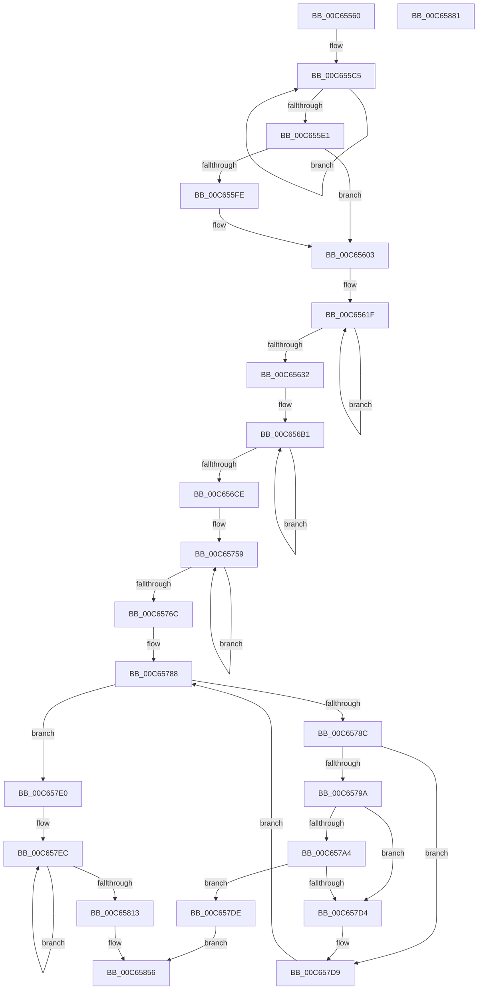

# MiAssignTopLevelRanges

- RVA: `0x00C65560`–`0x00C65882` (길이 `802` bytes)
- VA: `0x0000000140C65560`
- 실행 섹션: `INIT`
- PDB 이름 있음: `예`; PDB Function 태그: `아니요`
- unwind 정보 RVA: `0x000D8068`
- 디코드: `181`개 명령, `802/802` bytes 표시
- 미해석 바이트: `0` (있으면 어셈블리에 `.byte`로 보존)

> 이 문서는 커널 이미지의 기계어와 PDB 기호를 분석해 생성했습니다. 4번과 5번은 함수 원형과 자료형을 바이너리 사용 방식에서 추정한 C 해석이며 원본 소스 복구 결과는 아닙니다.

## 1. Dependencies

- 직접 호출 지점: **9**; 고유 호출 대상: **7**
- 직접 호출자로 확인된 함수: **1**
- RIP 상대 이미지 참조: **10**

### Outgoing calls
- `0x00C655A5` → [memset](../../text/6C/memset_function_006C6C40.md) (function, `0x006C6C40`)
- `0x00C65622` → [ExGenRandom](../../text/41/ExGenRandom_function_0041B010.md) (function, `0x0041B010`)
- `0x00C65645` → [qsort](../../text/50/qsort_function_005009F0.md) (function, `0x005009F0`)
- `0x00C6567A` → [MiHyperSpaceSize](../../text/2C/MiHyperSpaceSize_function_002C2DFC.md) (function, `0x002C2DFC`)
- `0x00C6575C` → [ExGenRandom](../../text/41/ExGenRandom_function_0041B010.md) (function, `0x0041B010`)
- `0x00C6577E` → [qsort](../../text/50/qsort_function_005009F0.md) (function, `0x005009F0`)
- `0x00C657CA` → [MiAssignSystemVa](MiAssignSystemVa_function_00C65470.md) (function, `0x00C65470`)
- `0x00C6584E` → [MiAddSubRegionEntropy](MiAddSubRegionEntropy_function_00C652AC.md) (function, `0x00C652AC`)
- `0x00C65860` → [_security_check_cookie](../../text/6A/_security_check_cookie_function_006AC640.md) (function, `0x006AC640`)

### Direct callers
- [MiInitializeSystemVa](../C7/MiInitializeSystemVa_function_00C77020.md) at `0x00C7706A`

### Static image references
- `0x00C65581` → RVA `0x00E0A740` (`.data`; read)
- `0x00C655EB` → RVA `0x00FC6A88` (`ALMOSTRO`; read)
- `0x00C65632` → RVA `0x00C65E10` (`MiRegionAssignmentSort`; read)
- `0x00C656D1` → RVA `0x00000000` (`image boundary/outside`; read)
- `0x00C65813` → RVA `0x00E38C28` (`.data`; read)
- `0x00C6581A` → RVA `0x00E38C30` (`.data`; read/write)
- `0x00C65821` → RVA `0x00E38C58` (`.data`; write)
- `0x00C65828` → RVA `0x00E38C60` (`.data`; write)
- `0x00C65833` → RVA `0x00E38C28` (`.data`; write)
- `0x00C65847` → RVA `0x00E2F398` (`.data`; write)

## 2. Other-region calls and transfers

- 다른 실행 섹션으로 향하는 call: **7**
  - `0x00C655A5` → [memset](../../text/6C/memset_function_006C6C40.md) (`INIT` → `.text`)
  - `0x00C65622` → [ExGenRandom](../../text/41/ExGenRandom_function_0041B010.md) (`INIT` → `.text`)
  - `0x00C65645` → [qsort](../../text/50/qsort_function_005009F0.md) (`INIT` → `.text`)
  - `0x00C6567A` → [MiHyperSpaceSize](../../text/2C/MiHyperSpaceSize_function_002C2DFC.md) (`INIT` → `.text`)
  - `0x00C6575C` → [ExGenRandom](../../text/41/ExGenRandom_function_0041B010.md) (`INIT` → `.text`)
  - `0x00C6577E` → [qsort](../../text/50/qsort_function_005009F0.md) (`INIT` → `.text`)
  - `0x00C65860` → [_security_check_cookie](../../text/6A/_security_check_cookie_function_006AC640.md) (`INIT` → `.text`)
- 별도 외부 분기/꼬리 이동을 확인하지 못했습니다.

## 3. Assembly (complete function range)

```asm
00C65560  48 89 5C 24 18                  mov qword ptr [rsp + 0x18], rbx
00C65565  48 89 74 24 20                  mov qword ptr [rsp + 0x20], rsi
00C6556A  55                              push rbp
00C6556B  57                              push rdi
00C6556C  41 54                           push r12
00C6556E  41 56                           push r14
00C65570  41 57                           push r15
00C65572  48 8D AC 24 20 FF FF FF         lea rbp, [rsp - 0xe0]
00C6557A  48 81 EC E0 01 00 00            sub rsp, 0x1e0
00C65581  48 8B 05 B8 51 1A 00            mov rax, qword ptr [rip + 0x1a51b8]
00C65588  48 33 C4                        xor rax, rsp
00C6558B  48 89 85 D0 00 00 00            mov qword ptr [rbp + 0xd0], rax
00C65592  48 8B DA                        mov rbx, rdx
00C65595  44 8B F1                        mov r14d, ecx
00C65598  33 D2                           xor edx, edx
00C6559A  48 8D 4C 24 20                  lea rcx, [rsp + 0x20]
00C6559F  41 B8 B0 01 00 00               mov r8d, 0x1b0
00C655A5  E8 96 16 A6 FF                  call 0x1406c6c40
00C655AA  41 BF 01 00 00 00               mov r15d, 1
00C655B0  48 89 5C 24 30                  mov qword ptr [rsp + 0x30], rbx
00C655B5  41 8B D7                        mov edx, r15d
00C655B8  45 33 C0                        xor r8d, r8d
00C655BB  49 B9 00 00 00 00 00 10 00 00   movabs r9, 0x100000000000
00C655C5  8B C2                           mov eax, edx
00C655C7  41 FF C0                        inc r8d
00C655CA  41 03 D7                        add edx, r15d
00C655CD  48 8D 0C 40                     lea rcx, [rax + rax*2]
00C655D1  44 89 44 CC 20                  mov dword ptr [rsp + rcx*8 + 0x20], r8d
00C655D6  4C 89 4C CC 30                  mov qword ptr [rsp + rcx*8 + 0x30], r9
00C655DB  41 83 F8 04                     cmp r8d, 4
00C655DF  7C E4                           jl 0x140c655c5
00C655E1  48 8D 0C 52                     lea rcx, [rdx + rdx*2]
00C655E5  48 83 64 CC 30 00               and qword ptr [rsp + rcx*8 + 0x30], 0
00C655EB  48 0F BA 25 94 14 36 00 23      bt qword ptr [rip + 0x361494], 0x23
00C655F4  C7 44 CC 20 05 00 00 00         mov dword ptr [rsp + rcx*8 + 0x20], 5
00C655FC  73 05                           jae 0x140c65603
00C655FE  4C 89 4C CC 30                  mov qword ptr [rsp + rcx*8 + 0x30], r9
00C65603  BE 06 00 00 00                  mov esi, 6
00C65608  8D 42 01                        lea eax, [rdx + 1]
00C6560B  48 8D 04 40                     lea rax, [rax + rax*2]
00C6560F  8B FE                           mov edi, esi
00C65611  89 74 C4 20                     mov dword ptr [rsp + rax*8 + 0x20], esi
00C65615  48 8D 5C 24 3C                  lea rbx, [rsp + 0x3c]
00C6561A  4C 89 4C C4 30                  mov qword ptr [rsp + rax*8 + 0x30], r9
00C6561F  41 8B CF                        mov ecx, r15d
00C65622  E8 E9 59 7B FF                  call 0x14041b010
00C65627  89 03                           mov dword ptr [rbx], eax
00C65629  48 8D 5B 18                     lea rbx, [rbx + 0x18]
00C6562D  49 2B FF                        sub rdi, r15
00C65630  75 ED                           jne 0x140c6561f
00C65632  4C 8D 0D D7 07 00 00            lea r9, [rip + 0x7d7]
00C65639  48 8B D6                        mov rdx, rsi
00C6563C  44 8D 47 18                     lea r8d, [rdi + 0x18]
00C65640  48 8D 4C 24 38                  lea rcx, [rsp + 0x38]
00C65645  E8 A6 B3 89 FF                  call 0x1405009f0
00C6564A  48 B8 00 00 00 00 80 02 00 00   movabs rax, 0x28000000000
00C65654  C7 45 C8 07 00 00 00            mov dword ptr [rbp - 0x38], 7
00C6565B  48 89 45 D8                     mov qword ptr [rbp - 0x28], rax
00C6565F  49 BA 00 00 00 00 80 00 00 00   movabs r10, 0x8000000000
00C65669  C7 45 E0 08 00 00 00            mov dword ptr [rbp - 0x20], 8
00C65670  49 BC 00 00 00 00 00 01 00 00   movabs r12, 0x10000000000
00C6567A  E8 7D D7 65 FF                  call 0x1402c2dfc
00C6567F  48 83 65 08 00                  and qword ptr [rbp + 8], 0
00C65684  8D 57 09                        lea edx, [rdi + 9]
00C65687  48 B9 FF FF FF FF 7F 00 00 00   movabs rcx, 0x7fffffffff
00C65691  49 B9 00 00 00 00 80 FF FF FF   movabs r9, 0xffffff8000000000
00C6569B  48 03 C1                        add rax, rcx
00C6569E  49 23 C1                        and rax, r9
00C656A1  8D 7A 02                        lea edi, [rdx + 2]
00C656A4  49 03 C4                        add rax, r12
00C656A7  89 7D F8                        mov dword ptr [rbp - 8], edi
00C656AA  48 89 45 F0                     mov qword ptr [rbp - 0x10], rax
00C656AE  45 33 C0                        xor r8d, r8d
00C656B1  41 03 D7                        add edx, r15d
00C656B4  41 8D 40 09                     lea eax, [r8 + 9]
00C656B8  45 03 C7                        add r8d, r15d
00C656BB  48 8D 0C 52                     lea rcx, [rdx + rdx*2]
00C656BF  89 44 CC 20                     mov dword ptr [rsp + rcx*8 + 0x20], eax
00C656C3  4C 89 64 CC 30                  mov qword ptr [rsp + rcx*8 + 0x30], r12
00C656C8  41 83 F8 02                     cmp r8d, 2
00C656CC  7C E3                           jl 0x140c656b1
00C656CE  41 03 D7                        add edx, r15d
00C656D1  48 8D 05 28 A9 39 FF            lea rax, [rip - 0xc656d8]
00C656D8  48 8D 5D CC                     lea rbx, [rbp - 0x34]
00C656DC  48 8D 0C 52                     lea rcx, [rdx + rdx*2]
00C656E0  41 03 D7                        add edx, r15d
00C656E3  C7 44 CC 20 0C 00 00 00         mov dword ptr [rsp + rcx*8 + 0x20], 0xc
00C656EB  4C 89 54 CC 30                  mov qword ptr [rsp + rcx*8 + 0x30], r10
00C656F0  48 8D 0C 52                     lea rcx, [rdx + rdx*2]
00C656F4  41 03 D7                        add edx, r15d
00C656F7  C7 44 CC 20 0E 00 00 00         mov dword ptr [rsp + rcx*8 + 0x20], 0xe
00C656FF  4C 89 54 CC 30                  mov qword ptr [rsp + rcx*8 + 0x30], r10
00C65704  48 8D 0C 52                     lea rcx, [rdx + rdx*2]
00C65708  41 03 D7                        add edx, r15d
00C6570B  C7 44 CC 20 0D 00 00 00         mov dword ptr [rsp + rcx*8 + 0x20], 0xd
00C65713  4C 89 54 CC 30                  mov qword ptr [rsp + rcx*8 + 0x30], r10
00C65718  48 8D 0C 52                     lea rcx, [rdx + rdx*2]
00C6571C  41 03 D7                        add edx, r15d
00C6571F  C7 44 CC 20 0F 00 00 00         mov dword ptr [rsp + rcx*8 + 0x20], 0xf
00C65727  49 23 C1                        and rax, r9
00C6572A  4C 89 54 CC 30                  mov qword ptr [rsp + rcx*8 + 0x30], r10
00C6572F  48 8D 0C 52                     lea rcx, [rdx + rdx*2]
00C65733  48 89 44 CC 28                  mov qword ptr [rsp + rcx*8 + 0x28], rax
00C65738  8D 42 01                        lea eax, [rdx + 1]
00C6573B  48 8D 04 40                     lea rax, [rax + rax*2]
00C6573F  C7 44 CC 20 11 00 00 00         mov dword ptr [rsp + rcx*8 + 0x20], 0x11
00C65747  4C 89 54 CC 30                  mov qword ptr [rsp + rcx*8 + 0x30], r10
00C6574C  C7 44 C4 20 10 00 00 00         mov dword ptr [rsp + rax*8 + 0x20], 0x10
00C65754  4C 89 54 C4 30                  mov qword ptr [rsp + rax*8 + 0x30], r10
00C65759  41 8B CF                        mov ecx, r15d
00C6575C  E8 AF 58 7B FF                  call 0x14041b010
00C65761  89 03                           mov dword ptr [rbx], eax
00C65763  48 8D 5B 18                     lea rbx, [rbx + 0x18]
00C65767  49 2B FF                        sub rdi, r15
00C6576A  75 ED                           jne 0x140c65759
00C6576C  4C 8D 0D 9D 06 00 00            lea r9, [rip + 0x69d]
00C65773  8D 57 0A                        lea edx, [rdi + 0xa]
00C65776  44 8D 47 18                     lea r8d, [rdi + 0x18]
00C6577A  48 8D 4D E0                     lea rcx, [rbp - 0x20]
00C6577E  E8 6D B2 89 FF                  call 0x1405009f0
00C65783  33 DB                           xor ebx, ebx
00C65785  8D 77 12                        lea esi, [rdi + 0x12]
00C65788  3B DE                           cmp ebx, esi
00C6578A  73 54                           jae 0x140c657e0
00C6578C  48 8D 3C 5B                     lea rdi, [rbx + rbx*2]
00C65790  48 8B 4C FC 30                  mov rcx, qword ptr [rsp + rdi*8 + 0x30]
00C65795  48 85 C9                        test rcx, rcx
00C65798  74 3F                           je 0x140c657d9
00C6579A  48 8B 44 FC 28                  mov rax, qword ptr [rsp + rdi*8 + 0x28]
00C6579F  48 85 C0                        test rax, rax
00C657A2  75 30                           jne 0x140c657d4
00C657A4  48 B8 FF FF FF FF 7F 00 00 00   movabs rax, 0x7fffffffff
00C657AE  41 8B D6                        mov edx, r14d
00C657B1  48 03 C8                        add rcx, rax
00C657B4  48 B8 00 00 00 00 80 FF FF FF   movabs rax, 0xffffff8000000000
00C657BE  48 23 C8                        and rcx, rax
00C657C1  48 89 4C FC 30                  mov qword ptr [rsp + rdi*8 + 0x30], rcx
00C657C6  48 C1 E9 27                     shr rcx, 0x27
00C657CA  E8 A1 FC FF FF                  call 0x140c65470
00C657CF  48 85 C0                        test rax, rax
00C657D2  74 0A                           je 0x140c657de
00C657D4  48 89 44 FC 28                  mov qword ptr [rsp + rdi*8 + 0x28], rax
00C657D9  41 03 DF                        add ebx, r15d
00C657DC  EB AA                           jmp 0x140c65788
00C657DE  EB 76                           jmp 0x140c65856
00C657E0  48 8D 54 24 20                  lea rdx, [rsp + 0x20]
00C657E5  4C 8D 05 14 A8 39 FF            lea r8, [rip - 0xc657ec]
00C657EC  48 8B 42 08                     mov rax, qword ptr [rdx + 8]
00C657F0  48 63 0A                        movsxd rcx, dword ptr [rdx]
00C657F3  48 8D 52 18                     lea rdx, [rdx + 0x18]
00C657F7  48 03 C9                        add rcx, rcx
00C657FA  49 89 84 C8 A8 8B E3 00         mov qword ptr [r8 + rcx*8 + 0xe38ba8], rax
00C65802  48 8B 42 F8                     mov rax, qword ptr [rdx - 8]
00C65806  49 89 84 C8 B0 8B E3 00         mov qword ptr [r8 + rcx*8 + 0xe38bb0], rax
00C6580E  49 2B F7                        sub rsi, r15
00C65811  75 D9                           jne 0x140c657ec
00C65813  48 8B 15 0E 34 1D 00            mov rdx, qword ptr [rip + 0x1d340e]
00C6581A  4C 29 25 0F 34 1D 00            sub qword ptr [rip + 0x1d340f], r12
00C65821  48 89 15 30 34 1D 00            mov qword ptr [rip + 0x1d3430], rdx
00C65828  4C 89 25 31 34 1D 00            mov qword ptr [rip + 0x1d3431], r12
00C6582F  4A 8D 0C 22                     lea rcx, [rdx + r12]
00C65833  48 89 0D EE 33 1D 00            mov qword ptr [rip + 0x1d33ee], rcx
00C6583A  48 B9 00 00 00 00 80 00 00 00   movabs rcx, 0x8000000000
00C65844  48 03 CA                        add rcx, rdx
00C65847  48 89 0D 4A 9B 1C 00            mov qword ptr [rip + 0x1c9b4a], rcx
00C6584E  E8 59 FA FF FF                  call 0x140c652ac
00C65853  41 8B C7                        mov eax, r15d
00C65856  48 8B 8D D0 00 00 00            mov rcx, qword ptr [rbp + 0xd0]
00C6585D  48 33 CC                        xor rcx, rsp
00C65860  E8 DB 6D A4 FF                  call 0x1406ac640
00C65865  4C 8D 9C 24 E0 01 00 00         lea r11, [rsp + 0x1e0]
00C6586D  49 8B 5B 40                     mov rbx, qword ptr [r11 + 0x40]
00C65871  49 8B 73 48                     mov rsi, qword ptr [r11 + 0x48]
00C65875  49 8B E3                        mov rsp, r11
00C65878  41 5F                           pop r15
00C6587A  41 5E                           pop r14
00C6587C  41 5C                           pop r12
00C6587E  5F                              pop rdi
00C6587F  5D                              pop rbp
00C65880  C3                              ret
00C65881  CC                              int3
```

## 4. C-style interpretation (structured pseudocode)

```c
__int64 __fastcall MiAssignTopLevelRanges(int a1, __int64 a2)
{
    __int64 result;
    __int64 v_rbx;
    __int64 v_rdi;
    __int64 v_rsi;
    __int64 v_rsp;
    unsigned __int64 v_stack_m100;
    unsigned __int64 v_stack_m108;
    unsigned int v_stack_m110;
    unsigned __int64 v_stack_m118;
    unsigned int v_stack_m128;
    unsigned __int64 v_stack_m130;
    unsigned __int64 v_stack_m13C;
    unsigned int v_stack_m140;
    unsigned __int64 v_stack_m1CC;
    unsigned __int64 v_stack_m1D0;
    unsigned __int64 v_stack_m1D8;
    unsigned __int64 v_stack_m1E8;
    unsigned __int64 v_stack_m28;
    unsigned __int64 v_stack_m38;
    unsigned __int64 v_stack_p18;
    unsigned __int64 v_stack_p20;

    v_stack_p18 = v_rbx;
    v_stack_p20 = v_rsi;
    v_rsp = (v_rsp) - (480);
    result = (*(unsigned __int64 *)(v_rip + 1724856)) ^ (v_rsp);
    v_stack_m38 = result;
    a2 = 0;
    result = memset(v_stack_m1E8, a2, 432, a4);
    v_stack_m1D8 = 0;
    a3 = 0;
loc_00C655C5:
    a3 = (unsigned int)((a3) + 1);
    a2 = (unsigned int)((1) + (1));
    *(unsigned int *)(v_rsp + 1 + 1 * 2 * 8 + 32) = (unsigned int)(a3);
    *(unsigned __int64 *)(v_rsp + 1 + 1 * 2 * 8 + 48) = a4;
    if (((unsigned int)(a3)) < 4) goto loc_00C655C5;
    *(unsigned int *)(v_rsp + a2 + a2 * 2 * 8 + 32) = 5;
    if (((unsigned int)(a3)) < 4) {
        *(unsigned __int64 *)(v_rsp + a2 + a2 * 2 * 8 + 48) = a4;
    }
    *(unsigned int *)(v_rsp + a2 + 1 + a2 + 1 * 2 * 8 + 32) = 6;
    *(unsigned __int64 *)(v_rsp + a2 + 1 + a2 + 1 * 2 * 8 + 48) = a4;
loc_00C6561F:
    result = ExGenRandom(1, a2, a3, a4);
    *(unsigned int *)(v_stack_m1CC) = (unsigned int)(result);
    v_rdi = (6) - (1);
    if (condition_is_not_equal) goto loc_00C6561F;
    result = qsort(v_stack_m1D0, 6, v_rdi + 24, v_rip + 2007);
    v_stack_m140 = 7;
    v_stack_m130 = result;
    v_stack_m128 = 8;
    result = MiHyperSpaceSize(v_stack_m1D0, 6, v_rdi + 24, v_rip + 2007);
    result = (result) + (v_stack_m1D0);
    result = (result) & (v_rip + 2007);
    result = (result) + (v_r12);
    v_stack_m110 = (unsigned int)(v_rdi + 9 + 2);
    v_stack_m118 = result;
    a3 = 0;
loc_00C656B1:
    a2 = (unsigned int)((v_rdi + 9) + (1));
    a3 = (unsigned int)((a3) + (1));
    *(unsigned int *)(v_rsp + a2 + a2 * 2 * 8 + 32) = (unsigned int)(a3 + 9);
    *(unsigned __int64 *)(v_rsp + a2 + a2 * 2 * 8 + 48) = v_r12;
    if (((unsigned int)(a3)) < 2) goto loc_00C656B1;
    a2 = (unsigned int)((a2) + (1));
    a2 = (unsigned int)((a2) + (1));
    *(unsigned int *)(v_rsp + a2 + a2 * 2 * 8 + 32) = 12;
    *(unsigned __int64 *)(v_rsp + a2 + a2 * 2 * 8 + 48) = v_r10;
    a2 = (unsigned int)((a2) + (1));
    *(unsigned int *)(v_rsp + a2 + a2 * 2 * 8 + 32) = 14;
    *(unsigned __int64 *)(v_rsp + a2 + a2 * 2 * 8 + 48) = v_r10;
    a2 = (unsigned int)((a2) + (1));
    *(unsigned int *)(v_rsp + a2 + a2 * 2 * 8 + 32) = 13;
    *(unsigned __int64 *)(v_rsp + a2 + a2 * 2 * 8 + 48) = v_r10;
    a2 = (unsigned int)((a2) + (1));
    *(unsigned int *)(v_rsp + a2 + a2 * 2 * 8 + 32) = 15;
    result = (v_rip - 12998360) & (v_rip + 2007);
    *(unsigned __int64 *)(v_rsp + a2 + a2 * 2 * 8 + 48) = v_r10;
    *(unsigned __int64 *)(v_rsp + a2 + a2 * 2 * 8 + 40) = result;
    *(unsigned int *)(v_rsp + a2 + a2 * 2 * 8 + 32) = 17;
    *(unsigned __int64 *)(v_rsp + a2 + a2 * 2 * 8 + 48) = v_r10;
    *(unsigned int *)(v_rsp + a2 + 1 + a2 + 1 * 2 * 8 + 32) = 16;
    *(unsigned __int64 *)(v_rsp + a2 + 1 + a2 + 1 * 2 * 8 + 48) = v_r10;
loc_00C65759:
    result = ExGenRandom(1, a2, a3, v_rip + 2007);
    *(unsigned int *)(v_stack_m13C) = (unsigned int)(result);
    v_rdi = (v_rdi + 9 + 2) - (1);
    if (condition_is_not_equal) goto loc_00C65759;
    result = qsort(v_stack_m128, v_rdi + 10, v_rdi + 24, v_rip + 1693);
    v_rbx = 0;
loc_00C65788:
    if (0 >= ((unsigned int)(v_rdi + 18))) goto loc_00C657E0;
    if (*(unsigned __int64 *)(v_rsp + v_rbx + v_rbx * 2 * 8 + 48) == 0) goto loc_00C657D9;
    if (*(unsigned __int64 *)(v_rsp + v_rbx + v_rbx * 2 * 8 + 40) != 0) goto loc_00C657D4;
    a1 = (*(unsigned __int64 *)(v_rsp + v_rbx + v_rbx * 2 * 8 + 48)) + (*(unsigned __int64 *)(v_rsp + v_rbx + v_rbx * 2 * 8 + 40));
    a1 = (a1) & (*(unsigned __int64 *)(v_rsp + v_rbx + v_rbx * 2 * 8 + 40));
    *(unsigned __int64 *)(v_rsp + v_rbx + v_rbx * 2 * 8 + 48) = a1;
    a1 = (a1) >> (39);
    result = MiAssignSystemVa(a1, (unsigned int)((unsigned int)((unsigned int)(a1))), v_rdi + 24, v_rip + 1693);
    if (result == 0) goto loc_00C657DE;
loc_00C657D4:
    *(unsigned __int64 *)(v_rsp + v_rbx + v_rbx * 2 * 8 + 40) = result;
loc_00C657D9:
    v_rbx = (unsigned int)((v_rbx) + (1));
    goto loc_00C65788;
loc_00C657DE:
    goto loc_00C65856;
loc_00C657E0:
loc_00C657EC:
    a1 = ((int)(*(unsigned int *)(v_stack_m1E8))) + ((int)(*(unsigned int *)(v_stack_m1E8)));
    *(unsigned __int64 *)(v_rip - 12998636 + a1 * 8 + 14912424) = *(unsigned __int64 *)(v_stack_m1E8 + 8);
    *(unsigned __int64 *)(v_rip - 12998636 + a1 * 8 + 14912432) = *(unsigned __int64 *)(v_stack_m1E8 + 24 - 8);
    v_rsi = (v_rdi + 18) - (1);
    if (condition_is_not_equal) goto loc_00C657EC;
    *(unsigned __int64 *)(v_rip + 1913904) = *(unsigned __int64 *)(v_rip + 1913870);
    *(unsigned __int64 *)(v_rip + 1913905) = v_r12;
    *(unsigned __int64 *)(v_rip + 1913838) = *(unsigned __int64 *)(v_rip + 1913870) + v_r12 * 1;
    a1 = (*(unsigned __int64 *)(v_rip + 1913870) + v_r12 * 1) + (*(unsigned __int64 *)(v_rip + 1913870));
    *(unsigned __int64 *)(v_rip + 1874762) = a1;
    result = MiAddSubRegionEntropy(a1, *(unsigned __int64 *)(v_rip + 1913870), v_rip - 12998636, v_rip + 1693);
loc_00C65856:
    a1 = (v_stack_m38) ^ (v_rsp);
    result = _security_check_cookie(a1, *(unsigned __int64 *)(v_rip + 1913870), v_rip - 12998636, v_rip + 1693);
    return result;
}
```

## 5. (Beta) C Style

```c
int64_t MiAssignTopLevelRanges(int32_t Arg1, int64_t Arg2)
{
    int64_t result;
    int64_t local_rbx;
    int64_t local_rdi;
    int64_t local_rsi;
    int64_t local_rsp;
    uint64_t v_stack_m100;
    uint64_t v_stack_m108;
    uint32_t v_stack_m110;
    uint64_t v_stack_m118;
    uint32_t v_stack_m128;
    uint64_t v_stack_m130;
    uint64_t v_stack_m13C;
    uint32_t v_stack_m140;
    uint64_t v_stack_m1CC;
    uint64_t v_stack_m1D0;
    uint64_t v_stack_m1D8;
    uint64_t v_stack_m1E8;
    uint64_t v_stack_m28;
    uint64_t v_stack_m38;
    uint64_t v_stack_p18;
    uint64_t v_stack_p20;

    v_stack_p18 = local_rbx;
    v_stack_p20 = local_rsi;
    local_rsp = (local_rsp) - (480);
    result = (*(uint64_t *)(v_rip + 0x1A51B8)) ^ (local_rsp);
    v_stack_m38 = result;
    Arg2 = 0;
    result = memset(v_stack_m1E8, Arg2, 432, a4);
    v_stack_m1D8 = 0;
    a3 = 0;
loc_00C655C5:
    a3 = (uint32_t)((a3) + 1);
    Arg2 = (uint32_t)((1) + (1));
    *(uint32_t *)(local_rsp + 0x1 + 0x1 * 2 * 8 + 0x20) = (uint32_t)(a3);
    *(uint64_t *)(local_rsp + 0x1 + 0x1 * 2 * 8 + 0x30) = a4;
    if (((uint32_t)(a3)) < 4) goto loc_00C655C5;
    *(uint32_t *)(local_rsp + Arg2 + Arg2 * 2 * 8 + 0x20) = 5;
    if (((uint32_t)(a3)) < 4) {
        *(uint64_t *)(local_rsp + Arg2 + Arg2 * 2 * 8 + 0x30) = a4;
    }
    *(uint32_t *)(local_rsp + Arg2 + 0x1 + Arg2 + 0x1 * 2 * 8 + 0x20) = 6;
    *(uint64_t *)(local_rsp + Arg2 + 0x1 + Arg2 + 0x1 * 2 * 8 + 0x30) = a4;
loc_00C6561F:
    result = ExGenRandom(1, Arg2, a3, a4);
    *(uint32_t *)(v_stack_m1CC) = (uint32_t)(result);
    local_rdi = (6) - (1);
    if (condition_is_not_equal) goto loc_00C6561F;
    result = qsort(v_stack_m1D0, 6, local_rdi + 24, v_rip + 2007);
    v_stack_m140 = 7;
    v_stack_m130 = result;
    v_stack_m128 = 8;
    result = MiHyperSpaceSize(v_stack_m1D0, 6, local_rdi + 24, v_rip + 2007);
    result = (result) + (v_stack_m1D0);
    result = (result) & (v_rip + 2007);
    result = (result) + (local_r12);
    v_stack_m110 = (uint32_t)(local_rdi + 9 + 2);
    v_stack_m118 = result;
    a3 = 0;
loc_00C656B1:
    Arg2 = (uint32_t)((local_rdi + 9) + (1));
    a3 = (uint32_t)((a3) + (1));
    *(uint32_t *)(local_rsp + Arg2 + Arg2 * 2 * 8 + 0x20) = (uint32_t)(a3 + 9);
    *(uint64_t *)(local_rsp + Arg2 + Arg2 * 2 * 8 + 0x30) = local_r12;
    if (((uint32_t)(a3)) < 2) goto loc_00C656B1;
    Arg2 = (uint32_t)((Arg2) + (1));
    Arg2 = (uint32_t)((Arg2) + (1));
    *(uint32_t *)(local_rsp + Arg2 + Arg2 * 2 * 8 + 0x20) = 12;
    *(uint64_t *)(local_rsp + Arg2 + Arg2 * 2 * 8 + 0x30) = local_r10;
    Arg2 = (uint32_t)((Arg2) + (1));
    *(uint32_t *)(local_rsp + Arg2 + Arg2 * 2 * 8 + 0x20) = 14;
    *(uint64_t *)(local_rsp + Arg2 + Arg2 * 2 * 8 + 0x30) = local_r10;
    Arg2 = (uint32_t)((Arg2) + (1));
    *(uint32_t *)(local_rsp + Arg2 + Arg2 * 2 * 8 + 0x20) = 13;
    *(uint64_t *)(local_rsp + Arg2 + Arg2 * 2 * 8 + 0x30) = local_r10;
    Arg2 = (uint32_t)((Arg2) + (1));
    *(uint32_t *)(local_rsp + Arg2 + Arg2 * 2 * 8 + 0x20) = 15;
    result = (v_rip - 12998360) & (v_rip + 2007);
    *(uint64_t *)(local_rsp + Arg2 + Arg2 * 2 * 8 + 0x30) = local_r10;
    *(uint64_t *)(local_rsp + Arg2 + Arg2 * 2 * 8 + 0x28) = result;
    *(uint32_t *)(local_rsp + Arg2 + Arg2 * 2 * 8 + 0x20) = 17;
    *(uint64_t *)(local_rsp + Arg2 + Arg2 * 2 * 8 + 0x30) = local_r10;
    *(uint32_t *)(local_rsp + Arg2 + 0x1 + Arg2 + 0x1 * 2 * 8 + 0x20) = 16;
    *(uint64_t *)(local_rsp + Arg2 + 0x1 + Arg2 + 0x1 * 2 * 8 + 0x30) = local_r10;
loc_00C65759:
    result = ExGenRandom(1, Arg2, a3, v_rip + 2007);
    *(uint32_t *)(v_stack_m13C) = (uint32_t)(result);
    local_rdi = (local_rdi + 9 + 2) - (1);
    if (condition_is_not_equal) goto loc_00C65759;
    result = qsort(v_stack_m128, local_rdi + 10, local_rdi + 24, v_rip + 1693);
    local_rbx = 0;
loc_00C65788:
    if (0 >= ((uint32_t)(local_rdi + 18))) goto loc_00C657E0;
    if (*(uint64_t *)(local_rsp + local_rbx + local_rbx * 2 * 8 + 0x30) == 0) goto loc_00C657D9;
    if (*(uint64_t *)(local_rsp + local_rbx + local_rbx * 2 * 8 + 0x28) != 0) goto loc_00C657D4;
    Arg1 = (*(uint64_t *)(local_rsp + local_rbx + local_rbx * 2 * 8 + 0x30)) + (*(uint64_t *)(local_rsp + local_rbx + local_rbx * 2 * 8 + 0x28));
    Arg1 = (Arg1) & (*(uint64_t *)(local_rsp + local_rbx + local_rbx * 2 * 8 + 0x28));
    *(uint64_t *)(local_rsp + local_rbx + local_rbx * 2 * 8 + 0x30) = Arg1;
    Arg1 = (Arg1) >> (39);
    result = MiAssignSystemVa(Arg1, (uint32_t)((uint32_t)((uint32_t)(Arg1))), local_rdi + 24, v_rip + 1693);
    if (result == 0) goto loc_00C657DE;
loc_00C657D4:
    *(uint64_t *)(local_rsp + local_rbx + local_rbx * 2 * 8 + 0x28) = result;
loc_00C657D9:
    local_rbx = (uint32_t)((local_rbx) + (1));
    goto loc_00C65788;
loc_00C657DE:
    goto loc_00C65856;
loc_00C657E0:
loc_00C657EC:
    Arg1 = ((int32_t)(*(uint32_t *)(v_stack_m1E8))) + ((int32_t)(*(uint32_t *)(v_stack_m1E8)));
    *(uint64_t *)(v_rip - 0xC657EC + Arg1 * 8 + 0xE38BA8) = *(uint64_t *)(v_stack_m1E8 + 0x8);
    *(uint64_t *)(v_rip - 0xC657EC + Arg1 * 8 + 0xE38BB0) = *(uint64_t *)(v_stack_m1E8 + 0x18 - 0x8);
    local_rsi = (local_rdi + 18) - (1);
    if (condition_is_not_equal) goto loc_00C657EC;
    *(uint64_t *)(v_rip + 0x1D3430) = *(uint64_t *)(v_rip + 0x1D340E);
    *(uint64_t *)(v_rip + 0x1D3431) = local_r12;
    *(uint64_t *)(v_rip + 0x1D33EE) = *(uint64_t *)(v_rip + 0x1D340E) + local_r12 * 1;
    Arg1 = (*(uint64_t *)(v_rip + 0x1D340E) + local_r12 * 1) + (*(uint64_t *)(v_rip + 0x1D340E));
    *(uint64_t *)(v_rip + 0x1C9B4A) = Arg1;
    result = MiAddSubRegionEntropy(Arg1, *(uint64_t *)(v_rip + 0x1D340E), v_rip - 12998636, v_rip + 1693);
loc_00C65856:
    Arg1 = (v_stack_m38) ^ (local_rsp);
    result = _security_check_cookie(Arg1, *(uint64_t *)(v_rip + 0x1D340E), v_rip - 12998636, v_rip + 1693);
    return result;
}
```

## 6. Execution-region graph

[열기: 2D/3D 그래프와 함수 탐색 컨트롤 패널](../../../control-panel.html?section=init&rva=0x00C65560&view=graph)

- 2D 그래프는 위에서 아래로 흐르고, 3D 그래프는 빈 공간을 드래그해 회전합니다. Shift+드래그는 이동, 휠은 확대·축소, 함수 노드 선택은 대상 보고서 이동입니다.

### Static fallback


