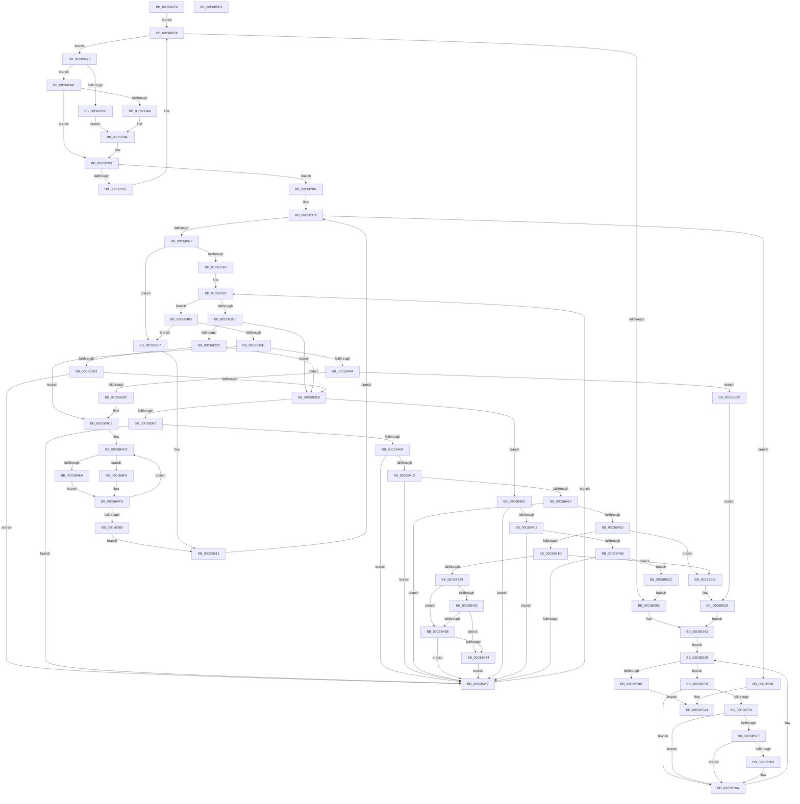

# MiBuildImportsForBootDrivers

- RVA: `0x00C6B2E8`–`0x00C6B5C4` (길이 `732` bytes)
- VA: `0x0000000140C6B2E8`
- 실행 섹션: `INIT`
- PDB 이름 있음: `예`; PDB Function 태그: `아니요`
- unwind 정보 RVA: `0x0008CF18`
- 디코드: `192`개 명령, `732/732` bytes 표시
- 미해석 바이트: `0` (있으면 어셈블리에 `.byte`로 보존)

> 이 문서는 커널 이미지의 기계어와 PDB 기호를 분석해 생성했습니다. 4번과 5번은 함수 원형과 자료형을 바이너리 사용 방식에서 추정한 C 해석이며 원본 소스 복구 결과는 아닙니다.

## 1. Dependencies

- 직접 호출 지점: **6**; 고유 호출 대상: **6**
- 직접 호출자로 확인된 함수: **1**
- RIP 상대 이미지 참조: **3**

### Outgoing calls
- `0x00C6B312` → [MiAcquireLoadLock](../../text/2A/MiAcquireLoadLock_function_002A3950.md) (function, `0x002A3950`)
- `0x00C6B391` → [RtlImageDirectoryEntryToData](../../text/43/RtlImageDirectoryEntryToData_function_004328D0.md) (function, `0x004328D0`)
- `0x00C6B3E6` → [MmFindDataTableEntryByAddress](../../text/2A/MmFindDataTableEntryByAddress_function_002A3C0C.md) (function, `0x002A3C0C`)
- `0x00C6B4AB` → [MiAllocatePool](../../text/35/MiAllocatePool_function_0035B540.md) (function, `0x0035B540`)
- `0x00C6B585` → [ExFreePoolWithTag](../../poolcode/B8/ExFreePoolWithTag_function_00B82870.md) (function, `0x00B82870`)
- `0x00C6B5A7` → [MmReleaseLoadLock](../../text/4D/MmReleaseLoadLock_function_004D36D0.md) (function, `0x004D36D0`)

### Direct callers
- [MiInitializeLoadedModuleList](MiInitializeLoadedModuleList_function_00C6BCDC.md) at `0x00C6BF5D`

### Static image references
- `0x00C6B31F` → RVA `0x00EF54C0` (`.data`; read)
- `0x00C6B333` → RVA `0x00FC6B28` (`ALMOSTRO`; read)
- `0x00C6B341` → RVA `0x00FC6B98` (`ALMOSTRO`; read)

## 2. Other-region calls and transfers

- 다른 실행 섹션으로 향하는 call: **6**
  - `0x00C6B312` → [MiAcquireLoadLock](../../text/2A/MiAcquireLoadLock_function_002A3950.md) (`INIT` → `.text`)
  - `0x00C6B391` → [RtlImageDirectoryEntryToData](../../text/43/RtlImageDirectoryEntryToData_function_004328D0.md) (`INIT` → `.text`)
  - `0x00C6B3E6` → [MmFindDataTableEntryByAddress](../../text/2A/MmFindDataTableEntryByAddress_function_002A3C0C.md) (`INIT` → `.text`)
  - `0x00C6B4AB` → [MiAllocatePool](../../text/35/MiAllocatePool_function_0035B540.md) (`INIT` → `.text`)
  - `0x00C6B585` → [ExFreePoolWithTag](../../poolcode/B8/ExFreePoolWithTag_function_00B82870.md) (`INIT` → `POOLCODE`)
  - `0x00C6B5A7` → [MmReleaseLoadLock](../../text/4D/MmReleaseLoadLock_function_004D36D0.md) (`INIT` → `.text`)
- 별도 외부 분기/꼬리 이동을 확인하지 못했습니다.

## 3. Assembly (complete function range)

```asm
00C6B2E8  48 89 5C 24 20                  mov qword ptr [rsp + 0x20], rbx
00C6B2ED  55                              push rbp
00C6B2EE  56                              push rsi
00C6B2EF  57                              push rdi
00C6B2F0  41 54                           push r12
00C6B2F2  41 55                           push r13
00C6B2F4  41 56                           push r14
00C6B2F6  41 57                           push r15
00C6B2F8  48 83 EC 20                     sub rsp, 0x20
00C6B2FC  83 64 24 60 00                  and dword ptr [rsp + 0x60], 0
00C6B301  33 DB                           xor ebx, ebx
00C6B303  48 21 5C 24 70                  and qword ptr [rsp + 0x70], rbx
00C6B308  33 FF                           xor edi, edi
00C6B30A  45 33 E4                        xor r12d, r12d
00C6B30D  8D 6B 01                        lea ebp, [rbx + 1]
00C6B310  8B CD                           mov ecx, ebp
00C6B312  E8 39 86 63 FF                  call 0x1402a3950
00C6B317  48 8B F0                        mov rsi, rax
00C6B31A  48 89 44 24 68                  mov qword ptr [rsp + 0x68], rax
00C6B31F  48 8B 05 9A A1 28 00            mov rax, qword ptr [rip + 0x28a19a]
00C6B326  4C 8D 35 93 A1 28 00            lea r14, [rip + 0x28a193]
00C6B32D  EB 2A                           jmp 0x140c6b359
00C6B32F  48 8B 48 30                     mov rcx, qword ptr [rax + 0x30]
00C6B333  48 39 0D EE B7 35 00            cmp qword ptr [rip + 0x35b7ee], rcx
00C6B33A  75 05                           jne 0x140c6b341
00C6B33C  4C 8B E0                        mov r12, rax
00C6B33F  EB 0E                           jmp 0x140c6b34f
00C6B341  48 39 0D 50 B8 35 00            cmp qword ptr [rip + 0x35b850], rcx
00C6B348  75 07                           jne 0x140c6b351
00C6B34A  48 89 44 24 70                  mov qword ptr [rsp + 0x70], rax
00C6B34F  03 DD                           add ebx, ebp
00C6B351  83 FB 02                        cmp ebx, 2
00C6B354  74 19                           je 0x140c6b36f
00C6B356  48 8B 00                        mov rax, qword ptr [rax]
00C6B359  49 3B C6                        cmp rax, r14
00C6B35C  75 D1                           jne 0x140c6b32f
00C6B35E  BF 25 02 00 C0                  mov edi, 0xc0000225
00C6B363  48 8B 1D 56 A1 28 00            mov rbx, qword ptr [rip + 0x28a156]
00C6B36A  E9 29 02 00 00                  jmp 0x140c6b598
00C6B36F  48 8B 1D 4A A1 28 00            mov rbx, qword ptr [rip + 0x28a14a]
00C6B376  49 3B DE                        cmp rbx, r14
00C6B379  0F 84 20 02 00 00               je 0x140c6b59f
00C6B37F  48 8B 4B 30                     mov rcx, qword ptr [rbx + 0x30]
00C6B383  4C 8D 4C 24 60                  lea r9, [rsp + 0x60]
00C6B388  41 B8 0C 00 00 00               mov r8d, 0xc
00C6B38E  40 8A D5                        mov dl, bpl
00C6B391  E8 3A 75 7C FF                  call 0x1404328d0
00C6B396  4C 8B F0                        mov r14, rax
00C6B399  48 85 C0                        test rax, rax
00C6B39C  0F 84 65 01 00 00               je 0x140c6b507
00C6B3A2  8B 6C 24 60                     mov ebp, dword ptr [rsp + 0x60]
00C6B3A6  45 33 ED                        xor r13d, r13d
00C6B3A9  C1 ED 03                        shr ebp, 3
00C6B3AC  33 F6                           xor esi, esi
00C6B3AE  33 C9                           xor ecx, ecx
00C6B3B0  89 6C 24 60                     mov dword ptr [rsp + 0x60], ebp
00C6B3B4  45 33 FF                        xor r15d, r15d
00C6B3B7  44 3B FD                        cmp r15d, ebp
00C6B3BA  0F 83 C3 00 00 00               jae 0x140c6b483
00C6B3C0  48 85 C9                        test rcx, rcx
00C6B3C3  74 1B                           je 0x140c6b3e0
00C6B3C5  49 8B 16                        mov rdx, qword ptr [r14]
00C6B3C8  4C 8B 41 30                     mov r8, qword ptr [rcx + 0x30]
00C6B3CC  49 3B D0                        cmp rdx, r8
00C6B3CF  72 0F                           jb 0x140c6b3e0
00C6B3D1  8B 41 40                        mov eax, dword ptr [rcx + 0x40]
00C6B3D4  49 03 C0                        add rax, r8
00C6B3D7  48 3B D0                        cmp rdx, rax
00C6B3DA  0F 82 97 00 00 00               jb 0x140c6b477
00C6B3E0  4D 8B 1E                        mov r11, qword ptr [r14]
00C6B3E3  49 8B CB                        mov rcx, r11
00C6B3E6  E8 21 88 63 FF                  call 0x1402a3c0c
00C6B3EB  48 8B C8                        mov rcx, rax
00C6B3EE  48 85 C0                        test rax, rax
00C6B3F1  74 69                           je 0x140c6b45c
00C6B3F3  8B 90 B8 00 00 00               mov edx, dword ptr [rax + 0xb8]
00C6B3F9  41 B9 00 00 10 00               mov r9d, 0x100000
00C6B3FF  41 85 D1                        test r9d, edx
00C6B402  75 73                           jne 0x140c6b477
00C6B404  49 3B C4                        cmp rax, r12
00C6B407  74 6E                           je 0x140c6b477
00C6B409  48 3B 44 24 70                  cmp rax, qword ptr [rsp + 0x70]
00C6B40E  74 67                           je 0x140c6b477
00C6B410  48 3B C3                        cmp rax, rbx
00C6B413  74 62                           je 0x140c6b477
00C6B415  84 D2                           test dl, dl
00C6B417  0F 88 04 01 00 00               js 0x140c6b521
00C6B41D  66 0F BA 60 6E 09               bt word ptr [rax + 0x6e], 9
00C6B423  0F 82 F8 00 00 00               jb 0x140c6b521
00C6B429  8B 83 B8 00 00 00               mov eax, dword ptr [rbx + 0xb8]
00C6B42F  84 C0                           test al, al
00C6B431  78 08                           js 0x140c6b43b
00C6B433  66 0F BA 63 6E 09               bt word ptr [rbx + 0x6e], 9
00C6B439  73 09                           jae 0x140c6b444
00C6B43B  48 39 8B F8 00 00 00            cmp qword ptr [rbx + 0xf8], rcx
00C6B442  74 33                           je 0x140c6b477
00C6B444  41 0B D1                        or edx, r9d
00C6B447  89 91 B8 00 00 00               mov dword ptr [rcx + 0xb8], edx
00C6B44D  41 FF C5                        inc r13d
00C6B450  48 89 B1 F0 00 00 00            mov qword ptr [rcx + 0xf0], rsi
00C6B457  48 8B F1                        mov rsi, rcx
00C6B45A  EB 1B                           jmp 0x140c6b477
00C6B45C  4D 85 DB                        test r11, r11
00C6B45F  74 16                           je 0x140c6b477
00C6B461  8B 83 B8 00 00 00               mov eax, dword ptr [rbx + 0xb8]
00C6B467  84 C0                           test al, al
00C6B469  78 0C                           js 0x140c6b477
00C6B46B  66 0F BA 63 6E 09               bt word ptr [rbx + 0x6e], 9
00C6B471  0F 83 C5 00 00 00               jae 0x140c6b53c
00C6B477  41 FF C7                        inc r15d
00C6B47A  49 83 C6 08                     add r14, 8
00C6B47E  E9 34 FF FF FF                  jmp 0x140c6b3b7
00C6B483  BD 01 00 00 00                  mov ebp, 1
00C6B488  48 85 F6                        test rsi, rsi
00C6B48B  74 7A                           je 0x140c6b507
00C6B48D  33 C9                           xor ecx, ecx
00C6B48F  44 3B ED                        cmp r13d, ebp
00C6B492  76 35                           jbe 0x140c6b4c9
00C6B494  41 8D 45 FF                     lea eax, [r13 - 1]
00C6B498  B9 00 01 00 00                  mov ecx, 0x100
00C6B49D  48 8D 14 C5 10 00 00 00         lea rdx, [rax*8 + 0x10]
00C6B4A5  41 B8 4D 6D 44 54               mov r8d, 0x54446d4d
00C6B4AB  E8 90 00 6F FF                  call 0x14035b540
00C6B4B0  48 8B C8                        mov rcx, rax
00C6B4B3  48 85 C0                        test rax, rax
00C6B4B6  0F 84 96 00 00 00               je 0x140c6b552
00C6B4BC  41 8B C5                        mov eax, r13d
00C6B4BF  48 89 01                        mov qword ptr [rcx], rax
00C6B4C2  48 89 8B 88 00 00 00            mov qword ptr [rbx + 0x88], rcx
00C6B4C9  33 D2                           xor edx, edx
00C6B4CB  4C 8B 86 F0 00 00 00            mov r8, qword ptr [rsi + 0xf0]
00C6B4D2  48 21 BE F0 00 00 00            and qword ptr [rsi + 0xf0], rdi
00C6B4D9  0F BA B6 B8 00 00 00 14         btr dword ptr [rsi + 0xb8], 0x14
00C6B4E1  66 01 6E 6C                     add word ptr [rsi + 0x6c], bp
00C6B4E5  44 3B ED                        cmp r13d, ebp
00C6B4E8  75 0C                           jne 0x140c6b4f6
00C6B4EA  48 0B F5                        or rsi, rbp
00C6B4ED  48 89 B3 88 00 00 00            mov qword ptr [rbx + 0x88], rsi
00C6B4F4  EB 07                           jmp 0x140c6b4fd
00C6B4F6  48 89 74 D1 08                  mov qword ptr [rcx + rdx*8 + 8], rsi
00C6B4FB  03 D5                           add edx, ebp
00C6B4FD  49 8B F0                        mov rsi, r8
00C6B500  4D 85 C0                        test r8, r8
00C6B503  75 C6                           jne 0x140c6b4cb
00C6B505  EB 0B                           jmp 0x140c6b512
00C6B507  48 C7 83 88 00 00 00 FE FF FF FF  mov qword ptr [rbx + 0x88], 0xfffffffffffffffe
00C6B512  48 8B 1B                        mov rbx, qword ptr [rbx]
00C6B515  4C 8D 35 A4 9F 28 00            lea r14, [rip + 0x289fa4]
00C6B51C  E9 55 FE FF FF                  jmp 0x140c6b376
00C6B521  BF C0 04 00 C0                  mov edi, 0xc00004c0
00C6B526  BD 01 00 00 00                  mov ebp, 1
00C6B52B  48 8B 74 24 68                  mov rsi, qword ptr [rsp + 0x68]
00C6B530  4C 8D 35 89 9F 28 00            lea r14, [rip + 0x289f89]
00C6B537  E9 27 FE FF FF                  jmp 0x140c6b363
00C6B53C  48 8B 74 24 68                  mov rsi, qword ptr [rsp + 0x68]
00C6B541  4C 8D 35 78 9F 28 00            lea r14, [rip + 0x289f78]
00C6B548  BD 01 00 00 00                  mov ebp, 1
00C6B54D  E9 0C FE FF FF                  jmp 0x140c6b35e
00C6B552  BF 9A 00 00 C0                  mov edi, 0xc000009a
00C6B557  EB D2                           jmp 0x140c6b52b
00C6B559  0F BA B3 B8 00 00 00 14         btr dword ptr [rbx + 0xb8], 0x14
00C6B561  48 C7 83 F0 00 00 00 00 00 00 00  mov qword ptr [rbx + 0xf0], 0
00C6B56C  48 8B 8B 88 00 00 00            mov rcx, qword ptr [rbx + 0x88]
00C6B573  48 3B CD                        cmp rcx, rbp
00C6B576  74 12                           je 0x140c6b58a
00C6B578  48 83 F9 FE                     cmp rcx, -2
00C6B57C  74 0C                           je 0x140c6b58a
00C6B57E  40 84 CD                        test bpl, cl
00C6B581  75 07                           jne 0x140c6b58a
00C6B583  33 D2                           xor edx, edx
00C6B585  E8 E6 72 F1 FF                  call 0x140b82870
00C6B58A  48 89 AB 88 00 00 00            mov qword ptr [rbx + 0x88], rbp
00C6B591  66 89 6B 6C                     mov word ptr [rbx + 0x6c], bp
00C6B595  48 8B 1B                        mov rbx, qword ptr [rbx]
00C6B598  49 3B DE                        cmp rbx, r14
00C6B59B  75 BC                           jne 0x140c6b559
00C6B59D  EB 05                           jmp 0x140c6b5a4
00C6B59F  48 8B 74 24 68                  mov rsi, qword ptr [rsp + 0x68]
00C6B5A4  48 8B CE                        mov rcx, rsi
00C6B5A7  E8 24 81 86 FF                  call 0x1404d36d0
00C6B5AC  48 8B 5C 24 78                  mov rbx, qword ptr [rsp + 0x78]
00C6B5B1  8B C7                           mov eax, edi
00C6B5B3  48 83 C4 20                     add rsp, 0x20
00C6B5B7  41 5F                           pop r15
00C6B5B9  41 5E                           pop r14
00C6B5BB  41 5D                           pop r13
00C6B5BD  41 5C                           pop r12
00C6B5BF  5F                              pop rdi
00C6B5C0  5E                              pop rsi
00C6B5C1  5D                              pop rbp
00C6B5C2  C3                              ret
00C6B5C3  CC                              int3
```

## 4. C-style interpretation (structured pseudocode)

```c
__int64 __fastcall MiBuildImportsForBootDrivers(void)
{
    __int64 result;
    __int64 v_r12;
    __int64 v_r13;
    __int64 v_r14;
    __int64 v_r15;
    __int64 v_rbp;
    __int64 v_rbx;
    __int64 v_rdi;
    __int64 v_rsi;
    __int64 v_rsp;
    unsigned __int64 v_stack_p10;
    unsigned __int64 v_stack_p18;
    unsigned __int64 v_stack_p20;
    unsigned int v_stack_p8;

    v_stack_p20 = v_rbx;
    v_rsp = (v_rsp) - (32);
    v_rbx = 0;
    v_rdi = 0;
    v_r12 = 0;
    result = MiAcquireLoadLock((unsigned int)((unsigned int)(v_rbx + 1)), a2, a3, a4);
    v_stack_p10 = result;
    goto loc_00C6B359;
loc_00C6B32F:
    if ((*(unsigned __int64 *)(v_rip + 3520494)) != (*(unsigned __int64 *)(*(unsigned __int64 *)(v_rip + 2662810) + 48))) goto loc_00C6B341;
    goto loc_00C6B34F;
loc_00C6B341:
    if ((*(unsigned __int64 *)(v_rip + 3520592)) != (*(unsigned __int64 *)(*(unsigned __int64 *)(v_rip + 2662810) + 48))) goto loc_00C6B351;
    v_stack_p18 = *(unsigned __int64 *)(v_rip + 2662810);
loc_00C6B34F:
    v_rbx = (unsigned int)((v_rbx) + ((unsigned int)(v_rbx + 1)));
loc_00C6B351:
    if (((unsigned int)(v_rbx)) == 2) goto loc_00C6B36F;
loc_00C6B359:
    if ((*(unsigned __int64 *)(*(unsigned __int64 *)(v_rip + 2662810))) != (v_rip + 2662803)) goto loc_00C6B32F;
loc_00C6B35E:
loc_00C6B363:
    goto loc_00C6B598;
loc_00C6B36F:
loc_00C6B376:
    if ((*(unsigned __int64 *)(v_rip + 2662730)) == (v_rip + 2662803)) goto loc_00C6B59F;
    result = RtlImageDirectoryEntryToData(*(unsigned __int64 *)(*(unsigned __int64 *)(v_rip + 2662730) + 48), (unsigned __int8)(v_rbx + 1), 12, v_stack_p8);
    if (result == 0) goto loc_00C6B507;
    v_r13 = 0;
    v_rbp = (unsigned int)(((unsigned int)(v_stack_p8)) >> (3));
    v_rsi = 0;
    a1 = 0;
    v_stack_p8 = (unsigned int)(v_rbp);
    v_r15 = 0;
loc_00C6B3B7:
    if (0 >= ((unsigned int)(v_rbp))) goto loc_00C6B483;
    if (0 == 0) goto loc_00C6B3E0;
    if ((*(unsigned __int64 *)(result)) < (*(unsigned __int64 *)(a1 + 48))) goto loc_00C6B3E0;
    result = ((unsigned int)(*(unsigned int *)(a1 + 64))) + (*(unsigned __int64 *)(a1 + 48));
    if ((*(unsigned __int64 *)(result)) < result) goto loc_00C6B477;
loc_00C6B3E0:
    result = MmFindDataTableEntryByAddress(*(unsigned __int64 *)(result), *(unsigned __int64 *)(result), *(unsigned __int64 *)(a1 + 48), v_stack_p8);
    if (result == 0) goto loc_00C6B45C;
    if ((((unsigned int)((unsigned int)(0x100000ULL))) & ((unsigned int)((unsigned int)(*(unsigned int *)(result + 184))))) != 0) goto loc_00C6B477;
    if (result == (*(unsigned __int64 *)(v_rip + 2662810))) goto loc_00C6B477;
    if (result == v_stack_p18) goto loc_00C6B477;
    if (result == (*(unsigned __int64 *)(v_rip + 2662730))) goto loc_00C6B477;
    if (sign_flag) goto loc_00C6B521;
    if (condition_is_below) goto loc_00C6B521;
    if (sign_flag) goto loc_00C6B43B;
    if (condition_is_above_or_equal) goto loc_00C6B444;
loc_00C6B43B:
    if ((*(unsigned __int64 *)(*(unsigned __int64 *)(v_rip + 2662730) + 248)) == result) goto loc_00C6B477;
loc_00C6B444:
    a2 = (unsigned int)(((unsigned int)(*(unsigned int *)(result + 184))) | ((unsigned int)((unsigned int)(0x100000ULL))));
    *(unsigned int *)(result + 184) = (unsigned int)(a2);
    v_r13 = (unsigned int)((v_r13) + 1);
    *(unsigned __int64 *)(result + 240) = 0;
    goto loc_00C6B477;
loc_00C6B45C:
    if (*(unsigned __int64 *)(result) == 0) goto loc_00C6B477;
    if (sign_flag) goto loc_00C6B477;
    if (condition_is_above_or_equal) goto loc_00C6B53C;
loc_00C6B477:
    v_r15 = (unsigned int)((v_r15) + 1);
    v_r14 = (result) + (8);
    goto loc_00C6B3B7;
loc_00C6B483:
    if (result == 0) goto loc_00C6B507;
    a1 = 0;
    if (((unsigned int)(v_r13)) <= 1) goto loc_00C6B4C9;
    result = MiAllocatePool(256, v_r13 - 1 * 8 + 16, (unsigned int)(0x54446D4DULL), (unsigned int)(0x100000ULL));
    if (result == 0) goto loc_00C6B552;
    *(unsigned __int64 *)(result) = (unsigned int)((unsigned int)(v_r13));
    *(unsigned __int64 *)(*(unsigned __int64 *)(v_rip + 2662730) + 136) = result;
loc_00C6B4C9:
    a2 = 0;
loc_00C6B4CB:
    if (((unsigned int)(v_r13)) != 1) goto loc_00C6B4F6;
    v_rsi = (result) | (1);
    *(unsigned __int64 *)(*(unsigned __int64 *)(v_rip + 2662730) + 136) = v_rsi;
    goto loc_00C6B4FD;
loc_00C6B4F6:
    *(unsigned __int64 *)(result + a2 * 8 + 8) = v_rsi;
    a2 = (unsigned int)((a2) + (1));
loc_00C6B4FD:
    if (*(unsigned __int64 *)(result + 240) != 0) goto loc_00C6B4CB;
    goto loc_00C6B512;
loc_00C6B507:
    *(unsigned __int64 *)(*(unsigned __int64 *)(v_rip + 2662730) + 136) = -2;
loc_00C6B512:
    goto loc_00C6B376;
loc_00C6B521:
loc_00C6B52B:
    goto loc_00C6B363;
loc_00C6B53C:
    goto loc_00C6B35E;
loc_00C6B552:
    goto loc_00C6B52B;
loc_00C6B559:
    *(unsigned __int64 *)(*(unsigned __int64 *)(*(unsigned __int64 *)(v_rip + 2662730)) + 240) = 0;
    if ((*(unsigned __int64 *)(*(unsigned __int64 *)(*(unsigned __int64 *)(v_rip + 2662730)) + 136)) == 1) goto loc_00C6B58A;
    if ((*(unsigned __int64 *)(*(unsigned __int64 *)(*(unsigned __int64 *)(v_rip + 2662730)) + 136)) == -2) goto loc_00C6B58A;
    result = (unsigned int)((unsigned int)(v_r13));
    if (((1) & ((unsigned __int8)(*(unsigned __int64 *)(*(unsigned __int64 *)(*(unsigned __int64 *)(v_rip + 2662730)) + 136)))) == 0) {
        a2 = 0;
        result = ExFreePoolWithTag(*(unsigned __int64 *)(*(unsigned __int64 *)(*(unsigned __int64 *)(v_rip + 2662730)) + 136), a2, *(unsigned __int64 *)(result + 240), (unsigned int)(0x100000ULL));
    }
    *(unsigned __int64 *)(*(unsigned __int64 *)(*(unsigned __int64 *)(v_rip + 2662730)) + 136) = 1;
    *(unsigned __int16 *)(*(unsigned __int64 *)(*(unsigned __int64 *)(v_rip + 2662730)) + 108) = 1;
loc_00C6B598:
    if ((*(unsigned __int64 *)(*(unsigned __int64 *)(*(unsigned __int64 *)(v_rip + 2662730)))) != (v_rip + 2662264)) goto loc_00C6B559;
    goto loc_00C6B5A4;
loc_00C6B59F:
loc_00C6B5A4:
    result = MmReleaseLoadLock(v_stack_p10, a2, *(unsigned __int64 *)(result + 240), (unsigned int)(0x100000ULL));
    v_rsp = (v_rsp) + (32);
    return (unsigned int)((unsigned int)((unsigned int)(0xC000009AULL)));
}
```

## 5. (Beta) C Style

```c
void MiBuildImportsForBootDrivers(void)
{
    int64_t result;
    int64_t local_r12;
    int64_t local_r13;
    int64_t local_r14;
    int64_t local_r15;
    int64_t local_rbp;
    int64_t local_rbx;
    int64_t local_rdi;
    int64_t local_rsi;
    int64_t local_rsp;
    uint64_t v_stack_p10;
    uint64_t v_stack_p18;
    uint64_t v_stack_p20;
    uint32_t v_stack_p8;

    v_stack_p20 = local_rbx;
    local_rsp = (local_rsp) - (32);
    local_rbx = 0;
    local_rdi = 0;
    local_r12 = 0;
    result = MiAcquireLoadLock((uint32_t)((uint32_t)(local_rbx + 1)), a2, a3, a4);
    v_stack_p10 = result;
    goto loc_00C6B359;
loc_00C6B32F:
    if ((*(uint64_t *)(v_rip + 0x35B7EE)) != (*(uint64_t *)(*(uint64_t *)(v_rip + 0x28A19A) + 0x30))) goto loc_00C6B341;
    goto loc_00C6B34F;
loc_00C6B341:
    if ((*(uint64_t *)(v_rip + 0x35B850)) != (*(uint64_t *)(*(uint64_t *)(v_rip + 0x28A19A) + 0x30))) goto loc_00C6B351;
    v_stack_p18 = *(uint64_t *)(v_rip + 0x28A19A);
loc_00C6B34F:
    local_rbx = (uint32_t)((local_rbx) + ((uint32_t)(local_rbx + 1)));
loc_00C6B351:
    if (((uint32_t)(local_rbx)) == 2) goto loc_00C6B36F;
loc_00C6B359:
    if ((*(uint64_t *)(*(uint64_t *)(v_rip + 0x28A19A))) != (v_rip + 2662803)) goto loc_00C6B32F;
loc_00C6B35E:
loc_00C6B363:
    goto loc_00C6B598;
loc_00C6B36F:
loc_00C6B376:
    if ((*(uint64_t *)(v_rip + 0x28A14A)) == (v_rip + 2662803)) goto loc_00C6B59F;
    result = RtlImageDirectoryEntryToData(*(uint64_t *)(*(uint64_t *)(v_rip + 0x28A14A) + 0x30), (uint8_t)(local_rbx + 1), 12, v_stack_p8);
    if (result == 0) goto loc_00C6B507;
    local_r13 = 0;
    local_rbp = (uint32_t)(((uint32_t)(v_stack_p8)) >> (3));
    local_rsi = 0;
    a1 = 0;
    v_stack_p8 = (uint32_t)(local_rbp);
    local_r15 = 0;
loc_00C6B3B7:
    if (0 >= ((uint32_t)(local_rbp))) goto loc_00C6B483;
    if (0 == 0) goto loc_00C6B3E0;
    if ((*(uint64_t *)(result)) < (*(uint64_t *)(a1 + 0x30))) goto loc_00C6B3E0;
    result = ((uint32_t)(*(uint32_t *)(a1 + 0x40))) + (*(uint64_t *)(a1 + 0x30));
    if ((*(uint64_t *)(result)) < result) goto loc_00C6B477;
loc_00C6B3E0:
    result = MmFindDataTableEntryByAddress(*(uint64_t *)(result), *(uint64_t *)(result), *(uint64_t *)(a1 + 0x30), v_stack_p8);
    if (result == 0) goto loc_00C6B45C;
    if ((((uint32_t)((uint32_t)(0x100000ULL))) & ((uint32_t)((uint32_t)(*(uint32_t *)(result + 0xB8))))) != 0) goto loc_00C6B477;
    if (result == (*(uint64_t *)(v_rip + 0x28A19A))) goto loc_00C6B477;
    if (result == v_stack_p18) goto loc_00C6B477;
    if (result == (*(uint64_t *)(v_rip + 0x28A14A))) goto loc_00C6B477;
    if (sign_flag) goto loc_00C6B521;
    if (condition_is_below) goto loc_00C6B521;
    if (sign_flag) goto loc_00C6B43B;
    if (condition_is_above_or_equal) goto loc_00C6B444;
loc_00C6B43B:
    if ((*(uint64_t *)(*(uint64_t *)(v_rip + 0x28A14A) + 0xF8)) == result) goto loc_00C6B477;
loc_00C6B444:
    a2 = (uint32_t)(((uint32_t)(*(uint32_t *)(result + 0xB8))) | ((uint32_t)((uint32_t)(0x100000ULL))));
    *(uint32_t *)(result + 0xB8) = (uint32_t)(a2);
    local_r13 = (uint32_t)((local_r13) + 1);
    *(uint64_t *)(result + 0xF0) = 0;
    goto loc_00C6B477;
loc_00C6B45C:
    if (*(uint64_t *)(result) == 0) goto loc_00C6B477;
    if (sign_flag) goto loc_00C6B477;
    if (condition_is_above_or_equal) goto loc_00C6B53C;
loc_00C6B477:
    local_r15 = (uint32_t)((local_r15) + 1);
    local_r14 = (result) + (8);
    goto loc_00C6B3B7;
loc_00C6B483:
    if (result == 0) goto loc_00C6B507;
    a1 = 0;
    if (((uint32_t)(local_r13)) <= 1) goto loc_00C6B4C9;
    result = MiAllocatePool(256, local_r13 - 1 * 8 + 16, (uint32_t)(0x54446D4DULL), (uint32_t)(0x100000ULL));
    if (result == 0) goto loc_00C6B552;
    *(uint64_t *)(result) = (uint32_t)((uint32_t)(local_r13));
    *(uint64_t *)(*(uint64_t *)(v_rip + 0x28A14A) + 0x88) = result;
loc_00C6B4C9:
    a2 = 0;
loc_00C6B4CB:
    if (((uint32_t)(local_r13)) != 1) goto loc_00C6B4F6;
    local_rsi = (result) | (1);
    *(uint64_t *)(*(uint64_t *)(v_rip + 0x28A14A) + 0x88) = local_rsi;
    goto loc_00C6B4FD;
loc_00C6B4F6:
    *(uint64_t *)(result + a2 * 8 + 0x8) = local_rsi;
    a2 = (uint32_t)((a2) + (1));
loc_00C6B4FD:
    if (*(uint64_t *)(result + 0xF0) != 0) goto loc_00C6B4CB;
    goto loc_00C6B512;
loc_00C6B507:
    *(uint64_t *)(*(uint64_t *)(v_rip + 0x28A14A) + 0x88) = -2;
loc_00C6B512:
    goto loc_00C6B376;
loc_00C6B521:
loc_00C6B52B:
    goto loc_00C6B363;
loc_00C6B53C:
    goto loc_00C6B35E;
loc_00C6B552:
    goto loc_00C6B52B;
loc_00C6B559:
    *(uint64_t *)(*(uint64_t *)(*(uint64_t *)(v_rip + 0x28A14A)) + 0xF0) = 0;
    if ((*(uint64_t *)(*(uint64_t *)(*(uint64_t *)(v_rip + 0x28A14A)) + 0x88)) == 1) goto loc_00C6B58A;
    if ((*(uint64_t *)(*(uint64_t *)(*(uint64_t *)(v_rip + 0x28A14A)) + 0x88)) == -2) goto loc_00C6B58A;
    result = (uint32_t)((uint32_t)(local_r13));
    if (((1) & ((uint8_t)(*(uint64_t *)(*(uint64_t *)(*(uint64_t *)(v_rip + 0x28A14A)) + 0x88)))) == 0) {
        a2 = 0;
        result = ExFreePoolWithTag(*(uint64_t *)(*(uint64_t *)(*(uint64_t *)(v_rip + 0x28A14A)) + 0x88), a2, *(uint64_t *)(result + 0xF0), (uint32_t)(0x100000ULL));
    }
    *(uint64_t *)(*(uint64_t *)(*(uint64_t *)(v_rip + 0x28A14A)) + 0x88) = 1;
    *(uint16_t *)(*(uint64_t *)(*(uint64_t *)(v_rip + 0x28A14A)) + 0x6C) = 1;
loc_00C6B598:
    if ((*(uint64_t *)(*(uint64_t *)(*(uint64_t *)(v_rip + 0x28A14A)))) != (v_rip + 2662264)) goto loc_00C6B559;
    goto loc_00C6B5A4;
loc_00C6B59F:
loc_00C6B5A4:
    result = MmReleaseLoadLock(v_stack_p10, a2, *(uint64_t *)(result + 0xF0), (uint32_t)(0x100000ULL));
    local_rsp = (local_rsp) + (32);
    return (uint32_t)((uint32_t)((uint32_t)(0xC000009AULL)));
}
```

## 6. Execution-region graph

[열기: 2D/3D 그래프와 함수 탐색 컨트롤 패널](../../../control-panel.html?section=init&rva=0x00C6B2E8&view=graph)

- 2D 그래프는 위에서 아래로 흐르고, 3D 그래프는 빈 공간을 드래그해 회전합니다. Shift+드래그는 이동, 휠은 확대·축소, 함수 노드 선택은 대상 보고서 이동입니다.

### Static fallback


