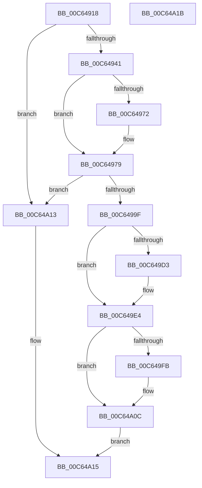

# MiBuildPagedPool

- RVA: `0x00C64918`–`0x00C64A1C` (길이 `260` bytes)
- VA: `0x0000000140C64918`
- 실행 섹션: `INIT`
- PDB 이름 있음: `예`; PDB Function 태그: `아니요`
- unwind 정보 RVA: `0x0005CF00`
- 디코드: `55`개 명령, `260/260` bytes 표시
- 미해석 바이트: `0` (있으면 어셈블리에 `.byte`로 보존)

> 이 문서는 커널 이미지의 기계어와 PDB 기호를 분석해 생성했습니다. 4번과 5번은 함수 원형과 자료형을 바이너리 사용 방식에서 추정한 C 해석이며 원본 소스 복구 결과는 아닙니다.

## 1. Dependencies

- 직접 호출 지점: **3**; 고유 호출 대상: **3**
- 직접 호출자로 확인된 함수: **1**
- RIP 상대 이미지 참조: **12**

### Outgoing calls
- `0x00C64934` → [MiInitializeDynamicRegion](MiInitializeDynamicRegion_function_00C65C2C.md) (function, `0x00C65C2C`)
- `0x00C64958` → [MiGetAnyMultiplexedVm](../../text/44/MiGetAnyMultiplexedVm_function_00448BD0.md) (function, `0x00448BD0`)
- `0x00C64996` → [MiInitializeSystemWorkingSetList](../../page/7F/MiInitializeSystemWorkingSetList_function_007FB7D4.md) (function, `0x007FB7D4`)

### Direct callers
- [MiInitNucleus](../C5/MiInitNucleus_function_00C5FD38.md) at `0x00C60428`

### Static image references
- `0x00C6491E` → RVA `0x00E38BD0` (`.data`; read)
- `0x00C6492A` → RVA `0x00E38BC8` (`.data`; read)
- `0x00C64941` → RVA `0x00FC6F18` (`ALMOSTRO`; write)
- `0x00C64951` → RVA `0x00E37660` (`.data`; write)
- `0x00C64969` → RVA `0x00E38840` (`.data`; read)
- `0x00C64979` → RVA `0x00E2CC00` (`.data`; read)
- `0x00C6498F` → RVA `0x00E38D00` (`.data`; read)
- `0x00C6499F` → RVA `0x00E37640` (`.data`; read/write)
- `0x00C649B1` → RVA `0x00E37660` (`.data`; read)
- `0x00C649B8` → RVA `0x00E37648` (`.data`; write)
- `0x00C649BF` → RVA `0x00E2CB60` (`.data`; write)
- `0x00C649E7` → RVA `0x00E2CB68` (`.data`; write)

## 2. Other-region calls and transfers

- 다른 실행 섹션으로 향하는 call: **2**
  - `0x00C64958` → [MiGetAnyMultiplexedVm](../../text/44/MiGetAnyMultiplexedVm_function_00448BD0.md) (`INIT` → `.text`)
  - `0x00C64996` → [MiInitializeSystemWorkingSetList](../../page/7F/MiInitializeSystemWorkingSetList_function_007FB7D4.md) (`INIT` → `PAGE`)
- 별도 외부 분기/꼬리 이동을 확인하지 못했습니다.

## 3. Assembly (complete function range)

```asm
00C64918  40 53                           push rbx
00C6491A  48 83 EC 20                     sub rsp, 0x20
00C6491E  48 8B 1D AB 42 1D 00            mov rbx, qword ptr [rip + 0x1d42ab]
00C64925  B9 05 00 00 00                  mov ecx, 5
00C6492A  48 8B 15 97 42 1D 00            mov rdx, qword ptr [rip + 0x1d4297]
00C64931  4C 8B C3                        mov r8, rbx
00C64934  E8 F3 12 00 00                  call 0x140c65c2c
00C64939  85 C0                           test eax, eax
00C6493B  0F 84 D2 00 00 00               je 0x140c64a13
00C64941  48 89 1D D0 25 36 00            mov qword ptr [rip + 0x3625d0], rbx
00C64948  B9 03 00 00 00                  mov ecx, 3
00C6494D  48 C1 EB 0C                     shr rbx, 0xc
00C64951  48 89 1D 08 2D 1D 00            mov qword ptr [rip + 0x1d2d08], rbx
00C64958  E8 73 42 7E FF                  call 0x140448bd0
00C6495D  8B 88 B8 00 00 00               mov ecx, dword ptr [rax + 0xb8]
00C64963  80 E1 0F                        and cl, 0xf
00C64966  80 F9 01                        cmp cl, 1
00C64969  48 8D 0D D0 3E 1D 00            lea rcx, [rip + 0x1d3ed0]
00C64970  74 07                           je 0x140c64979
00C64972  48 8D 88 C0 00 00 00            lea rcx, [rax + 0xc0]
00C64979  48 8D 15 80 82 1C 00            lea rdx, [rip + 0x1c8280]
00C64980  4C 8B CB                        mov r9, rbx
00C64983  48 89 11                        mov qword ptr [rcx], rdx
00C64986  41 B8 02 00 00 00               mov r8d, 2
00C6498C  48 8B D0                        mov rdx, rax
00C6498F  48 8D 0D 6A 43 1D 00            lea rcx, [rip + 0x1d436a]
00C64996  E8 39 6E B9 FF                  call 0x1407fb7d4
00C6499B  85 C0                           test eax, eax
00C6499D  78 74                           js 0x140c64a13
00C6499F  48 83 25 99 2C 1D 00 00         and qword ptr [rip + 0x1d2c99], 0
00C649A7  48 B9 CD CC CC CC CC CC CC CC   movabs rcx, 0xcccccccccccccccd
00C649B1  48 8B 05 A8 2C 1D 00            mov rax, qword ptr [rip + 0x1d2ca8]
00C649B8  48 89 05 89 2C 1D 00            mov qword ptr [rip + 0x1d2c89], rax
00C649BF  48 C7 05 96 81 1C 00 00 1E 00 00  mov qword ptr [rip + 0x1c8196], 0x1e00
00C649CA  48 81 FB 00 96 00 00            cmp rbx, 0x9600
00C649D1  73 11                           jae 0x140c649e4
00C649D3  48 8B C1                        mov rax, rcx
00C649D6  48 F7 E3                        mul rbx
00C649D9  48 C1 EA 02                     shr rdx, 2
00C649DD  48 89 15 7C 81 1C 00            mov qword ptr [rip + 0x1c817c], rdx
00C649E4  48 03 DB                        add rbx, rbx
00C649E7  48 C7 05 76 81 1C 00 00 3C 00 00  mov qword ptr [rip + 0x1c8176], 0x3c00
00C649F2  48 81 FB 00 2C 01 00            cmp rbx, 0x12c00
00C649F9  73 11                           jae 0x140c64a0c
00C649FB  48 8B C1                        mov rax, rcx
00C649FE  48 F7 E3                        mul rbx
00C64A01  48 C1 EA 02                     shr rdx, 2
00C64A05  48 89 15 5C 81 1C 00            mov qword ptr [rip + 0x1c815c], rdx
00C64A0C  B8 01 00 00 00                  mov eax, 1
00C64A11  EB 02                           jmp 0x140c64a15
00C64A13  33 C0                           xor eax, eax
00C64A15  48 83 C4 20                     add rsp, 0x20
00C64A19  5B                              pop rbx
00C64A1A  C3                              ret
00C64A1B  CC                              int3
```

## 4. C-style interpretation (structured pseudocode)

```c
__int64 __fastcall MiBuildPagedPool(void)
{
    __int64 result;
    __int64 v_rbx;
    __int64 v_rsp;

    v_rsp = (v_rsp) - (32);
    result = MiInitializeDynamicRegion(5, *(unsigned __int64 *)(v_rip + 1917591), *(unsigned __int64 *)(v_rip + 1917611), a4);
    if ((unsigned int)(result) == 0) goto loc_00C64A13;
    *(unsigned __int64 *)(v_rip + 3548624) = *(unsigned __int64 *)(v_rip + 1917611);
    v_rbx = (*(unsigned __int64 *)(v_rip + 1917611)) >> (12);
    *(unsigned __int64 *)(v_rip + 1912072) = v_rbx;
    result = MiGetAnyMultiplexedVm(3, *(unsigned __int64 *)(v_rip + 1917591), *(unsigned __int64 *)(v_rip + 1917611), a4);
    a1 = (unsigned __int8)(((unsigned int)(*(unsigned int *)(result + 184))) & (15));
    if (((unsigned __int8)(a1)) != 1) {
        a1 = result + 192;
    }
    *(unsigned __int64 *)(a1) = v_rip + 1868416;
    result = MiInitializeSystemWorkingSetList(v_rip + 1917802, result, 2, v_rbx);
    if (sign_flag) goto loc_00C64A13;
    *(unsigned __int64 *)(v_rip + 1911945) = *(unsigned __int64 *)(v_rip + 1911976);
    *(unsigned __int64 *)(v_rip + 1868182) = 0x1E00ULL;
    result = *(unsigned __int64 *)(v_rip + 1911976);
    if (v_rbx < 0x9600ULL) {
        result = v_rip + 1917802;
        a2 = (result) >> (2);
        *(unsigned __int64 *)(v_rip + 1868156) = a2;
    }
    v_rbx = (v_rbx) + (v_rbx);
    *(unsigned __int64 *)(v_rip + 1868150) = 0x3C00ULL;
    if (v_rbx < 0x12C00ULL) {
        result = v_rip + 1917802;
        a2 = (a2) >> (2);
        *(unsigned __int64 *)(v_rip + 1868124) = a2;
    }
    goto loc_00C64A15;
loc_00C64A13:
    result = 0;
loc_00C64A15:
    v_rsp = (v_rsp) + (32);
    return result;
}
```

## 5. (Beta) C Style

```c
void MiBuildPagedPool(void)
{
    int64_t result;
    int64_t local_rbx;
    int64_t local_rsp;

    local_rsp = (local_rsp) - (32);
    result = MiInitializeDynamicRegion(5, *(uint64_t *)(v_rip + 0x1D4297), *(uint64_t *)(v_rip + 0x1D42AB), a4);
    if ((uint32_t)(result) == 0) goto loc_00C64A13;
    *(uint64_t *)(v_rip + 0x3625D0) = *(uint64_t *)(v_rip + 0x1D42AB);
    local_rbx = (*(uint64_t *)(v_rip + 0x1D42AB)) >> (12);
    *(uint64_t *)(v_rip + 0x1D2D08) = local_rbx;
    result = MiGetAnyMultiplexedVm(3, *(uint64_t *)(v_rip + 0x1D4297), *(uint64_t *)(v_rip + 0x1D42AB), a4);
    a1 = (uint8_t)(((uint32_t)(*(uint32_t *)(result + 0xB8))) & (15));
    if (((uint8_t)(a1)) != 1) {
        a1 = result + 192;
    }
    *(uint64_t *)(a1) = v_rip + 1868416;
    result = MiInitializeSystemWorkingSetList(v_rip + 1917802, result, 2, local_rbx);
    if (sign_flag) goto loc_00C64A13;
    *(uint64_t *)(v_rip + 0x1D2C89) = *(uint64_t *)(v_rip + 0x1D2CA8);
    *(uint64_t *)(v_rip + 0x1C8196) = 0x1E00ULL;
    result = *(uint64_t *)(v_rip + 0x1D2CA8);
    if (local_rbx < 0x9600ULL) {
        result = v_rip + 1917802;
        a2 = (result) >> (2);
        *(uint64_t *)(v_rip + 0x1C817C) = a2;
    }
    local_rbx = (local_rbx) + (local_rbx);
    *(uint64_t *)(v_rip + 0x1C8176) = 0x3C00ULL;
    if (local_rbx < 0x12C00ULL) {
        result = v_rip + 1917802;
        a2 = (a2) >> (2);
        *(uint64_t *)(v_rip + 0x1C815C) = a2;
    }
    goto loc_00C64A15;
loc_00C64A13:
    result = 0;
loc_00C64A15:
    local_rsp = (local_rsp) + (32);
    return result;
}
```

## 6. Execution-region graph

[열기: 2D/3D 그래프와 함수 탐색 컨트롤 패널](../../../control-panel.html?section=init&rva=0x00C64918&view=graph)

- 2D 그래프는 위에서 아래로 흐르고, 3D 그래프는 빈 공간을 드래그해 회전합니다. Shift+드래그는 이동, 휠은 확대·축소, 함수 노드 선택은 대상 보고서 이동입니다.

### Static fallback


