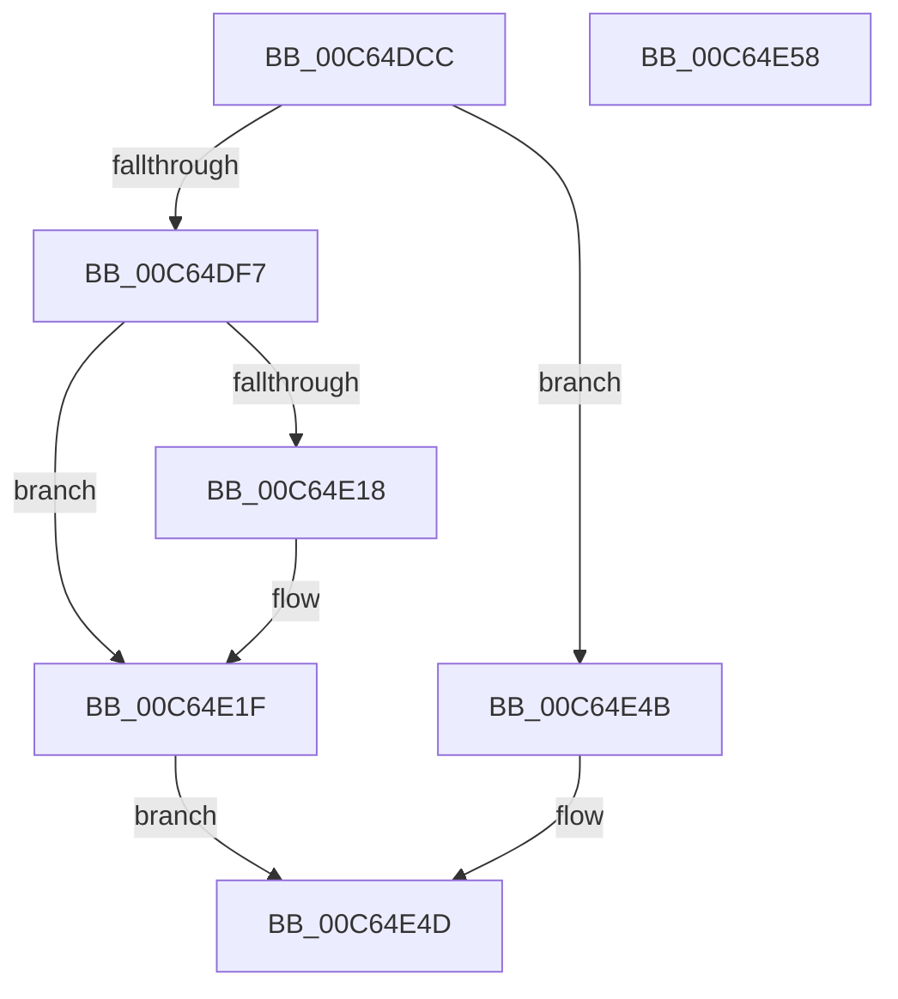

# MiBuildSystemDataViews

- RVA: `0x00C64DCC`–`0x00C64E59` (길이 `141` bytes)
- VA: `0x0000000140C64DCC`
- 실행 섹션: `INIT`
- PDB 이름 있음: `예`; PDB Function 태그: `아니요`
- unwind 정보 RVA: `0x0005CAAC`
- 디코드: `37`개 명령, `141/141` bytes 표시
- 미해석 바이트: `0` (있으면 어셈블리에 `.byte`로 보존)

> 이 문서는 커널 이미지의 기계어와 PDB 기호를 분석해 생성했습니다. 4번과 5번은 함수 원형과 자료형을 바이너리 사용 방식에서 추정한 C 해석이며 원본 소스 복구 결과는 아닙니다.

## 1. Dependencies

- 직접 호출 지점: **3**; 고유 호출 대상: **3**
- 직접 호출자로 확인된 함수: **1**
- RIP 상대 이미지 참조: **5**

### Outgoing calls
- `0x00C64DEC` → [MiInitializeDynamicRegion](MiInitializeDynamicRegion_function_00C65C2C.md) (function, `0x00C65C2C`)
- `0x00C64DFE` → [MiGetAnyMultiplexedVm](../../text/44/MiGetAnyMultiplexedVm_function_00448BD0.md) (function, `0x00448BD0`)
- `0x00C64E3C` → [MiInitializeSystemWorkingSetList](../../page/7F/MiInitializeSystemWorkingSetList_function_007FB7D4.md) (function, `0x007FB7D4`)

### Direct callers
- [MiInitNucleus](../C5/MiInitNucleus_function_00C5FD38.md) at `0x00C603AD`

### Static image references
- `0x00C64DD6` → RVA `0x00E38CB0` (`.data`; read)
- `0x00C64DE2` → RVA `0x00E38CA8` (`.data`; read)
- `0x00C64E0F` → RVA `0x00E38840` (`.data`; read)
- `0x00C64E1F` → RVA `0x00E36180` (`.data`; read)
- `0x00C64E35` → RVA `0x00E38D00` (`.data`; read)

## 2. Other-region calls and transfers

- 다른 실행 섹션으로 향하는 call: **2**
  - `0x00C64DFE` → [MiGetAnyMultiplexedVm](../../text/44/MiGetAnyMultiplexedVm_function_00448BD0.md) (`INIT` → `.text`)
  - `0x00C64E3C` → [MiInitializeSystemWorkingSetList](../../page/7F/MiInitializeSystemWorkingSetList_function_007FB7D4.md) (`INIT` → `PAGE`)
- 별도 외부 분기/꼬리 이동을 확인하지 못했습니다.

## 3. Assembly (complete function range)

```asm
00C64DCC  48 89 5C 24 08                  mov qword ptr [rsp + 8], rbx
00C64DD1  57                              push rdi
00C64DD2  48 83 EC 20                     sub rsp, 0x20
00C64DD6  48 8B 1D D3 3E 1D 00            mov rbx, qword ptr [rip + 0x1d3ed3]
00C64DDD  B9 11 00 00 00                  mov ecx, 0x11
00C64DE2  48 8B 15 BF 3E 1D 00            mov rdx, qword ptr [rip + 0x1d3ebf]
00C64DE9  4C 8B C3                        mov r8, rbx
00C64DEC  E8 3B 0E 00 00                  call 0x140c65c2c
00C64DF1  33 FF                           xor edi, edi
00C64DF3  85 C0                           test eax, eax
00C64DF5  74 54                           je 0x140c64e4b
00C64DF7  8D 4F 02                        lea ecx, [rdi + 2]
00C64DFA  48 C1 EB 0C                     shr rbx, 0xc
00C64DFE  E8 CD 3D 7E FF                  call 0x140448bd0
00C64E03  8B 88 B8 00 00 00               mov ecx, dword ptr [rax + 0xb8]
00C64E09  80 E1 0F                        and cl, 0xf
00C64E0C  80 F9 01                        cmp cl, 1
00C64E0F  48 8D 0D 2A 3A 1D 00            lea rcx, [rip + 0x1d3a2a]
00C64E16  74 07                           je 0x140c64e1f
00C64E18  48 8D 88 C0 00 00 00            lea rcx, [rax + 0xc0]
00C64E1F  48 8D 15 5A 13 1D 00            lea rdx, [rip + 0x1d135a]
00C64E26  4C 8B CB                        mov r9, rbx
00C64E29  48 89 11                        mov qword ptr [rcx], rdx
00C64E2C  41 B8 04 00 00 00               mov r8d, 4
00C64E32  48 8B D0                        mov rdx, rax
00C64E35  48 8D 0D C4 3E 1D 00            lea rcx, [rip + 0x1d3ec4]
00C64E3C  E8 93 69 B9 FF                  call 0x1407fb7d4
00C64E41  85 C0                           test eax, eax
00C64E43  40 0F 99 C7                     setns dil
00C64E47  8B C7                           mov eax, edi
00C64E49  EB 02                           jmp 0x140c64e4d
00C64E4B  33 C0                           xor eax, eax
00C64E4D  48 8B 5C 24 30                  mov rbx, qword ptr [rsp + 0x30]
00C64E52  48 83 C4 20                     add rsp, 0x20
00C64E56  5F                              pop rdi
00C64E57  C3                              ret
00C64E58  CC                              int3
```

## 4. C-style interpretation (structured pseudocode)

```c
__int64 __fastcall MiBuildSystemDataViews(void)
{
    __int64 result;
    __int64 v_rbx;
    __int64 v_rdi;
    __int64 v_rsp;
    unsigned __int64 v_stack_p8;

    v_stack_p8 = v_rbx;
    v_rsp = (v_rsp) - (32);
    result = MiInitializeDynamicRegion(17, *(unsigned __int64 *)(v_rip + 1916607), *(unsigned __int64 *)(v_rip + 1916627), a4);
    v_rdi = 0;
    if ((unsigned int)(result) == 0) goto loc_00C64E4B;
    v_rbx = (*(unsigned __int64 *)(v_rip + 1916627)) >> (12);
    result = MiGetAnyMultiplexedVm(v_rdi + 2, *(unsigned __int64 *)(v_rip + 1916607), *(unsigned __int64 *)(v_rip + 1916627), a4);
    a1 = (unsigned __int8)(((unsigned int)(*(unsigned int *)(result + 184))) & (15));
    if (((unsigned __int8)(a1)) != 1) {
        a1 = result + 192;
    }
    *(unsigned __int64 *)(a1) = v_rip + 1905498;
    result = MiInitializeSystemWorkingSetList(v_rip + 1916612, result, 4, v_rbx);
    v_rdi = (!sign_flag) ? 1 : 0;
    goto loc_00C64E4D;
loc_00C64E4B:
    result = 0;
loc_00C64E4D:
    v_rsp = (v_rsp) + (32);
    return result;
}
```

## 5. (Beta) C Style

```c
void MiBuildSystemDataViews(void)
{
    int64_t result;
    int64_t local_rbx;
    int64_t local_rdi;
    int64_t local_rsp;
    uint64_t v_stack_p8;

    v_stack_p8 = local_rbx;
    local_rsp = (local_rsp) - (32);
    result = MiInitializeDynamicRegion(17, *(uint64_t *)(v_rip + 0x1D3EBF), *(uint64_t *)(v_rip + 0x1D3ED3), a4);
    local_rdi = 0;
    if ((uint32_t)(result) == 0) goto loc_00C64E4B;
    local_rbx = (*(uint64_t *)(v_rip + 0x1D3ED3)) >> (12);
    result = MiGetAnyMultiplexedVm(local_rdi + 2, *(uint64_t *)(v_rip + 0x1D3EBF), *(uint64_t *)(v_rip + 0x1D3ED3), a4);
    a1 = (uint8_t)(((uint32_t)(*(uint32_t *)(result + 0xB8))) & (15));
    if (((uint8_t)(a1)) != 1) {
        a1 = result + 192;
    }
    *(uint64_t *)(a1) = v_rip + 1905498;
    result = MiInitializeSystemWorkingSetList(v_rip + 1916612, result, 4, local_rbx);
    local_rdi = (!sign_flag) ? 1 : 0;
    goto loc_00C64E4D;
loc_00C64E4B:
    result = 0;
loc_00C64E4D:
    local_rsp = (local_rsp) + (32);
    return result;
}
```

## 6. Execution-region graph

[열기: 2D/3D 그래프와 함수 탐색 컨트롤 패널](../../../control-panel.html?section=init&rva=0x00C64DCC&view=graph)

- 2D 그래프는 위에서 아래로 흐르고, 3D 그래프는 빈 공간을 드래그해 회전합니다. Shift+드래그는 이동, 휠은 확대·축소, 함수 노드 선택은 대상 보고서 이동입니다.

### Static fallback


