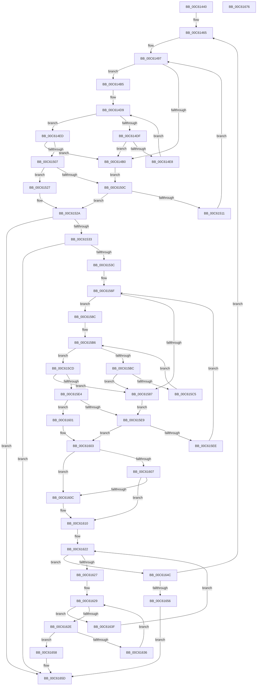

# MiCheckForBootMappingsBetweenDrivers

- RVA: `0x00C61440`–`0x00C61677` (길이 `567` bytes)
- VA: `0x0000000140C61440`
- 실행 섹션: `INIT`
- PDB 이름 있음: `예`; PDB Function 태그: `아니요`
- unwind 정보 RVA: `0x000D787C`
- 디코드: `185`개 명령, `567/567` bytes 표시
- 미해석 바이트: `0` (있으면 어셈블리에 `.byte`로 보존)

> 이 문서는 커널 이미지의 기계어와 PDB 기호를 분석해 생성했습니다. 4번과 5번은 함수 원형과 자료형을 바이너리 사용 방식에서 추정한 C 해석이며 원본 소스 복구 결과는 아닙니다.

## 1. Dependencies

- 직접 호출 지점: **0**; 고유 호출 대상: **0**
- 직접 호출자로 확인된 함수: **1**
- RIP 상대 이미지 참조: **0**

### Outgoing calls
- 직접 디코드된 call 명령이 없습니다.

### Direct callers
- [MiInitializeDriverPtes](MiInitializeDriverPtes_function_00C61818.md) at `0x00C619F3`

### Static image references
- 디코드된 RIP-relative 메모리 참조가 없습니다.

## 2. Other-region calls and transfers

- 다른 실행 섹션으로 향하는 call: **0**
- 별도 외부 분기/꼬리 이동을 확인하지 못했습니다.

## 3. Assembly (complete function range)

```asm
00C61440  48 89 5C 24 10                  mov qword ptr [rsp + 0x10], rbx
00C61445  48 89 6C 24 18                  mov qword ptr [rsp + 0x18], rbp
00C6144A  48 89 74 24 20                  mov qword ptr [rsp + 0x20], rsi
00C6144F  57                              push rdi
00C61450  41 54                           push r12
00C61452  41 55                           push r13
00C61454  41 56                           push r14
00C61456  41 57                           push r15
00C61458  33 D2                           xor edx, edx
00C6145A  4C 8B D1                        mov r10, rcx
00C6145D  41 83 CC FF                     or r12d, 0xffffffff
00C61461  44 8D 6A 01                     lea r13d, [rdx + 1]
00C61465  41 8B 72 10                     mov esi, dword ptr [r10 + 0x10]
00C61469  49 8B 7A 18                     mov rdi, qword ptr [r10 + 0x18]
00C6146D  48 8B CF                        mov rcx, rdi
00C61470  83 E1 04                        and ecx, 4
00C61473  8B C1                           mov eax, ecx
00C61475  44 8D 46 FF                     lea r8d, [rsi - 1]
00C61479  48 F7 D8                        neg rax
00C6147C  45 1B DB                        sbb r11d, r11d
00C6147F  41 83 E3 20                     and r11d, 0x20
00C61483  3B D6                           cmp edx, esi
00C61485  45 1B C9                        sbb r9d, r9d
00C61488  44 23 CA                        and r9d, edx
00C6148B  48 F7 D9                        neg rcx
00C6148E  48 1B C0                        sbb rax, rax
00C61491  83 E0 04                        and eax, 4
00C61494  48 2B F8                        sub rdi, rax
00C61497  83 64 24 30 00                  and dword ptr [rsp + 0x30], 0
00C6149C  43 8D 1C 03                     lea ebx, [r11 + r8]
00C614A0  8B C3                           mov eax, ebx
00C614A2  43 8D 0C 0B                     lea ecx, [r11 + r9]
00C614A6  2B C1                           sub eax, ecx
00C614A8  41 03 C5                        add eax, r13d
00C614AB  41 3B C5                        cmp eax, r13d
00C614AE  73 05                           jae 0x140c614b5
00C614B0  45 8B C4                        mov r8d, r12d
00C614B3  EB 57                           jmp 0x140c6150c
00C614B5  8B C3                           mov eax, ebx
00C614B7  48 C1 E8 06                     shr rax, 6
00C614BB  48 8D 2C C7                     lea rbp, [rdi + rax*8]
00C614BF  48 8B C1                        mov rax, rcx
00C614C2  48 C1 E8 06                     shr rax, 6
00C614C6  80 E1 3F                        and cl, 0x3f
00C614C9  4C 8D 04 C7                     lea r8, [rdi + rax*8]
00C614CD  49 8B C5                        mov rax, r13
00C614D0  48 D3 E0                        shl rax, cl
00C614D3  49 2B C5                        sub rax, r13
00C614D6  49 0B 00                        or rax, qword ptr [r8]
00C614D9  48 83 F8 FF                     cmp rax, -1
00C614DD  75 0E                           jne 0x140c614ed
00C614DF  49 83 C0 08                     add r8, 8
00C614E3  4C 3B C5                        cmp r8, rbp
00C614E6  77 C8                           ja 0x140c614b0
00C614E8  49 8B 00                        mov rax, qword ptr [r8]
00C614EB  EB EC                           jmp 0x140c614d9
00C614ED  4C 2B C7                        sub r8, rdi
00C614F0  48 F7 D0                        not rax
00C614F3  49 C1 F8 03                     sar r8, 3
00C614F7  48 0F BC C0                     bsf rax, rax
00C614FB  41 C1 E0 06                     shl r8d, 6
00C614FF  44 03 C0                        add r8d, eax
00C61502  44 3B C3                        cmp r8d, ebx
00C61505  77 A9                           ja 0x140c614b0
00C61507  45 3B C4                        cmp r8d, r12d
00C6150A  75 1B                           jne 0x140c61527
00C6150C  45 85 C9                        test r9d, r9d
00C6150F  74 19                           je 0x140c6152a
00C61511  44 8D 42 01                     lea r8d, [rdx + 1]
00C61515  44 3B C6                        cmp r8d, esi
00C61518  44 0F 47 C6                     cmova r8d, esi
00C6151C  45 03 C4                        add r8d, r12d
00C6151F  45 33 C9                        xor r9d, r9d
00C61522  E9 70 FF FF FF                  jmp 0x140c61497
00C61527  45 2B C3                        sub r8d, r11d
00C6152A  44 3B C2                        cmp r8d, edx
00C6152D  0F 82 2A 01 00 00               jb 0x140c6165d
00C61533  45 3B C4                        cmp r8d, r12d
00C61536  0F 84 21 01 00 00               je 0x140c6165d
00C6153C  41 8B 6A 10                     mov ebp, dword ptr [r10 + 0x10]
00C61540  41 8D 70 01                     lea esi, [r8 + 1]
00C61544  4D 8B 72 18                     mov r14, qword ptr [r10 + 0x18]
00C61548  49 8B CE                        mov rcx, r14
00C6154B  83 E1 04                        and ecx, 4
00C6154E  8B C1                           mov eax, ecx
00C61550  8D 55 FF                        lea edx, [rbp - 1]
00C61553  48 F7 D8                        neg rax
00C61556  1B DB                           sbb ebx, ebx
00C61558  83 E3 20                        and ebx, 0x20
00C6155B  3B F5                           cmp esi, ebp
00C6155D  45 1B DB                        sbb r11d, r11d
00C61560  44 23 DE                        and r11d, esi
00C61563  48 F7 D9                        neg rcx
00C61566  48 1B C0                        sbb rax, rax
00C61569  83 E0 04                        and eax, 4
00C6156C  4C 2B F0                        sub r14, rax
00C6156F  83 64 24 30 00                  and dword ptr [rsp + 0x30], 0
00C61574  8D 3C 13                        lea edi, [rbx + rdx]
00C61577  8B C7                           mov eax, edi
00C61579  41 8D 0C 1B                     lea ecx, [r11 + rbx]
00C6157D  2B C1                           sub eax, ecx
00C6157F  41 03 C5                        add eax, r13d
00C61582  41 3B C5                        cmp eax, r13d
00C61585  73 05                           jae 0x140c6158c
00C61587  41 8B D4                        mov edx, r12d
00C6158A  EB 5D                           jmp 0x140c615e9
00C6158C  8B C7                           mov eax, edi
00C6158E  4D 8B CD                        mov r9, r13
00C61591  48 C1 E8 06                     shr rax, 6
00C61595  4D 8D 3C C6                     lea r15, [r14 + rax*8]
00C61599  48 8B C1                        mov rax, rcx
00C6159C  48 C1 E8 06                     shr rax, 6
00C615A0  80 E1 3F                        and cl, 0x3f
00C615A3  49 D3 E1                        shl r9, cl
00C615A6  4D 2B CD                        sub r9, r13
00C615A9  49 8D 14 C6                     lea rdx, [r14 + rax*8]
00C615AD  48 8B 02                        mov rax, qword ptr [rdx]
00C615B0  48 F7 D0                        not rax
00C615B3  4C 0B C8                        or r9, rax
00C615B6  49 83 F9 FF                     cmp r9, -1
00C615BA  75 11                           jne 0x140c615cd
00C615BC  48 83 C2 08                     add rdx, 8
00C615C0  49 3B D7                        cmp rdx, r15
00C615C3  77 C2                           ja 0x140c61587
00C615C5  4C 8B 0A                        mov r9, qword ptr [rdx]
00C615C8  49 F7 D1                        not r9
00C615CB  EB E9                           jmp 0x140c615b6
00C615CD  49 2B D6                        sub rdx, r14
00C615D0  49 F7 D1                        not r9
00C615D3  48 C1 FA 03                     sar rdx, 3
00C615D7  49 0F BC C1                     bsf rax, r9
00C615DB  C1 E2 06                        shl edx, 6
00C615DE  03 D0                           add edx, eax
00C615E0  3B D7                           cmp edx, edi
00C615E2  77 A3                           ja 0x140c61587
00C615E4  41 3B D4                        cmp edx, r12d
00C615E7  75 18                           jne 0x140c61601
00C615E9  45 85 DB                        test r11d, r11d
00C615EC  74 15                           je 0x140c61603
00C615EE  8D 56 01                        lea edx, [rsi + 1]
00C615F1  3B D5                           cmp edx, ebp
00C615F3  0F 47 D5                        cmova edx, ebp
00C615F6  41 03 D4                        add edx, r12d
00C615F9  45 33 DB                        xor r11d, r11d
00C615FC  E9 6E FF FF FF                  jmp 0x140c6156f
00C61601  2B D3                           sub edx, ebx
00C61603  3B D6                           cmp edx, esi
00C61605  72 05                           jb 0x140c6160c
00C61607  41 3B D4                        cmp edx, r12d
00C6160A  75 04                           jne 0x140c61610
00C6160C  41 8B 52 10                     mov edx, dword ptr [r10 + 0x10]
00C61610  49 8B 42 08                     mov rax, qword ptr [r10 + 8]
00C61614  44 8B CA                        mov r9d, edx
00C61617  45 2B C8                        sub r9d, r8d
00C6161A  41 C1 E0 04                     shl r8d, 4
00C6161E  4E 8D 04 C0                     lea r8, [rax + r8*8]
00C61622  45 85 C9                        test r9d, r9d
00C61625  74 25                           je 0x140c6164c
00C61627  33 C9                           xor ecx, ecx
00C61629  83 F9 10                        cmp ecx, 0x10
00C6162C  73 11                           jae 0x140c6163f
00C6162E  49 8B 00                        mov rax, qword ptr [r8]
00C61631  48 85 C0                        test rax, rax
00C61634  75 22                           jne 0x140c61658
00C61636  49 83 C0 08                     add r8, 8
00C6163A  41 03 CD                        add ecx, r13d
00C6163D  EB EA                           jmp 0x140c61629
00C6163F  49 83 C0 78                     add r8, 0x78
00C61643  49 83 E0 80                     and r8, 0xffffffffffffff80
00C61647  45 03 CC                        add r9d, r12d
00C6164A  EB D6                           jmp 0x140c61622
00C6164C  41 3B 52 10                     cmp edx, dword ptr [r10 + 0x10]
00C61650  0F 82 0F FE FF FF               jb 0x140c61465
00C61656  EB 05                           jmp 0x140c6165d
00C61658  41 83 4A 24 02                  or dword ptr [r10 + 0x24], 2
00C6165D  48 8B 5C 24 38                  mov rbx, qword ptr [rsp + 0x38]
00C61662  48 8B 6C 24 40                  mov rbp, qword ptr [rsp + 0x40]
00C61667  48 8B 74 24 48                  mov rsi, qword ptr [rsp + 0x48]
00C6166C  41 5F                           pop r15
00C6166E  41 5E                           pop r14
00C61670  41 5D                           pop r13
00C61672  41 5C                           pop r12
00C61674  5F                              pop rdi
00C61675  C3                              ret
00C61676  CC                              int3
```

## 4. C-style interpretation (structured pseudocode)

```c
__int64 __fastcall MiCheckForBootMappingsBetweenDrivers(__int64 a1, int a2, __int64 a3, int a4)
{
    __int64 result;
    __int64 v_r11;
    __int64 v_r12;
    __int64 v_r14;
    __int64 v_rbx;
    __int64 v_rdi;
    unsigned __int64 v_stack_p10;
    unsigned __int64 v_stack_p18;
    unsigned __int64 v_stack_p20;
    unsigned int v_stack_p8;

    v_stack_p10 = v_rbx;
    v_stack_p18 = v_rbp;
    v_stack_p20 = v_rsi;
    a2 = 0;
    v_r12 = (unsigned int)((v_r12) | (0xFFFFFFFFULL));
loc_00C61465:
    a1 = (unsigned int)((*(unsigned __int64 *)(a1 + 24)) & (4));
    result = -((unsigned int)((unsigned int)(a1)));
    v_r11 = (unsigned int)((v_r11) & (32));
    a4 = (unsigned int)((a4) & (0));
    a1 = -(a1);
    result = (unsigned int)((result) & (4));
    v_rdi = (*(unsigned __int64 *)(a1 + 24)) - (result);
loc_00C61497:
    result = (unsigned int)(((unsigned int)((unsigned int)(v_r11 + (unsigned int)(*(unsigned int *)(a1 + 16)) - 1 * 1))) - ((unsigned int)(v_r11 + a4 * 1)));
    result = (unsigned int)((result) + ((unsigned int)(a2 + 1)));
    if (((unsigned int)(result)) >= ((unsigned int)(a2 + 1))) goto loc_00C614B5;
loc_00C614B0:
    goto loc_00C6150C;
loc_00C614B5:
    result = ((unsigned int)((unsigned int)(v_r11 + (unsigned int)(*(unsigned int *)(a1 + 16)) - 1 * 1))) >> (6);
    result = (v_r11 + a4 * 1) >> (6);
    a1 = (unsigned __int8)((v_r11 + a4 * 1) & (63));
    result = (a2 + 1) << ((unsigned __int8)(a1));
    result = (result) - (a2 + 1);
    result = (result) | (*(unsigned __int64 *)(v_rdi + result * 8));
loc_00C614D9:
    if (result != -1) goto loc_00C614ED;
    a3 = (v_rdi + result * 8) + (8);
    if (a3 > (v_rdi + result * 8)) goto loc_00C614B0;
    goto loc_00C614D9;
loc_00C614ED:
    a3 = (a3) - (v_rdi);
    result = ~(*(unsigned __int64 *)(a3));
    a3 = (a3) >> (3);
    a3 = (unsigned int)((a3) << (6));
    a3 = (unsigned int)((a3) + ((unsigned int)(result)));
    if (((unsigned int)(a3)) > ((unsigned int)(v_r11 + (unsigned int)(*(unsigned int *)(a1 + 16)) - 1 * 1))) goto loc_00C614B0;
    if (((unsigned int)(a3)) != ((unsigned int)(v_r12))) goto loc_00C61527;
loc_00C6150C:
    if (a4 == 0) goto loc_00C6152A;
    a3 = a2 + 1;
    if (((unsigned int)(a2 + 1)) > ((unsigned int)((unsigned int)(*(unsigned int *)(a1 + 16))))) { a3 = (unsigned int)((unsigned int)(*(unsigned int *)(a1 + 16))); }
    a3 = (unsigned int)((a3) + ((unsigned int)(v_r12)));
    a4 = 0;
    goto loc_00C61497;
loc_00C61527:
    a3 = (unsigned int)((a3) - ((unsigned int)(v_r11)));
loc_00C6152A:
    if (((unsigned int)(a3)) < 0) goto loc_00C6165D;
    if (((unsigned int)(a3)) == ((unsigned int)(v_r12))) goto loc_00C6165D;
    a1 = (unsigned int)((*(unsigned __int64 *)(a1 + 24)) & (4));
    result = -((unsigned int)((unsigned int)(a1)));
    v_rbx = (unsigned int)((v_r11 + (unsigned int)(*(unsigned int *)(a1 + 16)) - 1 * 1) & (32));
    v_r11 = (unsigned int)((v_r11) & ((unsigned int)(a3 + 1)));
    a1 = -(a1);
    result = (unsigned int)((result) & (4));
    v_r14 = (*(unsigned __int64 *)(a1 + 24)) - (result);
loc_00C6156F:
    result = (unsigned int)(((unsigned int)((unsigned int)(v_rbx + (unsigned int)(*(unsigned int *)(a1 + 16)) - 1 * 1))) - ((unsigned int)(v_r11 + v_rbx * 1)));
    result = (unsigned int)((result) + ((unsigned int)(a2 + 1)));
    if (((unsigned int)(result)) >= ((unsigned int)(a2 + 1))) goto loc_00C6158C;
loc_00C61587:
    goto loc_00C615E9;
loc_00C6158C:
    result = ((unsigned int)((unsigned int)(v_rbx + (unsigned int)(*(unsigned int *)(a1 + 16)) - 1 * 1))) >> (6);
    result = (v_r11 + v_rbx * 1) >> (6);
    a1 = (unsigned __int8)((v_r11 + v_rbx * 1) & (63));
    a4 = (a2 + 1) << ((unsigned __int8)(a1));
    a4 = (a4) - (a2 + 1);
    result = ~(*(unsigned __int64 *)(v_r14 + result * 8));
    a4 = (a4) | (result);
loc_00C615B6:
    if (a4 != -1) goto loc_00C615CD;
    a2 = (v_r14 + result * 8) + (8);
    if (a2 > (v_r14 + result * 8)) goto loc_00C61587;
    a4 = ~(*(unsigned __int64 *)(a2));
    goto loc_00C615B6;
loc_00C615CD:
    a2 = (a2) - (v_r14);
    a4 = ~(a4);
    a2 = (a2) >> (3);
    a2 = (unsigned int)((a2) << (6));
    a2 = (unsigned int)((a2) + ((unsigned int)(result)));
    if (a2 > ((unsigned int)(v_rbx + (unsigned int)(*(unsigned int *)(a1 + 16)) - 1 * 1))) goto loc_00C61587;
    if (a2 != ((unsigned int)(v_r12))) goto loc_00C61601;
loc_00C615E9:
    if ((unsigned int)(v_r11) == 0) goto loc_00C61603;
    a2 = a3 + 1 + 1;
    if (((unsigned int)(a3 + 1 + 1)) > ((unsigned int)((unsigned int)(*(unsigned int *)(a1 + 16))))) { a2 = (unsigned int)((unsigned int)(*(unsigned int *)(a1 + 16))); }
    a2 = (unsigned int)((a2) + ((unsigned int)(v_r12)));
    v_r11 = 0;
    goto loc_00C6156F;
loc_00C61601:
    a2 = (unsigned int)((a2) - ((unsigned int)(v_rbx)));
loc_00C61603:
    if (a2 < ((unsigned int)(a3 + 1))) goto loc_00C6160C;
    if (a2 == ((unsigned int)(v_r12))) {
        a2 = *(unsigned int *)(a1 + 16);
    }
    a4 = (unsigned int)(((unsigned int)(a2)) - ((unsigned int)(a3)));
    a3 = (unsigned int)((a3) << (4));
loc_00C61622:
    if (a4 == 0) goto loc_00C6164C;
    a1 = 0;
loc_00C61629:
    if (0 >= 16) goto loc_00C6163F;
    if (*(unsigned __int64 *)(*(unsigned __int64 *)(a1 + 8) + a3 * 8) != 0) goto loc_00C61658;
    a3 = (*(unsigned __int64 *)(a1 + 8) + a3 * 8) + (8);
    a1 = (unsigned int)((a1) + ((unsigned int)(a2 + 1)));
    goto loc_00C61629;
loc_00C6163F:
    a3 = (a3) + (120);
    a3 = (a3) & (-128);
    a4 = (unsigned int)((a4) + ((unsigned int)(v_r12)));
    goto loc_00C61622;
loc_00C6164C:
    if (a2 < (*(unsigned int *)(a1 + 16))) goto loc_00C61465;
    goto loc_00C6165D;
loc_00C61658:
loc_00C6165D:
    return *(unsigned __int64 *)(*(unsigned __int64 *)(a1 + 8) + a3 * 8);
}
```

## 5. (Beta) C Style

```c
int64_t MiCheckForBootMappingsBetweenDrivers(void *Arg1, int32_t Arg2, int64_t Arg3, int32_t Arg4)
{
    uint8_t *arg1 = (uint8_t *)Arg1;

    int64_t result;
    int64_t local_r11;
    int64_t local_r12;
    int64_t local_r14;
    int64_t local_rbx;
    int64_t local_rdi;
    uint64_t v_stack_p10;
    uint64_t v_stack_p18;
    uint64_t v_stack_p20;
    uint32_t v_stack_p8;

    v_stack_p10 = local_rbx;
    v_stack_p18 = local_rbp;
    v_stack_p20 = local_rsi;
    Arg2 = 0;
    local_r12 = (uint32_t)((local_r12) | (0xFFFFFFFFULL));
loc_00C61465:
    Arg1 = (uint32_t)((*(uint64_t *)(arg1 + 0x18)) & (4));
    result = -((uint32_t)((uint32_t)(Arg1)));
    local_r11 = (uint32_t)((local_r11) & (32));
    Arg4 = (uint32_t)((Arg4) & (0));
    Arg1 = -(Arg1);
    result = (uint32_t)((result) & (4));
    local_rdi = (*(uint64_t *)(arg1 + 0x18)) - (result);
loc_00C61497:
    result = (uint32_t)(((uint32_t)((uint32_t)(local_r11 + (uint32_t)(*(uint32_t *)(arg1 + 0x10)) - 1 * 1))) - ((uint32_t)(local_r11 + Arg4 * 1)));
    result = (uint32_t)((result) + ((uint32_t)(Arg2 + 1)));
    if (((uint32_t)(result)) >= ((uint32_t)(Arg2 + 1))) goto loc_00C614B5;
loc_00C614B0:
    goto loc_00C6150C;
loc_00C614B5:
    result = ((uint32_t)((uint32_t)(local_r11 + (uint32_t)(*(uint32_t *)(arg1 + 0x10)) - 1 * 1))) >> (6);
    result = (local_r11 + Arg4 * 1) >> (6);
    Arg1 = (uint8_t)((local_r11 + Arg4 * 1) & (63));
    result = (Arg2 + 1) << ((uint8_t)(Arg1));
    result = (result) - (Arg2 + 1);
    result = (result) | (*(uint64_t *)(local_rdi + result * 8));
loc_00C614D9:
    if (result != -1) goto loc_00C614ED;
    Arg3 = (local_rdi + result * 8) + (8);
    if (Arg3 > (local_rdi + result * 8)) goto loc_00C614B0;
    goto loc_00C614D9;
loc_00C614ED:
    Arg3 = (Arg3) - (local_rdi);
    result = ~(*(uint64_t *)(Arg3));
    Arg3 = (Arg3) >> (3);
    Arg3 = (uint32_t)((Arg3) << (6));
    Arg3 = (uint32_t)((Arg3) + ((uint32_t)(result)));
    if (((uint32_t)(Arg3)) > ((uint32_t)(local_r11 + (uint32_t)(*(uint32_t *)(arg1 + 0x10)) - 1 * 1))) goto loc_00C614B0;
    if (((uint32_t)(Arg3)) != ((uint32_t)(local_r12))) goto loc_00C61527;
loc_00C6150C:
    if (Arg4 == 0) goto loc_00C6152A;
    Arg3 = Arg2 + 1;
    if (((uint32_t)(Arg2 + 1)) > ((uint32_t)((uint32_t)(*(uint32_t *)(arg1 + 0x10))))) { Arg3 = (uint32_t)((uint32_t)(*(uint32_t *)(arg1 + 0x10))); }
    Arg3 = (uint32_t)((Arg3) + ((uint32_t)(local_r12)));
    Arg4 = 0;
    goto loc_00C61497;
loc_00C61527:
    Arg3 = (uint32_t)((Arg3) - ((uint32_t)(local_r11)));
loc_00C6152A:
    if (((uint32_t)(Arg3)) < 0) goto loc_00C6165D;
    if (((uint32_t)(Arg3)) == ((uint32_t)(local_r12))) goto loc_00C6165D;
    Arg1 = (uint32_t)((*(uint64_t *)(arg1 + 0x18)) & (4));
    result = -((uint32_t)((uint32_t)(Arg1)));
    local_rbx = (uint32_t)((local_r11 + (uint32_t)(*(uint32_t *)(arg1 + 0x10)) - 1 * 1) & (32));
    local_r11 = (uint32_t)((local_r11) & ((uint32_t)(Arg3 + 1)));
    Arg1 = -(Arg1);
    result = (uint32_t)((result) & (4));
    local_r14 = (*(uint64_t *)(arg1 + 0x18)) - (result);
loc_00C6156F:
    result = (uint32_t)(((uint32_t)((uint32_t)(local_rbx + (uint32_t)(*(uint32_t *)(arg1 + 0x10)) - 1 * 1))) - ((uint32_t)(local_r11 + local_rbx * 1)));
    result = (uint32_t)((result) + ((uint32_t)(Arg2 + 1)));
    if (((uint32_t)(result)) >= ((uint32_t)(Arg2 + 1))) goto loc_00C6158C;
loc_00C61587:
    goto loc_00C615E9;
loc_00C6158C:
    result = ((uint32_t)((uint32_t)(local_rbx + (uint32_t)(*(uint32_t *)(arg1 + 0x10)) - 1 * 1))) >> (6);
    result = (local_r11 + local_rbx * 1) >> (6);
    Arg1 = (uint8_t)((local_r11 + local_rbx * 1) & (63));
    Arg4 = (Arg2 + 1) << ((uint8_t)(Arg1));
    Arg4 = (Arg4) - (Arg2 + 1);
    result = ~(*(uint64_t *)(local_r14 + result * 8));
    Arg4 = (Arg4) | (result);
loc_00C615B6:
    if (Arg4 != -1) goto loc_00C615CD;
    Arg2 = (local_r14 + result * 8) + (8);
    if (Arg2 > (local_r14 + result * 8)) goto loc_00C61587;
    Arg4 = ~(*(uint64_t *)(Arg2));
    goto loc_00C615B6;
loc_00C615CD:
    Arg2 = (Arg2) - (local_r14);
    Arg4 = ~(Arg4);
    Arg2 = (Arg2) >> (3);
    Arg2 = (uint32_t)((Arg2) << (6));
    Arg2 = (uint32_t)((Arg2) + ((uint32_t)(result)));
    if (Arg2 > ((uint32_t)(local_rbx + (uint32_t)(*(uint32_t *)(arg1 + 0x10)) - 1 * 1))) goto loc_00C61587;
    if (Arg2 != ((uint32_t)(local_r12))) goto loc_00C61601;
loc_00C615E9:
    if ((uint32_t)(local_r11) == 0) goto loc_00C61603;
    Arg2 = Arg3 + 1 + 1;
    if (((uint32_t)(Arg3 + 1 + 1)) > ((uint32_t)((uint32_t)(*(uint32_t *)(arg1 + 0x10))))) { Arg2 = (uint32_t)((uint32_t)(*(uint32_t *)(arg1 + 0x10))); }
    Arg2 = (uint32_t)((Arg2) + ((uint32_t)(local_r12)));
    local_r11 = 0;
    goto loc_00C6156F;
loc_00C61601:
    Arg2 = (uint32_t)((Arg2) - ((uint32_t)(local_rbx)));
loc_00C61603:
    if (Arg2 < ((uint32_t)(Arg3 + 1))) goto loc_00C6160C;
    if (Arg2 == ((uint32_t)(local_r12))) {
        Arg2 = *(uint32_t *)(arg1 + 0x10);
    }
    Arg4 = (uint32_t)(((uint32_t)(Arg2)) - ((uint32_t)(Arg3)));
    Arg3 = (uint32_t)((Arg3) << (4));
loc_00C61622:
    if (Arg4 == 0) goto loc_00C6164C;
    Arg1 = 0;
loc_00C61629:
    if (0 >= 16) goto loc_00C6163F;
    if (*(uint64_t *)(*(uint64_t *)(arg1 + 0x8) + Arg3 * 8) != 0) goto loc_00C61658;
    Arg3 = (*(uint64_t *)(arg1 + 0x8) + Arg3 * 8) + (8);
    Arg1 = (uint32_t)((Arg1) + ((uint32_t)(Arg2 + 1)));
    goto loc_00C61629;
loc_00C6163F:
    Arg3 = (Arg3) + (120);
    Arg3 = (Arg3) & (-128);
    Arg4 = (uint32_t)((Arg4) + ((uint32_t)(local_r12)));
    goto loc_00C61622;
loc_00C6164C:
    if (Arg2 < (*(uint32_t *)(arg1 + 0x10))) goto loc_00C61465;
    goto loc_00C6165D;
loc_00C61658:
loc_00C6165D:
    return *(uint64_t *)(*(uint64_t *)(arg1 + 0x8) + Arg3 * 8);
}
```

### 관측된 메모리 오프셋

구조체 형식이 확인되지 않은 접근은 인자 기준의 오프셋으로만 기록했습니다.

| 기준 인자 | 오프셋 표현 | 폭 (bit) | 접근 |
|---|---:|---:|---|
| `Arg1` | `+ 0x8` | `64` | `R` |
| `Arg1` | `+ 0x10` | `32` | `R` |
| `Arg1` | `+ 0x18` | `64` | `R` |
| `Arg1` | `+ 0x24` | `32` | `R/W` |

## 6. Execution-region graph

[열기: 2D/3D 그래프와 함수 탐색 컨트롤 패널](../../../control-panel.html?section=init&rva=0x00C61440&view=graph)

- 2D 그래프는 위에서 아래로 흐르고, 3D 그래프는 빈 공간을 드래그해 회전합니다. Shift+드래그는 이동, 휠은 확대·축소, 함수 노드 선택은 대상 보고서 이동입니다.

### Static fallback


