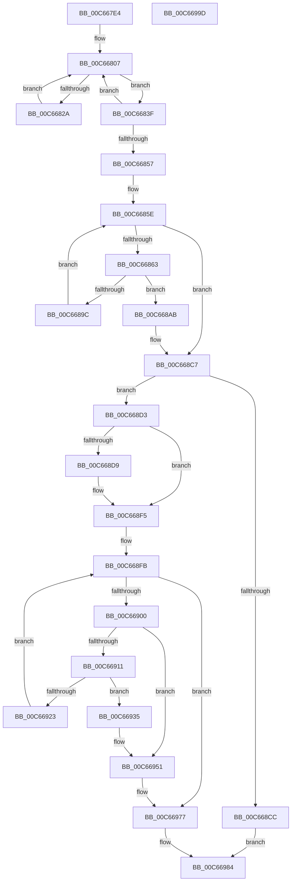

# MiCheckLargePageOk

- RVA: `0x00C667E4`–`0x00C6699E` (길이 `442` bytes)
- VA: `0x0000000140C667E4`
- 실행 섹션: `INIT`
- PDB 이름 있음: `예`; PDB Function 태그: `아니요`
- unwind 정보 RVA: `0x0009F048`
- 디코드: `124`개 명령, `442/442` bytes 표시
- 미해석 바이트: `0` (있으면 어셈블리에 `.byte`로 보존)

> 이 문서는 커널 이미지의 기계어와 PDB 기호를 분석해 생성했습니다. 4번과 5번은 함수 원형과 자료형을 바이너리 사용 방식에서 추정한 C 해석이며 원본 소스 복구 결과는 아닙니다.

## 1. Dependencies

- 직접 호출 지점: **10**; 고유 호출 대상: **5**
- 직접 호출자로 확인된 함수: **1**
- RIP 상대 이미지 참조: **6**

### Outgoing calls
- `0x00C6680E` → [MI_IS_PHYSICAL_ADDRESS](../../text/23/MI_IS_PHYSICAL_ADDRESS_function_0023B3A0.md) (function, `0x0023B3A0`)
- `0x00C66887` → [RtlImageNtHeaderEx](../../text/41/RtlImageNtHeaderEx_function_0041EAA0.md) (function, `0x0041EAA0`)
- `0x00C6689F` → [MiVerifyLargeSectionLayout](MiVerifyLargeSectionLayout_function_00C66F9C.md) (function, `0x00C66F9C`)
- `0x00C668C1` → [KeBugCheckEx](../../text/4F/KeBugCheckEx_function_004FD660.md) (function, `0x004FD660`)
- `0x00C668EF` → [KeBugCheckEx](../../text/4F/KeBugCheckEx_function_004FD660.md) (function, `0x004FD660`)
- `0x00C66907` → [MI_IS_PHYSICAL_ADDRESS](../../text/23/MI_IS_PHYSICAL_ADDRESS_function_0023B3A0.md) (function, `0x0023B3A0`)
- `0x00C66929` → [MiCheckLargePageSystemImage](MiCheckLargePageSystemImage_function_00C669A4.md) (function, `0x00C669A4`)
- `0x00C6694B` → [KeBugCheckEx](../../text/4F/KeBugCheckEx_function_004FD660.md) (function, `0x004FD660`)
- `0x00C66954` → [MI_IS_PHYSICAL_ADDRESS](../../text/23/MI_IS_PHYSICAL_ADDRESS_function_0023B3A0.md) (function, `0x0023B3A0`)
- `0x00C66971` → [KeBugCheckEx](../../text/4F/KeBugCheckEx_function_004FD660.md) (function, `0x004FD660`)

### Direct callers
- [MiInitNucleus](../C5/MiInitNucleus_function_00C5FD38.md) at `0x00C5FF2C`

### Static image references
- `0x00C6682A` → RVA `0x00FC6B28` (`ALMOSTRO`; write)
- `0x00C66836` → RVA `0x00FC6CB0` (`ALMOSTRO`; write)
- `0x00C66841` → RVA `0x00FC6B98` (`ALMOSTRO`; write)
- `0x00C6684B` → RVA `0x00FC6D90` (`ALMOSTRO`; write)
- `0x00C66867` → RVA `0x00E2D940` (`.data`; read)
- `0x00C66977` → RVA `0x00FC6A88` (`ALMOSTRO`; read/write)

## 2. Other-region calls and transfers

- 다른 실행 섹션으로 향하는 call: **8**
  - `0x00C6680E` → [MI_IS_PHYSICAL_ADDRESS](../../text/23/MI_IS_PHYSICAL_ADDRESS_function_0023B3A0.md) (`INIT` → `.text`)
  - `0x00C66887` → [RtlImageNtHeaderEx](../../text/41/RtlImageNtHeaderEx_function_0041EAA0.md) (`INIT` → `.text`)
  - `0x00C668C1` → [KeBugCheckEx](../../text/4F/KeBugCheckEx_function_004FD660.md) (`INIT` → `.text`)
  - `0x00C668EF` → [KeBugCheckEx](../../text/4F/KeBugCheckEx_function_004FD660.md) (`INIT` → `.text`)
  - `0x00C66907` → [MI_IS_PHYSICAL_ADDRESS](../../text/23/MI_IS_PHYSICAL_ADDRESS_function_0023B3A0.md) (`INIT` → `.text`)
  - `0x00C6694B` → [KeBugCheckEx](../../text/4F/KeBugCheckEx_function_004FD660.md) (`INIT` → `.text`)
  - `0x00C66954` → [MI_IS_PHYSICAL_ADDRESS](../../text/23/MI_IS_PHYSICAL_ADDRESS_function_0023B3A0.md) (`INIT` → `.text`)
  - `0x00C66971` → [KeBugCheckEx](../../text/4F/KeBugCheckEx_function_004FD660.md) (`INIT` → `.text`)
- 별도 외부 분기/꼬리 이동을 확인하지 못했습니다.

## 3. Assembly (complete function range)

```asm
00C667E4  48 89 5C 24 10                  mov qword ptr [rsp + 0x10], rbx
00C667E9  48 89 6C 24 18                  mov qword ptr [rsp + 0x18], rbp
00C667EE  48 89 74 24 20                  mov qword ptr [rsp + 0x20], rsi
00C667F3  57                              push rdi
00C667F4  41 56                           push r14
00C667F6  41 57                           push r15
00C667F8  48 83 EC 30                     sub rsp, 0x30
00C667FC  48 8B 71 10                     mov rsi, qword ptr [rcx + 0x10]
00C66800  33 ED                           xor ebp, ebp
00C66802  33 FF                           xor edi, edi
00C66804  48 8B D9                        mov rbx, rcx
00C66807  4C 8B 7E 30                     mov r15, qword ptr [rsi + 0x30]
00C6680B  49 8B CF                        mov rcx, r15
00C6680E  E8 8D 4B 5D FF                  call 0x14023b3a0
00C66813  85 C0                           test eax, eax
00C66815  8D 4D 01                        lea ecx, [rbp + 1]
00C66818  8B 46 40                        mov eax, dword ptr [rsi + 0x40]
00C6681B  0F 44 CD                        cmove ecx, ebp
00C6681E  49 03 C7                        add rax, r15
00C66821  8B E9                           mov ebp, ecx
00C66823  44 8B F1                        mov r14d, ecx
00C66826  85 FF                           test edi, edi
00C66828  75 15                           jne 0x140c6683f
00C6682A  4C 89 3D F7 02 36 00            mov qword ptr [rip + 0x3602f7], r15
00C66831  FF C7                           inc edi
00C66833  48 8B 36                        mov rsi, qword ptr [rsi]
00C66836  48 89 05 73 04 36 00            mov qword ptr [rip + 0x360473], rax
00C6683D  EB C8                           jmp 0x140c66807
00C6683F  FF C7                           inc edi
00C66841  4C 89 3D 50 03 36 00            mov qword ptr [rip + 0x360350], r15
00C66848  48 8B 36                        mov rsi, qword ptr [rsi]
00C6684B  48 89 05 3E 05 36 00            mov qword ptr [rip + 0x36053e], rax
00C66852  83 FF 02                        cmp edi, 2
00C66855  72 B0                           jb 0x140c66807
00C66857  90                              nop
00C66858  33 FF                           xor edi, edi
00C6685A  48 8B 73 10                     mov rsi, qword ptr [rbx + 0x10]
00C6685E  83 FF 01                        cmp edi, 1
00C66861  73 64                           jae 0x140c668c7
00C66863  48 8B 6E 30                     mov rbp, qword ptr [rsi + 0x30]
00C66867  48 8D 0D D2 70 1C 00            lea rcx, [rip + 0x1c70d2]
00C6686E  48 83 64 24 50 00               and qword ptr [rsp + 0x50], 0
00C66874  4C 8D 4C 24 50                  lea r9, [rsp + 0x50]
00C66879  45 33 C0                        xor r8d, r8d
00C6687C  48 89 34 F9                     mov qword ptr [rcx + rdi*8], rsi
00C66880  48 8B D5                        mov rdx, rbp
00C66883  41 8D 48 01                     lea ecx, [r8 + 1]
00C66887  E8 14 82 7B FF                  call 0x14041eaa0
00C6688C  48 8B 44 24 50                  mov rax, qword ptr [rsp + 0x50]
00C66891  8B 50 38                        mov edx, dword ptr [rax + 0x38]
00C66894  81 FA 00 10 00 00               cmp edx, 0x1000
00C6689A  75 0F                           jne 0x140c668ab
00C6689C  48 8B CD                        mov rcx, rbp
00C6689F  E8 F8 06 00 00                  call 0x140c66f9c
00C668A4  48 8B 36                        mov rsi, qword ptr [rsi]
00C668A7  FF C7                           inc edi
00C668A9  EB B3                           jmp 0x140c6685e
00C668AB  48 83 64 24 20 00               and qword ptr [rsp + 0x20], 0
00C668B1  4C 8B CA                        mov r9, rdx
00C668B4  BA 07 03 03 03                  mov edx, 0x3030307
00C668B9  4C 8B C3                        mov r8, rbx
00C668BC  B9 1A 00 00 00                  mov ecx, 0x1a
00C668C1  E8 9A 6D 89 FF                  call 0x1404fd660
00C668C6  CC                              int3
00C668C7  45 85 F6                        test r14d, r14d
00C668CA  75 07                           jne 0x140c668d3
00C668CC  33 C0                           xor eax, eax
00C668CE  E9 B1 00 00 00                  jmp 0x140c66984
00C668D3  41 83 FE 01                     cmp r14d, 1
00C668D7  74 1C                           je 0x140c668f5
00C668D9  48 83 64 24 20 00               and qword ptr [rsp + 0x20], 0
00C668DF  4D 8B CE                        mov r9, r14
00C668E2  4C 8B C3                        mov r8, rbx
00C668E5  BA 02 03 03 03                  mov edx, 0x3030302
00C668EA  B9 1A 00 00 00                  mov ecx, 0x1a
00C668EF  E8 6C 6D 89 FF                  call 0x1404fd660
00C668F4  CC                              int3
00C668F5  48 8B 73 10                     mov rsi, qword ptr [rbx + 0x10]
00C668F9  33 ED                           xor ebp, ebp
00C668FB  83 FD 01                        cmp ebp, 1
00C668FE  73 77                           jae 0x140c66977
00C66900  48 8B 7E 30                     mov rdi, qword ptr [rsi + 0x30]
00C66904  48 8B CF                        mov rcx, rdi
00C66907  E8 94 4A 5D FF                  call 0x14023b3a0
00C6690C  83 F8 01                        cmp eax, 1
00C6690F  75 40                           jne 0x140c66951
00C66911  48 8D 87 FF FF 1F 00            lea rax, [rdi + 0x1fffff]
00C66918  48 25 00 00 E0 FF               and rax, 0xffffffffffe00000
00C6691E  48 3B C7                        cmp rax, rdi
00C66921  75 12                           jne 0x140c66935
00C66923  48 8B D6                        mov rdx, rsi
00C66926  48 8B CB                        mov rcx, rbx
00C66929  E8 76 00 00 00                  call 0x140c669a4
00C6692E  48 8B 36                        mov rsi, qword ptr [rsi]
00C66931  FF C5                           inc ebp
00C66933  EB C6                           jmp 0x140c668fb
00C66935  48 83 64 24 20 00               and qword ptr [rsp + 0x20], 0
00C6693B  4C 8B CF                        mov r9, rdi
00C6693E  4C 8B C3                        mov r8, rbx
00C66941  BA 06 03 03 03                  mov edx, 0x3030306
00C66946  B9 1A 00 00 00                  mov ecx, 0x1a
00C6694B  E8 10 6D 89 FF                  call 0x1404fd660
00C66950  CC                              int3
00C66951  48 8B CF                        mov rcx, rdi
00C66954  E8 47 4A 5D FF                  call 0x14023b3a0
00C66959  48 63 C8                        movsxd rcx, eax
00C6695C  4C 8B CF                        mov r9, rdi
00C6695F  48 89 4C 24 20                  mov qword ptr [rsp + 0x20], rcx
00C66964  4C 8B C3                        mov r8, rbx
00C66967  B9 1A 00 00 00                  mov ecx, 0x1a
00C6696C  BA 04 03 03 03                  mov edx, 0x3030304
00C66971  E8 EA 6C 89 FF                  call 0x1404fd660
00C66976  CC                              int3
00C66977  48 83 0D 09 01 36 00 04         or qword ptr [rip + 0x360109], 4
00C6697F  B8 01 00 00 00                  mov eax, 1
00C66984  48 8B 5C 24 58                  mov rbx, qword ptr [rsp + 0x58]
00C66989  48 8B 6C 24 60                  mov rbp, qword ptr [rsp + 0x60]
00C6698E  48 8B 74 24 68                  mov rsi, qword ptr [rsp + 0x68]
00C66993  48 83 C4 30                     add rsp, 0x30
00C66997  41 5F                           pop r15
00C66999  41 5E                           pop r14
00C6699B  5F                              pop rdi
00C6699C  C3                              ret
00C6699D  CC                              int3
```

## 4. C-style interpretation (structured pseudocode)

```c
__int64 __fastcall MiCheckLargePageOk(__int64 a1, __int64 a2, int a3)
{
    __int64 result;
    __int64 v_rbp;
    __int64 v_rdi;
    __int64 v_rsp;
    unsigned __int64 v_stack_m28;
    unsigned __int64 v_stack_p10;
    unsigned __int64 v_stack_p18;
    unsigned __int64 v_stack_p20;
    unsigned __int64 v_stack_p8;

    v_stack_p10 = v_rbx;
    v_stack_p18 = v_rbp;
    v_stack_p20 = v_rsi;
    v_rsp = (v_rsp) - (48);
    v_rbp = 0;
    v_rdi = 0;
loc_00C66807:
    result = MI_IS_PHYSICAL_ADDRESS(*(unsigned __int64 *)(*(unsigned __int64 *)(a1 + 16) + 48), a2, a3, a4);
    a1 = v_rbp + 1;
    if ((unsigned int)(result) == 0) { a1 = 0; }
    result = ((unsigned int)(*(unsigned int *)(*(unsigned __int64 *)(a1 + 16) + 64))) + (*(unsigned __int64 *)(*(unsigned __int64 *)(a1 + 16) + 48));
    if (0 != 0) goto loc_00C6683F;
    *(unsigned __int64 *)(v_rip + 3539703) = *(unsigned __int64 *)(*(unsigned __int64 *)(a1 + 16) + 48);
    v_rdi = (unsigned int)((v_rdi) + 1);
    *(unsigned __int64 *)(v_rip + 3540083) = result;
    goto loc_00C66807;
loc_00C6683F:
    v_rdi = (unsigned int)((v_rdi) + 1);
    *(unsigned __int64 *)(v_rip + 3539792) = *(unsigned __int64 *)(*(unsigned __int64 *)(a1 + 16) + 48);
    *(unsigned __int64 *)(v_rip + 3540286) = result;
    if (((unsigned int)(v_rdi)) < 2) goto loc_00C66807;
    v_rdi = 0;
loc_00C6685E:
    if (0 >= 1) goto loc_00C668C7;
    a3 = 0;
    *(unsigned __int64 *)(v_rip + 1863890 + v_rdi * 8) = *(unsigned __int64 *)(a1 + 16);
    result = RtlImageNtHeaderEx(a3 + 1, *(unsigned __int64 *)(*(unsigned __int64 *)(a1 + 16) + 48), a3, v_stack_p8);
    if (((unsigned int)((unsigned int)(*(unsigned int *)(v_stack_p8 + 56)))) != 0x1000ULL) goto loc_00C668AB;
    result = MiVerifyLargeSectionLayout(*(unsigned __int64 *)(*(unsigned __int64 *)(a1 + 16) + 48), (unsigned int)(*(unsigned int *)(v_stack_p8 + 56)), a3, v_stack_p8);
    v_rdi = (unsigned int)((v_rdi) + 1);
    goto loc_00C6685E;
loc_00C668AB:
    result = KeBugCheckEx(26, (unsigned int)(0x3030307ULL), a1, (unsigned int)(*(unsigned int *)(v_stack_p8 + 56)));
loc_00C668C7:
    if ((unsigned int)((unsigned int)((unsigned int)(a1))) != 0) goto loc_00C668D3;
    result = 0;
    goto loc_00C66984;
loc_00C668D3:
    if (((unsigned int)((unsigned int)((unsigned int)(a1)))) != 1) {
        a4 = (unsigned int)((unsigned int)(a1));
        a3 = a1;
        a2 = 0x3030302ULL;
        a1 = 26;
        result = KeBugCheckEx(a1, a2, a3, a4);
    }
    v_rbp = 0;
loc_00C668FB:
    if (0 >= 1) goto loc_00C66977;
    result = MI_IS_PHYSICAL_ADDRESS(*(unsigned __int64 *)(*(unsigned __int64 *)(a1 + 16) + 48), a2, a3, a4);
    if (((unsigned int)(result)) != 1) goto loc_00C66951;
    result = (*(unsigned __int64 *)(*(unsigned __int64 *)(a1 + 16) + 48) + 2097151) & (0xFFFFFFFFFFE00000ULL);
    if (result != (*(unsigned __int64 *)(*(unsigned __int64 *)(a1 + 16) + 48))) goto loc_00C66935;
    result = MiCheckLargePageSystemImage(a1, *(unsigned __int64 *)(a1 + 16), a3, a4);
    v_rbp = (unsigned int)((v_rbp) + 1);
    goto loc_00C668FB;
loc_00C66935:
    result = KeBugCheckEx(26, (unsigned int)(0x3030306ULL), a1, *(unsigned __int64 *)(*(unsigned __int64 *)(a1 + 16) + 48));
loc_00C66951:
    result = MI_IS_PHYSICAL_ADDRESS(*(unsigned __int64 *)(*(unsigned __int64 *)(a1 + 16) + 48), (unsigned int)(0x3030306ULL), a1, *(unsigned __int64 *)(*(unsigned __int64 *)(a1 + 16) + 48));
    v_stack_m28 = (int)((unsigned int)(result));
    result = KeBugCheckEx(26, (unsigned int)(0x3030304ULL), a1, *(unsigned __int64 *)(*(unsigned __int64 *)(a1 + 16) + 48));
loc_00C66977:
loc_00C66984:
    v_rsp = (v_rsp) + (48);
    return 1;
}
```

## 5. (Beta) C Style

```c
int64_t MiCheckLargePageOk(void *Arg1, int64_t Arg2, int32_t Arg3)
{
    uint8_t *arg1 = (uint8_t *)Arg1;

    int64_t result;
    int64_t local_rbp;
    int64_t local_rdi;
    int64_t local_rsp;
    uint64_t v_stack_m28;
    uint64_t v_stack_p10;
    uint64_t v_stack_p18;
    uint64_t v_stack_p20;
    uint64_t v_stack_p8;

    v_stack_p10 = local_rbx;
    v_stack_p18 = local_rbp;
    v_stack_p20 = local_rsi;
    local_rsp = (local_rsp) - (48);
    local_rbp = 0;
    local_rdi = 0;
loc_00C66807:
    result = MI_IS_PHYSICAL_ADDRESS(*(uint64_t *)(*(uint64_t *)(arg1 + 0x10) + 0x30), Arg2, Arg3, a4);
    Arg1 = local_rbp + 1;
    if ((uint32_t)(result) == 0) { Arg1 = 0; }
    result = ((uint32_t)(*(uint32_t *)(*(uint64_t *)(arg1 + 0x10) + 0x40))) + (*(uint64_t *)(*(uint64_t *)(arg1 + 0x10) + 0x30));
    if (0 != 0) goto loc_00C6683F;
    *(uint64_t *)(v_rip + 0x3602F7) = *(uint64_t *)(*(uint64_t *)(arg1 + 0x10) + 0x30);
    local_rdi = (uint32_t)((local_rdi) + 1);
    *(uint64_t *)(v_rip + 0x360473) = result;
    goto loc_00C66807;
loc_00C6683F:
    local_rdi = (uint32_t)((local_rdi) + 1);
    *(uint64_t *)(v_rip + 0x360350) = *(uint64_t *)(*(uint64_t *)(arg1 + 0x10) + 0x30);
    *(uint64_t *)(v_rip + 0x36053E) = result;
    if (((uint32_t)(local_rdi)) < 2) goto loc_00C66807;
    local_rdi = 0;
loc_00C6685E:
    if (0 >= 1) goto loc_00C668C7;
    Arg3 = 0;
    *(uint64_t *)(v_rip + 0x1C70D2 + local_rdi * 8) = *(uint64_t *)(arg1 + 0x10);
    result = RtlImageNtHeaderEx(Arg3 + 1, *(uint64_t *)(*(uint64_t *)(arg1 + 0x10) + 0x30), Arg3, v_stack_p8);
    if (((uint32_t)((uint32_t)(*(uint32_t *)(v_stack_p8 + 0x38)))) != 0x1000ULL) goto loc_00C668AB;
    result = MiVerifyLargeSectionLayout(*(uint64_t *)(*(uint64_t *)(arg1 + 0x10) + 0x30), (uint32_t)(*(uint32_t *)(v_stack_p8 + 0x38)), Arg3, v_stack_p8);
    local_rdi = (uint32_t)((local_rdi) + 1);
    goto loc_00C6685E;
loc_00C668AB:
    result = KeBugCheckEx(26, (uint32_t)(0x3030307ULL), Arg1, (uint32_t)(*(uint32_t *)(v_stack_p8 + 0x38)));
loc_00C668C7:
    if ((uint32_t)((uint32_t)((uint32_t)(Arg1))) != 0) goto loc_00C668D3;
    result = 0;
    goto loc_00C66984;
loc_00C668D3:
    if (((uint32_t)((uint32_t)((uint32_t)(Arg1)))) != 1) {
        a4 = (uint32_t)((uint32_t)(Arg1));
        Arg3 = Arg1;
        Arg2 = 0x3030302ULL;
        Arg1 = 26;
        result = KeBugCheckEx(Arg1, Arg2, Arg3, a4);
    }
    local_rbp = 0;
loc_00C668FB:
    if (0 >= 1) goto loc_00C66977;
    result = MI_IS_PHYSICAL_ADDRESS(*(uint64_t *)(*(uint64_t *)(arg1 + 0x10) + 0x30), Arg2, Arg3, a4);
    if (((uint32_t)(result)) != 1) goto loc_00C66951;
    result = (*(uint64_t *)(*(uint64_t *)(arg1 + 0x10) + 0x30) + 2097151) & (0xFFFFFFFFFFE00000ULL);
    if (result != (*(uint64_t *)(*(uint64_t *)(arg1 + 0x10) + 0x30))) goto loc_00C66935;
    result = MiCheckLargePageSystemImage(Arg1, *(uint64_t *)(arg1 + 0x10), Arg3, a4);
    local_rbp = (uint32_t)((local_rbp) + 1);
    goto loc_00C668FB;
loc_00C66935:
    result = KeBugCheckEx(26, (uint32_t)(0x3030306ULL), Arg1, *(uint64_t *)(*(uint64_t *)(arg1 + 0x10) + 0x30));
loc_00C66951:
    result = MI_IS_PHYSICAL_ADDRESS(*(uint64_t *)(*(uint64_t *)(arg1 + 0x10) + 0x30), (uint32_t)(0x3030306ULL), Arg1, *(uint64_t *)(*(uint64_t *)(arg1 + 0x10) + 0x30));
    v_stack_m28 = (int32_t)((uint32_t)(result));
    result = KeBugCheckEx(26, (uint32_t)(0x3030304ULL), Arg1, *(uint64_t *)(*(uint64_t *)(arg1 + 0x10) + 0x30));
loc_00C66977:
loc_00C66984:
    local_rsp = (local_rsp) + (48);
    return 1;
}
```

### 관측된 메모리 오프셋

구조체 형식이 확인되지 않은 접근은 인자 기준의 오프셋으로만 기록했습니다.

| 기준 인자 | 오프셋 표현 | 폭 (bit) | 접근 |
|---|---:|---:|---|
| `Arg1` | `+ 0x10` | `64` | `R` |

## 6. Execution-region graph

[열기: 2D/3D 그래프와 함수 탐색 컨트롤 패널](../../../control-panel.html?section=init&rva=0x00C667E4&view=graph)

- 2D 그래프는 위에서 아래로 흐르고, 3D 그래프는 빈 공간을 드래그해 회전합니다. Shift+드래그는 이동, 휠은 확대·축소, 함수 노드 선택은 대상 보고서 이동입니다.

### Static fallback


