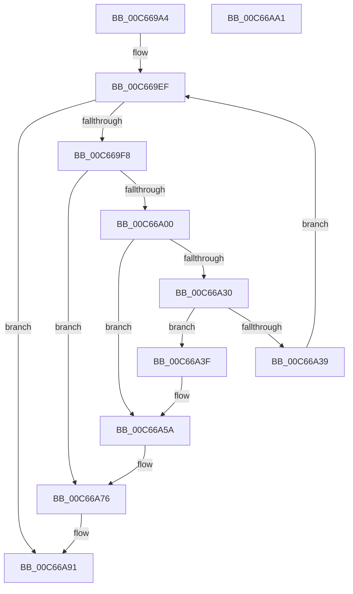

# MiCheckLargePageSystemImage

- RVA: `0x00C669A4`–`0x00C66AA2` (길이 `254` bytes)
- VA: `0x0000000140C669A4`
- 실행 섹션: `INIT`
- PDB 이름 있음: `예`; PDB Function 태그: `아니요`
- unwind 정보 RVA: `0x000794E0`
- 디코드: `68`개 명령, `254/254` bytes 표시
- 미해석 바이트: `0` (있으면 어셈블리에 `.byte`로 보존)

> 이 문서는 커널 이미지의 기계어와 PDB 기호를 분석해 생성했습니다. 4번과 5번은 함수 원형과 자료형을 바이너리 사용 방식에서 추정한 C 해석이며 원본 소스 복구 결과는 아닙니다.

## 1. Dependencies

- 직접 호출 지점: **4**; 고유 호출 대상: **2**
- 직접 호출자로 확인된 함수: **1**
- RIP 상대 이미지 참조: **0**

### Outgoing calls
- `0x00C66A17` → [MiFindDescriptorByPfn](../C5/MiFindDescriptorByPfn_function_00C5FBA0.md) (function, `0x00C5FBA0`)
- `0x00C66A54` → [KeBugCheckEx](../../text/4F/KeBugCheckEx_function_004FD660.md) (function, `0x004FD660`)
- `0x00C66A70` → [KeBugCheckEx](../../text/4F/KeBugCheckEx_function_004FD660.md) (function, `0x004FD660`)
- `0x00C66A8B` → [KeBugCheckEx](../../text/4F/KeBugCheckEx_function_004FD660.md) (function, `0x004FD660`)

### Direct callers
- [MiCheckLargePageOk](MiCheckLargePageOk_function_00C667E4.md) at `0x00C66929`

### Static image references
- 디코드된 RIP-relative 메모리 참조가 없습니다.

## 2. Other-region calls and transfers

- 다른 실행 섹션으로 향하는 call: **3**
  - `0x00C66A54` → [KeBugCheckEx](../../text/4F/KeBugCheckEx_function_004FD660.md) (`INIT` → `.text`)
  - `0x00C66A70` → [KeBugCheckEx](../../text/4F/KeBugCheckEx_function_004FD660.md) (`INIT` → `.text`)
  - `0x00C66A8B` → [KeBugCheckEx](../../text/4F/KeBugCheckEx_function_004FD660.md) (`INIT` → `.text`)
- 별도 외부 분기/꼬리 이동을 확인하지 못했습니다.

## 3. Assembly (complete function range)

```asm
00C669A4  48 89 5C 24 08                  mov qword ptr [rsp + 8], rbx
00C669A9  48 89 74 24 10                  mov qword ptr [rsp + 0x10], rsi
00C669AE  57                              push rdi
00C669AF  48 83 EC 30                     sub rsp, 0x30
00C669B3  4C 8B 42 30                     mov r8, qword ptr [rdx + 0x30]
00C669B7  41 B9 F8 FF FF 3F               mov r9d, 0x3ffffff8
00C669BD  49 8B D8                        mov rbx, r8
00C669C0  48 8B F9                        mov rdi, rcx
00C669C3  48 C1 EB 12                     shr rbx, 0x12
00C669C7  49 23 D9                        and rbx, r9
00C669CA  48 B9 00 00 00 40 FB F6 FF FF   movabs rcx, 0xfffff6fb40000000
00C669D4  48 8B C1                        mov rax, rcx
00C669D7  8B 72 40                        mov esi, dword ptr [rdx + 0x40]
00C669DA  48 03 D8                        add rbx, rax
00C669DD  FF CE                           dec esi
00C669DF  49 03 F0                        add rsi, r8
00C669E2  48 C1 EE 12                     shr rsi, 0x12
00C669E6  49 23 F1                        and rsi, r9
00C669E9  48 8B C1                        mov rax, rcx
00C669EC  48 03 F0                        add rsi, rax
00C669EF  48 3B DE                        cmp rbx, rsi
00C669F2  0F 87 99 00 00 00               ja 0x140c66a91
00C669F8  4C 8B 1B                        mov r11, qword ptr [rbx]
00C669FB  45 84 DB                        test r11b, r11b
00C669FE  79 76                           jns 0x140c66a76
00C66A00  48 B8 FF FF FF FF FF 00 00 00   movabs rax, 0xffffffffff
00C66A0A  49 C1 EB 0C                     shr r11, 0xc
00C66A0E  4C 23 D8                        and r11, rax
00C66A11  48 8B CF                        mov rcx, rdi
00C66A14  49 8B D3                        mov rdx, r11
00C66A17  E8 84 91 FF FF                  call 0x140c5fba0
00C66A1C  49 8D 8B 00 02 00 00            lea rcx, [r11 + 0x200]
00C66A23  48 8B 50 28                     mov rdx, qword ptr [rax + 0x28]
00C66A27  48 03 50 20                     add rdx, qword ptr [rax + 0x20]
00C66A2B  48 3B D1                        cmp rdx, rcx
00C66A2E  72 2A                           jb 0x140c66a5a
00C66A30  48 63 40 18                     movsxd rax, dword ptr [rax + 0x18]
00C66A34  83 F8 09                        cmp eax, 9
00C66A37  75 06                           jne 0x140c66a3f
00C66A39  48 83 C3 08                     add rbx, 8
00C66A3D  EB B0                           jmp 0x140c669ef
00C66A3F  4D 8B CB                        mov r9, r11
00C66A42  48 89 44 24 20                  mov qword ptr [rsp + 0x20], rax
00C66A47  4C 8B C7                        mov r8, rdi
00C66A4A  BA 09 03 03 03                  mov edx, 0x3030309
00C66A4F  B9 1A 00 00 00                  mov ecx, 0x1a
00C66A54  E8 07 6C 89 FF                  call 0x1404fd660
00C66A59  CC                              int3
00C66A5A  48 83 64 24 20 00               and qword ptr [rsp + 0x20], 0
00C66A60  4D 8B CB                        mov r9, r11
00C66A63  4C 8B C7                        mov r8, rdi
00C66A66  BA 01 03 03 03                  mov edx, 0x3030301
00C66A6B  B9 1A 00 00 00                  mov ecx, 0x1a
00C66A70  E8 EB 6B 89 FF                  call 0x1404fd660
00C66A75  CC                              int3
00C66A76  4C 8B CB                        mov r9, rbx
00C66A79  4C 89 5C 24 20                  mov qword ptr [rsp + 0x20], r11
00C66A7E  4C 8B C7                        mov r8, rdi
00C66A81  BA 00 03 03 03                  mov edx, 0x3030300
00C66A86  B9 1A 00 00 00                  mov ecx, 0x1a
00C66A8B  E8 D0 6B 89 FF                  call 0x1404fd660
00C66A90  CC                              int3
00C66A91  48 8B 5C 24 40                  mov rbx, qword ptr [rsp + 0x40]
00C66A96  48 8B 74 24 48                  mov rsi, qword ptr [rsp + 0x48]
00C66A9B  48 83 C4 30                     add rsp, 0x30
00C66A9F  5F                              pop rdi
00C66AA0  C3                              ret
00C66AA1  CC                              int3
```

## 4. C-style interpretation (structured pseudocode)

```c
__int64 __fastcall MiCheckLargePageSystemImage(__int64 a1, __int64 a2)
{
    __int64 result;
    __int64 v_r11;
    __int64 v_rbx;
    __int64 v_rsi;
    __int64 v_rsp;
    unsigned __int64 v_stack_m18;
    unsigned __int64 v_stack_p10;
    unsigned __int64 v_stack_p8;

    v_stack_p8 = v_rbx;
    v_stack_p10 = v_rsi;
    v_rsp = (v_rsp) - (48);
    v_rbx = (*(unsigned __int64 *)(a2 + 48)) >> (18);
    v_rbx = (v_rbx) & ((unsigned int)(0x3FFFFFF8ULL));
    v_rbx = (v_rbx) + (a1);
    v_rsi = (unsigned int)(((unsigned int)(*(unsigned int *)(a2 + 64))) - 1);
    v_rsi = (v_rsi) + (*(unsigned __int64 *)(a2 + 48));
    v_rsi = (v_rsi) >> (18);
    v_rsi = (v_rsi) & ((unsigned int)(0x3FFFFFF8ULL));
    v_rsi = (v_rsi) + (a1);
loc_00C669EF:
    if (v_rbx > v_rsi) goto loc_00C66A91;
    if (!sign_flag) goto loc_00C66A76;
    v_r11 = (*(unsigned __int64 *)(v_rbx)) >> (12);
    v_r11 = (v_r11) & (a1);
    result = MiFindDescriptorByPfn(a1, v_r11, *(unsigned __int64 *)(a2 + 48), (unsigned int)(0x3FFFFFF8ULL));
    a2 = (*(unsigned __int64 *)(result + 40)) + (*(unsigned __int64 *)(result + 32));
    if (a2 < (v_r11 + 512)) goto loc_00C66A5A;
    if (((unsigned int)((int)(*(unsigned int *)(result + 24)))) != 9) goto loc_00C66A3F;
    v_rbx = (v_rbx) + (8);
    goto loc_00C669EF;
loc_00C66A3F:
    v_stack_m18 = (int)(*(unsigned int *)(result + 24));
    result = KeBugCheckEx(26, (unsigned int)(0x3030309ULL), a1, v_r11);
loc_00C66A5A:
    result = KeBugCheckEx(26, (unsigned int)(0x3030301ULL), a1, v_r11);
loc_00C66A76:
    v_stack_m18 = v_r11;
    result = KeBugCheckEx(26, (unsigned int)(0x3030300ULL), a1, v_rbx);
loc_00C66A91:
    v_rsp = (v_rsp) + (48);
    return result;
}
```

## 5. (Beta) C Style

```c
int64_t MiCheckLargePageSystemImage(int64_t Arg1, void *Arg2)
{
    uint8_t *arg2 = (uint8_t *)Arg2;

    int64_t result;
    int64_t local_r11;
    int64_t local_rbx;
    int64_t local_rsi;
    int64_t local_rsp;
    uint64_t v_stack_m18;
    uint64_t v_stack_p10;
    uint64_t v_stack_p8;

    v_stack_p8 = local_rbx;
    v_stack_p10 = local_rsi;
    local_rsp = (local_rsp) - (48);
    local_rbx = (*(uint64_t *)(arg2 + 0x30)) >> (18);
    local_rbx = (local_rbx) & ((uint32_t)(0x3FFFFFF8ULL));
    local_rbx = (local_rbx) + (Arg1);
    local_rsi = (uint32_t)(((uint32_t)(*(uint32_t *)(arg2 + 0x40))) - 1);
    local_rsi = (local_rsi) + (*(uint64_t *)(arg2 + 0x30));
    local_rsi = (local_rsi) >> (18);
    local_rsi = (local_rsi) & ((uint32_t)(0x3FFFFFF8ULL));
    local_rsi = (local_rsi) + (Arg1);
loc_00C669EF:
    if (local_rbx > local_rsi) goto loc_00C66A91;
    if (!sign_flag) goto loc_00C66A76;
    local_r11 = (*(uint64_t *)(local_rbx)) >> (12);
    local_r11 = (local_r11) & (Arg1);
    result = MiFindDescriptorByPfn(Arg1, local_r11, *(uint64_t *)(arg2 + 0x30), (uint32_t)(0x3FFFFFF8ULL));
    Arg2 = (*(uint64_t *)(result + 0x28)) + (*(uint64_t *)(result + 0x20));
    if (Arg2 < (local_r11 + 512)) goto loc_00C66A5A;
    if (((uint32_t)((int32_t)(*(uint32_t *)(result + 0x18)))) != 9) goto loc_00C66A3F;
    local_rbx = (local_rbx) + (8);
    goto loc_00C669EF;
loc_00C66A3F:
    v_stack_m18 = (int32_t)(*(uint32_t *)(result + 0x18));
    result = KeBugCheckEx(26, (uint32_t)(0x3030309ULL), Arg1, local_r11);
loc_00C66A5A:
    result = KeBugCheckEx(26, (uint32_t)(0x3030301ULL), Arg1, local_r11);
loc_00C66A76:
    v_stack_m18 = local_r11;
    result = KeBugCheckEx(26, (uint32_t)(0x3030300ULL), Arg1, local_rbx);
loc_00C66A91:
    local_rsp = (local_rsp) + (48);
    return result;
}
```

### 관측된 메모리 오프셋

구조체 형식이 확인되지 않은 접근은 인자 기준의 오프셋으로만 기록했습니다.

| 기준 인자 | 오프셋 표현 | 폭 (bit) | 접근 |
|---|---:|---:|---|
| `Arg2` | `+ 0x30` | `64` | `R` |
| `Arg2` | `+ 0x40` | `32` | `R` |

## 6. Execution-region graph

[열기: 2D/3D 그래프와 함수 탐색 컨트롤 패널](../../../control-panel.html?section=init&rva=0x00C669A4&view=graph)

- 2D 그래프는 위에서 아래로 흐르고, 3D 그래프는 빈 공간을 드래그해 회전합니다. Shift+드래그는 이동, 휠은 확대·축소, 함수 노드 선택은 대상 보고서 이동입니다.

### Static fallback


