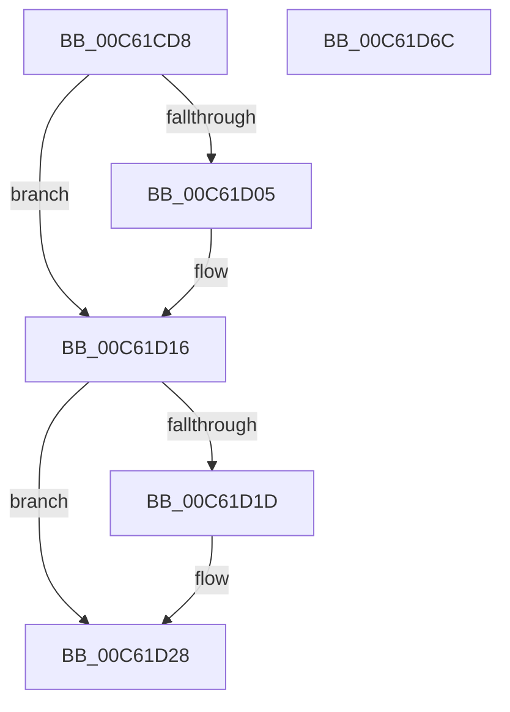

# MiClearStaleSecurePageMapping

- RVA: `0x00C61CD8`–`0x00C61D6D` (길이 `149` bytes)
- VA: `0x0000000140C61CD8`
- 실행 섹션: `INIT`
- PDB 이름 있음: `예`; PDB Function 태그: `아니요`
- unwind 정보 RVA: `0x000D25E0`
- 디코드: `41`개 명령, `149/149` bytes 표시
- 미해석 바이트: `0` (있으면 어셈블리에 `.byte`로 보존)

> 이 문서는 커널 이미지의 기계어와 PDB 기호를 분석해 생성했습니다. 4번과 5번은 함수 원형과 자료형을 바이너리 사용 방식에서 추정한 C 해석이며 원본 소스 복구 결과는 아닙니다.

## 1. Dependencies

- 직접 호출 지점: **6**; 고유 호출 대상: **6**
- 직접 호출자로 확인된 함수: **1**
- RIP 상대 이미지 참조: **1**

### Outgoing calls
- `0x00C61CFC` → [MiPteInShadowRange](../../text/23/MiPteInShadowRange_function_0023FB00.md) (function, `0x0023FB00`)
- `0x00C61D0A` → [MiSanitizeShadowPxe](../../text/29/MiSanitizeShadowPxe_function_00294B68.md) (function, `0x00294B68`)
- `0x00C61D23` → [MiWritePteShadow](../../text/29/MiWritePteShadow_function_00294EAC.md) (function, `0x00294EAC`)
- `0x00C61D2B` → [MiGetContainingPageTable](../../text/34/MiGetContainingPageTable_function_003467F0.md) (function, `0x003467F0`)
- `0x00C61D4D` → [MiDecreaseUsedPtesInPfn](../../text/2A/MiDecreaseUsedPtesInPfn_function_002A27AC.md) (function, `0x002A27AC`)
- `0x00C61D57` → [MiLockAndDecrementShareCount](../../text/2A/MiLockAndDecrementShareCount_function_002A2854.md) (function, `0x002A2854`)

### Direct callers
- [MiCreateDescriptorPfns](MiCreateDescriptorPfns_function_00C61D74.md) at `0x00C61F10`

### Static image references
- `0x00C61CEC` → RVA `0x00010880` (`.rdata`; read)

## 2. Other-region calls and transfers

- 다른 실행 섹션으로 향하는 call: **6**
  - `0x00C61CFC` → [MiPteInShadowRange](../../text/23/MiPteInShadowRange_function_0023FB00.md) (`INIT` → `.text`)
  - `0x00C61D0A` → [MiSanitizeShadowPxe](../../text/29/MiSanitizeShadowPxe_function_00294B68.md) (`INIT` → `.text`)
  - `0x00C61D23` → [MiWritePteShadow](../../text/29/MiWritePteShadow_function_00294EAC.md) (`INIT` → `.text`)
  - `0x00C61D2B` → [MiGetContainingPageTable](../../text/34/MiGetContainingPageTable_function_003467F0.md) (`INIT` → `.text`)
  - `0x00C61D4D` → [MiDecreaseUsedPtesInPfn](../../text/2A/MiDecreaseUsedPtesInPfn_function_002A27AC.md) (`INIT` → `.text`)
  - `0x00C61D57` → [MiLockAndDecrementShareCount](../../text/2A/MiLockAndDecrementShareCount_function_002A2854.md) (`INIT` → `.text`)
- 별도 외부 분기/꼬리 이동을 확인하지 못했습니다.

## 3. Assembly (complete function range)

```asm
00C61CD8  48 8B C4                        mov rax, rsp
00C61CDB  48 89 58 08                     mov qword ptr [rax + 8], rbx
00C61CDF  48 89 70 18                     mov qword ptr [rax + 0x18], rsi
00C61CE3  48 89 50 10                     mov qword ptr [rax + 0x10], rdx
00C61CE7  57                              push rdi
00C61CE8  48 83 EC 20                     sub rsp, 0x20
00C61CEC  48 8B 1D 8D EB 3A FF            mov rbx, qword ptr [rip - 0xc51473]
00C61CF3  48 8B F9                        mov rdi, rcx
00C61CF6  48 89 58 10                     mov qword ptr [rax + 0x10], rbx
00C61CFA  33 F6                           xor esi, esi
00C61CFC  E8 FF DD 5D FF                  call 0x14023fb00
00C61D01  85 C0                           test eax, eax
00C61D03  74 11                           je 0x140c61d16
00C61D05  48 8D 54 24 38                  lea rdx, [rsp + 0x38]
00C61D0A  E8 59 2E 63 FF                  call 0x140294b68
00C61D0F  48 8B 5C 24 38                  mov rbx, qword ptr [rsp + 0x38]
00C61D14  8B F0                           mov esi, eax
00C61D16  48 89 1F                        mov qword ptr [rdi], rbx
00C61D19  85 F6                           test esi, esi
00C61D1B  74 0B                           je 0x140c61d28
00C61D1D  48 8B D3                        mov rdx, rbx
00C61D20  48 8B CF                        mov rcx, rdi
00C61D23  E8 84 31 63 FF                  call 0x140294eac
00C61D28  48 8B CF                        mov rcx, rdi
00C61D2B  E8 C0 4A 6E FF                  call 0x1403467f0
00C61D30  48 8D 1C 40                     lea rbx, [rax + rax*2]
00C61D34  48 C1 E3 04                     shl rbx, 4
00C61D38  48 B8 00 00 00 00 00 DE FF FF   movabs rax, 0xffffde0000000000
00C61D42  48 03 D8                        add rbx, rax
00C61D45  BA 01 00 00 00                  mov edx, 1
00C61D4A  48 8B CB                        mov rcx, rbx
00C61D4D  E8 5A 0A 64 FF                  call 0x1402a27ac
00C61D52  33 D2                           xor edx, edx
00C61D54  48 8B CB                        mov rcx, rbx
00C61D57  E8 F8 0A 64 FF                  call 0x1402a2854
00C61D5C  48 8B 5C 24 30                  mov rbx, qword ptr [rsp + 0x30]
00C61D61  48 8B 74 24 40                  mov rsi, qword ptr [rsp + 0x40]
00C61D66  48 83 C4 20                     add rsp, 0x20
00C61D6A  5F                              pop rdi
00C61D6B  C3                              ret
00C61D6C  CC                              int3
```

## 4. C-style interpretation (structured pseudocode)

```c
__int64 __fastcall MiClearStaleSecurePageMapping(__int64 a1, __int64 a2)
{
    __int64 result;
    __int64 v_rbx;
    __int64 v_rsi;
    __int64 v_rsp;
    unsigned __int64 v_stack_p10;
    unsigned __int64 v_stack_p18;
    unsigned __int64 v_stack_p8;

    *(unsigned __int64 *)(v_rsp + 8) = v_rbx;
    *(unsigned __int64 *)(v_rsp + 24) = v_rsi;
    *(unsigned __int64 *)(v_rsp + 16) = a2;
    v_rsp = (v_rsp) - (32);
    *(unsigned __int64 *)(v_rsp + 16) = *(unsigned __int64 *)(v_rip - 12915827);
    v_rsi = 0;
    result = MiPteInShadowRange(a1, a2, a3, a4);
    v_rbx = *(unsigned __int64 *)(v_rip - 12915827);
    if ((unsigned int)(result) != 0) {
        a2 = v_stack_p10;
        result = MiSanitizeShadowPxe(a1, a2, a3, a4);
        v_rbx = v_stack_p10;
        v_rsi = (unsigned int)(result);
    }
    *(unsigned __int64 *)(a1) = v_rbx;
    if ((unsigned int)(v_rsi) != 0) {
        a2 = v_rbx;
        a1 = a1;
        result = MiWritePteShadow(a1, a2, a3, a4);
    }
    result = MiGetContainingPageTable(a1, a2, a3, a4);
    v_rbx = (result + result * 2) << (4);
    v_rbx = (v_rbx) + (result);
    result = MiDecreaseUsedPtesInPfn(v_rbx, 1, a3, a4);
    a2 = 0;
    result = MiLockAndDecrementShareCount(v_rbx, a2, a3, a4);
    v_rsp = (v_rsp) + (32);
    return result;
}
```

## 5. (Beta) C Style

```c
int64_t MiClearStaleSecurePageMapping(void *Arg1, int64_t Arg2)
{
    uint8_t *arg1 = (uint8_t *)Arg1;

    int64_t result;
    int64_t local_rbx;
    int64_t local_rsi;
    int64_t local_rsp;
    uint64_t v_stack_p10;
    uint64_t v_stack_p18;
    uint64_t v_stack_p8;

    *(uint64_t *)(local_rsp + 0x8) = local_rbx;
    *(uint64_t *)(local_rsp + 0x18) = local_rsi;
    *(uint64_t *)(local_rsp + 0x10) = Arg2;
    local_rsp = (local_rsp) - (32);
    *(uint64_t *)(local_rsp + 0x10) = *(uint64_t *)(v_rip - 0xC51473);
    local_rsi = 0;
    result = MiPteInShadowRange(Arg1, Arg2, a3, a4);
    local_rbx = *(uint64_t *)(v_rip - 0xC51473);
    if ((uint32_t)(result) != 0) {
        Arg2 = v_stack_p10;
        result = MiSanitizeShadowPxe(Arg1, Arg2, a3, a4);
        local_rbx = v_stack_p10;
        local_rsi = (uint32_t)(result);
    }
    *(uint64_t *)(arg1) = local_rbx;
    if ((uint32_t)(local_rsi) != 0) {
        Arg2 = local_rbx;
        Arg1 = Arg1;
        result = MiWritePteShadow(Arg1, Arg2, a3, a4);
    }
    result = MiGetContainingPageTable(Arg1, Arg2, a3, a4);
    local_rbx = (result + result * 2) << (4);
    local_rbx = (local_rbx) + (result);
    result = MiDecreaseUsedPtesInPfn(local_rbx, 1, a3, a4);
    Arg2 = 0;
    result = MiLockAndDecrementShareCount(local_rbx, Arg2, a3, a4);
    local_rsp = (local_rsp) + (32);
    return result;
}
```

### 관측된 메모리 오프셋

구조체 형식이 확인되지 않은 접근은 인자 기준의 오프셋으로만 기록했습니다.

| 기준 인자 | 오프셋 표현 | 폭 (bit) | 접근 |
|---|---:|---:|---|
| `Arg1` | `+ 0x0` | `64` | `W` |

## 6. Execution-region graph

[열기: 2D/3D 그래프와 함수 탐색 컨트롤 패널](../../../control-panel.html?section=init&rva=0x00C61CD8&view=graph)

- 2D 그래프는 위에서 아래로 흐르고, 3D 그래프는 빈 공간을 드래그해 회전합니다. Shift+드래그는 이동, 휠은 확대·축소, 함수 노드 선택은 대상 보고서 이동입니다.

### Static fallback


