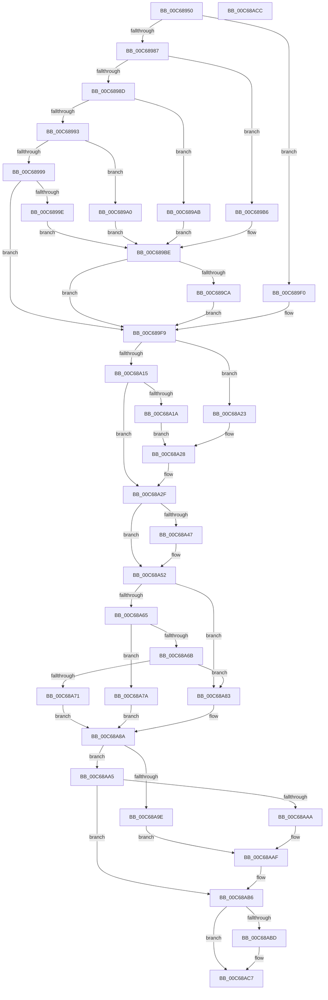

# MiCompensateForProcessorErrata

- RVA: `0x00C68950`–`0x00C68ACD` (길이 `381` bytes)
- VA: `0x0000000140C68950`
- 실행 섹션: `INIT`
- PDB 이름 있음: `예`; PDB Function 태그: `아니요`
- unwind 정보 RVA: `0x0005C788`
- 디코드: `89`개 명령, `381/381` bytes 표시
- 미해석 바이트: `0` (있으면 어셈블리에 `.byte`로 보존)

> 이 문서는 커널 이미지의 기계어와 PDB 기호를 분석해 생성했습니다. 4번과 5번은 함수 원형과 자료형을 바이너리 사용 방식에서 추정한 C 해석이며 원본 소스 복구 결과는 아닙니다.

## 1. Dependencies

- 직접 호출 지점: **1**; 고유 호출 대상: **1**
- 직접 호출자로 확인된 함수: **1**
- RIP 상대 이미지 참조: **14**

### Outgoing calls
- `0x00C68A3D` → [strstr](../../text/4F/strstr_function_004FF680.md) (function, `0x004FF680`)

### Direct callers
- [MiInitNucleus](../C5/MiInitNucleus_function_00C5FD38.md) at `0x00C5FDC8`

### Static image references
- `0x00C68954` → RVA `0x00FC6E54` (`ALMOSTRO`; read)
- `0x00C6895D` → RVA `0x00FC6A88` (`ALMOSTRO`; read)
- `0x00C689A0` → RVA `0x00E2EE84` (`.data`; write)
- `0x00C689B6` → RVA `0x00E2EE84` (`.data`; read/write)
- `0x00C689BE` → RVA `0x00EF02D0` (`.data`; read)
- `0x00C689CE` → RVA `0x00E01323` (`.data`; write)
- `0x00C689E0` → RVA `0x00E2DC80` (`.data`; write)
- `0x00C689E7` → RVA `0x00E01322` (`.data`; write)
- `0x00C689F9` → RVA `0x00E66930` (`.data`; read)
- `0x00C68A09` → RVA `0x00FC6A88` (`ALMOSTRO`; write)
- `0x00C68A36` → RVA `0x00C7E6B0` (` ?? ::PBOPGDP::`string'`; read)
- `0x00C68A47` → RVA `0x00FC6A88` (`ALMOSTRO`; read/write)
- `0x00C68A71` → RVA `0x00E2DBC9` (`.data`; write)
- `0x00C68A8A` → RVA `0x00FC6B30` (`ALMOSTRO`; read)

## 2. Other-region calls and transfers

- 다른 실행 섹션으로 향하는 call: **1**
  - `0x00C68A3D` → [strstr](../../text/4F/strstr_function_004FF680.md) (`INIT` → `.text`)
- 별도 외부 분기/꼬리 이동을 확인하지 못했습니다.

## 3. Assembly (complete function range)

```asm
00C68950  48 83 EC 28                     sub rsp, 0x28
00C68954  8B 15 FA E4 35 00               mov edx, dword ptr [rip + 0x35e4fa]
00C6895A  4C 8B C9                        mov r9, rcx
00C6895D  48 8B 05 24 E1 35 00            mov rax, qword ptr [rip + 0x35e124]
00C68964  83 E2 03                        and edx, 3
00C68967  48 25 FF FF 9F FF               and rax, 0xffffffffff9fffff
00C6896D  48 C1 E2 15                     shl rdx, 0x15
00C68971  48 0B D0                        or rdx, rax
00C68974  4C 8B C2                        mov r8, rdx
00C68977  49 C1 E8 15                     shr r8, 0x15
00C6897B  41 83 E0 03                     and r8d, 3
00C6897F  41 8B C0                        mov eax, r8d
00C68982  4D 85 C0                        test r8, r8
00C68985  74 69                           je 0x140c689f0
00C68987  48 83 E8 01                     sub rax, 1
00C6898B  74 29                           je 0x140c689b6
00C6898D  48 83 E8 01                     sub rax, 1
00C68991  74 18                           je 0x140c689ab
00C68993  48 83 F8 01                     cmp rax, 1
00C68997  74 07                           je 0x140c689a0
00C68999  4D 85 C0                        test r8, r8
00C6899C  74 5B                           je 0x140c689f9
00C6899E  EB 1E                           jmp 0x140c689be
00C689A0  66 C7 05 DB 64 1C 00 01 00      mov word ptr [rip + 0x1c64db], 1
00C689A9  EB 13                           jmp 0x140c689be
00C689AB  66 C7 05 D0 64 1C 00 00 01      mov word ptr [rip + 0x1c64d0], 0x100
00C689B4  EB 08                           jmp 0x140c689be
00C689B6  66 83 25 C6 64 1C 00 00         and word ptr [rip + 0x1c64c6], 0
00C689BE  44 8B 05 0B 79 28 00            mov r8d, dword ptr [rip + 0x28790b]
00C689C5  45 85 C0                        test r8d, r8d
00C689C8  7E 2F                           jle 0x140c689f9
00C689CA  41 8D 48 FF                     lea ecx, [r8 - 1]
00C689CE  C6 05 4E 89 19 00 04            mov byte ptr [rip + 0x19894e], 4
00C689D5  B8 01 00 00 00                  mov eax, 1
00C689DA  48 D3 E0                        shl rax, cl
00C689DD  41 FE C8                        dec r8b
00C689E0  48 89 05 99 52 1C 00            mov qword ptr [rip + 0x1c5299], rax
00C689E7  44 88 05 34 89 19 00            mov byte ptr [rip + 0x198934], r8b
00C689EE  EB 09                           jmp 0x140c689f9
00C689F0  66 C7 05 8B 64 1C 00 01 00      mov word ptr [rip + 0x1c648b], 1
00C689F9  8B 0D 31 DF 1F 00               mov ecx, dword ptr [rip + 0x1fdf31]
00C689FF  48 0F BA F2 1A                  btr rdx, 0x1a
00C68A04  48 0F BA EA 1B                  bts rdx, 0x1b
00C68A09  48 89 15 78 E0 35 00            mov qword ptr [rip + 0x35e078], rdx
00C68A10  83 E9 01                        sub ecx, 1
00C68A13  74 0E                           je 0x140c68a23
00C68A15  83 F9 01                        cmp ecx, 1
00C68A18  75 15                           jne 0x140c68a2f
00C68A1A  48 81 E2 FF FF FF F3            and rdx, 0xfffffffff3ffffff
00C68A21  EB 05                           jmp 0x140c68a28
00C68A23  48 0F BA EA 19                  bts rdx, 0x19
00C68A28  48 89 15 59 E0 35 00            mov qword ptr [rip + 0x35e059], rdx
00C68A2F  49 8B 89 D8 00 00 00            mov rcx, qword ptr [r9 + 0xd8]
00C68A36  48 8D 15 73 5C 01 00            lea rdx, [rip + 0x15c73]
00C68A3D  E8 3E 6C 89 FF                  call 0x1404ff680
00C68A42  48 85 C0                        test rax, rax
00C68A45  74 0B                           je 0x140c68a52
00C68A47  48 81 25 36 E0 35 00 FF FF FF F3  and qword ptr [rip + 0x35e036], 0xfffffffff3ffffff
00C68A52  48 8B 05 2F E0 35 00            mov rax, qword ptr [rip + 0x35e02f]
00C68A59  48 8B C8                        mov rcx, rax
00C68A5C  48 C1 E9 1A                     shr rcx, 0x1a
00C68A60  83 E1 03                        and ecx, 3
00C68A63  74 1E                           je 0x140c68a83
00C68A65  48 83 E9 01                     sub rcx, 1
00C68A69  74 0F                           je 0x140c68a7a
00C68A6B  48 83 F9 01                     cmp rcx, 1
00C68A6F  75 12                           jne 0x140c68a83
00C68A71  C6 05 51 51 1C 00 FF            mov byte ptr [rip + 0x1c5151], 0xff
00C68A78  EB 10                           jmp 0x140c68a8a
00C68A7A  C6 05 48 51 1C 00 01            mov byte ptr [rip + 0x1c5148], 1
00C68A81  EB 07                           jmp 0x140c68a8a
00C68A83  C6 05 3F 51 1C 00 00            mov byte ptr [rip + 0x1c513f], 0
00C68A8A  48 8B 0D 9F E0 35 00            mov rcx, qword ptr [rip + 0x35e09f]
00C68A91  41 B8 00 00 00 01               mov r8d, 0x1000000
00C68A97  48 0F BA E1 15                  bt rcx, 0x15
00C68A9C  73 07                           jae 0x140c68aa5
00C68A9E  48 0F BA E8 08                  bts rax, 8
00C68AA3  EB 0A                           jmp 0x140c68aaf
00C68AA5  49 85 C8                        test r8, rcx
00C68AA8  74 0C                           je 0x140c68ab6
00C68AAA  48 0F BA E8 09                  bts rax, 9
00C68AAF  48 89 05 D2 DF 35 00            mov qword ptr [rip + 0x35dfd2], rax
00C68AB6  48 0F BA E1 2E                  bt rcx, 0x2e
00C68ABB  73 0A                           jae 0x140c68ac7
00C68ABD  49 0B C0                        or rax, r8
00C68AC0  48 89 05 C1 DF 35 00            mov qword ptr [rip + 0x35dfc1], rax
00C68AC7  48 83 C4 28                     add rsp, 0x28
00C68ACB  C3                              ret
00C68ACC  CC                              int3
```

## 4. C-style interpretation (structured pseudocode)

```c
__int64 __fastcall MiCompensateForProcessorErrata(__int64 a1)
{
    __int64 result;
    __int64 v_rsp;

    v_rsp = (v_rsp) - (40);
    a2 = (unsigned int)(((unsigned int)(*(unsigned int *)(v_rip + 3532026))) & (3));
    result = (*(unsigned __int64 *)(v_rip + 3531044)) & (0xFFFFFFFFFF9FFFFFULL);
    a2 = (a2) << (21);
    a2 = (a2) | (result);
    a3 = (a2) >> (21);
    a3 = (unsigned int)((a3) & (3));
    if (a3 == 0) goto loc_00C689F0;
    result = ((unsigned int)((unsigned int)(a3))) - (1);
    if (condition_is_equal) goto loc_00C689B6;
    result = (result) - (1);
    if (condition_is_equal) goto loc_00C689AB;
    if (result == 1) goto loc_00C689A0;
    if (a3 == 0) goto loc_00C689F9;
    goto loc_00C689BE;
loc_00C689A0:
    *(unsigned __int16 *)(v_rip + 1860827) = 1;
    goto loc_00C689BE;
loc_00C689AB:
    *(unsigned __int16 *)(v_rip + 1860816) = 256;
    goto loc_00C689BE;
loc_00C689B6:
loc_00C689BE:
    if (condition_is_less_or_equal) goto loc_00C689F9;
    *(unsigned __int8 *)(v_rip + 1673550) = 4;
    result = (1) << ((unsigned __int8)((unsigned int)(*(unsigned int *)(v_rip + 2652427)) - 1));
    a3 = (unsigned __int8)(((unsigned int)(*(unsigned int *)(v_rip + 2652427))) - 1);
    *(unsigned __int64 *)(v_rip + 1856153) = result;
    *(unsigned __int8 *)(v_rip + 1673524) = (unsigned __int8)(a3);
    goto loc_00C689F9;
loc_00C689F0:
    *(unsigned __int16 *)(v_rip + 1860747) = 1;
loc_00C689F9:
    *(unsigned __int64 *)(v_rip + 3530872) = a2;
    a1 = (unsigned int)(((unsigned int)(*(unsigned int *)(v_rip + 2088753))) - (1));
    if (condition_is_equal) goto loc_00C68A23;
    if (((unsigned int)(a1)) != 1) goto loc_00C68A2F;
    a2 = (a2) & (0xFFFFFFFFF3FFFFFFULL);
    goto loc_00C68A28;
loc_00C68A23:
loc_00C68A28:
    *(unsigned __int64 *)(v_rip + 3530841) = a2;
loc_00C68A2F:
    result = strstr(*(unsigned __int64 *)(a1 + 216), v_rip + 89203, a3, a1);
    if (result != 0) {
    }
    a1 = (*(unsigned __int64 *)(v_rip + 3530799)) >> (26);
    a1 = (unsigned int)((a1) & (3));
    if (condition_is_equal) goto loc_00C68A83;
    a1 = (a1) - (1);
    if (condition_is_equal) goto loc_00C68A7A;
    if (a1 != 1) goto loc_00C68A83;
    *(unsigned __int8 *)(v_rip + 1855825) = 255;
    goto loc_00C68A8A;
loc_00C68A7A:
    *(unsigned __int8 *)(v_rip + 1855816) = 1;
    goto loc_00C68A8A;
loc_00C68A83:
    *(unsigned __int8 *)(v_rip + 1855807) = 0;
loc_00C68A8A:
    if (a1 >= 1) goto loc_00C68AA5;
    goto loc_00C68AAF;
loc_00C68AA5:
    if ((((unsigned int)(0x1000000ULL)) & (*(unsigned __int64 *)(v_rip + 3530911))) == 0) goto loc_00C68AB6;
loc_00C68AAF:
    *(unsigned __int64 *)(v_rip + 3530706) = *(unsigned __int64 *)(v_rip + 3530799);
loc_00C68AB6:
    result = *(unsigned __int64 *)(v_rip + 3530799);
    if (!(condition_is_above_or_equal)) {
        result = (*(unsigned __int64 *)(v_rip + 3530799)) | ((unsigned int)(0x1000000ULL));
        *(unsigned __int64 *)(v_rip + 3530689) = result;
    }
    v_rsp = (v_rsp) + (40);
    return result;
}
```

## 5. (Beta) C Style

```c
int64_t MiCompensateForProcessorErrata(void *Arg1)
{
    uint8_t *arg1 = (uint8_t *)Arg1;

    int64_t result;
    int64_t local_rsp;

    local_rsp = (local_rsp) - (40);
    a2 = (uint32_t)(((uint32_t)(*(uint32_t *)(v_rip + 0x35E4FA))) & (3));
    result = (*(uint64_t *)(v_rip + 0x35E124)) & (0xFFFFFFFFFF9FFFFFULL);
    a2 = (a2) << (21);
    a2 = (a2) | (result);
    a3 = (a2) >> (21);
    a3 = (uint32_t)((a3) & (3));
    if (a3 == 0) goto loc_00C689F0;
    result = ((uint32_t)((uint32_t)(a3))) - (1);
    if (condition_is_equal) goto loc_00C689B6;
    result = (result) - (1);
    if (condition_is_equal) goto loc_00C689AB;
    if (result == 1) goto loc_00C689A0;
    if (a3 == 0) goto loc_00C689F9;
    goto loc_00C689BE;
loc_00C689A0:
    *(uint16_t *)(v_rip + 0x1C64DB) = 1;
    goto loc_00C689BE;
loc_00C689AB:
    *(uint16_t *)(v_rip + 0x1C64D0) = 256;
    goto loc_00C689BE;
loc_00C689B6:
loc_00C689BE:
    if (condition_is_less_or_equal) goto loc_00C689F9;
    *(uint8_t *)(v_rip + 0x19894E) = 4;
    result = (1) << ((uint8_t)((uint32_t)(*(uint32_t *)(v_rip + 0x28790B)) - 1));
    a3 = (uint8_t)(((uint32_t)(*(uint32_t *)(v_rip + 0x28790B))) - 1);
    *(uint64_t *)(v_rip + 0x1C5299) = result;
    *(uint8_t *)(v_rip + 0x198934) = (uint8_t)(a3);
    goto loc_00C689F9;
loc_00C689F0:
    *(uint16_t *)(v_rip + 0x1C648B) = 1;
loc_00C689F9:
    *(uint64_t *)(v_rip + 0x35E078) = a2;
    Arg1 = (uint32_t)(((uint32_t)(*(uint32_t *)(v_rip + 0x1FDF31))) - (1));
    if (condition_is_equal) goto loc_00C68A23;
    if (((uint32_t)(Arg1)) != 1) goto loc_00C68A2F;
    a2 = (a2) & (0xFFFFFFFFF3FFFFFFULL);
    goto loc_00C68A28;
loc_00C68A23:
loc_00C68A28:
    *(uint64_t *)(v_rip + 0x35E059) = a2;
loc_00C68A2F:
    result = strstr(*(uint64_t *)(arg1 + 0xD8), v_rip + 89203, a3, Arg1);
    if (result != 0) {
    }
    Arg1 = (*(uint64_t *)(v_rip + 0x35E02F)) >> (26);
    Arg1 = (uint32_t)((Arg1) & (3));
    if (condition_is_equal) goto loc_00C68A83;
    Arg1 = (Arg1) - (1);
    if (condition_is_equal) goto loc_00C68A7A;
    if (Arg1 != 1) goto loc_00C68A83;
    *(uint8_t *)(v_rip + 0x1C5151) = 255;
    goto loc_00C68A8A;
loc_00C68A7A:
    *(uint8_t *)(v_rip + 0x1C5148) = 1;
    goto loc_00C68A8A;
loc_00C68A83:
    *(uint8_t *)(v_rip + 0x1C513F) = 0;
loc_00C68A8A:
    if (Arg1 >= 1) goto loc_00C68AA5;
    goto loc_00C68AAF;
loc_00C68AA5:
    if ((((uint32_t)(0x1000000ULL)) & (*(uint64_t *)(v_rip + 0x35E09F))) == 0) goto loc_00C68AB6;
loc_00C68AAF:
    *(uint64_t *)(v_rip + 0x35DFD2) = *(uint64_t *)(v_rip + 0x35E02F);
loc_00C68AB6:
    result = *(uint64_t *)(v_rip + 0x35E02F);
    if (!(condition_is_above_or_equal)) {
        result = (*(uint64_t *)(v_rip + 0x35E02F)) | ((uint32_t)(0x1000000ULL));
        *(uint64_t *)(v_rip + 0x35DFC1) = result;
    }
    local_rsp = (local_rsp) + (40);
    return result;
}
```

### 관측된 메모리 오프셋

구조체 형식이 확인되지 않은 접근은 인자 기준의 오프셋으로만 기록했습니다.

| 기준 인자 | 오프셋 표현 | 폭 (bit) | 접근 |
|---|---:|---:|---|
| `Arg1` | `+ 0xD8` | `64` | `R` |

## 6. Execution-region graph

[열기: 2D/3D 그래프와 함수 탐색 컨트롤 패널](../../../control-panel.html?section=init&rva=0x00C68950&view=graph)

- 2D 그래프는 위에서 아래로 흐르고, 3D 그래프는 빈 공간을 드래그해 회전합니다. Shift+드래그는 이동, 휠은 확대·축소, 함수 노드 선택은 대상 보고서 이동입니다.

### Static fallback


