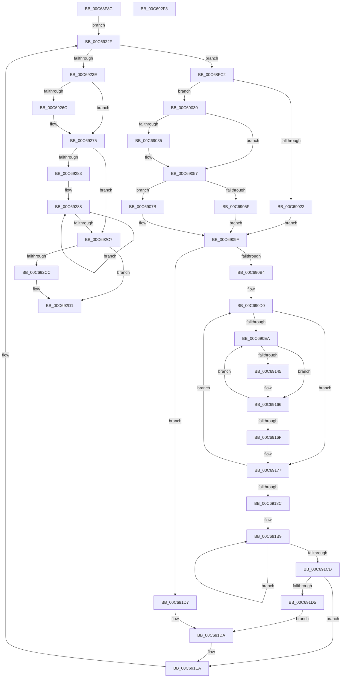

# MiComputeMemoryNodeProcessorAssignments

- RVA: `0x00C68F8C`–`0x00C692F4` (길이 `872` bytes)
- VA: `0x0000000140C68F8C`
- 실행 섹션: `INIT`
- PDB 이름 있음: `예`; PDB Function 태그: `아니요`
- unwind 정보 RVA: `0x000BE788`
- 디코드: `207`개 명령, `872/872` bytes 표시
- 미해석 바이트: `0` (있으면 어셈블리에 `.byte`로 보존)

> 이 문서는 커널 이미지의 기계어와 PDB 기호를 분석해 생성했습니다. 4번과 5번은 함수 원형과 자료형을 바이너리 사용 방식에서 추정한 C 해석이며 원본 소스 복구 결과는 아닙니다.

## 1. Dependencies

- 직접 호출 지점: **9**; 고유 호출 대상: **8**
- 직접 호출자로 확인된 함수: **1**
- RIP 상대 이미지 참조: **9**

### Outgoing calls
- `0x00C68FFD` → [KeQueryNodeActiveAffinity2](../../text/41/KeQueryNodeActiveAffinity2_function_004189C0.md) (function, `0x004189C0`)
- `0x00C6904F` → [ExAllocatePoolMm](../../text/35/ExAllocatePoolMm_function_0035B690.md) (function, `0x0035B690`)
- `0x00C6906E` → [KeQueryNodeActiveAffinity2](../../text/41/KeQueryNodeActiveAffinity2_function_004189C0.md) (function, `0x004189C0`)
- `0x00C6909A` → [KeQueryNodeActiveAffinity](../../text/43/KeQueryNodeActiveAffinity_function_0043EF80.md) (function, `0x0043EF80`)
- `0x00C690EF` → [KeFindFirstSetRightGroupAffinity](../../text/2C/KeFindFirstSetRightGroupAffinity_function_002CFB10.md) (function, `0x002CFB10`)
- `0x00C6925B` → [MiAllocatePool](../../text/35/MiAllocatePool_function_0035B540.md) (function, `0x0035B540`)
- `0x00C6926F` → [MxInstallMoreMemory](../../text/67/MxInstallMoreMemory_function_00671A04.md) (function, `0x00671A04`)
- `0x00C692B0` → [memcpy](../../text/6C/memcpy_function_006C6840.md) (function, `0x006C6840`)
- `0x00C692CC` → [MiReassignProcessorsToMemoryOnlyNodes](MiReassignProcessorsToMemoryOnlyNodes_function_00C69600.md) (function, `0x00C69600`)

### Direct callers
- [MiInitSystem](../C5/MiInitSystem_function_00C5E6C0.md) at `0x00C5EC15`

### Static image references
- `0x00C68FA0` → RVA `0x00FC5000` (`ALMOSTRO`; read)
- `0x00C68FE7` → RVA `0x00E2DBF8` (`.data`; read)
- `0x00C690B7` → RVA `0x00000000` (`image boundary/outside`; read)
- `0x00C69220` → RVA `0x00E2DBE8` (`.data`; read/write)
- `0x00C6923E` → RVA `0x00E2DBE8` (`.data`; read)
- `0x00C69254` → RVA `0x00E2DBE0` (`.data`; write)
- `0x00C69260` → RVA `0x00E2DBD8` (`.data`; write)
- `0x00C69295` → RVA `0x00E2DBD8` (`.data`; read)
- `0x00C692DB` → RVA `0x00FC6A88` (`ALMOSTRO`; read/write)

## 2. Other-region calls and transfers

- 다른 실행 섹션으로 향하는 call: **8**
  - `0x00C68FFD` → [KeQueryNodeActiveAffinity2](../../text/41/KeQueryNodeActiveAffinity2_function_004189C0.md) (`INIT` → `.text`)
  - `0x00C6904F` → [ExAllocatePoolMm](../../text/35/ExAllocatePoolMm_function_0035B690.md) (`INIT` → `.text`)
  - `0x00C6906E` → [KeQueryNodeActiveAffinity2](../../text/41/KeQueryNodeActiveAffinity2_function_004189C0.md) (`INIT` → `.text`)
  - `0x00C6909A` → [KeQueryNodeActiveAffinity](../../text/43/KeQueryNodeActiveAffinity_function_0043EF80.md) (`INIT` → `.text`)
  - `0x00C690EF` → [KeFindFirstSetRightGroupAffinity](../../text/2C/KeFindFirstSetRightGroupAffinity_function_002CFB10.md) (`INIT` → `.text`)
  - `0x00C6925B` → [MiAllocatePool](../../text/35/MiAllocatePool_function_0035B540.md) (`INIT` → `.text`)
  - `0x00C6926F` → [MxInstallMoreMemory](../../text/67/MxInstallMoreMemory_function_00671A04.md) (`INIT` → `.text`)
  - `0x00C692B0` → [memcpy](../../text/6C/memcpy_function_006C6840.md) (`INIT` → `.text`)
- 별도 외부 분기/꼬리 이동을 확인하지 못했습니다.

## 3. Assembly (complete function range)

```asm
00C68F8C  40 53                           push rbx
00C68F8E  55                              push rbp
00C68F8F  56                              push rsi
00C68F90  57                              push rdi
00C68F91  41 54                           push r12
00C68F93  41 55                           push r13
00C68F95  41 56                           push r14
00C68F97  41 57                           push r15
00C68F99  48 83 EC 48                     sub rsp, 0x48
00C68F9D  45 33 FF                        xor r15d, r15d
00C68FA0  66 44 3B 3D 58 C0 35 00         cmp r15w, word ptr [rip + 0x35c058]
00C68FA8  45 8B EF                        mov r13d, r15d
00C68FAB  44 89 BC 24 A8 00 00 00         mov dword ptr [rsp + 0xa8], r15d
00C68FB3  45 8B E7                        mov r12d, r15d
00C68FB6  41 8B DF                        mov ebx, r15d
00C68FB9  45 8D 77 01                     lea r14d, [r15 + 1]
00C68FBD  E9 6D 02 00 00                  jmp 0x140c6922f
00C68FC2  8B C3                           mov eax, ebx
00C68FC4  4C 8D 8C 24 90 00 00 00         lea r9, [rsp + 0x90]
00C68FCC  45 33 C0                        xor r8d, r8d
00C68FCF  66 44 89 BC 24 98 00 00 00      mov word ptr [rsp + 0x98], r15w
00C68FD8  33 D2                           xor edx, edx
00C68FDA  66 44 89 BC 24 90 00 00 00      mov word ptr [rsp + 0x90], r15w
00C68FE3  48 8D 0C 40                     lea rcx, [rax + rax*2]
00C68FE7  48 8B 05 0A 4C 1C 00            mov rax, qword ptr [rip + 0x1c4c0a]
00C68FEE  48 C1 E1 07                     shl rcx, 7
00C68FF2  48 8B B4 01 78 01 00 00         mov rsi, qword ptr [rcx + rax + 0x178]
00C68FFA  0F B7 CB                        movzx ecx, bx
00C68FFD  E8 BE F9 7A FF                  call 0x1404189c0
00C69002  0F B7 AC 24 90 00 00 00         movzx ebp, word ptr [rsp + 0x90]
00C6900A  4C 8D 76 30                     lea r14, [rsi + 0x30]
00C6900E  89 AC 24 A0 00 00 00            mov dword ptr [rsp + 0xa0], ebp
00C69015  B8 01 00 00 00                  mov eax, 1
00C6901A  49 8B FE                        mov rdi, r14
00C6901D  66 85 ED                        test bp, bp
00C69020  75 0E                           jne 0x140c69030
00C69022  8B E8                           mov ebp, eax
00C69024  89 84 24 A0 00 00 00            mov dword ptr [rsp + 0xa0], eax
00C6902B  44 8B F0                        mov r14d, eax
00C6902E  EB 6F                           jmp 0x140c6909f
00C69030  66 3B E8                        cmp bp, ax
00C69033  74 22                           je 0x140c69057
00C69035  44 8B CB                        mov r9d, ebx
00C69038  0F B7 D5                        movzx edx, bp
00C6903B  41 0F BA E9 1F                  bts r9d, 0x1f
00C69040  48 C1 E2 04                     shl rdx, 4
00C69044  B9 40 00 00 00                  mov ecx, 0x40
00C69049  41 B8 4D 69 47 61               mov r8d, 0x6147694d
00C6904F  E8 3C 26 6F FF                  call 0x14035b690
00C69054  48 8B F8                        mov rdi, rax
00C69057  0F B7 CB                        movzx ecx, bx
00C6905A  48 85 FF                        test rdi, rdi
00C6905D  74 1C                           je 0x140c6907b
00C6905F  4C 8D 8C 24 98 00 00 00         lea r9, [rsp + 0x98]
00C69067  44 0F B7 C5                     movzx r8d, bp
00C6906B  48 8B D7                        mov rdx, rdi
00C6906E  E8 4D F9 7A FF                  call 0x1404189c0
00C69073  41 BE 01 00 00 00               mov r14d, 1
00C69079  EB 24                           jmp 0x140c6909f
00C6907B  49 8B FE                        mov rdi, r14
00C6907E  4C 8D 84 24 90 00 00 00         lea r8, [rsp + 0x90]
00C69086  41 BE 01 00 00 00               mov r14d, 1
00C6908C  48 8B D7                        mov rdx, rdi
00C6908F  41 0F B7 EE                     movzx ebp, r14w
00C69093  89 AC 24 A0 00 00 00            mov dword ptr [rsp + 0xa0], ebp
00C6909A  E8 E1 5E 7D FF                  call 0x14043ef80
00C6909F  44 0F B7 FD                     movzx r15d, bp
00C690A3  44 89 BC 24 90 00 00 00         mov dword ptr [rsp + 0x90], r15d
00C690AB  45 85 FF                        test r15d, r15d
00C690AE  0F 84 23 01 00 00               je 0x140c691d7
00C690B4  45 33 ED                        xor r13d, r13d
00C690B7  48 8D 2D 42 6F 39 FF            lea rbp, [rip - 0xc690be]
00C690BE  41 8B C7                        mov eax, r15d
00C690C1  4C 8B F7                        mov r14, rdi
00C690C4  48 89 84 24 98 00 00 00         mov qword ptr [rsp + 0x98], rax
00C690CC  41 8D 5D 01                     lea ebx, [r13 + 1]
00C690D0  41 0F 10 06                     movups xmm0, xmmword ptr [r14]
00C690D4  4D 8B E5                        mov r12, r13
00C690D7  66 49 0F 7E C7                  movq r15, xmm0
00C690DC  0F 11 44 24 28                  movups xmmword ptr [rsp + 0x28], xmm0
00C690E1  4D 85 FF                        test r15, r15
00C690E4  0F 84 8D 00 00 00               je 0x140c69177
00C690EA  48 8D 4C 24 28                  lea rcx, [rsp + 0x28]
00C690EF  E8 1C 6A 66 FF                  call 0x1402cfb10
00C690F4  8B C8                           mov ecx, eax
00C690F6  B8 14 00 00 00                  mov eax, 0x14
00C690FB  4C 8B 84 CD 40 8C FC 00         mov r8, qword ptr [rbp + rcx*8 + 0xfc8c40]
00C69103  8D 48 02                        lea ecx, [rax + 2]
00C69106  8D 51 EC                        lea edx, [rcx - 0x14]
00C69109  45 8A 88 08 8A 00 00            mov r9b, byte ptr [r8 + 0x8a08]
00C69110  44 3A CB                        cmp r9b, bl
00C69113  0F 45 C1                        cmovne eax, ecx
00C69116  66 01 1C 30                     add word ptr [rax + rsi], bx
00C6911A  8D 41 EE                        lea eax, [rcx - 0x12]
00C6911D  44 3A CB                        cmp r9b, bl
00C69120  0F 45 D0                        cmovne edx, eax
00C69123  66 01 9C 2A EA DB E2 00         add word ptr [rdx + rbp + 0xe2dbea], bx
00C6912B  49 8B 88 C8 00 00 00            mov rcx, qword ptr [r8 + 0xc8]
00C69132  48 8B C1                        mov rax, rcx
00C69135  48 F7 D0                        not rax
00C69138  4C 23 F8                        and r15, rax
00C6913B  4C 89 7C 24 28                  mov qword ptr [rsp + 0x28], r15
00C69140  49 85 CC                        test r12, rcx
00C69143  75 21                           jne 0x140c69166
00C69145  B8 1A 00 00 00                  mov eax, 0x1a
00C6914A  44 3A CB                        cmp r9b, bl
00C6914D  8D 48 02                        lea ecx, [rax + 2]
00C69150  0F 45 C1                        cmovne eax, ecx
00C69153  66 01 1C 30                     add word ptr [rax + rsi], bx
00C69157  66 01 9C 2A F0 DB E2 00         add word ptr [rdx + rbp + 0xe2dbf0], bx
00C6915F  4D 0B A0 60 8E 00 00            or r12, qword ptr [r8 + 0x8e60]
00C69166  4D 85 FF                        test r15, r15
00C69169  0F 85 7B FF FF FF               jne 0x140c690ea
00C6916F  48 8B 84 24 98 00 00 00         mov rax, qword ptr [rsp + 0x98]
00C69177  49 83 C6 10                     add r14, 0x10
00C6917B  48 2B C3                        sub rax, rbx
00C6917E  48 89 84 24 98 00 00 00         mov qword ptr [rsp + 0x98], rax
00C69186  0F 85 44 FF FF FF               jne 0x140c690d0
00C6918C  44 8B 84 24 90 00 00 00         mov r8d, dword ptr [rsp + 0x90]
00C69194  41 0F B7 CD                     movzx ecx, r13w
00C69198  44 8B AC 24 A8 00 00 00         mov r13d, dword ptr [rsp + 0xa8]
00C691A0  48 8B D7                        mov rdx, rdi
00C691A3  8B 5C 24 24                     mov ebx, dword ptr [rsp + 0x24]
00C691A7  41 BE 01 00 00 00               mov r14d, 1
00C691AD  8B AC 24 A0 00 00 00            mov ebp, dword ptr [rsp + 0xa0]
00C691B4  44 8B 64 24 20                  mov r12d, dword ptr [rsp + 0x20]
00C691B9  F3 48 0F B8 02                  popcnt rax, qword ptr [rdx]
00C691BE  66 03 C1                        add ax, cx
00C691C1  48 8D 52 10                     lea rdx, [rdx + 0x10]
00C691C5  0F B7 C8                        movzx ecx, ax
00C691C8  4D 2B C6                        sub r8, r14
00C691CB  75 EC                           jne 0x140c691b9
00C691CD  45 33 FF                        xor r15d, r15d
00C691D0  66 85 C0                        test ax, ax
00C691D3  75 15                           jne 0x140c691ea
00C691D5  EB 03                           jmp 0x140c691da
00C691D7  45 33 FF                        xor r15d, r15d
00C691DA  66 44 09 76 20                  or word ptr [rsi + 0x20], r14w
00C691DF  45 03 EE                        add r13d, r14d
00C691E2  44 89 AC 24 A8 00 00 00         mov dword ptr [rsp + 0xa8], r13d
00C691EA  0F B7 C3                        movzx eax, bx
00C691ED  48 8D 0D 0C 6E 39 FF            lea rcx, [rip - 0xc691f4]
00C691F4  48 8B 84 C1 C0 F6 FC 00         mov rax, qword ptr [rcx + rax*8 + 0xfcf6c0]
00C691FC  8B 88 2C 01 00 00               mov ecx, dword ptr [rax + 0x12c]
00C69202  85 C9                           test ecx, ecx
00C69204  0F B7 05 F5 BD 35 00            movzx eax, word ptr [rip + 0x35bdf5]
00C6920B  41 0F 44 CE                     cmove ecx, r14d
00C6920F  44 89 66 0C                     mov dword ptr [rsi + 0xc], r12d
00C69213  89 4E 08                        mov dword ptr [rsi + 8], ecx
00C69216  44 03 E1                        add r12d, ecx
00C69219  48 89 3E                        mov qword ptr [rsi], rdi
00C6921C  66 89 6E 10                     mov word ptr [rsi + 0x10], bp
00C69220  66 01 2D C1 49 1C 00            add word ptr [rip + 0x1c49c1], bp
00C69227  89 5E 2C                        mov dword ptr [rsi + 0x2c], ebx
00C6922A  41 03 DE                        add ebx, r14d
00C6922D  3B D8                           cmp ebx, eax
00C6922F  89 5C 24 24                     mov dword ptr [rsp + 0x24], ebx
00C69233  44 89 64 24 20                  mov dword ptr [rsp + 0x20], r12d
00C69238  0F 82 84 FD FF FF               jb 0x140c68fc2
00C6923E  0F B7 15 A3 49 1C 00            movzx edx, word ptr [rip + 0x1c49a3]
00C69245  B9 40 00 00 00                  mov ecx, 0x40
00C6924A  48 C1 E2 04                     shl rdx, 4
00C6924E  41 B8 4D 69 47 61               mov r8d, 0x6147694d
00C69254  44 89 25 85 49 1C 00            mov dword ptr [rip + 0x1c4985], r12d
00C6925B  E8 E0 22 6F FF                  call 0x14035b540
00C69260  48 89 05 71 49 1C 00            mov qword ptr [rip + 0x1c4971], rax
00C69267  48 85 C0                        test rax, rax
00C6926A  75 09                           jne 0x140c69275
00C6926C  8D 48 34                        lea ecx, [rax + 0x34]
00C6926F  E8 90 87 A0 FF                  call 0x140671a04
00C69274  CC                              int3
00C69275  0F B7 05 84 BD 35 00            movzx eax, word ptr [rip + 0x35bd84]
00C6927C  41 8B FF                        mov edi, r15d
00C6927F  85 C0                           test eax, eax
00C69281  74 44                           je 0x140c692c7
00C69283  49 8B F7                        mov rsi, r15
00C69286  8B E8                           mov ebp, eax
00C69288  48 8B 05 69 49 1C 00            mov rax, qword ptr [rip + 0x1c4969]
00C6928F  8B CF                           mov ecx, edi
00C69291  48 C1 E1 04                     shl rcx, 4
00C69295  48 03 0D 3C 49 1C 00            add rcx, qword ptr [rip + 0x1c493c]
00C6929C  48 8B 9C 06 78 01 00 00         mov rbx, qword ptr [rsi + rax + 0x178]
00C692A4  44 0F B7 43 10                  movzx r8d, word ptr [rbx + 0x10]
00C692A9  48 8B 13                        mov rdx, qword ptr [rbx]
00C692AC  49 C1 E0 04                     shl r8, 4
00C692B0  E8 8B D5 A5 FF                  call 0x1406c6840
00C692B5  0F B7 43 10                     movzx eax, word ptr [rbx + 0x10]
00C692B9  48 8D B6 80 01 00 00            lea rsi, [rsi + 0x180]
00C692C0  03 F8                           add edi, eax
00C692C2  49 2B EE                        sub rbp, r14
00C692C5  75 C1                           jne 0x140c69288
00C692C7  45 85 ED                        test r13d, r13d
00C692CA  74 05                           je 0x140c692d1
00C692CC  E8 2F 03 00 00                  call 0x140c69600
00C692D1  48 B8 00 00 00 00 40 00 00 00   movabs rax, 0x4000000000
00C692DB  48 09 05 A6 D7 35 00            or qword ptr [rip + 0x35d7a6], rax
00C692E2  48 83 C4 48                     add rsp, 0x48
00C692E6  41 5F                           pop r15
00C692E8  41 5E                           pop r14
00C692EA  41 5D                           pop r13
00C692EC  41 5C                           pop r12
00C692EE  5F                              pop rdi
00C692EF  5E                              pop rsi
00C692F0  5D                              pop rbp
00C692F1  5B                              pop rbx
00C692F2  C3                              ret
00C692F3  CC                              int3
```

## 4. C-style interpretation (structured pseudocode)

```c
__int64 __fastcall MiComputeMemoryNodeProcessorAssignments(__int64 a1, int a2, int a3)
{
    __int64 result;
    __int64 v_r12;
    __int64 v_r13;
    __int64 v_r14;
    __int64 v_r15;
    __int64 v_rbp;
    __int64 v_rbx;
    __int64 v_rdi;
    __int64 v_rsp;
    unsigned __int64 v_stack_m60;
    unsigned int v_stack_m64;
    unsigned int v_stack_m68;
    unsigned __int16 v_stack_p10;
    unsigned int v_stack_p18;
    unsigned int v_stack_p20;
    unsigned __int64 v_stack_p8;

    v_rsp = (v_rsp) - (72);
    v_r15 = 0;
    v_stack_p20 = 0;
    goto loc_00C6922F;
loc_00C68FC2:
    a3 = 0;
    v_stack_p10 = 0;
    a2 = 0;
    v_stack_p8 = 0;
    a1 = (0 + 0 * 2) << (7);
    result = KeQueryNodeActiveAffinity2(0, a2, a3, v_stack_p8);
    v_stack_p18 = (unsigned int)(v_stack_p8);
    if ((unsigned __int16)(v_stack_p8) != 0) goto loc_00C69030;
    v_stack_p18 = 1;
    goto loc_00C6909F;
loc_00C69030:
    result = 1;
    v_rdi = *(unsigned __int64 *)(a1 + *(unsigned __int64 *)(v_rip + 1854474) * 1 + 376) + 48;
    if (1 != 1) {
        a4 = 0;
        a2 = 1;
        a2 = (a2) << (4);
        a1 = 64;
        a3 = 0x6147694DULL;
        result = ExAllocatePoolMm(a1, a2, a3, a4);
        v_rdi = result;
    }
    if (v_rdi == 0) goto loc_00C6907B;
    result = KeQueryNodeActiveAffinity2(0, v_rdi, 1, v_stack_p10);
    goto loc_00C6909F;
loc_00C6907B:
    v_stack_p18 = 1;
    result = KeQueryNodeActiveAffinity(0, 1, v_stack_p8, v_stack_p10);
loc_00C6909F:
    v_stack_p8 = 1;
    if (1 == 0) goto loc_00C691D7;
    v_r13 = 0;
    v_stack_p10 = 1;
loc_00C690D0:
    v_stack_m60 = v_xmm0;
    if (1 == 0) goto loc_00C69177;
loc_00C690EA:
    result = KeFindFirstSetRightGroupAffinity(v_stack_m60, 1, v_stack_p8, v_stack_p10);
    result = 20;
    if (((unsigned __int8)(*(unsigned __int8 *)(*(unsigned __int64 *)(v_rip - 13013182 + (unsigned int)((unsigned int)(result)) * 8 + 16550976) + 35336))) != ((unsigned __int8)(v_r13 + 1))) { result = (unsigned int)(20 + 2); }
    a2 = 20 + 2 - 20;
    if (((unsigned __int8)(*(unsigned __int8 *)(*(unsigned __int64 *)(v_rip - 13013182 + (unsigned int)((unsigned int)(result)) * 8 + 16550976) + 35336))) != ((unsigned __int8)(v_r13 + 1))) { a2 = (unsigned int)(20 + 2 - 18); }
    result = ~(*(unsigned __int64 *)(*(unsigned __int64 *)(v_rip - 13013182 + (unsigned int)((unsigned int)(result)) * 8 + 16550976) + 200));
    v_r15 = (1) & (result);
    v_stack_m60 = v_r15;
    v_r12 = 0;
    if (((0) & (*(unsigned __int64 *)(*(unsigned __int64 *)(v_rip - 13013182 + (unsigned int)((unsigned int)(result)) * 8 + 16550976) + 200))) == 0) {
        result = 26;
        a1 = result + 2;
        if (((unsigned __int8)(*(unsigned __int8 *)(*(unsigned __int64 *)(v_rip - 13013182 + (unsigned int)((unsigned int)(result)) * 8 + 16550976) + 35336))) != ((unsigned __int8)(v_r13 + 1))) { result = (unsigned int)(a1); }
        v_r12 = (0) | (*(unsigned __int64 *)(*(unsigned __int64 *)(v_rip - 13013182 + (unsigned int)((unsigned int)(result)) * 8 + 16550976) + 36448));
    }
    if (v_r15 != 0) goto loc_00C690EA;
loc_00C69177:
    v_r14 = (1) + (16);
    result = (v_stack_p10) - (v_r13 + 1);
    v_stack_p10 = result;
    if (condition_is_not_equal) goto loc_00C690D0;
loc_00C691B9:
    result = (unsigned __int16)((result) + (0));
    a3 = ((unsigned int)(v_stack_p8)) - (1);
    if (condition_is_not_equal) goto loc_00C691B9;
    v_r15 = 0;
    if ((unsigned __int16)(result) != 0) goto loc_00C691EA;
    goto loc_00C691DA;
loc_00C691D7:
    v_r15 = 0;
loc_00C691DA:
    v_r13 = (unsigned int)(((unsigned int)(v_stack_p20)) + (1));
    v_stack_p20 = (unsigned int)(v_r13);
loc_00C691EA:
    a1 = (unsigned int)(*(unsigned int *)(*(unsigned __int64 *)(v_rip - 13013492 + (unsigned __int16)((unsigned int)(v_stack_m64)) * 8 + 16578240) + 300));
    if ((unsigned int)((unsigned int)(*(unsigned int *)(*(unsigned __int64 *)(v_rip - 13013492 + (unsigned __int16)((unsigned int)(v_stack_m64)) * 8 + 16578240) + 300))) == 0) { a1 = 1; }
    *(unsigned int *)(*(unsigned __int64 *)(a1 + *(unsigned __int64 *)(v_rip + 1854474) * 1 + 376) + 12) = (unsigned int)((unsigned int)(v_stack_m68));
    *(unsigned int *)(*(unsigned __int64 *)(a1 + *(unsigned __int64 *)(v_rip + 1854474) * 1 + 376) + 8) = (unsigned int)(a1);
    v_r12 = (unsigned int)(((unsigned int)(v_stack_m68)) + ((unsigned int)(a1)));
    *(unsigned __int64 *)(*(unsigned __int64 *)(a1 + *(unsigned __int64 *)(v_rip + 1854474) * 1 + 376)) = 1;
    *(unsigned __int16 *)(*(unsigned __int64 *)(a1 + *(unsigned __int64 *)(v_rip + 1854474) * 1 + 376) + 16) = (unsigned __int16)((unsigned int)(v_stack_p18));
    *(unsigned int *)(*(unsigned __int64 *)(a1 + *(unsigned __int64 *)(v_rip + 1854474) * 1 + 376) + 44) = (unsigned int)((unsigned int)(v_stack_m64));
    v_rbx = (unsigned int)(((unsigned int)(v_stack_m64)) + (1));
loc_00C6922F:
    v_stack_m64 = (unsigned int)(v_rbx);
    v_stack_m68 = (unsigned int)(v_r12);
    if (((unsigned int)(v_rbx)) < ((unsigned int)(*(unsigned __int16 *)(v_rip + 3522037)))) goto loc_00C68FC2;
    a2 = (*(unsigned __int16 *)(v_rip + 1853859)) << (4);
    *(unsigned int *)(v_rip + 1853829) = (unsigned int)(v_r12);
    result = MiAllocatePool(64, a2, (unsigned int)(0x6147694DULL), *(unsigned __int8 *)(*(unsigned __int64 *)(v_rip - 13013182 + (unsigned int)((unsigned int)(result)) * 8 + 16550976) + 35336));
    *(unsigned __int64 *)(v_rip + 1853809) = result;
    if (result == 0) {
        a1 = result + 52;
        result = MxInstallMoreMemory(a1, a2, (unsigned int)(0x6147694DULL), *(unsigned __int8 *)(*(unsigned __int64 *)(v_rip - 13013182 + (unsigned int)((unsigned int)(result)) * 8 + 16550976) + 35336));
    }
    if ((unsigned int)(*(unsigned __int16 *)(v_rip + 3521924)) == 0) goto loc_00C692C7;
loc_00C69288:
    a1 = (0) << (4);
    a1 = (a1) + (*(unsigned __int64 *)(v_rip + 1853756));
    a3 = (*(unsigned __int16 *)(*(unsigned __int64 *)(0 + *(unsigned __int64 *)(v_rip + 1853801) * 1 + 376) + 16)) << (4);
    result = memcpy(a1, *(unsigned __int64 *)(*(unsigned __int64 *)(0 + *(unsigned __int64 *)(v_rip + 1853801) * 1 + 376)), a3, *(unsigned __int8 *)(*(unsigned __int64 *)(v_rip - 13013182 + (unsigned int)((unsigned int)(result)) * 8 + 16550976) + 35336));
    v_rdi = (unsigned int)((0) + ((unsigned int)(*(unsigned __int16 *)(*(unsigned __int64 *)(0 + *(unsigned __int64 *)(v_rip + 1853801) * 1 + 376) + 16))));
    v_rbp = ((unsigned int)((unsigned int)(*(unsigned __int16 *)(v_rip + 3521924)))) - (1);
    if (condition_is_not_equal) goto loc_00C69288;
loc_00C692C7:
    result = *(unsigned __int16 *)(*(unsigned __int64 *)(0 + *(unsigned __int64 *)(v_rip + 1853801) * 1 + 376) + 16);
    if ((unsigned int)(v_r13) != 0) {
        result = MiReassignProcessorsToMemoryOnlyNodes(a1, *(unsigned __int64 *)(*(unsigned __int64 *)(0 + *(unsigned __int64 *)(v_rip + 1853801) * 1 + 376)), a3, *(unsigned __int8 *)(*(unsigned __int64 *)(v_rip - 13013182 + (unsigned int)((unsigned int)(result)) * 8 + 16550976) + 35336));
    }
    v_rsp = (v_rsp) + (72);
    return result;
}
```

## 5. (Beta) C Style

```c
int64_t MiComputeMemoryNodeProcessorAssignments(int64_t Arg1, int32_t Arg2, int32_t Arg3)
{
    int64_t result;
    int64_t local_r12;
    int64_t local_r13;
    int64_t local_r14;
    int64_t local_r15;
    int64_t local_rbp;
    int64_t local_rbx;
    int64_t local_rdi;
    int64_t local_rsp;
    uint64_t v_stack_m60;
    uint32_t v_stack_m64;
    uint32_t v_stack_m68;
    uint16_t v_stack_p10;
    uint32_t v_stack_p18;
    uint32_t v_stack_p20;
    uint64_t v_stack_p8;

    local_rsp = (local_rsp) - (72);
    local_r15 = 0;
    v_stack_p20 = 0;
    goto loc_00C6922F;
loc_00C68FC2:
    Arg3 = 0;
    v_stack_p10 = 0;
    Arg2 = 0;
    v_stack_p8 = 0;
    Arg1 = (0 + 0 * 2) << (7);
    result = KeQueryNodeActiveAffinity2(0, Arg2, Arg3, v_stack_p8);
    v_stack_p18 = (uint32_t)(v_stack_p8);
    if ((uint16_t)(v_stack_p8) != 0) goto loc_00C69030;
    v_stack_p18 = 1;
    goto loc_00C6909F;
loc_00C69030:
    result = 1;
    local_rdi = *(uint64_t *)(Arg1 + *(uint64_t *)(v_rip + 0x1C4C0A) * 1 + 0x178) + 48;
    if (1 != 1) {
        a4 = 0;
        Arg2 = 1;
        Arg2 = (Arg2) << (4);
        Arg1 = 64;
        Arg3 = 0x6147694DULL;
        result = ExAllocatePoolMm(Arg1, Arg2, Arg3, a4);
        local_rdi = result;
    }
    if (local_rdi == 0) goto loc_00C6907B;
    result = KeQueryNodeActiveAffinity2(0, local_rdi, 1, v_stack_p10);
    goto loc_00C6909F;
loc_00C6907B:
    v_stack_p18 = 1;
    result = KeQueryNodeActiveAffinity(0, 1, v_stack_p8, v_stack_p10);
loc_00C6909F:
    v_stack_p8 = 1;
    if (1 == 0) goto loc_00C691D7;
    local_r13 = 0;
    v_stack_p10 = 1;
loc_00C690D0:
    v_stack_m60 = v_xmm0;
    if (1 == 0) goto loc_00C69177;
loc_00C690EA:
    result = KeFindFirstSetRightGroupAffinity(v_stack_m60, 1, v_stack_p8, v_stack_p10);
    result = 20;
    if (((uint8_t)(*(uint8_t *)(*(uint64_t *)(v_rip - 0xC690BE + (uint32_t)((uint32_t)(result)) * 8 + 0xFC8C40) + 0x8A08))) != ((uint8_t)(local_r13 + 1))) { result = (uint32_t)(20 + 2); }
    Arg2 = 20 + 2 - 20;
    if (((uint8_t)(*(uint8_t *)(*(uint64_t *)(v_rip - 0xC690BE + (uint32_t)((uint32_t)(result)) * 8 + 0xFC8C40) + 0x8A08))) != ((uint8_t)(local_r13 + 1))) { Arg2 = (uint32_t)(20 + 2 - 18); }
    result = ~(*(uint64_t *)(*(uint64_t *)(v_rip - 0xC690BE + (uint32_t)((uint32_t)(result)) * 8 + 0xFC8C40) + 0xC8));
    local_r15 = (1) & (result);
    v_stack_m60 = local_r15;
    local_r12 = 0;
    if (((0) & (*(uint64_t *)(*(uint64_t *)(v_rip - 0xC690BE + (uint32_t)((uint32_t)(result)) * 8 + 0xFC8C40) + 0xC8))) == 0) {
        result = 26;
        Arg1 = result + 2;
        if (((uint8_t)(*(uint8_t *)(*(uint64_t *)(v_rip - 0xC690BE + (uint32_t)((uint32_t)(result)) * 8 + 0xFC8C40) + 0x8A08))) != ((uint8_t)(local_r13 + 1))) { result = (uint32_t)(Arg1); }
        local_r12 = (0) | (*(uint64_t *)(*(uint64_t *)(v_rip - 0xC690BE + (uint32_t)((uint32_t)(result)) * 8 + 0xFC8C40) + 0x8E60));
    }
    if (local_r15 != 0) goto loc_00C690EA;
loc_00C69177:
    local_r14 = (1) + (16);
    result = (v_stack_p10) - (local_r13 + 1);
    v_stack_p10 = result;
    if (condition_is_not_equal) goto loc_00C690D0;
loc_00C691B9:
    result = (uint16_t)((result) + (0));
    Arg3 = ((uint32_t)(v_stack_p8)) - (1);
    if (condition_is_not_equal) goto loc_00C691B9;
    local_r15 = 0;
    if ((uint16_t)(result) != 0) goto loc_00C691EA;
    goto loc_00C691DA;
loc_00C691D7:
    local_r15 = 0;
loc_00C691DA:
    local_r13 = (uint32_t)(((uint32_t)(v_stack_p20)) + (1));
    v_stack_p20 = (uint32_t)(local_r13);
loc_00C691EA:
    Arg1 = (uint32_t)(*(uint32_t *)(*(uint64_t *)(v_rip - 0xC691F4 + (uint16_t)((uint32_t)(v_stack_m64)) * 8 + 0xFCF6C0) + 0x12C));
    if ((uint32_t)((uint32_t)(*(uint32_t *)(*(uint64_t *)(v_rip - 0xC691F4 + (uint16_t)((uint32_t)(v_stack_m64)) * 8 + 0xFCF6C0) + 0x12C))) == 0) { Arg1 = 1; }
    *(uint32_t *)(*(uint64_t *)(Arg1 + *(uint64_t *)(v_rip + 0x1C4C0A) * 1 + 0x178) + 0xC) = (uint32_t)((uint32_t)(v_stack_m68));
    *(uint32_t *)(*(uint64_t *)(Arg1 + *(uint64_t *)(v_rip + 0x1C4C0A) * 1 + 0x178) + 0x8) = (uint32_t)(Arg1);
    local_r12 = (uint32_t)(((uint32_t)(v_stack_m68)) + ((uint32_t)(Arg1)));
    *(uint64_t *)(*(uint64_t *)(Arg1 + *(uint64_t *)(v_rip + 0x1C4C0A) * 1 + 0x178)) = 1;
    *(uint16_t *)(*(uint64_t *)(Arg1 + *(uint64_t *)(v_rip + 0x1C4C0A) * 1 + 0x178) + 0x10) = (uint16_t)((uint32_t)(v_stack_p18));
    *(uint32_t *)(*(uint64_t *)(Arg1 + *(uint64_t *)(v_rip + 0x1C4C0A) * 1 + 0x178) + 0x2C) = (uint32_t)((uint32_t)(v_stack_m64));
    local_rbx = (uint32_t)(((uint32_t)(v_stack_m64)) + (1));
loc_00C6922F:
    v_stack_m64 = (uint32_t)(local_rbx);
    v_stack_m68 = (uint32_t)(local_r12);
    if (((uint32_t)(local_rbx)) < ((uint32_t)(*(uint16_t *)(v_rip + 0x35BDF5)))) goto loc_00C68FC2;
    Arg2 = (*(uint16_t *)(v_rip + 0x1C49A3)) << (4);
    *(uint32_t *)(v_rip + 0x1C4985) = (uint32_t)(local_r12);
    result = MiAllocatePool(64, Arg2, (uint32_t)(0x6147694DULL), *(uint8_t *)(*(uint64_t *)(v_rip - 0xC690BE + (uint32_t)((uint32_t)(result)) * 8 + 0xFC8C40) + 0x8A08));
    *(uint64_t *)(v_rip + 0x1C4971) = result;
    if (result == 0) {
        Arg1 = result + 52;
        result = MxInstallMoreMemory(Arg1, Arg2, (uint32_t)(0x6147694DULL), *(uint8_t *)(*(uint64_t *)(v_rip - 0xC690BE + (uint32_t)((uint32_t)(result)) * 8 + 0xFC8C40) + 0x8A08));
    }
    if ((uint32_t)(*(uint16_t *)(v_rip + 0x35BD84)) == 0) goto loc_00C692C7;
loc_00C69288:
    Arg1 = (0) << (4);
    Arg1 = (Arg1) + (*(uint64_t *)(v_rip + 0x1C493C));
    Arg3 = (*(uint16_t *)(*(uint64_t *)(0 + *(uint64_t *)(v_rip + 0x1C4969) * 1 + 0x178) + 0x10)) << (4);
    result = memcpy(Arg1, *(uint64_t *)(*(uint64_t *)(0 + *(uint64_t *)(v_rip + 0x1C4969) * 1 + 0x178)), Arg3, *(uint8_t *)(*(uint64_t *)(v_rip - 0xC690BE + (uint32_t)((uint32_t)(result)) * 8 + 0xFC8C40) + 0x8A08));
    local_rdi = (uint32_t)((0) + ((uint32_t)(*(uint16_t *)(*(uint64_t *)(0 + *(uint64_t *)(v_rip + 0x1C4969) * 1 + 0x178) + 0x10))));
    local_rbp = ((uint32_t)((uint32_t)(*(uint16_t *)(v_rip + 0x35BD84)))) - (1);
    if (condition_is_not_equal) goto loc_00C69288;
loc_00C692C7:
    result = *(uint16_t *)(*(uint64_t *)(0 + *(uint64_t *)(v_rip + 0x1C4969) * 1 + 0x178) + 0x10);
    if ((uint32_t)(local_r13) != 0) {
        result = MiReassignProcessorsToMemoryOnlyNodes(Arg1, *(uint64_t *)(*(uint64_t *)(0 + *(uint64_t *)(v_rip + 0x1C4969) * 1 + 0x178)), Arg3, *(uint8_t *)(*(uint64_t *)(v_rip - 0xC690BE + (uint32_t)((uint32_t)(result)) * 8 + 0xFC8C40) + 0x8A08));
    }
    local_rsp = (local_rsp) + (72);
    return result;
}
```

## 6. Execution-region graph

[열기: 2D/3D 그래프와 함수 탐색 컨트롤 패널](../../../control-panel.html?section=init&rva=0x00C68F8C&view=graph)

- 2D 그래프는 위에서 아래로 흐르고, 3D 그래프는 빈 공간을 드래그해 회전합니다. Shift+드래그는 이동, 휠은 확대·축소, 함수 노드 선택은 대상 보고서 이동입니다.

### Static fallback


