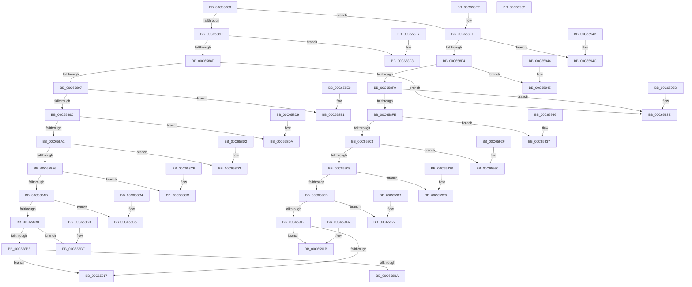

# MiConvertAssignedRegionToVaType

- RVA: `0x00C65888`–`0x00C65953` (길이 `203` bytes)
- VA: `0x0000000140C65888`
- 실행 섹션: `INIT`
- PDB 이름 있음: `예`; PDB Function 태그: `아니요`
- unwind 정보 RVA: `0x000DB714`
- 디코드: `86`개 명령, `203/203` bytes 표시
- 미해석 바이트: `0` (있으면 어셈블리에 `.byte`로 보존)

> 이 문서는 커널 이미지의 기계어와 PDB 기호를 분석해 생성했습니다. 4번과 5번은 함수 원형과 자료형을 바이너리 사용 방식에서 추정한 C 해석이며 원본 소스 복구 결과는 아닙니다.

## 1. Dependencies

- 직접 호출 지점: **0**; 고유 호출 대상: **0**
- 직접 호출자로 확인된 함수: **1**
- RIP 상대 이미지 참조: **0**

### Outgoing calls
- 직접 디코드된 call 명령이 없습니다.

### Direct callers
- [MiSetSystemRegionTypes](MiSetSystemRegionTypes_function_00C65E34.md) at `0x00C65E65`

### Static image references
- 디코드된 RIP-relative 메모리 참조가 없습니다.

## 2. Other-region calls and transfers

- 다른 실행 섹션으로 향하는 call: **0**
- 별도 외부 분기/꼬리 이동을 확인하지 못했습니다.

## 3. Assembly (complete function range)

```asm
00C65888  83 F9 09                        cmp ecx, 9
00C6588B  7F 62                           jg 0x140c658ef
00C6588D  74 59                           je 0x140c658e8
00C6588F  85 C9                           test ecx, ecx
00C65891  0F 84 A7 00 00 00               je 0x140c6593e
00C65897  83 E9 01                        sub ecx, 1
00C6589A  74 45                           je 0x140c658e1
00C6589C  83 E9 01                        sub ecx, 1
00C6589F  74 39                           je 0x140c658da
00C658A1  83 E9 01                        sub ecx, 1
00C658A4  74 2D                           je 0x140c658d3
00C658A6  83 E9 01                        sub ecx, 1
00C658A9  74 21                           je 0x140c658cc
00C658AB  83 E9 01                        sub ecx, 1
00C658AE  74 15                           je 0x140c658c5
00C658B0  83 E9 02                        sub ecx, 2
00C658B3  74 09                           je 0x140c658be
00C658B5  83 F9 01                        cmp ecx, 1
00C658B8  75 5D                           jne 0x140c65917
00C658BA  8B C1                           mov eax, ecx
00C658BC  C3                              ret
00C658BD  CC                              int3
00C658BE  B8 12 00 00 00                  mov eax, 0x12
00C658C3  C3                              ret
00C658C4  CC                              int3
00C658C5  B8 13 00 00 00                  mov eax, 0x13
00C658CA  C3                              ret
00C658CB  CC                              int3
00C658CC  B8 08 00 00 00                  mov eax, 8
00C658D1  C3                              ret
00C658D2  CC                              int3
00C658D3  B8 07 00 00 00                  mov eax, 7
00C658D8  C3                              ret
00C658D9  CC                              int3
00C658DA  B8 05 00 00 00                  mov eax, 5
00C658DF  C3                              ret
00C658E0  CC                              int3
00C658E1  B8 04 00 00 00                  mov eax, 4
00C658E6  C3                              ret
00C658E7  CC                              int3
00C658E8  B8 0D 00 00 00                  mov eax, 0xd
00C658ED  C3                              ret
00C658EE  CC                              int3
00C658EF  83 E9 0A                        sub ecx, 0xa
00C658F2  74 58                           je 0x140c6594c
00C658F4  83 E9 01                        sub ecx, 1
00C658F7  74 4C                           je 0x140c65945
00C658F9  83 E9 01                        sub ecx, 1
00C658FC  74 40                           je 0x140c6593e
00C658FE  83 E9 01                        sub ecx, 1
00C65901  74 34                           je 0x140c65937
00C65903  83 E9 01                        sub ecx, 1
00C65906  74 28                           je 0x140c65930
00C65908  83 E9 01                        sub ecx, 1
00C6590B  74 1C                           je 0x140c65929
00C6590D  83 E9 01                        sub ecx, 1
00C65910  74 10                           je 0x140c65922
00C65912  83 F9 01                        cmp ecx, 1
00C65915  74 04                           je 0x140c6591b
00C65917  33 C0                           xor eax, eax
00C65919  C3                              ret
00C6591A  CC                              int3
00C6591B  B8 0B 00 00 00                  mov eax, 0xb
00C65920  C3                              ret
00C65921  CC                              int3
00C65922  B8 11 00 00 00                  mov eax, 0x11
00C65927  C3                              ret
00C65928  CC                              int3
00C65929  B8 0F 00 00 00                  mov eax, 0xf
00C6592E  C3                              ret
00C6592F  CC                              int3
00C65930  B8 0E 00 00 00                  mov eax, 0xe
00C65935  C3                              ret
00C65936  CC                              int3
00C65937  B8 09 00 00 00                  mov eax, 9
00C6593C  C3                              ret
00C6593D  CC                              int3
00C6593E  B8 03 00 00 00                  mov eax, 3
00C65943  C3                              ret
00C65944  CC                              int3
00C65945  B8 10 00 00 00                  mov eax, 0x10
00C6594A  C3                              ret
00C6594B  CC                              int3
00C6594C  B8 06 00 00 00                  mov eax, 6
00C65951  C3                              ret
00C65952  CC                              int3
```

## 4. C-style interpretation (structured pseudocode)

```c
__int64 __fastcall MiConvertAssignedRegionToVaType(int a1)
{
    __int64 result;

    if (a1 > 9) goto loc_00C658EF;
    if (a1 == 9) goto loc_00C658E8;
    if (a1 == 0) goto loc_00C6593E;
    a1 = (unsigned int)((a1) - (1));
    if (condition_is_equal) goto loc_00C658E1;
    a1 = (unsigned int)((a1) - (1));
    if (condition_is_equal) goto loc_00C658DA;
    a1 = (unsigned int)((a1) - (1));
    if (condition_is_equal) goto loc_00C658D3;
    a1 = (unsigned int)((a1) - (1));
    if (condition_is_equal) goto loc_00C658CC;
    a1 = (unsigned int)((a1) - (1));
    if (condition_is_equal) goto loc_00C658C5;
    a1 = (unsigned int)((a1) - (2));
    if (condition_is_equal) goto loc_00C658BE;
    if (a1 != 1) goto loc_00C65917;
    return (unsigned int)(a1);
loc_00C658BE:
    return 18;
loc_00C658C5:
    return 19;
loc_00C658CC:
    return 8;
loc_00C658D3:
    return 7;
loc_00C658DA:
    return 5;
loc_00C658E1:
    return 4;
loc_00C658E8:
    return 13;
loc_00C658EF:
    a1 = (unsigned int)((a1) - (10));
    if (condition_is_equal) goto loc_00C6594C;
    a1 = (unsigned int)((a1) - (1));
    if (condition_is_equal) goto loc_00C65945;
    a1 = (unsigned int)((a1) - (1));
    if (condition_is_equal) goto loc_00C6593E;
    a1 = (unsigned int)((a1) - (1));
    if (condition_is_equal) goto loc_00C65937;
    a1 = (unsigned int)((a1) - (1));
    if (condition_is_equal) goto loc_00C65930;
    a1 = (unsigned int)((a1) - (1));
    if (condition_is_equal) goto loc_00C65929;
    a1 = (unsigned int)((a1) - (1));
    if (condition_is_equal) goto loc_00C65922;
    if (a1 == 1) goto loc_00C6591B;
loc_00C65917:
    result = 0;
    return result;
loc_00C6591B:
    return 11;
loc_00C65922:
    return 17;
loc_00C65929:
    return 15;
loc_00C65930:
    return 14;
loc_00C65937:
    return 9;
loc_00C6593E:
    return 3;
loc_00C65945:
    return 16;
loc_00C6594C:
    return 6;
}
```

## 5. (Beta) C Style

```c
int64_t MiConvertAssignedRegionToVaType(int32_t Arg1)
{
    int64_t result;

    if (Arg1 > 9) goto loc_00C658EF;
    if (Arg1 == 9) goto loc_00C658E8;
    if (Arg1 == 0) goto loc_00C6593E;
    Arg1 = (uint32_t)((Arg1) - (1));
    if (condition_is_equal) goto loc_00C658E1;
    Arg1 = (uint32_t)((Arg1) - (1));
    if (condition_is_equal) goto loc_00C658DA;
    Arg1 = (uint32_t)((Arg1) - (1));
    if (condition_is_equal) goto loc_00C658D3;
    Arg1 = (uint32_t)((Arg1) - (1));
    if (condition_is_equal) goto loc_00C658CC;
    Arg1 = (uint32_t)((Arg1) - (1));
    if (condition_is_equal) goto loc_00C658C5;
    Arg1 = (uint32_t)((Arg1) - (2));
    if (condition_is_equal) goto loc_00C658BE;
    if (Arg1 != 1) goto loc_00C65917;
    return (uint32_t)(Arg1);
loc_00C658BE:
    return 18;
loc_00C658C5:
    return 19;
loc_00C658CC:
    return 8;
loc_00C658D3:
    return 7;
loc_00C658DA:
    return 5;
loc_00C658E1:
    return 4;
loc_00C658E8:
    return 13;
loc_00C658EF:
    Arg1 = (uint32_t)((Arg1) - (10));
    if (condition_is_equal) goto loc_00C6594C;
    Arg1 = (uint32_t)((Arg1) - (1));
    if (condition_is_equal) goto loc_00C65945;
    Arg1 = (uint32_t)((Arg1) - (1));
    if (condition_is_equal) goto loc_00C6593E;
    Arg1 = (uint32_t)((Arg1) - (1));
    if (condition_is_equal) goto loc_00C65937;
    Arg1 = (uint32_t)((Arg1) - (1));
    if (condition_is_equal) goto loc_00C65930;
    Arg1 = (uint32_t)((Arg1) - (1));
    if (condition_is_equal) goto loc_00C65929;
    Arg1 = (uint32_t)((Arg1) - (1));
    if (condition_is_equal) goto loc_00C65922;
    if (Arg1 == 1) goto loc_00C6591B;
loc_00C65917:
    result = 0;
    return result;
loc_00C6591B:
    return 11;
loc_00C65922:
    return 17;
loc_00C65929:
    return 15;
loc_00C65930:
    return 14;
loc_00C65937:
    return 9;
loc_00C6593E:
    return 3;
loc_00C65945:
    return 16;
loc_00C6594C:
    return 6;
}
```

## 6. Execution-region graph

[열기: 2D/3D 그래프와 함수 탐색 컨트롤 패널](../../../control-panel.html?section=init&rva=0x00C65888&view=graph)

- 2D 그래프는 위에서 아래로 흐르고, 3D 그래프는 빈 공간을 드래그해 회전합니다. Shift+드래그는 이동, 휠은 확대·축소, 함수 노드 선택은 대상 보고서 이동입니다.

### Static fallback


