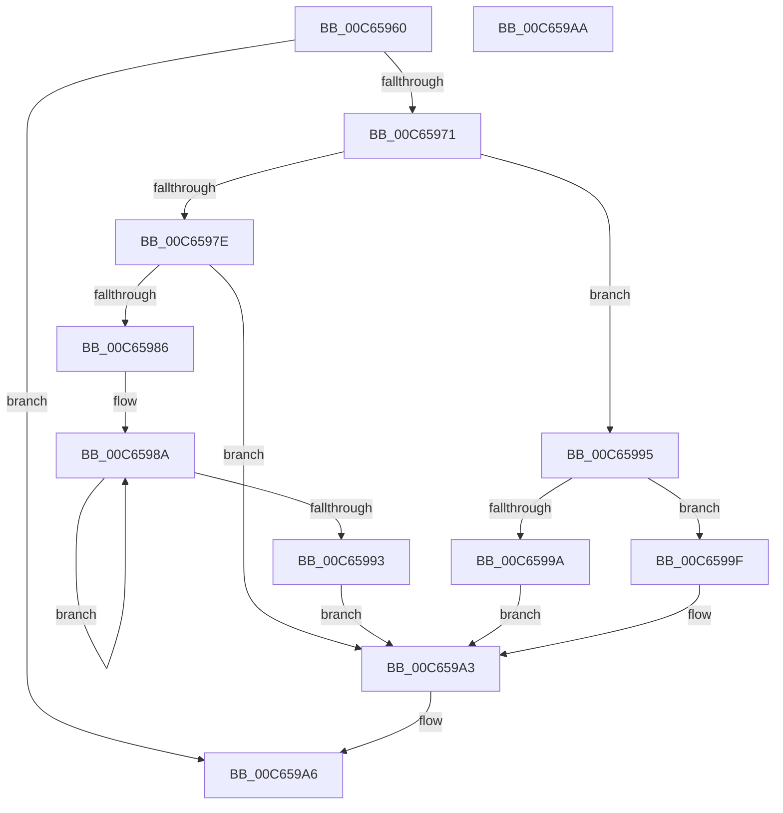

# MiCountBootDriverRegionPtes

- RVA: `0x00C65960`–`0x00C659AB` (길이 `75` bytes)
- VA: `0x0000000140C65960`
- 실행 섹션: `INIT`
- PDB 이름 있음: `예`; PDB Function 태그: `아니요`
- unwind 정보 RVA: `0x000DB714`
- 디코드: `26`개 명령, `75/75` bytes 표시
- 미해석 바이트: `0` (있으면 어셈블리에 `.byte`로 보존)

> 이 문서는 커널 이미지의 기계어와 PDB 기호를 분석해 생성했습니다. 4번과 5번은 함수 원형과 자료형을 바이너리 사용 방식에서 추정한 C 해석이며 원본 소스 복구 결과는 아닙니다.

## 1. Dependencies

- 직접 호출 지점: **0**; 고유 호출 대상: **0**
- 직접 호출자로 확인된 함수: **0**
- RIP 상대 이미지 참조: **0**

### Outgoing calls
- 직접 디코드된 call 명령이 없습니다.

### Direct callers
- 이 함수 시작 RVA로 연결되는 직접 call은 확인되지 않았습니다. 간접 호출은 완전히 역산할 수 없습니다.

### Static image references
- 디코드된 RIP-relative 메모리 참조가 없습니다.

## 2. Other-region calls and transfers

- 다른 실행 섹션으로 향하는 call: **0**
- 별도 외부 분기/꼬리 이동을 확인하지 못했습니다.

## 3. Assembly (complete function range)

```asm
00C65960  48 8B 12                        mov rdx, qword ptr [rdx]
00C65963  41 B9 01 00 00 00               mov r9d, 1
00C65969  4C 8B D1                        mov r10, rcx
00C6596C  41 84 D1                        test r9b, dl
00C6596F  74 35                           je 0x140c659a6
00C65971  4D 8B 92 B8 00 00 00            mov r10, qword ptr [r10 + 0xb8]
00C65978  33 C9                           xor ecx, ecx
00C6597A  84 D2                           test dl, dl
00C6597C  79 17                           jns 0x140c65995
00C6597E  41 8B C9                        mov ecx, r9d
00C65981  45 3B C1                        cmp r8d, r9d
00C65984  7E 1D                           jle 0x140c659a3
00C65986  41 8D 50 FF                     lea edx, [r8 - 1]
00C6598A  48 C1 E1 09                     shl rcx, 9
00C6598E  49 2B D1                        sub rdx, r9
00C65991  75 F7                           jne 0x140c6598a
00C65993  EB 0E                           jmp 0x140c659a3
00C65995  45 3B C1                        cmp r8d, r9d
00C65998  7E 05                           jle 0x140c6599f
00C6599A  44 8B C9                        mov r9d, ecx
00C6599D  EB 04                           jmp 0x140c659a3
00C6599F  49 0F 44 C9                     cmove rcx, r9
00C659A3  49 01 0A                        add qword ptr [r10], rcx
00C659A6  41 8B C1                        mov eax, r9d
00C659A9  C3                              ret
00C659AA  CC                              int3
```

## 4. C-style interpretation (structured pseudocode)

```c
__int64 __fastcall MiCountBootDriverRegionPtes(__int64 a1, __int64 a2, __int64 a3)
{
    if (((1) & ((unsigned __int8)(*(unsigned __int64 *)(a2)))) == 0) goto loc_00C659A6;
    a1 = 0;
    if (!sign_flag) goto loc_00C65995;
    if (((unsigned int)(a3)) <= 1) goto loc_00C659A3;
loc_00C6598A:
    a1 = (1) << (9);
    a2 = (a3 - 1) - (1);
    if (condition_is_not_equal) goto loc_00C6598A;
    goto loc_00C659A3;
loc_00C65995:
    if (((unsigned int)(a3)) <= 1) goto loc_00C6599F;
    goto loc_00C659A3;
loc_00C6599F:
    if (((unsigned int)(a3)) == 1) { a1 = (unsigned int)((unsigned int)(a1)); }
loc_00C659A3:
loc_00C659A6:
    return (unsigned int)((unsigned int)((unsigned int)((unsigned int)(a1))));
}
```

## 5. (Beta) C Style

```c
int64_t MiCountBootDriverRegionPtes(void *Arg1, void *Arg2, int64_t Arg3)
{
    uint8_t *arg1 = (uint8_t *)Arg1;
    uint8_t *arg2 = (uint8_t *)Arg2;

    if (((1) & ((uint8_t)(*(uint64_t *)(arg2)))) == 0) goto loc_00C659A6;
    Arg1 = 0;
    if (!sign_flag) goto loc_00C65995;
    if (((uint32_t)(Arg3)) <= 1) goto loc_00C659A3;
loc_00C6598A:
    Arg1 = (1) << (9);
    Arg2 = (Arg3 - 1) - (1);
    if (condition_is_not_equal) goto loc_00C6598A;
    goto loc_00C659A3;
loc_00C65995:
    if (((uint32_t)(Arg3)) <= 1) goto loc_00C6599F;
    goto loc_00C659A3;
loc_00C6599F:
    if (((uint32_t)(Arg3)) == 1) { Arg1 = (uint32_t)((uint32_t)(Arg1)); }
loc_00C659A3:
loc_00C659A6:
    return (uint32_t)((uint32_t)((uint32_t)((uint32_t)(Arg1))));
}
```

### 관측된 메모리 오프셋

구조체 형식이 확인되지 않은 접근은 인자 기준의 오프셋으로만 기록했습니다.

| 기준 인자 | 오프셋 표현 | 폭 (bit) | 접근 |
|---|---:|---:|---|
| `Arg1` | `+ 0xB8` | `64` | `R` |
| `Arg2` | `+ 0x0` | `64` | `R` |

## 6. Execution-region graph

[열기: 2D/3D 그래프와 함수 탐색 컨트롤 패널](../../../control-panel.html?section=init&rva=0x00C65960&view=graph)

- 2D 그래프는 위에서 아래로 흐르고, 3D 그래프는 빈 공간을 드래그해 회전합니다. Shift+드래그는 이동, 휠은 확대·축소, 함수 노드 선택은 대상 보고서 이동입니다.

### Static fallback


