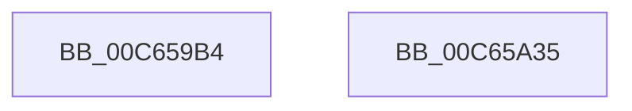

# MiCountBootDriverRegions

- RVA: `0x00C659B4`–`0x00C65A36` (길이 `130` bytes)
- VA: `0x0000000140C659B4`
- 실행 섹션: `INIT`
- PDB 이름 있음: `예`; PDB Function 태그: `아니요`
- unwind 정보 RVA: `0x000D7D20`
- 디코드: `23`개 명령, `130/130` bytes 표시
- 미해석 바이트: `0` (있으면 어셈블리에 `.byte`로 보존)

> 이 문서는 커널 이미지의 기계어와 PDB 기호를 분석해 생성했습니다. 4번과 5번은 함수 원형과 자료형을 바이너리 사용 방식에서 추정한 C 해석이며 원본 소스 복구 결과는 아닙니다.

## 1. Dependencies

- 직접 호출 지점: **2**; 고유 호출 대상: **2**
- 직접 호출자로 확인된 함수: **1**
- RIP 상대 이미지 참조: **3**

### Outgoing calls
- `0x00C659C8` → [memset](../../text/6C/memset_function_006C6C40.md) (function, `0x006C6C40`)
- `0x00C65A20` → [MiWalkPageTables](../../text/2C/MiWalkPageTables_function_002C2710.md) (function, `0x002C2710`)

### Direct callers
- [MiInitNucleus](../C5/MiInitNucleus_function_00C5FD38.md) at `0x00C5FEA7`

### Static image references
- `0x00C659CD` → RVA `0x00E38CB8` (`.data`; read)
- `0x00C659ED` → RVA `0x00E38CC0` (`.data`; read)
- `0x00C65A0C` → RVA `0x00C65960` (`MiCountBootDriverRegionPtes`; read)

## 2. Other-region calls and transfers

- 다른 실행 섹션으로 향하는 call: **2**
  - `0x00C659C8` → [memset](../../text/6C/memset_function_006C6C40.md) (`INIT` → `.text`)
  - `0x00C65A20` → [MiWalkPageTables](../../text/2C/MiWalkPageTables_function_002C2710.md) (`INIT` → `.text`)
- 별도 외부 분기/꼬리 이동을 확인하지 못했습니다.

## 3. Assembly (complete function range)

```asm
00C659B4  48 81 EC E8 00 00 00            sub rsp, 0xe8
00C659BB  33 D2                           xor edx, edx
00C659BD  48 8D 4C 24 20                  lea rcx, [rsp + 0x20]
00C659C2  41 B8 C0 00 00 00               mov r8d, 0xc0
00C659C8  E8 73 12 A6 FF                  call 0x1406c6c40
00C659CD  48 8B 0D E4 32 1D 00            mov rcx, qword ptr [rip + 0x1d32e4]
00C659D4  48 8D 84 24 F0 00 00 00         lea rax, [rsp + 0xf0]
00C659DC  48 83 A4 24 F0 00 00 00 00      and qword ptr [rsp + 0xf0], 0
00C659E5  48 89 84 24 D8 00 00 00         mov qword ptr [rsp + 0xd8], rax
00C659ED  48 8B 05 CC 32 1D 00            mov rax, qword ptr [rip + 0x1d32cc]
00C659F4  48 FF C8                        dec rax
00C659F7  48 89 4C 24 48                  mov qword ptr [rsp + 0x48], rcx
00C659FC  48 03 C8                        add rcx, rax
00C659FF  C7 44 24 20 00 26 02 00         mov dword ptr [rsp + 0x20], 0x22600
00C65A07  48 89 4C 24 50                  mov qword ptr [rsp + 0x50], rcx
00C65A0C  48 8D 05 4D FF FF FF            lea rax, [rip - 0xb3]
00C65A13  48 8D 4C 24 20                  lea rcx, [rsp + 0x20]
00C65A18  48 89 84 24 C8 00 00 00         mov qword ptr [rsp + 0xc8], rax
00C65A20  E8 EB CC 65 FF                  call 0x1402c2710
00C65A25  48 8B 84 24 F0 00 00 00         mov rax, qword ptr [rsp + 0xf0]
00C65A2D  48 81 C4 E8 00 00 00            add rsp, 0xe8
00C65A34  C3                              ret
00C65A35  CC                              int3
```

## 4. C-style interpretation (structured pseudocode)

```c
__int64 __fastcall MiCountBootDriverRegions(__int64 a1, int a2)
{
    __int64 result;
    __int64 v_rsp;
    unsigned __int64 v_stack_m10;
    unsigned __int64 v_stack_m20;
    unsigned __int64 v_stack_m98;
    unsigned __int64 v_stack_mA0;
    unsigned __int64 v_stack_mC8;
    unsigned __int64 v_stack_p8;

    v_rsp = (v_rsp) - (232);
    a2 = 0;
    result = memset(v_stack_mC8, a2, 192, a4);
    v_stack_m10 = v_stack_p8;
    result = (*(unsigned __int64 *)(v_rip + 1913548)) - 1;
    v_stack_mA0 = *(unsigned __int64 *)(v_rip + 1913572);
    a1 = (*(unsigned __int64 *)(v_rip + 1913572)) + (result);
    v_stack_mC8 = 0x22600ULL;
    v_stack_m98 = a1;
    v_stack_m20 = v_rip - 179;
    result = MiWalkPageTables(v_stack_mC8, a2, 192, a4);
    v_rsp = (v_rsp) + (232);
    return v_stack_p8;
}
```

## 5. (Beta) C Style

```c
int64_t MiCountBootDriverRegions(int64_t Arg1, int32_t Arg2)
{
    int64_t result;
    int64_t local_rsp;
    uint64_t v_stack_m10;
    uint64_t v_stack_m20;
    uint64_t v_stack_m98;
    uint64_t v_stack_mA0;
    uint64_t v_stack_mC8;
    uint64_t v_stack_p8;

    local_rsp = (local_rsp) - (232);
    Arg2 = 0;
    result = memset(v_stack_mC8, Arg2, 192, a4);
    v_stack_m10 = v_stack_p8;
    result = (*(uint64_t *)(v_rip + 0x1D32CC)) - 1;
    v_stack_mA0 = *(uint64_t *)(v_rip + 0x1D32E4);
    Arg1 = (*(uint64_t *)(v_rip + 0x1D32E4)) + (result);
    v_stack_mC8 = 0x22600ULL;
    v_stack_m98 = Arg1;
    v_stack_m20 = v_rip - 179;
    result = MiWalkPageTables(v_stack_mC8, Arg2, 192, a4);
    local_rsp = (local_rsp) + (232);
    return v_stack_p8;
}
```

## 6. Execution-region graph

[열기: 2D/3D 그래프와 함수 탐색 컨트롤 패널](../../../control-panel.html?section=init&rva=0x00C659B4&view=graph)

- 2D 그래프는 위에서 아래로 흐르고, 3D 그래프는 빈 공간을 드래그해 회전합니다. Shift+드래그는 이동, 휠은 확대·축소, 함수 노드 선택은 대상 보고서 이동입니다.

### Static fallback


