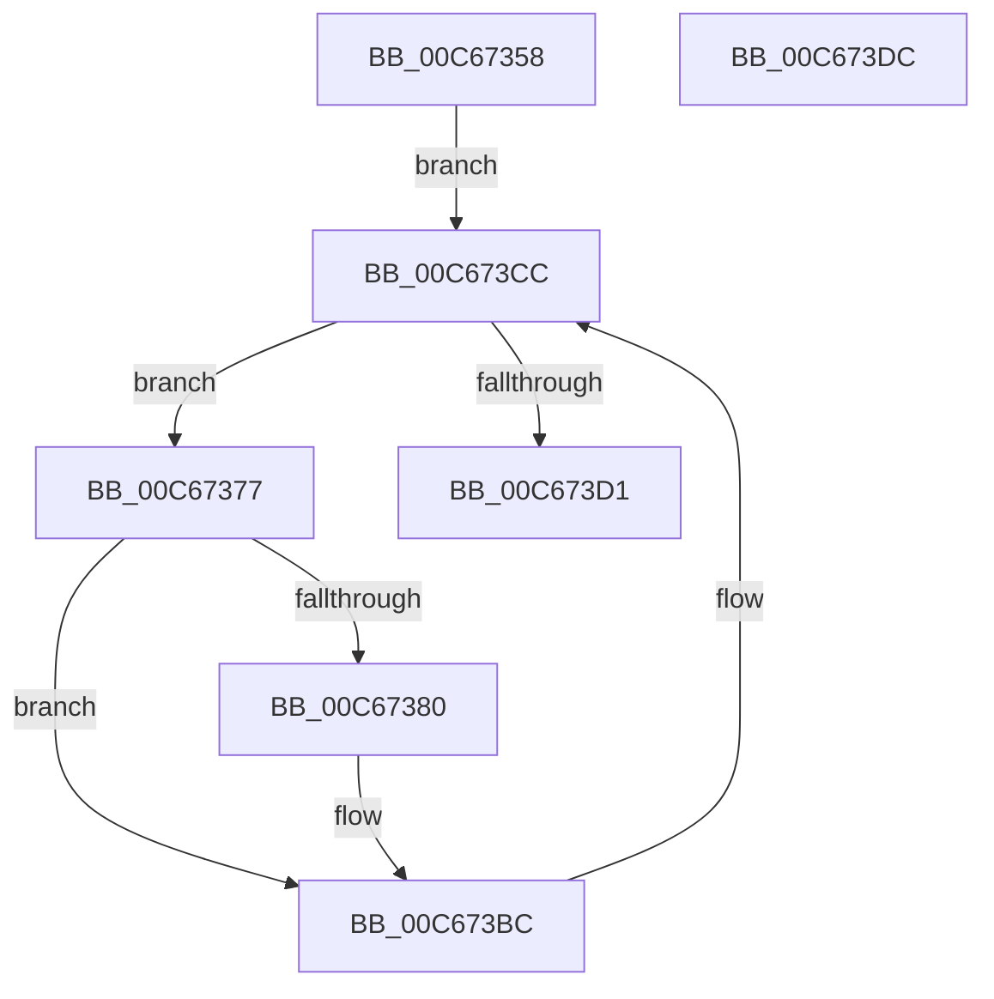

# MiCreateBootDriverHotPatchLinkage

- RVA: `0x00C67358`–`0x00C673DD` (길이 `133` bytes)
- VA: `0x0000000140C67358`
- 실행 섹션: `INIT`
- PDB 이름 있음: `예`; PDB Function 태그: `아니요`
- unwind 정보 RVA: `0x0005CAAC`
- 디코드: `33`개 명령, `133/133` bytes 표시
- 미해석 바이트: `0` (있으면 어셈블리에 `.byte`로 보존)

> 이 문서는 커널 이미지의 기계어와 PDB 기호를 분석해 생성했습니다. 4번과 5번은 함수 원형과 자료형을 바이너리 사용 방식에서 추정한 C 해석이며 원본 소스 복구 결과는 아닙니다.

## 1. Dependencies

- 직접 호출 지점: **1**; 고유 호출 대상: **1**
- 직접 호출자로 확인된 함수: **1**
- RIP 상대 이미지 참조: **0**

### Outgoing calls
- `0x00C673B7` → [MiLinkHotPatchToBase](../../text/68/MiLinkHotPatchToBase_function_00683728.md) (function, `0x00683728`)

### Direct callers
- [MiInitializeLoadedModuleList](MiInitializeLoadedModuleList_function_00C6BCDC.md) at `0x00C6BF58`

### Static image references
- 디코드된 RIP-relative 메모리 참조가 없습니다.

## 2. Other-region calls and transfers

- 다른 실행 섹션으로 향하는 call: **1**
  - `0x00C673B7` → [MiLinkHotPatchToBase](../../text/68/MiLinkHotPatchToBase_function_00683728.md) (`INIT` → `.text`)
- 별도 외부 분기/꼬리 이동을 확인하지 못했습니다.

## 3. Assembly (complete function range)

```asm
00C67358  48 89 5C 24 08                  mov qword ptr [rsp + 8], rbx
00C6735D  57                              push rdi
00C6735E  48 83 EC 20                     sub rsp, 0x20
00C67362  48 8B 81 F0 00 00 00            mov rax, qword ptr [rcx + 0xf0]
00C67369  48 8B F9                        mov rdi, rcx
00C6736C  48 05 C8 0E 00 00               add rax, 0xec8
00C67372  48 8B 18                        mov rbx, qword ptr [rax]
00C67375  EB 55                           jmp 0x140c673cc
00C67377  8B 43 28                        mov eax, dword ptr [rbx + 0x28]
00C6737A  24 03                           and al, 3
00C6737C  3C 01                           cmp al, 1
00C6737E  75 3C                           jne 0x140c673bc
00C67380  48 8B 43 50                     mov rax, qword ptr [rbx + 0x50]
00C67384  48 8B 53 58                     mov rdx, qword ptr [rbx + 0x58]
00C67388  48 8B 88 90 00 00 00            mov rcx, qword ptr [rax + 0x90]
00C6738F  48 8B 82 90 00 00 00            mov rax, qword ptr [rdx + 0x90]
00C67396  48 89 81 F8 00 00 00            mov qword ptr [rcx + 0xf8], rax
00C6739D  48 8B 53 58                     mov rdx, qword ptr [rbx + 0x58]
00C673A1  48 8B 4B 50                     mov rcx, qword ptr [rbx + 0x50]
00C673A5  44 8B 43 44                     mov r8d, dword ptr [rbx + 0x44]
00C673A9  48 8B 92 90 00 00 00            mov rdx, qword ptr [rdx + 0x90]
00C673B0  48 8B 89 90 00 00 00            mov rcx, qword ptr [rcx + 0x90]
00C673B7  E8 6C C3 A1 FF                  call 0x140683728
00C673BC  48 8B 87 F0 00 00 00            mov rax, qword ptr [rdi + 0xf0]
00C673C3  48 8B 1B                        mov rbx, qword ptr [rbx]
00C673C6  48 05 C8 0E 00 00               add rax, 0xec8
00C673CC  48 3B D8                        cmp rbx, rax
00C673CF  75 A6                           jne 0x140c67377
00C673D1  48 8B 5C 24 30                  mov rbx, qword ptr [rsp + 0x30]
00C673D6  48 83 C4 20                     add rsp, 0x20
00C673DA  5F                              pop rdi
00C673DB  C3                              ret
00C673DC  CC                              int3
```

## 4. C-style interpretation (structured pseudocode)

```c
__int64 __fastcall MiCreateBootDriverHotPatchLinkage(__int64 a1)
{
    __int64 result;
    __int64 v_rsp;
    unsigned __int64 v_stack_p8;

    v_stack_p8 = v_rbx;
    v_rsp = (v_rsp) - (32);
    result = (*(unsigned __int64 *)(a1 + 240)) + (0xEC8ULL);
    goto loc_00C673CC;
loc_00C67377:
    result = (unsigned __int8)(((unsigned int)(*(unsigned int *)(*(unsigned __int64 *)(result) + 40))) & (3));
    if (((unsigned __int8)(result)) == 1) {
        result = *(unsigned __int64 *)(*(unsigned __int64 *)(result) + 80);
        a2 = *(unsigned __int64 *)(*(unsigned __int64 *)(result) + 88);
        a1 = *(unsigned __int64 *)(result + 144);
        result = *(unsigned __int64 *)(a2 + 144);
        *(unsigned __int64 *)(a1 + 248) = result;
        a2 = *(unsigned __int64 *)(*(unsigned __int64 *)(result) + 88);
        a1 = *(unsigned __int64 *)(*(unsigned __int64 *)(result) + 80);
        a3 = *(unsigned int *)(*(unsigned __int64 *)(result) + 68);
        a2 = *(unsigned __int64 *)(a2 + 144);
        a1 = *(unsigned __int64 *)(a1 + 144);
        result = MiLinkHotPatchToBase(a1, a2, a3, a4);
    }
    result = (*(unsigned __int64 *)(a1 + 240)) + (0xEC8ULL);
loc_00C673CC:
    if ((*(unsigned __int64 *)(*(unsigned __int64 *)(result))) != result) goto loc_00C67377;
    v_rsp = (v_rsp) + (32);
    return result;
}
```

## 5. (Beta) C Style

```c
int64_t MiCreateBootDriverHotPatchLinkage(void *Arg1)
{
    uint8_t *arg1 = (uint8_t *)Arg1;

    int64_t result;
    int64_t local_rsp;
    uint64_t v_stack_p8;

    v_stack_p8 = local_rbx;
    local_rsp = (local_rsp) - (32);
    result = (*(uint64_t *)(arg1 + 0xF0)) + (0xEC8ULL);
    goto loc_00C673CC;
loc_00C67377:
    result = (uint8_t)(((uint32_t)(*(uint32_t *)(*(uint64_t *)(result) + 0x28))) & (3));
    if (((uint8_t)(result)) == 1) {
        result = *(uint64_t *)(*(uint64_t *)(result) + 0x50);
        a2 = *(uint64_t *)(*(uint64_t *)(result) + 0x58);
        Arg1 = *(uint64_t *)(result + 0x90);
        result = *(uint64_t *)(a2 + 0x90);
        *(uint64_t *)(arg1 + 0xF8) = result;
        a2 = *(uint64_t *)(*(uint64_t *)(result) + 0x58);
        Arg1 = *(uint64_t *)(*(uint64_t *)(result) + 0x50);
        a3 = *(uint32_t *)(*(uint64_t *)(result) + 0x44);
        a2 = *(uint64_t *)(a2 + 0x90);
        Arg1 = *(uint64_t *)(arg1 + 0x90);
        result = MiLinkHotPatchToBase(Arg1, a2, a3, a4);
    }
    result = (*(uint64_t *)(arg1 + 0xF0)) + (0xEC8ULL);
loc_00C673CC:
    if ((*(uint64_t *)(*(uint64_t *)(result))) != result) goto loc_00C67377;
    local_rsp = (local_rsp) + (32);
    return result;
}
```

### 관측된 메모리 오프셋

구조체 형식이 확인되지 않은 접근은 인자 기준의 오프셋으로만 기록했습니다.

| 기준 인자 | 오프셋 표현 | 폭 (bit) | 접근 |
|---|---:|---:|---|
| `Arg1` | `+ 0xF0` | `64` | `R` |

## 6. Execution-region graph

[열기: 2D/3D 그래프와 함수 탐색 컨트롤 패널](../../../control-panel.html?section=init&rva=0x00C67358&view=graph)

- 2D 그래프는 위에서 아래로 흐르고, 3D 그래프는 빈 공간을 드래그해 회전합니다. Shift+드래그는 이동, 휠은 확대·축소, 함수 노드 선택은 대상 보고서 이동입니다.

### Static fallback


