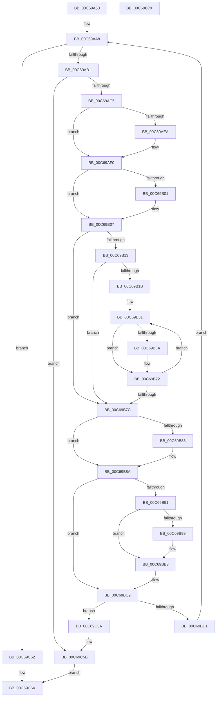

# MiCreateBootSlabEntries

- RVA: `0x00C69A50`–`0x00C69C7A` (길이 `554` bytes)
- VA: `0x0000000140C69A50`
- 실행 섹션: `INIT`
- PDB 이름 있음: `예`; PDB Function 태그: `아니요`
- unwind 정보 RVA: `0x000CBFC4`
- 디코드: `147`개 명령, `554/554` bytes 표시
- 미해석 바이트: `0` (있으면 어셈블리에 `.byte`로 보존)

> 이 문서는 커널 이미지의 기계어와 PDB 기호를 분석해 생성했습니다. 4번과 5번은 함수 원형과 자료형을 바이너리 사용 방식에서 추정한 C 해석이며 원본 소스 복구 결과는 아닙니다.

## 1. Dependencies

- 직접 호출 지점: **9**; 고유 호출 대상: **9**
- 직접 호출자로 확인된 함수: **2**
- RIP 상대 이미지 참조: **7**

### Outgoing calls
- `0x00C69AB4` → [MiAllocateSlabEntry](../../text/4A/MiAllocateSlabEntry_function_004AE468.md) (function, `0x004AE468`)
- `0x00C69ADD` → [RtlSetAllBits](../../text/36/RtlSetAllBits_function_00362490.md) (function, `0x00362490`)
- `0x00C69B54` → [MiUpdatePageFileHighInPte](../../text/36/MiUpdatePageFileHighInPte_function_0036D840.md) (function, `0x0036D840`)
- `0x00C69BA3` → [MiReleaseNonPagedResources](../../text/32/MiReleaseNonPagedResources_function_0032299C.md) (function, `0x0032299C`)
- `0x00C69BC8` → [MiIsPfnRangeFromSlabAllocation](../../text/49/MiIsPfnRangeFromSlabAllocation_function_004952AC.md) (function, `0x004952AC`)
- `0x00C69BEB` → [MiSetSlabTypeIdentifiers](../../text/49/MiSetSlabTypeIdentifiers_function_00498AC8.md) (function, `0x00498AC8`)
- `0x00C69C03` → [MiUpdateLargePageBitMap](../../text/37/MiUpdateLargePageBitMap_function_0037619C.md) (function, `0x0037619C`)
- `0x00C69C18` → [MiInsertSlabEntry](../../text/37/MiInsertSlabEntry_function_00378AF4.md) (function, `0x00378AF4`)
- `0x00C69C55` → [KeBugCheckEx](../../text/4F/KeBugCheckEx_function_004FD660.md) (function, `0x004FD660`)

### Direct callers
- [MiCreateKernelHalSlabRange](MiCreateKernelHalSlabRange_function_00C69C80.md) at `0x00C69DED`
- [MiCreateSlabAllocationsFromLoaderBlock](MiCreateSlabAllocationsFromLoaderBlock_function_00C69E3C.md) at `0x00C69F65`

### Static image references
- `0x00C69A74` → RVA `0x00011C60` (`.rdata`; read)
- `0x00C69AF6` → RVA `0x00E3D254` (`.data`; read)
- `0x00C69B60` → RVA `0x00E3D9C0` (`.data`; read/write)
- `0x00C69B83` → RVA `0x00E3D9E0` (`.data`; read/write)
- `0x00C69B9C` → RVA `0x00E38D00` (`.data`; read)
- `0x00C69BAB` → RVA `0x00E376D8` (`.data`; read/write)
- `0x00C69BB3` → RVA `0x00E3D9E8` (`.data`; read/write)

## 2. Other-region calls and transfers

- 다른 실행 섹션으로 향하는 call: **9**
  - `0x00C69AB4` → [MiAllocateSlabEntry](../../text/4A/MiAllocateSlabEntry_function_004AE468.md) (`INIT` → `.text`)
  - `0x00C69ADD` → [RtlSetAllBits](../../text/36/RtlSetAllBits_function_00362490.md) (`INIT` → `.text`)
  - `0x00C69B54` → [MiUpdatePageFileHighInPte](../../text/36/MiUpdatePageFileHighInPte_function_0036D840.md) (`INIT` → `.text`)
  - `0x00C69BA3` → [MiReleaseNonPagedResources](../../text/32/MiReleaseNonPagedResources_function_0032299C.md) (`INIT` → `.text`)
  - `0x00C69BC8` → [MiIsPfnRangeFromSlabAllocation](../../text/49/MiIsPfnRangeFromSlabAllocation_function_004952AC.md) (`INIT` → `.text`)
  - `0x00C69BEB` → [MiSetSlabTypeIdentifiers](../../text/49/MiSetSlabTypeIdentifiers_function_00498AC8.md) (`INIT` → `.text`)
  - `0x00C69C03` → [MiUpdateLargePageBitMap](../../text/37/MiUpdateLargePageBitMap_function_0037619C.md) (`INIT` → `.text`)
  - `0x00C69C18` → [MiInsertSlabEntry](../../text/37/MiInsertSlabEntry_function_00378AF4.md) (`INIT` → `.text`)
  - `0x00C69C55` → [KeBugCheckEx](../../text/4F/KeBugCheckEx_function_004FD660.md) (`INIT` → `.text`)
- 별도 외부 분기/꼬리 이동을 확인하지 못했습니다.

## 3. Assembly (complete function range)

```asm
00C69A50  48 89 5C 24 10                  mov qword ptr [rsp + 0x10], rbx
00C69A55  44 89 4C 24 20                  mov dword ptr [rsp + 0x20], r9d
00C69A5A  4C 89 44 24 18                  mov qword ptr [rsp + 0x18], r8
00C69A5F  55                              push rbp
00C69A60  56                              push rsi
00C69A61  57                              push rdi
00C69A62  41 54                           push r12
00C69A64  41 55                           push r13
00C69A66  41 56                           push r14
00C69A68  41 57                           push r15
00C69A6A  48 83 EC 30                     sub rsp, 0x30
00C69A6E  8B 81 88 00 00 00               mov eax, dword ptr [rcx + 0x88]
00C69A74  4C 8D 2D E5 81 3A FF            lea r13, [rip - 0xc57e1b]
00C69A7B  48 C1 E8 04                     shr rax, 4
00C69A7F  4C 8D 34 52                     lea r14, [rdx + rdx*2]
00C69A83  83 E0 03                        and eax, 3
00C69A86  49 C1 E6 04                     shl r14, 4
00C69A8A  45 8B F9                        mov r15d, r9d
00C69A8D  49 8B F8                        mov rdi, r8
00C69A90  4C 8B E2                        mov r12, rdx
00C69A93  48 8B E9                        mov rbp, rcx
00C69A96  45 8B 6C C5 00                  mov r13d, dword ptr [r13 + rax*8]
00C69A9B  48 B8 00 00 00 00 00 DE FF FF   movabs rax, 0xffffde0000000000
00C69AA5  4C 03 F0                        add r14, rax
00C69AA8  48 85 FF                        test rdi, rdi
00C69AAB  0F 84 B1 01 00 00               je 0x140c69c62
00C69AB1  48 8B CD                        mov rcx, rbp
00C69AB4  E8 AF 49 84 FF                  call 0x1404ae468
00C69AB9  48 8B D8                        mov rbx, rax
00C69ABC  48 85 C0                        test rax, rax
00C69ABF  0F 84 96 01 00 00               je 0x140c69c5b
00C69AC5  4C 89 60 28                     mov qword ptr [rax + 0x28], r12
00C69AC9  48 8D 4B 40                     lea rcx, [rbx + 0x40]
00C69ACD  4B 8D 04 2C                     lea rax, [r12 + r13]
00C69AD1  48 89 44 24 70                  mov qword ptr [rsp + 0x70], rax
00C69AD6  48 FF C8                        dec rax
00C69AD9  48 89 43 30                     mov qword ptr [rbx + 0x30], rax
00C69ADD  E8 AE 89 6F FF                  call 0x140362490
00C69AE2  8B 53 5C                        mov edx, dword ptr [rbx + 0x5c]
00C69AE5  45 85 FF                        test r15d, r15d
00C69AE8  74 06                           je 0x140c69af0
00C69AEA  83 CA 03                        or edx, 3
00C69AED  89 53 5C                        mov dword ptr [rbx + 0x5c], edx
00C69AF0  8B 8D 80 00 00 00               mov ecx, dword ptr [rbp + 0x80]
00C69AF6  8B 05 58 37 1D 00               mov eax, dword ptr [rip + 0x1d3758]
00C69AFC  0F A3 C8                        bt eax, ecx
00C69AFF  73 06                           jae 0x140c69b07
00C69B01  83 CA 02                        or edx, 2
00C69B04  89 53 5C                        mov dword ptr [rbx + 0x5c], edx
00C69B07  45 33 FF                        xor r15d, r15d
00C69B0A  83 BD 80 00 00 00 04            cmp dword ptr [rbp + 0x80], 4
00C69B11  77 69                           ja 0x140c69b7c
00C69B13  45 8B D5                        mov r10d, r13d
00C69B16  45 85 ED                        test r13d, r13d
00C69B19  74 61                           je 0x140c69b7c
00C69B1B  4A 8D 04 6D 00 00 00 00         lea rax, [r13*2]
00C69B23  49 03 C5                        add rax, r13
00C69B26  4D 8D 4E 10                     lea r9, [r14 + 0x10]
00C69B2A  48 C1 E0 04                     shl rax, 4
00C69B2E  4C 03 F0                        add r14, rax
00C69B31  49 8B 41 F8                     mov rax, qword ptr [r9 - 8]
00C69B35  48 85 C0                        test rax, rax
00C69B38  75 38                           jne 0x140c69b72
00C69B3A  44 8B 43 5C                     mov r8d, dword ptr [rbx + 0x5c]
00C69B3E  49 8B 09                        mov rcx, qword ptr [r9]
00C69B41  41 83 E0 02                     and r8d, 2
00C69B45  41 8B C0                        mov eax, r8d
00C69B48  F7 D8                           neg eax
00C69B4A  48 1B D2                        sbb rdx, rdx
00C69B4D  83 E2 04                        and edx, 4
00C69B50  48 83 C2 03                     add rdx, 3
00C69B54  E8 E7 3C 70 FF                  call 0x14036d840
00C69B59  49 89 01                        mov qword ptr [r9], rax
00C69B5C  49 8D 47 01                     lea rax, [r15 + 1]
00C69B60  F0 48 FF 0D 58 3E 1D 00         lock dec qword ptr [rip + 0x1d3e58]
00C69B68  45 85 C0                        test r8d, r8d
00C69B6B  49 0F 45 C7                     cmovne rax, r15
00C69B6F  4C 8B F8                        mov r15, rax
00C69B72  49 83 C1 30                     add r9, 0x30
00C69B76  41 83 C2 FF                     add r10d, -1
00C69B7A  75 B5                           jne 0x140c69b31
00C69B7C  8B 43 5C                        mov eax, dword ptr [rbx + 0x5c]
00C69B7F  A8 01                           test al, 1
00C69B81  74 07                           je 0x140c69b8a
00C69B83  4C 01 2D 56 3E 1D 00            add qword ptr [rip + 0x1d3e56], r13
00C69B8A  8B 43 5C                        mov eax, dword ptr [rbx + 0x5c]
00C69B8D  A8 02                           test al, 2
00C69B8F  75 31                           jne 0x140c69bc2
00C69B91  49 8B FD                        mov rdi, r13
00C69B94  49 2B FF                        sub rdi, r15
00C69B97  74 1A                           je 0x140c69bb3
00C69B99  48 8B D7                        mov rdx, rdi
00C69B9C  48 8D 0D 5D F1 1C 00            lea rcx, [rip + 0x1cf15d]
00C69BA3  E8 F4 8D 6B FF                  call 0x14032299c
00C69BA8  48 F7 DF                        neg rdi
00C69BAB  F0 48 01 3D 25 DB 1C 00         lock add qword ptr [rip + 0x1cdb25], rdi
00C69BB3  4C 01 3D 2E 3E 1D 00            add qword ptr [rip + 0x1d3e2e], r15
00C69BBA  48 8B BC 24 80 00 00 00         mov rdi, qword ptr [rsp + 0x80]
00C69BC2  49 8B D5                        mov rdx, r13
00C69BC5  49 8B CC                        mov rcx, r12
00C69BC8  E8 DF B6 82 FF                  call 0x1404952ac
00C69BCD  85 C0                           test eax, eax
00C69BCF  75 69                           jne 0x140c69c3a
00C69BD1  8B 43 5C                        mov eax, dword ptr [rbx + 0x5c]
00C69BD4  45 33 C9                        xor r9d, r9d
00C69BD7  44 8B 85 80 00 00 00            mov r8d, dword ptr [rbp + 0x80]
00C69BDE  48 8B 4B 28                     mov rcx, qword ptr [rbx + 0x28]
00C69BE2  D1 E8                           shr eax, 1
00C69BE4  83 E0 01                        and eax, 1
00C69BE7  89 44 24 20                     mov dword ptr [rsp + 0x20], eax
00C69BEB  E8 D8 EE 82 FF                  call 0x140498ac8
00C69BF0  41 B9 01 00 00 00               mov r9d, 1
00C69BF6  48 8D 0D 03 F1 1C 00            lea rcx, [rip + 0x1cf103]
00C69BFD  4D 8B C5                        mov r8, r13
00C69C00  49 8B D4                        mov rdx, r12
00C69C03  E8 94 C5 70 FF                  call 0x14037619c
00C69C08  45 33 C9                        xor r9d, r9d
00C69C0B  48 8D 0D EE F0 1C 00            lea rcx, [rip + 0x1cf0ee]
00C69C12  4C 8B C3                        mov r8, rbx
00C69C15  48 8B D5                        mov rdx, rbp
00C69C18  E8 D7 EE 70 FF                  call 0x140378af4
00C69C1D  4C 8B 64 24 70                  mov r12, qword ptr [rsp + 0x70]
00C69C22  49 2B FD                        sub rdi, r13
00C69C25  44 8B BC 24 88 00 00 00         mov r15d, dword ptr [rsp + 0x88]
00C69C2D  48 89 BC 24 80 00 00 00         mov qword ptr [rsp + 0x80], rdi
00C69C35  E9 6E FE FF FF                  jmp 0x140c69aa8
00C69C3A  4C 63 8D 80 00 00 00            movsxd r9, dword ptr [rbp + 0x80]
00C69C41  BA 12 03 03 03                  mov edx, 0x3030312
00C69C46  48 83 64 24 20 00               and qword ptr [rsp + 0x20], 0
00C69C4C  B9 1A 00 00 00                  mov ecx, 0x1a
00C69C51  4C 8B 43 28                     mov r8, qword ptr [rbx + 0x28]
00C69C55  E8 06 3A 89 FF                  call 0x1404fd660
00C69C5A  CC                              int3
00C69C5B  B8 9A 00 00 C0                  mov eax, 0xc000009a
00C69C60  EB 02                           jmp 0x140c69c64
00C69C62  33 C0                           xor eax, eax
00C69C64  48 8B 5C 24 78                  mov rbx, qword ptr [rsp + 0x78]
00C69C69  48 83 C4 30                     add rsp, 0x30
00C69C6D  41 5F                           pop r15
00C69C6F  41 5E                           pop r14
00C69C71  41 5D                           pop r13
00C69C73  41 5C                           pop r12
00C69C75  5F                              pop rdi
00C69C76  5E                              pop rsi
00C69C77  5D                              pop rbp
00C69C78  C3                              ret
00C69C79  CC                              int3
```

## 4. C-style interpretation (structured pseudocode)

```c
__int64 __fastcall MiCreateBootSlabEntries(__int64 a1, __int64 a2, __int64 a3, int a4)
{
    __int64 result;
    __int64 v_r10;
    __int64 v_r14;
    __int64 v_r15;
    __int64 v_rdi;
    __int64 v_rsp;
    unsigned int v_stack_m48;
    unsigned __int64 v_stack_p10;
    unsigned __int64 v_stack_p18;
    unsigned int v_stack_p20;
    unsigned __int64 v_stack_p8;

    v_stack_p10 = v_rbx;
    v_stack_p20 = a4;
    v_stack_p18 = a3;
    v_rsp = (v_rsp) - (48);
    result = ((unsigned int)(*(unsigned int *)(a1 + 136))) >> (4);
    result = (unsigned int)((result) & (3));
    v_r14 = (a2 + a2 * 2) << (4);
    v_r14 = (v_r14) + (result);
loc_00C69AA8:
    if (a3 == 0) goto loc_00C69C62;
    result = MiAllocateSlabEntry(a1, a2, a3, a4);
    if (result == 0) goto loc_00C69C5B;
    *(unsigned __int64 *)(result + 40) = a2;
    v_stack_p8 = a2 + (unsigned int)(*(unsigned int *)(v_rip - 12942875 + result * 8)) * 1;
    result = (a2 + (unsigned int)(*(unsigned int *)(v_rip - 12942875 + result * 8)) * 1) - 1;
    *(unsigned __int64 *)(result + 48) = result;
    result = RtlSetAllBits(result + 64, a2, a3, a4);
    if ((unsigned int)((unsigned int)(a4)) != 0) {
        a2 = (unsigned int)(((unsigned int)(*(unsigned int *)(result + 92))) | (3));
        *(unsigned int *)(result + 92) = (unsigned int)(a2);
    }
    if (!(condition_is_above_or_equal)) {
        a2 = (unsigned int)((a2) | (2));
        *(unsigned int *)(result + 92) = (unsigned int)(a2);
    }
    v_r15 = 0;
    if ((*(unsigned int *)(a1 + 128)) > 4) goto loc_00C69B7C;
    if ((unsigned int)((unsigned int)(*(unsigned int *)(v_rip - 12942875 + result * 8))) == 0) goto loc_00C69B7C;
    result = ((unsigned int)(*(unsigned int *)(v_rip - 12942875 + result * 8)) * 2) + ((unsigned int)(*(unsigned int *)(v_rip - 12942875 + result * 8)));
    result = (result) << (4);
    v_r14 = (v_r14) + (result);
loc_00C69B31:
    result = *(unsigned __int64 *)(v_r14 + 16 - 8);
    if (*(unsigned __int64 *)(v_r14 + 16 - 8) == 0) {
        a3 = *(unsigned int *)(result + 92);
        a1 = *(unsigned __int64 *)(v_r14 + 16);
        a3 = (unsigned int)((a3) & (2));
        result = (unsigned int)(a3);
        result = (unsigned int)(-(result));
        a2 = (unsigned int)((a2) & (4));
        a2 = (a2) + (3);
        result = MiUpdatePageFileHighInPte(a1, a2, a3, v_r14 + 16);
        *(unsigned __int64 *)(v_r14 + 16) = result;
        result = v_r15 + 1;
        if ((unsigned int)(a3) != 0) { result = 0; }
        v_r15 = result;
    }
    a4 = (v_r14 + 16) + (48);
    v_r10 = (unsigned int)(((unsigned int)((unsigned int)((unsigned int)(*(unsigned int *)(v_rip - 12942875 + result * 8))))) + (-1));
    if (condition_is_not_equal) goto loc_00C69B31;
loc_00C69B7C:
    if ((((unsigned __int8)((unsigned int)(*(unsigned int *)(result + 92)))) & (1)) != 0) {
    }
    if ((((unsigned __int8)((unsigned int)(*(unsigned int *)(result + 92)))) & (2)) != 0) goto loc_00C69BC2;
    v_rdi = ((unsigned int)(*(unsigned int *)(v_rip - 12942875 + result * 8))) - (v_r15);
    result = (unsigned int)(*(unsigned int *)(result + 92));
    if (!(condition_is_equal)) {
        a2 = v_rdi;
        a1 = v_rip + 1896797;
        result = MiReleaseNonPagedResources(a1, a2, a3, a4);
        v_rdi = -(v_rdi);
    }
loc_00C69BC2:
    result = MiIsPfnRangeFromSlabAllocation(a2, (unsigned int)(*(unsigned int *)(v_rip - 12942875 + result * 8)), a3, a4);
    if ((unsigned int)(result) != 0) goto loc_00C69C3A;
    a4 = 0;
    result = (unsigned int)(((unsigned int)(*(unsigned int *)(result + 92))) >> (1));
    result = (unsigned int)((result) & (1));
    v_stack_m48 = (unsigned int)(result);
    result = MiSetSlabTypeIdentifiers(*(unsigned __int64 *)(result + 40), (unsigned int)(*(unsigned int *)(v_rip - 12942875 + result * 8)), (unsigned int)(*(unsigned int *)(a1 + 128)), a4);
    result = MiUpdateLargePageBitMap(v_rip + 1896707, a2, (unsigned int)(*(unsigned int *)(v_rip - 12942875 + result * 8)), 1);
    a4 = 0;
    result = MiInsertSlabEntry(v_rip + 1896686, a1, result, a4);
    v_rdi = (v_stack_p18) - ((unsigned int)(*(unsigned int *)(v_rip - 12942875 + result * 8)));
    v_stack_p18 = v_rdi;
    goto loc_00C69AA8;
loc_00C69C3A:
    result = KeBugCheckEx(26, (unsigned int)(0x3030312ULL), *(unsigned __int64 *)(result + 40), (int)(*(unsigned int *)(a1 + 128)));
loc_00C69C5B:
    goto loc_00C69C64;
loc_00C69C62:
    result = 0;
loc_00C69C64:
    v_rsp = (v_rsp) + (48);
    return result;
}
```

## 5. (Beta) C Style

```c
int64_t MiCreateBootSlabEntries(void *Arg1, void *Arg2, int64_t Arg3, int32_t Arg4)
{
    uint8_t *arg1 = (uint8_t *)Arg1;
    uint8_t *arg2 = (uint8_t *)Arg2;

    int64_t result;
    int64_t local_r10;
    int64_t local_r14;
    int64_t local_r15;
    int64_t local_rdi;
    int64_t local_rsp;
    uint32_t v_stack_m48;
    uint64_t v_stack_p10;
    uint64_t v_stack_p18;
    uint32_t v_stack_p20;
    uint64_t v_stack_p8;

    v_stack_p10 = local_rbx;
    v_stack_p20 = Arg4;
    v_stack_p18 = Arg3;
    local_rsp = (local_rsp) - (48);
    result = ((uint32_t)(*(uint32_t *)(arg1 + 0x88))) >> (4);
    result = (uint32_t)((result) & (3));
    local_r14 = (Arg2 + Arg2 * 2) << (4);
    local_r14 = (local_r14) + (result);
loc_00C69AA8:
    if (Arg3 == 0) goto loc_00C69C62;
    result = MiAllocateSlabEntry(Arg1, Arg2, Arg3, Arg4);
    if (result == 0) goto loc_00C69C5B;
    *(void **)(result + 0x28) = Arg2;
    v_stack_p8 = Arg2 + (uint32_t)(*(uint32_t *)(v_rip - 0xC57E1B + result * 8)) * 1;
    result = (Arg2 + (uint32_t)(*(uint32_t *)(v_rip - 0xC57E1B + result * 8)) * 1) - 1;
    *(uint64_t *)(result + 0x30) = result;
    result = RtlSetAllBits(result + 64, Arg2, Arg3, Arg4);
    if ((uint32_t)((uint32_t)(Arg4)) != 0) {
        Arg2 = (uint32_t)(((uint32_t)(*(uint32_t *)(result + 0x5C))) | (3));
        *(uint32_t *)(result + 0x5C) = (uint32_t)(Arg2);
    }
    if (!(condition_is_above_or_equal)) {
        Arg2 = (uint32_t)((Arg2) | (2));
        *(uint32_t *)(result + 0x5C) = (uint32_t)(Arg2);
    }
    local_r15 = 0;
    if ((*(uint32_t *)(arg1 + 0x80)) > 4) goto loc_00C69B7C;
    if ((uint32_t)((uint32_t)(*(uint32_t *)(v_rip - 0xC57E1B + result * 8))) == 0) goto loc_00C69B7C;
    result = ((uint32_t)(*(uint32_t *)(v_rip - 0xC57E1B + result * 8)) * 2) + ((uint32_t)(*(uint32_t *)(v_rip - 0xC57E1B + result * 8)));
    result = (result) << (4);
    local_r14 = (local_r14) + (result);
loc_00C69B31:
    result = *(uint64_t *)(local_r14 + 0x10 - 0x8);
    if (*(uint64_t *)(local_r14 + 0x10 - 0x8) == 0) {
        Arg3 = *(uint32_t *)(result + 0x5C);
        Arg1 = *(uint64_t *)(local_r14 + 0x10);
        Arg3 = (uint32_t)((Arg3) & (2));
        result = (uint32_t)(Arg3);
        result = (uint32_t)(-(result));
        Arg2 = (uint32_t)((Arg2) & (4));
        Arg2 = (Arg2) + (3);
        result = MiUpdatePageFileHighInPte(Arg1, Arg2, Arg3, local_r14 + 16);
        *(uint64_t *)(local_r14 + 0x10) = result;
        result = local_r15 + 1;
        if ((uint32_t)(Arg3) != 0) { result = 0; }
        local_r15 = result;
    }
    Arg4 = (local_r14 + 16) + (48);
    local_r10 = (uint32_t)(((uint32_t)((uint32_t)((uint32_t)(*(uint32_t *)(v_rip - 0xC57E1B + result * 8))))) + (-1));
    if (condition_is_not_equal) goto loc_00C69B31;
loc_00C69B7C:
    if ((((uint8_t)((uint32_t)(*(uint32_t *)(result + 0x5C)))) & (1)) != 0) {
    }
    if ((((uint8_t)((uint32_t)(*(uint32_t *)(result + 0x5C)))) & (2)) != 0) goto loc_00C69BC2;
    local_rdi = ((uint32_t)(*(uint32_t *)(v_rip - 0xC57E1B + result * 8))) - (local_r15);
    result = (uint32_t)(*(uint32_t *)(result + 0x5C));
    if (!(condition_is_equal)) {
        Arg2 = local_rdi;
        Arg1 = v_rip + 1896797;
        result = MiReleaseNonPagedResources(Arg1, Arg2, Arg3, Arg4);
        local_rdi = -(local_rdi);
    }
loc_00C69BC2:
    result = MiIsPfnRangeFromSlabAllocation(Arg2, (uint32_t)(*(uint32_t *)(v_rip - 0xC57E1B + result * 8)), Arg3, Arg4);
    if ((uint32_t)(result) != 0) goto loc_00C69C3A;
    Arg4 = 0;
    result = (uint32_t)(((uint32_t)(*(uint32_t *)(result + 0x5C))) >> (1));
    result = (uint32_t)((result) & (1));
    v_stack_m48 = (uint32_t)(result);
    result = MiSetSlabTypeIdentifiers(*(uint64_t *)(result + 0x28), (uint32_t)(*(uint32_t *)(v_rip - 0xC57E1B + result * 8)), (uint32_t)(*(uint32_t *)(arg1 + 0x80)), Arg4);
    result = MiUpdateLargePageBitMap(v_rip + 1896707, Arg2, (uint32_t)(*(uint32_t *)(v_rip - 0xC57E1B + result * 8)), 1);
    Arg4 = 0;
    result = MiInsertSlabEntry(v_rip + 1896686, Arg1, result, Arg4);
    local_rdi = (v_stack_p18) - ((uint32_t)(*(uint32_t *)(v_rip - 0xC57E1B + result * 8)));
    v_stack_p18 = local_rdi;
    goto loc_00C69AA8;
loc_00C69C3A:
    result = KeBugCheckEx(26, (uint32_t)(0x3030312ULL), *(uint64_t *)(result + 0x28), (int32_t)(*(uint32_t *)(arg1 + 0x80)));
loc_00C69C5B:
    goto loc_00C69C64;
loc_00C69C62:
    result = 0;
loc_00C69C64:
    local_rsp = (local_rsp) + (48);
    return result;
}
```

### 관측된 메모리 오프셋

구조체 형식이 확인되지 않은 접근은 인자 기준의 오프셋으로만 기록했습니다.

| 기준 인자 | 오프셋 표현 | 폭 (bit) | 접근 |
|---|---:|---:|---|
| `Arg1` | `+ 0x80` | `32` | `R` |
| `Arg1` | `+ 0x88` | `32` | `R` |
| `Arg2` | `+ 0x0 + rdx*2` | `64` | `R` |

## 6. Execution-region graph

[열기: 2D/3D 그래프와 함수 탐색 컨트롤 패널](../../../control-panel.html?section=init&rva=0x00C69A50&view=graph)

- 2D 그래프는 위에서 아래로 흐르고, 3D 그래프는 빈 공간을 드래그해 회전합니다. Shift+드래그는 이동, 휠은 확대·축소, 함수 노드 선택은 대상 보고서 이동입니다.

### Static fallback


