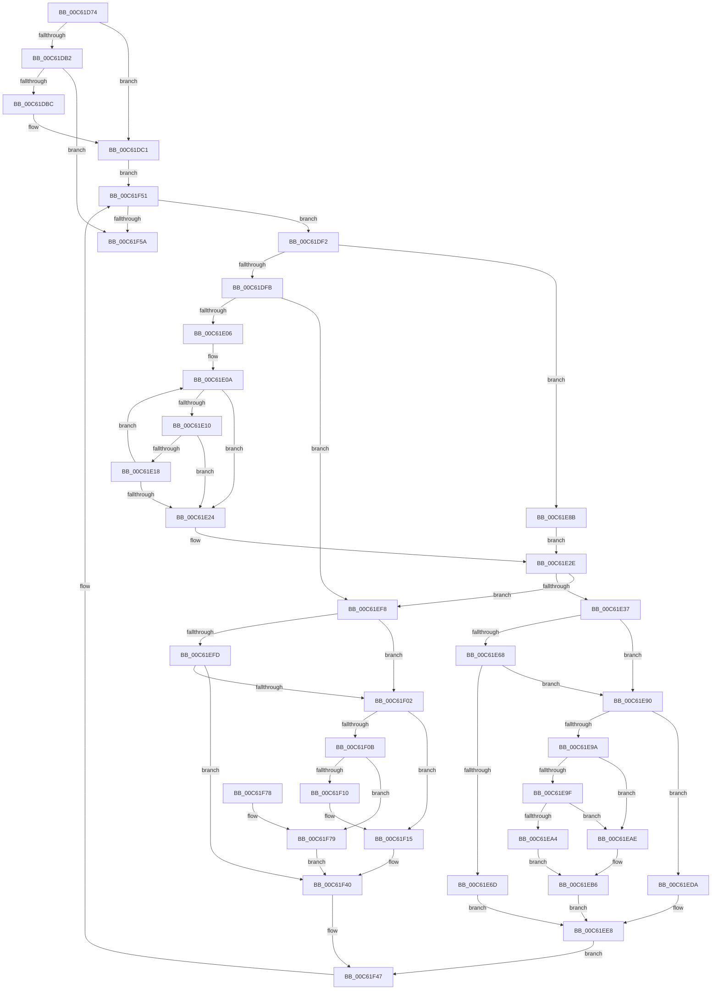

# MiCreateDescriptorPfns

- RVA: `0x00C61D74`–`0x00C61F85` (길이 `529` bytes)
- VA: `0x0000000140C61D74`
- 실행 섹션: `INIT`
- PDB 이름 있음: `예`; PDB Function 태그: `아니요`
- unwind 정보 RVA: `0x000D7948`
- 디코드: `141`개 명령, `529/529` bytes 표시
- 미해석 바이트: `0` (있으면 어셈블리에 `.byte`로 보존)

> 이 문서는 커널 이미지의 기계어와 PDB 기호를 분석해 생성했습니다. 4번과 5번은 함수 원형과 자료형을 바이너리 사용 방식에서 추정한 C 해석이며 원본 소스 복구 결과는 아닙니다.

## 1. Dependencies

- 직접 호출 지점: **7**; 고유 호출 대상: **6**
- 직접 호출자로 확인된 함수: **1**
- RIP 상대 이미지 참조: **1**

### Outgoing calls
- `0x00C61E55` → [MiRestrictRangeToNode](../../text/40/MiRestrictRangeToNode_function_0040199C.md) (function, `0x0040199C`)
- `0x00C61E84` → [MxCreateFreePfns](MxCreateFreePfns_function_00C632CC.md) (function, `0x00C632CC`)
- `0x00C61ED3` → [MiInitializeNewPfns](../../text/67/MiInitializeNewPfns_function_00670E94.md) (function, `0x00670E94`)
- `0x00C61EE3` → [MxInsertEnclaveBootPages](MxInsertEnclaveBootPages_function_00C68CB0.md) (function, `0x00C68CB0`)
- `0x00C61F10` → [MiClearStaleSecurePageMapping](MiClearStaleSecurePageMapping_function_00C61CD8.md) (function, `0x00C61CD8`)
- `0x00C61F3B` → [MiInitializeNewPfns](../../text/67/MiInitializeNewPfns_function_00670E94.md) (function, `0x00670E94`)
- `0x00C61F7E` → [MiMarkPfnVerified](../../text/38/MiMarkPfnVerified_function_003833C4.md) (function, `0x003833C4`)

### Direct callers
- [MiSwitchToPfns](MiSwitchToPfns_function_00C62C90.md) at `0x00C62E7D`

### Static image references
- `0x00C61EBC` → RVA `0x00E38D00` (`.data`; read)

## 2. Other-region calls and transfers

- 다른 실행 섹션으로 향하는 call: **4**
  - `0x00C61E55` → [MiRestrictRangeToNode](../../text/40/MiRestrictRangeToNode_function_0040199C.md) (`INIT` → `.text`)
  - `0x00C61ED3` → [MiInitializeNewPfns](../../text/67/MiInitializeNewPfns_function_00670E94.md) (`INIT` → `.text`)
  - `0x00C61F3B` → [MiInitializeNewPfns](../../text/67/MiInitializeNewPfns_function_00670E94.md) (`INIT` → `.text`)
  - `0x00C61F7E` → [MiMarkPfnVerified](../../text/38/MiMarkPfnVerified_function_003833C4.md) (`INIT` → `.text`)
- 별도 외부 분기/꼬리 이동을 확인하지 못했습니다.

## 3. Assembly (complete function range)

```asm
00C61D74  48 8B C4                        mov rax, rsp
00C61D77  48 89 58 08                     mov qword ptr [rax + 8], rbx
00C61D7B  48 89 68 10                     mov qword ptr [rax + 0x10], rbp
00C61D7F  48 89 70 18                     mov qword ptr [rax + 0x18], rsi
00C61D83  57                              push rdi
00C61D84  41 54                           push r12
00C61D86  41 55                           push r13
00C61D88  41 56                           push r14
00C61D8A  41 57                           push r15
00C61D8C  48 83 EC 70                     sub rsp, 0x70
00C61D90  48 8B 59 28                     mov rbx, qword ptr [rcx + 0x28]
00C61D94  0F 57 C0                        xorps xmm0, xmm0
00C61D97  0F 11 40 A8                     movups xmmword ptr [rax - 0x58], xmm0
00C61D9B  4D 8B E0                        mov r12, r8
00C61D9E  4C 8B EA                        mov r13, rdx
00C61DA1  0F 11 40 B8                     movups xmmword ptr [rax - 0x48], xmm0
00C61DA5  0F 11 40 C8                     movups xmmword ptr [rax - 0x38], xmm0
00C61DA9  48 8B 41 20                     mov rax, qword ptr [rcx + 0x20]
00C61DAD  48 85 C0                        test rax, rax
00C61DB0  75 0F                           jne 0x140c61dc1
00C61DB2  48 83 EB 01                     sub rbx, 1
00C61DB6  0F 84 9E 01 00 00               je 0x140c61f5a
00C61DBC  B8 01 00 00 00                  mov eax, 1
00C61DC1  44 8B 79 18                     mov r15d, dword ptr [rcx + 0x18]
00C61DC5  48 8D 3C 40                     lea rdi, [rax + rax*2]
00C61DC9  41 8B F7                        mov esi, r15d
00C61DCC  48 C1 E7 04                     shl rdi, 4
00C61DD0  81 E6 FF FF FF 1F               and esi, 0x1fffffff
00C61DD6  48 B9 00 00 00 00 00 DE FF FF   movabs rcx, 0xffffde0000000000
00C61DE0  41 81 E7 00 00 00 20            and r15d, 0x20000000
00C61DE7  48 8B C1                        mov rax, rcx
00C61DEA  48 03 F8                        add rdi, rax
00C61DED  E9 5F 01 00 00                  jmp 0x140c61f51
00C61DF2  45 85 FF                        test r15d, r15d
00C61DF5  0F 84 90 00 00 00               je 0x140c61e8b
00C61DFB  33 D2                           xor edx, edx
00C61DFD  48 85 DB                        test rbx, rbx
00C61E00  0F 84 F2 00 00 00               je 0x140c61ef8
00C61E06  48 8D 4F 08                     lea rcx, [rdi + 8]
00C61E0A  F6 41 1A 07                     test byte ptr [rcx + 0x1a], 7
00C61E0E  75 14                           jne 0x140c61e24
00C61E10  48 8B 01                        mov rax, qword ptr [rcx]
00C61E13  48 85 C0                        test rax, rax
00C61E16  75 0C                           jne 0x140c61e24
00C61E18  48 FF C2                        inc rdx
00C61E1B  48 83 C1 30                     add rcx, 0x30
00C61E1F  48 3B D3                        cmp rdx, rbx
00C61E22  72 E6                           jb 0x140c61e0a
00C61E24  48 B9 00 00 00 00 00 DE FF FF   movabs rcx, 0xffffde0000000000
00C61E2E  48 85 D2                        test rdx, rdx
00C61E31  0F 84 C1 00 00 00               je 0x140c61ef8
00C61E37  48 8B C1                        mov rax, rcx
00C61E3A  48 8B EF                        mov rbp, rdi
00C61E3D  48 2B E8                        sub rbp, rax
00C61E40  48 B8 AB AA AA AA AA AA AA AA   movabs rax, 0xaaaaaaaaaaaaaaab
00C61E4A  48 C1 FD 04                     sar rbp, 4
00C61E4E  48 0F AF E8                     imul rbp, rax
00C61E52  48 8B CD                        mov rcx, rbp
00C61E55  E8 42 FB 79 FF                  call 0x14040199c
00C61E5A  8D 4E F7                        lea ecx, [rsi - 9]
00C61E5D  4C 8B F0                        mov r14, rax
00C61E60  F7 C1 DD FF FF FF               test ecx, 0xffffffdd
00C61E66  75 28                           jne 0x140c61e90
00C61E68  83 FE 2B                        cmp esi, 0x2b
00C61E6B  74 23                           je 0x140c61e90
00C61E6D  48 8D 4C 24 40                  lea rcx, [rsp + 0x40]
00C61E72  C7 44 24 58 02 00 00 00         mov dword ptr [rsp + 0x58], 2
00C61E7A  48 89 6C 24 60                  mov qword ptr [rsp + 0x60], rbp
00C61E7F  48 89 44 24 68                  mov qword ptr [rsp + 0x68], rax
00C61E84  E8 43 14 00 00                  call 0x140c632cc
00C61E89  EB 5D                           jmp 0x140c61ee8
00C61E8B  48 8B D3                        mov rdx, rbx
00C61E8E  EB 9E                           jmp 0x140c61e2e
00C61E90  8D 46 DF                        lea eax, [rsi - 0x21]
00C61E93  A9 FD FF FF FF                  test eax, 0xfffffffd
00C61E98  74 40                           je 0x140c61eda
00C61E9A  83 FE 1D                        cmp esi, 0x1d
00C61E9D  74 0F                           je 0x140c61eae
00C61E9F  83 FE 24                        cmp esi, 0x24
00C61EA2  74 0A                           je 0x140c61eae
00C61EA4  B8 80 00 00 00                  mov eax, 0x80
00C61EA9  4D 8B C5                        mov r8, r13
00C61EAC  EB 08                           jmp 0x140c61eb6
00C61EAE  B8 00 01 00 00                  mov eax, 0x100
00C61EB3  4D 8B C4                        mov r8, r12
00C61EB6  48 83 64 24 30 00               and qword ptr [rsp + 0x30], 0
00C61EBC  4C 8D 0D 3D 6E 1D 00            lea r9, [rip + 0x1d6e3d]
00C61EC3  48 83 64 24 28 00               and qword ptr [rsp + 0x28], 0
00C61EC9  49 8B D6                        mov rdx, r14
00C61ECC  48 8B CF                        mov rcx, rdi
00C61ECF  89 44 24 20                     mov dword ptr [rsp + 0x20], eax
00C61ED3  E8 BC EF A0 FF                  call 0x140670e94
00C61ED8  EB 0E                           jmp 0x140c61ee8
00C61EDA  44 8B C6                        mov r8d, esi
00C61EDD  49 8B D6                        mov rdx, r14
00C61EE0  48 8B CD                        mov rcx, rbp
00C61EE3  E8 C8 6D 00 00                  call 0x140c68cb0
00C61EE8  4B 8D 04 76                     lea rax, [r14 + r14*2]
00C61EEC  49 2B DE                        sub rbx, r14
00C61EEF  48 C1 E0 04                     shl rax, 4
00C61EF3  48 03 F8                        add rdi, rax
00C61EF6  EB 4F                           jmp 0x140c61f47
00C61EF8  83 FE 1D                        cmp esi, 0x1d
00C61EFB  74 05                           je 0x140c61f02
00C61EFD  83 FE 24                        cmp esi, 0x24
00C61F00  75 3E                           jne 0x140c61f40
00C61F02  48 8B 4F 08                     mov rcx, qword ptr [rdi + 8]
00C61F06  48 85 C9                        test rcx, rcx
00C61F09  74 0A                           je 0x140c61f15
00C61F0B  83 FE 1D                        cmp esi, 0x1d
00C61F0E  75 69                           jne 0x140c61f79
00C61F10  E8 C3 FD FF FF                  call 0x140c61cd8
00C61F15  48 83 64 24 30 00               and qword ptr [rsp + 0x30], 0
00C61F1B  4C 8D 0D DE 6D 1D 00            lea r9, [rip + 0x1d6dde]
00C61F22  48 83 64 24 28 00               and qword ptr [rsp + 0x28], 0
00C61F28  4D 8B C4                        mov r8, r12
00C61F2B  BA 01 00 00 00                  mov edx, 1
00C61F30  C7 44 24 20 00 01 00 00         mov dword ptr [rsp + 0x20], 0x100
00C61F38  48 8B CF                        mov rcx, rdi
00C61F3B  E8 54 EF A0 FF                  call 0x140670e94
00C61F40  48 83 C7 30                     add rdi, 0x30
00C61F44  48 FF CB                        dec rbx
00C61F47  48 B9 00 00 00 00 00 DE FF FF   movabs rcx, 0xffffde0000000000
00C61F51  48 85 DB                        test rbx, rbx
00C61F54  0F 85 98 FE FF FF               jne 0x140c61df2
00C61F5A  4C 8D 5C 24 70                  lea r11, [rsp + 0x70]
00C61F5F  49 8B 5B 30                     mov rbx, qword ptr [r11 + 0x30]
00C61F63  49 8B 6B 38                     mov rbp, qword ptr [r11 + 0x38]
00C61F67  49 8B 73 40                     mov rsi, qword ptr [r11 + 0x40]
00C61F6B  49 8B E3                        mov rsp, r11
00C61F6E  41 5F                           pop r15
00C61F70  41 5E                           pop r14
00C61F72  41 5D                           pop r13
00C61F74  41 5C                           pop r12
00C61F76  5F                              pop rdi
00C61F77  C3                              ret
00C61F78  CC                              int3
00C61F79  33 D2                           xor edx, edx
00C61F7B  48 8B CF                        mov rcx, rdi
00C61F7E  E8 41 14 72 FF                  call 0x1403833c4
00C61F83  EB BB                           jmp 0x140c61f40
```

## 4. C-style interpretation (structured pseudocode)

```c
__int64 __fastcall MiCreateDescriptorPfns(__int64 a1, __int64 a2, __int64 a3)
{
    __int64 result;
    __int64 v_r15;
    __int64 v_rbp;
    __int64 v_rbx;
    __int64 v_rdi;
    __int64 v_rsi;
    __int64 v_rsp;
    unsigned __int64 v_stack_m28;
    unsigned __int64 v_stack_m30;
    unsigned __int64 v_stack_m38;
    unsigned int v_stack_m40;
    unsigned __int64 v_stack_m58;
    unsigned __int64 v_stack_m68;
    unsigned __int64 v_stack_m70;
    unsigned int v_stack_m78;

    *(unsigned __int64 *)(v_rsp + 8) = v_rbx;
    *(unsigned __int64 *)(v_rsp + 16) = v_rbp;
    *(unsigned __int64 *)(v_rsp + 24) = v_rsi;
    v_rsp = (v_rsp) - (112);
    *(unsigned __int64 *)(v_rsp - 88) = v_xmm0;
    *(unsigned __int64 *)(v_rsp - 72) = v_xmm0;
    *(unsigned __int64 *)(v_rsp - 56) = v_xmm0;
    if (*(unsigned __int64 *)(a1 + 32) != 0) goto loc_00C61DC1;
    v_rbx = (*(unsigned __int64 *)(a1 + 40)) - (1);
    if (condition_is_equal) goto loc_00C61F5A;
loc_00C61DC1:
    v_rdi = (1 + 1 * 2) << (4);
    v_rsi = (unsigned int)(((unsigned int)((unsigned int)((unsigned int)(*(unsigned int *)(a1 + 24))))) & (0x1FFFFFFFULL));
    v_r15 = (unsigned int)(((unsigned int)(*(unsigned int *)(a1 + 24))) & (0x20000000ULL));
    v_rdi = (v_rdi) + (a1);
    goto loc_00C61F51;
loc_00C61DF2:
    if ((unsigned int)(v_r15) == 0) goto loc_00C61E8B;
    a2 = 0;
    if (v_rbx == 0) goto loc_00C61EF8;
loc_00C61E0A:
    if (((*(unsigned __int8 *)(v_rdi + 8 + 26)) & (7)) != 0) goto loc_00C61E24;
    if (*(unsigned __int64 *)(v_rdi + 8) != 0) goto loc_00C61E24;
    a2 = (a2) + 1;
    a1 = (v_rdi + 8) + (48);
    if (a2 < v_rbx) goto loc_00C61E0A;
loc_00C61E24:
loc_00C61E2E:
    if (a2 == 0) goto loc_00C61EF8;
    v_rbp = (v_rdi) - (a1);
    v_rbp = (v_rbp) >> (4);
    v_rbp = (v_rbp) * (a1);
    result = MiRestrictRangeToNode(v_rbp, a2, a3, a4);
    if ((((unsigned int)(v_rsi - 9)) & (0xFFFFFFDDULL)) != 0) goto loc_00C61E90;
    if (((unsigned int)(v_rsi)) == 43) goto loc_00C61E90;
    v_stack_m40 = 2;
    v_stack_m38 = v_rbp;
    v_stack_m30 = result;
    result = MxCreateFreePfns(v_stack_m58, a2, a3, a4);
    goto loc_00C61EE8;
loc_00C61E8B:
    goto loc_00C61E2E;
loc_00C61E90:
    if ((((unsigned int)(v_rsi - 33)) & (0xFFFFFFFDULL)) == 0) goto loc_00C61EDA;
    if (((unsigned int)(v_rsi)) == 29) goto loc_00C61EAE;
    if (((unsigned int)(v_rsi)) == 36) goto loc_00C61EAE;
    goto loc_00C61EB6;
loc_00C61EAE:
loc_00C61EB6:
    v_stack_m78 = 256;
    result = MiInitializeNewPfns(v_rdi, result, a3, v_rip + 1928765);
    goto loc_00C61EE8;
loc_00C61EDA:
    result = MxInsertEnclaveBootPages(v_rbp, result, (unsigned int)((unsigned int)(v_rsi)), v_rip + 1928765);
loc_00C61EE8:
    v_rbx = (v_rbx) - (result);
    result = (result + result * 2) << (4);
    v_rdi = (v_rdi) + (result);
    goto loc_00C61F47;
loc_00C61EF8:
    if (((unsigned int)(v_rsi)) == 29) goto loc_00C61F02;
    if (((unsigned int)(v_rsi)) != 36) goto loc_00C61F40;
loc_00C61F02:
    if (*(unsigned __int64 *)(v_rdi + 8) == 0) goto loc_00C61F15;
    if (((unsigned int)(v_rsi)) != 29) goto loc_00C61F79;
    result = MiClearStaleSecurePageMapping(*(unsigned __int64 *)(v_rdi + 8), result, (unsigned int)((unsigned int)(v_rsi)), v_rip + 1928765);
loc_00C61F15:
    v_stack_m78 = 256;
    result = MiInitializeNewPfns(v_rdi, 1, a3, v_rip + 1928670);
loc_00C61F40:
    v_rdi = (v_rdi) + (48);
    v_rbx = (v_rbx) - 1;
loc_00C61F47:
loc_00C61F51:
    if (v_rbx != 0) goto loc_00C61DF2;
loc_00C61F5A:
    return result;
loc_00C61F79:
    a2 = 0;
    result = MiMarkPfnVerified(v_rdi, a2, a3, v_rip + 1928670);
    goto loc_00C61F40;
}
```

## 5. (Beta) C Style

```c
int64_t MiCreateDescriptorPfns(void *Arg1, int64_t Arg2, int64_t Arg3)
{
    uint8_t *arg1 = (uint8_t *)Arg1;

    int64_t result;
    int64_t local_r15;
    int64_t local_rbp;
    int64_t local_rbx;
    int64_t local_rdi;
    int64_t local_rsi;
    int64_t local_rsp;
    uint64_t v_stack_m28;
    uint64_t v_stack_m30;
    uint64_t v_stack_m38;
    uint32_t v_stack_m40;
    uint64_t v_stack_m58;
    uint64_t v_stack_m68;
    uint64_t v_stack_m70;
    uint32_t v_stack_m78;

    *(uint64_t *)(local_rsp + 0x8) = local_rbx;
    *(uint64_t *)(local_rsp + 0x10) = local_rbp;
    *(uint64_t *)(local_rsp + 0x18) = local_rsi;
    local_rsp = (local_rsp) - (112);
    *(uint64_t *)(local_rsp - 0x58) = v_xmm0;
    *(uint64_t *)(local_rsp - 0x48) = v_xmm0;
    *(uint64_t *)(local_rsp - 0x38) = v_xmm0;
    if (*(uint64_t *)(arg1 + 0x20) != 0) goto loc_00C61DC1;
    local_rbx = (*(uint64_t *)(arg1 + 0x28)) - (1);
    if (condition_is_equal) goto loc_00C61F5A;
loc_00C61DC1:
    local_rdi = (1 + 1 * 2) << (4);
    local_rsi = (uint32_t)(((uint32_t)((uint32_t)((uint32_t)(*(uint32_t *)(arg1 + 0x18))))) & (0x1FFFFFFFULL));
    local_r15 = (uint32_t)(((uint32_t)(*(uint32_t *)(arg1 + 0x18))) & (0x20000000ULL));
    local_rdi = (local_rdi) + (Arg1);
    goto loc_00C61F51;
loc_00C61DF2:
    if ((uint32_t)(local_r15) == 0) goto loc_00C61E8B;
    Arg2 = 0;
    if (local_rbx == 0) goto loc_00C61EF8;
loc_00C61E0A:
    if (((*(uint8_t *)(local_rdi + 0x8 + 0x1A)) & (7)) != 0) goto loc_00C61E24;
    if (*(uint64_t *)(local_rdi + 0x8) != 0) goto loc_00C61E24;
    Arg2 = (Arg2) + 1;
    Arg1 = (local_rdi + 8) + (48);
    if (Arg2 < local_rbx) goto loc_00C61E0A;
loc_00C61E24:
loc_00C61E2E:
    if (Arg2 == 0) goto loc_00C61EF8;
    local_rbp = (local_rdi) - (Arg1);
    local_rbp = (local_rbp) >> (4);
    local_rbp = (local_rbp) * (Arg1);
    result = MiRestrictRangeToNode(local_rbp, Arg2, Arg3, a4);
    if ((((uint32_t)(local_rsi - 9)) & (0xFFFFFFDDULL)) != 0) goto loc_00C61E90;
    if (((uint32_t)(local_rsi)) == 43) goto loc_00C61E90;
    v_stack_m40 = 2;
    v_stack_m38 = local_rbp;
    v_stack_m30 = result;
    result = MxCreateFreePfns(v_stack_m58, Arg2, Arg3, a4);
    goto loc_00C61EE8;
loc_00C61E8B:
    goto loc_00C61E2E;
loc_00C61E90:
    if ((((uint32_t)(local_rsi - 33)) & (0xFFFFFFFDULL)) == 0) goto loc_00C61EDA;
    if (((uint32_t)(local_rsi)) == 29) goto loc_00C61EAE;
    if (((uint32_t)(local_rsi)) == 36) goto loc_00C61EAE;
    goto loc_00C61EB6;
loc_00C61EAE:
loc_00C61EB6:
    v_stack_m78 = 256;
    result = MiInitializeNewPfns(local_rdi, result, Arg3, v_rip + 1928765);
    goto loc_00C61EE8;
loc_00C61EDA:
    result = MxInsertEnclaveBootPages(local_rbp, result, (uint32_t)((uint32_t)(local_rsi)), v_rip + 1928765);
loc_00C61EE8:
    local_rbx = (local_rbx) - (result);
    result = (result + result * 2) << (4);
    local_rdi = (local_rdi) + (result);
    goto loc_00C61F47;
loc_00C61EF8:
    if (((uint32_t)(local_rsi)) == 29) goto loc_00C61F02;
    if (((uint32_t)(local_rsi)) != 36) goto loc_00C61F40;
loc_00C61F02:
    if (*(uint64_t *)(local_rdi + 0x8) == 0) goto loc_00C61F15;
    if (((uint32_t)(local_rsi)) != 29) goto loc_00C61F79;
    result = MiClearStaleSecurePageMapping(*(uint64_t *)(local_rdi + 0x8), result, (uint32_t)((uint32_t)(local_rsi)), v_rip + 1928765);
loc_00C61F15:
    v_stack_m78 = 256;
    result = MiInitializeNewPfns(local_rdi, 1, Arg3, v_rip + 1928670);
loc_00C61F40:
    local_rdi = (local_rdi) + (48);
    local_rbx = (local_rbx) - 1;
loc_00C61F47:
loc_00C61F51:
    if (local_rbx != 0) goto loc_00C61DF2;
loc_00C61F5A:
    return result;
loc_00C61F79:
    Arg2 = 0;
    result = MiMarkPfnVerified(local_rdi, Arg2, Arg3, v_rip + 1928670);
    goto loc_00C61F40;
}
```

### 관측된 메모리 오프셋

구조체 형식이 확인되지 않은 접근은 인자 기준의 오프셋으로만 기록했습니다.

| 기준 인자 | 오프셋 표현 | 폭 (bit) | 접근 |
|---|---:|---:|---|
| `Arg1` | `+ 0x18` | `32` | `R` |
| `Arg1` | `+ 0x20` | `64` | `R` |
| `Arg1` | `+ 0x28` | `64` | `R` |

## 6. Execution-region graph

[열기: 2D/3D 그래프와 함수 탐색 컨트롤 패널](../../../control-panel.html?section=init&rva=0x00C61D74&view=graph)

- 2D 그래프는 위에서 아래로 흐르고, 3D 그래프는 빈 공간을 드래그해 회전합니다. Shift+드래그는 이동, 휠은 확대·축소, 함수 노드 선택은 대상 보고서 이동입니다.

### Static fallback


