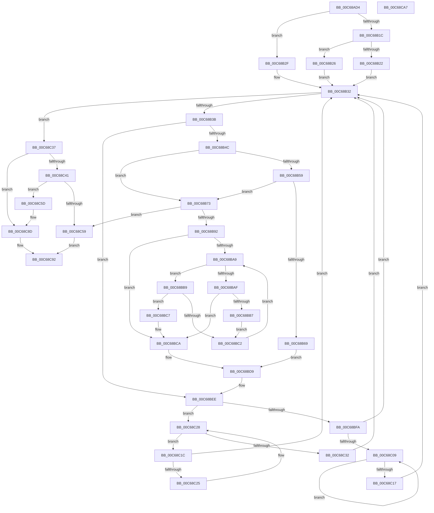

# MiCreateEnclaveRegions

- RVA: `0x00C68AD4`–`0x00C68CA8` (길이 `468` bytes)
- VA: `0x0000000140C68AD4`
- 실행 섹션: `INIT`
- PDB 이름 있음: `예`; PDB Function 태그: `아니요`
- unwind 정보 RVA: `0x0005C954`
- 디코드: `122`개 명령, `468/468` bytes 표시
- 미해석 바이트: `0` (있으면 어셈블리에 `.byte`로 보존)

> 이 문서는 커널 이미지의 기계어와 PDB 기호를 분석해 생성했습니다. 4번과 5번은 함수 원형과 자료형을 바이너리 사용 방식에서 추정한 C 해석이며 원본 소스 복구 결과는 아닙니다.

## 1. Dependencies

- 직접 호출 지점: **4**; 고유 호출 대상: **3**
- 직접 호출자로 확인된 함수: **1**
- RIP 상대 이미지 참조: **10**

### Outgoing calls
- `0x00C68B81` → [MiAllocatePool](../../text/35/MiAllocatePool_function_0035B540.md) (function, `0x0035B540`)
- `0x00C68BD4` → [RtlAvlInsertNodeEx](../../text/26/RtlAvlInsertNodeEx_function_00265790.md) (function, `0x00265790`)
- `0x00C68BE9` → [MiUpdateLargePageBitMap](../../text/37/MiUpdateLargePageBitMap_function_0037619C.md) (function, `0x0037619C`)
- `0x00C68C4F` → [MiAllocatePool](../../text/35/MiAllocatePool_function_0035B540.md) (function, `0x0035B540`)

### Direct callers
- [MiInitSystem](../C5/MiInitSystem_function_00C5E6C0.md) at `0x00C5EB80`

### Static image references
- `0x00C68AEA` → RVA `0x00E375E0` (`.data`; read)
- `0x00C68AF1` → RVA `0x00E375F0` (`.data`; read/write)
- `0x00C68AFF` → RVA `0x00E375F8` (`.data`; read/write)
- `0x00C68B06` → RVA `0x00E375E8` (`.data`; write)
- `0x00C68B0D` → RVA `0x00E375E0` (`.data`; write)
- `0x00C68B9D` → RVA `0x00E375B8` (`.data`; read)
- `0x00C68BDC` → RVA `0x00E38D00` (`.data`; read)
- `0x00C68C74` → RVA `0x00E375D0` (`.data`; read/write)
- `0x00C68C7C` → RVA `0x00E375C8` (`.data`; write)
- `0x00C68C83` → RVA `0x00E375D8` (`.data`; write)

## 2. Other-region calls and transfers

- 다른 실행 섹션으로 향하는 call: **4**
  - `0x00C68B81` → [MiAllocatePool](../../text/35/MiAllocatePool_function_0035B540.md) (`INIT` → `.text`)
  - `0x00C68BD4` → [RtlAvlInsertNodeEx](../../text/26/RtlAvlInsertNodeEx_function_00265790.md) (`INIT` → `.text`)
  - `0x00C68BE9` → [MiUpdateLargePageBitMap](../../text/37/MiUpdateLargePageBitMap_function_0037619C.md) (`INIT` → `.text`)
  - `0x00C68C4F` → [MiAllocatePool](../../text/35/MiAllocatePool_function_0035B540.md) (`INIT` → `.text`)
- 별도 외부 분기/꼬리 이동을 확인하지 못했습니다.

## 3. Assembly (complete function range)

```asm
00C68AD4  48 89 5C 24 08                  mov qword ptr [rsp + 8], rbx
00C68AD9  48 89 6C 24 10                  mov qword ptr [rsp + 0x10], rbp
00C68ADE  48 89 74 24 18                  mov qword ptr [rsp + 0x18], rsi
00C68AE3  57                              push rdi
00C68AE4  48 83 EC 20                     sub rsp, 0x20
00C68AE8  33 FF                           xor edi, edi
00C68AEA  48 8D 05 EF EA 1C 00            lea rax, [rip + 0x1ceaef]
00C68AF1  48 21 3D F8 EA 1C 00            and qword ptr [rip + 0x1ceaf8], rdi
00C68AF8  48 8D 99 60 01 00 00            lea rbx, [rcx + 0x160]
00C68AFF  48 21 3D F2 EA 1C 00            and qword ptr [rip + 0x1ceaf2], rdi
00C68B06  48 89 05 DB EA 1C 00            mov qword ptr [rip + 0x1ceadb], rax
00C68B0D  48 89 05 CC EA 1C 00            mov qword ptr [rip + 0x1ceacc], rax
00C68B14  48 8B 43 08                     mov rax, qword ptr [rbx + 8]
00C68B18  A8 01                           test al, 1
00C68B1A  74 13                           je 0x140c68b2f
00C68B1C  48 83 F8 01                     cmp rax, 1
00C68B20  75 04                           jne 0x140c68b26
00C68B22  33 DB                           xor ebx, ebx
00C68B24  EB 0C                           jmp 0x140c68b32
00C68B26  48 83 CB 01                     or rbx, 1
00C68B2A  48 33 D8                        xor rbx, rax
00C68B2D  EB 03                           jmp 0x140c68b32
00C68B2F  48 8B D8                        mov rbx, rax
00C68B32  48 85 DB                        test rbx, rbx
00C68B35  0F 84 FC 00 00 00               je 0x140c68c37
00C68B3B  8B 43 18                        mov eax, dword ptr [rbx + 0x18]
00C68B3E  83 E8 21                        sub eax, 0x21
00C68B41  A9 FD FF FF FF                  test eax, 0xfffffffd
00C68B46  0F 85 A2 00 00 00               jne 0x140c68bee
00C68B4C  48 8B 73 20                     mov rsi, qword ptr [rbx + 0x20]
00C68B50  48 8B 6B 28                     mov rbp, qword ptr [rbx + 0x28]
00C68B54  48 85 FF                        test rdi, rdi
00C68B57  74 1A                           je 0x140c68b73
00C68B59  48 8B 57 20                     mov rdx, qword ptr [rdi + 0x20]
00C68B5D  48 8B 4F 18                     mov rcx, qword ptr [rdi + 0x18]
00C68B61  48 03 CA                        add rcx, rdx
00C68B64  48 3B F1                        cmp rsi, rcx
00C68B67  75 0A                           jne 0x140c68b73
00C68B69  48 8D 04 2A                     lea rax, [rdx + rbp]
00C68B6D  48 89 47 20                     mov qword ptr [rdi + 0x20], rax
00C68B71  EB 66                           jmp 0x140c68bd9
00C68B73  BA 28 00 00 00                  mov edx, 0x28
00C68B78  41 B8 4D 6D 45 52               mov r8d, 0x52456d4d
00C68B7E  8D 4A 18                        lea ecx, [rdx + 0x18]
00C68B81  E8 BA 29 6F FF                  call 0x14035b540
00C68B86  48 8B F8                        mov rdi, rax
00C68B89  48 85 C0                        test rax, rax
00C68B8C  0F 84 C7 00 00 00               je 0x140c68c59
00C68B92  48 89 70 18                     mov qword ptr [rax + 0x18], rsi
00C68B96  45 32 C0                        xor r8b, r8b
00C68B99  48 89 68 20                     mov qword ptr [rax + 0x20], rbp
00C68B9D  48 8B 15 14 EA 1C 00            mov rdx, qword ptr [rip + 0x1cea14]
00C68BA4  48 85 D2                        test rdx, rdx
00C68BA7  74 21                           je 0x140c68bca
00C68BA9  48 3B 72 18                     cmp rsi, qword ptr [rdx + 0x18]
00C68BAD  73 0A                           jae 0x140c68bb9
00C68BAF  48 8B 02                        mov rax, qword ptr [rdx]
00C68BB2  48 85 C0                        test rax, rax
00C68BB5  74 13                           je 0x140c68bca
00C68BB7  EB 09                           jmp 0x140c68bc2
00C68BB9  48 8B 42 08                     mov rax, qword ptr [rdx + 8]
00C68BBD  48 85 C0                        test rax, rax
00C68BC0  74 05                           je 0x140c68bc7
00C68BC2  48 8B D0                        mov rdx, rax
00C68BC5  EB E2                           jmp 0x140c68ba9
00C68BC7  41 B0 01                        mov r8b, 1
00C68BCA  4C 8B CF                        mov r9, rdi
00C68BCD  48 8D 0D E4 E9 1C 00            lea rcx, [rip + 0x1ce9e4]
00C68BD4  E8 B7 CB 5F FF                  call 0x140265790
00C68BD9  45 33 C9                        xor r9d, r9d
00C68BDC  48 8D 0D 1D 01 1D 00            lea rcx, [rip + 0x1d011d]
00C68BE3  4C 8B C5                        mov r8, rbp
00C68BE6  48 8B D6                        mov rdx, rsi
00C68BE9  E8 AE D5 70 FF                  call 0x14037619c
00C68BEE  48 8B 43 08                     mov rax, qword ptr [rbx + 8]
00C68BF2  48 8B CB                        mov rcx, rbx
00C68BF5  48 85 C0                        test rax, rax
00C68BF8  74 2E                           je 0x140c68c28
00C68BFA  48 8B 08                        mov rcx, qword ptr [rax]
00C68BFD  48 8B D8                        mov rbx, rax
00C68C00  48 85 C9                        test rcx, rcx
00C68C03  0F 84 29 FF FF FF               je 0x140c68b32
00C68C09  48 8B 01                        mov rax, qword ptr [rcx]
00C68C0C  48 8B D9                        mov rbx, rcx
00C68C0F  48 8B C8                        mov rcx, rax
00C68C12  48 85 C0                        test rax, rax
00C68C15  75 F2                           jne 0x140c68c09
00C68C17  E9 16 FF FF FF                  jmp 0x140c68b32
00C68C1C  48 39 0B                        cmp qword ptr [rbx], rcx
00C68C1F  0F 84 0D FF FF FF               je 0x140c68b32
00C68C25  48 8B CB                        mov rcx, rbx
00C68C28  48 8B 5B 10                     mov rbx, qword ptr [rbx + 0x10]
00C68C2C  48 83 E3 FC                     and rbx, 0xfffffffffffffffc
00C68C30  75 EA                           jne 0x140c68c1c
00C68C32  E9 FB FE FF FF                  jmp 0x140c68b32
00C68C37  48 83 3D 79 E9 1C 00 00         cmp qword ptr [rip + 0x1ce979], 0
00C68C3F  74 4C                           je 0x140c68c8d
00C68C41  BA 50 00 00 00                  mov edx, 0x50
00C68C46  41 B8 45 4D 42 4D               mov r8d, 0x4d424d45
00C68C4C  8D 4A F0                        lea ecx, [rdx - 0x10]
00C68C4F  E8 EC 28 6F FF                  call 0x14035b540
00C68C54  48 85 C0                        test rax, rax
00C68C57  75 04                           jne 0x140c68c5d
00C68C59  33 C0                           xor eax, eax
00C68C5B  EB 35                           jmp 0x140c68c92
00C68C5D  C7 00 00 02 00 00               mov dword ptr [rax], 0x200
00C68C63  48 8D 50 10                     lea rdx, [rax + 0x10]
00C68C67  48 89 50 08                     mov qword ptr [rax + 8], rdx
00C68C6B  0F BE 0A                        movsx ecx, byte ptr [rdx]
00C68C6E  0F BA E9 00                     bts ecx, 0
00C68C72  88 0A                           mov byte ptr [rdx], cl
00C68C74  48 83 25 54 E9 1C 00 00         and qword ptr [rip + 0x1ce954], 0
00C68C7C  48 89 05 45 E9 1C 00            mov qword ptr [rip + 0x1ce945], rax
00C68C83  C7 05 4B E9 1C 00 00 00 00 00   mov dword ptr [rip + 0x1ce94b], 0
00C68C8D  B8 01 00 00 00                  mov eax, 1
00C68C92  48 8B 5C 24 30                  mov rbx, qword ptr [rsp + 0x30]
00C68C97  48 8B 6C 24 38                  mov rbp, qword ptr [rsp + 0x38]
00C68C9C  48 8B 74 24 40                  mov rsi, qword ptr [rsp + 0x40]
00C68CA1  48 83 C4 20                     add rsp, 0x20
00C68CA5  5F                              pop rdi
00C68CA6  C3                              ret
00C68CA7  CC                              int3
```

## 4. C-style interpretation (structured pseudocode)

```c
__int64 __fastcall MiCreateEnclaveRegions(__int64 a1)
{
    __int64 result;
    __int64 v_rbx;
    __int64 v_rdi;
    __int64 v_rsp;
    unsigned __int64 v_stack_p10;
    unsigned __int64 v_stack_p18;
    unsigned __int64 v_stack_p8;

    v_stack_p8 = v_rbx;
    v_stack_p10 = v_rbp;
    v_stack_p18 = v_rsi;
    v_rsp = (v_rsp) - (32);
    v_rdi = 0;
    *(unsigned __int64 *)(v_rip + 1895131) = v_rip + 1895151;
    *(unsigned __int64 *)(v_rip + 1895116) = v_rip + 1895151;
    if ((((unsigned __int8)(*(unsigned __int64 *)(a1 + 352 + 8))) & (1)) == 0) goto loc_00C68B2F;
    if ((*(unsigned __int64 *)(a1 + 352 + 8)) != 1) goto loc_00C68B26;
    v_rbx = 0;
    goto loc_00C68B32;
loc_00C68B26:
    v_rbx = (v_rbx) | (1);
    v_rbx = (v_rbx) ^ (*(unsigned __int64 *)(a1 + 352 + 8));
    goto loc_00C68B32;
loc_00C68B2F:
loc_00C68B32:
    if (*(unsigned __int64 *)(a1 + 352 + 8) == 0) goto loc_00C68C37;
    result = (unsigned int)(((unsigned int)(*(unsigned int *)(*(unsigned __int64 *)(a1 + 352 + 8) + 24))) - (33));
    if ((((unsigned int)(result)) & (0xFFFFFFFDULL)) != 0) goto loc_00C68BEE;
    if (0 == 0) goto loc_00C68B73;
    a1 = (*(unsigned __int64 *)(v_rdi + 24)) + (*(unsigned __int64 *)(v_rdi + 32));
    if ((*(unsigned __int64 *)(*(unsigned __int64 *)(a1 + 352 + 8) + 32)) != a1) goto loc_00C68B73;
    *(unsigned __int64 *)(v_rdi + 32) = *(unsigned __int64 *)(v_rdi + 32) + *(unsigned __int64 *)(*(unsigned __int64 *)(a1 + 352 + 8) + 40) * 1;
    goto loc_00C68BD9;
loc_00C68B73:
    result = MiAllocatePool(40 + 24, 40, (unsigned int)(0x52456D4DULL), a4);
    if (result == 0) goto loc_00C68C59;
    *(unsigned __int64 *)(result + 24) = *(unsigned __int64 *)(*(unsigned __int64 *)(a1 + 352 + 8) + 32);
    a3 = 0;
    *(unsigned __int64 *)(result + 32) = *(unsigned __int64 *)(*(unsigned __int64 *)(a1 + 352 + 8) + 40);
    if (*(unsigned __int64 *)(v_rip + 1894932) == 0) goto loc_00C68BCA;
loc_00C68BA9:
    if ((*(unsigned __int64 *)(*(unsigned __int64 *)(a1 + 352 + 8) + 32)) >= (*(unsigned __int64 *)(*(unsigned __int64 *)(v_rip + 1894932) + 24))) goto loc_00C68BB9;
    if (*(unsigned __int64 *)(*(unsigned __int64 *)(v_rip + 1894932)) == 0) goto loc_00C68BCA;
    goto loc_00C68BC2;
loc_00C68BB9:
    if (*(unsigned __int64 *)(*(unsigned __int64 *)(v_rip + 1894932) + 8) == 0) goto loc_00C68BC7;
loc_00C68BC2:
    goto loc_00C68BA9;
loc_00C68BC7:
loc_00C68BCA:
    result = RtlAvlInsertNodeEx(v_rip + 1894884, *(unsigned __int64 *)(*(unsigned __int64 *)(v_rip + 1894932) + 8), 1, result);
loc_00C68BD9:
    a4 = 0;
    result = MiUpdateLargePageBitMap(v_rip + 1900829, *(unsigned __int64 *)(*(unsigned __int64 *)(a1 + 352 + 8) + 32), *(unsigned __int64 *)(*(unsigned __int64 *)(a1 + 352 + 8) + 40), a4);
loc_00C68BEE:
    if (*(unsigned __int64 *)(*(unsigned __int64 *)(a1 + 352 + 8) + 8) == 0) goto loc_00C68C28;
    if (*(unsigned __int64 *)(*(unsigned __int64 *)(*(unsigned __int64 *)(a1 + 352 + 8) + 8)) == 0) goto loc_00C68B32;
loc_00C68C09:
    if (*(unsigned __int64 *)(*(unsigned __int64 *)(*(unsigned __int64 *)(*(unsigned __int64 *)(a1 + 352 + 8) + 8))) != 0) goto loc_00C68C09;
    goto loc_00C68B32;
loc_00C68C1C:
    if ((*(unsigned __int64 *)(*(unsigned __int64 *)(*(unsigned __int64 *)(*(unsigned __int64 *)(a1 + 352 + 8) + 8)))) == (*(unsigned __int64 *)(*(unsigned __int64 *)(*(unsigned __int64 *)(*(unsigned __int64 *)(a1 + 352 + 8) + 8))))) goto loc_00C68B32;
loc_00C68C28:
    v_rbx = (*(unsigned __int64 *)(*(unsigned __int64 *)(*(unsigned __int64 *)(*(unsigned __int64 *)(a1 + 352 + 8) + 8)) + 16)) & (-4);
    if (condition_is_not_equal) goto loc_00C68C1C;
    goto loc_00C68B32;
loc_00C68C37:
    if ((*(unsigned __int64 *)(v_rip + 1894777)) == 0) goto loc_00C68C8D;
    result = MiAllocatePool(80 - 16, 80, (unsigned int)(0x4D424D45ULL), a4);
    if (result != 0) goto loc_00C68C5D;
loc_00C68C59:
    result = 0;
    goto loc_00C68C92;
loc_00C68C5D:
    *(unsigned int *)(result) = 512;
    *(unsigned __int64 *)(result + 8) = result + 16;
    *(unsigned __int8 *)(result + 16) = (unsigned __int8)((__int8)(*(unsigned __int8 *)(result + 16)));
    *(unsigned __int64 *)(v_rip + 1894725) = 0;
    *(unsigned int *)(v_rip + 1894731) = 0;
loc_00C68C8D:
loc_00C68C92:
    v_rsp = (v_rsp) + (32);
    return 1;
}
```

## 5. (Beta) C Style

```c
int64_t MiCreateEnclaveRegions(void *Arg1)
{
    uint8_t *arg1 = (uint8_t *)Arg1;

    int64_t result;
    int64_t local_rbx;
    int64_t local_rdi;
    int64_t local_rsp;
    uint64_t v_stack_p10;
    uint64_t v_stack_p18;
    uint64_t v_stack_p8;

    v_stack_p8 = local_rbx;
    v_stack_p10 = local_rbp;
    v_stack_p18 = local_rsi;
    local_rsp = (local_rsp) - (32);
    local_rdi = 0;
    *(uint64_t *)(v_rip + 0x1CEADB) = v_rip + 1895151;
    *(uint64_t *)(v_rip + 0x1CEACC) = v_rip + 1895151;
    if ((((uint8_t)(*(uint64_t *)(arg1 + 0x160 + 0x8))) & (1)) == 0) goto loc_00C68B2F;
    if ((*(uint64_t *)(arg1 + 0x160 + 0x8)) != 1) goto loc_00C68B26;
    local_rbx = 0;
    goto loc_00C68B32;
loc_00C68B26:
    local_rbx = (local_rbx) | (1);
    local_rbx = (local_rbx) ^ (*(uint64_t *)(arg1 + 0x160 + 0x8));
    goto loc_00C68B32;
loc_00C68B2F:
loc_00C68B32:
    if (*(uint64_t *)(arg1 + 0x160 + 0x8) == 0) goto loc_00C68C37;
    result = (uint32_t)(((uint32_t)(*(uint32_t *)(*(uint64_t *)(arg1 + 0x160 + 0x8) + 0x18))) - (33));
    if ((((uint32_t)(result)) & (0xFFFFFFFDULL)) != 0) goto loc_00C68BEE;
    if (0 == 0) goto loc_00C68B73;
    Arg1 = (*(uint64_t *)(local_rdi + 0x18)) + (*(uint64_t *)(local_rdi + 0x20));
    if ((*(uint64_t *)(*(uint64_t *)(arg1 + 0x160 + 0x8) + 0x20)) != Arg1) goto loc_00C68B73;
    *(uint64_t *)(local_rdi + 0x20) = *(uint64_t *)(local_rdi + 0x20) + *(uint64_t *)(*(uint64_t *)(arg1 + 0x160 + 0x8) + 0x28) * 1;
    goto loc_00C68BD9;
loc_00C68B73:
    result = MiAllocatePool(40 + 24, 40, (uint32_t)(0x52456D4DULL), a4);
    if (result == 0) goto loc_00C68C59;
    *(uint64_t *)(result + 0x18) = *(uint64_t *)(*(uint64_t *)(arg1 + 0x160 + 0x8) + 0x20);
    a3 = 0;
    *(uint64_t *)(result + 0x20) = *(uint64_t *)(*(uint64_t *)(arg1 + 0x160 + 0x8) + 0x28);
    if (*(uint64_t *)(v_rip + 0x1CEA14) == 0) goto loc_00C68BCA;
loc_00C68BA9:
    if ((*(uint64_t *)(*(uint64_t *)(arg1 + 0x160 + 0x8) + 0x20)) >= (*(uint64_t *)(*(uint64_t *)(v_rip + 0x1CEA14) + 0x18))) goto loc_00C68BB9;
    if (*(uint64_t *)(*(uint64_t *)(v_rip + 0x1CEA14)) == 0) goto loc_00C68BCA;
    goto loc_00C68BC2;
loc_00C68BB9:
    if (*(uint64_t *)(*(uint64_t *)(v_rip + 0x1CEA14) + 0x8) == 0) goto loc_00C68BC7;
loc_00C68BC2:
    goto loc_00C68BA9;
loc_00C68BC7:
loc_00C68BCA:
    result = RtlAvlInsertNodeEx(v_rip + 1894884, *(uint64_t *)(*(uint64_t *)(v_rip + 0x1CEA14) + 0x8), 1, result);
loc_00C68BD9:
    a4 = 0;
    result = MiUpdateLargePageBitMap(v_rip + 1900829, *(uint64_t *)(*(uint64_t *)(arg1 + 0x160 + 0x8) + 0x20), *(uint64_t *)(*(uint64_t *)(arg1 + 0x160 + 0x8) + 0x28), a4);
loc_00C68BEE:
    if (*(uint64_t *)(*(uint64_t *)(arg1 + 0x160 + 0x8) + 0x8) == 0) goto loc_00C68C28;
    if (*(uint64_t *)(*(uint64_t *)(*(uint64_t *)(arg1 + 0x160 + 0x8) + 0x8)) == 0) goto loc_00C68B32;
loc_00C68C09:
    if (*(uint64_t *)(*(uint64_t *)(*(uint64_t *)(*(uint64_t *)(arg1 + 0x160 + 0x8) + 0x8))) != 0) goto loc_00C68C09;
    goto loc_00C68B32;
loc_00C68C1C:
    if ((*(uint64_t *)(*(uint64_t *)(*(uint64_t *)(*(uint64_t *)(arg1 + 0x160 + 0x8) + 0x8)))) == (*(uint64_t *)(*(uint64_t *)(*(uint64_t *)(*(uint64_t *)(arg1 + 0x160 + 0x8) + 0x8))))) goto loc_00C68B32;
loc_00C68C28:
    local_rbx = (*(uint64_t *)(*(uint64_t *)(*(uint64_t *)(*(uint64_t *)(arg1 + 0x160 + 0x8) + 0x8)) + 0x10)) & (-4);
    if (condition_is_not_equal) goto loc_00C68C1C;
    goto loc_00C68B32;
loc_00C68C37:
    if ((*(uint64_t *)(v_rip + 0x1CE979)) == 0) goto loc_00C68C8D;
    result = MiAllocatePool(80 - 16, 80, (uint32_t)(0x4D424D45ULL), a4);
    if (result != 0) goto loc_00C68C5D;
loc_00C68C59:
    result = 0;
    goto loc_00C68C92;
loc_00C68C5D:
    *(uint32_t *)(result) = 512;
    *(uint64_t *)(result + 0x8) = result + 16;
    *(uint8_t *)(result + 0x10) = (uint8_t)((int8_t)(*(uint8_t *)(result + 0x10)));
    *(uint64_t *)(v_rip + 0x1CE945) = 0;
    *(uint32_t *)(v_rip + 0x1CE94B) = 0;
loc_00C68C8D:
loc_00C68C92:
    local_rsp = (local_rsp) + (32);
    return 1;
}
```

### 관측된 메모리 오프셋

구조체 형식이 확인되지 않은 접근은 인자 기준의 오프셋으로만 기록했습니다.

| 기준 인자 | 오프셋 표현 | 폭 (bit) | 접근 |
|---|---:|---:|---|
| `Arg1` | `+ 0x8` | `64` | `R` |
| `Arg1` | `+ 0x160` | `64` | `R` |

## 6. Execution-region graph

[열기: 2D/3D 그래프와 함수 탐색 컨트롤 패널](../../../control-panel.html?section=init&rva=0x00C68AD4&view=graph)

- 2D 그래프는 위에서 아래로 흐르고, 3D 그래프는 빈 공간을 드래그해 회전합니다. Shift+드래그는 이동, 휠은 확대·축소, 함수 노드 선택은 대상 보고서 이동입니다.

### Static fallback


