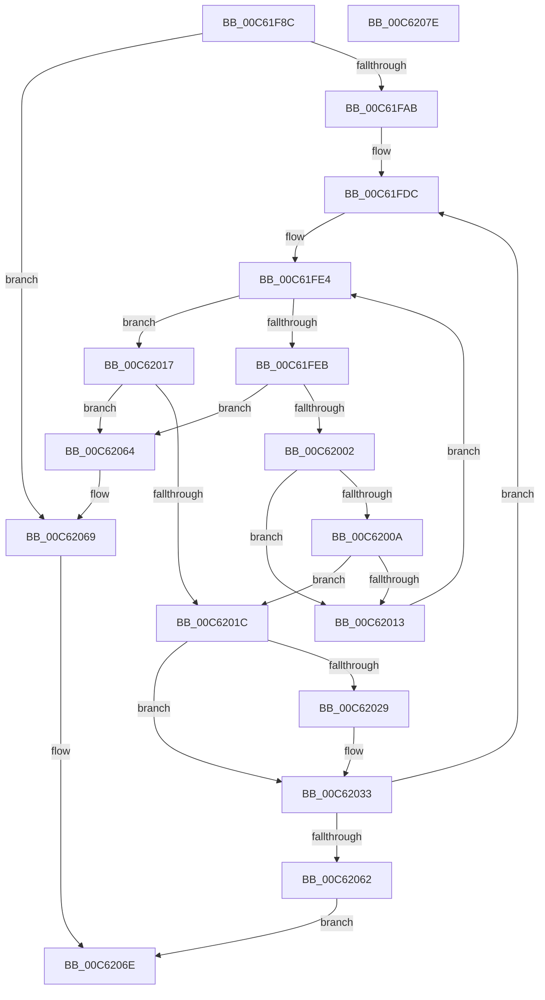

# MiCreateFreePfns

- RVA: `0x00C61F8C`–`0x00C6207F` (길이 `243` bytes)
- VA: `0x0000000140C61F8C`
- 실행 섹션: `INIT`
- PDB 이름 있음: `예`; PDB Function 태그: `아니요`
- unwind 정보 RVA: `0x0008A4C8`
- 디코드: `66`개 명령, `243/243` bytes 표시
- 미해석 바이트: `0` (있으면 어셈블리에 `.byte`로 보존)

> 이 문서는 커널 이미지의 기계어와 PDB 기호를 분석해 생성했습니다. 4번과 5번은 함수 원형과 자료형을 바이너리 사용 방식에서 추정한 C 해석이며 원본 소스 복구 결과는 아닙니다.

## 1. Dependencies

- 직접 호출 지점: **4**; 고유 호출 대상: **3**
- 직접 호출자로 확인된 함수: **1**
- RIP 상대 이미지 참조: **2**

### Outgoing calls
- `0x00C61FAF` → [MiPageToNode](../../text/33/MiPageToNode_function_00338CD0.md) (function, `0x00338CD0`)
- `0x00C6202E` → [MxCreateFreePfns](MxCreateFreePfns_function_00C632CC.md) (function, `0x00C632CC`)
- `0x00C62039` → [MxReleaseFreeDescriptor](MxReleaseFreeDescriptor_function_00C640D4.md) (function, `0x00C640D4`)
- `0x00C62069` → [MxCreateFreePfns](MxCreateFreePfns_function_00C632CC.md) (function, `0x00C632CC`)

### Direct callers
- [MiSwitchToPfns](MiSwitchToPfns_function_00C62C90.md) at `0x00C62E18`
- [MiSwitchToPfns](MiSwitchToPfns_function_00C62C90.md) at `0x00C62E47`

### Static image references
- `0x00C61FDC` → RVA `0x00FC5000` (`ALMOSTRO`; read)
- `0x00C61FF1` → RVA `0x010093D0` (`INITDATA`; read)

## 2. Other-region calls and transfers

- 다른 실행 섹션으로 향하는 call: **1**
  - `0x00C61FAF` → [MiPageToNode](../../text/33/MiPageToNode_function_00338CD0.md) (`INIT` → `.text`)
- 별도 외부 분기/꼬리 이동을 확인하지 못했습니다.

## 3. Assembly (complete function range)

```asm
00C61F8C  48 89 5C 24 08                  mov qword ptr [rsp + 8], rbx
00C61F91  48 89 74 24 10                  mov qword ptr [rsp + 0x10], rsi
00C61F96  57                              push rdi
00C61F97  48 83 EC 50                     sub rsp, 0x50
00C61F9B  F7 41 18 00 00 00 40            test dword ptr [rcx + 0x18], 0x40000000
00C61FA2  48 8B F9                        mov rdi, rcx
00C61FA5  0F 84 BE 00 00 00               je 0x140c62069
00C61FAB  48 8B 49 20                     mov rcx, qword ptr [rcx + 0x20]
00C61FAF  E8 1C 6D 6D FF                  call 0x140338cd0
00C61FB4  0F 10 07                        movups xmm0, xmmword ptr [rdi]
00C61FB7  33 DB                           xor ebx, ebx
00C61FB9  0F 10 4F 10                     movups xmm1, xmmword ptr [rdi + 0x10]
00C61FBD  33 F6                           xor esi, esi
00C61FBF  0F 11 44 24 20                  movups xmmword ptr [rsp + 0x20], xmm0
00C61FC4  0F 10 47 20                     movups xmm0, xmmword ptr [rdi + 0x20]
00C61FC8  0F 11 4C 24 30                  movups xmmword ptr [rsp + 0x30], xmm1
00C61FCD  0F 11 44 24 40                  movups xmmword ptr [rsp + 0x40], xmm0
00C61FD2  4C 8B 4C 24 48                  mov r9, qword ptr [rsp + 0x48]
00C61FD7  48 8B 54 24 40                  mov rdx, qword ptr [rsp + 0x40]
00C61FDC  44 0F B7 05 1C 30 36 00         movzx r8d, word ptr [rip + 0x36301c]
00C61FE4  8B C6                           mov eax, esi
00C61FE6  41 3B F0                        cmp esi, r8d
00C61FE9  73 2C                           jae 0x140c62017
00C61FEB  8B C6                           mov eax, esi
00C61FED  48 6B D8 38                     imul rbx, rax, 0x38
00C61FF1  48 8D 05 D8 73 3A 00            lea rax, [rip + 0x3a73d8]
00C61FF8  48 03 D8                        add rbx, rax
00C61FFB  48 83 7B 28 00                  cmp qword ptr [rbx + 0x28], 0
00C62000  74 62                           je 0x140c62064
00C62002  48 8B 0B                        mov rcx, qword ptr [rbx]
00C62005  48 3B CA                        cmp rcx, rdx
00C62008  72 09                           jb 0x140c62013
00C6200A  49 8D 04 11                     lea rax, [r9 + rdx]
00C6200E  48 3B C8                        cmp rcx, rax
00C62011  72 09                           jb 0x140c6201c
00C62013  FF C6                           inc esi
00C62015  EB CD                           jmp 0x140c61fe4
00C62017  41 3B C0                        cmp eax, r8d
00C6201A  74 48                           je 0x140c62064
00C6201C  48 8B 03                        mov rax, qword ptr [rbx]
00C6201F  48 2B C2                        sub rax, rdx
00C62022  48 89 44 24 48                  mov qword ptr [rsp + 0x48], rax
00C62027  74 0A                           je 0x140c62033
00C62029  48 8D 4C 24 20                  lea rcx, [rsp + 0x20]
00C6202E  E8 99 12 00 00                  call 0x140c632cc
00C62033  8B 57 18                        mov edx, dword ptr [rdi + 0x18]
00C62036  48 8B CB                        mov rcx, rbx
00C62039  E8 96 20 00 00                  call 0x140c640d4
00C6203E  48 8B 53 08                     mov rdx, qword ptr [rbx + 8]
00C62042  FF C6                           inc esi
00C62044  48 03 13                        add rdx, qword ptr [rbx]
00C62047  4C 8B 4F 28                     mov r9, qword ptr [rdi + 0x28]
00C6204B  4C 2B CA                        sub r9, rdx
00C6204E  48 89 54 24 40                  mov qword ptr [rsp + 0x40], rdx
00C62053  4C 03 4F 20                     add r9, qword ptr [rdi + 0x20]
00C62057  4C 89 4C 24 48                  mov qword ptr [rsp + 0x48], r9
00C6205C  0F 85 7A FF FF FF               jne 0x140c61fdc
00C62062  EB 0A                           jmp 0x140c6206e
00C62064  48 8D 4C 24 20                  lea rcx, [rsp + 0x20]
00C62069  E8 5E 12 00 00                  call 0x140c632cc
00C6206E  48 8B 5C 24 60                  mov rbx, qword ptr [rsp + 0x60]
00C62073  48 8B 74 24 68                  mov rsi, qword ptr [rsp + 0x68]
00C62078  48 83 C4 50                     add rsp, 0x50
00C6207C  5F                              pop rdi
00C6207D  C3                              ret
00C6207E  CC                              int3
```

## 4. C-style interpretation (structured pseudocode)

```c
__int64 __fastcall MiCreateFreePfns(__int64 a1)
{
    __int64 result;
    __int64 v_rbx;
    __int64 v_rsi;
    __int64 v_rsp;
    unsigned __int64 v_stack_m10;
    unsigned __int64 v_stack_m18;
    unsigned __int64 v_stack_m28;
    unsigned __int64 v_stack_m38;
    unsigned __int64 v_stack_p10;
    unsigned __int64 v_stack_p8;

    v_stack_p8 = v_rbx;
    v_stack_p10 = v_rsi;
    v_rsp = (v_rsp) - (80);
    if (((*(unsigned int *)(a1 + 24)) & (0x40000000ULL)) == 0) goto loc_00C62069;
    result = MiPageToNode(*(unsigned __int64 *)(a1 + 32), a2, a3, a4);
    v_rbx = 0;
    v_rsi = 0;
    v_stack_m38 = v_xmm0;
    v_stack_m28 = v_xmm1;
    v_stack_m18 = v_xmm0;
loc_00C61FDC:
loc_00C61FE4:
    if (0 >= ((unsigned int)(*(unsigned __int16 *)(v_rip + 3551260)))) goto loc_00C62017;
    v_rbx = (v_rbx) * (0);
    v_rbx = (v_rbx) + (v_rip + 3830744);
    if ((*(unsigned __int64 *)(v_rbx + 40)) == 0) goto loc_00C62064;
    if ((*(unsigned __int64 *)(v_rbx)) < v_stack_m18) goto loc_00C62013;
    if ((*(unsigned __int64 *)(v_rbx)) < (v_stack_m10 + v_stack_m18 * 1)) goto loc_00C6201C;
loc_00C62013:
    v_rsi = (unsigned int)((v_rsi) + 1);
    goto loc_00C61FE4;
loc_00C62017:
    if (((unsigned int)(v_stack_m10 + v_stack_m18 * 1)) == ((unsigned int)(*(unsigned __int16 *)(v_rip + 3551260)))) goto loc_00C62064;
loc_00C6201C:
    result = (*(unsigned __int64 *)(v_rbx)) - (v_stack_m18);
    v_stack_m10 = result;
    if (!(condition_is_equal)) {
        a1 = v_stack_m38;
        result = MxCreateFreePfns(a1, v_stack_m18, *(unsigned __int16 *)(v_rip + 3551260), v_stack_m10);
    }
    result = MxReleaseFreeDescriptor(v_rbx, (unsigned int)(*(unsigned int *)(a1 + 24)), *(unsigned __int16 *)(v_rip + 3551260), v_stack_m10);
    v_rsi = (unsigned int)((v_rsi) + 1);
    a2 = (*(unsigned __int64 *)(v_rbx + 8)) + (*(unsigned __int64 *)(v_rbx));
    a4 = (*(unsigned __int64 *)(a1 + 40)) - (a2);
    v_stack_m18 = a2;
    a4 = (a4) + (*(unsigned __int64 *)(a1 + 32));
    v_stack_m10 = a4;
    if (condition_is_not_equal) goto loc_00C61FDC;
    goto loc_00C6206E;
loc_00C62064:
loc_00C62069:
    result = MxCreateFreePfns(v_stack_m38, a2, *(unsigned __int16 *)(v_rip + 3551260), a4);
loc_00C6206E:
    v_rsp = (v_rsp) + (80);
    return result;
}
```

## 5. (Beta) C Style

```c
int64_t MiCreateFreePfns(void *Arg1)
{
    uint8_t *arg1 = (uint8_t *)Arg1;

    int64_t result;
    int64_t local_rbx;
    int64_t local_rsi;
    int64_t local_rsp;
    uint64_t v_stack_m10;
    uint64_t v_stack_m18;
    uint64_t v_stack_m28;
    uint64_t v_stack_m38;
    uint64_t v_stack_p10;
    uint64_t v_stack_p8;

    v_stack_p8 = local_rbx;
    v_stack_p10 = local_rsi;
    local_rsp = (local_rsp) - (80);
    if (((*(uint32_t *)(arg1 + 0x18)) & (0x40000000ULL)) == 0) goto loc_00C62069;
    result = MiPageToNode(*(uint64_t *)(arg1 + 0x20), a2, a3, a4);
    local_rbx = 0;
    local_rsi = 0;
    v_stack_m38 = v_xmm0;
    v_stack_m28 = v_xmm1;
    v_stack_m18 = v_xmm0;
loc_00C61FDC:
loc_00C61FE4:
    if (0 >= ((uint32_t)(*(uint16_t *)(v_rip + 0x36301C)))) goto loc_00C62017;
    local_rbx = (local_rbx) * (0);
    local_rbx = (local_rbx) + (v_rip + 3830744);
    if ((*(uint64_t *)(local_rbx + 0x28)) == 0) goto loc_00C62064;
    if ((*(uint64_t *)(local_rbx)) < v_stack_m18) goto loc_00C62013;
    if ((*(uint64_t *)(local_rbx)) < (v_stack_m10 + v_stack_m18 * 1)) goto loc_00C6201C;
loc_00C62013:
    local_rsi = (uint32_t)((local_rsi) + 1);
    goto loc_00C61FE4;
loc_00C62017:
    if (((uint32_t)(v_stack_m10 + v_stack_m18 * 1)) == ((uint32_t)(*(uint16_t *)(v_rip + 0x36301C)))) goto loc_00C62064;
loc_00C6201C:
    result = (*(uint64_t *)(local_rbx)) - (v_stack_m18);
    v_stack_m10 = result;
    if (!(condition_is_equal)) {
        Arg1 = v_stack_m38;
        result = MxCreateFreePfns(Arg1, v_stack_m18, *(uint16_t *)(v_rip + 0x36301C), v_stack_m10);
    }
    result = MxReleaseFreeDescriptor(local_rbx, (uint32_t)(*(uint32_t *)(arg1 + 0x18)), *(uint16_t *)(v_rip + 0x36301C), v_stack_m10);
    local_rsi = (uint32_t)((local_rsi) + 1);
    a2 = (*(uint64_t *)(local_rbx + 0x8)) + (*(uint64_t *)(local_rbx));
    a4 = (*(uint64_t *)(arg1 + 0x28)) - (a2);
    v_stack_m18 = a2;
    a4 = (a4) + (*(uint64_t *)(arg1 + 0x20));
    v_stack_m10 = a4;
    if (condition_is_not_equal) goto loc_00C61FDC;
    goto loc_00C6206E;
loc_00C62064:
loc_00C62069:
    result = MxCreateFreePfns(v_stack_m38, a2, *(uint16_t *)(v_rip + 0x36301C), a4);
loc_00C6206E:
    local_rsp = (local_rsp) + (80);
    return result;
}
```

### 관측된 메모리 오프셋

구조체 형식이 확인되지 않은 접근은 인자 기준의 오프셋으로만 기록했습니다.

| 기준 인자 | 오프셋 표현 | 폭 (bit) | 접근 |
|---|---:|---:|---|
| `Arg1` | `+ 0x0` | `128` | `R` |
| `Arg1` | `+ 0x10` | `128` | `R` |
| `Arg1` | `+ 0x18` | `32` | `R` |
| `Arg1` | `+ 0x20` | `64` | `R` |
| `Arg1` | `+ 0x20` | `128` | `R` |
| `Arg1` | `+ 0x28` | `64` | `R` |

## 6. Execution-region graph

[열기: 2D/3D 그래프와 함수 탐색 컨트롤 패널](../../../control-panel.html?section=init&rva=0x00C61F8C&view=graph)

- 2D 그래프는 위에서 아래로 흐르고, 3D 그래프는 빈 공간을 드래그해 회전합니다. Shift+드래그는 이동, 휠은 확대·축소, 함수 노드 선택은 대상 보고서 이동입니다.

### Static fallback


