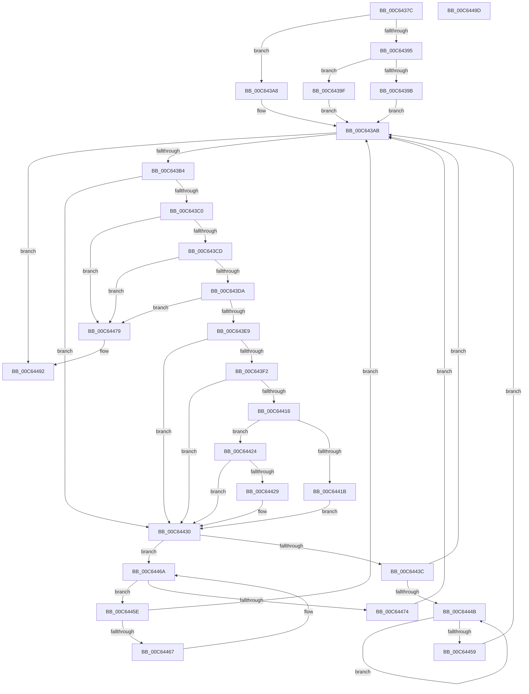

# MiCreateHugeIoRanges

- RVA: `0x00C6437C`–`0x00C6449E` (길이 `290` bytes)
- VA: `0x0000000140C6437C`
- 실행 섹션: `INIT`
- PDB 이름 있음: `예`; PDB Function 태그: `아니요`
- unwind 정보 RVA: `0x0006E5F8`
- 디코드: `81`개 명령, `290/290` bytes 표시
- 미해석 바이트: `0` (있으면 어셈블리에 `.byte`로 보존)

> 이 문서는 커널 이미지의 기계어와 PDB 기호를 분석해 생성했습니다. 4번과 5번은 함수 원형과 자료형을 바이너리 사용 방식에서 추정한 C 해석이며 원본 소스 복구 결과는 아닙니다.

## 1. Dependencies

- 직접 호출 지점: **3**; 고유 호출 대상: **3**
- 직접 호출자로 확인된 함수: **1**
- RIP 상대 이미지 참조: **1**

### Outgoing calls
- `0x00C643E9` → [MiInitializeHugePfnDatabase](../../text/67/MiInitializeHugePfnDatabase_function_00676410.md) (function, `0x00676410`)
- `0x00C6440D` → [MiAddPartitionHugeRange](../../text/67/MiAddPartitionHugeRange_function_006750D8.md) (function, `0x006750D8`)
- `0x00C6448C` → [KeBugCheckEx](../../text/4F/KeBugCheckEx_function_004FD660.md) (function, `0x004FD660`)

### Direct callers
- [MiInitNucleus](../C5/MiInitNucleus_function_00C5FD38.md) at `0x00C60496`

### Static image references
- `0x00C643F5` → RVA `0x00E38D00` (`.data`; read)

## 2. Other-region calls and transfers

- 다른 실행 섹션으로 향하는 call: **3**
  - `0x00C643E9` → [MiInitializeHugePfnDatabase](../../text/67/MiInitializeHugePfnDatabase_function_00676410.md) (`INIT` → `.text`)
  - `0x00C6440D` → [MiAddPartitionHugeRange](../../text/67/MiAddPartitionHugeRange_function_006750D8.md) (`INIT` → `.text`)
  - `0x00C6448C` → [KeBugCheckEx](../../text/4F/KeBugCheckEx_function_004FD660.md) (`INIT` → `.text`)
- 별도 외부 분기/꼬리 이동을 확인하지 못했습니다.

## 3. Assembly (complete function range)

```asm
00C6437C  48 89 5C 24 08                  mov qword ptr [rsp + 8], rbx
00C64381  57                              push rdi
00C64382  48 83 EC 30                     sub rsp, 0x30
00C64386  48 8D 99 60 01 00 00            lea rbx, [rcx + 0x160]
00C6438D  48 8B 43 08                     mov rax, qword ptr [rbx + 8]
00C64391  A8 01                           test al, 1
00C64393  74 13                           je 0x140c643a8
00C64395  48 83 F8 01                     cmp rax, 1
00C64399  75 04                           jne 0x140c6439f
00C6439B  33 DB                           xor ebx, ebx
00C6439D  EB 0C                           jmp 0x140c643ab
00C6439F  48 83 CB 01                     or rbx, 1
00C643A3  48 33 D8                        xor rbx, rax
00C643A6  EB 03                           jmp 0x140c643ab
00C643A8  48 8B D8                        mov rbx, rax
00C643AB  48 85 DB                        test rbx, rbx
00C643AE  0F 84 DE 00 00 00               je 0x140c64492
00C643B4  48 63 7B 18                     movsxd rdi, dword ptr [rbx + 0x18]
00C643B8  8D 47 DA                        lea eax, [rdi - 0x26]
00C643BB  83 F8 01                        cmp eax, 1
00C643BE  77 70                           ja 0x140c64430
00C643C0  4C 8B 43 20                     mov r8, qword ptr [rbx + 0x20]
00C643C4  4D 85 C0                        test r8, r8
00C643C7  0F 84 AC 00 00 00               je 0x140c64479
00C643CD  49 F7 C0 FF FF 03 00            test r8, 0x3ffff
00C643D4  0F 85 9F 00 00 00               jne 0x140c64479
00C643DA  8B 43 28                        mov eax, dword ptr [rbx + 0x28]
00C643DD  48 A9 FF FF 03 00               test rax, 0x3ffff
00C643E3  0F 85 90 00 00 00               jne 0x140c64479
00C643E9  E8 22 20 A1 FF                  call 0x140676410
00C643EE  85 C0                           test eax, eax
00C643F0  74 3E                           je 0x140c64430
00C643F2  45 33 C0                        xor r8d, r8d
00C643F5  48 8D 0D 04 49 1D 00            lea rcx, [rip + 0x1d4904]
00C643FC  83 7B 18 26                     cmp dword ptr [rbx + 0x18], 0x26
00C64400  48 8B D3                        mov rdx, rbx
00C64403  41 0F 95 C0                     setne r8b
00C64407  45 33 C9                        xor r9d, r9d
00C6440A  41 FF C0                        inc r8d
00C6440D  E8 C6 0C A1 FF                  call 0x1406750d8
00C64412  85 C0                           test eax, eax
00C64414  78 1A                           js 0x140c64430
00C64416  83 FF 26                        cmp edi, 0x26
00C64419  75 09                           jne 0x140c64424
00C6441B  C7 43 18 18 00 00 00            mov dword ptr [rbx + 0x18], 0x18
00C64422  EB 0C                           jmp 0x140c64430
00C64424  83 FF 27                        cmp edi, 0x27
00C64427  75 07                           jne 0x140c64430
00C64429  C7 43 18 02 00 00 00            mov dword ptr [rbx + 0x18], 2
00C64430  48 8B 43 08                     mov rax, qword ptr [rbx + 8]
00C64434  48 8B CB                        mov rcx, rbx
00C64437  48 85 C0                        test rax, rax
00C6443A  74 2E                           je 0x140c6446a
00C6443C  48 8B 08                        mov rcx, qword ptr [rax]
00C6443F  48 8B D8                        mov rbx, rax
00C64442  48 85 C9                        test rcx, rcx
00C64445  0F 84 60 FF FF FF               je 0x140c643ab
00C6444B  48 8B 01                        mov rax, qword ptr [rcx]
00C6444E  48 8B D9                        mov rbx, rcx
00C64451  48 8B C8                        mov rcx, rax
00C64454  48 85 C0                        test rax, rax
00C64457  75 F2                           jne 0x140c6444b
00C64459  E9 4D FF FF FF                  jmp 0x140c643ab
00C6445E  48 39 0B                        cmp qword ptr [rbx], rcx
00C64461  0F 84 44 FF FF FF               je 0x140c643ab
00C64467  48 8B CB                        mov rcx, rbx
00C6446A  48 8B 5B 10                     mov rbx, qword ptr [rbx + 0x10]
00C6446E  48 83 E3 FC                     and rbx, 0xfffffffffffffffc
00C64472  75 EA                           jne 0x140c6445e
00C64474  E9 32 FF FF FF                  jmp 0x140c643ab
00C64479  4C 8B 4B 28                     mov r9, qword ptr [rbx + 0x28]
00C6447D  BA 1C 03 03 03                  mov edx, 0x303031c
00C64482  B9 1A 00 00 00                  mov ecx, 0x1a
00C64487  48 89 7C 24 20                  mov qword ptr [rsp + 0x20], rdi
00C6448C  E8 CF 91 89 FF                  call 0x1404fd660
00C64491  CC                              int3
00C64492  48 8B 5C 24 40                  mov rbx, qword ptr [rsp + 0x40]
00C64497  48 83 C4 30                     add rsp, 0x30
00C6449B  5F                              pop rdi
00C6449C  C3                              ret
00C6449D  CC                              int3
```

## 4. C-style interpretation (structured pseudocode)

```c
__int64 __fastcall MiCreateHugeIoRanges(__int64 a1, __int64 a2, __int64 a3, int a4)
{
    __int64 result;
    __int64 v_rbx;
    __int64 v_rsp;
    unsigned __int64 v_stack_m18;
    unsigned __int64 v_stack_p8;

    v_stack_p8 = v_rbx;
    v_rsp = (v_rsp) - (48);
    if ((((unsigned __int8)(*(unsigned __int64 *)(a1 + 352 + 8))) & (1)) == 0) goto loc_00C643A8;
    if ((*(unsigned __int64 *)(a1 + 352 + 8)) != 1) goto loc_00C6439F;
    v_rbx = 0;
    goto loc_00C643AB;
loc_00C6439F:
    v_rbx = (v_rbx) | (1);
    v_rbx = (v_rbx) ^ (*(unsigned __int64 *)(a1 + 352 + 8));
    goto loc_00C643AB;
loc_00C643A8:
loc_00C643AB:
    if (*(unsigned __int64 *)(a1 + 352 + 8) == 0) goto loc_00C64492;
    if (((unsigned int)((int)(*(unsigned int *)(*(unsigned __int64 *)(a1 + 352 + 8) + 24)) - 38)) > 1) goto loc_00C64430;
    if (*(unsigned __int64 *)(*(unsigned __int64 *)(a1 + 352 + 8) + 32) == 0) goto loc_00C64479;
    if (((*(unsigned __int64 *)(*(unsigned __int64 *)(a1 + 352 + 8) + 32)) & (0x3FFFFULL)) != 0) goto loc_00C64479;
    if ((((unsigned int)(*(unsigned int *)(*(unsigned __int64 *)(a1 + 352 + 8) + 40))) & (0x3FFFFULL)) != 0) goto loc_00C64479;
    result = MiInitializeHugePfnDatabase(a1, a2, *(unsigned __int64 *)(*(unsigned __int64 *)(a1 + 352 + 8) + 32), a4);
    if ((unsigned int)(result) == 0) goto loc_00C64430;
    a3 = 0;
    a3 = ((*(unsigned int *)(*(unsigned __int64 *)(a1 + 352 + 8) + 24)) != 38) ? 1 : 0;
    a4 = 0;
    a3 = (unsigned int)((a3) + 1);
    result = MiAddPartitionHugeRange(v_rip + 1919236, *(unsigned __int64 *)(a1 + 352 + 8), a3, a4);
    if (sign_flag) goto loc_00C64430;
    if (((unsigned int)((int)(*(unsigned int *)(*(unsigned __int64 *)(a1 + 352 + 8) + 24)))) != 38) goto loc_00C64424;
    *(unsigned int *)(*(unsigned __int64 *)(a1 + 352 + 8) + 24) = 24;
    goto loc_00C64430;
loc_00C64424:
    if (((unsigned int)((int)(*(unsigned int *)(*(unsigned __int64 *)(a1 + 352 + 8) + 24)))) == 39) {
        *(unsigned int *)(*(unsigned __int64 *)(a1 + 352 + 8) + 24) = 2;
    }
    if (*(unsigned __int64 *)(*(unsigned __int64 *)(a1 + 352 + 8) + 8) == 0) goto loc_00C6446A;
    if (*(unsigned __int64 *)(*(unsigned __int64 *)(*(unsigned __int64 *)(a1 + 352 + 8) + 8)) == 0) goto loc_00C643AB;
loc_00C6444B:
    if (*(unsigned __int64 *)(*(unsigned __int64 *)(*(unsigned __int64 *)(*(unsigned __int64 *)(a1 + 352 + 8) + 8))) != 0) goto loc_00C6444B;
    goto loc_00C643AB;
loc_00C6445E:
    if ((*(unsigned __int64 *)(*(unsigned __int64 *)(*(unsigned __int64 *)(*(unsigned __int64 *)(a1 + 352 + 8) + 8)))) == (*(unsigned __int64 *)(*(unsigned __int64 *)(*(unsigned __int64 *)(*(unsigned __int64 *)(a1 + 352 + 8) + 8))))) goto loc_00C643AB;
loc_00C6446A:
    v_rbx = (*(unsigned __int64 *)(*(unsigned __int64 *)(*(unsigned __int64 *)(*(unsigned __int64 *)(a1 + 352 + 8) + 8)) + 16)) & (-4);
    if (condition_is_not_equal) goto loc_00C6445E;
    goto loc_00C643AB;
loc_00C64479:
    v_stack_m18 = (int)(*(unsigned int *)(*(unsigned __int64 *)(a1 + 352 + 8) + 24));
    result = KeBugCheckEx(26, (unsigned int)(0x303031CULL), a3, *(unsigned __int64 *)(v_rbx + 40));
loc_00C64492:
    v_rsp = (v_rsp) + (48);
    return result;
}
```

## 5. (Beta) C Style

```c
int64_t MiCreateHugeIoRanges(void *Arg1, int64_t Arg2, int64_t Arg3, int32_t Arg4)
{
    uint8_t *arg1 = (uint8_t *)Arg1;

    int64_t result;
    int64_t local_rbx;
    int64_t local_rsp;
    uint64_t v_stack_m18;
    uint64_t v_stack_p8;

    v_stack_p8 = local_rbx;
    local_rsp = (local_rsp) - (48);
    if ((((uint8_t)(*(uint64_t *)(arg1 + 0x160 + 0x8))) & (1)) == 0) goto loc_00C643A8;
    if ((*(uint64_t *)(arg1 + 0x160 + 0x8)) != 1) goto loc_00C6439F;
    local_rbx = 0;
    goto loc_00C643AB;
loc_00C6439F:
    local_rbx = (local_rbx) | (1);
    local_rbx = (local_rbx) ^ (*(uint64_t *)(arg1 + 0x160 + 0x8));
    goto loc_00C643AB;
loc_00C643A8:
loc_00C643AB:
    if (*(uint64_t *)(arg1 + 0x160 + 0x8) == 0) goto loc_00C64492;
    if (((uint32_t)((int32_t)(*(uint32_t *)(*(uint64_t *)(arg1 + 0x160 + 0x8) + 0x18)) - 38)) > 1) goto loc_00C64430;
    if (*(uint64_t *)(*(uint64_t *)(arg1 + 0x160 + 0x8) + 0x20) == 0) goto loc_00C64479;
    if (((*(uint64_t *)(*(uint64_t *)(arg1 + 0x160 + 0x8) + 0x20)) & (0x3FFFFULL)) != 0) goto loc_00C64479;
    if ((((uint32_t)(*(uint32_t *)(*(uint64_t *)(arg1 + 0x160 + 0x8) + 0x28))) & (0x3FFFFULL)) != 0) goto loc_00C64479;
    result = MiInitializeHugePfnDatabase(Arg1, Arg2, *(uint64_t *)(*(uint64_t *)(arg1 + 0x160 + 0x8) + 0x20), Arg4);
    if ((uint32_t)(result) == 0) goto loc_00C64430;
    Arg3 = 0;
    Arg3 = ((*(uint32_t *)(*(uint64_t *)(arg1 + 0x160 + 0x8) + 0x18)) != 38) ? 1 : 0;
    Arg4 = 0;
    Arg3 = (uint32_t)((Arg3) + 1);
    result = MiAddPartitionHugeRange(v_rip + 1919236, *(uint64_t *)(arg1 + 0x160 + 0x8), Arg3, Arg4);
    if (sign_flag) goto loc_00C64430;
    if (((uint32_t)((int32_t)(*(uint32_t *)(*(uint64_t *)(arg1 + 0x160 + 0x8) + 0x18)))) != 38) goto loc_00C64424;
    *(uint32_t *)(*(uint64_t *)(arg1 + 0x160 + 0x8) + 0x18) = 24;
    goto loc_00C64430;
loc_00C64424:
    if (((uint32_t)((int32_t)(*(uint32_t *)(*(uint64_t *)(arg1 + 0x160 + 0x8) + 0x18)))) == 39) {
        *(uint32_t *)(*(uint64_t *)(arg1 + 0x160 + 0x8) + 0x18) = 2;
    }
    if (*(uint64_t *)(*(uint64_t *)(arg1 + 0x160 + 0x8) + 0x8) == 0) goto loc_00C6446A;
    if (*(uint64_t *)(*(uint64_t *)(*(uint64_t *)(arg1 + 0x160 + 0x8) + 0x8)) == 0) goto loc_00C643AB;
loc_00C6444B:
    if (*(uint64_t *)(*(uint64_t *)(*(uint64_t *)(*(uint64_t *)(arg1 + 0x160 + 0x8) + 0x8))) != 0) goto loc_00C6444B;
    goto loc_00C643AB;
loc_00C6445E:
    if ((*(uint64_t *)(*(uint64_t *)(*(uint64_t *)(*(uint64_t *)(arg1 + 0x160 + 0x8) + 0x8)))) == (*(uint64_t *)(*(uint64_t *)(*(uint64_t *)(*(uint64_t *)(arg1 + 0x160 + 0x8) + 0x8))))) goto loc_00C643AB;
loc_00C6446A:
    local_rbx = (*(uint64_t *)(*(uint64_t *)(*(uint64_t *)(*(uint64_t *)(arg1 + 0x160 + 0x8) + 0x8)) + 0x10)) & (-4);
    if (condition_is_not_equal) goto loc_00C6445E;
    goto loc_00C643AB;
loc_00C64479:
    v_stack_m18 = (int32_t)(*(uint32_t *)(*(uint64_t *)(arg1 + 0x160 + 0x8) + 0x18));
    result = KeBugCheckEx(26, (uint32_t)(0x303031CULL), Arg3, *(uint64_t *)(local_rbx + 0x28));
loc_00C64492:
    local_rsp = (local_rsp) + (48);
    return result;
}
```

### 관측된 메모리 오프셋

구조체 형식이 확인되지 않은 접근은 인자 기준의 오프셋으로만 기록했습니다.

| 기준 인자 | 오프셋 표현 | 폭 (bit) | 접근 |
|---|---:|---:|---|
| `Arg1` | `+ 0x8` | `64` | `R` |
| `Arg1` | `+ 0x160` | `64` | `R` |

## 6. Execution-region graph

[열기: 2D/3D 그래프와 함수 탐색 컨트롤 패널](../../../control-panel.html?section=init&rva=0x00C6437C&view=graph)

- 2D 그래프는 위에서 아래로 흐르고, 3D 그래프는 빈 공간을 드래그해 회전합니다. Shift+드래그는 이동, 휠은 확대·축소, 함수 노드 선택은 대상 보고서 이동입니다.

### Static fallback


