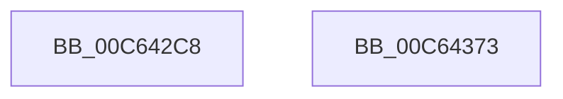

# MiCreateInitialSystemWsles

- RVA: `0x00C642C8`–`0x00C64374` (길이 `172` bytes)
- VA: `0x0000000140C642C8`
- 실행 섹션: `INIT`
- PDB 이름 있음: `예`; PDB Function 태그: `아니요`
- unwind 정보 RVA: `0x000D7B24`
- 디코드: `38`개 명령, `172/172` bytes 표시
- 미해석 바이트: `0` (있으면 어셈블리에 `.byte`로 보존)

> 이 문서는 커널 이미지의 기계어와 PDB 기호를 분석해 생성했습니다. 4번과 5번은 함수 원형과 자료형을 바이너리 사용 방식에서 추정한 C 해석이며 원본 소스 복구 결과는 아닙니다.

## 1. Dependencies

- 직접 호출 지점: **5**; 고유 호출 대상: **5**
- 직접 호출자로 확인된 함수: **1**
- RIP 상대 이미지 참조: **3**

### Outgoing calls
- `0x00C642E2` → [memset](../../text/6C/memset_function_006C6C40.md) (function, `0x006C6C40`)
- `0x00C642EC` → [MiGetAnyMultiplexedVm](../../text/44/MiGetAnyMultiplexedVm_function_00448BD0.md) (function, `0x00448BD0`)
- `0x00C64339` → [MiLockWorkingSetShared](../../text/27/MiLockWorkingSetShared_function_0027CBF0.md) (function, `0x0027CBF0`)
- `0x00C64347` → [MiWalkPageTables](../../text/2C/MiWalkPageTables_function_002C2710.md) (function, `0x002C2710`)
- `0x00C64355` → [MiUnlockWorkingSetShared](../../text/27/MiUnlockWorkingSetShared_function_0027D690.md) (function, `0x0027D690`)

### Direct callers
- [MiInitializeSystemImageRegion](MiInitializeSystemImageRegion_function_00C6C05C.md) at `0x00C6C247`

### Static image references
- `0x00C642F1` → RVA `0x00E38CB8` (`.data`; read)
- `0x00C642FB` → RVA `0x00E38CC0` (`.data`; read)
- `0x00C64302` → RVA `0x00673D00` (`MiCreatePteWsle`; read)

## 2. Other-region calls and transfers

- 다른 실행 섹션으로 향하는 call: **5**
  - `0x00C642E2` → [memset](../../text/6C/memset_function_006C6C40.md) (`INIT` → `.text`)
  - `0x00C642EC` → [MiGetAnyMultiplexedVm](../../text/44/MiGetAnyMultiplexedVm_function_00448BD0.md) (`INIT` → `.text`)
  - `0x00C64339` → [MiLockWorkingSetShared](../../text/27/MiLockWorkingSetShared_function_0027CBF0.md) (`INIT` → `.text`)
  - `0x00C64347` → [MiWalkPageTables](../../text/2C/MiWalkPageTables_function_002C2710.md) (`INIT` → `.text`)
  - `0x00C64355` → [MiUnlockWorkingSetShared](../../text/27/MiUnlockWorkingSetShared_function_0027D690.md) (`INIT` → `.text`)
- 별도 외부 분기/꼬리 이동을 확인하지 못했습니다.

## 3. Assembly (complete function range)

```asm
00C642C8  48 89 5C 24 08                  mov qword ptr [rsp + 8], rbx
00C642CD  57                              push rdi
00C642CE  48 81 EC E0 00 00 00            sub rsp, 0xe0
00C642D5  33 D2                           xor edx, edx
00C642D7  48 8D 4C 24 20                  lea rcx, [rsp + 0x20]
00C642DC  41 B8 C0 00 00 00               mov r8d, 0xc0
00C642E2  E8 59 29 A6 FF                  call 0x1406c6c40
00C642E7  B9 01 00 00 00                  mov ecx, 1
00C642EC  E8 DF 48 7E FF                  call 0x140448bd0
00C642F1  48 8B 15 C0 49 1D 00            mov rdx, qword ptr [rip + 0x1d49c0]
00C642F8  48 8B F8                        mov rdi, rax
00C642FB  48 8B 0D BE 49 1D 00            mov rcx, qword ptr [rip + 0x1d49be]
00C64302  48 8D 05 F7 F9 A0 FF            lea rax, [rip - 0x5f0609]
00C64309  81 64 24 24 3F FE FF FF         and dword ptr [rsp + 0x24], 0xfffffe3f
00C64311  48 FF C9                        dec rcx
00C64314  48 89 54 24 48                  mov qword ptr [rsp + 0x48], rdx
00C64319  48 03 D1                        add rdx, rcx
00C6431C  48 8B CF                        mov rcx, rdi
00C6431F  48 89 54 24 50                  mov qword ptr [rsp + 0x50], rdx
00C64324  48 89 84 24 C8 00 00 00         mov qword ptr [rsp + 0xc8], rax
00C6432C  48 89 7C 24 40                  mov qword ptr [rsp + 0x40], rdi
00C64331  C7 44 24 20 07 00 00 00         mov dword ptr [rsp + 0x20], 7
00C64339  E8 B2 88 61 FF                  call 0x14027cbf0
00C6433E  48 8D 4C 24 20                  lea rcx, [rsp + 0x20]
00C64343  88 44 24 29                     mov byte ptr [rsp + 0x29], al
00C64347  E8 C4 E3 65 FF                  call 0x1402c2710
00C6434C  8A 54 24 29                     mov dl, byte ptr [rsp + 0x29]
00C64350  48 8B CF                        mov rcx, rdi
00C64353  8B D8                           mov ebx, eax
00C64355  E8 36 93 61 FF                  call 0x14027d690
00C6435A  33 C0                           xor eax, eax
00C6435C  83 FB 05                        cmp ebx, 5
00C6435F  48 8B 9C 24 F0 00 00 00         mov rbx, qword ptr [rsp + 0xf0]
00C64367  0F 95 C0                        setne al
00C6436A  48 81 C4 E0 00 00 00            add rsp, 0xe0
00C64371  5F                              pop rdi
00C64372  C3                              ret
00C64373  CC                              int3
```

## 4. C-style interpretation (structured pseudocode)

```c
__int64 __fastcall MiCreateInitialSystemWsles(__int64 a1, int a2)
{
    __int64 result;
    __int64 v_rsp;
    unsigned __int64 v_stack_m20;
    unsigned __int64 v_stack_m98;
    unsigned __int64 v_stack_mA0;
    unsigned __int64 v_stack_mA8;
    unsigned __int8 v_stack_mBF;
    unsigned int v_stack_mC4;
    unsigned __int64 v_stack_mC8;
    unsigned __int64 v_stack_p8;

    v_stack_p8 = v_rbx;
    v_rsp = (v_rsp) - (224);
    a2 = 0;
    result = memset(v_stack_mC8, a2, 192, a4);
    result = MiGetAnyMultiplexedVm(1, a2, 192, a4);
    a1 = (*(unsigned __int64 *)(v_rip + 1919422)) - 1;
    v_stack_mA0 = *(unsigned __int64 *)(v_rip + 1919424);
    a2 = (*(unsigned __int64 *)(v_rip + 1919424)) + (a1);
    v_stack_m98 = a2;
    v_stack_m20 = v_rip - 6227465;
    v_stack_mA8 = result;
    v_stack_mC8 = 7;
    result = MiLockWorkingSetShared(result, a2, 192, a4);
    v_stack_mBF = (unsigned __int8)(result);
    result = MiWalkPageTables(v_stack_mC8, a2, 192, a4);
    result = MiUnlockWorkingSetShared(result, v_stack_mBF, 192, a4);
    result = 0;
    result = (((unsigned int)((unsigned int)((unsigned int)(result)))) != 5) ? 1 : 0;
    v_rsp = (v_rsp) + (224);
    return result;
}
```

## 5. (Beta) C Style

```c
int64_t MiCreateInitialSystemWsles(int64_t Arg1, int32_t Arg2)
{
    int64_t result;
    int64_t local_rsp;
    uint64_t v_stack_m20;
    uint64_t v_stack_m98;
    uint64_t v_stack_mA0;
    uint64_t v_stack_mA8;
    uint8_t v_stack_mBF;
    uint32_t v_stack_mC4;
    uint64_t v_stack_mC8;
    uint64_t v_stack_p8;

    v_stack_p8 = local_rbx;
    local_rsp = (local_rsp) - (224);
    Arg2 = 0;
    result = memset(v_stack_mC8, Arg2, 192, a4);
    result = MiGetAnyMultiplexedVm(1, Arg2, 192, a4);
    Arg1 = (*(uint64_t *)(v_rip + 0x1D49BE)) - 1;
    v_stack_mA0 = *(uint64_t *)(v_rip + 0x1D49C0);
    Arg2 = (*(uint64_t *)(v_rip + 0x1D49C0)) + (Arg1);
    v_stack_m98 = Arg2;
    v_stack_m20 = v_rip - 6227465;
    v_stack_mA8 = result;
    v_stack_mC8 = 7;
    result = MiLockWorkingSetShared(result, Arg2, 192, a4);
    v_stack_mBF = (uint8_t)(result);
    result = MiWalkPageTables(v_stack_mC8, Arg2, 192, a4);
    result = MiUnlockWorkingSetShared(result, v_stack_mBF, 192, a4);
    result = 0;
    result = (((uint32_t)((uint32_t)((uint32_t)(result)))) != 5) ? 1 : 0;
    local_rsp = (local_rsp) + (224);
    return result;
}
```

## 6. Execution-region graph

[열기: 2D/3D 그래프와 함수 탐색 컨트롤 패널](../../../control-panel.html?section=init&rva=0x00C642C8&view=graph)

- 2D 그래프는 위에서 아래로 흐르고, 3D 그래프는 빈 공간을 드래그해 회전합니다. Shift+드래그는 이동, 휠은 확대·축소, 함수 노드 선택은 대상 보고서 이동입니다.

### Static fallback


