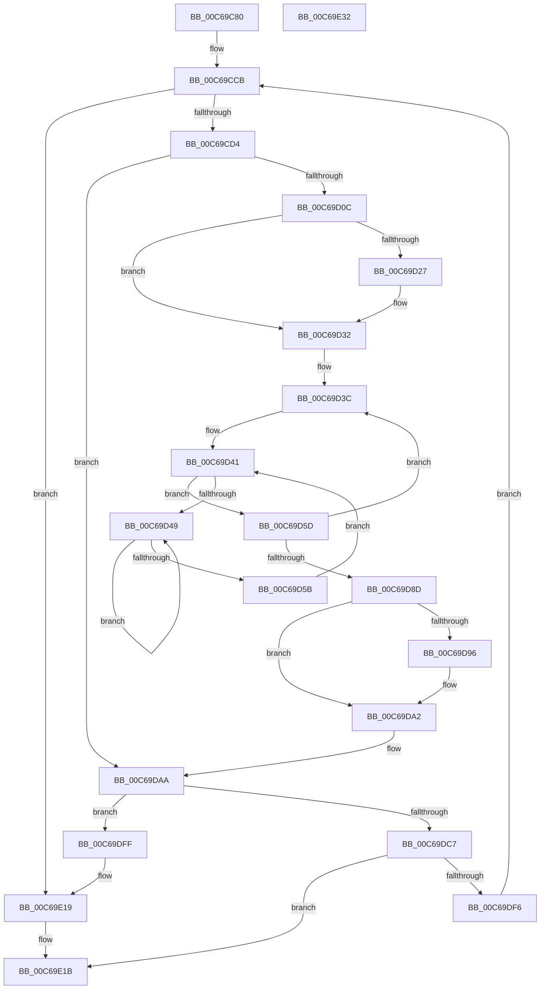

# MiCreateKernelHalSlabRange

- RVA: `0x00C69C80`–`0x00C69E33` (길이 `435` bytes)
- VA: `0x0000000140C69C80`
- 실행 섹션: `INIT`
- PDB 이름 있음: `예`; PDB Function 태그: `아니요`
- unwind 정보 RVA: `0x000D8FBC`
- 디코드: `111`개 명령, `435/435` bytes 표시
- 미해석 바이트: `0` (있으면 어셈블리에 `.byte`로 보존)

> 이 문서는 커널 이미지의 기계어와 PDB 기호를 분석해 생성했습니다. 4번과 5번은 함수 원형과 자료형을 바이너리 사용 방식에서 추정한 C 해석이며 원본 소스 복구 결과는 아닙니다.

## 1. Dependencies

- 직접 호출 지점: **8**; 고유 호출 대상: **7**
- 직접 호출자로 확인된 함수: **0**
- RIP 상대 이미지 참조: **2**

### Outgoing calls
- `0x00C69D11` → [MiConvertActiveLargePageToSmall](../../text/42/MiConvertActiveLargePageToSmall_function_00420AF8.md) (function, `0x00420AF8`)
- `0x00C69D2D` → [KiRaiseIrqlProcessIrqlFlags](../../text/4F/KiRaiseIrqlProcessIrqlFlags_function_004F56FC.md) (function, `0x004F56FC`)
- `0x00C69D4E` → [KeYieldProcessorEx](../../text/3F/KeYieldProcessorEx_function_003FBD00.md) (function, `0x003FBD00`)
- `0x00C69D9D` → [KiLowerIrqlProcessIrqlFlags](../../text/4F/KiLowerIrqlProcessIrqlFlags_function_004F5698.md) (function, `0x004F5698`)
- `0x00C69DAD` → [MiPageToNode](../../text/33/MiPageToNode_function_00338CD0.md) (function, `0x00338CD0`)
- `0x00C69DBB` → [MiPageToNode](../../text/33/MiPageToNode_function_00338CD0.md) (function, `0x00338CD0`)
- `0x00C69DED` → [MiCreateBootSlabEntries](MiCreateBootSlabEntries_function_00C69A50.md) (function, `0x00C69A50`)
- `0x00C69E13` → [KeBugCheckEx](../../text/4F/KeBugCheckEx_function_004FD660.md) (function, `0x004FD660`)

### Direct callers
- 이 함수 시작 RVA로 연결되는 직접 call은 확인되지 않았습니다. 간접 호출은 완전히 역산할 수 없습니다.

### Static image references
- `0x00C69D1E` → RVA `0x00FC6D20` (`ALMOSTRO`; read)
- `0x00C69DC7` → RVA `0x00E38D10` (`.data`; read)

## 2. Other-region calls and transfers

- 다른 실행 섹션으로 향하는 call: **7**
  - `0x00C69D11` → [MiConvertActiveLargePageToSmall](../../text/42/MiConvertActiveLargePageToSmall_function_00420AF8.md) (`INIT` → `.text`)
  - `0x00C69D2D` → [KiRaiseIrqlProcessIrqlFlags](../../text/4F/KiRaiseIrqlProcessIrqlFlags_function_004F56FC.md) (`INIT` → `.text`)
  - `0x00C69D4E` → [KeYieldProcessorEx](../../text/3F/KeYieldProcessorEx_function_003FBD00.md) (`INIT` → `.text`)
  - `0x00C69D9D` → [KiLowerIrqlProcessIrqlFlags](../../text/4F/KiLowerIrqlProcessIrqlFlags_function_004F5698.md) (`INIT` → `.text`)
  - `0x00C69DAD` → [MiPageToNode](../../text/33/MiPageToNode_function_00338CD0.md) (`INIT` → `.text`)
  - `0x00C69DBB` → [MiPageToNode](../../text/33/MiPageToNode_function_00338CD0.md) (`INIT` → `.text`)
  - `0x00C69E13` → [KeBugCheckEx](../../text/4F/KeBugCheckEx_function_004FD660.md) (`INIT` → `.text`)
- 별도 외부 분기/꼬리 이동을 확인하지 못했습니다.

## 3. Assembly (complete function range)

```asm
00C69C80  48 89 5C 24 10                  mov qword ptr [rsp + 0x10], rbx
00C69C85  48 89 6C 24 18                  mov qword ptr [rsp + 0x18], rbp
00C69C8A  56                              push rsi
00C69C8B  57                              push rdi
00C69C8C  41 55                           push r13
00C69C8E  41 56                           push r14
00C69C90  41 57                           push r15
00C69C92  48 83 EC 30                     sub rsp, 0x30
00C69C96  4C 8B FA                        mov r15, rdx
00C69C99  48 8B F1                        mov rsi, rcx
00C69C9C  48 C1 EE 12                     shr rsi, 0x12
00C69CA0  BA F8 FF FF 3F                  mov edx, 0x3ffffff8
00C69CA5  48 23 F2                        and rsi, rdx
00C69CA8  48 B9 00 00 00 40 FB F6 FF FF   movabs rcx, 0xfffff6fb40000000
00C69CB2  48 8B C1                        mov rax, rcx
00C69CB5  49 C1 EF 12                     shr r15, 0x12
00C69CB9  48 03 F0                        add rsi, rax
00C69CBC  4C 23 FA                        and r15, rdx
00C69CBF  48 8B C1                        mov rax, rcx
00C69CC2  4C 03 F8                        add r15, rax
00C69CC5  41 BD 02 00 00 00               mov r13d, 2
00C69CCB  49 3B F7                        cmp rsi, r15
00C69CCE  0F 83 45 01 00 00               jae 0x140c69e19
00C69CD4  48 8B 3E                        mov rdi, qword ptr [rsi]
00C69CD7  48 B8 FF FF FF FF FF 00 00 00   movabs rax, 0xffffffffff
00C69CE1  48 C1 EF 0C                     shr rdi, 0xc
00C69CE5  48 23 F8                        and rdi, rax
00C69CE8  48 8D 1C 7F                     lea rbx, [rdi + rdi*2]
00C69CEC  48 C1 E3 04                     shl rbx, 4
00C69CF0  48 B8 00 00 00 00 00 DE FF FF   movabs rax, 0xffffde0000000000
00C69CFA  48 03 D8                        add rbx, rax
00C69CFD  48 8B 43 28                     mov rax, qword ptr [rbx + 0x28]
00C69D01  48 0F BA E0 28                  bt rax, 0x28
00C69D06  0F 83 9E 00 00 00               jae 0x140c69daa
00C69D0C  33 D2                           xor edx, edx
00C69D0E  48 8B CB                        mov rcx, rbx
00C69D11  E8 E2 6D 7B FF                  call 0x140420af8
00C69D16  44 0F 20 C5                     mov rbp, cr8
00C69D1A  45 0F 22 C5                     mov cr8, r13
00C69D1E  83 3D FB CF 35 00 00            cmp dword ptr [rip + 0x35cffb], 0
00C69D25  74 0B                           je 0x140c69d32
00C69D27  41 8A D5                        mov dl, r13b
00C69D2A  40 8A CD                        mov cl, bpl
00C69D2D  E8 CA B9 88 FF                  call 0x1404f56fc
00C69D32  48 83 C3 18                     add rbx, 0x18
00C69D36  41 BE 00 02 00 00               mov r14d, 0x200
00C69D3C  83 64 24 60 00                  and dword ptr [rsp + 0x60], 0
00C69D41  F0 48 0F BA 2B 3F               lock bts qword ptr [rbx], 0x3f
00C69D47  73 14                           jae 0x140c69d5d
00C69D49  48 8D 4C 24 60                  lea rcx, [rsp + 0x60]
00C69D4E  E8 AD 1F 79 FF                  call 0x1403fbd00
00C69D53  48 8B 03                        mov rax, qword ptr [rbx]
00C69D56  48 85 C0                        test rax, rax
00C69D59  78 EE                           js 0x140c69d49
00C69D5B  EB E4                           jmp 0x140c69d41
00C69D5D  8B 43 08                        mov eax, dword ptr [rbx + 8]
00C69D60  89 44 24 60                     mov dword ptr [rsp + 0x60], eax
00C69D64  B8 FF FF 00 00                  mov eax, 0xffff
00C69D69  66 01 44 24 60                  add word ptr [rsp + 0x60], ax
00C69D6E  8B 44 24 60                     mov eax, dword ptr [rsp + 0x60]
00C69D72  89 43 08                        mov dword ptr [rbx + 8], eax
00C69D75  48 B8 FF FF FF FF FF FF FF 7F   movabs rax, 0x7fffffffffffffff
00C69D7F  F0 48 21 03                     lock and qword ptr [rbx], rax
00C69D83  48 83 C3 30                     add rbx, 0x30
00C69D87  49 83 EE 01                     sub r14, 1
00C69D8B  75 AF                           jne 0x140c69d3c
00C69D8D  44 39 35 8C CF 35 00            cmp dword ptr [rip + 0x35cf8c], r14d
00C69D94  74 0C                           je 0x140c69da2
00C69D96  44 0F 20 C1                     mov rcx, cr8
00C69D9A  40 8A D5                        mov dl, bpl
00C69D9D  E8 F6 B8 88 FF                  call 0x1404f5698
00C69DA2  40 0F B6 C5                     movzx eax, bpl
00C69DA6  44 0F 22 C0                     mov cr8, rax
00C69DAA  48 8B CF                        mov rcx, rdi
00C69DAD  E8 1E EF 6C FF                  call 0x140338cd0
00C69DB2  48 8D 8F FF 01 00 00            lea rcx, [rdi + 0x1ff]
00C69DB9  8B D8                           mov ebx, eax
00C69DBB  E8 10 EF 6C FF                  call 0x140338cd0
00C69DC0  44 8B CB                        mov r9d, ebx
00C69DC3  3B D8                           cmp ebx, eax
00C69DC5  75 38                           jne 0x140c69dff
00C69DC7  48 8B 05 42 EF 1C 00            mov rax, qword ptr [rip + 0x1cef42]
00C69DCE  41 B8 00 02 00 00               mov r8d, 0x200
00C69DD4  49 69 C9 80 DF 00 00            imul rcx, r9, 0xdf80
00C69DDB  48 05 D8 41 00 00               add rax, 0x41d8
00C69DE1  41 B9 01 00 00 00               mov r9d, 1
00C69DE7  48 03 C8                        add rcx, rax
00C69DEA  48 8B D7                        mov rdx, rdi
00C69DED  E8 5E FC FF FF                  call 0x140c69a50
00C69DF2  85 C0                           test eax, eax
00C69DF4  78 25                           js 0x140c69e1b
00C69DF6  48 83 C6 08                     add rsi, 8
00C69DFA  E9 CC FE FF FF                  jmp 0x140c69ccb
00C69DFF  8B C8                           mov ecx, eax
00C69E01  4C 8B C7                        mov r8, rdi
00C69E04  48 89 4C 24 20                  mov qword ptr [rsp + 0x20], rcx
00C69E09  BA 17 03 03 03                  mov edx, 0x3030317
00C69E0E  B9 1A 00 00 00                  mov ecx, 0x1a
00C69E13  E8 48 38 89 FF                  call 0x1404fd660
00C69E18  CC                              int3
00C69E19  33 C0                           xor eax, eax
00C69E1B  48 8B 5C 24 68                  mov rbx, qword ptr [rsp + 0x68]
00C69E20  48 8B 6C 24 70                  mov rbp, qword ptr [rsp + 0x70]
00C69E25  48 83 C4 30                     add rsp, 0x30
00C69E29  41 5F                           pop r15
00C69E2B  41 5E                           pop r14
00C69E2D  41 5D                           pop r13
00C69E2F  5F                              pop rdi
00C69E30  5E                              pop rsi
00C69E31  C3                              ret
00C69E32  CC                              int3
```

## 4. C-style interpretation (structured pseudocode)

```c
__int64 __fastcall MiCreateKernelHalSlabRange(__int64 a1, __int64 a2)
{
    __int64 result;
    __int64 v_r14;
    __int64 v_r15;
    __int64 v_rbx;
    __int64 v_rdi;
    __int64 v_rsi;
    __int64 v_rsp;
    unsigned __int64 v_stack_m38;
    unsigned __int64 v_stack_p10;
    unsigned __int64 v_stack_p18;
    unsigned int v_stack_p8;

    v_stack_p10 = v_rbx;
    v_stack_p18 = v_rbp;
    v_rsp = (v_rsp) - (48);
    v_rsi = (a1) >> (18);
    v_rsi = (v_rsi) & ((unsigned int)(0x3FFFFFF8ULL));
    v_r15 = (a2) >> (18);
    v_rsi = (v_rsi) + (a1);
    v_r15 = (v_r15) & ((unsigned int)(0x3FFFFFF8ULL));
    v_r15 = (v_r15) + (a1);
loc_00C69CCB:
    if (v_rsi >= v_r15) goto loc_00C69E19;
    v_rdi = (*(unsigned __int64 *)(v_rsi)) >> (12);
    v_rdi = (v_rdi) & (a1);
    v_rbx = (v_rdi + v_rdi * 2) << (4);
    v_rbx = (v_rbx) + (a1);
    if (condition_is_above_or_equal) goto loc_00C69DAA;
    a2 = 0;
    result = MiConvertActiveLargePageToSmall(v_rbx, a2, a3, a4);
    if ((*(unsigned int *)(v_rip + 3526651)) != 0) {
        a2 = 2;
        a1 = (unsigned __int8)(v_cr8);
        result = KiRaiseIrqlProcessIrqlFlags(a1, a2, a3, a4);
    }
    v_rbx = (v_rbx) + (24);
loc_00C69D3C:
loc_00C69D41:
    if (condition_is_above_or_equal) goto loc_00C69D5D;
loc_00C69D49:
    result = KeYieldProcessorEx(v_stack_p8, a2, a3, a4);
    if (sign_flag) goto loc_00C69D49;
    goto loc_00C69D41;
loc_00C69D5D:
    v_stack_p8 = (unsigned int)((unsigned int)(*(unsigned int *)(v_rbx + 8)));
    *(unsigned int *)(v_rbx + 8) = (unsigned int)((unsigned int)(v_stack_p8));
    v_rbx = (v_rbx) + (48);
    v_r14 = (512) - (1);
    if (condition_is_not_equal) goto loc_00C69D3C;
    result = (unsigned int)(v_stack_p8);
    if ((*(unsigned int *)(v_rip + 3526540)) != ((unsigned int)(v_r14))) {
        a1 = 2;
        a2 = (unsigned __int8)(v_cr8);
        result = KiLowerIrqlProcessIrqlFlags(a1, a2, a3, a4);
    }
loc_00C69DAA:
    result = MiPageToNode(v_rdi, a2, a3, a4);
    result = MiPageToNode(v_rdi + 511, a2, a3, a4);
    if (((unsigned int)((unsigned int)((unsigned int)(result)))) != ((unsigned int)(result))) goto loc_00C69DFF;
    a1 = (v_rdi + 511) * ((unsigned int)((unsigned int)((unsigned int)((unsigned int)(result)))));
    result = (*(unsigned __int64 *)(v_rip + 1896258)) + (0x41D8ULL);
    a1 = (a1) + (result);
    result = MiCreateBootSlabEntries(a1, v_rdi, 512, 1);
    if (sign_flag) goto loc_00C69E1B;
    v_rsi = (v_rsi) + (8);
    goto loc_00C69CCB;
loc_00C69DFF:
    v_stack_m38 = (unsigned int)((unsigned int)(result));
    result = KeBugCheckEx(26, (unsigned int)(0x3030317ULL), v_rdi, 1);
loc_00C69E19:
    result = 0;
loc_00C69E1B:
    v_rsp = (v_rsp) + (48);
    return result;
}
```

## 5. (Beta) C Style

```c
int64_t MiCreateKernelHalSlabRange(int64_t Arg1, int64_t Arg2)
{
    int64_t result;
    int64_t local_r14;
    int64_t local_r15;
    int64_t local_rbx;
    int64_t local_rdi;
    int64_t local_rsi;
    int64_t local_rsp;
    uint64_t v_stack_m38;
    uint64_t v_stack_p10;
    uint64_t v_stack_p18;
    uint32_t v_stack_p8;

    v_stack_p10 = local_rbx;
    v_stack_p18 = local_rbp;
    local_rsp = (local_rsp) - (48);
    local_rsi = (Arg1) >> (18);
    local_rsi = (local_rsi) & ((uint32_t)(0x3FFFFFF8ULL));
    local_r15 = (Arg2) >> (18);
    local_rsi = (local_rsi) + (Arg1);
    local_r15 = (local_r15) & ((uint32_t)(0x3FFFFFF8ULL));
    local_r15 = (local_r15) + (Arg1);
loc_00C69CCB:
    if (local_rsi >= local_r15) goto loc_00C69E19;
    local_rdi = (*(uint64_t *)(local_rsi)) >> (12);
    local_rdi = (local_rdi) & (Arg1);
    local_rbx = (local_rdi + local_rdi * 2) << (4);
    local_rbx = (local_rbx) + (Arg1);
    if (condition_is_above_or_equal) goto loc_00C69DAA;
    Arg2 = 0;
    result = MiConvertActiveLargePageToSmall(local_rbx, Arg2, a3, a4);
    if ((*(uint32_t *)(v_rip + 0x35CFFB)) != 0) {
        Arg2 = 2;
        Arg1 = (uint8_t)(v_cr8);
        result = KiRaiseIrqlProcessIrqlFlags(Arg1, Arg2, a3, a4);
    }
    local_rbx = (local_rbx) + (24);
loc_00C69D3C:
loc_00C69D41:
    if (condition_is_above_or_equal) goto loc_00C69D5D;
loc_00C69D49:
    result = KeYieldProcessorEx(v_stack_p8, Arg2, a3, a4);
    if (sign_flag) goto loc_00C69D49;
    goto loc_00C69D41;
loc_00C69D5D:
    v_stack_p8 = (uint32_t)((uint32_t)(*(uint32_t *)(local_rbx + 0x8)));
    *(uint32_t *)(local_rbx + 0x8) = (uint32_t)((uint32_t)(v_stack_p8));
    local_rbx = (local_rbx) + (48);
    local_r14 = (512) - (1);
    if (condition_is_not_equal) goto loc_00C69D3C;
    result = (uint32_t)(v_stack_p8);
    if ((*(uint32_t *)(v_rip + 0x35CF8C)) != ((uint32_t)(local_r14))) {
        Arg1 = 2;
        Arg2 = (uint8_t)(v_cr8);
        result = KiLowerIrqlProcessIrqlFlags(Arg1, Arg2, a3, a4);
    }
loc_00C69DAA:
    result = MiPageToNode(local_rdi, Arg2, a3, a4);
    result = MiPageToNode(local_rdi + 511, Arg2, a3, a4);
    if (((uint32_t)((uint32_t)((uint32_t)(result)))) != ((uint32_t)(result))) goto loc_00C69DFF;
    Arg1 = (local_rdi + 511) * ((uint32_t)((uint32_t)((uint32_t)((uint32_t)(result)))));
    result = (*(uint64_t *)(v_rip + 0x1CEF42)) + (0x41D8ULL);
    Arg1 = (Arg1) + (result);
    result = MiCreateBootSlabEntries(Arg1, local_rdi, 512, 1);
    if (sign_flag) goto loc_00C69E1B;
    local_rsi = (local_rsi) + (8);
    goto loc_00C69CCB;
loc_00C69DFF:
    v_stack_m38 = (uint32_t)((uint32_t)(result));
    result = KeBugCheckEx(26, (uint32_t)(0x3030317ULL), local_rdi, 1);
loc_00C69E19:
    result = 0;
loc_00C69E1B:
    local_rsp = (local_rsp) + (48);
    return result;
}
```

## 6. Execution-region graph

[열기: 2D/3D 그래프와 함수 탐색 컨트롤 패널](../../../control-panel.html?section=init&rva=0x00C69C80&view=graph)

- 2D 그래프는 위에서 아래로 흐르고, 3D 그래프는 빈 공간을 드래그해 회전합니다. Shift+드래그는 이동, 휠은 확대·축소, 함수 노드 선택은 대상 보고서 이동입니다.

### Static fallback


