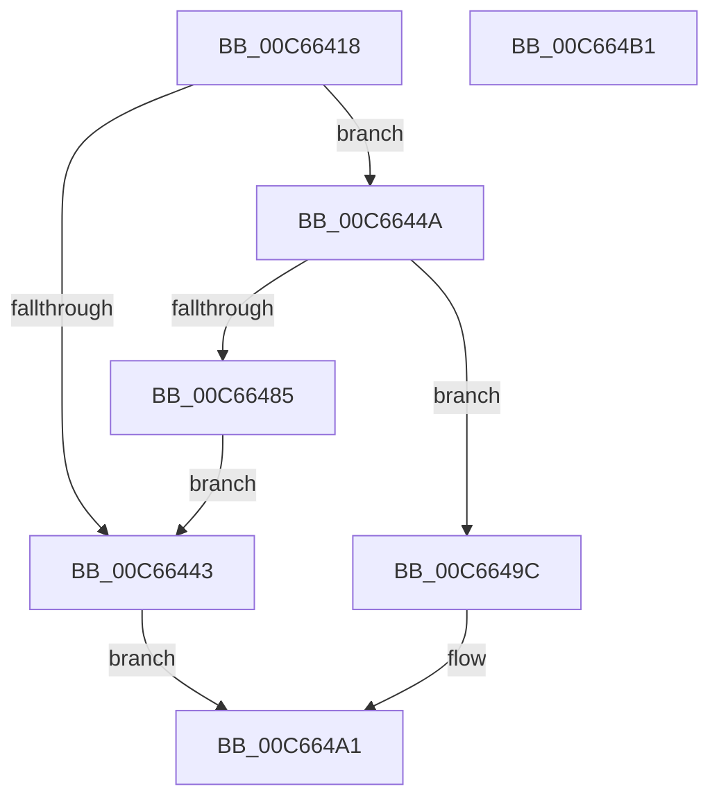

# MiCreateRetpolineBitmap

- RVA: `0x00C66418`–`0x00C664B2` (길이 `154` bytes)
- VA: `0x0000000140C66418`
- 실행 섹션: `INIT`
- PDB 이름 있음: `예`; PDB Function 태그: `아니요`
- unwind 정보 RVA: `0x00060BC4`
- 디코드: `39`개 명령, `154/154` bytes 표시
- 미해석 바이트: `0` (있으면 어셈블리에 `.byte`로 보존)

> 이 문서는 커널 이미지의 기계어와 PDB 기호를 분석해 생성했습니다. 4번과 5번은 함수 원형과 자료형을 바이너리 사용 방식에서 추정한 C 해석이며 원본 소스 복구 결과는 아닙니다.

## 1. Dependencies

- 직접 호출 지점: **3**; 고유 호출 대상: **3**
- 직접 호출자로 확인된 함수: **1**
- RIP 상대 이미지 참조: **2**

### Outgoing calls
- `0x00C66436` → [MiReservePtes](../../text/31/MiReservePtes_function_00318D20.md) (function, `0x00318D20`)
- `0x00C6647C` → [MiInitializeDynamicBitmap](../../text/67/MiInitializeDynamicBitmap_function_0067F5BC.md) (function, `0x0067F5BC`)
- `0x00C66495` → [MiReleasePtes](../../text/24/MiReleasePtes_function_00247240.md) (function, `0x00247240`)

### Direct callers
- [MiInitializeRetpoline](MiInitializeRetpoline_function_00C66544.md) at `0x00C665AC`

### Static image references
- `0x00C6642F` → RVA `0x00E37668` (`.data`; read)
- `0x00C6645F` → RVA `0x00E2D858` (`.data`; read)

## 2. Other-region calls and transfers

- 다른 실행 섹션으로 향하는 call: **3**
  - `0x00C66436` → [MiReservePtes](../../text/31/MiReservePtes_function_00318D20.md) (`INIT` → `.text`)
  - `0x00C6647C` → [MiInitializeDynamicBitmap](../../text/67/MiInitializeDynamicBitmap_function_0067F5BC.md) (`INIT` → `.text`)
  - `0x00C66495` → [MiReleasePtes](../../text/24/MiReleasePtes_function_00247240.md) (`INIT` → `.text`)
- 별도 외부 분기/꼬리 이동을 확인하지 못했습니다.

## 3. Assembly (complete function range)

```asm
00C66418  48 89 5C 24 08                  mov qword ptr [rsp + 8], rbx
00C6641D  48 89 74 24 10                  mov qword ptr [rsp + 0x10], rsi
00C66422  57                              push rdi
00C66423  48 83 EC 20                     sub rsp, 0x20
00C66427  48 8B F1                        mov rsi, rcx
00C6642A  BA 00 00 01 00                  mov edx, 0x10000
00C6642F  48 8D 0D 32 12 1D 00            lea rcx, [rip + 0x1d1232]
00C66436  E8 E5 28 6B FF                  call 0x140318d20
00C6643B  48 8B F8                        mov rdi, rax
00C6643E  48 85 C0                        test rax, rax
00C66441  75 07                           jne 0x140c6644a
00C66443  B8 17 00 00 C0                  mov eax, 0xc0000017
00C66448  EB 57                           jmp 0x140c664a1
00C6644A  48 8B DF                        mov rbx, rdi
00C6644D  48 C1 E3 19                     shl rbx, 0x19
00C66451  48 B8 00 00 00 00 80 F6 FF FF   movabs rax, 0xfffff68000000000
00C6645B  48 C1 E0 19                     shl rax, 0x19
00C6645F  48 8D 0D F2 73 1C 00            lea rcx, [rip + 0x1c73f2]
00C66466  48 2B D8                        sub rbx, rax
00C66469  41 B9 07 00 00 00               mov r9d, 7
00C6646F  48 C1 FB 10                     sar rbx, 0x10
00C66473  41 B8 00 00 00 80               mov r8d, 0x80000000
00C66479  48 8B D3                        mov rdx, rbx
00C6647C  E8 3B 91 A1 FF                  call 0x14067f5bc
00C66481  85 C0                           test eax, eax
00C66483  75 17                           jne 0x140c6649c
00C66485  41 B8 00 00 01 00               mov r8d, 0x10000
00C6648B  48 8D 0D D6 11 1D 00            lea rcx, [rip + 0x1d11d6]
00C66492  48 8B D7                        mov rdx, rdi
00C66495  E8 A6 0D 5E FF                  call 0x140247240
00C6649A  EB A7                           jmp 0x140c66443
00C6649C  48 89 1E                        mov qword ptr [rsi], rbx
00C6649F  33 C0                           xor eax, eax
00C664A1  48 8B 5C 24 30                  mov rbx, qword ptr [rsp + 0x30]
00C664A6  48 8B 74 24 38                  mov rsi, qword ptr [rsp + 0x38]
00C664AB  48 83 C4 20                     add rsp, 0x20
00C664AF  5F                              pop rdi
00C664B0  C3                              ret
00C664B1  CC                              int3
```

## 4. C-style interpretation (structured pseudocode)

```c
__int64 __fastcall MiCreateRetpolineBitmap(__int64 a1)
{
    __int64 result;
    __int64 v_rbx;
    __int64 v_rsp;
    unsigned __int64 v_stack_p10;
    unsigned __int64 v_stack_p8;

    v_stack_p8 = v_rbx;
    v_stack_p10 = v_rsi;
    v_rsp = (v_rsp) - (32);
    result = MiReservePtes(v_rip + 1905202, (unsigned int)(0x10000ULL), a3, a4);
    if (result != 0) goto loc_00C6644A;
loc_00C66443:
    goto loc_00C664A1;
loc_00C6644A:
    v_rbx = (result) << (25);
    result = ((unsigned int)(0xC0000017ULL)) << (25);
    v_rbx = (v_rbx) - (result);
    v_rbx = (v_rbx) >> (16);
    result = MiInitializeDynamicBitmap(v_rip + 1864690, v_rbx, (unsigned int)(0x80000000ULL), 7);
    if ((unsigned int)(result) != 0) goto loc_00C6649C;
    result = MiReleasePtes(v_rip + 1905110, result, (unsigned int)(0x10000ULL), 7);
    goto loc_00C66443;
loc_00C6649C:
    *(unsigned __int64 *)(a1) = v_rbx;
    result = 0;
loc_00C664A1:
    v_rsp = (v_rsp) + (32);
    return result;
}
```

## 5. (Beta) C Style

```c
int64_t MiCreateRetpolineBitmap(void *Arg1)
{
    uint8_t *arg1 = (uint8_t *)Arg1;

    int64_t result;
    int64_t local_rbx;
    int64_t local_rsp;
    uint64_t v_stack_p10;
    uint64_t v_stack_p8;

    v_stack_p8 = local_rbx;
    v_stack_p10 = local_rsi;
    local_rsp = (local_rsp) - (32);
    result = MiReservePtes(v_rip + 1905202, (uint32_t)(0x10000ULL), a3, a4);
    if (result != 0) goto loc_00C6644A;
loc_00C66443:
    goto loc_00C664A1;
loc_00C6644A:
    local_rbx = (result) << (25);
    result = ((uint32_t)(0xC0000017ULL)) << (25);
    local_rbx = (local_rbx) - (result);
    local_rbx = (local_rbx) >> (16);
    result = MiInitializeDynamicBitmap(v_rip + 1864690, local_rbx, (uint32_t)(0x80000000ULL), 7);
    if ((uint32_t)(result) != 0) goto loc_00C6649C;
    result = MiReleasePtes(v_rip + 1905110, result, (uint32_t)(0x10000ULL), 7);
    goto loc_00C66443;
loc_00C6649C:
    *(uint64_t *)(arg1) = local_rbx;
    result = 0;
loc_00C664A1:
    local_rsp = (local_rsp) + (32);
    return result;
}
```

### 관측된 메모리 오프셋

구조체 형식이 확인되지 않은 접근은 인자 기준의 오프셋으로만 기록했습니다.

| 기준 인자 | 오프셋 표현 | 폭 (bit) | 접근 |
|---|---:|---:|---|
| `Arg1` | `+ 0x0` | `64` | `W` |

## 6. Execution-region graph

[열기: 2D/3D 그래프와 함수 탐색 컨트롤 패널](../../../control-panel.html?section=init&rva=0x00C66418&view=graph)

- 2D 그래프는 위에서 아래로 흐르고, 3D 그래프는 빈 공간을 드래그해 회전합니다. Shift+드래그는 이동, 휠은 확대·축소, 함수 노드 선택은 대상 보고서 이동입니다.

### Static fallback


