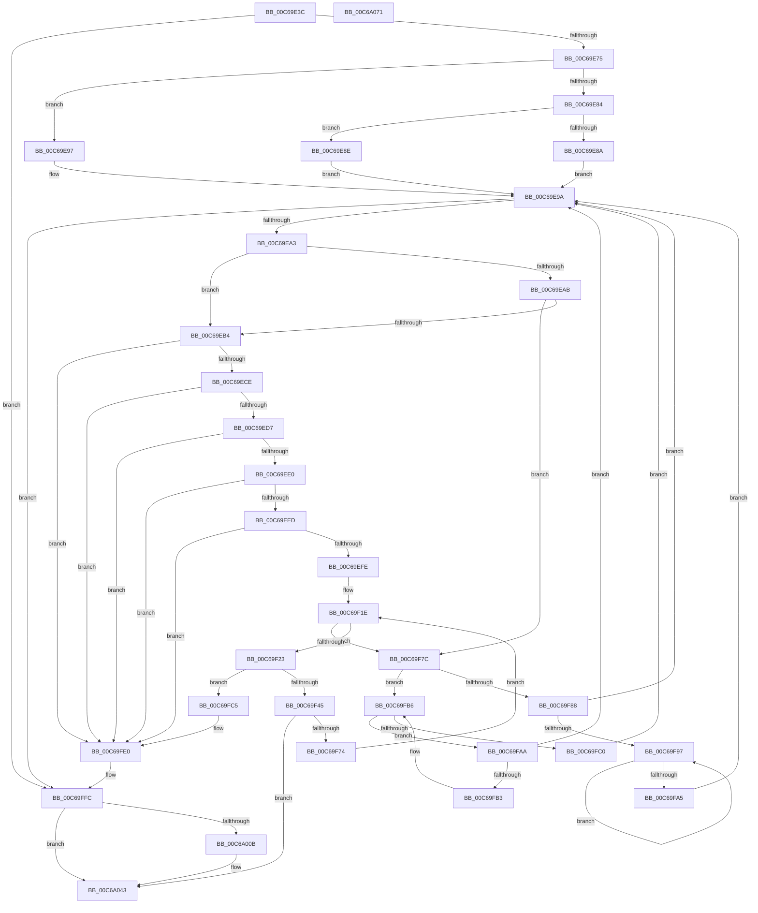

# MiCreateSlabAllocationsFromLoaderBlock

- RVA: `0x00C69E3C`–`0x00C6A072` (길이 `566` bytes)
- VA: `0x0000000140C69E3C`
- 실행 섹션: `INIT`
- PDB 이름 있음: `예`; PDB Function 태그: `아니요`
- unwind 정보 RVA: `0x000D8FD8`
- 디코드: `150`개 명령, `566/566` bytes 표시
- 미해석 바이트: `0` (있으면 어셈블리에 `.byte`로 보존)

> 이 문서는 커널 이미지의 기계어와 PDB 기호를 분석해 생성했습니다. 4번과 5번은 함수 원형과 자료형을 바이너리 사용 방식에서 추정한 C 해석이며 원본 소스 복구 결과는 아닙니다.

## 1. Dependencies

- 직접 호출 지점: **10**; 고유 호출 대상: **6**
- 직접 호출자로 확인된 함수: **1**
- RIP 상대 이미지 참조: **5**

### Outgoing calls
- `0x00C69F01` → [MiPageToNode](../../text/33/MiPageToNode_function_00338CD0.md) (function, `0x00338CD0`)
- `0x00C69F0B` → [MiPageToNode](../../text/33/MiPageToNode_function_00338CD0.md) (function, `0x00338CD0`)
- `0x00C69F26` → [MiPageToNode](../../text/33/MiPageToNode_function_00338CD0.md) (function, `0x00338CD0`)
- `0x00C69F38` → [MiPageToNode](../../text/33/MiPageToNode_function_00338CD0.md) (function, `0x00338CD0`)
- `0x00C69F65` → [MiCreateBootSlabEntries](MiCreateBootSlabEntries_function_00C69A50.md) (function, `0x00C69A50`)
- `0x00C69FDA` → [KeBugCheckEx](../../text/4F/KeBugCheckEx_function_004FD660.md) (function, `0x004FD660`)
- `0x00C69FF6` → [KeBugCheckEx](../../text/4F/KeBugCheckEx_function_004FD660.md) (function, `0x004FD660`)
- `0x00C6A01C` → [memset](../../text/6C/memset_function_006C6C40.md) (function, `0x006C6C40`)
- `0x00C6A03C` → [VslpEnterIumSecureMode](../../text/23/VslpEnterIumSecureMode_function_00235E50.md) (function, `0x00235E50`)
- `0x00C6A050` → [_security_check_cookie](../../text/6A/_security_check_cookie_function_006AC640.md) (function, `0x006AC640`)

### Direct callers
- [MiInitSystem](../C5/MiInitSystem_function_00C5E6C0.md) at `0x00C5E91E`

### Static image references
- `0x00C69E55` → RVA `0x00E0A740` (`.data`; read)
- `0x00C69E67` → RVA `0x00E38D04` (`.data`; read)
- `0x00C69EF1` → RVA `0x00E2DCE0` (`.data`; read)
- `0x00C69F45` → RVA `0x00E38D10` (`.data`; read)
- `0x00C69FFE` → RVA `0x00FC6A88` (`ALMOSTRO`; read)

## 2. Other-region calls and transfers

- 다른 실행 섹션으로 향하는 call: **9**
  - `0x00C69F01` → [MiPageToNode](../../text/33/MiPageToNode_function_00338CD0.md) (`INIT` → `.text`)
  - `0x00C69F0B` → [MiPageToNode](../../text/33/MiPageToNode_function_00338CD0.md) (`INIT` → `.text`)
  - `0x00C69F26` → [MiPageToNode](../../text/33/MiPageToNode_function_00338CD0.md) (`INIT` → `.text`)
  - `0x00C69F38` → [MiPageToNode](../../text/33/MiPageToNode_function_00338CD0.md) (`INIT` → `.text`)
  - `0x00C69FDA` → [KeBugCheckEx](../../text/4F/KeBugCheckEx_function_004FD660.md) (`INIT` → `.text`)
  - `0x00C69FF6` → [KeBugCheckEx](../../text/4F/KeBugCheckEx_function_004FD660.md) (`INIT` → `.text`)
  - `0x00C6A01C` → [memset](../../text/6C/memset_function_006C6C40.md) (`INIT` → `.text`)
  - `0x00C6A03C` → [VslpEnterIumSecureMode](../../text/23/VslpEnterIumSecureMode_function_00235E50.md) (`INIT` → `.text`)
  - `0x00C6A050` → [_security_check_cookie](../../text/6A/_security_check_cookie_function_006AC640.md) (`INIT` → `.text`)
- 별도 외부 분기/꼬리 이동을 확인하지 못했습니다.

## 3. Assembly (complete function range)

```asm
00C69E3C  48 89 5C 24 10                  mov qword ptr [rsp + 0x10], rbx
00C69E41  48 89 6C 24 18                  mov qword ptr [rsp + 0x18], rbp
00C69E46  56                              push rsi
00C69E47  57                              push rdi
00C69E48  41 54                           push r12
00C69E4A  41 56                           push r14
00C69E4C  41 57                           push r15
00C69E4E  48 81 EC B0 00 00 00            sub rsp, 0xb0
00C69E55  48 8B 05 E4 08 1A 00            mov rax, qword ptr [rip + 0x1a08e4]
00C69E5C  48 33 C4                        xor rax, rsp
00C69E5F  48 89 84 24 A0 00 00 00         mov qword ptr [rsp + 0xa0], rax
00C69E67  8B 05 97 EE 1C 00               mov eax, dword ptr [rip + 0x1cee97]
00C69E6D  A8 08                           test al, 8
00C69E6F  0F 84 87 01 00 00               je 0x140c69ffc
00C69E75  48 8D B9 60 01 00 00            lea rdi, [rcx + 0x160]
00C69E7C  48 8B 47 08                     mov rax, qword ptr [rdi + 8]
00C69E80  A8 01                           test al, 1
00C69E82  74 13                           je 0x140c69e97
00C69E84  48 83 F8 01                     cmp rax, 1
00C69E88  75 04                           jne 0x140c69e8e
00C69E8A  33 FF                           xor edi, edi
00C69E8C  EB 0C                           jmp 0x140c69e9a
00C69E8E  48 83 CF 01                     or rdi, 1
00C69E92  48 33 F8                        xor rdi, rax
00C69E95  EB 03                           jmp 0x140c69e9a
00C69E97  48 8B F8                        mov rdi, rax
00C69E9A  48 85 FF                        test rdi, rdi
00C69E9D  0F 84 59 01 00 00               je 0x140c69ffc
00C69EA3  8B 47 18                        mov eax, dword ptr [rdi + 0x18]
00C69EA6  83 F8 1D                        cmp eax, 0x1d
00C69EA9  74 09                           je 0x140c69eb4
00C69EAB  83 F8 24                        cmp eax, 0x24
00C69EAE  0F 85 C8 00 00 00               jne 0x140c69f7c
00C69EB4  4C 8B 77 28                     mov r14, qword ptr [rdi + 0x28]
00C69EB8  48 8B 77 20                     mov rsi, qword ptr [rdi + 0x20]
00C69EBC  49 8B C6                        mov rax, r14
00C69EBF  48 0B C6                        or rax, rsi
00C69EC2  48 A9 FF 01 00 00               test rax, 0x1ff
00C69EC8  0F 85 12 01 00 00               jne 0x140c69fe0
00C69ECE  48 85 F6                        test rsi, rsi
00C69ED1  0F 84 09 01 00 00               je 0x140c69fe0
00C69ED7  4D 85 F6                        test r14, r14
00C69EDA  0F 84 00 01 00 00               je 0x140c69fe0
00C69EE0  49 8D 04 36                     lea rax, [r14 + rsi]
00C69EE4  48 3B C6                        cmp rax, rsi
00C69EE7  0F 82 F3 00 00 00               jb 0x140c69fe0
00C69EED  48 8D 68 FF                     lea rbp, [rax - 1]
00C69EF1  48 3B 2D E8 3D 1C 00            cmp rbp, qword ptr [rip + 0x1c3de8]
00C69EF8  0F 87 E2 00 00 00               ja 0x140c69fe0
00C69EFE  48 8B CE                        mov rcx, rsi
00C69F01  E8 CA ED 6C FF                  call 0x140338cd0
00C69F06  48 8B CD                        mov rcx, rbp
00C69F09  8B D8                           mov ebx, eax
00C69F0B  E8 C0 ED 6C FF                  call 0x140338cd0
00C69F10  3B D8                           cmp ebx, eax
00C69F12  4D 8B FE                        mov r15, r14
00C69F15  B9 00 02 00 00                  mov ecx, 0x200
00C69F1A  4C 0F 45 F9                     cmovne r15, rcx
00C69F1E  4D 85 F6                        test r14, r14
00C69F21  74 59                           je 0x140c69f7c
00C69F23  48 8B CE                        mov rcx, rsi
00C69F26  E8 A5 ED 6C FF                  call 0x140338cd0
00C69F2B  49 8D 2C 37                     lea rbp, [r15 + rsi]
00C69F2F  8B D8                           mov ebx, eax
00C69F31  48 8D 4D FF                     lea rcx, [rbp - 1]
00C69F35  44 8B E0                        mov r12d, eax
00C69F38  E8 93 ED 6C FF                  call 0x140338cd0
00C69F3D  3B D8                           cmp ebx, eax
00C69F3F  0F 85 80 00 00 00               jne 0x140c69fc5
00C69F45  48 8B 05 C4 ED 1C 00            mov rax, qword ptr [rip + 0x1cedc4]
00C69F4C  45 33 C9                        xor r9d, r9d
00C69F4F  48 05 20 3F 00 00               add rax, 0x3f20
00C69F55  4D 8B C7                        mov r8, r15
00C69F58  49 69 CC 80 DF 00 00            imul rcx, r12, 0xdf80
00C69F5F  48 8B D6                        mov rdx, rsi
00C69F62  48 03 C8                        add rcx, rax
00C69F65  E8 E6 FA FF FF                  call 0x140c69a50
00C69F6A  8B C8                           mov ecx, eax
00C69F6C  85 C0                           test eax, eax
00C69F6E  0F 88 CF 00 00 00               js 0x140c6a043
00C69F74  4D 2B F7                        sub r14, r15
00C69F77  48 8B F5                        mov rsi, rbp
00C69F7A  EB A2                           jmp 0x140c69f1e
00C69F7C  48 8B 47 08                     mov rax, qword ptr [rdi + 8]
00C69F80  48 8B CF                        mov rcx, rdi
00C69F83  48 85 C0                        test rax, rax
00C69F86  74 2E                           je 0x140c69fb6
00C69F88  48 8B 08                        mov rcx, qword ptr [rax]
00C69F8B  48 8B F8                        mov rdi, rax
00C69F8E  48 85 C9                        test rcx, rcx
00C69F91  0F 84 03 FF FF FF               je 0x140c69e9a
00C69F97  48 8B 01                        mov rax, qword ptr [rcx]
00C69F9A  48 8B F9                        mov rdi, rcx
00C69F9D  48 8B C8                        mov rcx, rax
00C69FA0  48 85 C0                        test rax, rax
00C69FA3  75 F2                           jne 0x140c69f97
00C69FA5  E9 F0 FE FF FF                  jmp 0x140c69e9a
00C69FAA  48 39 0F                        cmp qword ptr [rdi], rcx
00C69FAD  0F 84 E7 FE FF FF               je 0x140c69e9a
00C69FB3  48 8B CF                        mov rcx, rdi
00C69FB6  48 8B 7F 10                     mov rdi, qword ptr [rdi + 0x10]
00C69FBA  48 83 E7 FC                     and rdi, 0xfffffffffffffffc
00C69FBE  75 EA                           jne 0x140c69faa
00C69FC0  E9 D5 FE FF FF                  jmp 0x140c69e9a
00C69FC5  4D 8B CF                        mov r9, r15
00C69FC8  4C 89 64 24 20                  mov qword ptr [rsp + 0x20], r12
00C69FCD  4C 8B C6                        mov r8, rsi
00C69FD0  BA 16 03 03 03                  mov edx, 0x3030316
00C69FD5  B9 1A 00 00 00                  mov ecx, 0x1a
00C69FDA  E8 81 36 89 FF                  call 0x1404fd660
00C69FDF  CC                              int3
00C69FE0  48 83 64 24 20 00               and qword ptr [rsp + 0x20], 0
00C69FE6  4D 8B CE                        mov r9, r14
00C69FE9  4C 8B C6                        mov r8, rsi
00C69FEC  BA 11 03 03 03                  mov edx, 0x3030311
00C69FF1  B9 1A 00 00 00                  mov ecx, 0x1a
00C69FF6  E8 65 36 89 FF                  call 0x1404fd660
00C69FFB  CC                              int3
00C69FFC  33 C9                           xor ecx, ecx
00C69FFE  48 F7 05 7F CA 35 00 00 40 00 00  test qword ptr [rip + 0x35ca7f], 0x4000
00C6A009  74 38                           je 0x140c6a043
00C6A00B  8B 1D F3 EC 1C 00               mov ebx, dword ptr [rip + 0x1cecf3]
00C6A011  44 8D 41 68                     lea r8d, [rcx + 0x68]
00C6A015  48 8D 4C 24 30                  lea rcx, [rsp + 0x30]
00C6A01A  33 D2                           xor edx, edx
00C6A01C  E8 1F CC A5 FF                  call 0x1406c6c40
00C6A021  48 C1 EB 03                     shr rbx, 3
00C6A025  4C 8D 4C 24 30                  lea r9, [rsp + 0x30]
00C6A02A  83 E3 01                        and ebx, 1
00C6A02D  BA DD 00 00 00                  mov edx, 0xdd
00C6A032  45 33 C0                        xor r8d, r8d
00C6A035  48 89 5C 24 38                  mov qword ptr [rsp + 0x38], rbx
00C6A03A  B1 02                           mov cl, 2
00C6A03C  E8 0F BE 5C FF                  call 0x140235e50
00C6A041  8B C8                           mov ecx, eax
00C6A043  8B C1                           mov eax, ecx
00C6A045  48 8B 8C 24 A0 00 00 00         mov rcx, qword ptr [rsp + 0xa0]
00C6A04D  48 33 CC                        xor rcx, rsp
00C6A050  E8 EB 25 A4 FF                  call 0x1406ac640
00C6A055  4C 8D 9C 24 B0 00 00 00         lea r11, [rsp + 0xb0]
00C6A05D  49 8B 5B 38                     mov rbx, qword ptr [r11 + 0x38]
00C6A061  49 8B 6B 40                     mov rbp, qword ptr [r11 + 0x40]
00C6A065  49 8B E3                        mov rsp, r11
00C6A068  41 5F                           pop r15
00C6A06A  41 5E                           pop r14
00C6A06C  41 5C                           pop r12
00C6A06E  5F                              pop rdi
00C6A06F  5E                              pop rsi
00C6A070  C3                              ret
00C6A071  CC                              int3
```

## 4. C-style interpretation (structured pseudocode)

```c
__int64 __fastcall MiCreateSlabAllocationsFromLoaderBlock(__int64 a1, __int64 a2, __int64 a3, int a4)
{
    __int64 result;
    __int64 v_r14;
    __int64 v_r15;
    __int64 v_rbx;
    __int64 v_rdi;
    __int64 v_rsp;
    unsigned __int64 v_stack_m28;
    unsigned __int64 v_stack_m38;
    unsigned __int64 v_stack_mA0;
    unsigned __int64 v_stack_mA8;
    unsigned __int64 v_stack_mB8;
    unsigned __int64 v_stack_p10;
    unsigned __int64 v_stack_p18;

    v_stack_p10 = v_rbx;
    v_stack_p18 = v_rbp;
    v_rsp = (v_rsp) - (176);
    result = (*(unsigned __int64 *)(v_rip + 1706212)) ^ (v_rsp);
    v_stack_m38 = result;
    if ((((unsigned __int8)((unsigned int)(*(unsigned int *)(v_rip + 1896087)))) & (8)) == 0) goto loc_00C69FFC;
    if ((((unsigned __int8)(*(unsigned __int64 *)(a1 + 352 + 8))) & (1)) == 0) goto loc_00C69E97;
    if ((*(unsigned __int64 *)(a1 + 352 + 8)) != 1) goto loc_00C69E8E;
    v_rdi = 0;
    goto loc_00C69E9A;
loc_00C69E8E:
    v_rdi = (v_rdi) | (1);
    v_rdi = (v_rdi) ^ (*(unsigned __int64 *)(a1 + 352 + 8));
    goto loc_00C69E9A;
loc_00C69E97:
loc_00C69E9A:
    if (*(unsigned __int64 *)(a1 + 352 + 8) == 0) goto loc_00C69FFC;
    if (((unsigned int)((unsigned int)(*(unsigned int *)(*(unsigned __int64 *)(a1 + 352 + 8) + 24)))) == 29) goto loc_00C69EB4;
    if (((unsigned int)((unsigned int)(*(unsigned int *)(*(unsigned __int64 *)(a1 + 352 + 8) + 24)))) != 36) goto loc_00C69F7C;
loc_00C69EB4:
    result = (*(unsigned __int64 *)(*(unsigned __int64 *)(a1 + 352 + 8) + 40)) | (*(unsigned __int64 *)(*(unsigned __int64 *)(a1 + 352 + 8) + 32));
    if (((result) & (511)) != 0) goto loc_00C69FE0;
    if (*(unsigned __int64 *)(*(unsigned __int64 *)(a1 + 352 + 8) + 32) == 0) goto loc_00C69FE0;
    if (*(unsigned __int64 *)(*(unsigned __int64 *)(a1 + 352 + 8) + 40) == 0) goto loc_00C69FE0;
    if ((*(unsigned __int64 *)(*(unsigned __int64 *)(a1 + 352 + 8) + 40) + *(unsigned __int64 *)(*(unsigned __int64 *)(a1 + 352 + 8) + 32) * 1) < (*(unsigned __int64 *)(*(unsigned __int64 *)(a1 + 352 + 8) + 32))) goto loc_00C69FE0;
    if ((*(unsigned __int64 *)(*(unsigned __int64 *)(a1 + 352 + 8) + 40) + *(unsigned __int64 *)(*(unsigned __int64 *)(a1 + 352 + 8) + 32) * 1 - 1) > (*(unsigned __int64 *)(v_rip + 1850856))) goto loc_00C69FE0;
    result = MiPageToNode(*(unsigned __int64 *)(*(unsigned __int64 *)(a1 + 352 + 8) + 32), a2, a3, a4);
    result = MiPageToNode(*(unsigned __int64 *)(*(unsigned __int64 *)(a1 + 352 + 8) + 40) + *(unsigned __int64 *)(*(unsigned __int64 *)(a1 + 352 + 8) + 32) * 1 - 1, a2, a3, a4);
    v_r15 = *(unsigned __int64 *)(*(unsigned __int64 *)(a1 + 352 + 8) + 40);
    if (((unsigned int)((unsigned int)((unsigned int)(result)))) != ((unsigned int)(result))) { v_r15 = 512; }
loc_00C69F1E:
    if (*(unsigned __int64 *)(*(unsigned __int64 *)(a1 + 352 + 8) + 40) == 0) goto loc_00C69F7C;
    result = MiPageToNode(*(unsigned __int64 *)(*(unsigned __int64 *)(a1 + 352 + 8) + 32), a2, a3, a4);
    result = MiPageToNode(v_r15 + *(unsigned __int64 *)(*(unsigned __int64 *)(a1 + 352 + 8) + 32) * 1 - 1, a2, a3, a4);
    if (((unsigned int)((unsigned int)((unsigned int)(result)))) != ((unsigned int)(result))) goto loc_00C69FC5;
    a4 = 0;
    result = (*(unsigned __int64 *)(v_rip + 1895876)) + (0x3F20ULL);
    a1 = (v_r15 + *(unsigned __int64 *)(*(unsigned __int64 *)(a1 + 352 + 8) + 32) * 1 - 1) * ((unsigned int)((unsigned int)(result)));
    a1 = (a1) + (result);
    result = MiCreateBootSlabEntries(a1, *(unsigned __int64 *)(*(unsigned __int64 *)(a1 + 352 + 8) + 32), v_r15, a4);
    if (sign_flag) goto loc_00C6A043;
    v_r14 = (*(unsigned __int64 *)(*(unsigned __int64 *)(a1 + 352 + 8) + 40)) - (v_r15);
    goto loc_00C69F1E;
loc_00C69F7C:
    if (*(unsigned __int64 *)(*(unsigned __int64 *)(a1 + 352 + 8) + 8) == 0) goto loc_00C69FB6;
    if (*(unsigned __int64 *)(*(unsigned __int64 *)(*(unsigned __int64 *)(a1 + 352 + 8) + 8)) == 0) goto loc_00C69E9A;
loc_00C69F97:
    if (*(unsigned __int64 *)(*(unsigned __int64 *)(*(unsigned __int64 *)(*(unsigned __int64 *)(a1 + 352 + 8) + 8))) != 0) goto loc_00C69F97;
    goto loc_00C69E9A;
loc_00C69FAA:
    if ((*(unsigned __int64 *)(*(unsigned __int64 *)(*(unsigned __int64 *)(*(unsigned __int64 *)(a1 + 352 + 8) + 8)))) == (*(unsigned __int64 *)(*(unsigned __int64 *)(*(unsigned __int64 *)(*(unsigned __int64 *)(a1 + 352 + 8) + 8))))) goto loc_00C69E9A;
loc_00C69FB6:
    v_rdi = (*(unsigned __int64 *)(*(unsigned __int64 *)(*(unsigned __int64 *)(*(unsigned __int64 *)(a1 + 352 + 8) + 8)) + 16)) & (-4);
    if (condition_is_not_equal) goto loc_00C69FAA;
    goto loc_00C69E9A;
loc_00C69FC5:
    v_stack_mB8 = (unsigned int)((unsigned int)(result));
    result = KeBugCheckEx(26, (unsigned int)(0x3030316ULL), v_r15 + *(unsigned __int64 *)(*(unsigned __int64 *)(a1 + 352 + 8) + 32) * 1, v_r15);
loc_00C69FE0:
    result = KeBugCheckEx(26, (unsigned int)(0x3030311ULL), v_r15 + *(unsigned __int64 *)(*(unsigned __int64 *)(a1 + 352 + 8) + 32) * 1, v_r14);
loc_00C69FFC:
    a1 = 0;
    v_rbx = (unsigned int)((unsigned int)(result));
    if (((*(unsigned __int64 *)(v_rip + 3525247)) & (0x4000ULL)) != 0) {
        v_rbx = *(unsigned int *)(v_rip + 1895667);
        a3 = a1 + 104;
        a1 = v_stack_mA8;
        a2 = 0;
        result = memset(a1, a2, a3, v_r14);
        v_rbx = (v_rbx) >> (3);
        a4 = v_stack_mA8;
        v_rbx = (unsigned int)((v_rbx) & (1));
        a2 = 221;
        a3 = 0;
        v_stack_mA0 = v_rbx;
        a1 = 2;
        result = VslpEnterIumSecureMode(a1, a2, a3, a4);
        a1 = (unsigned int)(result);
    }
    a1 = (v_stack_m38) ^ (v_rsp);
    result = _security_check_cookie(a1, a2, a3, a4);
    return result;
}
```

## 5. (Beta) C Style

```c
int64_t MiCreateSlabAllocationsFromLoaderBlock(void *Arg1, int64_t Arg2, int64_t Arg3, int32_t Arg4)
{
    uint8_t *arg1 = (uint8_t *)Arg1;

    int64_t result;
    int64_t local_r14;
    int64_t local_r15;
    int64_t local_rbx;
    int64_t local_rdi;
    int64_t local_rsp;
    uint64_t v_stack_m28;
    uint64_t v_stack_m38;
    uint64_t v_stack_mA0;
    uint64_t v_stack_mA8;
    uint64_t v_stack_mB8;
    uint64_t v_stack_p10;
    uint64_t v_stack_p18;

    v_stack_p10 = local_rbx;
    v_stack_p18 = local_rbp;
    local_rsp = (local_rsp) - (176);
    result = (*(uint64_t *)(v_rip + 0x1A08E4)) ^ (local_rsp);
    v_stack_m38 = result;
    if ((((uint8_t)((uint32_t)(*(uint32_t *)(v_rip + 0x1CEE97)))) & (8)) == 0) goto loc_00C69FFC;
    if ((((uint8_t)(*(uint64_t *)(arg1 + 0x160 + 0x8))) & (1)) == 0) goto loc_00C69E97;
    if ((*(uint64_t *)(arg1 + 0x160 + 0x8)) != 1) goto loc_00C69E8E;
    local_rdi = 0;
    goto loc_00C69E9A;
loc_00C69E8E:
    local_rdi = (local_rdi) | (1);
    local_rdi = (local_rdi) ^ (*(uint64_t *)(arg1 + 0x160 + 0x8));
    goto loc_00C69E9A;
loc_00C69E97:
loc_00C69E9A:
    if (*(uint64_t *)(arg1 + 0x160 + 0x8) == 0) goto loc_00C69FFC;
    if (((uint32_t)((uint32_t)(*(uint32_t *)(*(uint64_t *)(arg1 + 0x160 + 0x8) + 0x18)))) == 29) goto loc_00C69EB4;
    if (((uint32_t)((uint32_t)(*(uint32_t *)(*(uint64_t *)(arg1 + 0x160 + 0x8) + 0x18)))) != 36) goto loc_00C69F7C;
loc_00C69EB4:
    result = (*(uint64_t *)(*(uint64_t *)(arg1 + 0x160 + 0x8) + 0x28)) | (*(uint64_t *)(*(uint64_t *)(arg1 + 0x160 + 0x8) + 0x20));
    if (((result) & (511)) != 0) goto loc_00C69FE0;
    if (*(uint64_t *)(*(uint64_t *)(arg1 + 0x160 + 0x8) + 0x20) == 0) goto loc_00C69FE0;
    if (*(uint64_t *)(*(uint64_t *)(arg1 + 0x160 + 0x8) + 0x28) == 0) goto loc_00C69FE0;
    if ((*(uint64_t *)(*(uint64_t *)(arg1 + 0x160 + 0x8) + 0x28) + *(uint64_t *)(*(uint64_t *)(arg1 + 0x160 + 0x8) + 0x20) * 1) < (*(uint64_t *)(*(uint64_t *)(arg1 + 0x160 + 0x8) + 0x20))) goto loc_00C69FE0;
    if ((*(uint64_t *)(*(uint64_t *)(arg1 + 0x160 + 0x8) + 0x28) + *(uint64_t *)(*(uint64_t *)(arg1 + 0x160 + 0x8) + 0x20) * 1 - 1) > (*(uint64_t *)(v_rip + 0x1C3DE8))) goto loc_00C69FE0;
    result = MiPageToNode(*(uint64_t *)(*(uint64_t *)(arg1 + 0x160 + 0x8) + 0x20), Arg2, Arg3, Arg4);
    result = MiPageToNode(*(uint64_t *)(*(uint64_t *)(arg1 + 0x160 + 0x8) + 0x28) + *(uint64_t *)(*(uint64_t *)(arg1 + 0x160 + 0x8) + 0x20) * 1 - 1, Arg2, Arg3, Arg4);
    local_r15 = *(uint64_t *)(*(uint64_t *)(arg1 + 0x160 + 0x8) + 0x28);
    if (((uint32_t)((uint32_t)((uint32_t)(result)))) != ((uint32_t)(result))) { local_r15 = 512; }
loc_00C69F1E:
    if (*(uint64_t *)(*(uint64_t *)(arg1 + 0x160 + 0x8) + 0x28) == 0) goto loc_00C69F7C;
    result = MiPageToNode(*(uint64_t *)(*(uint64_t *)(arg1 + 0x160 + 0x8) + 0x20), Arg2, Arg3, Arg4);
    result = MiPageToNode(local_r15 + *(uint64_t *)(*(uint64_t *)(arg1 + 0x160 + 0x8) + 0x20) * 1 - 1, Arg2, Arg3, Arg4);
    if (((uint32_t)((uint32_t)((uint32_t)(result)))) != ((uint32_t)(result))) goto loc_00C69FC5;
    Arg4 = 0;
    result = (*(uint64_t *)(v_rip + 0x1CEDC4)) + (0x3F20ULL);
    Arg1 = (local_r15 + *(uint64_t *)(*(uint64_t *)(arg1 + 0x160 + 0x8) + 0x20) * 1 - 1) * ((uint32_t)((uint32_t)(result)));
    Arg1 = (Arg1) + (result);
    result = MiCreateBootSlabEntries(Arg1, *(uint64_t *)(*(uint64_t *)(arg1 + 0x160 + 0x8) + 0x20), local_r15, Arg4);
    if (sign_flag) goto loc_00C6A043;
    local_r14 = (*(uint64_t *)(*(uint64_t *)(arg1 + 0x160 + 0x8) + 0x28)) - (local_r15);
    goto loc_00C69F1E;
loc_00C69F7C:
    if (*(uint64_t *)(*(uint64_t *)(arg1 + 0x160 + 0x8) + 0x8) == 0) goto loc_00C69FB6;
    if (*(uint64_t *)(*(uint64_t *)(*(uint64_t *)(arg1 + 0x160 + 0x8) + 0x8)) == 0) goto loc_00C69E9A;
loc_00C69F97:
    if (*(uint64_t *)(*(uint64_t *)(*(uint64_t *)(*(uint64_t *)(arg1 + 0x160 + 0x8) + 0x8))) != 0) goto loc_00C69F97;
    goto loc_00C69E9A;
loc_00C69FAA:
    if ((*(uint64_t *)(*(uint64_t *)(*(uint64_t *)(*(uint64_t *)(arg1 + 0x160 + 0x8) + 0x8)))) == (*(uint64_t *)(*(uint64_t *)(*(uint64_t *)(*(uint64_t *)(arg1 + 0x160 + 0x8) + 0x8))))) goto loc_00C69E9A;
loc_00C69FB6:
    local_rdi = (*(uint64_t *)(*(uint64_t *)(*(uint64_t *)(*(uint64_t *)(arg1 + 0x160 + 0x8) + 0x8)) + 0x10)) & (-4);
    if (condition_is_not_equal) goto loc_00C69FAA;
    goto loc_00C69E9A;
loc_00C69FC5:
    v_stack_mB8 = (uint32_t)((uint32_t)(result));
    result = KeBugCheckEx(26, (uint32_t)(0x3030316ULL), local_r15 + *(uint64_t *)(*(uint64_t *)(arg1 + 0x160 + 0x8) + 0x20) * 1, local_r15);
loc_00C69FE0:
    result = KeBugCheckEx(26, (uint32_t)(0x3030311ULL), local_r15 + *(uint64_t *)(*(uint64_t *)(arg1 + 0x160 + 0x8) + 0x20) * 1, local_r14);
loc_00C69FFC:
    Arg1 = 0;
    local_rbx = (uint32_t)((uint32_t)(result));
    if (((*(uint64_t *)(v_rip + 0x35CA7F)) & (0x4000ULL)) != 0) {
        local_rbx = *(uint32_t *)(v_rip + 0x1CECF3);
        Arg3 = Arg1 + 104;
        Arg1 = v_stack_mA8;
        Arg2 = 0;
        result = memset(Arg1, Arg2, Arg3, local_r14);
        local_rbx = (local_rbx) >> (3);
        Arg4 = v_stack_mA8;
        local_rbx = (uint32_t)((local_rbx) & (1));
        Arg2 = 221;
        Arg3 = 0;
        v_stack_mA0 = local_rbx;
        Arg1 = 2;
        result = VslpEnterIumSecureMode(Arg1, Arg2, Arg3, Arg4);
        Arg1 = (uint32_t)(result);
    }
    Arg1 = (v_stack_m38) ^ (local_rsp);
    result = _security_check_cookie(Arg1, Arg2, Arg3, Arg4);
    return result;
}
```

### 관측된 메모리 오프셋

구조체 형식이 확인되지 않은 접근은 인자 기준의 오프셋으로만 기록했습니다.

| 기준 인자 | 오프셋 표현 | 폭 (bit) | 접근 |
|---|---:|---:|---|
| `Arg1` | `+ 0x8` | `64` | `R` |
| `Arg1` | `+ 0x160` | `64` | `R` |

## 6. Execution-region graph

[열기: 2D/3D 그래프와 함수 탐색 컨트롤 패널](../../../control-panel.html?section=init&rva=0x00C69E3C&view=graph)

- 2D 그래프는 위에서 아래로 흐르고, 3D 그래프는 빈 공간을 드래그해 회전합니다. Shift+드래그는 이동, 휠은 확대·축소, 함수 노드 선택은 대상 보고서 이동입니다.

### Static fallback


