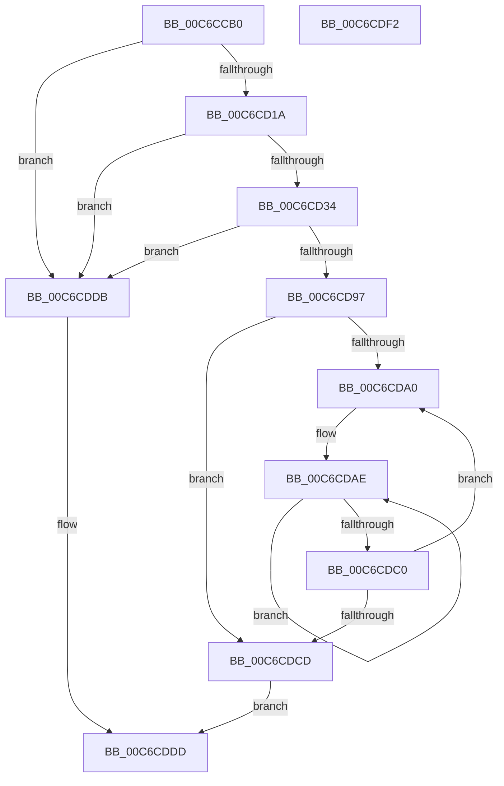

# MiCreateTopLevelUltraMappings

- RVA: `0x00C6CCB0`–`0x00C6CDF3` (길이 `323` bytes)
- VA: `0x0000000140C6CCB0`
- 실행 섹션: `INIT`
- PDB 이름 있음: `예`; PDB Function 태그: `아니요`
- unwind 정보 RVA: `0x0005C954`
- 디코드: `78`개 명령, `323/323` bytes 표시
- 미해석 바이트: `0` (있으면 어셈블리에 `.byte`로 보존)

> 이 문서는 커널 이미지의 기계어와 PDB 기호를 분석해 생성했습니다. 4번과 5번은 함수 원형과 자료형을 바이너리 사용 방식에서 추정한 C 해석이며 원본 소스 복구 결과는 아닙니다.

## 1. Dependencies

- 직접 호출 지점: **4**; 고유 호출 대상: **4**
- 직접 호출자로 확인된 함수: **1**
- RIP 상대 이미지 참조: **7**

### Outgoing calls
- `0x00C6CD0B` → [MiMakeZeroedPageTables](../../text/3B/MiMakeZeroedPageTables_function_003B4F6C.md) (function, `0x003B4F6C`)
- `0x00C6CD27` → [MiInitializeUltraSpace](MiInitializeUltraSpace_function_00C6CDFC.md) (function, `0x00C6CDFC`)
- `0x00C6CD8A` → [MiAllocatePool](../../text/35/MiAllocatePool_function_0035B540.md) (function, `0x0035B540`)
- `0x00C6CDB1` → [InitializeSListHead](../../text/46/InitializeSListHead_function_00468A90.md) (function, `0x00468A90`)

### Direct callers
- [MiInitNucleus](../C5/MiInitNucleus_function_00C5FD38.md) at `0x00C60380`

### Static image references
- `0x00C6CCC4` → RVA `0x00E38C08` (`.data`; read)
- `0x00C6CCD5` → RVA `0x00E38C10` (`.data`; read)
- `0x00C6CD1D` → RVA `0x00E35FE0` (`.data`; read)
- `0x00C6CD54` → RVA `0x00E36030` (`.data`; write)
- `0x00C6CD6C` → RVA `0x00FC5000` (`ALMOSTRO`; read)
- `0x00C6CD76` → RVA `0x00E36038` (`.data`; write)
- `0x00C6CDCD` → RVA `0x00E36028` (`.data`; write)

## 2. Other-region calls and transfers

- 다른 실행 섹션으로 향하는 call: **3**
  - `0x00C6CD0B` → [MiMakeZeroedPageTables](../../text/3B/MiMakeZeroedPageTables_function_003B4F6C.md) (`INIT` → `.text`)
  - `0x00C6CD8A` → [MiAllocatePool](../../text/35/MiAllocatePool_function_0035B540.md) (`INIT` → `.text`)
  - `0x00C6CDB1` → [InitializeSListHead](../../text/46/InitializeSListHead_function_00468A90.md) (`INIT` → `.text`)
- 별도 외부 분기/꼬리 이동을 확인하지 못했습니다.

## 3. Assembly (complete function range)

```asm
00C6CCB0  48 89 5C 24 08                  mov qword ptr [rsp + 8], rbx
00C6CCB5  48 89 6C 24 10                  mov qword ptr [rsp + 0x10], rbp
00C6CCBA  48 89 74 24 18                  mov qword ptr [rsp + 0x18], rsi
00C6CCBF  57                              push rdi
00C6CCC0  48 83 EC 20                     sub rsp, 0x20
00C6CCC4  48 8B 1D 3D BF 1C 00            mov rbx, qword ptr [rip + 0x1cbf3d]
00C6CCCB  48 B8 F8 FF FF FF 7F 00 00 00   movabs rax, 0x7ffffffff8
00C6CCD5  48 8B 35 34 BF 1C 00            mov rsi, qword ptr [rip + 0x1cbf34]
00C6CCDC  48 8B CB                        mov rcx, rbx
00C6CCDF  48 C1 E9 09                     shr rcx, 9
00C6CCE3  48 23 C8                        and rcx, rax
00C6CCE6  48 B8 00 00 00 00 80 F6 FF FF   movabs rax, 0xfffff68000000000
00C6CCF0  48 03 C8                        add rcx, rax
00C6CCF3  41 B9 08 00 00 00               mov r9d, 8
00C6CCF9  48 8B C6                        mov rax, rsi
00C6CCFC  48 C1 E8 0C                     shr rax, 0xc
00C6CD00  48 FF C8                        dec rax
00C6CD03  45 8D 41 FE                     lea r8d, [r9 - 2]
00C6CD07  48 8D 14 C1                     lea rdx, [rcx + rax*8]
00C6CD0B  E8 5C 82 74 FF                  call 0x1403b4f6c
00C6CD10  33 FF                           xor edi, edi
00C6CD12  85 C0                           test eax, eax
00C6CD14  0F 84 C1 00 00 00               je 0x140c6cddb
00C6CD1A  4C 8B C6                        mov r8, rsi
00C6CD1D  48 8D 0D BC 92 1C 00            lea rcx, [rip + 0x1c92bc]
00C6CD24  48 8B D3                        mov rdx, rbx
00C6CD27  E8 D0 00 00 00                  call 0x140c6cdfc
00C6CD2C  85 C0                           test eax, eax
00C6CD2E  0F 84 A7 00 00 00               je 0x140c6cddb
00C6CD34  48 8B CB                        mov rcx, rbx
00C6CD37  48 BA 00 00 A0 7D FB F6 FF FF   movabs rdx, 0xfffff6fb7da00000
00C6CD41  48 C1 E9 1B                     shr rcx, 0x1b
00C6CD45  41 B8 F8 FF 1F 00               mov r8d, 0x1ffff8
00C6CD4B  49 23 C8                        and rcx, r8
00C6CD4E  48 8B C2                        mov rax, rdx
00C6CD51  48 03 C8                        add rcx, rax
00C6CD54  48 89 0D D5 92 1C 00            mov qword ptr [rip + 0x1c92d5], rcx
00C6CD5B  48 8D 4E FF                     lea rcx, [rsi - 1]
00C6CD5F  48 03 CB                        add rcx, rbx
00C6CD62  48 C1 E9 1B                     shr rcx, 0x1b
00C6CD66  49 23 C8                        and rcx, r8
00C6CD69  48 8B C2                        mov rax, rdx
00C6CD6C  0F B7 15 8D 82 35 00            movzx edx, word ptr [rip + 0x35828d]
00C6CD73  48 03 C8                        add rcx, rax
00C6CD76  48 89 0D BB 92 1C 00            mov qword ptr [rip + 0x1c92bb], rcx
00C6CD7D  41 B8 4D 6D 20 20               mov r8d, 0x20206d4d
00C6CD83  8D 4F 48                        lea ecx, [rdi + 0x48]
00C6CD86  48 C1 E2 09                     shl rdx, 9
00C6CD8A  E8 B1 E7 6E FF                  call 0x14035b540
00C6CD8F  48 8B E8                        mov rbp, rax
00C6CD92  48 85 C0                        test rax, rax
00C6CD95  74 44                           je 0x140c6cddb
00C6CD97  66 3B 3D 62 82 35 00            cmp di, word ptr [rip + 0x358262]
00C6CD9E  73 2D                           jae 0x140c6cdcd
00C6CDA0  8B DF                           mov ebx, edi
00C6CDA2  BE 08 00 00 00                  mov esi, 8
00C6CDA7  48 C1 E3 09                     shl rbx, 9
00C6CDAB  48 03 DD                        add rbx, rbp
00C6CDAE  48 8B CB                        mov rcx, rbx
00C6CDB1  E8 DA BC 7F FF                  call 0x140468a90
00C6CDB6  48 83 C3 40                     add rbx, 0x40
00C6CDBA  48 83 EE 01                     sub rsi, 1
00C6CDBE  75 EE                           jne 0x140c6cdae
00C6CDC0  0F B7 0D 39 82 35 00            movzx ecx, word ptr [rip + 0x358239]
00C6CDC7  FF C7                           inc edi
00C6CDC9  3B F9                           cmp edi, ecx
00C6CDCB  72 D3                           jb 0x140c6cda0
00C6CDCD  48 89 2D 54 92 1C 00            mov qword ptr [rip + 0x1c9254], rbp
00C6CDD4  B8 01 00 00 00                  mov eax, 1
00C6CDD9  EB 02                           jmp 0x140c6cddd
00C6CDDB  33 C0                           xor eax, eax
00C6CDDD  48 8B 5C 24 30                  mov rbx, qword ptr [rsp + 0x30]
00C6CDE2  48 8B 6C 24 38                  mov rbp, qword ptr [rsp + 0x38]
00C6CDE7  48 8B 74 24 40                  mov rsi, qword ptr [rsp + 0x40]
00C6CDEC  48 83 C4 20                     add rsp, 0x20
00C6CDF0  5F                              pop rdi
00C6CDF1  C3                              ret
00C6CDF2  CC                              int3
```

## 4. C-style interpretation (structured pseudocode)

```c
__int64 __fastcall MiCreateTopLevelUltraMappings(void)
{
    __int64 result;
    __int64 v_rbx;
    __int64 v_rdi;
    __int64 v_rsi;
    __int64 v_rsp;
    unsigned __int64 v_stack_p10;
    unsigned __int64 v_stack_p18;
    unsigned __int64 v_stack_p8;

    v_stack_p8 = v_rbx;
    v_stack_p10 = v_rbp;
    v_stack_p18 = v_rsi;
    v_rsp = (v_rsp) - (32);
    a1 = (*(unsigned __int64 *)(v_rip + 1883965)) >> (9);
    a1 = (a1) & (result);
    a1 = (a1) + (result);
    result = (*(unsigned __int64 *)(v_rip + 1883956)) >> (12);
    result = (result) - 1;
    result = MiMakeZeroedPageTables(a1, a1 + result * 8, 8 - 2, 8);
    v_rdi = 0;
    if ((unsigned int)(result) == 0) goto loc_00C6CDDB;
    result = MiInitializeUltraSpace(v_rip + 1872572, *(unsigned __int64 *)(v_rip + 1883965), *(unsigned __int64 *)(v_rip + 1883956), 8);
    if ((unsigned int)(result) == 0) goto loc_00C6CDDB;
    a1 = (*(unsigned __int64 *)(v_rip + 1883965)) >> (27);
    a1 = (a1) & ((unsigned int)(0x1FFFF8ULL));
    a1 = (a1) + (*(unsigned __int64 *)(v_rip + 1883965));
    *(unsigned __int64 *)(v_rip + 1872597) = a1;
    a1 = (*(unsigned __int64 *)(v_rip + 1883956) - 1) + (*(unsigned __int64 *)(v_rip + 1883965));
    a1 = (a1) >> (27);
    a1 = (a1) & ((unsigned int)(0x1FFFF8ULL));
    a1 = (a1) + (*(unsigned __int64 *)(v_rip + 1883965));
    *(unsigned __int64 *)(v_rip + 1872571) = a1;
    a2 = (*(unsigned __int16 *)(v_rip + 3506829)) << (9);
    result = MiAllocatePool(v_rdi + 72, a2, (unsigned int)(0x20206D4DULL), 8);
    if (result == 0) goto loc_00C6CDDB;
    if (0 >= (*(unsigned __int16 *)(v_rip + 3506786))) goto loc_00C6CDCD;
loc_00C6CDA0:
    v_rbx = (0) << (9);
    v_rbx = (v_rbx) + (result);
loc_00C6CDAE:
    result = InitializeSListHead(v_rbx, a2, (unsigned int)(0x20206D4DULL), 8);
    v_rbx = (v_rbx) + (64);
    v_rsi = (8) - (1);
    if (condition_is_not_equal) goto loc_00C6CDAE;
    v_rdi = (unsigned int)((v_rdi) + 1);
    if (((unsigned int)(v_rdi)) < ((unsigned int)(*(unsigned __int16 *)(v_rip + 3506745)))) goto loc_00C6CDA0;
loc_00C6CDCD:
    *(unsigned __int64 *)(v_rip + 1872468) = result;
    goto loc_00C6CDDD;
loc_00C6CDDB:
    result = 0;
loc_00C6CDDD:
    v_rsp = (v_rsp) + (32);
    return result;
}
```

## 5. (Beta) C Style

```c
void MiCreateTopLevelUltraMappings(void)
{
    int64_t result;
    int64_t local_rbx;
    int64_t local_rdi;
    int64_t local_rsi;
    int64_t local_rsp;
    uint64_t v_stack_p10;
    uint64_t v_stack_p18;
    uint64_t v_stack_p8;

    v_stack_p8 = local_rbx;
    v_stack_p10 = local_rbp;
    v_stack_p18 = local_rsi;
    local_rsp = (local_rsp) - (32);
    a1 = (*(uint64_t *)(v_rip + 0x1CBF3D)) >> (9);
    a1 = (a1) & (result);
    a1 = (a1) + (result);
    result = (*(uint64_t *)(v_rip + 0x1CBF34)) >> (12);
    result = (result) - 1;
    result = MiMakeZeroedPageTables(a1, a1 + result * 8, 8 - 2, 8);
    local_rdi = 0;
    if ((uint32_t)(result) == 0) goto loc_00C6CDDB;
    result = MiInitializeUltraSpace(v_rip + 1872572, *(uint64_t *)(v_rip + 0x1CBF3D), *(uint64_t *)(v_rip + 0x1CBF34), 8);
    if ((uint32_t)(result) == 0) goto loc_00C6CDDB;
    a1 = (*(uint64_t *)(v_rip + 0x1CBF3D)) >> (27);
    a1 = (a1) & ((uint32_t)(0x1FFFF8ULL));
    a1 = (a1) + (*(uint64_t *)(v_rip + 0x1CBF3D));
    *(uint64_t *)(v_rip + 0x1C92D5) = a1;
    a1 = (*(uint64_t *)(v_rip + 0x1CBF34) - 1) + (*(uint64_t *)(v_rip + 0x1CBF3D));
    a1 = (a1) >> (27);
    a1 = (a1) & ((uint32_t)(0x1FFFF8ULL));
    a1 = (a1) + (*(uint64_t *)(v_rip + 0x1CBF3D));
    *(uint64_t *)(v_rip + 0x1C92BB) = a1;
    a2 = (*(uint16_t *)(v_rip + 0x35828D)) << (9);
    result = MiAllocatePool(local_rdi + 72, a2, (uint32_t)(0x20206D4DULL), 8);
    if (result == 0) goto loc_00C6CDDB;
    if (0 >= (*(uint16_t *)(v_rip + 0x358262))) goto loc_00C6CDCD;
loc_00C6CDA0:
    local_rbx = (0) << (9);
    local_rbx = (local_rbx) + (result);
loc_00C6CDAE:
    result = InitializeSListHead(local_rbx, a2, (uint32_t)(0x20206D4DULL), 8);
    local_rbx = (local_rbx) + (64);
    local_rsi = (8) - (1);
    if (condition_is_not_equal) goto loc_00C6CDAE;
    local_rdi = (uint32_t)((local_rdi) + 1);
    if (((uint32_t)(local_rdi)) < ((uint32_t)(*(uint16_t *)(v_rip + 0x358239)))) goto loc_00C6CDA0;
loc_00C6CDCD:
    *(uint64_t *)(v_rip + 0x1C9254) = result;
    goto loc_00C6CDDD;
loc_00C6CDDB:
    result = 0;
loc_00C6CDDD:
    local_rsp = (local_rsp) + (32);
    return result;
}
```

## 6. Execution-region graph

[열기: 2D/3D 그래프와 함수 탐색 컨트롤 패널](../../../control-panel.html?section=init&rva=0x00C6CCB0&view=graph)

- 2D 그래프는 위에서 아래로 흐르고, 3D 그래프는 빈 공간을 드래그해 회전합니다. Shift+드래그는 이동, 휠은 확대·축소, 함수 노드 선택은 대상 보고서 이동입니다.

### Static fallback


