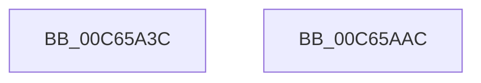

# MiFillGapAddresses

- RVA: `0x00C65A3C`–`0x00C65AAD` (길이 `113` bytes)
- VA: `0x0000000140C65A3C`
- 실행 섹션: `INIT`
- PDB 이름 있음: `예`; PDB Function 태그: `아니요`
- unwind 정보 RVA: `0x000D7B24`
- 디코드: `23`개 명령, `113/113` bytes 표시
- 미해석 바이트: `0` (있으면 어셈블리에 `.byte`로 보존)

> 이 문서는 커널 이미지의 기계어와 PDB 기호를 분석해 생성했습니다. 4번과 5번은 함수 원형과 자료형을 바이너리 사용 방식에서 추정한 C 해석이며 원본 소스 복구 결과는 아닙니다.

## 1. Dependencies

- 직접 호출 지점: **2**; 고유 호출 대상: **2**
- 직접 호출자로 확인된 함수: **2**
- RIP 상대 이미지 참조: **2**

### Outgoing calls
- `0x00C65A5C` → [memset](../../text/6C/memset_function_006C6C40.md) (function, `0x006C6C40`)
- `0x00C65A96` → [MiWalkPageTables](../../text/2C/MiWalkPageTables_function_002C2710.md) (function, `0x002C2710`)

### Direct callers
- [MiInitNucleus](../C5/MiInitNucleus_function_00C5FD38.md) at `0x00C603E5`
- [MiInitializeKasan](MiInitializeKasan_function_00C60810.md) at `0x00C60843`

### Static image references
- `0x00C65A61` → RVA `0x00E37440` (`.data`; read)
- `0x00C65A7D` → RVA `0x00C65AC0` (`MiFillGapPtes`; read)

## 2. Other-region calls and transfers

- 다른 실행 섹션으로 향하는 call: **2**
  - `0x00C65A5C` → [memset](../../text/6C/memset_function_006C6C40.md) (`INIT` → `.text`)
  - `0x00C65A96` → [MiWalkPageTables](../../text/2C/MiWalkPageTables_function_002C2710.md) (`INIT` → `.text`)
- 별도 외부 분기/꼬리 이동을 확인하지 못했습니다.

## 3. Assembly (complete function range)

```asm
00C65A3C  48 89 5C 24 08                  mov qword ptr [rsp + 8], rbx
00C65A41  57                              push rdi
00C65A42  48 81 EC E0 00 00 00            sub rsp, 0xe0
00C65A49  48 8B FA                        mov rdi, rdx
00C65A4C  48 8B D9                        mov rbx, rcx
00C65A4F  33 D2                           xor edx, edx
00C65A51  48 8D 4C 24 20                  lea rcx, [rsp + 0x20]
00C65A56  41 B8 C0 00 00 00               mov r8d, 0xc0
00C65A5C  E8 DF 11 A6 FF                  call 0x1406c6c40
00C65A61  48 8D 05 D8 19 1D 00            lea rax, [rip + 0x1d19d8]
00C65A68  C7 44 24 20 00 26 02 00         mov dword ptr [rsp + 0x20], 0x22600
00C65A70  48 89 84 24 D8 00 00 00         mov qword ptr [rsp + 0xd8], rax
00C65A78  48 8D 4C 24 20                  lea rcx, [rsp + 0x20]
00C65A7D  48 8D 05 3C 00 00 00            lea rax, [rip + 0x3c]
00C65A84  48 89 5C 24 48                  mov qword ptr [rsp + 0x48], rbx
00C65A89  48 89 84 24 C8 00 00 00         mov qword ptr [rsp + 0xc8], rax
00C65A91  48 89 7C 24 50                  mov qword ptr [rsp + 0x50], rdi
00C65A96  E8 75 CC 65 FF                  call 0x1402c2710
00C65A9B  48 8B 9C 24 F0 00 00 00         mov rbx, qword ptr [rsp + 0xf0]
00C65AA3  48 81 C4 E0 00 00 00            add rsp, 0xe0
00C65AAA  5F                              pop rdi
00C65AAB  C3                              ret
00C65AAC  CC                              int3
```

## 4. C-style interpretation (structured pseudocode)

```c
__int64 __fastcall MiFillGapAddresses(__int64 a1, __int64 a2)
{
    __int64 result;
    __int64 v_rsp;
    unsigned __int64 v_stack_m10;
    unsigned __int64 v_stack_m20;
    unsigned __int64 v_stack_m98;
    unsigned __int64 v_stack_mA0;
    unsigned __int64 v_stack_mC8;
    unsigned __int64 v_stack_p8;

    v_stack_p8 = v_rbx;
    v_rsp = (v_rsp) - (224);
    a2 = 0;
    result = memset(v_stack_mC8, a2, 192, a4);
    v_stack_mC8 = 0x22600ULL;
    v_stack_m10 = v_rip + 1907160;
    v_stack_mA0 = a1;
    v_stack_m20 = v_rip + 60;
    v_stack_m98 = 0;
    result = MiWalkPageTables(v_stack_mC8, a2, 192, a4);
    v_rsp = (v_rsp) + (224);
    return result;
}
```

## 5. (Beta) C Style

```c
int64_t MiFillGapAddresses(int64_t Arg1, int64_t Arg2)
{
    int64_t result;
    int64_t local_rsp;
    uint64_t v_stack_m10;
    uint64_t v_stack_m20;
    uint64_t v_stack_m98;
    uint64_t v_stack_mA0;
    uint64_t v_stack_mC8;
    uint64_t v_stack_p8;

    v_stack_p8 = local_rbx;
    local_rsp = (local_rsp) - (224);
    Arg2 = 0;
    result = memset(v_stack_mC8, Arg2, 192, a4);
    v_stack_mC8 = 0x22600ULL;
    v_stack_m10 = v_rip + 1907160;
    v_stack_mA0 = Arg1;
    v_stack_m20 = v_rip + 60;
    v_stack_m98 = 0;
    result = MiWalkPageTables(v_stack_mC8, Arg2, 192, a4);
    local_rsp = (local_rsp) + (224);
    return result;
}
```

## 6. Execution-region graph

[열기: 2D/3D 그래프와 함수 탐색 컨트롤 패널](../../../control-panel.html?section=init&rva=0x00C65A3C&view=graph)

- 2D 그래프는 위에서 아래로 흐르고, 3D 그래프는 빈 공간을 드래그해 회전합니다. Shift+드래그는 이동, 휠은 확대·축소, 함수 노드 선택은 대상 보고서 이동입니다.

### Static fallback


