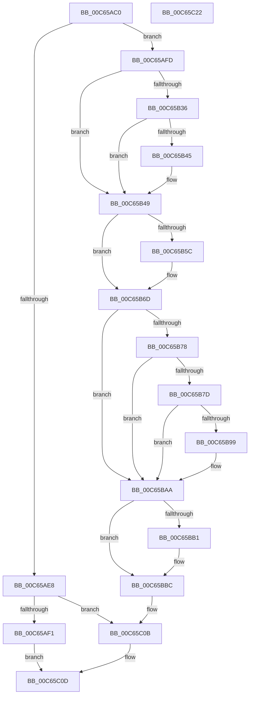

# MiFillGapPtes

- RVA: `0x00C65AC0`–`0x00C65C23` (길이 `355` bytes)
- VA: `0x0000000140C65AC0`
- 실행 섹션: `INIT`
- PDB 이름 있음: `예`; PDB Function 태그: `아니요`
- unwind 정보 RVA: `0x0006C8E8`
- 디코드: `91`개 명령, `355/355` bytes 표시
- 미해석 바이트: `0` (있으면 어셈블리에 `.byte`로 보존)

> 이 문서는 커널 이미지의 기계어와 PDB 기호를 분석해 생성했습니다. 4번과 5번은 함수 원형과 자료형을 바이너리 사용 방식에서 추정한 C 해석이며 원본 소스 복구 결과는 아닙니다.

## 1. Dependencies

- 직접 호출 지점: **7**; 고유 호출 대상: **7**
- 직접 호출자로 확인된 함수: **0**
- RIP 상대 이미지 참조: **2**

### Outgoing calls
- `0x00C65B21` → [MiMakeValidPte](../../text/2C/MiMakeValidPte_function_002C5590.md) (function, `0x002C5590`)
- `0x00C65B53` → [MiPteInShadowRange](../../text/23/MiPteInShadowRange_function_0023FB00.md) (function, `0x0023FB00`)
- `0x00C65B61` → [MiSanitizeShadowPxe](../../text/29/MiSanitizeShadowPxe_function_00294B68.md) (function, `0x00294B68`)
- `0x00C65BA5` → [MiCheckLinearProtectedPteAccessedBit](../../text/29/MiCheckLinearProtectedPteAccessedBit_function_00292D80.md) (function, `0x00292D80`)
- `0x00C65BB7` → [MiWritePteShadow](../../text/29/MiWritePteShadow_function_00294EAC.md) (function, `0x00294EAC`)
- `0x00C65BBF` → [MiGetContainingPageTable](../../text/34/MiGetContainingPageTable_function_003467F0.md) (function, `0x003467F0`)
- `0x00C65BE1` → [MiIncreaseUsedPtesInPfn](../../text/38/MiIncreaseUsedPtesInPfn_function_00382D90.md) (function, `0x00382D90`)

### Direct callers
- 이 함수 시작 RVA로 연결되는 직접 call은 확인되지 않았습니다. 간접 호출은 완전히 역산할 수 없습니다.

### Static image references
- `0x00C65B26` → RVA `0x00FC6A88` (`ALMOSTRO`; read)
- `0x00C65B3D` → RVA `0x00E2DBC9` (`.data`; reference)

## 2. Other-region calls and transfers

- 다른 실행 섹션으로 향하는 call: **7**
  - `0x00C65B21` → [MiMakeValidPte](../../text/2C/MiMakeValidPte_function_002C5590.md) (`INIT` → `.text`)
  - `0x00C65B53` → [MiPteInShadowRange](../../text/23/MiPteInShadowRange_function_0023FB00.md) (`INIT` → `.text`)
  - `0x00C65B61` → [MiSanitizeShadowPxe](../../text/29/MiSanitizeShadowPxe_function_00294B68.md) (`INIT` → `.text`)
  - `0x00C65BA5` → [MiCheckLinearProtectedPteAccessedBit](../../text/29/MiCheckLinearProtectedPteAccessedBit_function_00292D80.md) (`INIT` → `.text`)
  - `0x00C65BB7` → [MiWritePteShadow](../../text/29/MiWritePteShadow_function_00294EAC.md) (`INIT` → `.text`)
  - `0x00C65BBF` → [MiGetContainingPageTable](../../text/34/MiGetContainingPageTable_function_003467F0.md) (`INIT` → `.text`)
  - `0x00C65BE1` → [MiIncreaseUsedPtesInPfn](../../text/38/MiIncreaseUsedPtesInPfn_function_00382D90.md) (`INIT` → `.text`)
- 별도 외부 분기/꼬리 이동을 확인하지 못했습니다.

## 3. Assembly (complete function range)

```asm
00C65AC0  48 89 5C 24 10                  mov qword ptr [rsp + 0x10], rbx
00C65AC5  48 89 6C 24 18                  mov qword ptr [rsp + 0x18], rbp
00C65ACA  48 89 74 24 20                  mov qword ptr [rsp + 0x20], rsi
00C65ACF  57                              push rdi
00C65AD0  48 83 EC 20                     sub rsp, 0x20
00C65AD4  48 8B 02                        mov rax, qword ptr [rdx]
00C65AD7  48 8B FA                        mov rdi, rdx
00C65ADA  4C 8B 89 B8 00 00 00            mov r9, qword ptr [rcx + 0xb8]
00C65AE1  49 63 E8                        movsxd rbp, r8d
00C65AE4  A8 01                           test al, 1
00C65AE6  74 15                           je 0x140c65afd
00C65AE8  45 85 C0                        test r8d, r8d
00C65AEB  0F 84 1A 01 00 00               je 0x140c65c0b
00C65AF1  48 C1 E8 07                     shr rax, 7
00C65AF5  83 E0 01                        and eax, 1
00C65AF8  E9 10 01 00 00                  jmp 0x140c65c0d
00C65AFD  49 8B 14 E9                     mov rdx, qword ptr [r9 + rbp*8]
00C65B01  8B C5                           mov eax, ebp
00C65B03  F7 D8                           neg eax
00C65B05  48 8B CF                        mov rcx, rdi
00C65B08  45 1B C0                        sbb r8d, r8d
00C65B0B  33 F6                           xor esi, esi
00C65B0D  41 81 E0 03 00 00 88            and r8d, 0x88000003
00C65B14  41 81 C0 01 00 00 20            add r8d, 0x20000001
00C65B1B  85 ED                           test ebp, ebp
00C65B1D  48 0F 45 CE                     cmovne rcx, rsi
00C65B21  E8 6A FA 65 FF                  call 0x1402c5590
00C65B26  48 F7 05 57 0F 36 00 00 00 00 02  test qword ptr [rip + 0x360f57], 0x2000000
00C65B31  48 8B D8                        mov rbx, rax
00C65B34  75 13                           jne 0x140c65b49
00C65B36  8B CD                           mov ecx, ebp
00C65B38  8D 56 01                        lea edx, [rsi + 1]
00C65B3B  D3 E2                           shl edx, cl
00C65B3D  84 15 86 80 1C 00               test byte ptr [rip + 0x1c8086], dl
00C65B43  74 04                           je 0x140c65b49
00C65B45  48 83 E3 DF                     and rbx, 0xffffffffffffffdf
00C65B49  48 8B CF                        mov rcx, rdi
00C65B4C  48 89 5C 24 30                  mov qword ptr [rsp + 0x30], rbx
00C65B51  8B EE                           mov ebp, esi
00C65B53  E8 A8 9F 5D FF                  call 0x14023fb00
00C65B58  85 C0                           test eax, eax
00C65B5A  74 11                           je 0x140c65b6d
00C65B5C  48 8D 54 24 30                  lea rdx, [rsp + 0x30]
00C65B61  E8 02 F0 62 FF                  call 0x140294b68
00C65B66  48 8B 5C 24 30                  mov rbx, qword ptr [rsp + 0x30]
00C65B6B  8B E8                           mov ebp, eax
00C65B6D  48 0F BA 25 12 0F 36 00 24      bt qword ptr [rip + 0x360f12], 0x24
00C65B76  73 32                           jae 0x140c65baa
00C65B78  F6 C3 20                        test bl, 0x20
00C65B7B  75 2D                           jne 0x140c65baa
00C65B7D  48 B9 00 00 00 00 80 F6 FF FF   movabs rcx, 0xfffff68000000000
00C65B87  48 B8 00 00 00 00 40 00 00 00   movabs rax, 0x4000000000
00C65B91  48 03 C8                        add rcx, rax
00C65B94  48 3B F9                        cmp rdi, rcx
00C65B97  72 11                           jb 0x140c65baa
00C65B99  41 B8 80 00 00 00               mov r8d, 0x80
00C65B9F  48 8B D3                        mov rdx, rbx
00C65BA2  48 8B CF                        mov rcx, rdi
00C65BA5  E8 D6 D1 62 FF                  call 0x140292d80
00C65BAA  48 89 1F                        mov qword ptr [rdi], rbx
00C65BAD  85 ED                           test ebp, ebp
00C65BAF  74 0B                           je 0x140c65bbc
00C65BB1  48 8B D3                        mov rdx, rbx
00C65BB4  48 8B CF                        mov rcx, rdi
00C65BB7  E8 F0 F2 62 FF                  call 0x140294eac
00C65BBC  48 8B CF                        mov rcx, rdi
00C65BBF  E8 2C 0C 6E FF                  call 0x1403467f0
00C65BC4  4C 8D 1C 40                     lea r11, [rax + rax*2]
00C65BC8  49 C1 E3 04                     shl r11, 4
00C65BCC  48 B8 00 00 00 00 00 DE FF FF   movabs rax, 0xffffde0000000000
00C65BD6  4C 03 D8                        add r11, rax
00C65BD9  BA 01 00 00 00                  mov edx, 1
00C65BDE  49 8B CB                        mov rcx, r11
00C65BE1  E8 AA D1 71 FF                  call 0x140382d90
00C65BE6  49 8B 43 18                     mov rax, qword ptr [r11 + 0x18]
00C65BEA  49 8B 4B 18                     mov rcx, qword ptr [r11 + 0x18]
00C65BEE  48 FF C0                        inc rax
00C65BF1  48 8B D0                        mov rdx, rax
00C65BF4  48 33 D1                        xor rdx, rcx
00C65BF7  48 B9 00 00 00 00 00 00 00 C0   movabs rcx, 0xc000000000000000
00C65C01  48 23 D1                        and rdx, rcx
00C65C04  48 33 D0                        xor rdx, rax
00C65C07  49 89 53 18                     mov qword ptr [r11 + 0x18], rdx
00C65C0B  33 C0                           xor eax, eax
00C65C0D  48 8B 5C 24 38                  mov rbx, qword ptr [rsp + 0x38]
00C65C12  48 8B 6C 24 40                  mov rbp, qword ptr [rsp + 0x40]
00C65C17  48 8B 74 24 48                  mov rsi, qword ptr [rsp + 0x48]
00C65C1C  48 83 C4 20                     add rsp, 0x20
00C65C20  5F                              pop rdi
00C65C21  C3                              ret
00C65C22  CC                              int3
```

## 4. C-style interpretation (structured pseudocode)

```c
__int64 __fastcall MiFillGapPtes(__int64 a1, __int64 a2, int a3)
{
    __int64 result;
    __int64 v_r11;
    __int64 v_rbp;
    __int64 v_rbx;
    __int64 v_rsi;
    __int64 v_rsp;
    unsigned __int64 v_stack_p10;
    unsigned __int64 v_stack_p18;
    unsigned __int64 v_stack_p20;
    unsigned __int64 v_stack_p8;

    v_stack_p10 = v_rbx;
    v_stack_p18 = v_rbp;
    v_stack_p20 = v_rsi;
    v_rsp = (v_rsp) - (32);
    if ((((unsigned __int8)(*(unsigned __int64 *)(a2))) & (1)) == 0) goto loc_00C65AFD;
    if (a3 == 0) goto loc_00C65C0B;
    result = (*(unsigned __int64 *)(a2)) >> (7);
    result = (unsigned int)((result) & (1));
    goto loc_00C65C0D;
loc_00C65AFD:
    result = (unsigned int)(-((unsigned int)((unsigned int)((int)(a3)))));
    v_rsi = 0;
    a3 = (unsigned int)((a3) & (0x88000003ULL));
    a3 = (unsigned int)((a3) + (0x20000001ULL));
    if ((unsigned int)((int)(a3)) != 0) { a2 = 0; }
    result = MiMakeValidPte(a2, *(unsigned __int64 *)(*(unsigned __int64 *)(a1 + 184) + (int)(a3) * 8), a3, *(unsigned __int64 *)(a1 + 184));
    if (((*(unsigned __int64 *)(v_rip + 3542871)) & (0x2000000ULL)) != 0) goto loc_00C65B49;
    a2 = (unsigned int)((v_rsi + 1) << ((unsigned __int8)((unsigned int)((unsigned int)((int)(a3))))));
    v_rbx = result;
    if (((*(unsigned __int8 *)(v_rip + 1867910)) & ((unsigned __int8)(a2))) != 0) {
        v_rbx = (result) & (-33);
    }
    v_stack_p8 = v_rbx;
    result = MiPteInShadowRange(a2, a2, a3, *(unsigned __int64 *)(a1 + 184));
    v_rbp = 0;
    if ((unsigned int)(result) != 0) {
        a2 = v_stack_p8;
        result = MiSanitizeShadowPxe(a2, a2, a3, *(unsigned __int64 *)(a1 + 184));
        v_rbx = v_stack_p8;
        v_rbp = (unsigned int)(result);
    }
    if (condition_is_above_or_equal) goto loc_00C65BAA;
    if ((((unsigned __int8)(v_rbx)) & (32)) != 0) goto loc_00C65BAA;
    a1 = (a2) + (result);
    if (a2 >= a1) {
        a3 = 128;
        a2 = v_rbx;
        a1 = a2;
        result = MiCheckLinearProtectedPteAccessedBit(a1, a2, a3, *(unsigned __int64 *)(a1 + 184));
    }
    *(unsigned __int64 *)(a2) = v_rbx;
    if ((unsigned int)(v_rbp) != 0) {
        a2 = v_rbx;
        a1 = a2;
        result = MiWritePteShadow(a1, a2, a3, *(unsigned __int64 *)(a1 + 184));
    }
    result = MiGetContainingPageTable(a2, a2, a3, *(unsigned __int64 *)(a1 + 184));
    v_r11 = (result + result * 2) << (4);
    v_r11 = (v_r11) + (result);
    result = MiIncreaseUsedPtesInPfn(v_r11, 1, a3, *(unsigned __int64 *)(a1 + 184));
    result = (*(unsigned __int64 *)(v_r11 + 24)) + 1;
    a2 = (result) ^ (*(unsigned __int64 *)(v_r11 + 24));
    a2 = (a2) & (*(unsigned __int64 *)(v_r11 + 24));
    a2 = (a2) ^ (result);
    *(unsigned __int64 *)(v_r11 + 24) = a2;
loc_00C65C0B:
    result = 0;
loc_00C65C0D:
    v_rsp = (v_rsp) + (32);
    return result;
}
```

## 5. (Beta) C Style

```c
int64_t MiFillGapPtes(void *Arg1, void *Arg2, int32_t Arg3)
{
    uint8_t *arg1 = (uint8_t *)Arg1;
    uint8_t *arg2 = (uint8_t *)Arg2;

    int64_t result;
    int64_t local_r11;
    int64_t local_rbp;
    int64_t local_rbx;
    int64_t local_rsi;
    int64_t local_rsp;
    uint64_t v_stack_p10;
    uint64_t v_stack_p18;
    uint64_t v_stack_p20;
    uint64_t v_stack_p8;

    v_stack_p10 = local_rbx;
    v_stack_p18 = local_rbp;
    v_stack_p20 = local_rsi;
    local_rsp = (local_rsp) - (32);
    if ((((uint8_t)(*(uint64_t *)(arg2))) & (1)) == 0) goto loc_00C65AFD;
    if (Arg3 == 0) goto loc_00C65C0B;
    result = (*(uint64_t *)(arg2)) >> (7);
    result = (uint32_t)((result) & (1));
    goto loc_00C65C0D;
loc_00C65AFD:
    result = (uint32_t)(-((uint32_t)((uint32_t)((int32_t)(Arg3)))));
    local_rsi = 0;
    Arg3 = (uint32_t)((Arg3) & (0x88000003ULL));
    Arg3 = (uint32_t)((Arg3) + (0x20000001ULL));
    if ((uint32_t)((int32_t)(Arg3)) != 0) { Arg2 = 0; }
    result = MiMakeValidPte(Arg2, *(uint64_t *)(*(uint64_t *)(arg1 + 0xB8) + (int32_t)(Arg3) * 8), Arg3, *(uint64_t *)(arg1 + 0xB8));
    if (((*(uint64_t *)(v_rip + 0x360F57)) & (0x2000000ULL)) != 0) goto loc_00C65B49;
    Arg2 = (uint32_t)((local_rsi + 1) << ((uint8_t)((uint32_t)((uint32_t)((int32_t)(Arg3))))));
    local_rbx = result;
    if (((*(uint8_t *)(v_rip + 0x1C8086)) & ((uint8_t)(Arg2))) != 0) {
        local_rbx = (result) & (-33);
    }
    v_stack_p8 = local_rbx;
    result = MiPteInShadowRange(Arg2, Arg2, Arg3, *(uint64_t *)(arg1 + 0xB8));
    local_rbp = 0;
    if ((uint32_t)(result) != 0) {
        Arg2 = v_stack_p8;
        result = MiSanitizeShadowPxe(Arg2, Arg2, Arg3, *(uint64_t *)(arg1 + 0xB8));
        local_rbx = v_stack_p8;
        local_rbp = (uint32_t)(result);
    }
    if (condition_is_above_or_equal) goto loc_00C65BAA;
    if ((((uint8_t)(local_rbx)) & (32)) != 0) goto loc_00C65BAA;
    Arg1 = (Arg2) + (result);
    if (Arg2 >= Arg1) {
        Arg3 = 128;
        Arg2 = local_rbx;
        Arg1 = Arg2;
        result = MiCheckLinearProtectedPteAccessedBit(Arg1, Arg2, Arg3, *(uint64_t *)(arg1 + 0xB8));
    }
    *(uint64_t *)(arg2) = local_rbx;
    if ((uint32_t)(local_rbp) != 0) {
        Arg2 = local_rbx;
        Arg1 = Arg2;
        result = MiWritePteShadow(Arg1, Arg2, Arg3, *(uint64_t *)(arg1 + 0xB8));
    }
    result = MiGetContainingPageTable(Arg2, Arg2, Arg3, *(uint64_t *)(arg1 + 0xB8));
    local_r11 = (result + result * 2) << (4);
    local_r11 = (local_r11) + (result);
    result = MiIncreaseUsedPtesInPfn(local_r11, 1, Arg3, *(uint64_t *)(arg1 + 0xB8));
    result = (*(uint64_t *)(local_r11 + 0x18)) + 1;
    Arg2 = (result) ^ (*(uint64_t *)(local_r11 + 0x18));
    Arg2 = (Arg2) & (*(uint64_t *)(local_r11 + 0x18));
    Arg2 = (Arg2) ^ (result);
    *(void **)(local_r11 + 0x18) = Arg2;
loc_00C65C0B:
    result = 0;
loc_00C65C0D:
    local_rsp = (local_rsp) + (32);
    return result;
}
```

### 관측된 메모리 오프셋

구조체 형식이 확인되지 않은 접근은 인자 기준의 오프셋으로만 기록했습니다.

| 기준 인자 | 오프셋 표현 | 폭 (bit) | 접근 |
|---|---:|---:|---|
| `Arg1` | `+ 0xB8` | `64` | `R` |
| `Arg2` | `+ 0x0` | `64` | `R` |

## 6. Execution-region graph

[열기: 2D/3D 그래프와 함수 탐색 컨트롤 패널](../../../control-panel.html?section=init&rva=0x00C65AC0&view=graph)

- 2D 그래프는 위에서 아래로 흐르고, 3D 그래프는 빈 공간을 드래그해 회전합니다. Shift+드래그는 이동, 휠은 확대·축소, 함수 노드 선택은 대상 보고서 이동입니다.

### Static fallback


