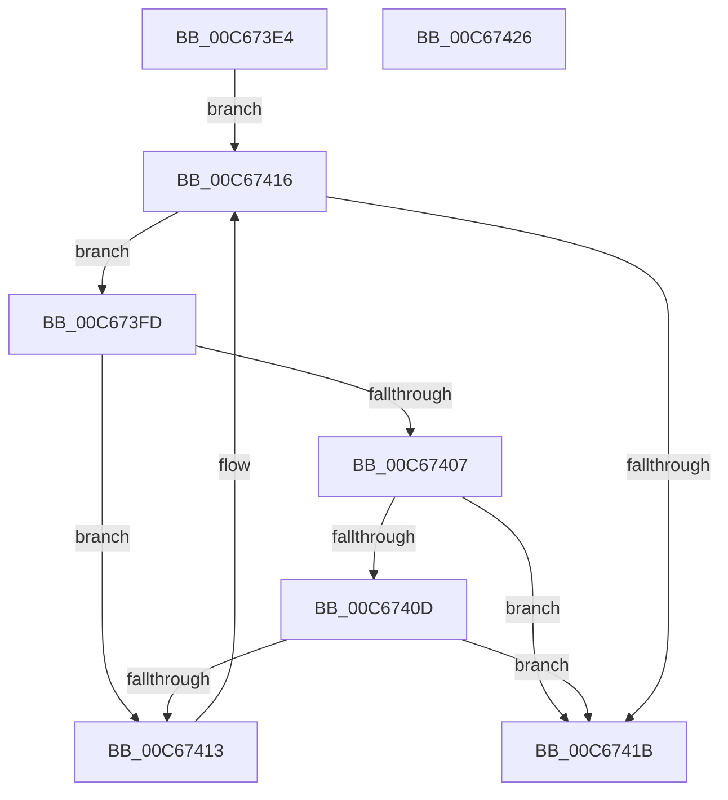

# MiFindLoaderAppliedHotPatchEntry

- RVA: `0x00C673E4`–`0x00C67427` (길이 `67` bytes)
- VA: `0x0000000140C673E4`
- 실행 섹션: `INIT`
- PDB 이름 있음: `예`; PDB Function 태그: `아니요`
- unwind 정보 RVA: `0x000DB714`
- 디코드: `22`개 명령, `67/67` bytes 표시
- 미해석 바이트: `0` (있으면 어셈블리에 `.byte`로 보존)

> 이 문서는 커널 이미지의 기계어와 PDB 기호를 분석해 생성했습니다. 4번과 5번은 함수 원형과 자료형을 바이너리 사용 방식에서 추정한 C 해석이며 원본 소스 복구 결과는 아닙니다.

## 1. Dependencies

- 직접 호출 지점: **0**; 고유 호출 대상: **0**
- 직접 호출자로 확인된 함수: **1**
- RIP 상대 이미지 참조: **0**

### Outgoing calls
- 직접 디코드된 call 명령이 없습니다.

### Direct callers
- [MiUpdateBootHpatPagesInUse](MiUpdateBootHpatPagesInUse_function_00C67548.md) at `0x00C67577`

### Static image references
- 디코드된 RIP-relative 메모리 참조가 없습니다.

## 2. Other-region calls and transfers

- 다른 실행 섹션으로 향하는 call: **0**
- 별도 외부 분기/꼬리 이동을 확인하지 못했습니다.

## 3. Assembly (complete function range)

```asm
00C673E4  4C 8B 8A F0 00 00 00            mov r9, qword ptr [rdx + 0xf0]
00C673EB  45 33 D2                        xor r10d, r10d
00C673EE  49 81 C1 C8 0E 00 00            add r9, 0xec8
00C673F5  45 8B C2                        mov r8d, r10d
00C673F8  49 8B 11                        mov rdx, qword ptr [r9]
00C673FB  EB 19                           jmp 0x140c67416
00C673FD  8B 42 28                        mov eax, dword ptr [rdx + 0x28]
00C67400  4C 8B C2                        mov r8, rdx
00C67403  A8 01                           test al, 1
00C67405  74 0C                           je 0x140c67413
00C67407  48 39 4A 50                     cmp qword ptr [rdx + 0x50], rcx
00C6740B  74 0E                           je 0x140c6741b
00C6740D  48 39 4A 58                     cmp qword ptr [rdx + 0x58], rcx
00C67411  74 08                           je 0x140c6741b
00C67413  48 8B 12                        mov rdx, qword ptr [rdx]
00C67416  49 3B D1                        cmp rdx, r9
00C67419  75 E2                           jne 0x140c673fd
00C6741B  49 3B D1                        cmp rdx, r9
00C6741E  4D 0F 44 C2                     cmove r8, r10
00C67422  49 8B C0                        mov rax, r8
00C67425  C3                              ret
00C67426  CC                              int3
```

## 4. C-style interpretation (structured pseudocode)

```c
__int64 __fastcall MiFindLoaderAppliedHotPatchEntry(__int64 a1, __int64 a2)
{
    __int64 v_r10;

    v_r10 = 0;
    a4 = (*(unsigned __int64 *)(a2 + 240)) + (0xEC8ULL);
    goto loc_00C67416;
loc_00C673FD:
    if ((((unsigned __int8)((unsigned int)(*(unsigned int *)(*(unsigned __int64 *)(a4) + 40)))) & (1)) == 0) goto loc_00C67413;
    if ((*(unsigned __int64 *)(*(unsigned __int64 *)(a4) + 80)) == a1) goto loc_00C6741B;
    if ((*(unsigned __int64 *)(*(unsigned __int64 *)(a4) + 88)) == a1) goto loc_00C6741B;
loc_00C67413:
loc_00C67416:
    if ((*(unsigned __int64 *)(*(unsigned __int64 *)(a4))) != a4) goto loc_00C673FD;
loc_00C6741B:
    a3 = *(unsigned __int64 *)(a4);
    if ((*(unsigned __int64 *)(*(unsigned __int64 *)(a4))) == a4) { a3 = 0; }
    return a3;
}
```

## 5. (Beta) C Style

```c
int64_t MiFindLoaderAppliedHotPatchEntry(int64_t Arg1, void *Arg2)
{
    uint8_t *arg2 = (uint8_t *)Arg2;

    int64_t local_r10;

    local_r10 = 0;
    a4 = (*(uint64_t *)(arg2 + 0xF0)) + (0xEC8ULL);
    goto loc_00C67416;
loc_00C673FD:
    if ((((uint8_t)((uint32_t)(*(uint32_t *)(*(uint64_t *)(a4) + 0x28)))) & (1)) == 0) goto loc_00C67413;
    if ((*(uint64_t *)(*(uint64_t *)(a4) + 0x50)) == Arg1) goto loc_00C6741B;
    if ((*(uint64_t *)(*(uint64_t *)(a4) + 0x58)) == Arg1) goto loc_00C6741B;
loc_00C67413:
loc_00C67416:
    if ((*(uint64_t *)(*(uint64_t *)(a4))) != a4) goto loc_00C673FD;
loc_00C6741B:
    a3 = *(uint64_t *)(a4);
    if ((*(uint64_t *)(*(uint64_t *)(a4))) == a4) { a3 = 0; }
    return a3;
}
```

### 관측된 메모리 오프셋

구조체 형식이 확인되지 않은 접근은 인자 기준의 오프셋으로만 기록했습니다.

| 기준 인자 | 오프셋 표현 | 폭 (bit) | 접근 |
|---|---:|---:|---|
| `Arg2` | `+ 0xF0` | `64` | `R` |

## 6. Execution-region graph

[열기: 2D/3D 그래프와 함수 탐색 컨트롤 패널](../../../control-panel.html?section=init&rva=0x00C673E4&view=graph)

- 2D 그래프는 위에서 아래로 흐르고, 3D 그래프는 빈 공간을 드래그해 회전합니다. Shift+드래그는 이동, 휠은 확대·축소, 함수 노드 선택은 대상 보고서 이동입니다.

### Static fallback


