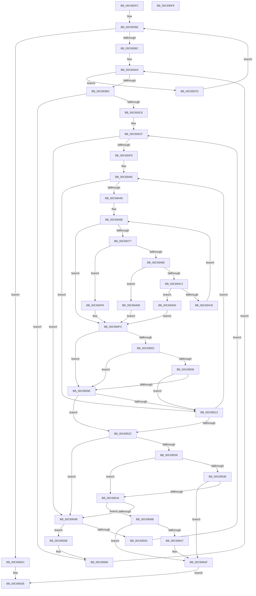

# MiFindProcessorsForMemoryOnlyNode

- RVA: `0x00C692FC`–`0x00C695F7` (길이 `763` bytes)
- VA: `0x0000000140C692FC`
- 실행 섹션: `INIT`
- PDB 이름 있음: `예`; PDB Function 태그: `아니요`
- unwind 정보 RVA: `0x000D8E68`
- 디코드: `195`개 명령, `763/763` bytes 표시
- 미해석 바이트: `0` (있으면 어셈블리에 `.byte`로 보존)

> 이 문서는 커널 이미지의 기계어와 PDB 기호를 분석해 생성했습니다. 4번과 5번은 함수 원형과 자료형을 바이너리 사용 방식에서 추정한 C 해석이며 원본 소스 복구 결과는 아닙니다.

## 1. Dependencies

- 직접 호출 지점: **1**; 고유 호출 대상: **1**
- 직접 호출자로 확인된 함수: **1**
- RIP 상대 이미지 참조: **4**

### Outgoing calls
- `0x00C6940A` → [KeFindFirstSetRightGroupAffinity](../../text/2C/KeFindFirstSetRightGroupAffinity_function_002CFB10.md) (function, `0x002CFB10`)

### Direct callers
- [MiReassignProcessorsToMemoryOnlyNodes](MiReassignProcessorsToMemoryOnlyNodes_function_00C69600.md) at `0x00C69661`
- [MiReassignProcessorsToMemoryOnlyNodes](MiReassignProcessorsToMemoryOnlyNodes_function_00C69600.md) at `0x00C6966F`
- [MiReassignProcessorsToMemoryOnlyNodes](MiReassignProcessorsToMemoryOnlyNodes_function_00C69600.md) at `0x00C69691`

### Static image references
- `0x00C69319` → RVA `0x00E2DBF8` (`.data`; read)
- `0x00C6932C` → RVA `0x00FC5000` (`ALMOSTRO`; read)
- `0x00C69334` → RVA `0x00E2DBD0` (`.data`; read)
- `0x00C693F9` → RVA `0x00FC8C40` (`ALMOSTRO`; read)

## 2. Other-region calls and transfers

- 다른 실행 섹션으로 향하는 call: **1**
  - `0x00C6940A` → [KeFindFirstSetRightGroupAffinity](../../text/2C/KeFindFirstSetRightGroupAffinity_function_002CFB10.md) (`INIT` → `.text`)
- 별도 외부 분기/꼬리 이동을 확인하지 못했습니다.

## 3. Assembly (complete function range)

```asm
00C692FC  48 89 5C 24 10                  mov qword ptr [rsp + 0x10], rbx
00C69301  55                              push rbp
00C69302  56                              push rsi
00C69303  57                              push rdi
00C69304  41 54                           push r12
00C69306  41 55                           push r13
00C69308  41 56                           push r14
00C6930A  41 57                           push r15
00C6930C  48 83 EC 70                     sub rsp, 0x70
00C69310  8B C1                           mov eax, ecx
00C69312  44 8B EA                        mov r13d, edx
00C69315  4C 8D 04 40                     lea r8, [rax + rax*2]
00C69319  48 8B 05 D8 48 1C 00            mov rax, qword ptr [rip + 0x1c48d8]
00C69320  49 C1 E0 07                     shl r8, 7
00C69324  4D 8B A4 00 78 01 00 00         mov r12, qword ptr [r8 + rax + 0x178]
00C6932C  44 0F B7 05 CC BC 35 00         movzx r8d, word ptr [rip + 0x35bccc]
00C69334  48 8B 05 95 48 1C 00            mov rax, qword ptr [rip + 0x1c4895]
00C6933B  41 0F AF C8                     imul ecx, r8d
00C6933F  4C 89 64 24 48                  mov qword ptr [rsp + 0x48], r12
00C69344  4C 8D 34 88                     lea r14, [rax + rcx*4]
00C69348  4B 8D 04 86                     lea rax, [r14 + r8*4]
00C6934C  49 83 C6 04                     add r14, 4
00C69350  45 33 DB                        xor r11d, r11d
00C69353  48 89 44 24 50                  mov qword ptr [rsp + 0x50], rax
00C69358  41 B8 01 00 00 00               mov r8d, 1
00C6935E  4C 89 74 24 38                  mov qword ptr [rsp + 0x38], r14
00C69363  4C 3B F0                        cmp r14, rax
00C69366  0F 83 70 02 00 00               jae 0x140c695dc
00C6936C  41 8B 1E                        mov ebx, dword ptr [r14]
00C6936F  45 8B C8                        mov r9d, r8d
00C69372  48 8B 05 7F 48 1C 00            mov rax, qword ptr [rip + 0x1c487f]
00C69379  89 9C 24 C8 00 00 00            mov dword ptr [rsp + 0xc8], ebx
00C69380  44 89 84 24 C0 00 00 00         mov dword ptr [rsp + 0xc0], r8d
00C69388  48 8D 0C 5B                     lea rcx, [rbx + rbx*2]
00C6938C  48 C1 E1 07                     shl rcx, 7
00C69390  48 8B 84 01 78 01 00 00         mov rax, qword ptr [rcx + rax + 0x178]
00C69398  49 8B C8                        mov rcx, r8
00C6939B  48 89 44 24 20                  mov qword ptr [rsp + 0x20], rax
00C693A0  48 8D 78 1A                     lea rdi, [rax + 0x1a]
00C693A4  48 89 4C 24 30                  mov qword ptr [rsp + 0x30], rcx
00C693A9  48 83 F9 03                     cmp rcx, 3
00C693AD  0F 8D CA 01 00 00               jge 0x140c6957d
00C693B3  0F B7 57 FA                     movzx edx, word ptr [rdi - 6]
00C693B7  66 89 94 24 B0 00 00 00         mov word ptr [rsp + 0xb0], dx
00C693BF  66 85 D2                        test dx, dx
00C693C2  0F 84 9E 01 00 00               je 0x140c69566
00C693C8  0F B7 68 10                     movzx ebp, word ptr [rax + 0x10]
00C693CC  41 2B E8                        sub ebp, r8d
00C693CF  48 8B 00                        mov rax, qword ptr [rax]
00C693D2  44 8B FD                        mov r15d, ebp
00C693D5  4D 03 FF                        add r15, r15
00C693D8  42 0F 10 04 F8                  movups xmm0, xmmword ptr [rax + r15*8]
00C693DD  66 48 0F 7E C6                  movq rsi, xmm0
00C693E2  0F 11 44 24 58                  movups xmmword ptr [rsp + 0x58], xmm0
00C693E7  48 85 F6                        test rsi, rsi
00C693EA  0F 84 5B 01 00 00               je 0x140c6954b
00C693F0  44 0F B7 A4 24 B0 00 00 00      movzx r12d, word ptr [rsp + 0xb0]
00C693F9  4C 8D 35 40 F8 35 00            lea r14, [rip + 0x35f840]
00C69400  BB 01 00 00 00                  mov ebx, 1
00C69405  48 8D 4C 24 58                  lea rcx, [rsp + 0x58]
00C6940A  E8 01 67 66 FF                  call 0x1402cfb10
00C6940F  4C 63 8C 24 C0 00 00 00         movsxd r9, dword ptr [rsp + 0xc0]
00C69417  45 33 DB                        xor r11d, r11d
00C6941A  44 8B D0                        mov r10d, eax
00C6941D  4B 8B 0C D6                     mov rcx, qword ptr [r14 + r10*8]
00C69421  48 8B 91 C8 00 00 00            mov rdx, qword ptr [rcx + 0xc8]
00C69428  48 8B C2                        mov rax, rdx
00C6942B  48 F7 D0                        not rax
00C6942E  48 23 F0                        and rsi, rax
00C69431  41 8B C3                        mov eax, r11d
00C69434  38 99 08 8A 00 00               cmp byte ptr [rcx + 0x8a08], bl
00C6943A  48 89 74 24 58                  mov qword ptr [rsp + 0x58], rsi
00C6943F  0F 95 C0                        setne al
00C69442  03 C3                           add eax, ebx
00C69444  41 3B C1                        cmp eax, r9d
00C69447  0F 85 C6 00 00 00               jne 0x140c69513
00C6944D  48 8B 81 60 8E 00 00            mov rax, qword ptr [rcx + 0x8e60]
00C69454  45 0F B7 C3                     movzx r8d, r11w
00C69458  48 8B C8                        mov rcx, rax
00C6945B  48 89 44 24 40                  mov qword ptr [rsp + 0x40], rax
00C69460  48 23 CE                        and rcx, rsi
00C69463  48 89 74 24 28                  mov qword ptr [rsp + 0x28], rsi
00C69468  48 0B CA                        or rcx, rdx
00C6946B  41 8B D3                        mov edx, r11d
00C6946E  48 85 C9                        test rcx, rcx
00C69471  0F 84 85 00 00 00               je 0x140c694fc
00C69477  4F 8B 1C D6                     mov r11, qword ptr [r14 + r10*8]
00C6947B  33 C0                           xor eax, eax
00C6947D  41 38 9B 08 8A 00 00            cmp byte ptr [r11 + 0x8a08], bl
00C69484  0F 95 C0                        setne al
00C69487  03 C3                           add eax, ebx
00C69489  41 3B C1                        cmp eax, r9d
00C6948C  75 6B                           jne 0x140c694f9
00C6948E  49 8B B3 C8 00 00 00            mov rsi, qword ptr [r11 + 0xc8]
00C69495  41 BB 01 00 00 00               mov r11d, 1
00C6949B  48 0B D6                        or rdx, rsi
00C6949E  66 45 03 C3                     add r8w, r11w
00C694A2  48 F7 D6                        not rsi
00C694A5  41 8B DB                        mov ebx, r11d
00C694A8  48 23 CE                        and rcx, rsi
00C694AB  48 23 74 24 28                  and rsi, qword ptr [rsp + 0x28]
00C694B0  48 89 74 24 28                  mov qword ptr [rsp + 0x28], rsi
00C694B5  48 8B C6                        mov rax, rsi
00C694B8  48 89 74 24 58                  mov qword ptr [rsp + 0x58], rsi
00C694BD  45 3B EB                        cmp r13d, r11d
00C694C0  74 16                           je 0x140c694d8
00C694C2  41 83 FD 02                     cmp r13d, 2
00C694C6  74 08                           je 0x140c694d0
00C694C8  45 03 D3                        add r10d, r11d
00C694CB  45 33 DB                        xor r11d, r11d
00C694CE  EB 9E                           jmp 0x140c6946e
00C694D0  45 33 DB                        xor r11d, r11d
00C694D3  41 8B CB                        mov ecx, r11d
00C694D6  EB 24                           jmp 0x140c694fc
00C694D8  48 8B 74 24 40                  mov rsi, qword ptr [rsp + 0x40]
00C694DD  45 33 DB                        xor r11d, r11d
00C694E0  48 F7 D6                        not rsi
00C694E3  48 23 F0                        and rsi, rax
00C694E6  41 8B C3                        mov eax, r11d
00C694E9  48 85 C9                        test rcx, rcx
00C694EC  48 89 74 24 58                  mov qword ptr [rsp + 0x58], rsi
00C694F1  0F 94 C0                        sete al
00C694F4  48 8B C8                        mov rcx, rax
00C694F7  EB 03                           jmp 0x140c694fc
00C694F9  45 33 DB                        xor r11d, r11d
00C694FC  66 45 85 C0                     test r8w, r8w
00C69500  74 0C                           je 0x140c6950e
00C69502  41 83 FD 02                     cmp r13d, 2
00C69506  74 06                           je 0x140c6950e
00C69508  66 45 3B C4                     cmp r8w, r12w
00C6950C  74 05                           je 0x140c69513
00C6950E  48 85 C9                        test rcx, rcx
00C69511  74 0F                           je 0x140c69522
00C69513  49 8B D3                        mov rdx, r11
00C69516  45 8B C3                        mov r8d, r11d
00C69519  48 85 F6                        test rsi, rsi
00C6951C  0F 85 E3 FE FF FF               jne 0x140c69405
00C69522  8B 9C 24 C8 00 00 00            mov ebx, dword ptr [rsp + 0xc8]
00C69529  4C 8B 74 24 38                  mov r14, qword ptr [rsp + 0x38]
00C6952E  4C 8B 64 24 48                  mov r12, qword ptr [rsp + 0x48]
00C69533  66 45 85 C0                     test r8w, r8w
00C69537  74 12                           je 0x140c6954b
00C69539  45 85 ED                        test r13d, r13d
00C6953C  74 06                           je 0x140c69544
00C6953E  41 83 FD 01                     cmp r13d, 1
00C69542  75 6B                           jne 0x140c695af
00C69544  66 44 39 47 FA                  cmp word ptr [rdi - 6], r8w
00C69549  75 40                           jne 0x140c6958b
00C6954B  48 8B 44 24 20                  mov rax, qword ptr [rsp + 0x20]
00C69550  85 ED                           test ebp, ebp
00C69552  74 07                           je 0x140c6955b
00C69554  FF CD                           dec ebp
00C69556  E9 74 FE FF FF                  jmp 0x140c693cf
00C6955B  48 8B 4C 24 30                  mov rcx, qword ptr [rsp + 0x30]
00C69560  41 B8 01 00 00 00               mov r8d, 1
00C69566  45 03 C8                        add r9d, r8d
00C69569  49 03 C8                        add rcx, r8
00C6956C  44 89 8C 24 C0 00 00 00         mov dword ptr [rsp + 0xc0], r9d
00C69574  48 83 C7 02                     add rdi, 2
00C69578  E9 27 FE FF FF                  jmp 0x140c693a4
00C6957D  48 8B 44 24 50                  mov rax, qword ptr [rsp + 0x50]
00C69582  49 83 C6 04                     add r14, 4
00C69586  E9 D3 FD FF FF                  jmp 0x140c6935e
00C6958B  48 8B 4C 24 20                  mov rcx, qword ptr [rsp + 0x20]
00C69590  48 8B C2                        mov rax, rdx
00C69593  48 F7 D0                        not rax
00C69596  48 8B 09                        mov rcx, qword ptr [rcx]
00C69599  4A 21 04 F9                     and qword ptr [rcx + r15*8], rax
00C6959D  66 44 29 47 FA                  sub word ptr [rdi - 6], r8w
00C695A2  45 85 ED                        test r13d, r13d
00C695A5  75 08                           jne 0x140c695af
00C695A7  B9 FF FF 00 00                  mov ecx, 0xffff
00C695AC  66 01 0F                        add word ptr [rdi], cx
00C695AF  49 8B 0C 24                     mov rcx, qword ptr [r12]
00C695B3  B8 01 00 00 00                  mov eax, 1
00C695B8  48 89 11                        mov qword ptr [rcx], rdx
00C695BB  49 8B 14 24                     mov rdx, qword ptr [r12]
00C695BF  42 0F B7 4C FA 08               movzx ecx, word ptr [rdx + r15*8 + 8]
00C695C5  66 89 4A 08                     mov word ptr [rdx + 8], cx
00C695C9  66 47 89 44 4C 12               mov word ptr [r12 + r9*2 + 0x12], r8w
00C695CF  66 43 89 44 4C 18               mov word ptr [r12 + r9*2 + 0x18], ax
00C695D5  41 89 5C 24 2C                  mov dword ptr [r12 + 0x2c], ebx
00C695DA  EB 02                           jmp 0x140c695de
00C695DC  33 C0                           xor eax, eax
00C695DE  48 8B 9C 24 B8 00 00 00         mov rbx, qword ptr [rsp + 0xb8]
00C695E6  48 83 C4 70                     add rsp, 0x70
00C695EA  41 5F                           pop r15
00C695EC  41 5E                           pop r14
00C695EE  41 5D                           pop r13
00C695F0  41 5C                           pop r12
00C695F2  5F                              pop rdi
00C695F3  5E                              pop rsi
00C695F4  5D                              pop rbp
00C695F5  C3                              ret
00C695F6  CC                              int3
```

## 4. C-style interpretation (structured pseudocode)

```c
__int64 __fastcall MiFindProcessorsForMemoryOnlyNode(int a1, int a2)
{
    __int64 result;
    __int64 v_r10;
    __int64 v_r11;
    __int64 v_r14;
    __int64 v_r15;
    __int64 v_rbp;
    __int64 v_rdi;
    __int64 v_rsi;
    __int64 v_rsp;
    unsigned __int64 v_stack_m50;
    unsigned __int64 v_stack_m58;
    unsigned __int64 v_stack_m60;
    unsigned __int64 v_stack_m68;
    unsigned __int64 v_stack_m70;
    unsigned __int64 v_stack_m78;
    unsigned __int64 v_stack_m80;
    unsigned __int64 v_stack_m88;
    unsigned __int64 v_stack_p10;
    unsigned int v_stack_p18;
    unsigned int v_stack_p20;
    unsigned __int16 v_stack_p8;

    v_stack_p10 = v_rbx;
    v_rsp = (v_rsp) - (112);
    a3 = ((unsigned int)(a1) + (unsigned int)(a1) * 2) << (7);
    a1 = (unsigned int)((a1) * ((unsigned int)(*(unsigned __int16 *)(v_rip + 3521740))));
    v_stack_m60 = *(unsigned __int64 *)(a3 + *(unsigned __int64 *)(v_rip + 1853656) * 1 + 376);
    v_r14 = (*(unsigned __int64 *)(v_rip + 1853589) + a1 * 4) + (4);
    v_r11 = 0;
    v_stack_m58 = *(unsigned __int64 *)(v_rip + 1853589) + a1 * 4 + *(unsigned __int16 *)(v_rip + 3521740) * 4;
loc_00C6935E:
    v_stack_m70 = v_r14;
    if (v_r14 >= (*(unsigned __int64 *)(v_rip + 1853589) + a1 * 4 + *(unsigned __int16 *)(v_rip + 3521740) * 4)) goto loc_00C695DC;
    v_stack_p20 = (unsigned int)((unsigned int)(*(unsigned int *)(v_r14)));
    v_stack_p18 = 1;
    a1 = ((unsigned int)(*(unsigned int *)(v_r14)) + (unsigned int)(*(unsigned int *)(v_r14)) * 2) << (7);
    v_stack_m88 = *(unsigned __int64 *)(a1 + *(unsigned __int64 *)(v_rip + 1853567) * 1 + 376);
loc_00C693A4:
    v_stack_m78 = 1;
    if (1 >= 3) goto loc_00C6957D;
    v_stack_p8 = (unsigned __int16)(*(unsigned __int16 *)(*(unsigned __int64 *)(a1 + *(unsigned __int64 *)(v_rip + 1853567) * 1 + 376) + 26 - 6));
    if ((unsigned __int16)(*(unsigned __int16 *)(*(unsigned __int64 *)(a1 + *(unsigned __int64 *)(v_rip + 1853567) * 1 + 376) + 26 - 6)) == 0) goto loc_00C69566;
    v_rbp = (unsigned int)((*(unsigned __int16 *)(*(unsigned __int64 *)(a1 + *(unsigned __int64 *)(v_rip + 1853567) * 1 + 376) + 16)) - (1));
loc_00C693CF:
    v_r15 = ((unsigned int)((unsigned int)(v_rbp))) + ((unsigned int)((unsigned int)(v_rbp)));
    v_stack_m50 = v_xmm0;
    if (v_rsi == 0) goto loc_00C6954B;
loc_00C69405:
    result = KeFindFirstSetRightGroupAffinity(v_stack_m50, *(unsigned __int16 *)(*(unsigned __int64 *)(a1 + *(unsigned __int64 *)(v_rip + 1853567) * 1 + 376) + 26 - 6), 1, 1);
    v_r11 = 0;
    result = ~(*(unsigned __int64 *)(*(unsigned __int64 *)(v_rip + 3536960 + (unsigned int)((unsigned int)(result)) * 8) + 200));
    v_rsi = (v_rsi) & (result);
    v_stack_m50 = v_rsi;
    result = ((*(unsigned __int8 *)(*(unsigned __int64 *)(v_rip + 3536960 + (unsigned int)((unsigned int)(result)) * 8) + 35336)) != 1) ? 1 : 0;
    result = (unsigned int)((result) + (1));
    if (((unsigned int)(result)) != ((unsigned int)((int)(v_stack_p18)))) goto loc_00C69513;
    v_stack_m68 = *(unsigned __int64 *)(*(unsigned __int64 *)(v_rip + 3536960 + (unsigned int)((unsigned int)(result)) * 8) + 36448);
    a1 = (*(unsigned __int64 *)(*(unsigned __int64 *)(v_rip + 3536960 + (unsigned int)((unsigned int)(result)) * 8) + 36448)) & (v_rsi);
    v_stack_m80 = v_rsi;
    a1 = (a1) | (*(unsigned __int64 *)(*(unsigned __int64 *)(v_rip + 3536960 + (unsigned int)((unsigned int)(result)) * 8) + 200));
loc_00C6946E:
    if (a1 == 0) goto loc_00C694FC;
    result = 0;
    result = ((*(unsigned __int8 *)(*(unsigned __int64 *)(v_rip + 3536960 + (unsigned int)((unsigned int)(result)) * 8) + 35336)) != 1) ? 1 : 0;
    result = (unsigned int)((result) + (1));
    if (((unsigned int)(result)) != ((unsigned int)((int)(v_stack_p18)))) goto loc_00C694F9;
    a2 = (0) | (*(unsigned __int64 *)(*(unsigned __int64 *)(v_rip + 3536960 + (unsigned int)((unsigned int)(result)) * 8) + 200));
    a3 = (unsigned __int16)((0) + (1));
    v_rsi = ~(*(unsigned __int64 *)(*(unsigned __int64 *)(v_rip + 3536960 + (unsigned int)((unsigned int)(result)) * 8) + 200));
    a1 = (a1) & (v_rsi);
    v_rsi = (v_rsi) & (v_stack_m80);
    v_stack_m80 = v_rsi;
    v_stack_m50 = v_rsi;
    if (((unsigned int)((unsigned int)(a2))) == 1) goto loc_00C694D8;
    if (((unsigned int)((unsigned int)(a2))) == 2) goto loc_00C694D0;
    v_r10 = (unsigned int)(((unsigned int)((unsigned int)(result))) + (1));
    v_r11 = 0;
    goto loc_00C6946E;
loc_00C694D0:
    v_r11 = 0;
    goto loc_00C694FC;
loc_00C694D8:
    v_r11 = 0;
    v_rsi = ~(v_stack_m68);
    v_rsi = (v_rsi) & (v_rsi);
    v_stack_m50 = v_rsi;
    result = (0 == 0) ? 1 : 0;
    goto loc_00C694FC;
loc_00C694F9:
    v_r11 = 0;
loc_00C694FC:
    if ((unsigned __int16)(a3) == 0) goto loc_00C6950E;
    if (((unsigned int)((unsigned int)(a2))) == 2) goto loc_00C6950E;
    if (((unsigned __int16)(a3)) == ((unsigned __int16)(v_stack_p8))) goto loc_00C69513;
loc_00C6950E:
    if (result == 0) goto loc_00C69522;
loc_00C69513:
    if (v_rsi != 0) goto loc_00C69405;
loc_00C69522:
    if (0 == 0) goto loc_00C6954B;
    if ((unsigned int)((unsigned int)(a2)) == 0) goto loc_00C69544;
    if (((unsigned int)((unsigned int)(a2))) != 1) goto loc_00C695AF;
loc_00C69544:
    if ((*(unsigned __int16 *)(*(unsigned __int64 *)(a1 + *(unsigned __int64 *)(v_rip + 1853567) * 1 + 376) + 26 - 6)) != 0) goto loc_00C6958B;
loc_00C6954B:
    if ((unsigned int)(v_rbp) == 0) goto loc_00C6955B;
    v_rbp = (unsigned int)((v_rbp) - 1);
    goto loc_00C693CF;
loc_00C6955B:
loc_00C69566:
    a4 = (unsigned int)(((int)(v_stack_p18)) + (1));
    a1 = (v_stack_m78) + (1);
    v_stack_p18 = (unsigned int)(a4);
    v_rdi = (*(unsigned __int64 *)(a1 + *(unsigned __int64 *)(v_rip + 1853567) * 1 + 376) + 26) + (2);
    goto loc_00C693A4;
loc_00C6957D:
    v_r14 = (v_stack_m70) + (4);
    goto loc_00C6935E;
loc_00C6958B:
    result = ~(0);
    if ((unsigned int)((unsigned int)(a2)) == 0) {
        a1 = 0xFFFFULL;
    }
    *(unsigned __int64 *)(*(unsigned __int64 *)(v_stack_m60)) = 0;
    *(unsigned __int16 *)(*(unsigned __int64 *)(v_stack_m60) + 8) = (unsigned __int16)(*(unsigned __int16 *)(*(unsigned __int64 *)(v_stack_m60) + v_r15 * 8 + 8));
    *(unsigned __int16 *)(v_stack_m60 + a4 * 2 + 18) = 1;
    *(unsigned __int16 *)(v_stack_m60 + a4 * 2 + 24) = 1;
    *(unsigned int *)(v_stack_m60 + 44) = (unsigned int)((unsigned int)(v_stack_p20));
    goto loc_00C695DE;
loc_00C695DC:
    result = 0;
loc_00C695DE:
    v_rsp = (v_rsp) + (112);
    return result;
}
```

## 5. (Beta) C Style

```c
int64_t MiFindProcessorsForMemoryOnlyNode(void *Arg1, int32_t Arg2)
{
    uint8_t *arg1 = (uint8_t *)Arg1;

    int64_t result;
    int64_t local_r10;
    int64_t local_r11;
    int64_t local_r14;
    int64_t local_r15;
    int64_t local_rbp;
    int64_t local_rdi;
    int64_t local_rsi;
    int64_t local_rsp;
    uint64_t v_stack_m50;
    uint64_t v_stack_m58;
    uint64_t v_stack_m60;
    uint64_t v_stack_m68;
    uint64_t v_stack_m70;
    uint64_t v_stack_m78;
    uint64_t v_stack_m80;
    uint64_t v_stack_m88;
    uint64_t v_stack_p10;
    uint32_t v_stack_p18;
    uint32_t v_stack_p20;
    uint16_t v_stack_p8;

    v_stack_p10 = local_rbx;
    local_rsp = (local_rsp) - (112);
    a3 = ((uint32_t)(Arg1) + (uint32_t)(Arg1) * 2) << (7);
    Arg1 = (uint32_t)((Arg1) * ((uint32_t)(*(uint16_t *)(v_rip + 0x35BCCC))));
    v_stack_m60 = *(uint64_t *)(a3 + *(uint64_t *)(v_rip + 0x1C48D8) * 1 + 0x178);
    local_r14 = (*(uint64_t *)(v_rip + 0x1C4895) + Arg1 * 4) + (4);
    local_r11 = 0;
    v_stack_m58 = *(uint64_t *)(v_rip + 0x1C4895) + Arg1 * 4 + *(uint16_t *)(v_rip + 0x35BCCC) * 4;
loc_00C6935E:
    v_stack_m70 = local_r14;
    if (local_r14 >= (*(uint64_t *)(v_rip + 0x1C4895) + Arg1 * 4 + *(uint16_t *)(v_rip + 0x35BCCC) * 4)) goto loc_00C695DC;
    v_stack_p20 = (uint32_t)((uint32_t)(*(uint32_t *)(local_r14)));
    v_stack_p18 = 1;
    Arg1 = ((uint32_t)(*(uint32_t *)(local_r14)) + (uint32_t)(*(uint32_t *)(local_r14)) * 2) << (7);
    v_stack_m88 = *(uint64_t *)(arg1 + *(uint64_t *)(v_rip + 0x1C487F) * 1 + 0x178);
loc_00C693A4:
    v_stack_m78 = 1;
    if (1 >= 3) goto loc_00C6957D;
    v_stack_p8 = (uint16_t)(*(uint16_t *)(*(uint64_t *)(arg1 + *(uint64_t *)(v_rip + 0x1C487F) * 1 + 0x178) + 0x1A - 0x6));
    if ((uint16_t)(*(uint16_t *)(*(uint64_t *)(arg1 + *(uint64_t *)(v_rip + 0x1C487F) * 1 + 0x178) + 0x1A - 0x6)) == 0) goto loc_00C69566;
    local_rbp = (uint32_t)((*(uint16_t *)(*(uint64_t *)(arg1 + *(uint64_t *)(v_rip + 0x1C487F) * 1 + 0x178) + 0x10)) - (1));
loc_00C693CF:
    local_r15 = ((uint32_t)((uint32_t)(local_rbp))) + ((uint32_t)((uint32_t)(local_rbp)));
    v_stack_m50 = v_xmm0;
    if (local_rsi == 0) goto loc_00C6954B;
loc_00C69405:
    result = KeFindFirstSetRightGroupAffinity(v_stack_m50, *(uint16_t *)(*(uint64_t *)(arg1 + *(uint64_t *)(v_rip + 0x1C487F) * 1 + 0x178) + 0x1A - 0x6), 1, 1);
    local_r11 = 0;
    result = ~(*(uint64_t *)(*(uint64_t *)(v_rip + 0x35F840 + (uint32_t)((uint32_t)(result)) * 8) + 0xC8));
    local_rsi = (local_rsi) & (result);
    v_stack_m50 = local_rsi;
    result = ((*(uint8_t *)(*(uint64_t *)(v_rip + 0x35F840 + (uint32_t)((uint32_t)(result)) * 8) + 0x8A08)) != 1) ? 1 : 0;
    result = (uint32_t)((result) + (1));
    if (((uint32_t)(result)) != ((uint32_t)((int32_t)(v_stack_p18)))) goto loc_00C69513;
    v_stack_m68 = *(uint64_t *)(*(uint64_t *)(v_rip + 0x35F840 + (uint32_t)((uint32_t)(result)) * 8) + 0x8E60);
    Arg1 = (*(uint64_t *)(*(uint64_t *)(v_rip + 0x35F840 + (uint32_t)((uint32_t)(result)) * 8) + 0x8E60)) & (local_rsi);
    v_stack_m80 = local_rsi;
    Arg1 = (Arg1) | (*(uint64_t *)(*(uint64_t *)(v_rip + 0x35F840 + (uint32_t)((uint32_t)(result)) * 8) + 0xC8));
loc_00C6946E:
    if (Arg1 == NULL) goto loc_00C694FC;
    result = 0;
    result = ((*(uint8_t *)(*(uint64_t *)(v_rip + 0x35F840 + (uint32_t)((uint32_t)(result)) * 8) + 0x8A08)) != 1) ? 1 : 0;
    result = (uint32_t)((result) + (1));
    if (((uint32_t)(result)) != ((uint32_t)((int32_t)(v_stack_p18)))) goto loc_00C694F9;
    Arg2 = (0) | (*(uint64_t *)(*(uint64_t *)(v_rip + 0x35F840 + (uint32_t)((uint32_t)(result)) * 8) + 0xC8));
    a3 = (uint16_t)((0) + (1));
    local_rsi = ~(*(uint64_t *)(*(uint64_t *)(v_rip + 0x35F840 + (uint32_t)((uint32_t)(result)) * 8) + 0xC8));
    Arg1 = (Arg1) & (local_rsi);
    local_rsi = (local_rsi) & (v_stack_m80);
    v_stack_m80 = local_rsi;
    v_stack_m50 = local_rsi;
    if (((uint32_t)((uint32_t)(Arg2))) == 1) goto loc_00C694D8;
    if (((uint32_t)((uint32_t)(Arg2))) == 2) goto loc_00C694D0;
    local_r10 = (uint32_t)(((uint32_t)((uint32_t)(result))) + (1));
    local_r11 = 0;
    goto loc_00C6946E;
loc_00C694D0:
    local_r11 = 0;
    goto loc_00C694FC;
loc_00C694D8:
    local_r11 = 0;
    local_rsi = ~(v_stack_m68);
    local_rsi = (local_rsi) & (local_rsi);
    v_stack_m50 = local_rsi;
    result = (0 == 0) ? 1 : 0;
    goto loc_00C694FC;
loc_00C694F9:
    local_r11 = 0;
loc_00C694FC:
    if ((uint16_t)(a3) == 0) goto loc_00C6950E;
    if (((uint32_t)((uint32_t)(Arg2))) == 2) goto loc_00C6950E;
    if (((uint16_t)(a3)) == ((uint16_t)(v_stack_p8))) goto loc_00C69513;
loc_00C6950E:
    if (result == 0) goto loc_00C69522;
loc_00C69513:
    if (local_rsi != 0) goto loc_00C69405;
loc_00C69522:
    if (0 == 0) goto loc_00C6954B;
    if ((uint32_t)((uint32_t)(Arg2)) == 0) goto loc_00C69544;
    if (((uint32_t)((uint32_t)(Arg2))) != 1) goto loc_00C695AF;
loc_00C69544:
    if ((*(uint16_t *)(*(uint64_t *)(arg1 + *(uint64_t *)(v_rip + 0x1C487F) * 1 + 0x178) + 0x1A - 0x6)) != 0) goto loc_00C6958B;
loc_00C6954B:
    if ((uint32_t)(local_rbp) == 0) goto loc_00C6955B;
    local_rbp = (uint32_t)((local_rbp) - 1);
    goto loc_00C693CF;
loc_00C6955B:
loc_00C69566:
    a4 = (uint32_t)(((int32_t)(v_stack_p18)) + (1));
    Arg1 = (v_stack_m78) + (1);
    v_stack_p18 = (uint32_t)(a4);
    local_rdi = (*(uint64_t *)(arg1 + *(uint64_t *)(v_rip + 0x1C487F) * 1 + 0x178) + 26) + (2);
    goto loc_00C693A4;
loc_00C6957D:
    local_r14 = (v_stack_m70) + (4);
    goto loc_00C6935E;
loc_00C6958B:
    result = ~(0);
    if ((uint32_t)((uint32_t)(Arg2)) == 0) {
        Arg1 = 0xFFFFULL;
    }
    *(uint64_t *)(*(uint64_t *)(v_stack_m60)) = 0;
    *(uint16_t *)(*(uint64_t *)(v_stack_m60) + 0x8) = (uint16_t)(*(uint16_t *)(*(uint64_t *)(v_stack_m60) + local_r15 * 8 + 0x8));
    *(uint16_t *)(v_stack_m60 + a4 * 2 + 0x12) = 1;
    *(uint16_t *)(v_stack_m60 + a4 * 2 + 0x18) = 1;
    *(uint32_t *)(v_stack_m60 + 0x2C) = (uint32_t)((uint32_t)(v_stack_p20));
    goto loc_00C695DE;
loc_00C695DC:
    result = 0;
loc_00C695DE:
    local_rsp = (local_rsp) + (112);
    return result;
}
```

### 관측된 메모리 오프셋

구조체 형식이 확인되지 않은 접근은 인자 기준의 오프셋으로만 기록했습니다.

| 기준 인자 | 오프셋 표현 | 폭 (bit) | 접근 |
|---|---:|---:|---|
| `Arg1` | `+ 0x0 + rax*2` | `64` | `R` |

## 6. Execution-region graph

[열기: 2D/3D 그래프와 함수 탐색 컨트롤 패널](../../../control-panel.html?section=init&rva=0x00C692FC&view=graph)

- 2D 그래프는 위에서 아래로 흐르고, 3D 그래프는 빈 공간을 드래그해 회전합니다. Shift+드래그는 이동, 휠은 확대·축소, 함수 노드 선택은 대상 보고서 이동입니다.

### Static fallback


