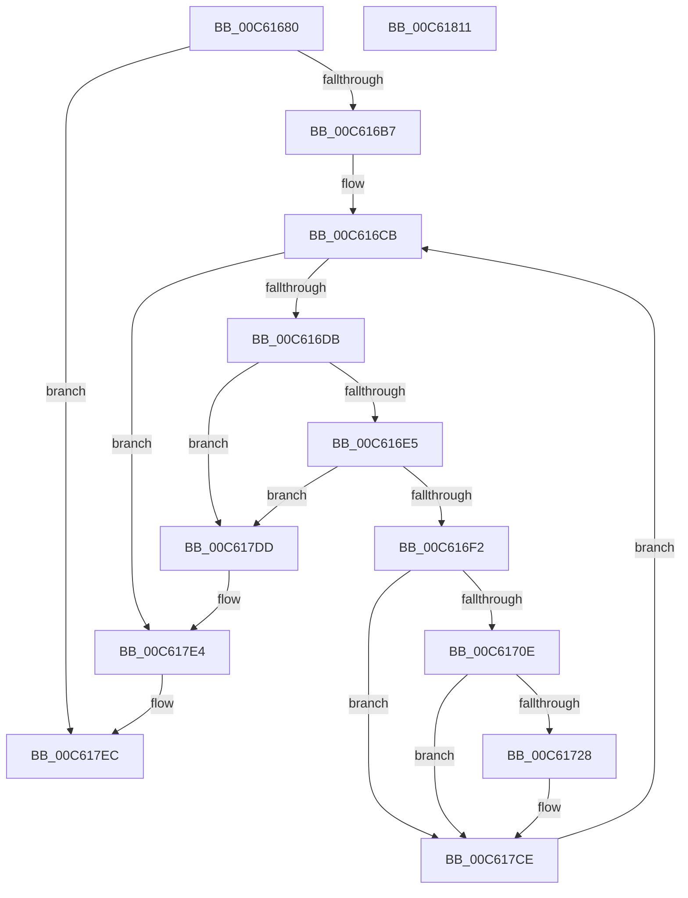

# MiFlushStrongCodeDriverLoadFailures

- RVA: `0x00C61680`–`0x00C61812` (길이 `402` bytes)
- VA: `0x0000000140C61680`
- 실행 섹션: `INIT`
- PDB 이름 있음: `예`; PDB Function 태그: `아니요`
- unwind 정보 RVA: `0x000D789C`
- 디코드: `89`개 명령, `402/402` bytes 표시
- 미해석 바이트: `0` (있으면 어셈블리에 `.byte`로 보존)

> 이 문서는 커널 이미지의 기계어와 PDB 기호를 분석해 생성했습니다. 4번과 5번은 함수 원형과 자료형을 바이너리 사용 방식에서 추정한 C 해석이며 원본 소스 복구 결과는 아닙니다.

## 1. Dependencies

- 직접 호출 지점: **7**; 고유 호출 대상: **7**
- 직접 호출자로 확인된 함수: **1**
- RIP 상대 이미지 참조: **5**

### Outgoing calls
- `0x00C616BC` → [MiAcquireLoadLock](../../text/2A/MiAcquireLoadLock_function_002A3950.md) (function, `0x002A3950`)
- `0x00C6171B` → [tlgKeywordOn](../../text/42/tlgKeywordOn_function_0042EAA0.md) (function, `0x0042EAA0`)
- `0x00C61730` → [tlgCreate1Sz_char](../../text/42/tlgCreate1Sz_char_function_00427304.md) (function, `0x00427304`)
- `0x00C617C9` → [tlgWriteEx_EtwWriteEx](../../text/4A/tlgWriteEx_EtwWriteEx_function_004AA348.md) (function, `0x004AA348`)
- `0x00C617D3` → [ExFreePoolWithTag](../../poolcode/B8/ExFreePoolWithTag_function_00B82870.md) (function, `0x00B82870`)
- `0x00C617E7` → [MmReleaseLoadLock](../../text/4D/MmReleaseLoadLock_function_004D36D0.md) (function, `0x004D36D0`)
- `0x00C617F3` → [_security_check_cookie](../../text/6A/_security_check_cookie_function_006AC640.md) (function, `0x006AC640`)

### Direct callers
- [MiInitSystem](../C5/MiInitSystem_function_00C5E6C0.md) at `0x00C5ED3A`

### Static image references
- `0x00C6169B` → RVA `0x00E0A740` (`.data`; read)
- `0x00C616A9` → RVA `0x00E37618` (`.data`; read)
- `0x00C616C4` → RVA `0x00E2D930` (`.data`; read)
- `0x00C616F2` → RVA `0x00E2D930` (`.data`; write)
- `0x00C61741` → RVA `0x00057C8D` (`.rdata`; read)

## 2. Other-region calls and transfers

- 다른 실행 섹션으로 향하는 call: **7**
  - `0x00C616BC` → [MiAcquireLoadLock](../../text/2A/MiAcquireLoadLock_function_002A3950.md) (`INIT` → `.text`)
  - `0x00C6171B` → [tlgKeywordOn](../../text/42/tlgKeywordOn_function_0042EAA0.md) (`INIT` → `.text`)
  - `0x00C61730` → [tlgCreate1Sz_char](../../text/42/tlgCreate1Sz_char_function_00427304.md) (`INIT` → `.text`)
  - `0x00C617C9` → [tlgWriteEx_EtwWriteEx](../../text/4A/tlgWriteEx_EtwWriteEx_function_004AA348.md) (`INIT` → `.text`)
  - `0x00C617D3` → [ExFreePoolWithTag](../../poolcode/B8/ExFreePoolWithTag_function_00B82870.md) (`INIT` → `POOLCODE`)
  - `0x00C617E7` → [MmReleaseLoadLock](../../text/4D/MmReleaseLoadLock_function_004D36D0.md) (`INIT` → `.text`)
  - `0x00C617F3` → [_security_check_cookie](../../text/6A/_security_check_cookie_function_006AC640.md) (`INIT` → `.text`)
- 별도 외부 분기/꼬리 이동을 확인하지 못했습니다.

## 3. Assembly (complete function range)

```asm
00C61680  48 8B C4                        mov rax, rsp
00C61683  48 89 58 08                     mov qword ptr [rax + 8], rbx
00C61687  48 89 78 10                     mov qword ptr [rax + 0x10], rdi
00C6168B  4C 89 70 18                     mov qword ptr [rax + 0x18], r14
00C6168F  55                              push rbp
00C61690  48 8D 68 A1                     lea rbp, [rax - 0x5f]
00C61694  48 81 EC E0 00 00 00            sub rsp, 0xe0
00C6169B  48 8B 05 9E 90 1A 00            mov rax, qword ptr [rip + 0x1a909e]
00C616A2  48 33 C4                        xor rax, rsp
00C616A5  48 89 45 47                     mov qword ptr [rbp + 0x47], rax
00C616A9  48 83 3D 67 5F 1D 00 00         cmp qword ptr [rip + 0x1d5f67], 0
00C616B1  0F 84 35 01 00 00               je 0x140c617ec
00C616B7  B9 01 00 00 00                  mov ecx, 1
00C616BC  E8 8F 22 64 FF                  call 0x1402a3950
00C616C1  48 8B F8                        mov rdi, rax
00C616C4  4C 8D 35 65 C2 1C 00            lea r14, [rip + 0x1cc265]
00C616CB  48 8B 1D 5E C2 1C 00            mov rbx, qword ptr [rip + 0x1cc25e]
00C616D2  49 3B DE                        cmp rbx, r14
00C616D5  0F 84 09 01 00 00               je 0x140c617e4
00C616DB  4C 39 73 08                     cmp qword ptr [rbx + 8], r14
00C616DF  0F 85 F8 00 00 00               jne 0x140c617dd
00C616E5  48 8B 03                        mov rax, qword ptr [rbx]
00C616E8  48 39 58 08                     cmp qword ptr [rax + 8], rbx
00C616EC  0F 85 EB 00 00 00               jne 0x140c617dd
00C616F2  48 89 05 37 C2 1C 00            mov qword ptr [rip + 0x1cc237], rax
00C616F9  4C 89 70 08                     mov qword ptr [rax + 8], r14
00C616FD  4C 8B 05 14 5F 1D 00            mov r8, qword ptr [rip + 0x1d5f14]
00C61704  41 83 38 02                     cmp dword ptr [r8], 2
00C61708  0F 86 C0 00 00 00               jbe 0x140c617ce
00C6170E  48 BA 00 40 00 00 00 40 00 00   movabs rdx, 0x400000004000
00C61718  49 8B C8                        mov rcx, r8
00C6171B  E8 80 D3 7C FF                  call 0x14042eaa0
00C61720  84 C0                           test al, al
00C61722  0F 84 A6 00 00 00               je 0x140c617ce
00C61728  48 8B 53 10                     mov rdx, qword ptr [rbx + 0x10]
00C6172C  48 8D 4D E7                     lea rcx, [rbp - 0x19]
00C61730  E8 CF 5B 7C FF                  call 0x140427304
00C61735  83 65 03 00                     and dword ptr [rbp + 3], 0
00C61739  48 8D 45 0F                     lea rax, [rbp + 0xf]
00C6173D  83 65 13 00                     and dword ptr [rbp + 0x13], 0
00C61741  48 8D 15 45 65 3F FF            lea rdx, [rip - 0xc09abb]
00C61748  83 65 23 00                     and dword ptr [rbp + 0x23], 0
00C6174C  41 B9 01 00 00 00               mov r9d, 1
00C61752  83 65 33 00                     and dword ptr [rbp + 0x33], 0
00C61756  49 8B C8                        mov rcx, r8
00C61759  83 65 43 00                     and dword ptr [rbp + 0x43], 0
00C6175D  48 89 45 F7                     mov qword ptr [rbp - 9], rax
00C61761  48 8B 43 20                     mov rax, qword ptr [rbx + 0x20]
00C61765  48 89 45 07                     mov qword ptr [rbp + 7], rax
00C61769  0F B7 43 18                     movzx eax, word ptr [rbx + 0x18]
00C6176D  89 45 0F                        mov dword ptr [rbp + 0xf], eax
00C61770  8B 43 28                        mov eax, dword ptr [rbx + 0x28]
00C61773  89 45 B7                        mov dword ptr [rbp - 0x49], eax
00C61776  48 8D 45 B7                     lea rax, [rbp - 0x49]
00C6177A  48 89 45 17                     mov qword ptr [rbp + 0x17], rax
00C6177E  8B 43 2C                        mov eax, dword ptr [rbx + 0x2c]
00C61781  89 45 BB                        mov dword ptr [rbp - 0x45], eax
00C61784  48 8D 45 BB                     lea rax, [rbp - 0x45]
00C61788  48 89 45 27                     mov qword ptr [rbp + 0x27], rax
00C6178C  48 8D 45 BF                     lea rax, [rbp - 0x41]
00C61790  48 89 45 37                     mov qword ptr [rbp + 0x37], rax
00C61794  48 8D 45 C7                     lea rax, [rbp - 0x39]
00C61798  48 89 44 24 38                  mov qword ptr [rsp + 0x38], rax
00C6179D  C7 44 24 30 08 00 00 00         mov dword ptr [rsp + 0x30], 8
00C617A5  C7 45 FF 02 00 00 00            mov dword ptr [rbp - 1], 2
00C617AC  C7 45 1F 04 00 00 00            mov dword ptr [rbp + 0x1f], 4
00C617B3  C7 45 2F 04 00 00 00            mov dword ptr [rbp + 0x2f], 4
00C617BA  48 C7 45 BF 00 00 00 01         mov qword ptr [rbp - 0x41], 0x1000000
00C617C2  C7 45 3F 08 00 00 00            mov dword ptr [rbp + 0x3f], 8
00C617C9  E8 7A 8B 84 FF                  call 0x1404aa348
00C617CE  33 D2                           xor edx, edx
00C617D0  48 8B CB                        mov rcx, rbx
00C617D3  E8 98 10 F2 FF                  call 0x140b82870
00C617D8  E9 EE FE FF FF                  jmp 0x140c616cb
00C617DD  B9 03 00 00 00                  mov ecx, 3
00C617E2  CD 29                           int 0x29
00C617E4  48 8B CF                        mov rcx, rdi
00C617E7  E8 E4 1E 87 FF                  call 0x1404d36d0
00C617EC  48 8B 4D 47                     mov rcx, qword ptr [rbp + 0x47]
00C617F0  48 33 CC                        xor rcx, rsp
00C617F3  E8 48 AE A4 FF                  call 0x1406ac640
00C617F8  4C 8D 9C 24 E0 00 00 00         lea r11, [rsp + 0xe0]
00C61800  49 8B 5B 10                     mov rbx, qword ptr [r11 + 0x10]
00C61804  49 8B 7B 18                     mov rdi, qword ptr [r11 + 0x18]
00C61808  4D 8B 73 20                     mov r14, qword ptr [r11 + 0x20]
00C6180C  49 8B E3                        mov rsp, r11
00C6180F  5D                              pop rbp
00C61810  C3                              ret
00C61811  CC                              int3
```

## 4. C-style interpretation (structured pseudocode)

```c
__int64 __fastcall MiFlushStrongCodeDriverLoadFailures(void)
{
    __int64 result;
    __int64 v_rsp;
    unsigned __int64 v_stack_m8;
    unsigned __int64 v_stack_mB0;
    unsigned int v_stack_mB8;

    *(unsigned __int64 *)(v_rsp + 8) = v_rbx;
    *(unsigned __int64 *)(v_rsp + 16) = v_rdi;
    *(unsigned __int64 *)(v_rsp + 24) = v_r14;
    v_rsp = (v_rsp) - (224);
    result = (*(unsigned __int64 *)(v_rip + 1740958)) ^ (v_rsp);
    *(unsigned __int64 *)(v_rsp - 95 + 71) = result;
    if ((*(unsigned __int64 *)(v_rip + 1924967)) == 0) goto loc_00C617EC;
    result = MiAcquireLoadLock(1, a2, a3, a4);
loc_00C616CB:
    if ((*(unsigned __int64 *)(v_rip + 1884766)) == (v_rip + 1884773)) goto loc_00C617E4;
    if ((*(unsigned __int64 *)(*(unsigned __int64 *)(v_rip + 1884766) + 8)) != (v_rip + 1884773)) goto loc_00C617DD;
    if ((*(unsigned __int64 *)(*(unsigned __int64 *)(*(unsigned __int64 *)(v_rip + 1884766)) + 8)) != (*(unsigned __int64 *)(v_rip + 1884766))) goto loc_00C617DD;
    *(unsigned __int64 *)(v_rip + 1884727) = *(unsigned __int64 *)(*(unsigned __int64 *)(v_rip + 1884766));
    *(unsigned __int64 *)(*(unsigned __int64 *)(*(unsigned __int64 *)(v_rip + 1884766)) + 8) = v_rip + 1884773;
    if ((*(unsigned int *)(*(unsigned __int64 *)(v_rip + 1924884))) <= 2) goto loc_00C617CE;
    result = tlgKeywordOn(*(unsigned __int64 *)(v_rip + 1924884), a2, *(unsigned __int64 *)(v_rip + 1924884), a4);
    if ((unsigned __int8)(result) != 0) {
        a2 = *(unsigned __int64 *)(*(unsigned __int64 *)(v_rip + 1884766) + 16);
        a1 = v_rsp - 95 - 25;
        result = tlgCreate1Sz_char(a1, a2, *(unsigned __int64 *)(v_rip + 1924884), a4);
        result = v_rsp - 95 + 15;
        a2 = v_rip - 12622523;
        a4 = 1;
        a1 = *(unsigned __int64 *)(v_rip + 1924884);
        *(unsigned __int64 *)(v_rsp - 95 - 9) = result;
        result = *(unsigned __int64 *)(*(unsigned __int64 *)(v_rip + 1884766) + 32);
        *(unsigned __int64 *)(v_rsp - 95 + 7) = result;
        result = *(unsigned __int16 *)(*(unsigned __int64 *)(v_rip + 1884766) + 24);
        *(unsigned int *)(v_rsp - 95 + 15) = (unsigned int)(result);
        result = *(unsigned int *)(*(unsigned __int64 *)(v_rip + 1884766) + 40);
        *(unsigned int *)(v_rsp - 95 - 73) = (unsigned int)(result);
        result = v_rsp - 95 - 73;
        *(unsigned __int64 *)(v_rsp - 95 + 23) = result;
        result = *(unsigned int *)(*(unsigned __int64 *)(v_rip + 1884766) + 44);
        *(unsigned int *)(v_rsp - 95 - 69) = (unsigned int)(result);
        result = v_rsp - 95 - 69;
        *(unsigned __int64 *)(v_rsp - 95 + 39) = result;
        result = v_rsp - 95 - 65;
        *(unsigned __int64 *)(v_rsp - 95 + 55) = result;
        result = v_rsp - 95 - 57;
        v_stack_mB0 = result;
        v_stack_mB8 = 8;
        *(unsigned int *)(v_rsp - 95 - 1) = 2;
        *(unsigned int *)(v_rsp - 95 + 31) = 4;
        *(unsigned int *)(v_rsp - 95 + 47) = 4;
        *(unsigned __int64 *)(v_rsp - 95 - 65) = 0x1000000ULL;
        *(unsigned int *)(v_rsp - 95 + 63) = 8;
        result = tlgWriteEx_EtwWriteEx(a1, a2, *(unsigned __int64 *)(v_rip + 1924884), a4);
    }
    a2 = 0;
    result = ExFreePoolWithTag(*(unsigned __int64 *)(v_rip + 1884766), a2, *(unsigned __int64 *)(v_rip + 1924884), a4);
    goto loc_00C616CB;
loc_00C617DD:
loc_00C617E4:
    result = MmReleaseLoadLock(result, a2, *(unsigned __int64 *)(v_rip + 1924884), a4);
loc_00C617EC:
    a1 = (*(unsigned __int64 *)(v_rsp - 95 + 71)) ^ (v_rsp);
    result = _security_check_cookie(a1, a2, *(unsigned __int64 *)(v_rip + 1924884), a4);
    return result;
}
```

## 5. (Beta) C Style

```c
void MiFlushStrongCodeDriverLoadFailures(void)
{
    int64_t result;
    int64_t local_rsp;
    uint64_t v_stack_m8;
    uint64_t v_stack_mB0;
    uint32_t v_stack_mB8;

    *(uint64_t *)(local_rsp + 0x8) = local_rbx;
    *(uint64_t *)(local_rsp + 0x10) = local_rdi;
    *(uint64_t *)(local_rsp + 0x18) = local_r14;
    local_rsp = (local_rsp) - (224);
    result = (*(uint64_t *)(v_rip + 0x1A909E)) ^ (local_rsp);
    *(uint64_t *)(local_rsp - 0x5F + 0x47) = result;
    if ((*(uint64_t *)(v_rip + 0x1D5F67)) == 0) goto loc_00C617EC;
    result = MiAcquireLoadLock(1, a2, a3, a4);
loc_00C616CB:
    if ((*(uint64_t *)(v_rip + 0x1CC25E)) == (v_rip + 1884773)) goto loc_00C617E4;
    if ((*(uint64_t *)(*(uint64_t *)(v_rip + 0x1CC25E) + 0x8)) != (v_rip + 1884773)) goto loc_00C617DD;
    if ((*(uint64_t *)(*(uint64_t *)(*(uint64_t *)(v_rip + 0x1CC25E)) + 0x8)) != (*(uint64_t *)(v_rip + 0x1CC25E))) goto loc_00C617DD;
    *(uint64_t *)(v_rip + 0x1CC237) = *(uint64_t *)(*(uint64_t *)(v_rip + 0x1CC25E));
    *(uint64_t *)(*(uint64_t *)(*(uint64_t *)(v_rip + 0x1CC25E)) + 0x8) = v_rip + 1884773;
    if ((*(uint32_t *)(*(uint64_t *)(v_rip + 0x1D5F14))) <= 2) goto loc_00C617CE;
    result = tlgKeywordOn(*(uint64_t *)(v_rip + 0x1D5F14), a2, *(uint64_t *)(v_rip + 0x1D5F14), a4);
    if ((uint8_t)(result) != 0) {
        a2 = *(uint64_t *)(*(uint64_t *)(v_rip + 0x1CC25E) + 0x10);
        a1 = local_rsp - 95 - 25;
        result = tlgCreate1Sz_char(a1, a2, *(uint64_t *)(v_rip + 0x1D5F14), a4);
        result = local_rsp - 95 + 15;
        a2 = v_rip - 12622523;
        a4 = 1;
        a1 = *(uint64_t *)(v_rip + 0x1D5F14);
        *(uint64_t *)(local_rsp - 0x5F - 0x9) = result;
        result = *(uint64_t *)(*(uint64_t *)(v_rip + 0x1CC25E) + 0x20);
        *(uint64_t *)(local_rsp - 0x5F + 0x7) = result;
        result = *(uint16_t *)(*(uint64_t *)(v_rip + 0x1CC25E) + 0x18);
        *(uint32_t *)(local_rsp - 0x5F + 0xF) = (uint32_t)(result);
        result = *(uint32_t *)(*(uint64_t *)(v_rip + 0x1CC25E) + 0x28);
        *(uint32_t *)(local_rsp - 0x5F - 0x49) = (uint32_t)(result);
        result = local_rsp - 95 - 73;
        *(uint64_t *)(local_rsp - 0x5F + 0x17) = result;
        result = *(uint32_t *)(*(uint64_t *)(v_rip + 0x1CC25E) + 0x2C);
        *(uint32_t *)(local_rsp - 0x5F - 0x45) = (uint32_t)(result);
        result = local_rsp - 95 - 69;
        *(uint64_t *)(local_rsp - 0x5F + 0x27) = result;
        result = local_rsp - 95 - 65;
        *(uint64_t *)(local_rsp - 0x5F + 0x37) = result;
        result = local_rsp - 95 - 57;
        v_stack_mB0 = result;
        v_stack_mB8 = 8;
        *(uint32_t *)(local_rsp - 0x5F - 0x1) = 2;
        *(uint32_t *)(local_rsp - 0x5F + 0x1F) = 4;
        *(uint32_t *)(local_rsp - 0x5F + 0x2F) = 4;
        *(uint64_t *)(local_rsp - 0x5F - 0x41) = 0x1000000ULL;
        *(uint32_t *)(local_rsp - 0x5F + 0x3F) = 8;
        result = tlgWriteEx_EtwWriteEx(a1, a2, *(uint64_t *)(v_rip + 0x1D5F14), a4);
    }
    a2 = 0;
    result = ExFreePoolWithTag(*(uint64_t *)(v_rip + 0x1CC25E), a2, *(uint64_t *)(v_rip + 0x1D5F14), a4);
    goto loc_00C616CB;
loc_00C617DD:
loc_00C617E4:
    result = MmReleaseLoadLock(result, a2, *(uint64_t *)(v_rip + 0x1D5F14), a4);
loc_00C617EC:
    a1 = (*(uint64_t *)(local_rsp - 0x5F + 0x47)) ^ (local_rsp);
    result = _security_check_cookie(a1, a2, *(uint64_t *)(v_rip + 0x1D5F14), a4);
    return result;
}
```

## 6. Execution-region graph

[열기: 2D/3D 그래프와 함수 탐색 컨트롤 패널](../../../control-panel.html?section=init&rva=0x00C61680&view=graph)

- 2D 그래프는 위에서 아래로 흐르고, 3D 그래프는 빈 공간을 드래그해 회전합니다. Shift+드래그는 이동, 휠은 확대·축소, 함수 노드 선택은 대상 보고서 이동입니다.

### Static fallback


