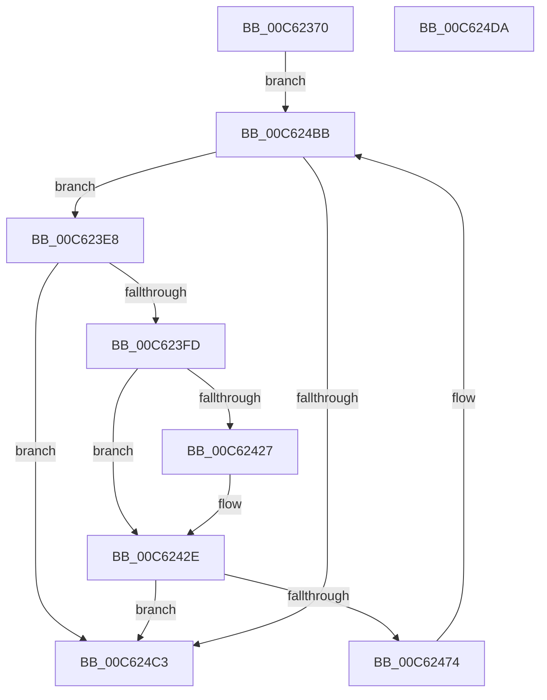

# MiFreeEmptyBootPageTable

- RVA: `0x00C62370`–`0x00C624DB` (길이 `363` bytes)
- VA: `0x0000000140C62370`
- 실행 섹션: `INIT`
- PDB 이름 있음: `예`; PDB Function 태그: `아니요`
- unwind 정보 RVA: `0x00083688`
- 디코드: `90`개 명령, `363/363` bytes 표시
- 미해석 바이트: `0` (있으면 어셈블리에 `.byte`로 보존)

> 이 문서는 커널 이미지의 기계어와 PDB 기호를 분석해 생성했습니다. 4번과 5번은 함수 원형과 자료형을 바이너리 사용 방식에서 추정한 C 해석이며 원본 소스 복구 결과는 아닙니다.

## 1. Dependencies

- 직접 호출 지점: **4**; 고유 호출 대상: **3**
- 직접 호출자로 확인된 함수: **1**
- RIP 상대 이미지 참조: **4**

### Outgoing calls
- `0x00C623DC` → [MiDecreaseUsedPtesInPfn](../../text/2A/MiDecreaseUsedPtesInPfn_function_002A27AC.md) (function, `0x002A27AC`)
- `0x00C623EB` → [MiGetLeafVa](../../text/27/MiGetLeafVa_function_0027C0A0.md) (function, `0x0027C0A0`)
- `0x00C6246A` → [MiLockAndInsertPageInFreeList](../../text/47/MiLockAndInsertPageInFreeList_function_00470FA8.md) (function, `0x00470FA8`)
- `0x00C624B6` → [MiDecreaseUsedPtesInPfn](../../text/2A/MiDecreaseUsedPtesInPfn_function_002A27AC.md) (function, `0x002A27AC`)

### Direct callers
- [MxCreateFreePfns](MxCreateFreePfns_function_00C632CC.md) at `0x00C633B1`

### Static image references
- `0x00C623F0` → RVA `0x01008700` (`INITDATA`; read)
- `0x00C623FD` → RVA `0x010086C8` (`INITDATA`; read)
- `0x00C62427` → RVA `0x010086C8` (`INITDATA`; write)
- `0x00C62460` → RVA `0x00010880` (`.rdata`; read)

## 2. Other-region calls and transfers

- 다른 실행 섹션으로 향하는 call: **4**
  - `0x00C623DC` → [MiDecreaseUsedPtesInPfn](../../text/2A/MiDecreaseUsedPtesInPfn_function_002A27AC.md) (`INIT` → `.text`)
  - `0x00C623EB` → [MiGetLeafVa](../../text/27/MiGetLeafVa_function_0027C0A0.md) (`INIT` → `.text`)
  - `0x00C6246A` → [MiLockAndInsertPageInFreeList](../../text/47/MiLockAndInsertPageInFreeList_function_00470FA8.md) (`INIT` → `.text`)
  - `0x00C624B6` → [MiDecreaseUsedPtesInPfn](../../text/2A/MiDecreaseUsedPtesInPfn_function_002A27AC.md) (`INIT` → `.text`)
- 별도 외부 분기/꼬리 이동을 확인하지 못했습니다.

## 3. Assembly (complete function range)

```asm
00C62370  48 89 5C 24 10                  mov qword ptr [rsp + 0x10], rbx
00C62375  48 89 6C 24 18                  mov qword ptr [rsp + 0x18], rbp
00C6237A  56                              push rsi
00C6237B  57                              push rdi
00C6237C  41 54                           push r12
00C6237E  41 56                           push r14
00C62380  41 57                           push r15
00C62382  48 83 EC 20                     sub rsp, 0x20
00C62386  48 8D 1C 49                     lea rbx, [rcx + rcx*2]
00C6238A  49 BC 00 00 00 00 00 DE FF FF   movabs r12, 0xffffde0000000000
00C62394  48 C1 E3 04                     shl rbx, 4
00C62398  4C 8B F1                        mov r14, rcx
00C6239B  49 8B C4                        mov rax, r12
00C6239E  48 03 D8                        add rbx, rax
00C623A1  49 BF 00 00 00 00 00 00 00 C0   movabs r15, 0xc000000000000000
00C623AB  48 B8 00 00 00 00 00 00 00 80   movabs rax, 0x8000000000000000
00C623B5  48 8B 7B 08                     mov rdi, qword ptr [rbx + 8]
00C623B9  48 0B F8                        or rdi, rax
00C623BC  48 8B 43 18                     mov rax, qword ptr [rbx + 0x18]
00C623C0  48 8D 48 FF                     lea rcx, [rax - 1]
00C623C4  48 8B D1                        mov rdx, rcx
00C623C7  48 33 D0                        xor rdx, rax
00C623CA  49 23 D7                        and rdx, r15
00C623CD  48 33 D1                        xor rdx, rcx
00C623D0  48 8B CB                        mov rcx, rbx
00C623D3  48 89 53 18                     mov qword ptr [rbx + 0x18], rdx
00C623D7  BA 01 00 00 00                  mov edx, 1
00C623DC  E8 CB 03 64 FF                  call 0x1402a27ac
00C623E1  33 ED                           xor ebp, ebp
00C623E3  E9 D3 00 00 00                  jmp 0x140c624bb
00C623E8  48 8B CF                        mov rcx, rdi
00C623EB  E8 B0 9C 61 FF                  call 0x14027c0a0
00C623F0  48 3B 05 09 63 3A 00            cmp rax, qword ptr [rip + 0x3a6309]
00C623F7  0F 83 C6 00 00 00               jae 0x140c624c3
00C623FD  48 8B 05 C4 62 3A 00            mov rax, qword ptr [rip + 0x3a62c4]
00C62404  48 B9 F8 FF FF FF 7F 00 00 00   movabs rcx, 0x7ffffffff8
00C6240E  48 C1 E8 09                     shr rax, 9
00C62412  48 23 C1                        and rax, rcx
00C62415  48 B9 00 00 00 00 80 F6 FF FF   movabs rcx, 0xfffff68000000000
00C6241F  48 03 C1                        add rax, rcx
00C62422  48 3B F8                        cmp rdi, rax
00C62425  75 07                           jne 0x140c6242e
00C62427  48 89 2D 9A 62 3A 00            mov qword ptr [rip + 0x3a629a], rbp
00C6242E  48 8B 43 18                     mov rax, qword ptr [rbx + 0x18]
00C62432  48 8B CB                        mov rcx, rbx
00C62435  49 23 C7                        and rax, r15
00C62438  48 89 43 18                     mov qword ptr [rbx + 0x18], rax
00C6243C  8B 43 20                        mov eax, dword ptr [rbx + 0x20]
00C6243F  89 44 24 50                     mov dword ptr [rsp + 0x50], eax
00C62443  66 89 6C 24 50                  mov word ptr [rsp + 0x50], bp
00C62448  8B 44 24 50                     mov eax, dword ptr [rsp + 0x50]
00C6244C  89 43 20                        mov dword ptr [rbx + 0x20], eax
00C6244F  48 B8 FF FF FF FF FF 00 00 00   movabs rax, 0xffffffffff
00C62459  48 8B 73 28                     mov rsi, qword ptr [rbx + 0x28]
00C6245D  48 23 F0                        and rsi, rax
00C62460  48 8B 05 19 E4 3A FF            mov rax, qword ptr [rip - 0xc51be7]
00C62467  48 89 07                        mov qword ptr [rdi], rax
00C6246A  E8 39 EB 80 FF                  call 0x140470fa8
00C6246F  49 3B F6                        cmp rsi, r14
00C62472  74 4F                           je 0x140c624c3
00C62474  48 8D 1C 76                     lea rbx, [rsi + rsi*2]
00C62478  4C 8B F6                        mov r14, rsi
00C6247B  48 C1 E3 04                     shl rbx, 4
00C6247F  49 8B C4                        mov rax, r12
00C62482  48 03 D8                        add rbx, rax
00C62485  48 B8 00 00 00 00 00 00 00 80   movabs rax, 0x8000000000000000
00C6248F  48 8B 7B 08                     mov rdi, qword ptr [rbx + 8]
00C62493  48 0B F8                        or rdi, rax
00C62496  48 8B 43 18                     mov rax, qword ptr [rbx + 0x18]
00C6249A  48 8D 50 FF                     lea rdx, [rax - 1]
00C6249E  48 8B CA                        mov rcx, rdx
00C624A1  48 33 C8                        xor rcx, rax
00C624A4  49 23 CF                        and rcx, r15
00C624A7  48 33 CA                        xor rcx, rdx
00C624AA  BA 01 00 00 00                  mov edx, 1
00C624AF  48 89 4B 18                     mov qword ptr [rbx + 0x18], rcx
00C624B3  48 8B CB                        mov rcx, rbx
00C624B6  E8 F1 02 64 FF                  call 0x1402a27ac
00C624BB  85 C0                           test eax, eax
00C624BD  0F 84 25 FF FF FF               je 0x140c623e8
00C624C3  48 8B 5C 24 58                  mov rbx, qword ptr [rsp + 0x58]
00C624C8  48 8B 6C 24 60                  mov rbp, qword ptr [rsp + 0x60]
00C624CD  48 83 C4 20                     add rsp, 0x20
00C624D1  41 5F                           pop r15
00C624D3  41 5E                           pop r14
00C624D5  41 5C                           pop r12
00C624D7  5F                              pop rdi
00C624D8  5E                              pop rsi
00C624D9  C3                              ret
00C624DA  CC                              int3
```

## 4. C-style interpretation (structured pseudocode)

```c
__int64 __fastcall MiFreeEmptyBootPageTable(__int64 a1)
{
    __int64 result;
    __int64 v_rbp;
    __int64 v_rbx;
    __int64 v_rdi;
    __int64 v_rsi;
    __int64 v_rsp;
    unsigned __int64 v_stack_p10;
    unsigned __int64 v_stack_p18;
    unsigned int v_stack_p8;

    v_stack_p10 = v_rbx;
    v_stack_p18 = v_rbp;
    v_rsp = (v_rsp) - (32);
    v_rbx = (a1 + a1 * 2) << (4);
    v_rbx = (v_rbx) + (v_r12);
    v_rdi = (*(unsigned __int64 *)(v_rbx + 8)) | (v_r12);
    a2 = (*(unsigned __int64 *)(v_rbx + 24) - 1) ^ (*(unsigned __int64 *)(v_rbx + 24));
    a2 = (a2) & (v_r15);
    a2 = (a2) ^ (*(unsigned __int64 *)(v_rbx + 24) - 1);
    *(unsigned __int64 *)(v_rbx + 24) = a2;
    result = MiDecreaseUsedPtesInPfn(v_rbx, 1, a3, a4);
    v_rbp = 0;
    goto loc_00C624BB;
loc_00C623E8:
    result = MiGetLeafVa(v_rdi, 1, a3, a4);
    if (result >= (*(unsigned __int64 *)(v_rip + 3826441))) goto loc_00C624C3;
    result = (*(unsigned __int64 *)(v_rip + 3826372)) >> (9);
    result = (result) & (v_rdi);
    result = (result) + (v_rdi);
    if (v_rdi == result) {
        *(unsigned __int64 *)(v_rip + 3826330) = 0;
    }
    result = (*(unsigned __int64 *)(v_rbx + 24)) & (v_r15);
    *(unsigned __int64 *)(v_rbx + 24) = result;
    v_stack_p8 = (unsigned int)((unsigned int)(*(unsigned int *)(v_rbx + 32)));
    v_stack_p8 = 0;
    *(unsigned int *)(v_rbx + 32) = (unsigned int)((unsigned int)(v_stack_p8));
    v_rsi = (*(unsigned __int64 *)(v_rbx + 40)) & ((unsigned int)(v_stack_p8));
    *(unsigned __int64 *)(v_rdi) = *(unsigned __int64 *)(v_rip - 12917735);
    result = MiLockAndInsertPageInFreeList(v_rbx, 1, a3, a4);
    if (v_rsi == a1) goto loc_00C624C3;
    v_rbx = (v_rsi + v_rsi * 2) << (4);
    v_rbx = (v_rbx) + (v_r12);
    v_rdi = (*(unsigned __int64 *)(v_rbx + 8)) | (v_r12);
    a1 = (*(unsigned __int64 *)(v_rbx + 24) - 1) ^ (*(unsigned __int64 *)(v_rbx + 24));
    a1 = (a1) & (v_r15);
    a1 = (a1) ^ (*(unsigned __int64 *)(v_rbx + 24) - 1);
    *(unsigned __int64 *)(v_rbx + 24) = a1;
    result = MiDecreaseUsedPtesInPfn(v_rbx, 1, a3, a4);
loc_00C624BB:
    if ((unsigned int)(result) == 0) goto loc_00C623E8;
loc_00C624C3:
    v_rsp = (v_rsp) + (32);
    return result;
}
```

## 5. (Beta) C Style

```c
int64_t MiFreeEmptyBootPageTable(void *Arg1)
{
    uint8_t *arg1 = (uint8_t *)Arg1;

    int64_t result;
    int64_t local_rbp;
    int64_t local_rbx;
    int64_t local_rdi;
    int64_t local_rsi;
    int64_t local_rsp;
    uint64_t v_stack_p10;
    uint64_t v_stack_p18;
    uint32_t v_stack_p8;

    v_stack_p10 = local_rbx;
    v_stack_p18 = local_rbp;
    local_rsp = (local_rsp) - (32);
    local_rbx = (Arg1 + Arg1 * 2) << (4);
    local_rbx = (local_rbx) + (local_r12);
    local_rdi = (*(uint64_t *)(local_rbx + 0x8)) | (local_r12);
    a2 = (*(uint64_t *)(local_rbx + 0x18) - 1) ^ (*(uint64_t *)(local_rbx + 0x18));
    a2 = (a2) & (local_r15);
    a2 = (a2) ^ (*(uint64_t *)(local_rbx + 0x18) - 1);
    *(uint64_t *)(local_rbx + 0x18) = a2;
    result = MiDecreaseUsedPtesInPfn(local_rbx, 1, a3, a4);
    local_rbp = 0;
    goto loc_00C624BB;
loc_00C623E8:
    result = MiGetLeafVa(local_rdi, 1, a3, a4);
    if (result >= (*(uint64_t *)(v_rip + 0x3A6309))) goto loc_00C624C3;
    result = (*(uint64_t *)(v_rip + 0x3A62C4)) >> (9);
    result = (result) & (local_rdi);
    result = (result) + (local_rdi);
    if (local_rdi == result) {
        *(uint64_t *)(v_rip + 0x3A629A) = 0;
    }
    result = (*(uint64_t *)(local_rbx + 0x18)) & (local_r15);
    *(uint64_t *)(local_rbx + 0x18) = result;
    v_stack_p8 = (uint32_t)((uint32_t)(*(uint32_t *)(local_rbx + 0x20)));
    v_stack_p8 = 0;
    *(uint32_t *)(local_rbx + 0x20) = (uint32_t)((uint32_t)(v_stack_p8));
    local_rsi = (*(uint64_t *)(local_rbx + 0x28)) & ((uint32_t)(v_stack_p8));
    *(uint64_t *)(local_rdi) = *(uint64_t *)(v_rip - 0xC51BE7);
    result = MiLockAndInsertPageInFreeList(local_rbx, 1, a3, a4);
    if (local_rsi == Arg1) goto loc_00C624C3;
    local_rbx = (local_rsi + local_rsi * 2) << (4);
    local_rbx = (local_rbx) + (local_r12);
    local_rdi = (*(uint64_t *)(local_rbx + 0x8)) | (local_r12);
    Arg1 = (*(uint64_t *)(local_rbx + 0x18) - 1) ^ (*(uint64_t *)(local_rbx + 0x18));
    Arg1 = (Arg1) & (local_r15);
    Arg1 = (Arg1) ^ (*(uint64_t *)(local_rbx + 0x18) - 1);
    *(void **)(local_rbx + 0x18) = Arg1;
    result = MiDecreaseUsedPtesInPfn(local_rbx, 1, a3, a4);
loc_00C624BB:
    if ((uint32_t)(result) == 0) goto loc_00C623E8;
loc_00C624C3:
    local_rsp = (local_rsp) + (32);
    return result;
}
```

### 관측된 메모리 오프셋

구조체 형식이 확인되지 않은 접근은 인자 기준의 오프셋으로만 기록했습니다.

| 기준 인자 | 오프셋 표현 | 폭 (bit) | 접근 |
|---|---:|---:|---|
| `Arg1` | `+ 0x0 + rcx*2` | `64` | `R` |

## 6. Execution-region graph

[열기: 2D/3D 그래프와 함수 탐색 컨트롤 패널](../../../control-panel.html?section=init&rva=0x00C62370&view=graph)

- 2D 그래프는 위에서 아래로 흐르고, 3D 그래프는 빈 공간을 드래그해 회전합니다. Shift+드래그는 이동, 휠은 확대·축소, 함수 노드 선택은 대상 보고서 이동입니다.

### Static fallback


