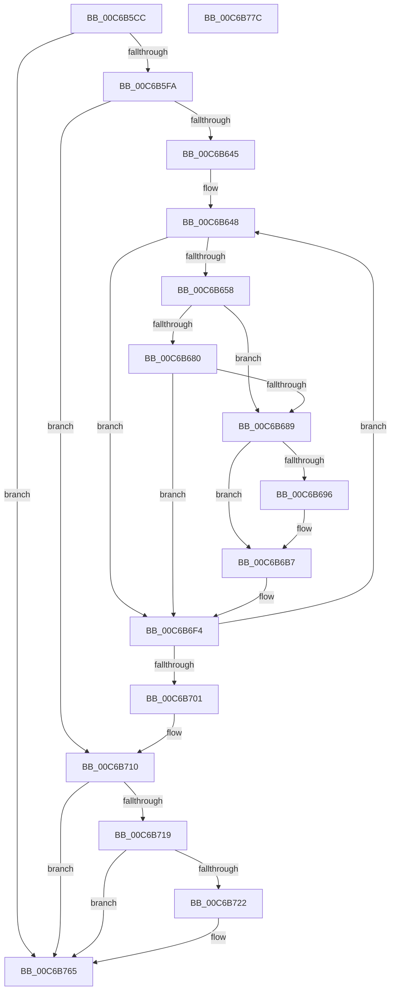

# MiFreeKernelPadSections

- RVA: `0x00C6B5CC`–`0x00C6B77D` (길이 `433` bytes)
- VA: `0x0000000140C6B5CC`
- 실행 섹션: `INIT`
- PDB 이름 있음: `예`; PDB Function 태그: `아니요`
- unwind 정보 RVA: `0x000D9504`
- 디코드: `109`개 명령, `433/433` bytes 표시
- 미해석 바이트: `0` (있으면 어셈블리에 `.byte`로 보존)

> 이 문서는 커널 이미지의 기계어와 PDB 기호를 분석해 생성했습니다. 4번과 5번은 함수 원형과 자료형을 바이너리 사용 방식에서 추정한 C 해석이며 원본 소스 복구 결과는 아닙니다.

## 1. Dependencies

- 직접 호출 지점: **5**; 고유 호출 대상: **4**
- 직접 호출자로 확인된 함수: **1**
- RIP 상대 이미지 참조: **2**

### Outgoing calls
- `0x00C6B60D` → [RtlImageNtHeaderEx](../../text/41/RtlImageNtHeaderEx_function_0041EAA0.md) (function, `0x0041EAA0`)
- `0x00C6B64B` → [MiIsKernelHalPadSection](../../text/4C/MiIsKernelHalPadSection_function_004CCFB0.md) (function, `0x004CCFB0`)
- `0x00C6B6A8` → [VslReserveProtectedPages](../../page/A9/VslReserveProtectedPages_function_00A90ACC.md) (function, `0x00A90ACC`)
- `0x00C6B6E5` → [MiFreeInitializationCode](../../page/7F/MiFreeInitializationCode_function_007F88A0.md) (function, `0x007F88A0`)
- `0x00C6B760` → [MiFreeInitializationCode](../../page/7F/MiFreeInitializationCode_function_007F88A0.md) (function, `0x007F88A0`)

### Direct callers
- [MiInitializeSystemImageRegion](MiInitializeSystemImageRegion_function_00C6C05C.md) at `0x00C6C261`

### Static image references
- `0x00C6B5E7` → RVA `0x00FC5258` (`ALMOSTRO`; read)
- `0x00C6B689` → RVA `0x00FC6A88` (`ALMOSTRO`; read)

## 2. Other-region calls and transfers

- 다른 실행 섹션으로 향하는 call: **5**
  - `0x00C6B60D` → [RtlImageNtHeaderEx](../../text/41/RtlImageNtHeaderEx_function_0041EAA0.md) (`INIT` → `.text`)
  - `0x00C6B64B` → [MiIsKernelHalPadSection](../../text/4C/MiIsKernelHalPadSection_function_004CCFB0.md) (`INIT` → `.text`)
  - `0x00C6B6A8` → [VslReserveProtectedPages](../../page/A9/VslReserveProtectedPages_function_00A90ACC.md) (`INIT` → `PAGE`)
  - `0x00C6B6E5` → [MiFreeInitializationCode](../../page/7F/MiFreeInitializationCode_function_007F88A0.md) (`INIT` → `PAGE`)
  - `0x00C6B760` → [MiFreeInitializationCode](../../page/7F/MiFreeInitializationCode_function_007F88A0.md) (`INIT` → `PAGE`)
- 별도 외부 분기/꼬리 이동을 확인하지 못했습니다.

## 3. Assembly (complete function range)

```asm
00C6B5CC  48 8B C4                        mov rax, rsp
00C6B5CF  48 89 58 08                     mov qword ptr [rax + 8], rbx
00C6B5D3  48 89 68 20                     mov qword ptr [rax + 0x20], rbp
00C6B5D7  48 89 50 10                     mov qword ptr [rax + 0x10], rdx
00C6B5DB  56                              push rsi
00C6B5DC  57                              push rdi
00C6B5DD  41 55                           push r13
00C6B5DF  41 56                           push r14
00C6B5E1  41 57                           push r15
00C6B5E3  48 83 EC 20                     sub rsp, 0x20
00C6B5E7  83 3D 6A 9C 35 00 02            cmp dword ptr [rip + 0x359c6a], 2
00C6B5EE  48 8B F2                        mov rsi, rdx
00C6B5F1  48 8B F9                        mov rdi, rcx
00C6B5F4  0F 84 6B 01 00 00               je 0x140c6b765
00C6B5FA  48 83 60 18 00                  and qword ptr [rax + 0x18], 0
00C6B5FF  4C 8D 48 18                     lea r9, [rax + 0x18]
00C6B603  45 33 C0                        xor r8d, r8d
00C6B606  48 8B D1                        mov rdx, rcx
00C6B609  41 8D 48 01                     lea ecx, [r8 + 1]
00C6B60D  E8 8E 34 7B FF                  call 0x14041eaa0
00C6B612  48 8B 4C 24 60                  mov rcx, qword ptr [rsp + 0x60]
00C6B617  45 33 F6                        xor r14d, r14d
00C6B61A  49 B9 F8 FF FF FF 7F 00 00 00   movabs r9, 0x7ffffffff8
00C6B624  0F B7 41 14                     movzx eax, word ptr [rcx + 0x14]
00C6B628  48 8D 59 18                     lea rbx, [rcx + 0x18]
00C6B62C  0F B7 69 06                     movzx ebp, word ptr [rcx + 6]
00C6B630  48 03 D8                        add rbx, rax
00C6B633  48 B9 00 00 00 00 80 F6 FF FF   movabs rcx, 0xfffff68000000000
00C6B63D  85 ED                           test ebp, ebp
00C6B63F  0F 84 CB 00 00 00               je 0x140c6b710
00C6B645  48 8B F1                        mov rsi, rcx
00C6B648  48 8B CB                        mov rcx, rbx
00C6B64B  E8 60 19 86 FF                  call 0x1404ccfb0
00C6B650  85 C0                           test eax, eax
00C6B652  0F 84 9C 00 00 00               je 0x140c6b6f4
00C6B658  8B 4B 10                        mov ecx, dword ptr [rbx + 0x10]
00C6B65B  8B 43 08                        mov eax, dword ptr [rbx + 8]
00C6B65E  3B C8                           cmp ecx, eax
00C6B660  44 8B 7B 0C                     mov r15d, dword ptr [rbx + 0xc]
00C6B664  0F 42 C8                        cmovb ecx, eax
00C6B667  41 FF C6                        inc r14d
00C6B66A  81 C1 FF 0F 00 00               add ecx, 0xfff
00C6B670  81 E1 00 F0 FF FF               and ecx, 0xfffff000
00C6B676  44 8D 69 FF                     lea r13d, [rcx - 1]
00C6B67A  41 83 FE 01                     cmp r14d, 1
00C6B67E  75 09                           jne 0x140c6b689
00C6B680  44 39 35 D1 9B 35 00            cmp dword ptr [rip + 0x359bd1], r14d
00C6B687  74 6B                           je 0x140c6b6f4
00C6B689  48 F7 05 F4 B3 35 00 00 40 00 00  test qword ptr [rip + 0x35b3f4], 0x4000
00C6B694  74 21                           je 0x140c6b6b7
00C6B696  C1 E9 0C                        shr ecx, 0xc
00C6B699  4A 8D 14 3F                     lea rdx, [rdi + r15]
00C6B69D  44 8B C1                        mov r8d, ecx
00C6B6A0  41 B9 02 00 00 00               mov r9d, 2
00C6B6A6  33 C9                           xor ecx, ecx
00C6B6A8  E8 1F 54 E2 FF                  call 0x140a90acc
00C6B6AD  49 B9 F8 FF FF FF 7F 00 00 00   movabs r9, 0x7ffffffff8
00C6B6B7  47 8D 04 2F                     lea r8d, [r15 + r13]
00C6B6BB  4C 03 C7                        add r8, rdi
00C6B6BE  49 C1 E8 09                     shr r8, 9
00C6B6C2  4D 23 C1                        and r8, r9
00C6B6C5  48 8B C6                        mov rax, rsi
00C6B6C8  4A 8D 14 3F                     lea rdx, [rdi + r15]
00C6B6CC  4C 03 C0                        add r8, rax
00C6B6CF  48 C1 EA 09                     shr rdx, 9
00C6B6D3  49 23 D1                        and rdx, r9
00C6B6D6  48 8B C6                        mov rax, rsi
00C6B6D9  48 03 D0                        add rdx, rax
00C6B6DC  41 B9 01 00 00 00               mov r9d, 1
00C6B6E2  48 8B CF                        mov rcx, rdi
00C6B6E5  E8 B6 D1 B8 FF                  call 0x1407f88a0
00C6B6EA  49 B9 F8 FF FF FF 7F 00 00 00   movabs r9, 0x7ffffffff8
00C6B6F4  48 83 C3 28                     add rbx, 0x28
00C6B6F8  83 C5 FF                        add ebp, -1
00C6B6FB  0F 85 47 FF FF FF               jne 0x140c6b648
00C6B701  48 8B 74 24 58                  mov rsi, qword ptr [rsp + 0x58]
00C6B706  48 B9 00 00 00 00 80 F6 FF FF   movabs rcx, 0xfffff68000000000
00C6B710  F6 05 71 B3 35 00 04            test byte ptr [rip + 0x35b371], 4
00C6B717  74 4C                           je 0x140c6b765
00C6B719  48 F7 C6 FF FF 1F 00            test rsi, 0x1fffff
00C6B720  74 43                           je 0x140c6b765
00C6B722  2B F7                           sub esi, edi
00C6B724  44 8D 86 FF FF 1F 00            lea r8d, [rsi + 0x1fffff]
00C6B72B  41 81 E0 00 00 E0 FF            and r8d, 0xffe00000
00C6B732  41 FF C8                        dec r8d
00C6B735  4C 03 C7                        add r8, rdi
00C6B738  49 C1 E8 09                     shr r8, 9
00C6B73C  4D 23 C1                        and r8, r9
00C6B73F  48 8B C1                        mov rax, rcx
00C6B742  8B D6                           mov edx, esi
00C6B744  4C 03 C0                        add r8, rax
00C6B747  48 03 D7                        add rdx, rdi
00C6B74A  48 C1 EA 09                     shr rdx, 9
00C6B74E  49 23 D1                        and rdx, r9
00C6B751  48 8B C1                        mov rax, rcx
00C6B754  48 03 D0                        add rdx, rax
00C6B757  41 B9 01 00 00 00               mov r9d, 1
00C6B75D  48 8B CF                        mov rcx, rdi
00C6B760  E8 3B D1 B8 FF                  call 0x1407f88a0
00C6B765  48 8B 5C 24 50                  mov rbx, qword ptr [rsp + 0x50]
00C6B76A  48 8B 6C 24 68                  mov rbp, qword ptr [rsp + 0x68]
00C6B76F  48 83 C4 20                     add rsp, 0x20
00C6B773  41 5F                           pop r15
00C6B775  41 5E                           pop r14
00C6B777  41 5D                           pop r13
00C6B779  5F                              pop rdi
00C6B77A  5E                              pop rsi
00C6B77B  C3                              ret
00C6B77C  CC                              int3
```

## 4. C-style interpretation (structured pseudocode)

```c
__int64 __fastcall MiFreeKernelPadSections(__int64 a1, __int64 a2, int a3)
{
    __int64 result;
    __int64 v_r14;
    __int64 v_rbp;
    __int64 v_rbx;
    __int64 v_rsi;
    __int64 v_rsp;
    unsigned __int64 v_stack_p10;
    unsigned __int64 v_stack_p18;
    unsigned __int64 v_stack_p20;
    unsigned __int64 v_stack_p8;

    *(unsigned __int64 *)(v_rsp + 8) = v_rbx;
    *(unsigned __int64 *)(v_rsp + 32) = v_rbp;
    *(unsigned __int64 *)(v_rsp + 16) = a2;
    v_rsp = (v_rsp) - (32);
    if ((*(unsigned int *)(v_rip + 3513450)) == 2) goto loc_00C6B765;
    a3 = 0;
    result = RtlImageNtHeaderEx(a3 + 1, a1, a3, v_rsp + 24);
    v_r14 = 0;
    v_rbx = (v_stack_p18 + 24) + (*(unsigned __int16 *)(v_stack_p18 + 20));
    if ((unsigned int)(*(unsigned __int16 *)(v_stack_p18 + 6)) == 0) goto loc_00C6B710;
loc_00C6B648:
    result = MiIsKernelHalPadSection(v_rbx, a1, a3, v_rsp + 24);
    if ((unsigned int)(result) == 0) goto loc_00C6B6F4;
    a1 = (unsigned int)(*(unsigned int *)(v_rbx + 16));
    if (((unsigned int)((unsigned int)(*(unsigned int *)(v_rbx + 16)))) < ((unsigned int)((unsigned int)(*(unsigned int *)(v_rbx + 8))))) { a1 = (unsigned int)((unsigned int)(*(unsigned int *)(v_rbx + 8))); }
    v_r14 = (unsigned int)((v_r14) + 1);
    a1 = (unsigned int)((a1) + (0xFFFULL));
    a1 = (unsigned int)((a1) & (0xFFFFF000ULL));
    if (((unsigned int)(v_r14)) != 1) goto loc_00C6B689;
    if ((*(unsigned int *)(v_rip + 3513297)) == ((unsigned int)(v_r14))) goto loc_00C6B6F4;
loc_00C6B689:
    result = (unsigned int)(*(unsigned int *)(v_rbx + 8));
    if (((*(unsigned __int64 *)(v_rip + 3519476)) & (0x4000ULL)) != 0) {
        a1 = (unsigned int)((a1) >> (12));
        a2 = a1 + (unsigned int)(*(unsigned int *)(v_rbx + 12)) * 1;
        a3 = (unsigned int)(a1);
        a4 = 2;
        a1 = 0;
        result = VslReserveProtectedPages(a1, a2, a3, a4);
    }
    a3 = ((unsigned int)(*(unsigned int *)(v_rbx + 12)) + a1 - 1 * 1) + (0);
    a3 = (a3) >> (9);
    a3 = (a3) & (a4);
    a3 = (a3) + (v_stack_p18);
    a2 = (a1 + (unsigned int)(*(unsigned int *)(v_rbx + 12)) * 1) >> (9);
    a2 = (a2) & (a4);
    a2 = (a2) + (v_stack_p18);
    result = MiFreeInitializationCode(0, a2, a3, 1);
loc_00C6B6F4:
    v_rbx = (v_rbx) + (40);
    v_rbp = (unsigned int)((*(unsigned __int16 *)(v_stack_p18 + 6)) + (-1));
    if (condition_is_not_equal) goto loc_00C6B648;
loc_00C6B710:
    if (((*(unsigned __int8 *)(v_rip + 3519345)) & (4)) == 0) goto loc_00C6B765;
    v_rsi = v_stack_p10;
    if (((v_stack_p10) & (0x1FFFFFULL)) != 0) {
        v_rsi = (unsigned int)((v_stack_p10) - (0));
        a3 = v_rsi + 2097151;
        a3 = (unsigned int)((a3) & (0xFFE00000ULL));
        a3 = (unsigned int)((a3) - 1);
        a3 = (a3) + (0);
        a3 = (a3) >> (9);
        a3 = (a3) & (1);
        result = 0;
        a2 = (unsigned int)(v_rsi);
        a3 = (a3) + (result);
        a2 = (a2) + (0);
        a2 = (a2) >> (9);
        a2 = (a2) & (1);
        result = 0;
        a2 = (a2) + (result);
        a4 = 1;
        a1 = 0;
        result = MiFreeInitializationCode(a1, a2, a3, a4);
    }
    v_rsp = (v_rsp) + (32);
    return result;
}
```

## 5. (Beta) C Style

```c
int64_t MiFreeKernelPadSections(void *Arg1, int64_t Arg2, int32_t Arg3)
{
    uint8_t *arg1 = (uint8_t *)Arg1;

    int64_t result;
    int64_t local_r14;
    int64_t local_rbp;
    int64_t local_rbx;
    int64_t local_rsi;
    int64_t local_rsp;
    uint64_t v_stack_p10;
    uint64_t v_stack_p18;
    uint64_t v_stack_p20;
    uint64_t v_stack_p8;

    *(uint64_t *)(local_rsp + 0x8) = local_rbx;
    *(uint64_t *)(local_rsp + 0x20) = local_rbp;
    *(uint64_t *)(local_rsp + 0x10) = Arg2;
    local_rsp = (local_rsp) - (32);
    if ((*(uint32_t *)(v_rip + 0x359C6A)) == 2) goto loc_00C6B765;
    Arg3 = 0;
    result = RtlImageNtHeaderEx(Arg3 + 1, Arg1, Arg3, local_rsp + 24);
    local_r14 = 0;
    local_rbx = (v_stack_p18 + 24) + (*(uint16_t *)(v_stack_p18 + 0x14));
    if ((uint32_t)(*(uint16_t *)(v_stack_p18 + 0x6)) == 0) goto loc_00C6B710;
loc_00C6B648:
    result = MiIsKernelHalPadSection(local_rbx, Arg1, Arg3, local_rsp + 24);
    if ((uint32_t)(result) == 0) goto loc_00C6B6F4;
    Arg1 = (uint32_t)(*(uint32_t *)(local_rbx + 0x10));
    if (((uint32_t)((uint32_t)(*(uint32_t *)(local_rbx + 0x10)))) < ((uint32_t)((uint32_t)(*(uint32_t *)(local_rbx + 0x8))))) { Arg1 = (uint32_t)((uint32_t)(*(uint32_t *)(local_rbx + 0x8))); }
    local_r14 = (uint32_t)((local_r14) + 1);
    Arg1 = (uint32_t)((Arg1) + (0xFFFULL));
    Arg1 = (uint32_t)((Arg1) & (0xFFFFF000ULL));
    if (((uint32_t)(local_r14)) != 1) goto loc_00C6B689;
    if ((*(uint32_t *)(v_rip + 0x359BD1)) == ((uint32_t)(local_r14))) goto loc_00C6B6F4;
loc_00C6B689:
    result = (uint32_t)(*(uint32_t *)(local_rbx + 0x8));
    if (((*(uint64_t *)(v_rip + 0x35B3F4)) & (0x4000ULL)) != 0) {
        Arg1 = (uint32_t)((Arg1) >> (12));
        Arg2 = Arg1 + (uint32_t)(*(uint32_t *)(local_rbx + 0xC)) * 1;
        Arg3 = (uint32_t)(Arg1);
        a4 = 2;
        Arg1 = 0;
        result = VslReserveProtectedPages(Arg1, Arg2, Arg3, a4);
    }
    Arg3 = ((uint32_t)(*(uint32_t *)(local_rbx + 0xC)) + Arg1 - 1 * 1) + (0);
    Arg3 = (Arg3) >> (9);
    Arg3 = (Arg3) & (a4);
    Arg3 = (Arg3) + (v_stack_p18);
    Arg2 = (Arg1 + (uint32_t)(*(uint32_t *)(local_rbx + 0xC)) * 1) >> (9);
    Arg2 = (Arg2) & (a4);
    Arg2 = (Arg2) + (v_stack_p18);
    result = MiFreeInitializationCode(0, Arg2, Arg3, 1);
loc_00C6B6F4:
    local_rbx = (local_rbx) + (40);
    local_rbp = (uint32_t)((*(uint16_t *)(v_stack_p18 + 0x6)) + (-1));
    if (condition_is_not_equal) goto loc_00C6B648;
loc_00C6B710:
    if (((*(uint8_t *)(v_rip + 0x35B371)) & (4)) == 0) goto loc_00C6B765;
    local_rsi = v_stack_p10;
    if (((v_stack_p10) & (0x1FFFFFULL)) != 0) {
        local_rsi = (uint32_t)((v_stack_p10) - (0));
        Arg3 = local_rsi + 2097151;
        Arg3 = (uint32_t)((Arg3) & (0xFFE00000ULL));
        Arg3 = (uint32_t)((Arg3) - 1);
        Arg3 = (Arg3) + (0);
        Arg3 = (Arg3) >> (9);
        Arg3 = (Arg3) & (1);
        result = 0;
        Arg2 = (uint32_t)(local_rsi);
        Arg3 = (Arg3) + (result);
        Arg2 = (Arg2) + (0);
        Arg2 = (Arg2) >> (9);
        Arg2 = (Arg2) & (1);
        result = 0;
        Arg2 = (Arg2) + (result);
        a4 = 1;
        Arg1 = 0;
        result = MiFreeInitializationCode(Arg1, Arg2, Arg3, a4);
    }
    local_rsp = (local_rsp) + (32);
    return result;
}
```

### 관측된 메모리 오프셋

구조체 형식이 확인되지 않은 접근은 인자 기준의 오프셋으로만 기록했습니다.

| 기준 인자 | 오프셋 표현 | 폭 (bit) | 접근 |
|---|---:|---:|---|
| `Arg1` | `+ 0x0 + r15*1` | `64` | `R` |

## 6. Execution-region graph

[열기: 2D/3D 그래프와 함수 탐색 컨트롤 패널](../../../control-panel.html?section=init&rva=0x00C6B5CC&view=graph)

- 2D 그래프는 위에서 아래로 흐르고, 3D 그래프는 빈 공간을 드래그해 회전합니다. Shift+드래그는 이동, 휠은 확대·축소, 함수 노드 선택은 대상 보고서 이동입니다.

### Static fallback


