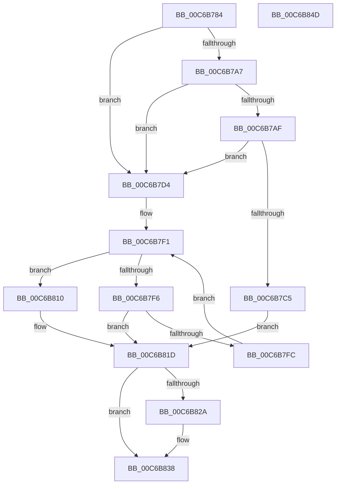

# MiGetBootImagePageProtection

- RVA: `0x00C6B784`–`0x00C6B84E` (길이 `202` bytes)
- VA: `0x0000000140C6B784`
- 실행 섹션: `INIT`
- PDB 이름 있음: `예`; PDB Function 태그: `아니요`
- unwind 정보 RVA: `0x00060BC4`
- 디코드: `62`개 명령, `202/202` bytes 표시
- 미해석 바이트: `0` (있으면 어셈블리에 `.byte`로 보존)

> 이 문서는 커널 이미지의 기계어와 PDB 기호를 분석해 생성했습니다. 4번과 5번은 함수 원형과 자료형을 바이너리 사용 방식에서 추정한 C 해석이며 원본 소스 복구 결과는 아닙니다.

## 1. Dependencies

- 직접 호출 지점: **2**; 고유 호출 대상: **1**
- 직접 호출자로 확인된 함수: **1**
- RIP 상대 이미지 참조: **1**

### Outgoing calls
- `0x00C6B7CB` → [MiComputeDriverProtection](../../page/AA/MiComputeDriverProtection_function_00AA80A8.md) (function, `0x00AA80A8`)
- `0x00C6B800` → [MiComputeDriverProtection](../../page/AA/MiComputeDriverProtection_function_00AA80A8.md) (function, `0x00AA80A8`)

### Direct callers
- [MiHandleBootImage](MiHandleBootImage_function_00C6B854.md) at `0x00C6B9D5`

### Static image references
- `0x00C6B81D` → RVA `0x00FC6A88` (`ALMOSTRO`; read)

## 2. Other-region calls and transfers

- 다른 실행 섹션으로 향하는 call: **2**
  - `0x00C6B7CB` → [MiComputeDriverProtection](../../page/AA/MiComputeDriverProtection_function_00AA80A8.md) (`INIT` → `PAGE`)
  - `0x00C6B800` → [MiComputeDriverProtection](../../page/AA/MiComputeDriverProtection_function_00AA80A8.md) (`INIT` → `PAGE`)
- 별도 외부 분기/꼬리 이동을 확인하지 못했습니다.

## 3. Assembly (complete function range)

```asm
00C6B784  48 89 5C 24 08                  mov qword ptr [rsp + 8], rbx
00C6B789  48 89 74 24 10                  mov qword ptr [rsp + 0x10], rsi
00C6B78E  57                              push rdi
00C6B78F  48 83 EC 20                     sub rsp, 0x20
00C6B793  44 8B D9                        mov r11d, ecx
00C6B796  45 33 D2                        xor r10d, r10d
00C6B799  49 8B 09                        mov rcx, qword ptr [r9]
00C6B79C  49 8B F9                        mov rdi, r9
00C6B79F  49 8B F0                        mov rsi, r8
00C6B7A2  48 85 C9                        test rcx, rcx
00C6B7A5  74 2D                           je 0x140c6b7d4
00C6B7A7  8B 59 0C                        mov ebx, dword ptr [rcx + 0xc]
00C6B7AA  44 3B DB                        cmp r11d, ebx
00C6B7AD  72 25                           jb 0x140c6b7d4
00C6B7AF  44 8B 49 10                     mov r9d, dword ptr [rcx + 0x10]
00C6B7B3  8B 41 08                        mov eax, dword ptr [rcx + 8]
00C6B7B6  44 3B C8                        cmp r9d, eax
00C6B7B9  44 0F 42 C8                     cmovb r9d, eax
00C6B7BD  44 03 CB                        add r9d, ebx
00C6B7C0  45 3B D9                        cmp r11d, r9d
00C6B7C3  73 0F                           jae 0x140c6b7d4
00C6B7C5  4C 8B D1                        mov r10, rcx
00C6B7C8  8B 49 24                        mov ecx, dword ptr [rcx + 0x24]
00C6B7CB  E8 D8 C8 E3 FF                  call 0x140aa80a8
00C6B7D0  8B C8                           mov ecx, eax
00C6B7D2  EB 49                           jmp 0x140c6b81d
00C6B7D4  44 0F B7 4A 14                  movzx r9d, word ptr [rdx + 0x14]
00C6B7D9  0F B7 42 06                     movzx eax, word ptr [rdx + 6]
00C6B7DD  49 83 C1 18                     add r9, 0x18
00C6B7E1  4C 03 CA                        add r9, rdx
00C6B7E4  48 8D 0C 80                     lea rcx, [rax + rax*4]
00C6B7E8  49 8D 1C C9                     lea rbx, [r9 + rcx*8]
00C6B7EC  B9 01 00 00 00                  mov ecx, 1
00C6B7F1  4C 3B CB                        cmp r9, rbx
00C6B7F4  73 1A                           jae 0x140c6b810
00C6B7F6  45 3B 59 0C                     cmp r11d, dword ptr [r9 + 0xc]
00C6B7FA  72 21                           jb 0x140c6b81d
00C6B7FC  41 8B 49 24                     mov ecx, dword ptr [r9 + 0x24]
00C6B800  E8 A3 C8 E3 FF                  call 0x140aa80a8
00C6B805  4D 8B D1                        mov r10, r9
00C6B808  8B C8                           mov ecx, eax
00C6B80A  49 83 C1 28                     add r9, 0x28
00C6B80E  EB E1                           jmp 0x140c6b7f1
00C6B810  8B 4E 10                        mov ecx, dword ptr [rsi + 0x10]
00C6B813  45 33 D2                        xor r10d, r10d
00C6B816  48 C1 E9 05                     shr rcx, 5
00C6B81A  83 E1 1F                        and ecx, 0x1f
00C6B81D  48 F7 05 60 B2 35 00 00 80 00 00  test qword ptr [rip + 0x35b260], 0x8000
00C6B828  74 0E                           je 0x140c6b838
00C6B82A  8A C1                           mov al, cl
00C6B82C  BA 03 00 00 00                  mov edx, 3
00C6B831  24 06                           and al, 6
00C6B833  3C 06                           cmp al, 6
00C6B835  0F 44 CA                        cmove ecx, edx
00C6B838  48 8B 5C 24 30                  mov rbx, qword ptr [rsp + 0x30]
00C6B83D  8B C1                           mov eax, ecx
00C6B83F  48 8B 74 24 38                  mov rsi, qword ptr [rsp + 0x38]
00C6B844  4C 89 17                        mov qword ptr [rdi], r10
00C6B847  48 83 C4 20                     add rsp, 0x20
00C6B84B  5F                              pop rdi
00C6B84C  C3                              ret
00C6B84D  CC                              int3
```

## 4. C-style interpretation (structured pseudocode)

```c
__int64 __fastcall MiGetBootImagePageProtection(int a1, __int64 a2, __int64 a3, __int64 a4)
{
    __int64 result;
    __int64 v_r10;
    __int64 v_rsp;
    unsigned __int64 v_stack_p10;
    unsigned __int64 v_stack_p8;

    v_stack_p8 = v_rbx;
    v_stack_p10 = v_rsi;
    v_rsp = (v_rsp) - (32);
    v_r10 = 0;
    if (*(unsigned __int64 *)(a4) == 0) goto loc_00C6B7D4;
    if (((unsigned int)((unsigned int)(a1))) < ((unsigned int)((unsigned int)(*(unsigned int *)(*(unsigned __int64 *)(a4) + 12))))) goto loc_00C6B7D4;
    a4 = (unsigned int)(*(unsigned int *)(*(unsigned __int64 *)(a4) + 16));
    if (((unsigned int)((unsigned int)(*(unsigned int *)(*(unsigned __int64 *)(a4) + 16)))) < ((unsigned int)((unsigned int)(*(unsigned int *)(*(unsigned __int64 *)(a4) + 8))))) { a4 = (unsigned int)((unsigned int)(*(unsigned int *)(*(unsigned __int64 *)(a4) + 8))); }
    a4 = (unsigned int)((a4) + ((unsigned int)((unsigned int)(*(unsigned int *)(*(unsigned __int64 *)(a4) + 12)))));
    if (((unsigned int)((unsigned int)(a1))) >= ((unsigned int)(a4))) goto loc_00C6B7D4;
    result = MiComputeDriverProtection((unsigned int)(*(unsigned int *)(*(unsigned __int64 *)(a4) + 36)), a2, a3, a4);
    goto loc_00C6B81D;
loc_00C6B7D4:
    a4 = (*(unsigned __int16 *)(a2 + 20)) + (24);
    a4 = (a4) + (a2);
loc_00C6B7F1:
    if (a4 >= (a4 + *(unsigned __int16 *)(a2 + 6) + *(unsigned __int16 *)(a2 + 6) * 4 * 8)) goto loc_00C6B810;
    if (((unsigned int)((unsigned int)(a1))) < (*(unsigned int *)(a4 + 12))) goto loc_00C6B81D;
    result = MiComputeDriverProtection((unsigned int)(*(unsigned int *)(a4 + 36)), a2, a3, a4);
    a4 = (a4) + (40);
    goto loc_00C6B7F1;
loc_00C6B810:
    v_r10 = 0;
    a1 = ((unsigned int)(*(unsigned int *)(a3 + 16))) >> (5);
    a1 = (unsigned int)((a1) & (31));
loc_00C6B81D:
    if (((*(unsigned __int64 *)(v_rip + 3519072)) & (0x8000ULL)) != 0) {
        result = (unsigned __int8)(a1);
        a2 = 3;
        result = (unsigned __int8)((result) & (6));
        if (((unsigned __int8)(result)) == 6) { a1 = (unsigned int)(a2); }
    }
    *(unsigned __int64 *)(a4) = 0;
    v_rsp = (v_rsp) + (32);
    return (unsigned int)(a1);
}
```

## 5. (Beta) C Style

```c
int64_t MiGetBootImagePageProtection(int32_t Arg1, void *Arg2, void *Arg3, void *Arg4)
{
    uint8_t *arg2 = (uint8_t *)Arg2;
    uint8_t *arg3 = (uint8_t *)Arg3;
    uint8_t *arg4 = (uint8_t *)Arg4;

    int64_t result;
    int64_t local_r10;
    int64_t local_rsp;
    uint64_t v_stack_p10;
    uint64_t v_stack_p8;

    v_stack_p8 = local_rbx;
    v_stack_p10 = local_rsi;
    local_rsp = (local_rsp) - (32);
    local_r10 = 0;
    if (*(uint64_t *)(arg4) == 0) goto loc_00C6B7D4;
    if (((uint32_t)((uint32_t)(Arg1))) < ((uint32_t)((uint32_t)(*(uint32_t *)(*(uint64_t *)(arg4) + 0xC))))) goto loc_00C6B7D4;
    Arg4 = (uint32_t)(*(uint32_t *)(*(uint64_t *)(arg4) + 0x10));
    if (((uint32_t)((uint32_t)(*(uint32_t *)(*(uint64_t *)(arg4) + 0x10)))) < ((uint32_t)((uint32_t)(*(uint32_t *)(*(uint64_t *)(arg4) + 0x8))))) { Arg4 = (uint32_t)((uint32_t)(*(uint32_t *)(*(uint64_t *)(arg4) + 0x8))); }
    Arg4 = (uint32_t)((Arg4) + ((uint32_t)((uint32_t)(*(uint32_t *)(*(uint64_t *)(arg4) + 0xC)))));
    if (((uint32_t)((uint32_t)(Arg1))) >= ((uint32_t)(Arg4))) goto loc_00C6B7D4;
    result = MiComputeDriverProtection((uint32_t)(*(uint32_t *)(*(uint64_t *)(arg4) + 0x24)), Arg2, Arg3, Arg4);
    goto loc_00C6B81D;
loc_00C6B7D4:
    Arg4 = (*(uint16_t *)(arg2 + 0x14)) + (24);
    Arg4 = (Arg4) + (Arg2);
loc_00C6B7F1:
    if (Arg4 >= (Arg4 + *(uint16_t *)(arg2 + 0x6) + *(uint16_t *)(arg2 + 0x6) * 4 * 8)) goto loc_00C6B810;
    if (((uint32_t)((uint32_t)(Arg1))) < (*(uint32_t *)(arg4 + 0xC))) goto loc_00C6B81D;
    result = MiComputeDriverProtection((uint32_t)(*(uint32_t *)(arg4 + 0x24)), Arg2, Arg3, Arg4);
    Arg4 = (Arg4) + (40);
    goto loc_00C6B7F1;
loc_00C6B810:
    local_r10 = 0;
    Arg1 = ((uint32_t)(*(uint32_t *)(arg3 + 0x10))) >> (5);
    Arg1 = (uint32_t)((Arg1) & (31));
loc_00C6B81D:
    if (((*(uint64_t *)(v_rip + 0x35B260)) & (0x8000ULL)) != 0) {
        result = (uint8_t)(Arg1);
        Arg2 = 3;
        result = (uint8_t)((result) & (6));
        if (((uint8_t)(result)) == 6) { Arg1 = (uint32_t)(Arg2); }
    }
    *(uint64_t *)(arg4) = 0;
    local_rsp = (local_rsp) + (32);
    return (uint32_t)(Arg1);
}
```

### 관측된 메모리 오프셋

구조체 형식이 확인되지 않은 접근은 인자 기준의 오프셋으로만 기록했습니다.

| 기준 인자 | 오프셋 표현 | 폭 (bit) | 접근 |
|---|---:|---:|---|
| `Arg2` | `+ 0x6` | `16` | `R` |
| `Arg2` | `+ 0x14` | `16` | `R` |
| `Arg3` | `+ 0x10` | `32` | `R` |
| `Arg4` | `+ 0x0` | `64` | `R` |
| `Arg4` | `+ 0x0` | `64` | `W` |

## 6. Execution-region graph

[열기: 2D/3D 그래프와 함수 탐색 컨트롤 패널](../../../control-panel.html?section=init&rva=0x00C6B784&view=graph)

- 2D 그래프는 위에서 아래로 흐르고, 3D 그래프는 빈 공간을 드래그해 회전합니다. Shift+드래그는 이동, 휠은 확대·축소, 함수 노드 선택은 대상 보고서 이동입니다.

### Static fallback


