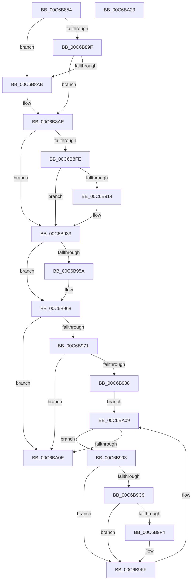

# MiHandleBootImage

- RVA: `0x00C6B854`–`0x00C6BA24` (길이 `464` bytes)
- VA: `0x0000000140C6B854`
- 실행 섹션: `INIT`
- PDB 이름 있음: `예`; PDB Function 태그: `아니요`
- unwind 정보 RVA: `0x000A9680`
- 디코드: `119`개 명령, `464/464` bytes 표시
- 미해석 바이트: `0` (있으면 어셈블리에 `.byte`로 보존)

> 이 문서는 커널 이미지의 기계어와 PDB 기호를 분석해 생성했습니다. 4번과 5번은 함수 원형과 자료형을 바이너리 사용 방식에서 추정한 C 해석이며 원본 소스 복구 결과는 아닙니다.

## 1. Dependencies

- 직접 호출 지점: **8**; 고유 호출 대상: **8**
- 직접 호출자로 확인된 함수: **1**
- RIP 상대 이미지 참조: **6**

### Outgoing calls
- `0x00C6B8C0` → [RtlImageNtHeaderEx](../../text/41/RtlImageNtHeaderEx_function_0041EAA0.md) (function, `0x0041EAA0`)
- `0x00C6B90B` → [MI_IS_PHYSICAL_ADDRESS](../../text/23/MI_IS_PHYSICAL_ADDRESS_function_0023B3A0.md) (function, `0x0023B3A0`)
- `0x00C6B93E` → [MiUpdateBootHpatPagesInUse](MiUpdateBootHpatPagesInUse_function_00C67548.md) (function, `0x00C67548`)
- `0x00C6B963` → [MiFreeBootDriverPages](../C7/MiFreeBootDriverPages_function_00C7695C.md) (function, `0x00C7695C`)
- `0x00C6B9BF` → [MiGetPfnSlabType](../../text/28/MiGetPfnSlabType_function_0028E2D0.md) (function, `0x0028E2D0`)
- `0x00C6B9D5` → [MiGetBootImagePageProtection](MiGetBootImagePageProtection_function_00C6B784.md) (function, `0x00C6B784`)
- `0x00C6B9E9` → [MiAllocateDriverPage](../../page/A8/MiAllocateDriverPage_function_00A80128.md) (function, `0x00A80128`)
- `0x00C6B9FA` → [MiTradeBootImagePage](MiTradeBootImagePage_function_00C6C554.md) (function, `0x00C6C554`)

### Direct callers
- [MiReloadBootLoadedDrivers](MiReloadBootLoadedDrivers_function_00C6C3F8.md) at `0x00C6C442`

### Static image references
- `0x00C6B86D` → RVA `0x00E375AC` (`.data`; read)
- `0x00C6B875` → RVA `0x00E375B0` (`.data`; read)
- `0x00C6B87E` → RVA `0x00E2D838` (`.data`; read)
- `0x00C6B88C` → RVA `0x00FC6B28` (`ALMOSTRO`; read)
- `0x00C6B89F` → RVA `0x00FC6B98` (`ALMOSTRO`; read)
- `0x00C6B9E0` → RVA `0x00E38D00` (`.data`; read)

## 2. Other-region calls and transfers

- 다른 실행 섹션으로 향하는 call: **4**
  - `0x00C6B8C0` → [RtlImageNtHeaderEx](../../text/41/RtlImageNtHeaderEx_function_0041EAA0.md) (`INIT` → `.text`)
  - `0x00C6B90B` → [MI_IS_PHYSICAL_ADDRESS](../../text/23/MI_IS_PHYSICAL_ADDRESS_function_0023B3A0.md) (`INIT` → `.text`)
  - `0x00C6B9BF` → [MiGetPfnSlabType](../../text/28/MiGetPfnSlabType_function_0028E2D0.md) (`INIT` → `.text`)
  - `0x00C6B9E9` → [MiAllocateDriverPage](../../page/A8/MiAllocateDriverPage_function_00A80128.md) (`INIT` → `PAGE`)
- 별도 외부 분기/꼬리 이동을 확인하지 못했습니다.

## 3. Assembly (complete function range)

```asm
00C6B854  48 89 5C 24 20                  mov qword ptr [rsp + 0x20], rbx
00C6B859  48 89 4C 24 08                  mov qword ptr [rsp + 8], rcx
00C6B85E  55                              push rbp
00C6B85F  56                              push rsi
00C6B860  57                              push rdi
00C6B861  41 54                           push r12
00C6B863  41 55                           push r13
00C6B865  41 56                           push r14
00C6B867  41 57                           push r15
00C6B869  48 83 EC 20                     sub rsp, 0x20
00C6B86D  8B 35 39 BD 1C 00               mov esi, dword ptr [rip + 0x1cbd39]
00C6B873  33 FF                           xor edi, edi
00C6B875  03 35 35 BD 1C 00               add esi, dword ptr [rip + 0x1cbd35]
00C6B87B  4C 8B EA                        mov r13, rdx
00C6B87E  8B 05 B4 1F 1C 00               mov eax, dword ptr [rip + 0x1c1fb4]
00C6B884  48 8B 6A 30                     mov rbp, qword ptr [rdx + 0x30]
00C6B888  48 C1 EE 0C                     shr rsi, 0xc
00C6B88C  48 3B 2D 95 B2 35 00            cmp rbp, qword ptr [rip + 0x35b295]
00C6B893  48 89 44 24 70                  mov qword ptr [rsp + 0x70], rax
00C6B898  B8 01 00 00 00                  mov eax, 1
00C6B89D  74 0C                           je 0x140c6b8ab
00C6B89F  48 3B 2D F2 B2 35 00            cmp rbp, qword ptr [rip + 0x35b2f2]
00C6B8A6  44 8B FF                        mov r15d, edi
00C6B8A9  75 03                           jne 0x140c6b8ae
00C6B8AB  44 8B F8                        mov r15d, eax
00C6B8AE  4C 8D 4C 24 68                  lea r9, [rsp + 0x68]
00C6B8B3  48 89 7C 24 68                  mov qword ptr [rsp + 0x68], rdi
00C6B8B8  45 33 C0                        xor r8d, r8d
00C6B8BB  48 8B D5                        mov rdx, rbp
00C6B8BE  8B C8                           mov ecx, eax
00C6B8C0  E8 DB 31 7B FF                  call 0x14041eaa0
00C6B8C5  45 8B 75 40                     mov r14d, dword ptr [r13 + 0x40]
00C6B8C9  48 8B DD                        mov rbx, rbp
00C6B8CC  49 81 C6 FF 0F 00 00            add r14, 0xfff
00C6B8D3  48 C1 EB 09                     shr rbx, 9
00C6B8D7  48 B8 F8 FF FF FF 7F 00 00 00   movabs rax, 0x7ffffffff8
00C6B8E1  49 C1 EE 0C                     shr r14, 0xc
00C6B8E5  48 23 D8                        and rbx, rax
00C6B8E8  48 B8 00 00 00 00 80 F6 FF FF   movabs rax, 0xfffff68000000000
00C6B8F2  48 03 D8                        add rbx, rax
00C6B8F5  4E 8D 24 F3                     lea r12, [rbx + r14*8]
00C6B8F9  45 85 FF                        test r15d, r15d
00C6B8FC  74 35                           je 0x140c6b933
00C6B8FE  8B 35 A8 BC 1C 00               mov esi, dword ptr [rip + 0x1cbca8]
00C6B904  48 8B CD                        mov rcx, rbp
00C6B907  48 C1 EE 0C                     shr rsi, 0xc
00C6B90B  E8 90 FA 5C FF                  call 0x14023b3a0
00C6B910  85 C0                           test eax, eax
00C6B912  74 1F                           je 0x140c6b933
00C6B914  49 81 C6 FF 01 00 00            add r14, 0x1ff
00C6B91B  48 C7 C0 00 FE FF FF            mov rax, 0xfffffffffffffe00
00C6B922  4C 23 F0                        and r14, rax
00C6B925  48 81 C6 FF 01 00 00            add rsi, 0x1ff
00C6B92C  48 23 F0                        and rsi, rax
00C6B92F  4E 8D 24 F3                     lea r12, [rbx + r14*8]
00C6B933  4C 8B 44 24 60                  mov r8, qword ptr [rsp + 0x60]
00C6B938  49 8B D4                        mov rdx, r12
00C6B93B  49 8B CD                        mov rcx, r13
00C6B93E  E8 05 BC FF FF                  call 0x140c67548
00C6B943  4C 8B 4C 24 70                  mov r9, qword ptr [rsp + 0x70]
00C6B948  48 2B F0                        sub rsi, rax
00C6B94B  4C 03 CE                        add r9, rsi
00C6B94E  45 85 FF                        test r15d, r15d
00C6B951  4C 0F 45 CE                     cmovne r9, rsi
00C6B955  4D 85 C9                        test r9, r9
00C6B958  74 0E                           je 0x140c6b968
00C6B95A  4D 8D 04 C4                     lea r8, [r12 + rax*8]
00C6B95E  48 8B D5                        mov rdx, rbp
00C6B961  33 C9                           xor ecx, ecx
00C6B963  E8 F4 AF 00 00                  call 0x140c7695c
00C6B968  45 85 FF                        test r15d, r15d
00C6B96B  0F 85 9D 00 00 00               jne 0x140c6ba0e
00C6B971  48 8B 44 24 68                  mov rax, qword ptr [rsp + 0x68]
00C6B976  48 89 68 30                     mov qword ptr [rax + 0x30], rbp
00C6B97A  41 F7 45 68 00 00 80 00         test dword ptr [r13 + 0x68], 0x800000
00C6B982  0F 85 86 00 00 00               jne 0x140c6ba0e
00C6B988  4A 8D 34 F3                     lea rsi, [rbx + r14*8]
00C6B98C  48 89 7C 24 70                  mov qword ptr [rsp + 0x70], rdi
00C6B991  EB 76                           jmp 0x140c6ba09
00C6B993  48 8B 03                        mov rax, qword ptr [rbx]
00C6B996  48 B9 FF FF FF FF FF 00 00 00   movabs rcx, 0xffffffffff
00C6B9A0  48 C1 E8 0C                     shr rax, 0xc
00C6B9A4  48 23 C1                        and rax, rcx
00C6B9A7  4C 8D 04 40                     lea r8, [rax + rax*2]
00C6B9AB  49 C1 E0 04                     shl r8, 4
00C6B9AF  48 B8 00 00 00 00 00 DE FF FF   movabs rax, 0xffffde0000000000
00C6B9B9  4C 03 C0                        add r8, rax
00C6B9BC  49 8B C8                        mov rcx, r8
00C6B9BF  E8 0C 29 62 FF                  call 0x14028e2d0
00C6B9C4  83 F8 09                        cmp eax, 9
00C6B9C7  75 36                           jne 0x140c6b9ff
00C6B9C9  48 8B 54 24 68                  mov rdx, qword ptr [rsp + 0x68]
00C6B9CE  4C 8D 4C 24 70                  lea r9, [rsp + 0x70]
00C6B9D3  8B CF                           mov ecx, edi
00C6B9D5  E8 AA FD FF FF                  call 0x140c6b784
00C6B9DA  41 B8 01 00 00 00               mov r8d, 1
00C6B9E0  48 8D 0D 19 D3 1C 00            lea rcx, [rip + 0x1cd319]
00C6B9E7  8B D0                           mov edx, eax
00C6B9E9  E8 3A 47 E1 FF                  call 0x140a80128
00C6B9EE  48 83 F8 FF                     cmp rax, -1
00C6B9F2  74 0B                           je 0x140c6b9ff
00C6B9F4  48 8B D0                        mov rdx, rax
00C6B9F7  48 8B CB                        mov rcx, rbx
00C6B9FA  E8 55 0B 00 00                  call 0x140c6c554
00C6B9FF  48 83 C3 08                     add rbx, 8
00C6BA03  81 C7 00 10 00 00               add edi, 0x1000
00C6BA09  48 3B DE                        cmp rbx, rsi
00C6BA0C  72 85                           jb 0x140c6b993
00C6BA0E  48 8B 5C 24 78                  mov rbx, qword ptr [rsp + 0x78]
00C6BA13  48 83 C4 20                     add rsp, 0x20
00C6BA17  41 5F                           pop r15
00C6BA19  41 5E                           pop r14
00C6BA1B  41 5D                           pop r13
00C6BA1D  41 5C                           pop r12
00C6BA1F  5F                              pop rdi
00C6BA20  5E                              pop rsi
00C6BA21  5D                              pop rbp
00C6BA22  C3                              ret
00C6BA23  CC                              int3
```

## 4. C-style interpretation (structured pseudocode)

```c
__int64 __fastcall MiHandleBootImage(__int64 a1, __int64 a2, int a3)
{
    __int64 result;
    __int64 v_r12;
    __int64 v_r14;
    __int64 v_r15;
    __int64 v_rbx;
    __int64 v_rdi;
    __int64 v_rsi;
    __int64 v_rsp;
    unsigned __int64 v_stack_p10;
    unsigned __int64 v_stack_p18;
    unsigned __int64 v_stack_p20;
    unsigned __int64 v_stack_p8;

    v_stack_p20 = v_rbx;
    v_stack_p8 = a1;
    v_rsp = (v_rsp) - (32);
    v_rdi = 0;
    v_rsi = (unsigned int)(((unsigned int)(*(unsigned int *)(v_rip + 1883449))) + (*(unsigned int *)(v_rip + 1883445)));
    v_rsi = (v_rsi) >> (12);
    v_stack_p18 = (unsigned int)(*(unsigned int *)(v_rip + 1843124));
    if ((*(unsigned __int64 *)(a2 + 48)) == (*(unsigned __int64 *)(v_rip + 3519125))) goto loc_00C6B8AB;
    v_r15 = 0;
    if ((*(unsigned __int64 *)(a2 + 48)) == (*(unsigned __int64 *)(v_rip + 3519218))) {
        v_r15 = 1;
    }
    v_stack_p10 = 0;
    a3 = 0;
    result = RtlImageNtHeaderEx(1, *(unsigned __int64 *)(a2 + 48), a3, v_stack_p10);
    v_r14 = ((unsigned int)(*(unsigned int *)(a2 + 64))) + (0xFFFULL);
    v_rbx = (*(unsigned __int64 *)(a2 + 48)) >> (9);
    v_r14 = (v_r14) >> (12);
    v_rbx = (v_rbx) & (result);
    v_rbx = (v_rbx) + (result);
    if ((unsigned int)(v_r15) == 0) goto loc_00C6B933;
    v_rsi = ((unsigned int)(*(unsigned int *)(v_rip + 1883304))) >> (12);
    result = MI_IS_PHYSICAL_ADDRESS(*(unsigned __int64 *)(a2 + 48), *(unsigned __int64 *)(a2 + 48), a3, v_stack_p10);
    v_r12 = v_rbx + v_r14 * 8;
    if ((unsigned int)(result) != 0) {
        v_r14 = (v_r14) + (511);
        result = -512;
        v_r14 = (v_r14) & (result);
        v_rsi = (v_rsi) + (511);
        v_rsi = (v_rsi) & (result);
        v_r12 = v_rbx + v_r14 * 8;
    }
    result = MiUpdateBootHpatPagesInUse(a2, v_r12, v_stack_p8, v_stack_p10);
    v_rsi = (v_rsi) - (result);
    a4 = (v_stack_p18) + (v_rsi);
    if ((unsigned int)(v_r15) != 0) { a4 = v_rsi; }
    if (a4 != 0) {
        a3 = v_r12 + result * 8;
        a2 = *(unsigned __int64 *)(a2 + 48);
        a1 = 0;
        result = MiFreeBootDriverPages(a1, a2, a3, a4);
    }
    if ((unsigned int)(v_r15) != 0) goto loc_00C6BA0E;
    *(unsigned __int64 *)(v_stack_p10 + 48) = *(unsigned __int64 *)(a2 + 48);
    if (((*(unsigned int *)(a2 + 104)) & (0x800000ULL)) != 0) goto loc_00C6BA0E;
    v_stack_p18 = 0;
    goto loc_00C6BA09;
loc_00C6B993:
    result = (*(unsigned __int64 *)(v_rbx)) >> (12);
    result = (result) & (0);
    a3 = (result + result * 2) << (4);
    a3 = (a3) + (result);
    result = MiGetPfnSlabType(a3, a2, a3, a4);
    if (((unsigned int)(result)) != 9) goto loc_00C6B9FF;
    result = MiGetBootImagePageProtection(0, v_stack_p10, a3, v_stack_p18);
    result = MiAllocateDriverPage(v_rip + 1889049, (unsigned int)((unsigned int)(result)), 1, v_stack_p18);
    if (result != -1) {
        a2 = result;
        a1 = v_rbx;
        result = MiTradeBootImagePage(a1, a2, 1, v_stack_p18);
    }
    v_rbx = (v_rbx) + (8);
    v_rdi = (unsigned int)((v_rdi) + (0x1000ULL));
loc_00C6BA09:
    if (v_rbx < (v_rbx + v_r14 * 8)) goto loc_00C6B993;
loc_00C6BA0E:
    v_rsp = (v_rsp) + (32);
    return result;
}
```

## 5. (Beta) C Style

```c
int64_t MiHandleBootImage(int64_t Arg1, void *Arg2, int32_t Arg3)
{
    uint8_t *arg2 = (uint8_t *)Arg2;

    int64_t result;
    int64_t local_r12;
    int64_t local_r14;
    int64_t local_r15;
    int64_t local_rbx;
    int64_t local_rdi;
    int64_t local_rsi;
    int64_t local_rsp;
    uint64_t v_stack_p10;
    uint64_t v_stack_p18;
    uint64_t v_stack_p20;
    uint64_t v_stack_p8;

    v_stack_p20 = local_rbx;
    v_stack_p8 = Arg1;
    local_rsp = (local_rsp) - (32);
    local_rdi = 0;
    local_rsi = (uint32_t)(((uint32_t)(*(uint32_t *)(v_rip + 0x1CBD39))) + (*(uint32_t *)(v_rip + 0x1CBD35)));
    local_rsi = (local_rsi) >> (12);
    v_stack_p18 = (uint32_t)(*(uint32_t *)(v_rip + 0x1C1FB4));
    if ((*(uint64_t *)(arg2 + 0x30)) == (*(uint64_t *)(v_rip + 0x35B295))) goto loc_00C6B8AB;
    local_r15 = 0;
    if ((*(uint64_t *)(arg2 + 0x30)) == (*(uint64_t *)(v_rip + 0x35B2F2))) {
        local_r15 = 1;
    }
    v_stack_p10 = 0;
    Arg3 = 0;
    result = RtlImageNtHeaderEx(1, *(uint64_t *)(arg2 + 0x30), Arg3, v_stack_p10);
    local_r14 = ((uint32_t)(*(uint32_t *)(arg2 + 0x40))) + (0xFFFULL);
    local_rbx = (*(uint64_t *)(arg2 + 0x30)) >> (9);
    local_r14 = (local_r14) >> (12);
    local_rbx = (local_rbx) & (result);
    local_rbx = (local_rbx) + (result);
    if ((uint32_t)(local_r15) == 0) goto loc_00C6B933;
    local_rsi = ((uint32_t)(*(uint32_t *)(v_rip + 0x1CBCA8))) >> (12);
    result = MI_IS_PHYSICAL_ADDRESS(*(uint64_t *)(arg2 + 0x30), *(uint64_t *)(arg2 + 0x30), Arg3, v_stack_p10);
    local_r12 = local_rbx + local_r14 * 8;
    if ((uint32_t)(result) != 0) {
        local_r14 = (local_r14) + (511);
        result = -512;
        local_r14 = (local_r14) & (result);
        local_rsi = (local_rsi) + (511);
        local_rsi = (local_rsi) & (result);
        local_r12 = local_rbx + local_r14 * 8;
    }
    result = MiUpdateBootHpatPagesInUse(Arg2, local_r12, v_stack_p8, v_stack_p10);
    local_rsi = (local_rsi) - (result);
    a4 = (v_stack_p18) + (local_rsi);
    if ((uint32_t)(local_r15) != 0) { a4 = local_rsi; }
    if (a4 != 0) {
        Arg3 = local_r12 + result * 8;
        Arg2 = *(uint64_t *)(arg2 + 0x30);
        Arg1 = 0;
        result = MiFreeBootDriverPages(Arg1, Arg2, Arg3, a4);
    }
    if ((uint32_t)(local_r15) != 0) goto loc_00C6BA0E;
    *(uint64_t *)(v_stack_p10 + 0x30) = *(uint64_t *)(arg2 + 0x30);
    if (((*(uint32_t *)(arg2 + 0x68)) & (0x800000ULL)) != 0) goto loc_00C6BA0E;
    v_stack_p18 = 0;
    goto loc_00C6BA09;
loc_00C6B993:
    result = (*(uint64_t *)(local_rbx)) >> (12);
    result = (result) & (0);
    Arg3 = (result + result * 2) << (4);
    Arg3 = (Arg3) + (result);
    result = MiGetPfnSlabType(Arg3, Arg2, Arg3, a4);
    if (((uint32_t)(result)) != 9) goto loc_00C6B9FF;
    result = MiGetBootImagePageProtection(0, v_stack_p10, Arg3, v_stack_p18);
    result = MiAllocateDriverPage(v_rip + 1889049, (uint32_t)((uint32_t)(result)), 1, v_stack_p18);
    if (result != -1) {
        Arg2 = result;
        Arg1 = local_rbx;
        result = MiTradeBootImagePage(Arg1, Arg2, 1, v_stack_p18);
    }
    local_rbx = (local_rbx) + (8);
    local_rdi = (uint32_t)((local_rdi) + (0x1000ULL));
loc_00C6BA09:
    if (local_rbx < (local_rbx + local_r14 * 8)) goto loc_00C6B993;
loc_00C6BA0E:
    local_rsp = (local_rsp) + (32);
    return result;
}
```

### 관측된 메모리 오프셋

구조체 형식이 확인되지 않은 접근은 인자 기준의 오프셋으로만 기록했습니다.

| 기준 인자 | 오프셋 표현 | 폭 (bit) | 접근 |
|---|---:|---:|---|
| `Arg2` | `+ 0x30` | `64` | `R` |
| `Arg2` | `+ 0x40` | `32` | `R` |
| `Arg2` | `+ 0x68` | `32` | `R` |

## 6. Execution-region graph

[열기: 2D/3D 그래프와 함수 탐색 컨트롤 패널](../../../control-panel.html?section=init&rva=0x00C6B854&view=graph)

- 2D 그래프는 위에서 아래로 흐르고, 3D 그래프는 빈 공간을 드래그해 회전합니다. Shift+드래그는 이동, 휠은 확대·축소, 함수 노드 선택은 대상 보고서 이동입니다.

### Static fallback


