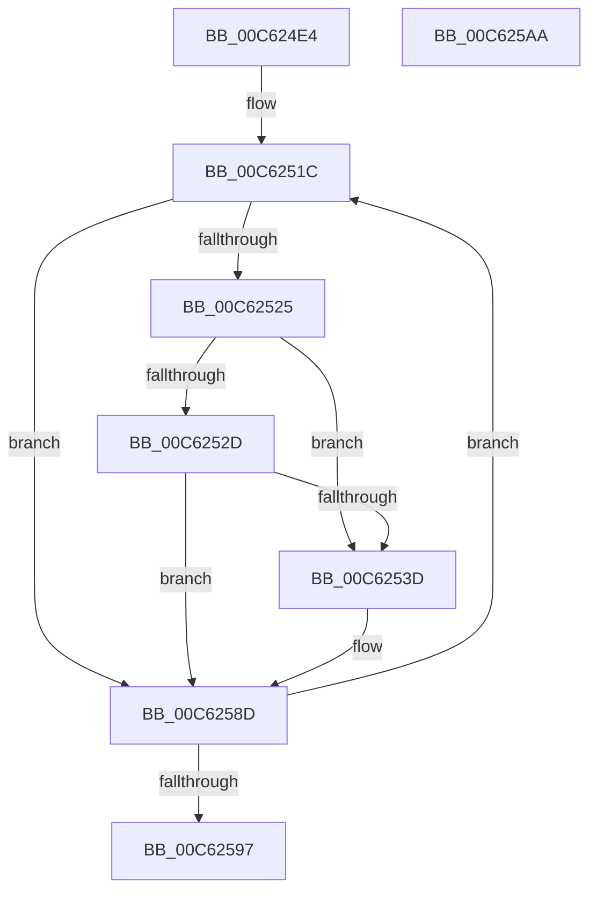

# MiHotAddBootDeferredDescriptorsDiscardable

- RVA: `0x00C624E4`–`0x00C625AB` (길이 `199` bytes)
- VA: `0x0000000140C624E4`
- 실행 섹션: `INIT`
- PDB 이름 있음: `예`; PDB Function 태그: `아니요`
- unwind 정보 RVA: `0x000D78C0`
- 디코드: `52`개 명령, `199/199` bytes 표시
- 미해석 바이트: `0` (있으면 어셈블리에 `.byte`로 보존)

> 이 문서는 커널 이미지의 기계어와 PDB 기호를 분석해 생성했습니다. 4번과 5번은 함수 원형과 자료형을 바이너리 사용 방식에서 추정한 C 해석이며 원본 소스 복구 결과는 아닙니다.

## 1. Dependencies

- 직접 호출 지점: **3**; 고유 호출 대상: **3**
- 직접 호출자로 확인된 함수: **1**
- RIP 상대 이미지 참조: **3**

### Outgoing calls
- `0x00C6250B` → [KeWaitForSingleObject](../../text/20/KeWaitForSingleObject_function_0020E6B0.md) (function, `0x0020E6B0`)
- `0x00C62544` → [MiPageToNode](../../text/33/MiPageToNode_function_00338CD0.md) (function, `0x00338CD0`)
- `0x00C62588` → [MiAddPhysicalMemoryChunks](../../page/7F/MiAddPhysicalMemoryChunks_function_007F98D4.md) (function, `0x007F98D4`)

### Direct callers
- [MiHotAddBootDeferredDescriptors](../../page/7F/MiHotAddBootDeferredDescriptors_function_007F94D0.md) at `0x007F94D4`

### Static image references
- `0x00C624FC` → RVA `0x00E3CF38` (`.data`; read)
- `0x00C62510` → RVA `0x0100C9E8` (`INITDATA`; read)
- `0x00C62581` → RVA `0x00E38D00` (`.data`; read)

## 2. Other-region calls and transfers

- 다른 실행 섹션으로 향하는 call: **3**
  - `0x00C6250B` → [KeWaitForSingleObject](../../text/20/KeWaitForSingleObject_function_0020E6B0.md) (`INIT` → `.text`)
  - `0x00C62544` → [MiPageToNode](../../text/33/MiPageToNode_function_00338CD0.md) (`INIT` → `.text`)
  - `0x00C62588` → [MiAddPhysicalMemoryChunks](../../page/7F/MiAddPhysicalMemoryChunks_function_007F98D4.md) (`INIT` → `PAGE`)
- 별도 외부 분기/꼬리 이동을 확인하지 못했습니다.

## 3. Assembly (complete function range)

```asm
00C624E4  48 89 5C 24 18                  mov qword ptr [rsp + 0x18], rbx
00C624E9  48 89 6C 24 20                  mov qword ptr [rsp + 0x20], rbp
00C624EE  56                              push rsi
00C624EF  57                              push rdi
00C624F0  41 56                           push r14
00C624F2  48 83 EC 30                     sub rsp, 0x30
00C624F6  48 83 64 24 20 00               and qword ptr [rsp + 0x20], 0
00C624FC  48 8D 0D 35 AA 1D 00            lea rcx, [rip + 0x1daa35]
00C62503  45 33 C9                        xor r9d, r9d
00C62506  45 33 C0                        xor r8d, r8d
00C62509  33 D2                           xor edx, edx
00C6250B  E8 A0 C1 5A FF                  call 0x14020e6b0
00C62510  48 8D 3D D1 A4 3A 00            lea rdi, [rip + 0x3aa4d1]
00C62517  BD 40 00 00 00                  mov ebp, 0x40
00C6251C  4C 8B 77 10                     mov r14, qword ptr [rdi + 0x10]
00C62520  4D 85 F6                        test r14, r14
00C62523  74 68                           je 0x140c6258d
00C62525  48 63 37                        movsxd rsi, dword ptr [rdi]
00C62528  83 FE 2C                        cmp esi, 0x2c
00C6252B  77 10                           ja 0x140c6253d
00C6252D  48 B9 48 00 C0 C0 C5 15 00 00   movabs rcx, 0x15c5c0c00048
00C62537  48 0F A3 F1                     bt rcx, rsi
00C6253B  72 50                           jb 0x140c6258d
00C6253D  48 8B 5F 08                     mov rbx, qword ptr [rdi + 8]
00C62541  48 8B CB                        mov rcx, rbx
00C62544  E8 87 67 6D FF                  call 0x140338cd0
00C62549  48 C1 E3 0C                     shl rbx, 0xc
00C6254D  4C 8D 44 24 50                  lea r8, [rsp + 0x50]
00C62552  49 C1 E6 0C                     shl r14, 0xc
00C62556  48 8D 54 24 58                  lea rdx, [rsp + 0x58]
00C6255B  83 FE 18                        cmp esi, 0x18
00C6255E  48 89 5C 24 58                  mov qword ptr [rsp + 0x58], rbx
00C62563  B8 00 0A 00 00                  mov eax, 0xa00
00C62568  4C 89 74 24 50                  mov qword ptr [rsp + 0x50], r14
00C6256D  B9 00 08 00 00                  mov ecx, 0x800
00C62572  0F 45 C1                        cmovne eax, ecx
00C62575  83 64 24 28 00                  and dword ptr [rsp + 0x28], 0
00C6257A  45 33 C9                        xor r9d, r9d
00C6257D  89 44 24 20                     mov dword ptr [rsp + 0x20], eax
00C62581  48 8D 0D 78 67 1D 00            lea rcx, [rip + 0x1d6778]
00C62588  E8 47 73 B9 FF                  call 0x1407f98d4
00C6258D  48 83 C7 30                     add rdi, 0x30
00C62591  48 83 ED 01                     sub rbp, 1
00C62595  75 85                           jne 0x140c6251c
00C62597  48 8B 5C 24 60                  mov rbx, qword ptr [rsp + 0x60]
00C6259C  48 8B 6C 24 68                  mov rbp, qword ptr [rsp + 0x68]
00C625A1  48 83 C4 30                     add rsp, 0x30
00C625A5  41 5E                           pop r14
00C625A7  5F                              pop rdi
00C625A8  5E                              pop rsi
00C625A9  C3                              ret
00C625AA  CC                              int3
```

## 4. C-style interpretation (structured pseudocode)

```c
__int64 __fastcall MiHotAddBootDeferredDescriptorsDiscardable(__int64 a1, int a2, int a3, int a4)
{
    __int64 result;
    __int64 v_r14;
    __int64 v_rbp;
    __int64 v_rbx;
    __int64 v_rdi;
    __int64 v_rsp;
    unsigned int v_stack_m20;
    unsigned __int64 v_stack_m28;
    unsigned __int64 v_stack_p10;
    unsigned __int64 v_stack_p18;
    unsigned __int64 v_stack_p20;
    unsigned __int64 v_stack_p8;

    v_stack_p18 = v_rbx;
    v_stack_p20 = v_rbp;
    v_rsp = (v_rsp) - (48);
    a4 = 0;
    a3 = 0;
    a2 = 0;
    result = KeWaitForSingleObject(v_rip + 1944117, a2, a3, a4);
loc_00C6251C:
    if (*(unsigned __int64 *)(v_rip + 3843281 + 16) == 0) goto loc_00C6258D;
    if (((unsigned int)((int)(*(unsigned int *)(v_rip + 3843281)))) > 44) goto loc_00C6253D;
    v_r14 = *(unsigned __int64 *)(v_rip + 3843281 + 16);
    if (((unsigned int)((int)(*(unsigned int *)(v_rip + 3843281)))) >= 44) {
        v_rbx = *(unsigned __int64 *)(v_rip + 3843281 + 8);
        a1 = v_rbx;
        result = MiPageToNode(a1, a2, a3, a4);
        v_rbx = (v_rbx) << (12);
        a3 = v_stack_p8;
        v_r14 = (*(unsigned __int64 *)(v_rip + 3843281 + 16)) << (12);
        a2 = v_stack_p10;
        v_stack_p10 = v_rbx;
        result = 0xA00ULL;
        v_stack_p8 = v_r14;
        a1 = 0x800ULL;
        if (((unsigned int)((int)(*(unsigned int *)(v_rip + 3843281)))) != 24) { result = (unsigned int)(a1); }
        a4 = 0;
        v_stack_m28 = (unsigned int)(result);
        a1 = v_rip + 1927032;
        result = MiAddPhysicalMemoryChunks(a1, a2, a3, a4);
    }
    v_rdi = (v_rip + 3843281) + (48);
    v_rbp = (64) - (1);
    if (condition_is_not_equal) goto loc_00C6251C;
    v_rsp = (v_rsp) + (48);
    return result;
}
```

## 5. (Beta) C Style

```c
int64_t MiHotAddBootDeferredDescriptorsDiscardable(int64_t Arg1, int32_t Arg2, int32_t Arg3, int32_t Arg4)
{
    int64_t result;
    int64_t local_r14;
    int64_t local_rbp;
    int64_t local_rbx;
    int64_t local_rdi;
    int64_t local_rsp;
    uint32_t v_stack_m20;
    uint64_t v_stack_m28;
    uint64_t v_stack_p10;
    uint64_t v_stack_p18;
    uint64_t v_stack_p20;
    uint64_t v_stack_p8;

    v_stack_p18 = local_rbx;
    v_stack_p20 = local_rbp;
    local_rsp = (local_rsp) - (48);
    Arg4 = 0;
    Arg3 = 0;
    Arg2 = 0;
    result = KeWaitForSingleObject(v_rip + 1944117, Arg2, Arg3, Arg4);
loc_00C6251C:
    if (*(uint64_t *)(v_rip + 0x3AA4D1 + 0x10) == 0) goto loc_00C6258D;
    if (((uint32_t)((int32_t)(*(uint32_t *)(v_rip + 0x3AA4D1)))) > 44) goto loc_00C6253D;
    local_r14 = *(uint64_t *)(v_rip + 0x3AA4D1 + 0x10);
    if (((uint32_t)((int32_t)(*(uint32_t *)(v_rip + 0x3AA4D1)))) >= 44) {
        local_rbx = *(uint64_t *)(v_rip + 0x3AA4D1 + 0x8);
        Arg1 = local_rbx;
        result = MiPageToNode(Arg1, Arg2, Arg3, Arg4);
        local_rbx = (local_rbx) << (12);
        Arg3 = v_stack_p8;
        local_r14 = (*(uint64_t *)(v_rip + 0x3AA4D1 + 0x10)) << (12);
        Arg2 = v_stack_p10;
        v_stack_p10 = local_rbx;
        result = 0xA00ULL;
        v_stack_p8 = local_r14;
        Arg1 = 0x800ULL;
        if (((uint32_t)((int32_t)(*(uint32_t *)(v_rip + 0x3AA4D1)))) != 24) { result = (uint32_t)(Arg1); }
        Arg4 = 0;
        v_stack_m28 = (uint32_t)(result);
        Arg1 = v_rip + 1927032;
        result = MiAddPhysicalMemoryChunks(Arg1, Arg2, Arg3, Arg4);
    }
    local_rdi = (v_rip + 3843281) + (48);
    local_rbp = (64) - (1);
    if (condition_is_not_equal) goto loc_00C6251C;
    local_rsp = (local_rsp) + (48);
    return result;
}
```

## 6. Execution-region graph

[열기: 2D/3D 그래프와 함수 탐색 컨트롤 패널](../../../control-panel.html?section=init&rva=0x00C624E4&view=graph)

- 2D 그래프는 위에서 아래로 흐르고, 3D 그래프는 빈 공간을 드래그해 회전합니다. Shift+드래그는 이동, 휠은 확대·축소, 함수 노드 선택은 대상 보고서 이동입니다.

### Static fallback


