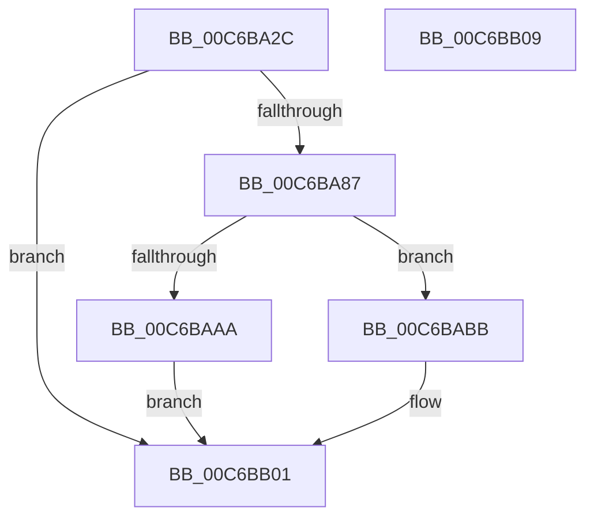

# MiInitializeApiSets

- RVA: `0x00C6BA2C`–`0x00C6BB0A` (길이 `222` bytes)
- VA: `0x0000000140C6BA2C`
- 실행 섹션: `INIT`
- PDB 이름 있음: `예`; PDB Function 태그: `아니요`
- unwind 정보 RVA: `0x000737F8`
- 디코드: `54`개 명령, `222/222` bytes 표시
- 미해석 바이트: `0` (있으면 어셈블리에 `.byte`로 보존)

> 이 문서는 커널 이미지의 기계어와 PDB 기호를 분석해 생성했습니다. 4번과 5번은 함수 원형과 자료형을 바이너리 사용 방식에서 추정한 C 해석이며 원본 소스 복구 결과는 아닙니다.

## 1. Dependencies

- 직접 호출 지점: **4**; 고유 호출 대상: **4**
- 직접 호출자로 확인된 함수: **1**
- RIP 상대 이미지 참조: **3**

### Outgoing calls
- `0x00C6BA7E` → [MmCreateSection](../../page/98/MmCreateSection_function_009838B0.md) (function, `0x009838B0`)
- `0x00C6BA9F` → [MmMapViewInSessionSpace](../../page/98/MmMapViewInSessionSpace_function_00982480.md) (function, `0x00982480`)
- `0x00C6BAB2` → [ObfDereferenceObjectWithTag](../../text/2F/ObfDereferenceObjectWithTag_function_002F78E0.md) (function, `0x002F78E0`)
- `0x00C6BAD8` → [memcpy](../../text/6C/memcpy_function_006C6840.md) (function, `0x006C6840`)

### Direct callers
- [MiInitSystem](../C5/MiInitSystem_function_00C5E6C0.md) at `0x00C5ECF8`

### Static image references
- `0x00C6BADD` → RVA `0x00E2D7D8` (`.data`; write)
- `0x00C6BAE4` → RVA `0x00E2D7E0` (`.data`; write)
- `0x00C6BAFA` → RVA `0x00E2D7E8` (`.data`; write)

## 2. Other-region calls and transfers

- 다른 실행 섹션으로 향하는 call: **4**
  - `0x00C6BA7E` → [MmCreateSection](../../page/98/MmCreateSection_function_009838B0.md) (`INIT` → `PAGE`)
  - `0x00C6BA9F` → [MmMapViewInSessionSpace](../../page/98/MmMapViewInSessionSpace_function_00982480.md) (`INIT` → `PAGE`)
  - `0x00C6BAB2` → [ObfDereferenceObjectWithTag](../../text/2F/ObfDereferenceObjectWithTag_function_002F78E0.md) (`INIT` → `.text`)
  - `0x00C6BAD8` → [memcpy](../../text/6C/memcpy_function_006C6840.md) (`INIT` → `.text`)
- 별도 외부 분기/꼬리 이동을 확인하지 못했습니다.

## 3. Assembly (complete function range)

```asm
00C6BA2C  4C 8B DC                        mov r11, rsp
00C6BA2F  53                              push rbx
00C6BA30  56                              push rsi
00C6BA31  57                              push rdi
00C6BA32  48 83 EC 40                     sub rsp, 0x40
00C6BA36  49 83 63 E0 00                  and qword ptr [r11 - 0x20], 0
00C6BA3B  4D 8D 4B 18                     lea r9, [r11 + 0x18]
00C6BA3F  48 8B 81 F0 00 00 00            mov rax, qword ptr [rcx + 0xf0]
00C6BA46  48 8B F1                        mov rsi, rcx
00C6BA49  49 83 63 D8 00                  and qword ptr [r11 - 0x28], 0
00C6BA4E  49 8D 4B 08                     lea rcx, [r11 + 8]
00C6BA52  49 83 63 10 00                  and qword ptr [r11 + 0x10], 0
00C6BA57  45 33 C0                        xor r8d, r8d
00C6BA5A  49 83 63 08 00                  and qword ptr [r11 + 8], 0
00C6BA5F  8B 90 A8 0A 00 00               mov edx, dword ptr [rax + 0xaa8]
00C6BA65  49 89 53 18                     mov qword ptr [r11 + 0x18], rdx
00C6BA69  BA 1F 00 0F 00                  mov edx, 0xf001f
00C6BA6E  C7 44 24 28 00 00 00 08         mov dword ptr [rsp + 0x28], 0x8000000
00C6BA76  C7 44 24 20 04 00 00 00         mov dword ptr [rsp + 0x20], 4
00C6BA7E  E8 2D 7E D1 FF                  call 0x1409838b0
00C6BA83  85 C0                           test eax, eax
00C6BA85  78 7A                           js 0x140c6bb01
00C6BA87  48 8B 7C 24 60                  mov rdi, qword ptr [rsp + 0x60]
00C6BA8C  4C 8D 44 24 70                  lea r8, [rsp + 0x70]
00C6BA91  48 83 64 24 70 00               and qword ptr [rsp + 0x70], 0
00C6BA97  48 8D 54 24 68                  lea rdx, [rsp + 0x68]
00C6BA9C  48 8B CF                        mov rcx, rdi
00C6BA9F  E8 DC 69 D1 FF                  call 0x140982480
00C6BAA4  8B D8                           mov ebx, eax
00C6BAA6  85 C0                           test eax, eax
00C6BAA8  79 11                           jns 0x140c6babb
00C6BAAA  BA 4D 6D 53 63                  mov edx, 0x63536d4d
00C6BAAF  48 8B CF                        mov rcx, rdi
00C6BAB2  E8 29 BE 68 FF                  call 0x1402f78e0
00C6BAB7  8B C3                           mov eax, ebx
00C6BAB9  EB 46                           jmp 0x140c6bb01
00C6BABB  48 8B 96 F0 00 00 00            mov rdx, qword ptr [rsi + 0xf0]
00C6BAC2  48 8B 5C 24 68                  mov rbx, qword ptr [rsp + 0x68]
00C6BAC7  48 8B CB                        mov rcx, rbx
00C6BACA  44 8B 82 A8 0A 00 00            mov r8d, dword ptr [rdx + 0xaa8]
00C6BAD1  48 8B 92 A0 0A 00 00            mov rdx, qword ptr [rdx + 0xaa0]
00C6BAD8  E8 63 AD A5 FF                  call 0x1406c6840
00C6BADD  48 89 3D F4 1C 1C 00            mov qword ptr [rip + 0x1c1cf4], rdi
00C6BAE4  48 89 1D F5 1C 1C 00            mov qword ptr [rip + 0x1c1cf5], rbx
00C6BAEB  48 8B 86 F0 00 00 00            mov rax, qword ptr [rsi + 0xf0]
00C6BAF2  8B 88 A8 0A 00 00               mov ecx, dword ptr [rax + 0xaa8]
00C6BAF8  33 C0                           xor eax, eax
00C6BAFA  48 89 0D E7 1C 1C 00            mov qword ptr [rip + 0x1c1ce7], rcx
00C6BB01  48 83 C4 40                     add rsp, 0x40
00C6BB05  5F                              pop rdi
00C6BB06  5E                              pop rsi
00C6BB07  5B                              pop rbx
00C6BB08  C3                              ret
00C6BB09  CC                              int3
```

## 4. C-style interpretation (structured pseudocode)

```c
__int64 __fastcall MiInitializeApiSets(__int64 a1, __int64 a2, int a3)
{
    __int64 result;
    __int64 v_rsp;
    unsigned int v_stack_m30;
    unsigned int v_stack_m38;
    unsigned __int64 v_stack_p10;
    unsigned __int64 v_stack_p18;
    unsigned __int64 v_stack_p8;

    v_rsp = (v_rsp) - (64);
    a3 = 0;
    *(unsigned __int64 *)(v_rsp + 24) = (unsigned int)(*(unsigned int *)(*(unsigned __int64 *)(a1 + 240) + 2728));
    v_stack_m30 = 0x8000000ULL;
    v_stack_m38 = 4;
    result = MmCreateSection(v_rsp + 8, (unsigned int)(0xF001FULL), a3, v_rsp + 24);
    if (sign_flag) goto loc_00C6BB01;
    result = MmMapViewInSessionSpace(v_stack_p8, v_stack_p10, v_stack_p18, v_rsp + 24);
    if (!sign_flag) goto loc_00C6BABB;
    result = ObfDereferenceObjectWithTag(v_stack_p8, (unsigned int)(0x63536D4DULL), v_stack_p18, v_rsp + 24);
    goto loc_00C6BB01;
loc_00C6BABB:
    result = memcpy(v_stack_p10, *(unsigned __int64 *)(*(unsigned __int64 *)(a1 + 240) + 2720), (unsigned int)(*(unsigned int *)(*(unsigned __int64 *)(a1 + 240) + 2728)), v_rsp + 24);
    *(unsigned __int64 *)(v_rip + 1842420) = v_stack_p8;
    *(unsigned __int64 *)(v_rip + 1842421) = v_stack_p10;
    result = 0;
    *(unsigned __int64 *)(v_rip + 1842407) = (unsigned int)(*(unsigned int *)(*(unsigned __int64 *)(a1 + 240) + 2728));
loc_00C6BB01:
    v_rsp = (v_rsp) + (64);
    return result;
}
```

## 5. (Beta) C Style

```c
int64_t MiInitializeApiSets(void *Arg1, int64_t Arg2, int32_t Arg3)
{
    uint8_t *arg1 = (uint8_t *)Arg1;

    int64_t result;
    int64_t local_rsp;
    uint32_t v_stack_m30;
    uint32_t v_stack_m38;
    uint64_t v_stack_p10;
    uint64_t v_stack_p18;
    uint64_t v_stack_p8;

    local_rsp = (local_rsp) - (64);
    Arg3 = 0;
    *(uint64_t *)(local_rsp + 0x18) = (uint32_t)(*(uint32_t *)(*(uint64_t *)(arg1 + 0xF0) + 0xAA8));
    v_stack_m30 = 0x8000000ULL;
    v_stack_m38 = 4;
    result = MmCreateSection(local_rsp + 8, (uint32_t)(0xF001FULL), Arg3, local_rsp + 24);
    if (sign_flag) goto loc_00C6BB01;
    result = MmMapViewInSessionSpace(v_stack_p8, v_stack_p10, v_stack_p18, local_rsp + 24);
    if (!sign_flag) goto loc_00C6BABB;
    result = ObfDereferenceObjectWithTag(v_stack_p8, (uint32_t)(0x63536D4DULL), v_stack_p18, local_rsp + 24);
    goto loc_00C6BB01;
loc_00C6BABB:
    result = memcpy(v_stack_p10, *(uint64_t *)(*(uint64_t *)(arg1 + 0xF0) + 0xAA0), (uint32_t)(*(uint32_t *)(*(uint64_t *)(arg1 + 0xF0) + 0xAA8)), local_rsp + 24);
    *(uint64_t *)(v_rip + 0x1C1CF4) = v_stack_p8;
    *(uint64_t *)(v_rip + 0x1C1CF5) = v_stack_p10;
    result = 0;
    *(uint64_t *)(v_rip + 0x1C1CE7) = (uint32_t)(*(uint32_t *)(*(uint64_t *)(arg1 + 0xF0) + 0xAA8));
loc_00C6BB01:
    local_rsp = (local_rsp) + (64);
    return result;
}
```

### 관측된 메모리 오프셋

구조체 형식이 확인되지 않은 접근은 인자 기준의 오프셋으로만 기록했습니다.

| 기준 인자 | 오프셋 표현 | 폭 (bit) | 접근 |
|---|---:|---:|---|
| `Arg1` | `+ 0xF0` | `64` | `R` |

## 6. Execution-region graph

[열기: 2D/3D 그래프와 함수 탐색 컨트롤 패널](../../../control-panel.html?section=init&rva=0x00C6BA2C&view=graph)

- 2D 그래프는 위에서 아래로 흐르고, 3D 그래프는 빈 공간을 드래그해 회전합니다. Shift+드래그는 이동, 휠은 확대·축소, 함수 노드 선택은 대상 보고서 이동입니다.

### Static fallback


