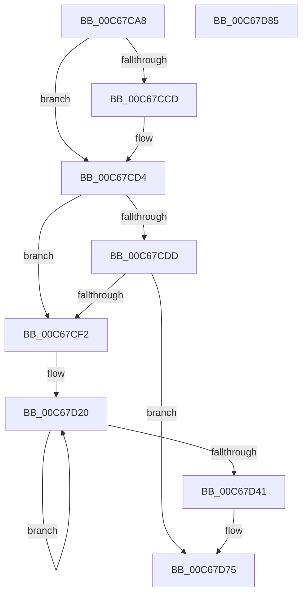

# MiInitializeBootKernelShadowStacks

- RVA: `0x00C67CA8`–`0x00C67D86` (길이 `222` bytes)
- VA: `0x0000000140C67CA8`
- 실행 섹션: `INIT`
- PDB 이름 있음: `예`; PDB Function 태그: `아니요`
- unwind 정보 RVA: `0x00060BC4`
- 디코드: `44`개 명령, `222/222` bytes 표시
- 미해석 바이트: `0` (있으면 어셈블리에 `.byte`로 보존)

> 이 문서는 커널 이미지의 기계어와 PDB 기호를 분석해 생성했습니다. 4번과 5번은 함수 원형과 자료형을 바이너리 사용 방식에서 추정한 C 해석이며 원본 소스 복구 결과는 아닙니다.

## 1. Dependencies

- 직접 호출 지점: **4**; 고유 호출 대상: **2**
- 직접 호출자로 확인된 함수: **1**
- RIP 상대 이미지 참조: **3**

### Outgoing calls
- `0x00C67D00` → [MiInitializeBootKernelShadowStack](../../text/68/MiInitializeBootKernelShadowStack_function_006863D8.md) (function, `0x006863D8`)
- `0x00C67D13` → [MiInitializeBootKernelShadowStack](../../text/68/MiInitializeBootKernelShadowStack_function_006863D8.md) (function, `0x006863D8`)
- `0x00C67D32` → [MiInitializeBootKernelShadowStack](../../text/68/MiInitializeBootKernelShadowStack_function_006863D8.md) (function, `0x006863D8`)
- `0x00C67D70` → [MiInitializeBootShadowStackPage](MiInitializeBootShadowStackPage_function_00C67D8C.md) (function, `0x00C67D8C`)

### Direct callers
- [MiInitSystem](../C5/MiInitSystem_function_00C5E6C0.md) at `0x00C5E95D`

### Static image references
- `0x00C67CB7` → RVA `0x01201841` (`CFGRO`; read)
- `0x00C67CCD` → RVA `0x00FC6A88` (`ALMOSTRO`; read/write)
- `0x00C67CD4` → RVA `0x00FC6A88` (`ALMOSTRO`; read)

## 2. Other-region calls and transfers

- 다른 실행 섹션으로 향하는 call: **3**
  - `0x00C67D00` → [MiInitializeBootKernelShadowStack](../../text/68/MiInitializeBootKernelShadowStack_function_006863D8.md) (`INIT` → `.text`)
  - `0x00C67D13` → [MiInitializeBootKernelShadowStack](../../text/68/MiInitializeBootKernelShadowStack_function_006863D8.md) (`INIT` → `.text`)
  - `0x00C67D32` → [MiInitializeBootKernelShadowStack](../../text/68/MiInitializeBootKernelShadowStack_function_006863D8.md) (`INIT` → `.text`)
- 별도 외부 분기/꼬리 이동을 확인하지 못했습니다.

## 3. Assembly (complete function range)

```asm
00C67CA8  48 89 5C 24 08                  mov qword ptr [rsp + 8], rbx
00C67CAD  48 89 74 24 10                  mov qword ptr [rsp + 0x10], rsi
00C67CB2  57                              push rdi
00C67CB3  48 83 EC 20                     sub rsp, 0x20
00C67CB7  80 3D 83 9B 59 00 00            cmp byte ptr [rip + 0x599b83], 0
00C67CBE  48 8B D9                        mov rbx, rcx
00C67CC1  48 B9 00 00 00 00 00 02 00 00   movabs rcx, 0x20000000000
00C67CCB  74 07                           je 0x140c67cd4
00C67CCD  48 09 0D B4 ED 35 00            or qword ptr [rip + 0x35edb4], rcx
00C67CD4  48 85 0D AD ED 35 00            test qword ptr [rip + 0x35edad], rcx
00C67CDB  75 15                           jne 0x140c67cf2
00C67CDD  48 8B 83 F0 00 00 00            mov rax, qword ptr [rbx + 0xf0]
00C67CE4  48 83 B8 90 0E 00 00 00         cmp qword ptr [rax + 0xe90], 0
00C67CEC  0F 84 83 00 00 00               je 0x140c67d75
00C67CF2  48 8B 8B F0 00 00 00            mov rcx, qword ptr [rbx + 0xf0]
00C67CF9  48 8B 89 88 0E 00 00            mov rcx, qword ptr [rcx + 0xe88]
00C67D00  E8 D3 E6 A1 FF                  call 0x1406863d8
00C67D05  48 8B 8B F0 00 00 00            mov rcx, qword ptr [rbx + 0xf0]
00C67D0C  48 8B 89 80 0E 00 00            mov rcx, qword ptr [rcx + 0xe80]
00C67D13  E8 C0 E6 A1 FF                  call 0x1406863d8
00C67D18  BF 08 00 00 00                  mov edi, 8
00C67D1D  8D 77 FC                        lea esi, [rdi - 4]
00C67D20  48 8B 83 F0 00 00 00            mov rax, qword ptr [rbx + 0xf0]
00C67D27  48 8B 88 90 0E 00 00            mov rcx, qword ptr [rax + 0xe90]
00C67D2E  48 8B 0C 39                     mov rcx, qword ptr [rcx + rdi]
00C67D32  E8 A1 E6 A1 FF                  call 0x1406863d8
00C67D37  48 8D 7F 08                     lea rdi, [rdi + 8]
00C67D3B  48 83 EE 01                     sub rsi, 1
00C67D3F  75 DF                           jne 0x140c67d20
00C67D41  48 8B 83 F0 00 00 00            mov rax, qword ptr [rbx + 0xf0]
00C67D48  48 8B 88 90 0E 00 00            mov rcx, qword ptr [rax + 0xe90]
00C67D4F  48 B8 F8 FF FF FF 7F 00 00 00   movabs rax, 0x7ffffffff8
00C67D59  48 C1 E9 09                     shr rcx, 9
00C67D5D  48 23 C8                        and rcx, rax
00C67D60  48 B8 00 00 00 00 80 F6 FF FF   movabs rax, 0xfffff68000000000
00C67D6A  48 03 C8                        add rcx, rax
00C67D6D  8D 56 01                        lea edx, [rsi + 1]
00C67D70  E8 17 00 00 00                  call 0x140c67d8c
00C67D75  48 8B 5C 24 30                  mov rbx, qword ptr [rsp + 0x30]
00C67D7A  48 8B 74 24 38                  mov rsi, qword ptr [rsp + 0x38]
00C67D7F  48 83 C4 20                     add rsp, 0x20
00C67D83  5F                              pop rdi
00C67D84  C3                              ret
00C67D85  CC                              int3
```

## 4. C-style interpretation (structured pseudocode)

```c
__int64 __fastcall MiInitializeBootKernelShadowStacks(__int64 a1)
{
    __int64 result;
    __int64 v_rsi;
    __int64 v_rsp;
    unsigned __int64 v_stack_p10;
    unsigned __int64 v_stack_p8;

    v_stack_p8 = v_rbx;
    v_stack_p10 = v_rsi;
    v_rsp = (v_rsp) - (32);
    if ((*(unsigned __int8 *)(v_rip + 5872515)) != 0) {
    }
    if (((*(unsigned __int64 *)(v_rip + 3534253)) & (a1)) != 0) goto loc_00C67CF2;
    if ((*(unsigned __int64 *)(*(unsigned __int64 *)(a1 + 240) + 3728)) == 0) goto loc_00C67D75;
loc_00C67CF2:
    result = MiInitializeBootKernelShadowStack(*(unsigned __int64 *)(*(unsigned __int64 *)(a1 + 240) + 3720), a2, a3, a4);
    result = MiInitializeBootKernelShadowStack(*(unsigned __int64 *)(*(unsigned __int64 *)(a1 + 240) + 3712), a2, a3, a4);
loc_00C67D20:
    result = MiInitializeBootKernelShadowStack(*(unsigned __int64 *)(*(unsigned __int64 *)(*(unsigned __int64 *)(a1 + 240) + 3728) + 8 * 1), a2, a3, a4);
    v_rsi = (8 - 4) - (1);
    if (condition_is_not_equal) goto loc_00C67D20;
    a1 = (*(unsigned __int64 *)(*(unsigned __int64 *)(a1 + 240) + 3728)) >> (9);
    a1 = (a1) & (*(unsigned __int64 *)(a1 + 240));
    a1 = (a1) + (*(unsigned __int64 *)(a1 + 240));
    result = MiInitializeBootShadowStackPage(a1, v_rsi + 1, a3, a4);
loc_00C67D75:
    v_rsp = (v_rsp) + (32);
    return result;
}
```

## 5. (Beta) C Style

```c
int64_t MiInitializeBootKernelShadowStacks(void *Arg1)
{
    uint8_t *arg1 = (uint8_t *)Arg1;

    int64_t result;
    int64_t local_rsi;
    int64_t local_rsp;
    uint64_t v_stack_p10;
    uint64_t v_stack_p8;

    v_stack_p8 = local_rbx;
    v_stack_p10 = local_rsi;
    local_rsp = (local_rsp) - (32);
    if ((*(uint8_t *)(v_rip + 0x599B83)) != 0) {
    }
    if (((*(uint64_t *)(v_rip + 0x35EDAD)) & (Arg1)) != 0) goto loc_00C67CF2;
    if ((*(uint64_t *)(*(uint64_t *)(arg1 + 0xF0) + 0xE90)) == 0) goto loc_00C67D75;
loc_00C67CF2:
    result = MiInitializeBootKernelShadowStack(*(uint64_t *)(*(uint64_t *)(arg1 + 0xF0) + 0xE88), a2, a3, a4);
    result = MiInitializeBootKernelShadowStack(*(uint64_t *)(*(uint64_t *)(arg1 + 0xF0) + 0xE80), a2, a3, a4);
loc_00C67D20:
    result = MiInitializeBootKernelShadowStack(*(uint64_t *)(*(uint64_t *)(*(uint64_t *)(arg1 + 0xF0) + 0xE90) + 0x8 * 1), a2, a3, a4);
    local_rsi = (8 - 4) - (1);
    if (condition_is_not_equal) goto loc_00C67D20;
    Arg1 = (*(uint64_t *)(*(uint64_t *)(arg1 + 0xF0) + 0xE90)) >> (9);
    Arg1 = (Arg1) & (*(uint64_t *)(arg1 + 0xF0));
    Arg1 = (Arg1) + (*(uint64_t *)(arg1 + 0xF0));
    result = MiInitializeBootShadowStackPage(Arg1, local_rsi + 1, a3, a4);
loc_00C67D75:
    local_rsp = (local_rsp) + (32);
    return result;
}
```

### 관측된 메모리 오프셋

구조체 형식이 확인되지 않은 접근은 인자 기준의 오프셋으로만 기록했습니다.

| 기준 인자 | 오프셋 표현 | 폭 (bit) | 접근 |
|---|---:|---:|---|
| `Arg1` | `+ 0xF0` | `64` | `R` |

## 6. Execution-region graph

[열기: 2D/3D 그래프와 함수 탐색 컨트롤 패널](../../../control-panel.html?section=init&rva=0x00C67CA8&view=graph)

- 2D 그래프는 위에서 아래로 흐르고, 3D 그래프는 빈 공간을 드래그해 회전합니다. Shift+드래그는 이동, 휠은 확대·축소, 함수 노드 선택은 대상 보고서 이동입니다.

### Static fallback


