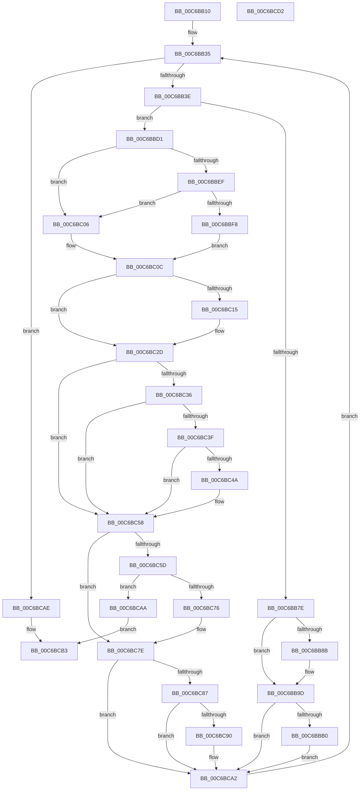

# MiInitializeBootLoadedDriverPfns

- RVA: `0x00C6BB10`–`0x00C6BCD3` (길이 `451` bytes)
- VA: `0x0000000140C6BB10`
- 실행 섹션: `INIT`
- PDB 이름 있음: `예`; PDB Function 태그: `아니요`
- unwind 정보 RVA: `0x0005FEF8`
- 디코드: `109`개 명령, `451/451` bytes 표시
- 미해석 바이트: `0` (있으면 어셈블리에 `.byte`로 보존)

> 이 문서는 커널 이미지의 기계어와 PDB 기호를 분석해 생성했습니다. 4번과 5번은 함수 원형과 자료형을 바이너리 사용 방식에서 추정한 C 해석이며 원본 소스 복구 결과는 아닙니다.

## 1. Dependencies

- 직접 호출 지점: **7**; 고유 호출 대상: **4**
- 직접 호출자로 확인된 함수: **1**
- RIP 상대 이미지 참조: **10**

### Outgoing calls
- `0x00C6BB75` → [MI_IS_PHYSICAL_ADDRESS](../../text/23/MI_IS_PHYSICAL_ADDRESS_function_0023B3A0.md) (function, `0x0023B3A0`)
- `0x00C6BB98` → [MiActOnLargeKernelHalPages](../../page/7F/MiActOnLargeKernelHalPages_function_007F852C.md) (function, `0x007F852C`)
- `0x00C6BBC7` → [MiInitializeBootLoadedDriverPfnRange](../../text/69/MiInitializeBootLoadedDriverPfnRange_function_00696F60.md) (function, `0x00696F60`)
- `0x00C6BBDA` → [MiInitializeBootLoadedDriverPfnRange](../../text/69/MiInitializeBootLoadedDriverPfnRange_function_00696F60.md) (function, `0x00696F60`)
- `0x00C6BC24` → [MiInitializeBootLoadedDriverPfnRange](../../text/69/MiInitializeBootLoadedDriverPfnRange_function_00696F60.md) (function, `0x00696F60`)
- `0x00C6BC53` → [MiInitializeBootLoadedDriverPfnRange](../../text/69/MiInitializeBootLoadedDriverPfnRange_function_00696F60.md) (function, `0x00696F60`)
- `0x00C6BC6D` → [MiAcquireNonPagedResources](../../text/28/MiAcquireNonPagedResources_function_00286C60.md) (function, `0x00286C60`)

### Direct callers
- [MiInitializeSystemImageRegion](MiInitializeSystemImageRegion_function_00C6C05C.md) at `0x00C6C232`

### Static image references
- `0x00C6BB7E` → RVA `0x00FC6A88` (`ALMOSTRO`; read)
- `0x00C6BB8E` → RVA `0x00C6C800` (`MiValidateKernelHalLargePageRange`; read)
- `0x00C6BB9D` → RVA `0x00E375AC` (`.data`; read)
- `0x00C6BBDF` → RVA `0x00FC6B28` (`ALMOSTRO`; read)
- `0x00C6BBEF` → RVA `0x00FC6B98` (`ALMOSTRO`; read)
- `0x00C6BBFE` → RVA `0x00E375B0` (`.data`; read)
- `0x00C6BC3F` → RVA `0x00E2D838` (`.data`; read)
- `0x00C6BC60` → RVA `0x00E38D00` (`.data`; read)
- `0x00C6BC76` → RVA `0x00E376D8` (`.data`; read/write)
- `0x00C6BC90` → RVA `0x00E376F0` (`.data`; read/write)

## 2. Other-region calls and transfers

- 다른 실행 섹션으로 향하는 call: **7**
  - `0x00C6BB75` → [MI_IS_PHYSICAL_ADDRESS](../../text/23/MI_IS_PHYSICAL_ADDRESS_function_0023B3A0.md) (`INIT` → `.text`)
  - `0x00C6BB98` → [MiActOnLargeKernelHalPages](../../page/7F/MiActOnLargeKernelHalPages_function_007F852C.md) (`INIT` → `PAGE`)
  - `0x00C6BBC7` → [MiInitializeBootLoadedDriverPfnRange](../../text/69/MiInitializeBootLoadedDriverPfnRange_function_00696F60.md) (`INIT` → `.text`)
  - `0x00C6BBDA` → [MiInitializeBootLoadedDriverPfnRange](../../text/69/MiInitializeBootLoadedDriverPfnRange_function_00696F60.md) (`INIT` → `.text`)
  - `0x00C6BC24` → [MiInitializeBootLoadedDriverPfnRange](../../text/69/MiInitializeBootLoadedDriverPfnRange_function_00696F60.md) (`INIT` → `.text`)
  - `0x00C6BC53` → [MiInitializeBootLoadedDriverPfnRange](../../text/69/MiInitializeBootLoadedDriverPfnRange_function_00696F60.md) (`INIT` → `.text`)
  - `0x00C6BC6D` → [MiAcquireNonPagedResources](../../text/28/MiAcquireNonPagedResources_function_00286C60.md) (`INIT` → `.text`)
- 별도 외부 분기/꼬리 이동을 확인하지 못했습니다.

## 3. Assembly (complete function range)

```asm
00C6BB10  48 8B C4                        mov rax, rsp
00C6BB13  48 89 58 08                     mov qword ptr [rax + 8], rbx
00C6BB17  48 89 68 10                     mov qword ptr [rax + 0x10], rbp
00C6BB1B  48 89 70 18                     mov qword ptr [rax + 0x18], rsi
00C6BB1F  48 89 78 20                     mov qword ptr [rax + 0x20], rdi
00C6BB23  41 54                           push r12
00C6BB25  41 56                           push r14
00C6BB27  41 57                           push r15
00C6BB29  48 83 EC 20                     sub rsp, 0x20
00C6BB2D  4C 8D 61 10                     lea r12, [rcx + 0x10]
00C6BB31  4D 8B 34 24                     mov r14, qword ptr [r12]
00C6BB35  4D 3B F4                        cmp r14, r12
00C6BB38  0F 84 70 01 00 00               je 0x140c6bcae
00C6BB3E  49 8B 76 30                     mov rsi, qword ptr [r14 + 0x30]
00C6BB42  48 B8 F8 FF FF FF 7F 00 00 00   movabs rax, 0x7ffffffff8
00C6BB4C  48 8B FE                        mov rdi, rsi
00C6BB4F  48 C1 EF 09                     shr rdi, 9
00C6BB53  48 23 F8                        and rdi, rax
00C6BB56  48 B8 00 00 00 00 80 F6 FF FF   movabs rax, 0xfffff68000000000
00C6BB60  41 8B 5E 40                     mov ebx, dword ptr [r14 + 0x40]
00C6BB64  48 8B CE                        mov rcx, rsi
00C6BB67  48 81 C3 FF 0F 00 00            add rbx, 0xfff
00C6BB6E  48 03 F8                        add rdi, rax
00C6BB71  48 C1 EB 0C                     shr rbx, 0xc
00C6BB75  E8 26 F8 5C FF                  call 0x14023b3a0
00C6BB7A  85 C0                           test eax, eax
00C6BB7C  74 53                           je 0x140c6bbd1
00C6BB7E  48 F7 05 FF AE 35 00 00 80 00 00  test qword ptr [rip + 0x35aeff], 0x8000
00C6BB89  74 12                           je 0x140c6bb9d
00C6BB8B  45 33 C0                        xor r8d, r8d
00C6BB8E  48 8D 15 6B 0C 00 00            lea rdx, [rip + 0xc6b]
00C6BB95  48 8B CE                        mov rcx, rsi
00C6BB98  E8 8F C9 B8 FF                  call 0x1407f852c
00C6BB9D  8B 15 09 BA 1C 00               mov edx, dword ptr [rip + 0x1cba09]
00C6BBA3  48 C1 EA 0C                     shr rdx, 0xc
00C6BBA7  48 85 D2                        test rdx, rdx
00C6BBAA  0F 84 F2 00 00 00               je 0x140c6bca2
00C6BBB0  48 8D 83 FF 01 00 00            lea rax, [rbx + 0x1ff]
00C6BBB7  41 B8 01 00 00 00               mov r8d, 1
00C6BBBD  48 25 00 FE FF FF               and rax, 0xfffffffffffffe00
00C6BBC3  48 8D 0C C7                     lea rcx, [rdi + rax*8]
00C6BBC7  E8 94 B3 A2 FF                  call 0x140696f60
00C6BBCC  E9 D1 00 00 00                  jmp 0x140c6bca2
00C6BBD1  45 33 C0                        xor r8d, r8d
00C6BBD4  48 8B D3                        mov rdx, rbx
00C6BBD7  48 8B CF                        mov rcx, rdi
00C6BBDA  E8 81 B3 A2 FF                  call 0x140696f60
00C6BBDF  48 3B 35 42 AF 35 00            cmp rsi, qword ptr [rip + 0x35af42]
00C6BBE6  4C 8D 3C DF                     lea r15, [rdi + rbx*8]
00C6BBEA  48 8B E8                        mov rbp, rax
00C6BBED  74 17                           je 0x140c6bc06
00C6BBEF  48 3B 35 A2 AF 35 00            cmp rsi, qword ptr [rip + 0x35afa2]
00C6BBF6  74 0E                           je 0x140c6bc06
00C6BBF8  8B 3D AE B9 1C 00               mov edi, dword ptr [rip + 0x1cb9ae]
00C6BBFE  03 3D AC B9 1C 00               add edi, dword ptr [rip + 0x1cb9ac]
00C6BC04  EB 06                           jmp 0x140c6bc0c
00C6BC06  8B 3D A0 B9 1C 00               mov edi, dword ptr [rip + 0x1cb9a0]
00C6BC0C  48 C1 EF 0C                     shr rdi, 0xc
00C6BC10  48 85 FF                        test rdi, rdi
00C6BC13  74 18                           je 0x140c6bc2d
00C6BC15  48 03 DF                        add rbx, rdi
00C6BC18  41 B8 01 00 00 00               mov r8d, 1
00C6BC1E  48 8B D7                        mov rdx, rdi
00C6BC21  49 8B CF                        mov rcx, r15
00C6BC24  E8 37 B3 A2 FF                  call 0x140696f60
00C6BC29  4D 8D 3C FF                     lea r15, [r15 + rdi*8]
00C6BC2D  48 3B 35 F4 AE 35 00            cmp rsi, qword ptr [rip + 0x35aef4]
00C6BC34  74 22                           je 0x140c6bc58
00C6BC36  48 3B 35 5B AF 35 00            cmp rsi, qword ptr [rip + 0x35af5b]
00C6BC3D  74 19                           je 0x140c6bc58
00C6BC3F  8B 15 F3 1B 1C 00               mov edx, dword ptr [rip + 0x1c1bf3]
00C6BC45  48 85 D2                        test rdx, rdx
00C6BC48  74 0E                           je 0x140c6bc58
00C6BC4A  48 03 DA                        add rbx, rdx
00C6BC4D  45 33 C0                        xor r8d, r8d
00C6BC50  49 8B CF                        mov rcx, r15
00C6BC53  E8 08 B3 A2 FF                  call 0x140696f60
00C6BC58  48 85 ED                        test rbp, rbp
00C6BC5B  74 21                           je 0x140c6bc7e
00C6BC5D  45 33 C9                        xor r9d, r9d
00C6BC60  48 8D 0D 99 D0 1C 00            lea rcx, [rip + 0x1cd099]
00C6BC67  45 33 C0                        xor r8d, r8d
00C6BC6A  48 8B D5                        mov rdx, rbp
00C6BC6D  E8 EE AF 61 FF                  call 0x140286c60
00C6BC72  85 C0                           test eax, eax
00C6BC74  78 34                           js 0x140c6bcaa
00C6BC76  F0 48 01 2D 5A BA 1C 00         lock add qword ptr [rip + 0x1cba5a], rbp
00C6BC7E  48 3B 35 A3 AE 35 00            cmp rsi, qword ptr [rip + 0x35aea3]
00C6BC85  74 1B                           je 0x140c6bca2
00C6BC87  48 3B 35 0A AF 35 00            cmp rsi, qword ptr [rip + 0x35af0a]
00C6BC8E  74 12                           je 0x140c6bca2
00C6BC90  F0 01 1D 59 BA 1C 00            lock add dword ptr [rip + 0x1cba59], ebx
00C6BC97  48 F7 DB                        neg rbx
00C6BC9A  F0 48 01 1D 36 BA 1C 00         lock add qword ptr [rip + 0x1cba36], rbx
00C6BCA2  4D 8B 36                        mov r14, qword ptr [r14]
00C6BCA5  E9 8B FE FF FF                  jmp 0x140c6bb35
00C6BCAA  33 C0                           xor eax, eax
00C6BCAC  EB 05                           jmp 0x140c6bcb3
00C6BCAE  B8 01 00 00 00                  mov eax, 1
00C6BCB3  48 8B 5C 24 40                  mov rbx, qword ptr [rsp + 0x40]
00C6BCB8  48 8B 6C 24 48                  mov rbp, qword ptr [rsp + 0x48]
00C6BCBD  48 8B 74 24 50                  mov rsi, qword ptr [rsp + 0x50]
00C6BCC2  48 8B 7C 24 58                  mov rdi, qword ptr [rsp + 0x58]
00C6BCC7  48 83 C4 20                     add rsp, 0x20
00C6BCCB  41 5F                           pop r15
00C6BCCD  41 5E                           pop r14
00C6BCCF  41 5C                           pop r12
00C6BCD1  C3                              ret
00C6BCD2  CC                              int3
```

## 4. C-style interpretation (structured pseudocode)

```c
__int64 __fastcall MiInitializeBootLoadedDriverPfns(__int64 a1, __int64 a2, int a3, int a4)
{
    __int64 result;
    __int64 v_r15;
    __int64 v_rbx;
    __int64 v_rdi;
    __int64 v_rsp;
    unsigned __int64 v_stack_p10;
    unsigned __int64 v_stack_p18;
    unsigned __int64 v_stack_p20;
    unsigned __int64 v_stack_p8;

    *(unsigned __int64 *)(v_rsp + 8) = v_rbx;
    *(unsigned __int64 *)(v_rsp + 16) = v_rbp;
    *(unsigned __int64 *)(v_rsp + 24) = v_rsi;
    *(unsigned __int64 *)(v_rsp + 32) = v_rdi;
    v_rsp = (v_rsp) - (32);
loc_00C6BB35:
    if ((*(unsigned __int64 *)(a1 + 16)) == (a1 + 16)) goto loc_00C6BCAE;
    v_rdi = (*(unsigned __int64 *)(*(unsigned __int64 *)(a1 + 16) + 48)) >> (9);
    v_rdi = (v_rdi) & (v_rsp);
    v_rbx = ((unsigned int)(*(unsigned int *)(*(unsigned __int64 *)(a1 + 16) + 64))) + (0xFFFULL);
    v_rdi = (v_rdi) + (v_rsp);
    v_rbx = (v_rbx) >> (12);
    result = MI_IS_PHYSICAL_ADDRESS(*(unsigned __int64 *)(*(unsigned __int64 *)(a1 + 16) + 48), a2, a3, a4);
    if ((unsigned int)(result) == 0) goto loc_00C6BBD1;
    if (((*(unsigned __int64 *)(v_rip + 3518207)) & (0x8000ULL)) != 0) {
        a3 = 0;
        a2 = v_rip + 3179;
        a1 = *(unsigned __int64 *)(*(unsigned __int64 *)(a1 + 16) + 48);
        result = MiActOnLargeKernelHalPages(a1, a2, a3, a4);
    }
    a2 = ((unsigned int)(*(unsigned int *)(v_rip + 1882633))) >> (12);
    if (a2 == 0) goto loc_00C6BCA2;
    result = (v_rbx + 511) & (-512);
    result = MiInitializeBootLoadedDriverPfnRange(v_rdi + result * 8, a2, 1, a4);
    goto loc_00C6BCA2;
loc_00C6BBD1:
    a3 = 0;
    result = MiInitializeBootLoadedDriverPfnRange(v_rdi, v_rbx, a3, a4);
    if ((*(unsigned __int64 *)(*(unsigned __int64 *)(a1 + 16) + 48)) == (*(unsigned __int64 *)(v_rip + 3518274))) goto loc_00C6BC06;
    if ((*(unsigned __int64 *)(*(unsigned __int64 *)(a1 + 16) + 48)) == (*(unsigned __int64 *)(v_rip + 3518370))) goto loc_00C6BC06;
    v_rdi = (unsigned int)(((unsigned int)(*(unsigned int *)(v_rip + 1882542))) + (*(unsigned int *)(v_rip + 1882540)));
    goto loc_00C6BC0C;
loc_00C6BC06:
loc_00C6BC0C:
    v_rdi = ((unsigned int)(*(unsigned int *)(v_rip + 1882528))) >> (12);
    v_r15 = v_rdi + v_rbx * 8;
    if (v_rdi != 0) {
        v_rbx = (v_rbx) + (v_rdi);
        a3 = 1;
        a2 = v_rdi;
        a1 = v_rdi + v_rbx * 8;
        result = MiInitializeBootLoadedDriverPfnRange(a1, a2, a3, a4);
        v_r15 = v_rdi + v_rbx * 8 + v_rdi * 8;
    }
    if ((*(unsigned __int64 *)(*(unsigned __int64 *)(a1 + 16) + 48)) == (*(unsigned __int64 *)(v_rip + 3518196))) goto loc_00C6BC58;
    if ((*(unsigned __int64 *)(*(unsigned __int64 *)(a1 + 16) + 48)) == (*(unsigned __int64 *)(v_rip + 3518299))) goto loc_00C6BC58;
    if ((unsigned int)(*(unsigned int *)(v_rip + 1842163)) != 0) {
        v_rbx = (v_rbx) + ((unsigned int)(*(unsigned int *)(v_rip + 1842163)));
        a3 = 0;
        a1 = v_r15;
        result = MiInitializeBootLoadedDriverPfnRange(a1, (unsigned int)(*(unsigned int *)(v_rip + 1842163)), a3, a4);
    }
    if (result == 0) goto loc_00C6BC7E;
    a4 = 0;
    a3 = 0;
    result = MiAcquireNonPagedResources(v_rip + 1888409, result, a3, a4);
    if (sign_flag) goto loc_00C6BCAA;
loc_00C6BC7E:
    if ((*(unsigned __int64 *)(*(unsigned __int64 *)(a1 + 16) + 48)) == (*(unsigned __int64 *)(v_rip + 3518115))) goto loc_00C6BCA2;
    if ((*(unsigned __int64 *)(*(unsigned __int64 *)(a1 + 16) + 48)) != (*(unsigned __int64 *)(v_rip + 3518218))) {
        v_rbx = -(v_rbx);
    }
    goto loc_00C6BB35;
loc_00C6BCAA:
    result = 0;
    goto loc_00C6BCB3;
loc_00C6BCAE:
loc_00C6BCB3:
    v_rsp = (v_rsp) + (32);
    return 1;
}
```

## 5. (Beta) C Style

```c
int64_t MiInitializeBootLoadedDriverPfns(void *Arg1, int64_t Arg2, int32_t Arg3, int32_t Arg4)
{
    uint8_t *arg1 = (uint8_t *)Arg1;

    int64_t result;
    int64_t local_r15;
    int64_t local_rbx;
    int64_t local_rdi;
    int64_t local_rsp;
    uint64_t v_stack_p10;
    uint64_t v_stack_p18;
    uint64_t v_stack_p20;
    uint64_t v_stack_p8;

    *(uint64_t *)(local_rsp + 0x8) = local_rbx;
    *(uint64_t *)(local_rsp + 0x10) = local_rbp;
    *(uint64_t *)(local_rsp + 0x18) = local_rsi;
    *(uint64_t *)(local_rsp + 0x20) = local_rdi;
    local_rsp = (local_rsp) - (32);
loc_00C6BB35:
    if ((*(uint64_t *)(arg1 + 0x10)) == (Arg1 + 16)) goto loc_00C6BCAE;
    local_rdi = (*(uint64_t *)(*(uint64_t *)(arg1 + 0x10) + 0x30)) >> (9);
    local_rdi = (local_rdi) & (local_rsp);
    local_rbx = ((uint32_t)(*(uint32_t *)(*(uint64_t *)(arg1 + 0x10) + 0x40))) + (0xFFFULL);
    local_rdi = (local_rdi) + (local_rsp);
    local_rbx = (local_rbx) >> (12);
    result = MI_IS_PHYSICAL_ADDRESS(*(uint64_t *)(*(uint64_t *)(arg1 + 0x10) + 0x30), Arg2, Arg3, Arg4);
    if ((uint32_t)(result) == 0) goto loc_00C6BBD1;
    if (((*(uint64_t *)(v_rip + 0x35AEFF)) & (0x8000ULL)) != 0) {
        Arg3 = 0;
        Arg2 = v_rip + 3179;
        Arg1 = *(uint64_t *)(*(uint64_t *)(arg1 + 0x10) + 0x30);
        result = MiActOnLargeKernelHalPages(Arg1, Arg2, Arg3, Arg4);
    }
    Arg2 = ((uint32_t)(*(uint32_t *)(v_rip + 0x1CBA09))) >> (12);
    if (Arg2 == 0) goto loc_00C6BCA2;
    result = (local_rbx + 511) & (-512);
    result = MiInitializeBootLoadedDriverPfnRange(local_rdi + result * 8, Arg2, 1, Arg4);
    goto loc_00C6BCA2;
loc_00C6BBD1:
    Arg3 = 0;
    result = MiInitializeBootLoadedDriverPfnRange(local_rdi, local_rbx, Arg3, Arg4);
    if ((*(uint64_t *)(*(uint64_t *)(arg1 + 0x10) + 0x30)) == (*(uint64_t *)(v_rip + 0x35AF42))) goto loc_00C6BC06;
    if ((*(uint64_t *)(*(uint64_t *)(arg1 + 0x10) + 0x30)) == (*(uint64_t *)(v_rip + 0x35AFA2))) goto loc_00C6BC06;
    local_rdi = (uint32_t)(((uint32_t)(*(uint32_t *)(v_rip + 0x1CB9AE))) + (*(uint32_t *)(v_rip + 0x1CB9AC)));
    goto loc_00C6BC0C;
loc_00C6BC06:
loc_00C6BC0C:
    local_rdi = ((uint32_t)(*(uint32_t *)(v_rip + 0x1CB9A0))) >> (12);
    local_r15 = local_rdi + local_rbx * 8;
    if (local_rdi != 0) {
        local_rbx = (local_rbx) + (local_rdi);
        Arg3 = 1;
        Arg2 = local_rdi;
        Arg1 = local_rdi + local_rbx * 8;
        result = MiInitializeBootLoadedDriverPfnRange(Arg1, Arg2, Arg3, Arg4);
        local_r15 = local_rdi + local_rbx * 8 + local_rdi * 8;
    }
    if ((*(uint64_t *)(*(uint64_t *)(arg1 + 0x10) + 0x30)) == (*(uint64_t *)(v_rip + 0x35AEF4))) goto loc_00C6BC58;
    if ((*(uint64_t *)(*(uint64_t *)(arg1 + 0x10) + 0x30)) == (*(uint64_t *)(v_rip + 0x35AF5B))) goto loc_00C6BC58;
    if ((uint32_t)(*(uint32_t *)(v_rip + 0x1C1BF3)) != 0) {
        local_rbx = (local_rbx) + ((uint32_t)(*(uint32_t *)(v_rip + 0x1C1BF3)));
        Arg3 = 0;
        Arg1 = local_r15;
        result = MiInitializeBootLoadedDriverPfnRange(Arg1, (uint32_t)(*(uint32_t *)(v_rip + 0x1C1BF3)), Arg3, Arg4);
    }
    if (result == 0) goto loc_00C6BC7E;
    Arg4 = 0;
    Arg3 = 0;
    result = MiAcquireNonPagedResources(v_rip + 1888409, result, Arg3, Arg4);
    if (sign_flag) goto loc_00C6BCAA;
loc_00C6BC7E:
    if ((*(uint64_t *)(*(uint64_t *)(arg1 + 0x10) + 0x30)) == (*(uint64_t *)(v_rip + 0x35AEA3))) goto loc_00C6BCA2;
    if ((*(uint64_t *)(*(uint64_t *)(arg1 + 0x10) + 0x30)) != (*(uint64_t *)(v_rip + 0x35AF0A))) {
        local_rbx = -(local_rbx);
    }
    goto loc_00C6BB35;
loc_00C6BCAA:
    result = 0;
    goto loc_00C6BCB3;
loc_00C6BCAE:
loc_00C6BCB3:
    local_rsp = (local_rsp) + (32);
    return 1;
}
```

### 관측된 메모리 오프셋

구조체 형식이 확인되지 않은 접근은 인자 기준의 오프셋으로만 기록했습니다.

| 기준 인자 | 오프셋 표현 | 폭 (bit) | 접근 |
|---|---:|---:|---|
| `Arg1` | `+ 0x0` | `64` | `R` |
| `Arg1` | `+ 0x10` | `64` | `R` |

## 6. Execution-region graph

[열기: 2D/3D 그래프와 함수 탐색 컨트롤 패널](../../../control-panel.html?section=init&rva=0x00C6BB10&view=graph)

- 2D 그래프는 위에서 아래로 흐르고, 3D 그래프는 빈 공간을 드래그해 회전합니다. Shift+드래그는 이동, 휠은 확대·축소, 함수 노드 선택은 대상 보고서 이동입니다.

### Static fallback


