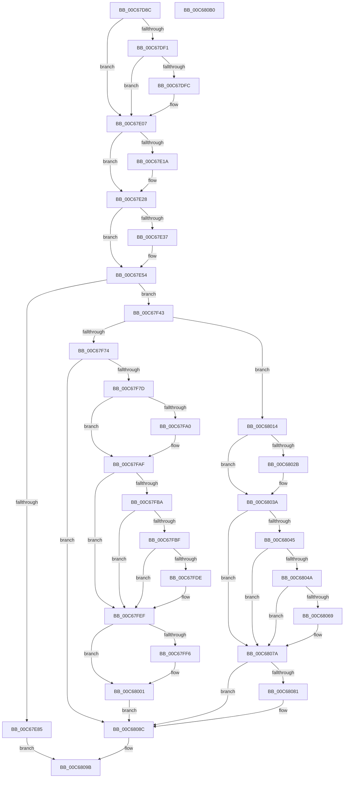

# MiInitializeBootShadowStackPage

- RVA: `0x00C67D8C`–`0x00C680B1` (길이 `805` bytes)
- VA: `0x0000000140C67D8C`
- 실행 섹션: `INIT`
- PDB 이름 있음: `예`; PDB Function 태그: `아니요`
- unwind 정보 RVA: `0x000D8834`
- 디코드: `209`개 명령, `805/805` bytes 표시
- 미해석 바이트: `0` (있으면 어셈블리에 `.byte`로 보존)

> 이 문서는 커널 이미지의 기계어와 PDB 기호를 분석해 생성했습니다. 4번과 5번은 함수 원형과 자료형을 바이너리 사용 방식에서 추정한 C 해석이며 원본 소스 복구 결과는 아닙니다.

## 1. Dependencies

- 직접 호출 지점: **29**; 고유 호출 대상: **20**
- 직접 호출자로 확인된 함수: **2**
- RIP 상대 이미지 참조: **4**

### Outgoing calls
- `0x00C67DD9` → [MiLockPageInline](../../text/31/MiLockPageInline_function_0031A340.md) (function, `0x0031A340`)
- `0x00C67E02` → [MiMarkPfnVerified](../../text/38/MiMarkPfnVerified_function_003833C4.md) (function, `0x003833C4`)
- `0x00C67E0A` → [MiGetPfnSlabType](../../text/28/MiGetPfnSlabType_function_0028E2D0.md) (function, `0x0028E2D0`)
- `0x00C67E1D` → [MiIsPfnFromChargedSlabAllocation](../../text/2A/MiIsPfnFromChargedSlabAllocation_function_002A2968.md) (function, `0x002A2968`)
- `0x00C67E2E` → [MiUnlockPage](../../text/31/MiUnlockPage_function_0031A3E0.md) (function, `0x0031A3E0`)
- `0x00C67E47` → [MiAcquireNonPagedResources](../../text/28/MiAcquireNonPagedResources_function_00286C60.md) (function, `0x00286C60`)
- `0x00C67E89` → [MiVaToFlushVm](../../text/31/MiVaToFlushVm_function_0031AD84.md) (function, `0x0031AD84`)
- `0x00C67E9B` → [MiLockWorkingSetOptimal](../../text/23/MiLockWorkingSetOptimal_function_00238FC0.md) (function, `0x00238FC0`)
- `0x00C67EDC` → [MiDecreaseUsedPtes](../../text/37/MiDecreaseUsedPtes_function_00378080.md) (function, `0x00378080`)
- `0x00C67EEC` → [MiFlushSingleTbEntry](../../text/28/MiFlushSingleTbEntry_function_0028E730.md) (function, `0x0028E730`)
- `0x00C67EF7` → [MiLockAndDecrementShareCount](../../text/2A/MiLockAndDecrementShareCount_function_002A2854.md) (function, `0x002A2854`)
- `0x00C67F01` → [MiLockAndDecrementShareCount](../../text/2A/MiLockAndDecrementShareCount_function_002A2854.md) (function, `0x002A2854`)
- `0x00C67F10` → [MiUnlockWorkingSetOptimal](../../text/23/MiUnlockWorkingSetOptimal_function_00238DFC.md) (function, `0x00238DFC`)
- `0x00C67F1F` → [MiReturnResident](../../text/28/MiReturnResident_function_00286890.md) (function, `0x00286890`)
- `0x00C67F31` → [MiReturnCommit](../../text/24/MiReturnCommit_function_00248410.md) (function, `0x00248410`)
- `0x00C67F47` → [MiVaToFlushVm](../../text/31/MiVaToFlushVm_function_0031AD84.md) (function, `0x0031AD84`)
- `0x00C67F59` → [MiLockWorkingSetOptimal](../../text/23/MiLockWorkingSetOptimal_function_00238FC0.md) (function, `0x00238FC0`)
- `0x00C67F64` → [MI_READ_PTE_LOCK_FREE](../../text/28/MI_READ_PTE_LOCK_FREE_function_002828A0.md) (function, `0x002828A0`)
- `0x00C67F82` → [MiLockPageAndSetDirty](../../text/28/MiLockPageAndSetDirty_function_002857A0.md) (function, `0x002857A0`)
- `0x00C67F97` → [MiPteInShadowRange](../../text/23/MiPteInShadowRange_function_0023FB00.md) (function, `0x0023FB00`)
- `0x00C67FA4` → [MiSanitizeShadowPxe](../../text/29/MiSanitizeShadowPxe_function_00294B68.md) (function, `0x00294B68`)
- `0x00C67FEA` → [MiCheckLinearProtectedPteAccessedBit](../../text/29/MiCheckLinearProtectedPteAccessedBit_function_00292D80.md) (function, `0x00292D80`)
- `0x00C67FFC` → [MiWritePteShadow](../../text/29/MiWritePteShadow_function_00294EAC.md) (function, `0x00294EAC`)
- `0x00C6800D` → [MiFlushSingleTbEntry](../../text/28/MiFlushSingleTbEntry_function_0028E730.md) (function, `0x0028E730`)
- `0x00C68022` → [MiPteInShadowRange](../../text/23/MiPteInShadowRange_function_0023FB00.md) (function, `0x0023FB00`)
- `0x00C6802F` → [MiSanitizeShadowPxe](../../text/29/MiSanitizeShadowPxe_function_00294B68.md) (function, `0x00294B68`)
- `0x00C68075` → [MiCheckLinearProtectedPteAccessedBit](../../text/29/MiCheckLinearProtectedPteAccessedBit_function_00292D80.md) (function, `0x00292D80`)
- `0x00C68087` → [MiWritePteShadow](../../text/29/MiWritePteShadow_function_00294EAC.md) (function, `0x00294EAC`)
- `0x00C68096` → [MiUnlockWorkingSetOptimal](../../text/23/MiUnlockWorkingSetOptimal_function_00238DFC.md) (function, `0x00238DFC`)

### Direct callers
- [MiInitializeBootKernelShadowStack](../../text/68/MiInitializeBootKernelShadowStack_function_006863D8.md) at `0x00686428`
- [MiInitializeBootKernelShadowStacks](MiInitializeBootKernelShadowStacks_function_00C67CA8.md) at `0x00C67D70`

### Static image references
- `0x00C67DF1` → RVA `0x00FC6A88` (`ALMOSTRO`; read)
- `0x00C67E3A` → RVA `0x00E38D00` (`.data`; read)
- `0x00C67E4C` → RVA `0x00E376D8` (`.data`; read/write)
- `0x00C67EC9` → RVA `0x00010880` (`.rdata`; read)

## 2. Other-region calls and transfers

- 다른 실행 섹션으로 향하는 call: **29**
  - `0x00C67DD9` → [MiLockPageInline](../../text/31/MiLockPageInline_function_0031A340.md) (`INIT` → `.text`)
  - `0x00C67E02` → [MiMarkPfnVerified](../../text/38/MiMarkPfnVerified_function_003833C4.md) (`INIT` → `.text`)
  - `0x00C67E0A` → [MiGetPfnSlabType](../../text/28/MiGetPfnSlabType_function_0028E2D0.md) (`INIT` → `.text`)
  - `0x00C67E1D` → [MiIsPfnFromChargedSlabAllocation](../../text/2A/MiIsPfnFromChargedSlabAllocation_function_002A2968.md) (`INIT` → `.text`)
  - `0x00C67E2E` → [MiUnlockPage](../../text/31/MiUnlockPage_function_0031A3E0.md) (`INIT` → `.text`)
  - `0x00C67E47` → [MiAcquireNonPagedResources](../../text/28/MiAcquireNonPagedResources_function_00286C60.md) (`INIT` → `.text`)
  - `0x00C67E89` → [MiVaToFlushVm](../../text/31/MiVaToFlushVm_function_0031AD84.md) (`INIT` → `.text`)
  - `0x00C67E9B` → [MiLockWorkingSetOptimal](../../text/23/MiLockWorkingSetOptimal_function_00238FC0.md) (`INIT` → `.text`)
  - `0x00C67EDC` → [MiDecreaseUsedPtes](../../text/37/MiDecreaseUsedPtes_function_00378080.md) (`INIT` → `.text`)
  - `0x00C67EEC` → [MiFlushSingleTbEntry](../../text/28/MiFlushSingleTbEntry_function_0028E730.md) (`INIT` → `.text`)
  - `0x00C67EF7` → [MiLockAndDecrementShareCount](../../text/2A/MiLockAndDecrementShareCount_function_002A2854.md) (`INIT` → `.text`)
  - `0x00C67F01` → [MiLockAndDecrementShareCount](../../text/2A/MiLockAndDecrementShareCount_function_002A2854.md) (`INIT` → `.text`)
  - `0x00C67F10` → [MiUnlockWorkingSetOptimal](../../text/23/MiUnlockWorkingSetOptimal_function_00238DFC.md) (`INIT` → `.text`)
  - `0x00C67F1F` → [MiReturnResident](../../text/28/MiReturnResident_function_00286890.md) (`INIT` → `.text`)
  - `0x00C67F31` → [MiReturnCommit](../../text/24/MiReturnCommit_function_00248410.md) (`INIT` → `.text`)
  - `0x00C67F47` → [MiVaToFlushVm](../../text/31/MiVaToFlushVm_function_0031AD84.md) (`INIT` → `.text`)
  - `0x00C67F59` → [MiLockWorkingSetOptimal](../../text/23/MiLockWorkingSetOptimal_function_00238FC0.md) (`INIT` → `.text`)
  - `0x00C67F64` → [MI_READ_PTE_LOCK_FREE](../../text/28/MI_READ_PTE_LOCK_FREE_function_002828A0.md) (`INIT` → `.text`)
  - `0x00C67F82` → [MiLockPageAndSetDirty](../../text/28/MiLockPageAndSetDirty_function_002857A0.md) (`INIT` → `.text`)
  - `0x00C67F97` → [MiPteInShadowRange](../../text/23/MiPteInShadowRange_function_0023FB00.md) (`INIT` → `.text`)
  - `0x00C67FA4` → [MiSanitizeShadowPxe](../../text/29/MiSanitizeShadowPxe_function_00294B68.md) (`INIT` → `.text`)
  - `0x00C67FEA` → [MiCheckLinearProtectedPteAccessedBit](../../text/29/MiCheckLinearProtectedPteAccessedBit_function_00292D80.md) (`INIT` → `.text`)
  - `0x00C67FFC` → [MiWritePteShadow](../../text/29/MiWritePteShadow_function_00294EAC.md) (`INIT` → `.text`)
  - `0x00C6800D` → [MiFlushSingleTbEntry](../../text/28/MiFlushSingleTbEntry_function_0028E730.md) (`INIT` → `.text`)
  - `0x00C68022` → [MiPteInShadowRange](../../text/23/MiPteInShadowRange_function_0023FB00.md) (`INIT` → `.text`)
  - `0x00C6802F` → [MiSanitizeShadowPxe](../../text/29/MiSanitizeShadowPxe_function_00294B68.md) (`INIT` → `.text`)
  - `0x00C68075` → [MiCheckLinearProtectedPteAccessedBit](../../text/29/MiCheckLinearProtectedPteAccessedBit_function_00292D80.md) (`INIT` → `.text`)
  - `0x00C68087` → [MiWritePteShadow](../../text/29/MiWritePteShadow_function_00294EAC.md) (`INIT` → `.text`)
  - `0x00C68096` → [MiUnlockWorkingSetOptimal](../../text/23/MiUnlockWorkingSetOptimal_function_00238DFC.md) (`INIT` → `.text`)
- 별도 외부 분기/꼬리 이동을 확인하지 못했습니다.

## 3. Assembly (complete function range)

```asm
00C67D8C  48 89 5C 24 10                  mov qword ptr [rsp + 0x10], rbx
00C67D91  55                              push rbp
00C67D92  56                              push rsi
00C67D93  57                              push rdi
00C67D94  41 54                           push r12
00C67D96  41 55                           push r13
00C67D98  41 56                           push r14
00C67D9A  41 57                           push r15
00C67D9C  48 8B EC                        mov rbp, rsp
00C67D9F  48 83 EC 30                     sub rsp, 0x30
00C67DA3  48 8B 01                        mov rax, qword ptr [rcx]
00C67DA6  4C 8B F1                        mov r14, rcx
00C67DA9  48 C1 E8 0C                     shr rax, 0xc
00C67DAD  48 B9 FF FF FF FF FF 00 00 00   movabs rcx, 0xffffffffff
00C67DB7  48 23 C1                        and rax, rcx
00C67DBA  8B FA                           mov edi, edx
00C67DBC  4C 8D 3C 40                     lea r15, [rax + rax*2]
00C67DC0  48 B8 00 00 00 00 00 DE FF FF   movabs rax, 0xffffde0000000000
00C67DCA  49 C1 E7 04                     shl r15, 4
00C67DCE  48 8B C0                        mov rax, rax
00C67DD1  4C 03 F8                        add r15, rax
00C67DD4  33 DB                           xor ebx, ebx
00C67DD6  49 8B CF                        mov rcx, r15
00C67DD9  E8 62 25 6B FF                  call 0x14031a340
00C67DDE  49 8B 4F 28                     mov rcx, qword ptr [r15 + 0x28]
00C67DE2  40 8A F0                        mov sil, al
00C67DE5  48 C1 E9 3C                     shr rcx, 0x3c
00C67DE9  80 E1 07                        and cl, 7
00C67DEC  80 F9 03                        cmp cl, 3
00C67DEF  74 16                           je 0x140c67e07
00C67DF1  48 0F BA 25 8E EC 35 00 29      bt qword ptr [rip + 0x35ec8e], 0x29
00C67DFA  73 0B                           jae 0x140c67e07
00C67DFC  8D 53 04                        lea edx, [rbx + 4]
00C67DFF  49 8B CF                        mov rcx, r15
00C67E02  E8 BD B5 71 FF                  call 0x1403833c4
00C67E07  49 8B CF                        mov rcx, r15
00C67E0A  E8 C1 64 62 FF                  call 0x14028e2d0
00C67E0F  41 BD 01 00 00 00               mov r13d, 1
00C67E15  83 F8 09                        cmp eax, 9
00C67E18  74 0E                           je 0x140c67e28
00C67E1A  49 8B CF                        mov rcx, r15
00C67E1D  E8 46 AB 63 FF                  call 0x1402a2968
00C67E22  85 C0                           test eax, eax
00C67E24  41 0F 44 DD                     cmove ebx, r13d
00C67E28  40 8A D6                        mov dl, sil
00C67E2B  49 8B CF                        mov rcx, r15
00C67E2E  E8 AD 25 6B FF                  call 0x14031a3e0
00C67E33  85 DB                           test ebx, ebx
00C67E35  74 1D                           je 0x140c67e54
00C67E37  45 33 C9                        xor r9d, r9d
00C67E3A  48 8D 0D BF 0E 1D 00            lea rcx, [rip + 0x1d0ebf]
00C67E41  45 33 C0                        xor r8d, r8d
00C67E44  49 8B D5                        mov rdx, r13
00C67E47  E8 14 EE 61 FF                  call 0x140286c60
00C67E4C  F0 4C 01 2D 84 F8 1C 00         lock add qword ptr [rip + 0x1cf884], r13
00C67E54  4D 8B E6                        mov r12, r14
00C67E57  48 B8 00 00 00 00 80 F6 FF FF   movabs rax, 0xfffff68000000000
00C67E61  49 C1 E4 19                     shl r12, 0x19
00C67E65  48 8B C0                        mov rax, rax
00C67E68  48 C1 E0 19                     shl rax, 0x19
00C67E6C  4C 2B E0                        sub r12, rax
00C67E6F  49 C1 FC 10                     sar r12, 0x10
00C67E73  48 0F BA 25 0C EC 35 00 29      bt qword ptr [rip + 0x35ec0c], 0x29
00C67E7C  49 8B CC                        mov rcx, r12
00C67E7F  0F 82 BE 00 00 00               jb 0x140c67f43
00C67E85  C6 45 40 00                     mov byte ptr [rbp + 0x40], 0
00C67E89  E8 F6 2E 6B FF                  call 0x14031ad84
00C67E8E  4C 8D 45 40                     lea r8, [rbp + 0x40]
00C67E92  49 8B D6                        mov rdx, r14
00C67E95  48 8B C8                        mov rcx, rax
00C67E98  48 8B F0                        mov rsi, rax
00C67E9B  E8 20 11 5D FF                  call 0x140238fc0
00C67EA0  49 8B 4F 28                     mov rcx, qword ptr [r15 + 0x28]
00C67EA4  48 8B F8                        mov rdi, rax
00C67EA7  48 B8 FF FF FF FF FF 00 00 00   movabs rax, 0xffffffffff
00C67EB1  48 23 C8                        and rcx, rax
00C67EB4  48 B8 00 00 00 00 00 DE FF FF   movabs rax, 0xffffde0000000000
00C67EBE  48 8D 1C 49                     lea rbx, [rcx + rcx*2]
00C67EC2  48 C1 E3 04                     shl rbx, 4
00C67EC6  48 8B C8                        mov rcx, rax
00C67EC9  48 8B 15 B0 89 3A FF            mov rdx, qword ptr [rip - 0xc57650]
00C67ED0  45 8B C5                        mov r8d, r13d
00C67ED3  49 89 16                        mov qword ptr [r14], rdx
00C67ED6  48 03 D9                        add rbx, rcx
00C67ED9  48 8B D7                        mov rdx, rdi
00C67EDC  E8 9F 01 71 FF                  call 0x140378080
00C67EE1  45 8B C5                        mov r8d, r13d
00C67EE4  BA 02 00 00 00                  mov edx, 2
00C67EE9  49 8B CC                        mov rcx, r12
00C67EEC  E8 3F 68 62 FF                  call 0x14028e730
00C67EF1  41 8B D5                        mov edx, r13d
00C67EF4  49 8B CF                        mov rcx, r15
00C67EF7  E8 58 A9 63 FF                  call 0x1402a2854
00C67EFC  33 D2                           xor edx, edx
00C67EFE  48 8B CB                        mov rcx, rbx
00C67F01  E8 4E A9 63 FF                  call 0x1402a2854
00C67F06  44 8A 45 40                     mov r8b, byte ptr [rbp + 0x40]
00C67F0A  48 8B D7                        mov rdx, rdi
00C67F0D  48 8B CE                        mov rcx, rsi
00C67F10  E8 E7 0E 5D FF                  call 0x140238dfc
00C67F15  49 8B D5                        mov rdx, r13
00C67F18  48 8D 0D E1 0D 1D 00            lea rcx, [rip + 0x1d0de1]
00C67F1F  E8 6C E9 61 FF                  call 0x140286890
00C67F24  45 33 C0                        xor r8d, r8d
00C67F27  48 8D 0D D2 0D 1D 00            lea rcx, [rip + 0x1d0dd2]
00C67F2E  49 8B D5                        mov rdx, r13
00C67F31  E8 DA 04 5E FF                  call 0x140248410
00C67F36  F0 48 FF 0D 9A F7 1C 00         lock dec qword ptr [rip + 0x1cf79a]
00C67F3E  E9 58 01 00 00                  jmp 0x140c6809b
00C67F43  C6 45 50 00                     mov byte ptr [rbp + 0x50], 0
00C67F47  E8 38 2E 6B FF                  call 0x14031ad84
00C67F4C  4C 8D 45 50                     lea r8, [rbp + 0x50]
00C67F50  49 8B D6                        mov rdx, r14
00C67F53  48 8B C8                        mov rcx, rax
00C67F56  48 8B F0                        mov rsi, rax
00C67F59  E8 62 10 5D FF                  call 0x140238fc0
00C67F5E  49 8B CE                        mov rcx, r14
00C67F61  4C 8B E8                        mov r13, rax
00C67F64  E8 37 A9 61 FF                  call 0x1402828a0
00C67F69  48 8B D8                        mov rbx, rax
00C67F6C  85 FF                           test edi, edi
00C67F6E  0F 84 A0 00 00 00               je 0x140c68014
00C67F74  83 FF 01                        cmp edi, 1
00C67F77  0F 85 0F 01 00 00               jne 0x140c6808c
00C67F7D  8B D7                           mov edx, edi
00C67F7F  49 8B CF                        mov rcx, r15
00C67F82  E8 19 D8 61 FF                  call 0x1402857a0
00C67F87  48 81 E3 BD F7 FF FF            and rbx, 0xfffffffffffff7bd
00C67F8E  49 8B CE                        mov rcx, r14
00C67F91  48 89 5D 58                     mov qword ptr [rbp + 0x58], rbx
00C67F95  33 FF                           xor edi, edi
00C67F97  E8 64 7B 5D FF                  call 0x14023fb00
00C67F9C  85 C0                           test eax, eax
00C67F9E  74 0F                           je 0x140c67faf
00C67FA0  48 8D 55 58                     lea rdx, [rbp + 0x58]
00C67FA4  E8 BF CB 62 FF                  call 0x140294b68
00C67FA9  48 8B 5D 58                     mov rbx, qword ptr [rbp + 0x58]
00C67FAD  8B F8                           mov edi, eax
00C67FAF  48 0F BA 25 D0 EA 35 00 24      bt qword ptr [rip + 0x35ead0], 0x24
00C67FB8  73 35                           jae 0x140c67fef
00C67FBA  F6 C3 20                        test bl, 0x20
00C67FBD  75 30                           jne 0x140c67fef
00C67FBF  48 B8 00 00 00 00 80 F6 FF FF   movabs rax, 0xfffff68000000000
00C67FC9  48 8B C0                        mov rax, rax
00C67FCC  48 B9 00 00 00 00 40 00 00 00   movabs rcx, 0x4000000000
00C67FD6  48 03 C1                        add rax, rcx
00C67FD9  4C 3B F0                        cmp r14, rax
00C67FDC  72 11                           jb 0x140c67fef
00C67FDE  41 B8 80 00 00 00               mov r8d, 0x80
00C67FE4  48 8B D3                        mov rdx, rbx
00C67FE7  49 8B CE                        mov rcx, r14
00C67FEA  E8 91 AD 62 FF                  call 0x140292d80
00C67FEF  49 89 1E                        mov qword ptr [r14], rbx
00C67FF2  85 FF                           test edi, edi
00C67FF4  74 0B                           je 0x140c68001
00C67FF6  48 8B D3                        mov rdx, rbx
00C67FF9  49 8B CE                        mov rcx, r14
00C67FFC  E8 AB CE 62 FF                  call 0x140294eac
00C68001  BA 02 00 00 00                  mov edx, 2
00C68006  49 8B CC                        mov rcx, r12
00C68009  44 8D 42 1E                     lea r8d, [rdx + 0x1e]
00C6800D  E8 1E 67 62 FF                  call 0x14028e730
00C68012  EB 78                           jmp 0x140c6808c
00C68014  48 0F BA F3 0B                  btr rbx, 0xb
00C68019  49 8B CE                        mov rcx, r14
00C6801C  48 89 5D F0                     mov qword ptr [rbp - 0x10], rbx
00C68020  33 FF                           xor edi, edi
00C68022  E8 D9 7A 5D FF                  call 0x14023fb00
00C68027  85 C0                           test eax, eax
00C68029  74 0F                           je 0x140c6803a
00C6802B  48 8D 55 F0                     lea rdx, [rbp - 0x10]
00C6802F  E8 34 CB 62 FF                  call 0x140294b68
00C68034  48 8B 5D F0                     mov rbx, qword ptr [rbp - 0x10]
00C68038  8B F8                           mov edi, eax
00C6803A  48 0F BA 25 45 EA 35 00 24      bt qword ptr [rip + 0x35ea45], 0x24
00C68043  73 35                           jae 0x140c6807a
00C68045  F6 C3 20                        test bl, 0x20
00C68048  75 30                           jne 0x140c6807a
00C6804A  48 B8 00 00 00 00 80 F6 FF FF   movabs rax, 0xfffff68000000000
00C68054  48 8B C0                        mov rax, rax
00C68057  48 B9 00 00 00 00 40 00 00 00   movabs rcx, 0x4000000000
00C68061  48 03 C1                        add rax, rcx
00C68064  4C 3B F0                        cmp r14, rax
00C68067  72 11                           jb 0x140c6807a
00C68069  41 B8 80 00 00 00               mov r8d, 0x80
00C6806F  48 8B D3                        mov rdx, rbx
00C68072  49 8B CE                        mov rcx, r14
00C68075  E8 06 AD 62 FF                  call 0x140292d80
00C6807A  49 89 1E                        mov qword ptr [r14], rbx
00C6807D  85 FF                           test edi, edi
00C6807F  74 0B                           je 0x140c6808c
00C68081  48 8B D3                        mov rdx, rbx
00C68084  49 8B CE                        mov rcx, r14
00C68087  E8 20 CE 62 FF                  call 0x140294eac
00C6808C  44 8A 45 50                     mov r8b, byte ptr [rbp + 0x50]
00C68090  49 8B D5                        mov rdx, r13
00C68093  48 8B CE                        mov rcx, rsi
00C68096  E8 61 0D 5D FF                  call 0x140238dfc
00C6809B  48 8B 5C 24 78                  mov rbx, qword ptr [rsp + 0x78]
00C680A0  48 83 C4 30                     add rsp, 0x30
00C680A4  41 5F                           pop r15
00C680A6  41 5E                           pop r14
00C680A8  41 5D                           pop r13
00C680AA  41 5C                           pop r12
00C680AC  5F                              pop rdi
00C680AD  5E                              pop rsi
00C680AE  5D                              pop rbp
00C680AF  C3                              ret
00C680B0  CC                              int3
```

## 4. C-style interpretation (structured pseudocode)

```c
__int64 __fastcall MiInitializeBootShadowStackPage(__int64 a1, int a2, int a3, int a4)
{
    __int64 result;
    __int64 v_r12;
    __int64 v_r15;
    __int64 v_rbx;
    __int64 v_rdi;
    __int64 v_rsp;
    unsigned __int64 v_stack_m48;
    unsigned __int64 v_stack_p10;
    unsigned __int8 v_stack_p18;
    unsigned __int64 v_stack_p20;
    unsigned __int8 v_stack_p8;

    v_stack_p10 = v_rbx;
    v_rsp = (v_rsp) - (48);
    result = (*(unsigned __int64 *)(a1)) >> (12);
    result = (result) & (a1);
    v_r15 = (result + result * 2) << (4);
    v_r15 = (v_r15) + (result);
    v_rbx = 0;
    result = MiLockPageInline(v_r15, a2, a3, a4);
    a1 = (*(unsigned __int64 *)(v_r15 + 40)) >> (60);
    a1 = (unsigned __int8)((a1) & (7));
    if (((unsigned __int8)(a1)) == 3) goto loc_00C67E07;
    if (((unsigned __int8)(a1)) < 3) {
        a2 = v_rbx + 4;
        a1 = v_r15;
        result = MiMarkPfnVerified(a1, a2, a3, a4);
    }
    result = MiGetPfnSlabType(v_r15, a2, a3, a4);
    if (((unsigned int)(result)) != 9) {
        a1 = v_r15;
        result = MiIsPfnFromChargedSlabAllocation(a1, a2, a3, a4);
        if ((unsigned int)(result) == 0) { v_rbx = 1; }
    }
    result = MiUnlockPage(v_r15, (unsigned __int8)((unsigned __int8)(result)), a3, a4);
    if ((unsigned int)(v_rbx) != 0) {
        a4 = 0;
        a1 = v_rip + 1904319;
        a3 = 0;
        a2 = 1;
        result = MiAcquireNonPagedResources(a1, a2, a3, a4);
    }
    v_r12 = (a1) << (25);
    result = (result) << (25);
    v_r12 = (v_r12) - (result);
    v_r12 = (v_r12) >> (16);
    if (condition_is_below) goto loc_00C67F43;
    v_stack_p8 = 0;
    result = MiVaToFlushVm(v_r12, a2, a3, a4);
    result = MiLockWorkingSetOptimal(result, a1, v_stack_p8, a4);
    a1 = (*(unsigned __int64 *)(v_r15 + 40)) & (result);
    v_rbx = (a1 + a1 * 2) << (4);
    *(unsigned __int64 *)(a1) = *(unsigned __int64 *)(v_rip - 12940880);
    v_rbx = (v_rbx) + (result);
    result = MiDecreaseUsedPtes(result, result, 1, a4);
    result = MiFlushSingleTbEntry(v_r12, 2, 1, a4);
    result = MiLockAndDecrementShareCount(v_r15, 1, 1, a4);
    a2 = 0;
    result = MiLockAndDecrementShareCount(v_rbx, a2, 1, a4);
    result = MiUnlockWorkingSetOptimal(result, result, v_stack_p8, a4);
    result = MiReturnResident(v_rip + 1904097, 1, v_stack_p8, a4);
    a3 = 0;
    result = MiReturnCommit(v_rip + 1904082, 1, a3, a4);
    goto loc_00C6809B;
loc_00C67F43:
    v_stack_p18 = 0;
    result = MiVaToFlushVm(v_rip + 1904082, 1, a3, a4);
    result = MiLockWorkingSetOptimal(result, a1, v_stack_p18, a4);
    result = MI_READ_PTE_LOCK_FREE(a1, a1, v_stack_p18, a4);
    if ((unsigned int)(result) == 0) goto loc_00C68014;
    if (((unsigned int)(result)) != 1) goto loc_00C6808C;
    result = MiLockPageAndSetDirty(v_r15, (unsigned int)((unsigned int)(result)), v_stack_p18, a4);
    v_rbx = (result) & (0xFFFFFFFFFFFFF7BDULL);
    v_stack_p20 = v_rbx;
    v_rdi = 0;
    result = MiPteInShadowRange(a1, (unsigned int)((unsigned int)(result)), v_stack_p18, a4);
    if ((unsigned int)(result) != 0) {
        a2 = v_stack_p20;
        result = MiSanitizeShadowPxe(a1, a2, v_stack_p18, a4);
        v_rbx = v_stack_p20;
        v_rdi = (unsigned int)(result);
    }
    if (condition_is_above_or_equal) goto loc_00C67FEF;
    if ((((unsigned __int8)(v_rbx)) & (32)) != 0) goto loc_00C67FEF;
    result = (result) + (a1);
    if (a1 >= result) {
        a3 = 128;
        a2 = v_rbx;
        a1 = a1;
        result = MiCheckLinearProtectedPteAccessedBit(a1, a2, a3, a4);
    }
    *(unsigned __int64 *)(a1) = v_rbx;
    if ((unsigned int)(v_rdi) != 0) {
        a2 = v_rbx;
        a1 = a1;
        result = MiWritePteShadow(a1, a2, a3, a4);
    }
    result = MiFlushSingleTbEntry(v_r12, 2, 2 + 30, a4);
    goto loc_00C6808C;
loc_00C68014:
    v_stack_m48 = v_rbx;
    v_rdi = 0;
    result = MiPteInShadowRange(a1, 2, 2 + 30, a4);
    if ((unsigned int)(result) != 0) {
        a2 = v_stack_m48;
        result = MiSanitizeShadowPxe(a1, a2, 2 + 30, a4);
        v_rbx = v_stack_m48;
        v_rdi = (unsigned int)(result);
    }
    if (condition_is_above_or_equal) goto loc_00C6807A;
    if ((((unsigned __int8)(v_rbx)) & (32)) != 0) goto loc_00C6807A;
    result = (result) + (a1);
    if (a1 >= result) {
        a3 = 128;
        a2 = v_rbx;
        a1 = a1;
        result = MiCheckLinearProtectedPteAccessedBit(a1, a2, a3, a4);
    }
    *(unsigned __int64 *)(a1) = v_rbx;
    if ((unsigned int)(v_rdi) != 0) {
        a2 = v_rbx;
        a1 = a1;
        result = MiWritePteShadow(a1, a2, a3, a4);
    }
    result = MiUnlockWorkingSetOptimal(result, result, v_stack_p18, a4);
loc_00C6809B:
    v_rsp = (v_rsp) + (48);
    return result;
}
```

## 5. (Beta) C Style

```c
int64_t MiInitializeBootShadowStackPage(void *Arg1, int32_t Arg2, int32_t Arg3, int32_t Arg4)
{
    uint8_t *arg1 = (uint8_t *)Arg1;

    int64_t result;
    int64_t local_r12;
    int64_t local_r15;
    int64_t local_rbx;
    int64_t local_rdi;
    int64_t local_rsp;
    uint64_t v_stack_m48;
    uint64_t v_stack_p10;
    uint8_t v_stack_p18;
    uint64_t v_stack_p20;
    uint8_t v_stack_p8;

    v_stack_p10 = local_rbx;
    local_rsp = (local_rsp) - (48);
    result = (*(uint64_t *)(arg1)) >> (12);
    result = (result) & (Arg1);
    local_r15 = (result + result * 2) << (4);
    local_r15 = (local_r15) + (result);
    local_rbx = 0;
    result = MiLockPageInline(local_r15, Arg2, Arg3, Arg4);
    Arg1 = (*(uint64_t *)(local_r15 + 0x28)) >> (60);
    Arg1 = (uint8_t)((Arg1) & (7));
    if (((uint8_t)(Arg1)) == 3) goto loc_00C67E07;
    if (((uint8_t)(Arg1)) < 3) {
        Arg2 = local_rbx + 4;
        Arg1 = local_r15;
        result = MiMarkPfnVerified(Arg1, Arg2, Arg3, Arg4);
    }
    result = MiGetPfnSlabType(local_r15, Arg2, Arg3, Arg4);
    if (((uint32_t)(result)) != 9) {
        Arg1 = local_r15;
        result = MiIsPfnFromChargedSlabAllocation(Arg1, Arg2, Arg3, Arg4);
        if ((uint32_t)(result) == 0) { local_rbx = 1; }
    }
    result = MiUnlockPage(local_r15, (uint8_t)((uint8_t)(result)), Arg3, Arg4);
    if ((uint32_t)(local_rbx) != 0) {
        Arg4 = 0;
        Arg1 = v_rip + 1904319;
        Arg3 = 0;
        Arg2 = 1;
        result = MiAcquireNonPagedResources(Arg1, Arg2, Arg3, Arg4);
    }
    local_r12 = (Arg1) << (25);
    result = (result) << (25);
    local_r12 = (local_r12) - (result);
    local_r12 = (local_r12) >> (16);
    if (condition_is_below) goto loc_00C67F43;
    v_stack_p8 = 0;
    result = MiVaToFlushVm(local_r12, Arg2, Arg3, Arg4);
    result = MiLockWorkingSetOptimal(result, Arg1, v_stack_p8, Arg4);
    Arg1 = (*(uint64_t *)(local_r15 + 0x28)) & (result);
    local_rbx = (Arg1 + Arg1 * 2) << (4);
    *(uint64_t *)(arg1) = *(uint64_t *)(v_rip - 0xC57650);
    local_rbx = (local_rbx) + (result);
    result = MiDecreaseUsedPtes(result, result, 1, Arg4);
    result = MiFlushSingleTbEntry(local_r12, 2, 1, Arg4);
    result = MiLockAndDecrementShareCount(local_r15, 1, 1, Arg4);
    Arg2 = 0;
    result = MiLockAndDecrementShareCount(local_rbx, Arg2, 1, Arg4);
    result = MiUnlockWorkingSetOptimal(result, result, v_stack_p8, Arg4);
    result = MiReturnResident(v_rip + 1904097, 1, v_stack_p8, Arg4);
    Arg3 = 0;
    result = MiReturnCommit(v_rip + 1904082, 1, Arg3, Arg4);
    goto loc_00C6809B;
loc_00C67F43:
    v_stack_p18 = 0;
    result = MiVaToFlushVm(v_rip + 1904082, 1, Arg3, Arg4);
    result = MiLockWorkingSetOptimal(result, Arg1, v_stack_p18, Arg4);
    result = MI_READ_PTE_LOCK_FREE(Arg1, Arg1, v_stack_p18, Arg4);
    if ((uint32_t)(result) == 0) goto loc_00C68014;
    if (((uint32_t)(result)) != 1) goto loc_00C6808C;
    result = MiLockPageAndSetDirty(local_r15, (uint32_t)((uint32_t)(result)), v_stack_p18, Arg4);
    local_rbx = (result) & (0xFFFFFFFFFFFFF7BDULL);
    v_stack_p20 = local_rbx;
    local_rdi = 0;
    result = MiPteInShadowRange(Arg1, (uint32_t)((uint32_t)(result)), v_stack_p18, Arg4);
    if ((uint32_t)(result) != 0) {
        Arg2 = v_stack_p20;
        result = MiSanitizeShadowPxe(Arg1, Arg2, v_stack_p18, Arg4);
        local_rbx = v_stack_p20;
        local_rdi = (uint32_t)(result);
    }
    if (condition_is_above_or_equal) goto loc_00C67FEF;
    if ((((uint8_t)(local_rbx)) & (32)) != 0) goto loc_00C67FEF;
    result = (result) + (Arg1);
    if (Arg1 >= result) {
        Arg3 = 128;
        Arg2 = local_rbx;
        Arg1 = Arg1;
        result = MiCheckLinearProtectedPteAccessedBit(Arg1, Arg2, Arg3, Arg4);
    }
    *(uint64_t *)(arg1) = local_rbx;
    if ((uint32_t)(local_rdi) != 0) {
        Arg2 = local_rbx;
        Arg1 = Arg1;
        result = MiWritePteShadow(Arg1, Arg2, Arg3, Arg4);
    }
    result = MiFlushSingleTbEntry(local_r12, 2, 2 + 30, Arg4);
    goto loc_00C6808C;
loc_00C68014:
    v_stack_m48 = local_rbx;
    local_rdi = 0;
    result = MiPteInShadowRange(Arg1, 2, 2 + 30, Arg4);
    if ((uint32_t)(result) != 0) {
        Arg2 = v_stack_m48;
        result = MiSanitizeShadowPxe(Arg1, Arg2, 2 + 30, Arg4);
        local_rbx = v_stack_m48;
        local_rdi = (uint32_t)(result);
    }
    if (condition_is_above_or_equal) goto loc_00C6807A;
    if ((((uint8_t)(local_rbx)) & (32)) != 0) goto loc_00C6807A;
    result = (result) + (Arg1);
    if (Arg1 >= result) {
        Arg3 = 128;
        Arg2 = local_rbx;
        Arg1 = Arg1;
        result = MiCheckLinearProtectedPteAccessedBit(Arg1, Arg2, Arg3, Arg4);
    }
    *(uint64_t *)(arg1) = local_rbx;
    if ((uint32_t)(local_rdi) != 0) {
        Arg2 = local_rbx;
        Arg1 = Arg1;
        result = MiWritePteShadow(Arg1, Arg2, Arg3, Arg4);
    }
    result = MiUnlockWorkingSetOptimal(result, result, v_stack_p18, Arg4);
loc_00C6809B:
    local_rsp = (local_rsp) + (48);
    return result;
}
```

### 관측된 메모리 오프셋

구조체 형식이 확인되지 않은 접근은 인자 기준의 오프셋으로만 기록했습니다.

| 기준 인자 | 오프셋 표현 | 폭 (bit) | 접근 |
|---|---:|---:|---|
| `Arg1` | `+ 0x0` | `64` | `R` |
| `Arg1` | `+ 0x0` | `64` | `W` |

## 6. Execution-region graph

[열기: 2D/3D 그래프와 함수 탐색 컨트롤 패널](../../../control-panel.html?section=init&rva=0x00C67D8C&view=graph)

- 2D 그래프는 위에서 아래로 흐르고, 3D 그래프는 빈 공간을 드래그해 회전합니다. Shift+드래그는 이동, 휠은 확대·축소, 함수 노드 선택은 대상 보고서 이동입니다.

### Static fallback


