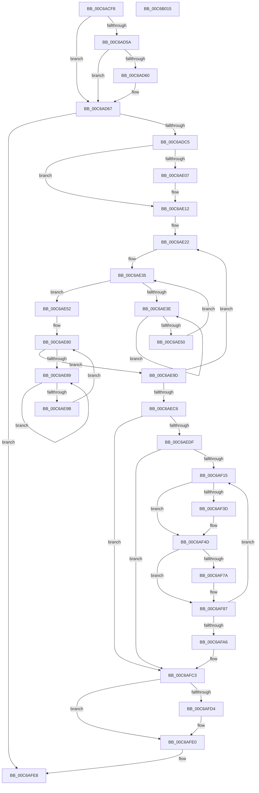

# MiInitializeCacheFlushing

- RVA: `0x00C6ACF8`–`0x00C6B016` (길이 `798` bytes)
- VA: `0x0000000140C6ACF8`
- 실행 섹션: `INIT`
- PDB 이름 있음: `예`; PDB Function 태그: `아니요`
- unwind 정보 RVA: `0x000C3A88`
- 디코드: `209`개 명령, `798/798` bytes 표시
- 미해석 바이트: `0` (있으면 어셈블리에 `.byte`로 보존)

> 이 문서는 커널 이미지의 기계어와 PDB 기호를 분석해 생성했습니다. 4번과 5번은 함수 원형과 자료형을 바이너리 사용 방식에서 추정한 C 해석이며 원본 소스 복구 결과는 아닙니다.

## 1. Dependencies

- 직접 호출 지점: **19**; 고유 호출 대상: **17**
- 직접 호출자로 확인된 함수: **1**
- RIP 상대 이미지 참조: **8**

### Outgoing calls
- `0x00C6AD4B` → [ZwQuerySystemInformation](../../text/6A/ZwQuerySystemInformation_function_006AD790.md) (function, `0x006AD790`)
- `0x00C6AD74` → [MiInitializePageColorBase](../../text/32/MiInitializePageColorBase_function_00320410.md) (function, `0x00320410`)
- `0x00C6ADB3` → [MiGetPage](../../text/28/MiGetPage_function_002884C0.md) (function, `0x002884C0`)
- `0x00C6ADEA` → [MiFinalizePageAttribute](../../text/33/MiFinalizePageAttribute_function_00332E30.md) (function, `0x00332E30`)
- `0x00C6AE0D` → [KiRaiseIrqlProcessIrqlFlags](../../text/4F/KiRaiseIrqlProcessIrqlFlags_function_004F56FC.md) (function, `0x004F56FC`)
- `0x00C6AE2D` → [MiZeroPhysicalPage](../../text/33/MiZeroPhysicalPage_function_00332590.md) (function, `0x00332590`)
- `0x00C6AE42` → [KeYieldProcessorEx](../../text/3F/KeYieldProcessorEx_function_003FBD00.md) (function, `0x003FBD00`)
- `0x00C6AE78` → [MiFlushCacheForAttributeChange](../../text/30/MiFlushCacheForAttributeChange_function_00308944.md) (function, `0x00308944`)
- `0x00C6AE8D` → [KeYieldProcessorEx](../../text/3F/KeYieldProcessorEx_function_003FBD00.md) (function, `0x003FBD00`)
- `0x00C6AEB8` → [MiFlushEntireTbDueToAttributeChange](../../text/30/MiFlushEntireTbDueToAttributeChange_function_00308AE0.md) (function, `0x00308AE0`)
- `0x00C6AF04` → [MiAllocatePool](../../text/35/MiAllocatePool_function_0035B540.md) (function, `0x0035B540`)
- `0x00C6AF1D` → [memset](../../text/6C/memset_function_006C6C40.md) (function, `0x006C6C40`)
- `0x00C6AF2B` → [KeQueryPerformanceCounter](../../text/37/KeQueryPerformanceCounter_function_0037E7E0.md) (function, `0x0037E7E0`)
- `0x00C6AF58` → [KeInvalidateAllCaches](../../text/30/KeInvalidateAllCaches_function_00308CC0.md) (function, `0x00308CC0`)
- `0x00C6AF6B` → [KeQueryPerformanceCounter](../../text/37/KeQueryPerformanceCounter_function_0037E7E0.md) (function, `0x0037E7E0`)
- `0x00C6AFAB` → [ExFreePoolWithTag](../../poolcode/B8/ExFreePoolWithTag_function_00B82870.md) (function, `0x00B82870`)
- `0x00C6AFC6` → [MiReleaseFreshPageAtDpc](../../text/33/MiReleaseFreshPageAtDpc_function_00334B50.md) (function, `0x00334B50`)
- `0x00C6AFDB` → [KiLowerIrqlProcessIrqlFlags](../../text/4F/KiLowerIrqlProcessIrqlFlags_function_004F5698.md) (function, `0x004F5698`)
- `0x00C6AFEF` → [_security_check_cookie](../../text/6A/_security_check_cookie_function_006AC640.md) (function, `0x006AC640`)

### Direct callers
- [MiInitSystem](../C5/MiInitSystem_function_00C5E6C0.md) at `0x00C5EB99`

### Static image references
- `0x00C6AD1B` → RVA `0x00E0A740` (`.data`; read)
- `0x00C6AD60` → RVA `0x00E2DC40` (`.data`; write)
- `0x00C6AD89` → RVA `0x00E2DCC0` (`.data`; read)
- `0x00C6ADA0` → RVA `0x00E38D00` (`.data`; read)
- `0x00C6ADFF` → RVA `0x00FC6D20` (`ALMOSTRO`; read)
- `0x00C6AEDF` → RVA `0x00E2DC30` (`.data`; read)
- `0x00C6AF52` → RVA `0x00E2DC54` (`.data`; read/write)
- `0x00C6AFBD` → RVA `0x00E2DC5C` (`.data`; write)

## 2. Other-region calls and transfers

- 다른 실행 섹션으로 향하는 call: **19**
  - `0x00C6AD4B` → [ZwQuerySystemInformation](../../text/6A/ZwQuerySystemInformation_function_006AD790.md) (`INIT` → `.text`)
  - `0x00C6AD74` → [MiInitializePageColorBase](../../text/32/MiInitializePageColorBase_function_00320410.md) (`INIT` → `.text`)
  - `0x00C6ADB3` → [MiGetPage](../../text/28/MiGetPage_function_002884C0.md) (`INIT` → `.text`)
  - `0x00C6ADEA` → [MiFinalizePageAttribute](../../text/33/MiFinalizePageAttribute_function_00332E30.md) (`INIT` → `.text`)
  - `0x00C6AE0D` → [KiRaiseIrqlProcessIrqlFlags](../../text/4F/KiRaiseIrqlProcessIrqlFlags_function_004F56FC.md) (`INIT` → `.text`)
  - `0x00C6AE2D` → [MiZeroPhysicalPage](../../text/33/MiZeroPhysicalPage_function_00332590.md) (`INIT` → `.text`)
  - `0x00C6AE42` → [KeYieldProcessorEx](../../text/3F/KeYieldProcessorEx_function_003FBD00.md) (`INIT` → `.text`)
  - `0x00C6AE78` → [MiFlushCacheForAttributeChange](../../text/30/MiFlushCacheForAttributeChange_function_00308944.md) (`INIT` → `.text`)
  - `0x00C6AE8D` → [KeYieldProcessorEx](../../text/3F/KeYieldProcessorEx_function_003FBD00.md) (`INIT` → `.text`)
  - `0x00C6AEB8` → [MiFlushEntireTbDueToAttributeChange](../../text/30/MiFlushEntireTbDueToAttributeChange_function_00308AE0.md) (`INIT` → `.text`)
  - `0x00C6AF04` → [MiAllocatePool](../../text/35/MiAllocatePool_function_0035B540.md) (`INIT` → `.text`)
  - `0x00C6AF1D` → [memset](../../text/6C/memset_function_006C6C40.md) (`INIT` → `.text`)
  - `0x00C6AF2B` → [KeQueryPerformanceCounter](../../text/37/KeQueryPerformanceCounter_function_0037E7E0.md) (`INIT` → `.text`)
  - `0x00C6AF58` → [KeInvalidateAllCaches](../../text/30/KeInvalidateAllCaches_function_00308CC0.md) (`INIT` → `.text`)
  - `0x00C6AF6B` → [KeQueryPerformanceCounter](../../text/37/KeQueryPerformanceCounter_function_0037E7E0.md) (`INIT` → `.text`)
  - `0x00C6AFAB` → [ExFreePoolWithTag](../../poolcode/B8/ExFreePoolWithTag_function_00B82870.md) (`INIT` → `POOLCODE`)
  - `0x00C6AFC6` → [MiReleaseFreshPageAtDpc](../../text/33/MiReleaseFreshPageAtDpc_function_00334B50.md) (`INIT` → `.text`)
  - `0x00C6AFDB` → [KiLowerIrqlProcessIrqlFlags](../../text/4F/KiLowerIrqlProcessIrqlFlags_function_004F5698.md) (`INIT` → `.text`)
  - `0x00C6AFEF` → [_security_check_cookie](../../text/6A/_security_check_cookie_function_006AC640.md) (`INIT` → `.text`)
- 별도 외부 분기/꼬리 이동을 확인하지 못했습니다.

## 3. Assembly (complete function range)

```asm
00C6ACF8  48 8B C4                        mov rax, rsp
00C6ACFB  48 89 58 08                     mov qword ptr [rax + 8], rbx
00C6ACFF  48 89 70 10                     mov qword ptr [rax + 0x10], rsi
00C6AD03  48 89 78 18                     mov qword ptr [rax + 0x18], rdi
00C6AD07  55                              push rbp
00C6AD08  41 54                           push r12
00C6AD0A  41 55                           push r13
00C6AD0C  41 56                           push r14
00C6AD0E  41 57                           push r15
00C6AD10  48 8D 68 A1                     lea rbp, [rax - 0x5f]
00C6AD14  48 81 EC 90 00 00 00            sub rsp, 0x90
00C6AD1B  48 8B 05 1E FA 19 00            mov rax, qword ptr [rip + 0x19fa1e]
00C6AD22  48 33 C4                        xor rax, rsp
00C6AD25  48 89 45 27                     mov qword ptr [rbp + 0x27], rax
00C6AD29  0F 57 C9                        xorps xmm1, xmm1
00C6AD2C  48 8D 55 07                     lea rdx, [rbp + 7]
00C6AD30  45 33 C9                        xor r9d, r9d
00C6AD33  0F 57 C0                        xorps xmm0, xmm0
00C6AD36  B9 C0 00 00 00                  mov ecx, 0xc0
00C6AD3B  0F 11 45 F7                     movups xmmword ptr [rbp - 9], xmm0
00C6AD3F  45 8D 41 20                     lea r8d, [r9 + 0x20]
00C6AD43  0F 11 4D 07                     movups xmmword ptr [rbp + 7], xmm1
00C6AD47  0F 11 4D 17                     movups xmmword ptr [rbp + 0x17], xmm1
00C6AD4B  E8 40 2A A4 FF                  call 0x1406ad790
00C6AD50  41 BD 01 00 00 00               mov r13d, 1
00C6AD56  85 C0                           test eax, eax
00C6AD58  78 0D                           js 0x140c6ad67
00C6AD5A  44 84 6D 0F                     test byte ptr [rbp + 0xf], r13b
00C6AD5E  74 07                           je 0x140c6ad67
00C6AD60  44 88 2D D9 2E 1C 00            mov byte ptr [rip + 0x1c2ed9], r13b
00C6AD67  45 33 C0                        xor r8d, r8d
00C6AD6A  4C 8D 4D F7                     lea r9, [rbp - 9]
00C6AD6E  33 C9                           xor ecx, ecx
00C6AD70  41 8D 50 03                     lea edx, [r8 + 3]
00C6AD74  E8 97 56 6B FF                  call 0x140320410
00C6AD79  4C 8B 4D F7                     mov r9, qword ptr [rbp - 9]
00C6AD7D  41 8B C5                        mov eax, r13d
00C6AD80  F0 41 0F C1 01                  lock xadd dword ptr [r9], eax
00C6AD85  4C 8B 45 FF                     mov r8, qword ptr [rbp - 1]
00C6AD89  4C 8D 0D 30 2F 1C 00            lea r9, [rip + 0x1c2f30]
00C6AD90  33 D2                           xor edx, edx
00C6AD92  49 8B C8                        mov rcx, r8
00C6AD95  48 C1 E9 10                     shr rcx, 0x10
00C6AD99  83 E1 03                        and ecx, 3
00C6AD9C  41 F7 34 89                     div dword ptr [r9 + rcx*4]
00C6ADA0  48 8D 0D 59 DF 1C 00            lea rcx, [rip + 0x1cdf59]
00C6ADA7  41 33 D0                        xor edx, r8d
00C6ADAA  0F B6 D2                        movzx edx, dl
00C6ADAD  41 33 D0                        xor edx, r8d
00C6ADB0  45 33 C0                        xor r8d, r8d
00C6ADB3  E8 08 D7 61 FF                  call 0x1402884c0
00C6ADB8  48 8B D8                        mov rbx, rax
00C6ADBB  48 83 F8 FF                     cmp rax, -1
00C6ADBF  0F 84 23 02 00 00               je 0x140c6afe8
00C6ADC5  48 83 65 CF 00                  and qword ptr [rbp - 0x31], 0
00C6ADCA  48 8D 3C 40                     lea rdi, [rax + rax*2]
00C6ADCE  48 C1 E7 04                     shl rdi, 4
00C6ADD2  33 F6                           xor esi, esi
00C6ADD4  48 B8 00 00 00 00 00 DE FF FF   movabs rax, 0xffffde0000000000
00C6ADDE  48 03 F8                        add rdi, rax
00C6ADE1  45 33 C0                        xor r8d, r8d
00C6ADE4  48 8B CF                        mov rcx, rdi
00C6ADE7  41 8B D5                        mov edx, r13d
00C6ADEA  E8 41 80 6C FF                  call 0x140332e30
00C6ADEF  45 0F 20 C4                     mov r12, cr8
00C6ADF3  4C 89 65 EF                     mov qword ptr [rbp - 0x11], r12
00C6ADF7  44 8D 76 02                     lea r14d, [rsi + 2]
00C6ADFB  45 0F 22 C6                     mov cr8, r14
00C6ADFF  39 35 1B BF 35 00               cmp dword ptr [rip + 0x35bf1b], esi
00C6AE05  74 0B                           je 0x140c6ae12
00C6AE07  41 8A D6                        mov dl, r14b
00C6AE0A  41 8A CC                        mov cl, r12b
00C6AE0D  E8 EA A8 88 FF                  call 0x1404f56fc
00C6AE12  41 BF 04 00 00 00               mov r15d, 4
00C6AE18  49 BC FF FF FF FF FF FF FF 7F   movabs r12, 0x7fffffffffffffff
00C6AE22  45 33 C9                        xor r9d, r9d
00C6AE25  45 8B C6                        mov r8d, r14d
00C6AE28  48 8B D3                        mov rdx, rbx
00C6AE2B  33 C9                           xor ecx, ecx
00C6AE2D  E8 5E 77 6C FF                  call 0x140332590
00C6AE32  21 75 D7                        and dword ptr [rbp - 0x29], esi
00C6AE35  F0 48 0F BA 6F 18 3F            lock bts qword ptr [rdi + 0x18], 0x3f
00C6AE3C  73 14                           jae 0x140c6ae52
00C6AE3E  48 8D 4D D7                     lea rcx, [rbp - 0x29]
00C6AE42  E8 B9 0E 79 FF                  call 0x1403fbd00
00C6AE47  48 8B 47 18                     mov rax, qword ptr [rdi + 0x18]
00C6AE4B  48 85 C0                        test rax, rax
00C6AE4E  78 EE                           js 0x140c6ae3e
00C6AE50  EB E3                           jmp 0x140c6ae35
00C6AE52  8B 47 20                        mov eax, dword ptr [rdi + 0x20]
00C6AE55  89 45 C7                        mov dword ptr [rbp - 0x39], eax
00C6AE58  C1 E8 10                        shr eax, 0x10
00C6AE5B  24 3F                           and al, 0x3f
00C6AE5D  88 45 C9                        mov byte ptr [rbp - 0x37], al
00C6AE60  8B 45 C7                        mov eax, dword ptr [rbp - 0x39]
00C6AE63  89 47 20                        mov dword ptr [rdi + 0x20], eax
00C6AE66  F0 4C 21 67 18                  lock and qword ptr [rdi + 0x18], r12
00C6AE6B  4C 8D 4D CF                     lea r9, [rbp - 0x31]
00C6AE6F  45 33 C0                        xor r8d, r8d
00C6AE72  49 8B D5                        mov rdx, r13
00C6AE75  48 8B CB                        mov rcx, rbx
00C6AE78  E8 C7 DA 69 FF                  call 0x140308944
00C6AE7D  21 75 DB                        and dword ptr [rbp - 0x25], esi
00C6AE80  F0 48 0F BA 6F 18 3F            lock bts qword ptr [rdi + 0x18], 0x3f
00C6AE87  73 14                           jae 0x140c6ae9d
00C6AE89  48 8D 4D DB                     lea rcx, [rbp - 0x25]
00C6AE8D  E8 6E 0E 79 FF                  call 0x1403fbd00
00C6AE92  48 8B 47 18                     mov rax, qword ptr [rdi + 0x18]
00C6AE96  48 85 C0                        test rax, rax
00C6AE99  78 EE                           js 0x140c6ae89
00C6AE9B  EB E3                           jmp 0x140c6ae80
00C6AE9D  8B 47 20                        mov eax, dword ptr [rdi + 0x20]
00C6AEA0  89 45 C7                        mov dword ptr [rbp - 0x39], eax
00C6AEA3  C1 E8 10                        shr eax, 0x10
00C6AEA6  24 3F                           and al, 0x3f
00C6AEA8  0C 40                           or al, 0x40
00C6AEAA  88 45 C9                        mov byte ptr [rbp - 0x37], al
00C6AEAD  8B 45 C7                        mov eax, dword ptr [rbp - 0x39]
00C6AEB0  89 47 20                        mov dword ptr [rdi + 0x20], eax
00C6AEB3  F0 4C 21 67 18                  lock and qword ptr [rdi + 0x18], r12
00C6AEB8  E8 23 DC 69 FF                  call 0x140308ae0
00C6AEBD  4D 2B FD                        sub r15, r13
00C6AEC0  0F 85 5C FF FF FF               jne 0x140c6ae22
00C6AEC6  48 8B 45 CF                     mov rax, qword ptr [rbp - 0x31]
00C6AECA  4C 8B 65 EF                     mov r12, qword ptr [rbp - 0x11]
00C6AECE  48 C1 E8 02                     shr rax, 2
00C6AED2  48 89 45 CF                     mov qword ptr [rbp - 0x31], rax
00C6AED6  48 85 C0                        test rax, rax
00C6AED9  0F 84 E4 00 00 00               je 0x140c6afc3
00C6AEDF  8B 05 4B 2D 1C 00               mov eax, dword ptr [rip + 0x1c2d4b]
00C6AEE5  B9 00 01 00 00                  mov ecx, 0x100
00C6AEEA  85 C0                           test eax, eax
00C6AEEC  41 B8 4D 6D 20 20               mov r8d, 0x20206d4d
00C6AEF2  0F 44 C1                        cmove eax, ecx
00C6AEF5  41 8D 4F 40                     lea ecx, [r15 + 0x40]
00C6AEF9  C1 E8 02                        shr eax, 2
00C6AEFC  8D 04 40                        lea eax, [rax + rax*2]
00C6AEFF  8B D0                           mov edx, eax
00C6AF01  44 8B E8                        mov r13d, eax
00C6AF04  E8 37 06 6F FF                  call 0x14035b540
00C6AF09  4C 8B F8                        mov r15, rax
00C6AF0C  48 85 C0                        test rax, rax
00C6AF0F  0F 84 AE 00 00 00               je 0x140c6afc3
00C6AF15  4D 8B C5                        mov r8, r13
00C6AF18  33 D2                           xor edx, edx
00C6AF1A  49 8B CF                        mov rcx, r15
00C6AF1D  E8 1E BD A5 FF                  call 0x1406c6c40
00C6AF22  48 83 65 DF 00                  and qword ptr [rbp - 0x21], 0
00C6AF27  48 8D 4D DF                     lea rcx, [rbp - 0x21]
00C6AF2B  E8 B0 38 71 FF                  call 0x14037e7e0
00C6AF30  48 81 7D DF 80 96 98 00         cmp qword ptr [rbp - 0x21], 0x989680
00C6AF38  48 8B D8                        mov rbx, rax
00C6AF3B  74 10                           je 0x140c6af4d
00C6AF3D  48 69 C3 80 96 98 00            imul rax, rbx, 0x989680
00C6AF44  48 99                           cqo
00C6AF46  48 F7 7D DF                     idiv qword ptr [rbp - 0x21]
00C6AF4A  48 8B D8                        mov rbx, rax
00C6AF4D  F0 83 0C 24 00                  lock or dword ptr [rsp], 0
00C6AF52  FF 05 FC 2C 1C 00               inc dword ptr [rip + 0x1c2cfc]
00C6AF58  E8 63 DD 69 FF                  call 0x140308cc0
00C6AF5D  F0 83 0C 24 00                  lock or dword ptr [rsp], 0
00C6AF62  48 83 65 E7 00                  and qword ptr [rbp - 0x19], 0
00C6AF67  48 8D 4D E7                     lea rcx, [rbp - 0x19]
00C6AF6B  E8 70 38 71 FF                  call 0x14037e7e0
00C6AF70  48 81 7D E7 80 96 98 00         cmp qword ptr [rbp - 0x19], 0x989680
00C6AF78  74 0D                           je 0x140c6af87
00C6AF7A  48 69 C0 80 96 98 00            imul rax, rax, 0x989680
00C6AF81  48 99                           cqo
00C6AF83  48 F7 7D E7                     idiv qword ptr [rbp - 0x19]
00C6AF87  F0 83 0C 24 00                  lock or dword ptr [rsp], 0
00C6AF8C  48 3B C3                        cmp rax, rbx
00C6AF8F  48 8B CB                        mov rcx, rbx
00C6AF92  48 0F 43 C8                     cmovae rcx, rax
00C6AF96  48 2B CB                        sub rcx, rbx
00C6AF99  48 03 F1                        add rsi, rcx
00C6AF9C  49 83 EE 01                     sub r14, 1
00C6AFA0  0F 85 6F FF FF FF               jne 0x140c6af15
00C6AFA6  33 D2                           xor edx, edx
00C6AFA8  49 8B CF                        mov rcx, r15
00C6AFAB  E8 C0 78 F1 FF                  call 0x140b82870
00C6AFB0  48 83 E6 FE                     and rsi, 0xfffffffffffffffe
00C6AFB4  33 D2                           xor edx, edx
00C6AFB6  48 8B C6                        mov rax, rsi
00C6AFB9  48 F7 75 CF                     div qword ptr [rbp - 0x31]
00C6AFBD  89 05 99 2C 1C 00               mov dword ptr [rip + 0x1c2c99], eax
00C6AFC3  48 8B CF                        mov rcx, rdi
00C6AFC6  E8 85 9B 6C FF                  call 0x140334b50
00C6AFCB  83 3D 4E BD 35 00 00            cmp dword ptr [rip + 0x35bd4e], 0
00C6AFD2  74 0C                           je 0x140c6afe0
00C6AFD4  44 0F 20 C1                     mov rcx, cr8
00C6AFD8  41 8A D4                        mov dl, r12b
00C6AFDB  E8 B8 A6 88 FF                  call 0x1404f5698
00C6AFE0  41 0F B6 C4                     movzx eax, r12b
00C6AFE4  44 0F 22 C0                     mov cr8, rax
00C6AFE8  48 8B 4D 27                     mov rcx, qword ptr [rbp + 0x27]
00C6AFEC  48 33 CC                        xor rcx, rsp
00C6AFEF  E8 4C 16 A4 FF                  call 0x1406ac640
00C6AFF4  4C 8D 9C 24 90 00 00 00         lea r11, [rsp + 0x90]
00C6AFFC  49 8B 5B 30                     mov rbx, qword ptr [r11 + 0x30]
00C6B000  49 8B 73 38                     mov rsi, qword ptr [r11 + 0x38]
00C6B004  49 8B 7B 40                     mov rdi, qword ptr [r11 + 0x40]
00C6B008  49 8B E3                        mov rsp, r11
00C6B00B  41 5F                           pop r15
00C6B00D  41 5E                           pop r14
00C6B00F  41 5D                           pop r13
00C6B011  41 5C                           pop r12
00C6B013  5D                              pop rbp
00C6B014  C3                              ret
00C6B015  CC                              int3
```

## 4. C-style interpretation (structured pseudocode)

```c
__int64 __fastcall MiInitializeCacheFlushing(__int64 a1, __int64 a2, __int64 a3, int a4)
{
    __int64 result;
    __int64 v_r14;
    __int64 v_r15;
    __int64 v_rbx;
    __int64 v_rdi;
    __int64 v_rsi;
    __int64 v_rsp;
    unsigned __int64 v_stack_m28;
    unsigned int v_stack_mB8;

    *(unsigned __int64 *)(v_rsp + 8) = v_rbx;
    *(unsigned __int64 *)(v_rsp + 16) = v_rsi;
    *(unsigned __int64 *)(v_rsp + 24) = v_rdi;
    v_rsp = (v_rsp) - (144);
    result = (*(unsigned __int64 *)(v_rip + 1702430)) ^ (v_rsp);
    *(unsigned __int64 *)(v_rsp - 95 + 39) = result;
    a4 = 0;
    *(unsigned __int64 *)(v_rsp - 95 - 9) = v_xmm0;
    *(unsigned __int64 *)(v_rsp - 95 + 7) = v_xmm1;
    *(unsigned __int64 *)(v_rsp - 95 + 23) = v_xmm1;
    result = ZwQuerySystemInformation(192, v_rsp - 95 + 7, a4 + 32, a4);
    if (sign_flag) goto loc_00C6AD67;
    if (((*(unsigned __int8 *)(v_rsp - 95 + 15)) & (1)) != 0) {
        *(unsigned __int8 *)(v_rip + 1847001) = 1;
    }
    a3 = 0;
    a1 = 0;
    result = MiInitializePageColorBase(a1, a3 + 3, a3, v_rsp - 95 - 9);
    a2 = 0;
    a1 = (*(unsigned __int64 *)(v_rsp - 95 - 1)) >> (16);
    a1 = (unsigned int)((a1) & (3));
    a2 = (unsigned int)((a2) ^ ((unsigned int)(*(unsigned __int64 *)(v_rsp - 95 - 1))));
    a2 = (unsigned int)(((unsigned __int8)(a2)) ^ ((unsigned int)(*(unsigned __int64 *)(v_rsp - 95 - 1))));
    a3 = 0;
    result = MiGetPage(v_rip + 1892185, a2, a3, v_rip + 1847088);
    if (result == -1) goto loc_00C6AFE8;
    v_rdi = (result + result * 2) << (4);
    v_rsi = 0;
    v_rdi = (v_rdi) + (result);
    a3 = 0;
    result = MiFinalizePageAttribute(v_rdi, 1, a3, v_rip + 1847088);
    *(unsigned __int64 *)(v_rsp - 95 - 17) = v_cr8;
    if ((*(unsigned int *)(v_rip + 3522331)) != 0) {
        a2 = (unsigned __int8)(v_rsi + 2);
        a1 = (unsigned __int8)(v_cr8);
        result = KiRaiseIrqlProcessIrqlFlags(a1, a2, a3, v_rip + 1847088);
    }
loc_00C6AE22:
    a4 = 0;
    a1 = 0;
    result = MiZeroPhysicalPage(a1, result, (unsigned int)((unsigned int)(v_rsi + 2)), a4);
loc_00C6AE35:
    if (condition_is_above_or_equal) goto loc_00C6AE52;
loc_00C6AE3E:
    result = KeYieldProcessorEx(v_rsp - 95 - 41, result, (unsigned int)((unsigned int)(v_rsi + 2)), a4);
    if (sign_flag) goto loc_00C6AE3E;
    goto loc_00C6AE35;
loc_00C6AE52:
    *(unsigned int *)(v_rsp - 95 - 57) = (unsigned int)((unsigned int)(*(unsigned int *)(v_rdi + 32)));
    result = (unsigned int)(((unsigned int)(*(unsigned int *)(v_rdi + 32))) >> (16));
    result = (unsigned __int8)((result) & (63));
    *(unsigned __int8 *)(v_rsp - 95 - 55) = (unsigned __int8)(result);
    *(unsigned int *)(v_rdi + 32) = (unsigned int)((unsigned int)(*(unsigned int *)(v_rsp - 95 - 57)));
    a3 = 0;
    result = MiFlushCacheForAttributeChange(result, 1, a3, v_rsp - 95 - 49);
loc_00C6AE80:
    if (condition_is_above_or_equal) goto loc_00C6AE9D;
loc_00C6AE89:
    result = KeYieldProcessorEx(v_rsp - 95 - 37, 1, a3, v_rsp - 95 - 49);
    if (sign_flag) goto loc_00C6AE89;
    goto loc_00C6AE80;
loc_00C6AE9D:
    *(unsigned int *)(v_rsp - 95 - 57) = (unsigned int)((unsigned int)(*(unsigned int *)(v_rdi + 32)));
    result = (unsigned int)(((unsigned int)(*(unsigned int *)(v_rdi + 32))) >> (16));
    result = (unsigned __int8)((result) & (63));
    result = (unsigned __int8)((result) | (64));
    *(unsigned __int8 *)(v_rsp - 95 - 55) = (unsigned __int8)(result);
    *(unsigned int *)(v_rdi + 32) = (unsigned int)((unsigned int)(*(unsigned int *)(v_rsp - 95 - 57)));
    result = MiFlushEntireTbDueToAttributeChange(v_rsp - 95 - 37, 1, a3, v_rsp - 95 - 49);
    v_r15 = (4) - (1);
    if (condition_is_not_equal) goto loc_00C6AE22;
    result = (*(unsigned __int64 *)(v_rsp - 95 - 49)) >> (2);
    *(unsigned __int64 *)(v_rsp - 95 - 49) = result;
    if (result == 0) goto loc_00C6AFC3;
    result = (unsigned int)(*(unsigned int *)(v_rip + 1846603));
    if ((unsigned int)((unsigned int)(*(unsigned int *)(v_rip + 1846603))) == 0) { result = 256; }
    result = (unsigned int)((result) >> (2));
    result = MiAllocatePool(v_r15 + 64, (unsigned int)((unsigned int)(result + result * 2)), (unsigned int)(0x20206D4DULL), v_rsp - 95 - 49);
    if (result == 0) goto loc_00C6AFC3;
loc_00C6AF15:
    a2 = 0;
    result = memset(result, a2, (unsigned int)((unsigned int)(result + result * 2)), v_rsp - 95 - 49);
    result = KeQueryPerformanceCounter(v_rsp - 95 - 33, a2, (unsigned int)((unsigned int)(result + result * 2)), v_rsp - 95 - 49);
    v_rbx = result;
    if ((*(unsigned __int64 *)(v_rsp - 95 - 33)) != 0x989680ULL) {
        result = (result) * (result);
        v_rbx = result;
    }
    result = KeInvalidateAllCaches(v_rsp - 95 - 33, a2, (unsigned int)((unsigned int)(result + result * 2)), v_rsp - 95 - 49);
    result = KeQueryPerformanceCounter(v_rsp - 95 - 25, a2, (unsigned int)((unsigned int)(result + result * 2)), v_rsp - 95 - 49);
    if ((*(unsigned __int64 *)(v_rsp - 95 - 25)) != 0x989680ULL) {
        result = (result) * (result);
    }
    a1 = v_rbx;
    if (result >= v_rbx) { a1 = result; }
    a1 = (a1) - (v_rbx);
    v_rsi = (v_rsi) + (a1);
    v_r14 = (v_rsi + 2) - (1);
    if (condition_is_not_equal) goto loc_00C6AF15;
    a2 = 0;
    result = ExFreePoolWithTag(result, a2, (unsigned int)((unsigned int)(result + result * 2)), v_rsp - 95 - 49);
    v_rsi = (v_rsi) & (-2);
    a2 = 0;
    *(unsigned int *)(v_rip + 1846425) = (unsigned int)(v_rsi);
loc_00C6AFC3:
    result = MiReleaseFreshPageAtDpc(v_rdi, a2, (unsigned int)((unsigned int)(result + result * 2)), v_rsp - 95 - 49);
    if ((*(unsigned int *)(v_rip + 3521870)) != 0) {
        a1 = v_rsi + 2;
        a2 = (unsigned __int8)(*(unsigned __int64 *)(v_rsp - 95 - 17));
        result = KiLowerIrqlProcessIrqlFlags(a1, a2, (unsigned int)((unsigned int)(result + result * 2)), v_rsp - 95 - 49);
    }
loc_00C6AFE8:
    a1 = (*(unsigned __int64 *)(v_rsp - 95 + 39)) ^ (v_rsp);
    result = _security_check_cookie(a1, a2, (unsigned int)((unsigned int)(result + result * 2)), v_rsp - 95 - 49);
    return result;
}
```

## 5. (Beta) C Style

```c
int64_t MiInitializeCacheFlushing(int64_t Arg1, int64_t Arg2, int64_t Arg3, int32_t Arg4)
{
    int64_t result;
    int64_t local_r14;
    int64_t local_r15;
    int64_t local_rbx;
    int64_t local_rdi;
    int64_t local_rsi;
    int64_t local_rsp;
    uint64_t v_stack_m28;
    uint32_t v_stack_mB8;

    *(uint64_t *)(local_rsp + 0x8) = local_rbx;
    *(uint64_t *)(local_rsp + 0x10) = local_rsi;
    *(uint64_t *)(local_rsp + 0x18) = local_rdi;
    local_rsp = (local_rsp) - (144);
    result = (*(uint64_t *)(v_rip + 0x19FA1E)) ^ (local_rsp);
    *(uint64_t *)(local_rsp - 0x5F + 0x27) = result;
    Arg4 = 0;
    *(uint64_t *)(local_rsp - 0x5F - 0x9) = v_xmm0;
    *(uint64_t *)(local_rsp - 0x5F + 0x7) = v_xmm1;
    *(uint64_t *)(local_rsp - 0x5F + 0x17) = v_xmm1;
    result = ZwQuerySystemInformation(192, local_rsp - 95 + 7, Arg4 + 32, Arg4);
    if (sign_flag) goto loc_00C6AD67;
    if (((*(uint8_t *)(local_rsp - 0x5F + 0xF)) & (1)) != 0) {
        *(uint8_t *)(v_rip + 0x1C2ED9) = 1;
    }
    Arg3 = 0;
    Arg1 = 0;
    result = MiInitializePageColorBase(Arg1, Arg3 + 3, Arg3, local_rsp - 95 - 9);
    Arg2 = 0;
    Arg1 = (*(uint64_t *)(local_rsp - 0x5F - 0x1)) >> (16);
    Arg1 = (uint32_t)((Arg1) & (3));
    Arg2 = (uint32_t)((Arg2) ^ ((uint32_t)(*(uint64_t *)(local_rsp - 0x5F - 0x1))));
    Arg2 = (uint32_t)(((uint8_t)(Arg2)) ^ ((uint32_t)(*(uint64_t *)(local_rsp - 0x5F - 0x1))));
    Arg3 = 0;
    result = MiGetPage(v_rip + 1892185, Arg2, Arg3, v_rip + 1847088);
    if (result == -1) goto loc_00C6AFE8;
    local_rdi = (result + result * 2) << (4);
    local_rsi = 0;
    local_rdi = (local_rdi) + (result);
    Arg3 = 0;
    result = MiFinalizePageAttribute(local_rdi, 1, Arg3, v_rip + 1847088);
    *(uint64_t *)(local_rsp - 0x5F - 0x11) = v_cr8;
    if ((*(uint32_t *)(v_rip + 0x35BF1B)) != 0) {
        Arg2 = (uint8_t)(local_rsi + 2);
        Arg1 = (uint8_t)(v_cr8);
        result = KiRaiseIrqlProcessIrqlFlags(Arg1, Arg2, Arg3, v_rip + 1847088);
    }
loc_00C6AE22:
    Arg4 = 0;
    Arg1 = 0;
    result = MiZeroPhysicalPage(Arg1, result, (uint32_t)((uint32_t)(local_rsi + 2)), Arg4);
loc_00C6AE35:
    if (condition_is_above_or_equal) goto loc_00C6AE52;
loc_00C6AE3E:
    result = KeYieldProcessorEx(local_rsp - 95 - 41, result, (uint32_t)((uint32_t)(local_rsi + 2)), Arg4);
    if (sign_flag) goto loc_00C6AE3E;
    goto loc_00C6AE35;
loc_00C6AE52:
    *(uint32_t *)(local_rsp - 0x5F - 0x39) = (uint32_t)((uint32_t)(*(uint32_t *)(local_rdi + 0x20)));
    result = (uint32_t)(((uint32_t)(*(uint32_t *)(local_rdi + 0x20))) >> (16));
    result = (uint8_t)((result) & (63));
    *(uint8_t *)(local_rsp - 0x5F - 0x37) = (uint8_t)(result);
    *(uint32_t *)(local_rdi + 0x20) = (uint32_t)((uint32_t)(*(uint32_t *)(local_rsp - 0x5F - 0x39)));
    Arg3 = 0;
    result = MiFlushCacheForAttributeChange(result, 1, Arg3, local_rsp - 95 - 49);
loc_00C6AE80:
    if (condition_is_above_or_equal) goto loc_00C6AE9D;
loc_00C6AE89:
    result = KeYieldProcessorEx(local_rsp - 95 - 37, 1, Arg3, local_rsp - 95 - 49);
    if (sign_flag) goto loc_00C6AE89;
    goto loc_00C6AE80;
loc_00C6AE9D:
    *(uint32_t *)(local_rsp - 0x5F - 0x39) = (uint32_t)((uint32_t)(*(uint32_t *)(local_rdi + 0x20)));
    result = (uint32_t)(((uint32_t)(*(uint32_t *)(local_rdi + 0x20))) >> (16));
    result = (uint8_t)((result) & (63));
    result = (uint8_t)((result) | (64));
    *(uint8_t *)(local_rsp - 0x5F - 0x37) = (uint8_t)(result);
    *(uint32_t *)(local_rdi + 0x20) = (uint32_t)((uint32_t)(*(uint32_t *)(local_rsp - 0x5F - 0x39)));
    result = MiFlushEntireTbDueToAttributeChange(local_rsp - 95 - 37, 1, Arg3, local_rsp - 95 - 49);
    local_r15 = (4) - (1);
    if (condition_is_not_equal) goto loc_00C6AE22;
    result = (*(uint64_t *)(local_rsp - 0x5F - 0x31)) >> (2);
    *(uint64_t *)(local_rsp - 0x5F - 0x31) = result;
    if (result == 0) goto loc_00C6AFC3;
    result = (uint32_t)(*(uint32_t *)(v_rip + 0x1C2D4B));
    if ((uint32_t)((uint32_t)(*(uint32_t *)(v_rip + 0x1C2D4B))) == 0) { result = 256; }
    result = (uint32_t)((result) >> (2));
    result = MiAllocatePool(local_r15 + 64, (uint32_t)((uint32_t)(result + result * 2)), (uint32_t)(0x20206D4DULL), local_rsp - 95 - 49);
    if (result == 0) goto loc_00C6AFC3;
loc_00C6AF15:
    Arg2 = 0;
    result = memset(result, Arg2, (uint32_t)((uint32_t)(result + result * 2)), local_rsp - 95 - 49);
    result = KeQueryPerformanceCounter(local_rsp - 95 - 33, Arg2, (uint32_t)((uint32_t)(result + result * 2)), local_rsp - 95 - 49);
    local_rbx = result;
    if ((*(uint64_t *)(local_rsp - 0x5F - 0x21)) != 0x989680ULL) {
        result = (result) * (result);
        local_rbx = result;
    }
    result = KeInvalidateAllCaches(local_rsp - 95 - 33, Arg2, (uint32_t)((uint32_t)(result + result * 2)), local_rsp - 95 - 49);
    result = KeQueryPerformanceCounter(local_rsp - 95 - 25, Arg2, (uint32_t)((uint32_t)(result + result * 2)), local_rsp - 95 - 49);
    if ((*(uint64_t *)(local_rsp - 0x5F - 0x19)) != 0x989680ULL) {
        result = (result) * (result);
    }
    Arg1 = local_rbx;
    if (result >= local_rbx) { Arg1 = result; }
    Arg1 = (Arg1) - (local_rbx);
    local_rsi = (local_rsi) + (Arg1);
    local_r14 = (local_rsi + 2) - (1);
    if (condition_is_not_equal) goto loc_00C6AF15;
    Arg2 = 0;
    result = ExFreePoolWithTag(result, Arg2, (uint32_t)((uint32_t)(result + result * 2)), local_rsp - 95 - 49);
    local_rsi = (local_rsi) & (-2);
    Arg2 = 0;
    *(uint32_t *)(v_rip + 0x1C2C99) = (uint32_t)(local_rsi);
loc_00C6AFC3:
    result = MiReleaseFreshPageAtDpc(local_rdi, Arg2, (uint32_t)((uint32_t)(result + result * 2)), local_rsp - 95 - 49);
    if ((*(uint32_t *)(v_rip + 0x35BD4E)) != 0) {
        Arg1 = local_rsi + 2;
        Arg2 = (uint8_t)(*(uint64_t *)(local_rsp - 0x5F - 0x11));
        result = KiLowerIrqlProcessIrqlFlags(Arg1, Arg2, (uint32_t)((uint32_t)(result + result * 2)), local_rsp - 95 - 49);
    }
loc_00C6AFE8:
    Arg1 = (*(uint64_t *)(local_rsp - 0x5F + 0x27)) ^ (local_rsp);
    result = _security_check_cookie(Arg1, Arg2, (uint32_t)((uint32_t)(result + result * 2)), local_rsp - 95 - 49);
    return result;
}
```

## 6. Execution-region graph

[열기: 2D/3D 그래프와 함수 탐색 컨트롤 패널](../../../control-panel.html?section=init&rva=0x00C6ACF8&view=graph)

- 2D 그래프는 위에서 아래로 흐르고, 3D 그래프는 빈 공간을 드래그해 회전합니다. Shift+드래그는 이동, 휠은 확대·축소, 함수 노드 선택은 대상 보고서 이동입니다.

### Static fallback


