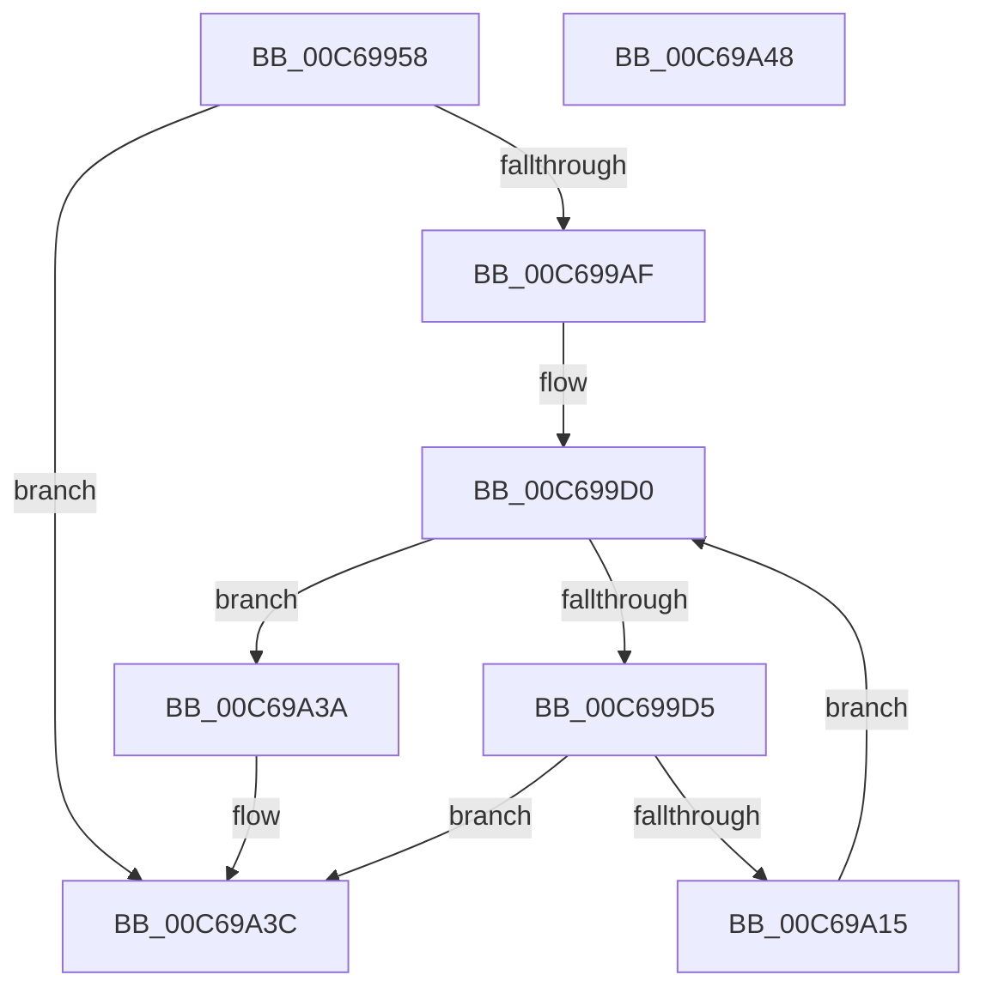

# MiInitializeCfg

- RVA: `0x00C69958`–`0x00C69A49` (길이 `241` bytes)
- VA: `0x0000000140C69958`
- 실행 섹션: `INIT`
- PDB 이름 있음: `예`; PDB Function 태그: `아니요`
- unwind 정보 RVA: `0x000D8EC4`
- 디코드: `52`개 명령, `241/241` bytes 표시
- 미해석 바이트: `0` (있으면 어셈블리에 `.byte`로 보존)

> 이 문서는 커널 이미지의 기계어와 PDB 기호를 분석해 생성했습니다. 4번과 5번은 함수 원형과 자료형을 바이너리 사용 방식에서 추정한 C 해석이며 원본 소스 복구 결과는 아닙니다.

## 1. Dependencies

- 직접 호출 지점: **4**; 고유 호출 대상: **2**
- 직접 호출자로 확인된 함수: **1**
- RIP 상대 이미지 참조: **3**

### Outgoing calls
- `0x00C699A2` → [MmCreateSection](../../page/98/MmCreateSection_function_009838B0.md) (function, `0x009838B0`)
- `0x00C699BB` → [MiSectionControlArea](../../text/29/MiSectionControlArea_function_00294CB0.md) (function, `0x00294CB0`)
- `0x00C69A0C` → [MmCreateSection](../../page/98/MmCreateSection_function_009838B0.md) (function, `0x009838B0`)
- `0x00C69A29` → [MiSectionControlArea](../../text/29/MiSectionControlArea_function_00294CB0.md) (function, `0x00294CB0`)

### Direct callers
- [MiInitSystem](../C5/MiInitSystem_function_00C5E6C0.md) at `0x00C5EB69`

### Static image references
- `0x00C699B4` → RVA `0x00E2D800` (`.data`; write)
- `0x00C699C0` → RVA `0x00E2D808` (`.data`; write)
- `0x00C699C7` → RVA `0x00E2CB40` (`.data`; read)

## 2. Other-region calls and transfers

- 다른 실행 섹션으로 향하는 call: **4**
  - `0x00C699A2` → [MmCreateSection](../../page/98/MmCreateSection_function_009838B0.md) (`INIT` → `PAGE`)
  - `0x00C699BB` → [MiSectionControlArea](../../text/29/MiSectionControlArea_function_00294CB0.md) (`INIT` → `.text`)
  - `0x00C69A0C` → [MmCreateSection](../../page/98/MmCreateSection_function_009838B0.md) (`INIT` → `PAGE`)
  - `0x00C69A29` → [MiSectionControlArea](../../text/29/MiSectionControlArea_function_00294CB0.md) (`INIT` → `.text`)
- 별도 외부 분기/꼬리 이동을 확인하지 못했습니다.

## 3. Assembly (complete function range)

```asm
00C69958  4C 8B DC                        mov r11, rsp
00C6995B  49 89 5B 18                     mov qword ptr [r11 + 0x18], rbx
00C6995F  41 57                           push r15
00C69961  48 83 EC 40                     sub rsp, 0x40
00C69965  49 83 63 F0 00                  and qword ptr [r11 - 0x10], 0
00C6996A  4D 8D 4B 10                     lea r9, [r11 + 0x10]
00C6996E  49 83 63 E8 00                  and qword ptr [r11 - 0x18], 0
00C69973  49 8D 4B 08                     lea rcx, [r11 + 8]
00C69977  49 83 63 08 00                  and qword ptr [r11 + 8], 0
00C6997C  48 B8 00 00 00 00 00 02 00 00   movabs rax, 0x20000000000
00C69986  C7 44 24 28 00 00 00 04         mov dword ptr [rsp + 0x28], 0x4000000
00C6998E  45 33 C0                        xor r8d, r8d
00C69991  BA 1F 00 0F 00                  mov edx, 0xf001f
00C69996  C7 44 24 20 04 00 00 00         mov dword ptr [rsp + 0x20], 4
00C6999E  49 89 43 10                     mov qword ptr [r11 + 0x10], rax
00C699A2  E8 09 9F D1 FF                  call 0x1409838b0
00C699A7  85 C0                           test eax, eax
00C699A9  0F 88 8D 00 00 00               js 0x140c69a3c
00C699AF  48 8B 4C 24 50                  mov rcx, qword ptr [rsp + 0x50]
00C699B4  48 89 0D 45 3E 1C 00            mov qword ptr [rip + 0x1c3e45], rcx
00C699BB  E8 F0 B2 62 FF                  call 0x140294cb0
00C699C0  48 89 05 41 3E 1C 00            mov qword ptr [rip + 0x1c3e41], rax
00C699C7  4C 8D 3D 72 31 1C 00            lea r15, [rip + 0x1c3172]
00C699CE  33 DB                           xor ebx, ebx
00C699D0  83 FB 01                        cmp ebx, 1
00C699D3  73 65                           jae 0x140c69a3a
00C699D5  48 83 64 24 38 00               and qword ptr [rsp + 0x38], 0
00C699DB  4C 8D 4C 24 58                  lea r9, [rsp + 0x58]
00C699E0  48 83 64 24 30 00               and qword ptr [rsp + 0x30], 0
00C699E6  48 8D 4C 24 50                  lea rcx, [rsp + 0x50]
00C699EB  C7 44 24 28 00 00 00 04         mov dword ptr [rsp + 0x28], 0x4000000
00C699F3  45 33 C0                        xor r8d, r8d
00C699F6  BA 1F 00 0F 00                  mov edx, 0xf001f
00C699FB  C7 44 24 20 04 00 00 00         mov dword ptr [rsp + 0x20], 4
00C69A03  48 C7 44 24 58 00 00 00 04      mov qword ptr [rsp + 0x58], 0x4000000
00C69A0C  E8 9F 9E D1 FF                  call 0x1409838b0
00C69A11  85 C0                           test eax, eax
00C69A13  78 27                           js 0x140c69a3c
00C69A15  48 8B 4C 24 50                  mov rcx, qword ptr [rsp + 0x50]
00C69A1A  44 8B C3                        mov r8d, ebx
00C69A1D  49 C1 E0 06                     shl r8, 6
00C69A21  4B 89 8C 38 58 0C 00 00         mov qword ptr [r8 + r15 + 0xc58], rcx
00C69A29  E8 82 B2 62 FF                  call 0x140294cb0
00C69A2E  4B 89 84 38 60 0C 00 00         mov qword ptr [r8 + r15 + 0xc60], rax
00C69A36  FF C3                           inc ebx
00C69A38  EB 96                           jmp 0x140c699d0
00C69A3A  33 C0                           xor eax, eax
00C69A3C  48 8B 5C 24 60                  mov rbx, qword ptr [rsp + 0x60]
00C69A41  48 83 C4 40                     add rsp, 0x40
00C69A45  41 5F                           pop r15
00C69A47  C3                              ret
00C69A48  CC                              int3
```

## 4. C-style interpretation (structured pseudocode)

```c
__int64 __fastcall MiInitializeCfg(__int64 a1, __int64 a2, int a3)
{
    __int64 result;
    __int64 v_rbx;
    __int64 v_rsp;
    unsigned __int64 v_stack_m10;
    unsigned __int64 v_stack_m18;
    unsigned int v_stack_m20;
    unsigned int v_stack_m28;
    unsigned __int64 v_stack_p10;
    unsigned __int64 v_stack_p18;
    unsigned __int64 v_stack_p8;

    *(unsigned __int64 *)(v_rsp + 24) = v_rbx;
    v_rsp = (v_rsp) - (64);
    v_stack_m20 = 0x4000000ULL;
    a3 = 0;
    v_stack_m28 = 4;
    *(unsigned __int64 *)(v_rsp + 16) = result;
    result = MmCreateSection(v_rsp + 8, (unsigned int)(0xF001FULL), a3, v_rsp + 16);
    if (sign_flag) goto loc_00C69A3C;
    *(unsigned __int64 *)(v_rip + 1850949) = v_stack_p8;
    result = MiSectionControlArea(v_stack_p8, (unsigned int)(0xF001FULL), a3, v_rsp + 16);
    *(unsigned __int64 *)(v_rip + 1850945) = result;
    v_rbx = 0;
loc_00C699D0:
    if (0 >= 1) goto loc_00C69A3A;
    v_stack_m20 = 0x4000000ULL;
    a3 = 0;
    v_stack_m28 = 4;
    v_stack_p10 = 0x4000000ULL;
    result = MmCreateSection(v_stack_p8, (unsigned int)(0xF001FULL), a3, v_stack_p10);
    if (sign_flag) goto loc_00C69A3C;
    a3 = (0) << (6);
    *(unsigned __int64 *)(a3 + v_rip + 1847666 * 1 + 3160) = v_stack_p8;
    result = MiSectionControlArea(v_stack_p8, (unsigned int)(0xF001FULL), a3, v_stack_p10);
    *(unsigned __int64 *)(a3 + v_rip + 1847666 * 1 + 3168) = result;
    v_rbx = (unsigned int)((v_rbx) + 1);
    goto loc_00C699D0;
loc_00C69A3A:
    result = 0;
loc_00C69A3C:
    v_rsp = (v_rsp) + (64);
    return result;
}
```

## 5. (Beta) C Style

```c
int64_t MiInitializeCfg(int64_t Arg1, int64_t Arg2, int32_t Arg3)
{
    int64_t result;
    int64_t local_rbx;
    int64_t local_rsp;
    uint64_t v_stack_m10;
    uint64_t v_stack_m18;
    uint32_t v_stack_m20;
    uint32_t v_stack_m28;
    uint64_t v_stack_p10;
    uint64_t v_stack_p18;
    uint64_t v_stack_p8;

    *(uint64_t *)(local_rsp + 0x18) = local_rbx;
    local_rsp = (local_rsp) - (64);
    v_stack_m20 = 0x4000000ULL;
    Arg3 = 0;
    v_stack_m28 = 4;
    *(uint64_t *)(local_rsp + 0x10) = result;
    result = MmCreateSection(local_rsp + 8, (uint32_t)(0xF001FULL), Arg3, local_rsp + 16);
    if (sign_flag) goto loc_00C69A3C;
    *(uint64_t *)(v_rip + 0x1C3E45) = v_stack_p8;
    result = MiSectionControlArea(v_stack_p8, (uint32_t)(0xF001FULL), Arg3, local_rsp + 16);
    *(uint64_t *)(v_rip + 0x1C3E41) = result;
    local_rbx = 0;
loc_00C699D0:
    if (0 >= 1) goto loc_00C69A3A;
    v_stack_m20 = 0x4000000ULL;
    Arg3 = 0;
    v_stack_m28 = 4;
    v_stack_p10 = 0x4000000ULL;
    result = MmCreateSection(v_stack_p8, (uint32_t)(0xF001FULL), Arg3, v_stack_p10);
    if (sign_flag) goto loc_00C69A3C;
    Arg3 = (0) << (6);
    *(uint64_t *)(Arg3 + v_rip + 0x1C3172 * 1 + 0xC58) = v_stack_p8;
    result = MiSectionControlArea(v_stack_p8, (uint32_t)(0xF001FULL), Arg3, v_stack_p10);
    *(uint64_t *)(Arg3 + v_rip + 0x1C3172 * 1 + 0xC60) = result;
    local_rbx = (uint32_t)((local_rbx) + 1);
    goto loc_00C699D0;
loc_00C69A3A:
    result = 0;
loc_00C69A3C:
    local_rsp = (local_rsp) + (64);
    return result;
}
```

## 6. Execution-region graph

[열기: 2D/3D 그래프와 함수 탐색 컨트롤 패널](../../../control-panel.html?section=init&rva=0x00C69958&view=graph)

- 2D 그래프는 위에서 아래로 흐르고, 3D 그래프는 빈 공간을 드래그해 회전합니다. Shift+드래그는 이동, 휠은 확대·축소, 함수 노드 선택은 대상 보고서 이동입니다.

### Static fallback


