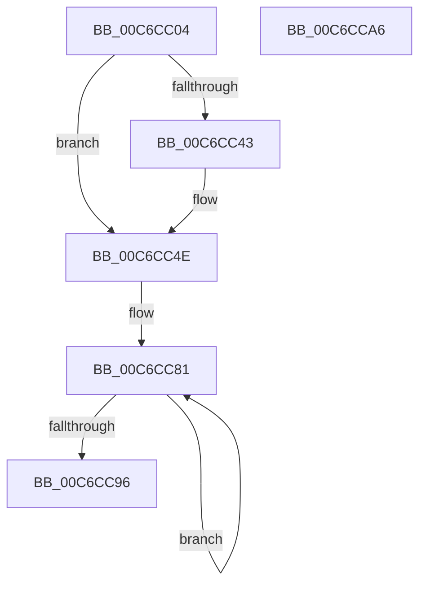

# MiInitializeDecayPfns

- RVA: `0x00C6CC04`–`0x00C6CCA7` (길이 `163` bytes)
- VA: `0x0000000140C6CC04`
- 실행 섹션: `INIT`
- PDB 이름 있음: `예`; PDB Function 태그: `아니요`
- unwind 정보 RVA: `0x00060BC4`
- 디코드: `38`개 명령, `163/163` bytes 표시
- 미해석 바이트: `0` (있으면 어셈블리에 `.byte`로 보존)

> 이 문서는 커널 이미지의 기계어와 PDB 기호를 분석해 생성했습니다. 4번과 5번은 함수 원형과 자료형을 바이너리 사용 방식에서 추정한 C 해석이며 원본 소스 복구 결과는 아닙니다.

## 1. Dependencies

- 직접 호출 지점: **4**; 고유 호출 대상: **4**
- 직접 호출자로 확인된 함수: **1**
- RIP 상대 이미지 참조: **6**

### Outgoing calls
- `0x00C6CC31` → [KcsanMarkAddressIgnored](../../text/4A/KcsanMarkAddressIgnored_function_004AE500.md) (function, `0x004AE500`)
- `0x00C6CC48` → [RtlRaiseStatus](../../text/2F/RtlRaiseStatus_function_002F6A50.md) (function, `0x002F6A50`)
- `0x00C6CC7C` → [MiSetPfnContainingFrame](../../text/36/MiSetPfnContainingFrame_function_00363FC0.md) (function, `0x00363FC0`)
- `0x00C6CC87` → [ExpInterlockedPushEntrySList](../../text/6B/ExpInterlockedPushEntrySList_function_006BA5B0.md) (function, `0x006BA5B0`)

### Direct callers
- [MiInitNucleus](../C5/MiInitNucleus_function_00C5FD38.md) at `0x00C60247`

### Static image references
- `0x00C6CC13` → RVA `0x00E35C38` (`.data`; read)
- `0x00C6CC24` → RVA `0x00E35C28` (`.data`; write)
- `0x00C6CC2A` → RVA `0x00E35C30` (`.data`; write)
- `0x00C6CC36` → RVA `0x00E35C10` (`.data`; read)
- `0x00C6CC4E` → RVA `0x00E35C00` (`.data`; read)
- `0x00C6CC58` → RVA `0x00E35C10` (`.data`; write)

## 2. Other-region calls and transfers

- 다른 실행 섹션으로 향하는 call: **4**
  - `0x00C6CC31` → [KcsanMarkAddressIgnored](../../text/4A/KcsanMarkAddressIgnored_function_004AE500.md) (`INIT` → `.text`)
  - `0x00C6CC48` → [RtlRaiseStatus](../../text/2F/RtlRaiseStatus_function_002F6A50.md) (`INIT` → `.text`)
  - `0x00C6CC7C` → [MiSetPfnContainingFrame](../../text/36/MiSetPfnContainingFrame_function_00363FC0.md) (`INIT` → `.text`)
  - `0x00C6CC87` → [ExpInterlockedPushEntrySList](../../text/6B/ExpInterlockedPushEntrySList_function_006BA5B0.md) (`INIT` → `.text`)
- 별도 외부 분기/꼬리 이동을 확인하지 못했습니다.

## 3. Assembly (complete function range)

```asm
00C6CC04  48 89 5C 24 08                  mov qword ptr [rsp + 8], rbx
00C6CC09  48 89 74 24 10                  mov qword ptr [rsp + 0x10], rsi
00C6CC0E  57                              push rdi
00C6CC0F  48 83 EC 20                     sub rsp, 0x20
00C6CC13  48 8D 0D 1E 90 1C 00            lea rcx, [rip + 0x1c901e]
00C6CC1A  BF 00 08 00 00                  mov edi, 0x800
00C6CC1F  BA 00 01 00 00                  mov edx, 0x100
00C6CC24  89 3D FE 8F 1C 00               mov dword ptr [rip + 0x1c8ffe], edi
00C6CC2A  48 89 0D FF 8F 1C 00            mov qword ptr [rip + 0x1c8fff], rcx
00C6CC31  E8 CA 18 84 FF                  call 0x1404ae500
00C6CC36  48 8D 35 D3 8F 1C 00            lea rsi, [rip + 0x1c8fd3]
00C6CC3D  40 F6 C6 0F                     test sil, 0xf
00C6CC41  74 0B                           je 0x140c6cc4e
00C6CC43  B9 02 00 00 80                  mov ecx, 0x80000002
00C6CC48  E8 03 9E 68 FF                  call 0x1402f6a50
00C6CC4D  CC                              int3
00C6CC4E  48 8B 05 AB 8F 1C 00            mov rax, qword ptr [rip + 0x1c8fab]
00C6CC55  0F 57 C0                        xorps xmm0, xmm0
00C6CC58  0F 29 05 B1 8F 1C 00            movaps xmmword ptr [rip + 0x1c8fb1], xmm0
00C6CC5F  48 8D 1C 40                     lea rbx, [rax + rax*2]
00C6CC63  48 C1 E3 04                     shl rbx, 4
00C6CC67  48 B8 D0 7F 01 00 00 DE FF FF   movabs rax, 0xffffde0000017fd0
00C6CC71  48 03 D8                        add rbx, rax
00C6CC74  BA 01 00 00 00                  mov edx, 1
00C6CC79  48 8B CB                        mov rcx, rbx
00C6CC7C  E8 3F 73 6F FF                  call 0x140363fc0
00C6CC81  48 8B D3                        mov rdx, rbx
00C6CC84  48 8B CE                        mov rcx, rsi
00C6CC87  E8 24 D9 A4 FF                  call 0x1406ba5b0
00C6CC8C  48 83 EB 30                     sub rbx, 0x30
00C6CC90  48 83 EF 01                     sub rdi, 1
00C6CC94  75 EB                           jne 0x140c6cc81
00C6CC96  48 8B 5C 24 30                  mov rbx, qword ptr [rsp + 0x30]
00C6CC9B  48 8B 74 24 38                  mov rsi, qword ptr [rsp + 0x38]
00C6CCA0  48 83 C4 20                     add rsp, 0x20
00C6CCA4  5F                              pop rdi
00C6CCA5  C3                              ret
00C6CCA6  CC                              int3
```

## 4. C-style interpretation (structured pseudocode)

```c
__int64 __fastcall MiInitializeDecayPfns(void)
{
    __int64 result;
    __int64 v_rbx;
    __int64 v_rdi;
    __int64 v_rsp;
    unsigned __int64 v_stack_p10;
    unsigned __int64 v_stack_p8;

    v_stack_p8 = v_rbx;
    v_stack_p10 = v_rsi;
    v_rsp = (v_rsp) - (32);
    *(unsigned int *)(v_rip + 1871870) = (unsigned int)((unsigned int)(0x800ULL));
    *(unsigned __int64 *)(v_rip + 1871871) = v_rip + 1871902;
    result = KcsanMarkAddressIgnored(v_rip + 1871902, 256, a3, a4);
    if ((((unsigned __int8)(v_rip + 1871827)) & (15)) != 0) {
        a1 = 0x80000002ULL;
        result = RtlRaiseStatus(a1, 256, a3, a4);
    }
    *(unsigned __int64 *)(v_rip + 1871793) = v_xmm0;
    v_rbx = (*(unsigned __int64 *)(v_rip + 1871787) + *(unsigned __int64 *)(v_rip + 1871787) * 2) << (4);
    v_rbx = (v_rbx) + (*(unsigned __int64 *)(v_rip + 1871787));
    result = MiSetPfnContainingFrame(v_rbx, 1, a3, a4);
loc_00C6CC81:
    result = ExpInterlockedPushEntrySList(v_rip + 1871827, v_rbx, a3, a4);
    v_rbx = (v_rbx) - (48);
    v_rdi = ((unsigned int)(0x800ULL)) - (1);
    if (condition_is_not_equal) goto loc_00C6CC81;
    v_rsp = (v_rsp) + (32);
    return result;
}
```

## 5. (Beta) C Style

```c
void MiInitializeDecayPfns(void)
{
    int64_t result;
    int64_t local_rbx;
    int64_t local_rdi;
    int64_t local_rsp;
    uint64_t v_stack_p10;
    uint64_t v_stack_p8;

    v_stack_p8 = local_rbx;
    v_stack_p10 = local_rsi;
    local_rsp = (local_rsp) - (32);
    *(uint32_t *)(v_rip + 0x1C8FFE) = (uint32_t)((uint32_t)(0x800ULL));
    *(uint64_t *)(v_rip + 0x1C8FFF) = v_rip + 1871902;
    result = KcsanMarkAddressIgnored(v_rip + 1871902, 256, a3, a4);
    if ((((uint8_t)(v_rip + 1871827)) & (15)) != 0) {
        a1 = 0x80000002ULL;
        result = RtlRaiseStatus(a1, 256, a3, a4);
    }
    *(uint64_t *)(v_rip + 0x1C8FB1) = v_xmm0;
    local_rbx = (*(uint64_t *)(v_rip + 0x1C8FAB) + *(uint64_t *)(v_rip + 0x1C8FAB) * 2) << (4);
    local_rbx = (local_rbx) + (*(uint64_t *)(v_rip + 0x1C8FAB));
    result = MiSetPfnContainingFrame(local_rbx, 1, a3, a4);
loc_00C6CC81:
    result = ExpInterlockedPushEntrySList(v_rip + 1871827, local_rbx, a3, a4);
    local_rbx = (local_rbx) - (48);
    local_rdi = ((uint32_t)(0x800ULL)) - (1);
    if (condition_is_not_equal) goto loc_00C6CC81;
    local_rsp = (local_rsp) + (32);
    return result;
}
```

## 6. Execution-region graph

[열기: 2D/3D 그래프와 함수 탐색 컨트롤 패널](../../../control-panel.html?section=init&rva=0x00C6CC04&view=graph)

- 2D 그래프는 위에서 아래로 흐르고, 3D 그래프는 빈 공간을 드래그해 회전합니다. Shift+드래그는 이동, 휠은 확대·축소, 함수 노드 선택은 대상 보고서 이동입니다.

### Static fallback


