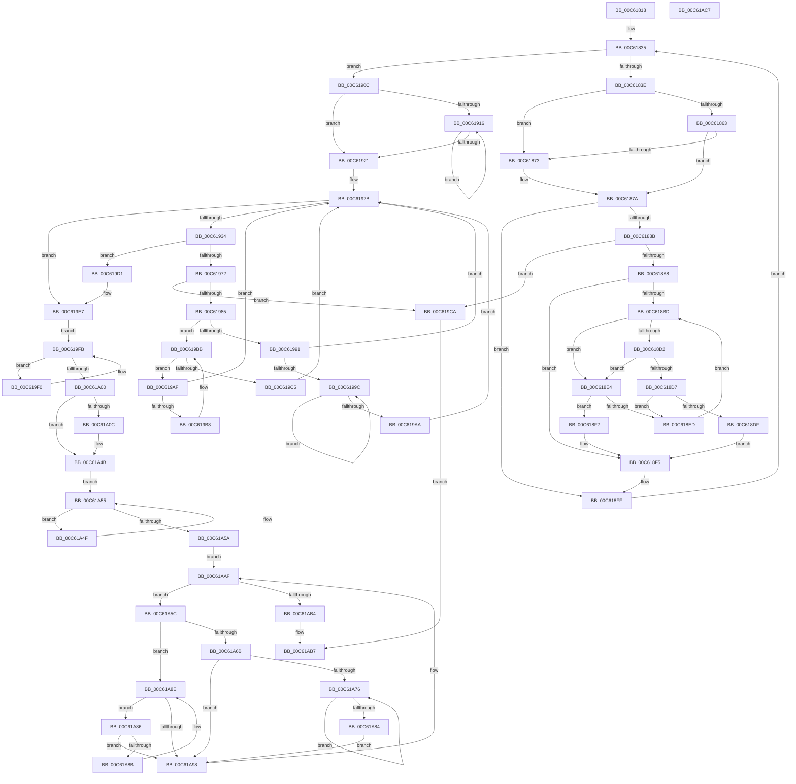

# MiInitializeDriverPtes

- RVA: `0x00C61818`–`0x00C61AC8` (길이 `688` bytes)
- VA: `0x0000000140C61818`
- 실행 섹션: `INIT`
- PDB 이름 있음: `예`; PDB Function 태그: `아니요`
- unwind 정보 RVA: `0x000717F8`
- 디코드: `193`개 명령, `688/688` bytes 표시
- 미해석 바이트: `0` (있으면 어셈블리에 `.byte`로 보존)

> 이 문서는 커널 이미지의 기계어와 PDB 기호를 분석해 생성했습니다. 4번과 5번은 함수 원형과 자료형을 바이너리 사용 방식에서 추정한 C 해석이며 원본 소스 복구 결과는 아닙니다.

## 1. Dependencies

- 직접 호출 지점: **8**; 고유 호출 대상: **8**
- 직접 호출자로 확인된 함수: **1**
- RIP 상대 이미지 참조: **8**

### Outgoing calls
- `0x00C61882` → [MI_IS_PHYSICAL_ADDRESS](../../text/23/MI_IS_PHYSICAL_ADDRESS_function_0023B3A0.md) (function, `0x0023B3A0`)
- `0x00C61897` → [MiAllocatePool](../../text/35/MiAllocatePool_function_0035B540.md) (function, `0x0035B540`)
- `0x00C618FA` → [RtlAvlInsertNodeEx](../../text/26/RtlAvlInsertNodeEx_function_00265790.md) (function, `0x00265790`)
- `0x00C6197C` → [MiReserveBootDriverPtes](MiReserveBootDriverPtes_function_00C61AD0.md) (function, `0x00C61AD0`)
- `0x00C619E1` → [KeBugCheckEx](../../text/4F/KeBugCheckEx_function_004FD660.md) (function, `0x004FD660`)
- `0x00C619F3` → [MiCheckForBootMappingsBetweenDrivers](MiCheckForBootMappingsBetweenDrivers_function_00C61440.md) (function, `0x00C61440`)
- `0x00C61AA0` → [RtlAvlRemoveNode](../../text/29/RtlAvlRemoveNode_function_00296650.md) (function, `0x00296650`)
- `0x00C61AAA` → [ExFreePoolWithTag](../../poolcode/B8/ExFreePoolWithTag_function_00B82870.md) (function, `0x00B82870`)

### Direct callers
- [MiInitializeSystemImageRegion](MiInitializeSystemImageRegion_function_00C6C05C.md) at `0x00C6C23E`

### Static image references
- `0x00C61856` → RVA `0x00FC6B28` (`ALMOSTRO`; read)
- `0x00C61863` → RVA `0x00FC6B98` (`ALMOSTRO`; read)
- `0x00C6186A` → RVA `0x00E2D96C` (`.data`; read)
- `0x00C61873` → RVA `0x00E2D968` (`.data`; read)
- `0x00C619E7` → RVA `0x00E2D960` (`.data`; read)
- `0x00C61A00` → RVA `0x00F10EC0` (`.data`; read)
- `0x00C61A39` → RVA `0x00E2F010` (`.data`; read)
- `0x00C61A44` → RVA `0x00E2F008` (`.data`; write)

## 2. Other-region calls and transfers

- 다른 실행 섹션으로 향하는 call: **6**
  - `0x00C61882` → [MI_IS_PHYSICAL_ADDRESS](../../text/23/MI_IS_PHYSICAL_ADDRESS_function_0023B3A0.md) (`INIT` → `.text`)
  - `0x00C61897` → [MiAllocatePool](../../text/35/MiAllocatePool_function_0035B540.md) (`INIT` → `.text`)
  - `0x00C618FA` → [RtlAvlInsertNodeEx](../../text/26/RtlAvlInsertNodeEx_function_00265790.md) (`INIT` → `.text`)
  - `0x00C619E1` → [KeBugCheckEx](../../text/4F/KeBugCheckEx_function_004FD660.md) (`INIT` → `.text`)
  - `0x00C61AA0` → [RtlAvlRemoveNode](../../text/29/RtlAvlRemoveNode_function_00296650.md) (`INIT` → `.text`)
  - `0x00C61AAA` → [ExFreePoolWithTag](../../poolcode/B8/ExFreePoolWithTag_function_00B82870.md) (`INIT` → `POOLCODE`)
- 별도 외부 분기/꼬리 이동을 확인하지 못했습니다.

## 3. Assembly (complete function range)

```asm
00C61818  48 89 5C 24 10                  mov qword ptr [rsp + 0x10], rbx
00C6181D  48 89 74 24 18                  mov qword ptr [rsp + 0x18], rsi
00C61822  57                              push rdi
00C61823  48 83 EC 30                     sub rsp, 0x30
00C61827  33 FF                           xor edi, edi
00C61829  48 8D 71 10                     lea rsi, [rcx + 0x10]
00C6182D  48 8B 1E                        mov rbx, qword ptr [rsi]
00C61830  48 89 7C 24 40                  mov qword ptr [rsp + 0x40], rdi
00C61835  48 3B DE                        cmp rbx, rsi
00C61838  0F 84 CE 00 00 00               je 0x140c6190c
00C6183E  8B 4B 40                        mov ecx, dword ptr [rbx + 0x40]
00C61841  B8 00 00 00 00                  mov eax, 0
00C61846  48 8B 53 30                     mov rdx, qword ptr [rbx + 0x30]
00C6184A  F7 C1 FF 0F 00 00               test ecx, 0xfff
00C61850  0F 95 C0                        setne al
00C61853  C1 E9 0C                        shr ecx, 0xc
00C61856  48 3B 15 CB 52 36 00            cmp rdx, qword ptr [rip + 0x3652cb]
00C6185D  44 8D 04 08                     lea r8d, [rax + rcx]
00C61861  74 10                           je 0x140c61873
00C61863  48 3B 15 2E 53 36 00            cmp rdx, qword ptr [rip + 0x36532e]
00C6186A  48 8D 05 FB C0 1C 00            lea rax, [rip + 0x1cc0fb]
00C61871  75 07                           jne 0x140c6187a
00C61873  48 8D 05 EE C0 1C 00            lea rax, [rip + 0x1cc0ee]
00C6187A  F0 44 01 00                     lock add dword ptr [rax], r8d
00C6187E  48 8B 4B 30                     mov rcx, qword ptr [rbx + 0x30]
00C61882  E8 19 9B 5D FF                  call 0x14023b3a0
00C61887  85 C0                           test eax, eax
00C61889  75 74                           jne 0x140c618ff
00C6188B  8D 50 20                        lea edx, [rax + 0x20]
00C6188E  41 B8 4D 6D 44 70               mov r8d, 0x70446d4d
00C61894  8D 48 40                        lea ecx, [rax + 0x40]
00C61897  E8 A4 9C 6F FF                  call 0x14035b540
00C6189C  4C 8B C8                        mov r9, rax
00C6189F  48 85 C0                        test rax, rax
00C618A2  0F 84 22 01 00 00               je 0x140c619ca
00C618A8  48 8B 54 24 40                  mov rdx, qword ptr [rsp + 0x40]
00C618AD  45 32 C0                        xor r8b, r8b
00C618B0  48 89 58 18                     mov qword ptr [rax + 0x18], rbx
00C618B4  4C 8B 53 30                     mov r10, qword ptr [rbx + 0x30]
00C618B8  48 85 D2                        test rdx, rdx
00C618BB  74 38                           je 0x140c618f5
00C618BD  48 8B 4A 18                     mov rcx, qword ptr [rdx + 0x18]
00C618C1  4C 8B 41 30                     mov r8, qword ptr [rcx + 0x30]
00C618C5  8B 49 40                        mov ecx, dword ptr [rcx + 0x40]
00C618C8  FF C9                           dec ecx
00C618CA  49 03 C8                        add rcx, r8
00C618CD  4C 3B D1                        cmp r10, rcx
00C618D0  77 12                           ja 0x140c618e4
00C618D2  4D 3B D0                        cmp r10, r8
00C618D5  73 0D                           jae 0x140c618e4
00C618D7  48 8B 02                        mov rax, qword ptr [rdx]
00C618DA  48 85 C0                        test rax, rax
00C618DD  75 0E                           jne 0x140c618ed
00C618DF  45 32 C0                        xor r8b, r8b
00C618E2  EB 11                           jmp 0x140c618f5
00C618E4  48 8B 42 08                     mov rax, qword ptr [rdx + 8]
00C618E8  48 85 C0                        test rax, rax
00C618EB  74 05                           je 0x140c618f2
00C618ED  48 8B D0                        mov rdx, rax
00C618F0  EB CB                           jmp 0x140c618bd
00C618F2  41 B0 01                        mov r8b, 1
00C618F5  48 8D 4C 24 40                  lea rcx, [rsp + 0x40]
00C618FA  E8 91 3E 60 FF                  call 0x140265790
00C618FF  48 8B 1B                        mov rbx, qword ptr [rbx]
00C61902  48 8B 7C 24 40                  mov rdi, qword ptr [rsp + 0x40]
00C61907  E9 29 FF FF FF                  jmp 0x140c61835
00C6190C  33 DB                           xor ebx, ebx
00C6190E  48 8B C7                        mov rax, rdi
00C61911  48 85 FF                        test rdi, rdi
00C61914  74 0B                           je 0x140c61921
00C61916  48 8B D8                        mov rbx, rax
00C61919  48 8B 00                        mov rax, qword ptr [rax]
00C6191C  48 85 C0                        test rax, rax
00C6191F  75 F5                           jne 0x140c61916
00C61921  48 BE 00 00 00 00 80 F6 FF FF   movabs rsi, 0xfffff68000000000
00C6192B  48 85 DB                        test rbx, rbx
00C6192E  0F 84 B3 00 00 00               je 0x140c619e7
00C61934  48 8B 53 18                     mov rdx, qword ptr [rbx + 0x18]
00C61938  48 B8 F8 FF FF FF 7F 00 00 00   movabs rax, 0x7ffffffff8
00C61942  48 8B 4A 30                     mov rcx, qword ptr [rdx + 0x30]
00C61946  48 C1 E9 09                     shr rcx, 9
00C6194A  48 23 C8                        and rcx, rax
00C6194D  48 8B C6                        mov rax, rsi
00C61950  48 03 C8                        add rcx, rax
00C61953  4C 8B C1                        mov r8, rcx
00C61956  49 C1 E0 19                     shl r8, 0x19
00C6195A  48 8B C6                        mov rax, rsi
00C6195D  44 8B 4A 40                     mov r9d, dword ptr [rdx + 0x40]
00C61961  48 C1 E0 19                     shl rax, 0x19
00C61965  4C 2B C0                        sub r8, rax
00C61968  49 C1 F8 10                     sar r8, 0x10
00C6196C  66 45 85 C0                     test r8w, r8w
00C61970  75 5F                           jne 0x140c619d1
00C61972  41 8D 91 FF 0F 00 00            lea edx, [r9 + 0xfff]
00C61979  C1 EA 0C                        shr edx, 0xc
00C6197C  E8 4F 01 00 00                  call 0x140c61ad0
00C61981  85 C0                           test eax, eax
00C61983  74 45                           je 0x140c619ca
00C61985  48 8B 43 08                     mov rax, qword ptr [rbx + 8]
00C61989  48 8B CB                        mov rcx, rbx
00C6198C  48 85 C0                        test rax, rax
00C6198F  74 2A                           je 0x140c619bb
00C61991  48 8B 08                        mov rcx, qword ptr [rax]
00C61994  48 8B D8                        mov rbx, rax
00C61997  48 85 C9                        test rcx, rcx
00C6199A  74 8F                           je 0x140c6192b
00C6199C  48 8B 01                        mov rax, qword ptr [rcx]
00C6199F  48 8B D9                        mov rbx, rcx
00C619A2  48 8B C8                        mov rcx, rax
00C619A5  48 85 C0                        test rax, rax
00C619A8  75 F2                           jne 0x140c6199c
00C619AA  E9 7C FF FF FF                  jmp 0x140c6192b
00C619AF  48 39 0B                        cmp qword ptr [rbx], rcx
00C619B2  0F 84 73 FF FF FF               je 0x140c6192b
00C619B8  48 8B CB                        mov rcx, rbx
00C619BB  48 8B 5B 10                     mov rbx, qword ptr [rbx + 0x10]
00C619BF  48 83 E3 FC                     and rbx, 0xfffffffffffffffc
00C619C3  75 EA                           jne 0x140c619af
00C619C5  E9 61 FF FF FF                  jmp 0x140c6192b
00C619CA  33 C0                           xor eax, eax
00C619CC  E9 E6 00 00 00                  jmp 0x140c61ab7
00C619D1  48 83 64 24 20 00               and qword ptr [rsp + 0x20], 0
00C619D7  BA 19 10 00 00                  mov edx, 0x1019
00C619DC  B9 1A 00 00 00                  mov ecx, 0x1a
00C619E1  E8 7A BC 89 FF                  call 0x1404fd660
00C619E6  CC                              int3
00C619E7  48 8B 1D 72 BF 1C 00            mov rbx, qword ptr [rip + 0x1cbf72]
00C619EE  EB 0B                           jmp 0x140c619fb
00C619F0  48 8B CB                        mov rcx, rbx
00C619F3  E8 48 FA FF FF                  call 0x140c61440
00C619F8  48 8B 1B                        mov rbx, qword ptr [rbx]
00C619FB  48 85 DB                        test rbx, rbx
00C619FE  75 F0                           jne 0x140c619f0
00C61A00  F7 05 B6 F4 2A 00 00 00 02 00   test dword ptr [rip + 0x2af4b6], 0x20000
00C61A0A  75 3F                           jne 0x140c61a4b
00C61A0C  48 8B 05 4D BF 1C 00            mov rax, qword ptr [rip + 0x1cbf4d]
00C61A13  48 8B 08                        mov rcx, qword ptr [rax]
00C61A16  8B 51 10                        mov edx, dword ptr [rcx + 0x10]
00C61A19  48 8B 41 08                     mov rax, qword ptr [rcx + 8]
00C61A1D  C1 E2 04                        shl edx, 4
00C61A20  48 C1 E2 1C                     shl rdx, 0x1c
00C61A24  48 C1 E0 19                     shl rax, 0x19
00C61A28  48 03 D0                        add rdx, rax
00C61A2B  48 8B C6                        mov rax, rsi
00C61A2E  48 C1 E0 19                     shl rax, 0x19
00C61A32  48 2B D0                        sub rdx, rax
00C61A35  48 C1 FA 10                     sar rdx, 0x10
00C61A39  48 2B 15 D0 D5 1C 00            sub rdx, qword ptr [rip + 0x1cd5d0]
00C61A40  48 C1 EA 15                     shr rdx, 0x15
00C61A44  48 89 15 BD D5 1C 00            mov qword ptr [rip + 0x1cd5bd], rdx
00C61A4B  33 DB                           xor ebx, ebx
00C61A4D  EB 06                           jmp 0x140c61a55
00C61A4F  48 8B DF                        mov rbx, rdi
00C61A52  48 8B 3F                        mov rdi, qword ptr [rdi]
00C61A55  48 85 FF                        test rdi, rdi
00C61A58  75 F5                           jne 0x140c61a4f
00C61A5A  EB 53                           jmp 0x140c61aaf
00C61A5C  48 8B 43 08                     mov rax, qword ptr [rbx + 8]
00C61A60  48 8B FB                        mov rdi, rbx
00C61A63  48 8B CB                        mov rcx, rbx
00C61A66  48 85 C0                        test rax, rax
00C61A69  74 23                           je 0x140c61a8e
00C61A6B  48 8B 08                        mov rcx, qword ptr [rax]
00C61A6E  48 8B D8                        mov rbx, rax
00C61A71  48 85 C9                        test rcx, rcx
00C61A74  74 22                           je 0x140c61a98
00C61A76  48 8B 01                        mov rax, qword ptr [rcx]
00C61A79  48 8B D9                        mov rbx, rcx
00C61A7C  48 8B C8                        mov rcx, rax
00C61A7F  48 85 C0                        test rax, rax
00C61A82  75 F2                           jne 0x140c61a76
00C61A84  EB 12                           jmp 0x140c61a98
00C61A86  48 39 0B                        cmp qword ptr [rbx], rcx
00C61A89  74 0D                           je 0x140c61a98
00C61A8B  48 8B CB                        mov rcx, rbx
00C61A8E  48 8B 5B 10                     mov rbx, qword ptr [rbx + 0x10]
00C61A92  48 83 E3 FC                     and rbx, 0xfffffffffffffffc
00C61A96  75 EE                           jne 0x140c61a86
00C61A98  48 8B D7                        mov rdx, rdi
00C61A9B  48 8D 4C 24 40                  lea rcx, [rsp + 0x40]
00C61AA0  E8 AB 4B 63 FF                  call 0x140296650
00C61AA5  33 D2                           xor edx, edx
00C61AA7  48 8B CF                        mov rcx, rdi
00C61AAA  E8 C1 0D F2 FF                  call 0x140b82870
00C61AAF  48 85 DB                        test rbx, rbx
00C61AB2  75 A8                           jne 0x140c61a5c
00C61AB4  8D 43 01                        lea eax, [rbx + 1]
00C61AB7  48 8B 5C 24 48                  mov rbx, qword ptr [rsp + 0x48]
00C61ABC  48 8B 74 24 50                  mov rsi, qword ptr [rsp + 0x50]
00C61AC1  48 83 C4 30                     add rsp, 0x30
00C61AC5  5F                              pop rdi
00C61AC6  C3                              ret
00C61AC7  CC                              int3
```

## 4. C-style interpretation (structured pseudocode)

```c
__int64 __fastcall MiInitializeDriverPtes(__int64 a1)
{
    __int64 result;
    __int64 v_rbx;
    __int64 v_rdi;
    __int64 v_rsp;
    unsigned __int64 v_stack_m18;
    unsigned __int64 v_stack_p10;
    unsigned __int64 v_stack_p18;
    unsigned __int64 v_stack_p8;

    v_stack_p10 = v_rbx;
    v_stack_p18 = v_rsi;
    v_rsp = (v_rsp) - (48);
    v_rdi = 0;
    v_stack_p8 = 0;
loc_00C61835:
    if ((*(unsigned __int64 *)(a1 + 16)) == (a1 + 16)) goto loc_00C6190C;
    result = ((((unsigned int)((unsigned int)(*(unsigned int *)(*(unsigned __int64 *)(a1 + 16) + 64)))) & (0xFFFULL)) != 0) ? 1 : 0;
    a1 = (unsigned int)(((unsigned int)(*(unsigned int *)(*(unsigned __int64 *)(a1 + 16) + 64))) >> (12));
    if ((*(unsigned __int64 *)(*(unsigned __int64 *)(a1 + 16) + 48)) == (*(unsigned __int64 *)(v_rip + 3560139))) goto loc_00C61873;
    result = v_rip + 1884411;
    if ((*(unsigned __int64 *)(*(unsigned __int64 *)(a1 + 16) + 48)) == (*(unsigned __int64 *)(v_rip + 3560238))) {
        result = v_rip + 1884398;
    }
    result = MI_IS_PHYSICAL_ADDRESS(*(unsigned __int64 *)(*(unsigned __int64 *)(a1 + 16) + 48), *(unsigned __int64 *)(*(unsigned __int64 *)(a1 + 16) + 48), result + a1 * 1, a4);
    if ((unsigned int)(result) != 0) goto loc_00C618FF;
    result = MiAllocatePool(result + 64, result + 32, (unsigned int)(0x70446D4DULL), a4);
    if (result == 0) goto loc_00C619CA;
    a3 = 0;
    *(unsigned __int64 *)(result + 24) = *(unsigned __int64 *)(a1 + 16);
    if (v_stack_p8 == 0) goto loc_00C618F5;
loc_00C618BD:
    a1 = (unsigned int)(((unsigned int)(*(unsigned int *)(*(unsigned __int64 *)(v_stack_p8 + 24) + 64))) - 1);
    a1 = (a1) + (*(unsigned __int64 *)(*(unsigned __int64 *)(v_stack_p8 + 24) + 48));
    if ((*(unsigned __int64 *)(*(unsigned __int64 *)(a1 + 16) + 48)) > a1) goto loc_00C618E4;
    if ((*(unsigned __int64 *)(*(unsigned __int64 *)(a1 + 16) + 48)) >= (*(unsigned __int64 *)(*(unsigned __int64 *)(v_stack_p8 + 24) + 48))) goto loc_00C618E4;
    if (*(unsigned __int64 *)(v_stack_p8) != 0) goto loc_00C618ED;
    a3 = 0;
    goto loc_00C618F5;
loc_00C618E4:
    if (*(unsigned __int64 *)(v_stack_p8 + 8) == 0) goto loc_00C618F2;
loc_00C618ED:
    goto loc_00C618BD;
loc_00C618F2:
loc_00C618F5:
    result = RtlAvlInsertNodeEx(v_stack_p8, *(unsigned __int64 *)(v_stack_p8 + 8), 1, result);
loc_00C618FF:
    goto loc_00C61835;
loc_00C6190C:
    v_rbx = 0;
    if (v_stack_p8 == 0) goto loc_00C61921;
loc_00C61916:
    if (*(unsigned __int64 *)(v_stack_p8) != 0) goto loc_00C61916;
loc_00C61921:
loc_00C6192B:
    if (v_stack_p8 == 0) goto loc_00C619E7;
    a1 = (*(unsigned __int64 *)(*(unsigned __int64 *)(v_stack_p8 + 24) + 48)) >> (9);
    a1 = (a1) & (*(unsigned __int64 *)(v_stack_p8));
    a1 = (a1) + (a1 + 16);
    a3 = (a1) << (25);
    result = (a1 + 16) << (25);
    a3 = (a3) - (result);
    a3 = (a3) >> (16);
    if ((unsigned __int16)(a3) != 0) goto loc_00C619D1;
    a2 = (unsigned int)(((unsigned int)(*(unsigned int *)(*(unsigned __int64 *)(v_stack_p8 + 24) + 64)) + 4095) >> (12));
    result = MiReserveBootDriverPtes(a1, a2, a3, (unsigned int)(*(unsigned int *)(*(unsigned __int64 *)(v_stack_p8 + 24) + 64)));
    if ((unsigned int)(result) == 0) goto loc_00C619CA;
    if (*(unsigned __int64 *)(v_stack_p8 + 8) == 0) goto loc_00C619BB;
    if (*(unsigned __int64 *)(*(unsigned __int64 *)(v_stack_p8 + 8)) == 0) goto loc_00C6192B;
loc_00C6199C:
    if (*(unsigned __int64 *)(*(unsigned __int64 *)(*(unsigned __int64 *)(v_stack_p8 + 8))) != 0) goto loc_00C6199C;
    goto loc_00C6192B;
loc_00C619AF:
    if ((*(unsigned __int64 *)(*(unsigned __int64 *)(*(unsigned __int64 *)(v_stack_p8 + 8)))) == (*(unsigned __int64 *)(*(unsigned __int64 *)(*(unsigned __int64 *)(v_stack_p8 + 8))))) goto loc_00C6192B;
loc_00C619BB:
    v_rbx = (*(unsigned __int64 *)(*(unsigned __int64 *)(*(unsigned __int64 *)(v_stack_p8 + 8)) + 16)) & (-4);
    if (condition_is_not_equal) goto loc_00C619AF;
    goto loc_00C6192B;
loc_00C619CA:
    result = 0;
    goto loc_00C61AB7;
loc_00C619D1:
    result = KeBugCheckEx(26, (unsigned int)(0x1019ULL), a3, (unsigned int)(*(unsigned int *)(*(unsigned __int64 *)(v_stack_p8 + 24) + 64)));
loc_00C619E7:
    goto loc_00C619FB;
loc_00C619F0:
    result = MiCheckForBootMappingsBetweenDrivers(*(unsigned __int64 *)(v_rip + 1884018), (unsigned int)(0x1019ULL), a3, (unsigned int)(*(unsigned int *)(*(unsigned __int64 *)(v_stack_p8 + 24) + 64)));
loc_00C619FB:
    if (*(unsigned __int64 *)(*(unsigned __int64 *)(v_rip + 1884018)) != 0) goto loc_00C619F0;
    if (((*(unsigned int *)(v_rip + 2815158)) & (0x20000ULL)) == 0) {
        result = *(unsigned __int64 *)(v_rip + 1883981);
        a1 = *(unsigned __int64 *)(result);
        a2 = *(unsigned int *)(a1 + 16);
        result = *(unsigned __int64 *)(a1 + 8);
        a2 = (unsigned int)((a2) << (4));
        a2 = (a2) << (28);
        result = (result) << (25);
        a2 = (a2) + (result);
        result = a1 + 16;
        result = (result) << (25);
        a2 = (a2) - (result);
        a2 = (a2) >> (16);
        a2 = (a2) - (*(unsigned __int64 *)(v_rip + 1889744));
        a2 = (a2) >> (21);
        *(unsigned __int64 *)(v_rip + 1889725) = a2;
    }
    v_rbx = 0;
    goto loc_00C61A55;
loc_00C61A4F:
loc_00C61A55:
    if (*(unsigned __int64 *)(v_stack_p8) != 0) goto loc_00C61A4F;
    goto loc_00C61AAF;
loc_00C61A5C:
    if (*(unsigned __int64 *)(v_stack_p8 + 8) == 0) goto loc_00C61A8E;
    if (*(unsigned __int64 *)(*(unsigned __int64 *)(v_stack_p8 + 8)) == 0) goto loc_00C61A98;
loc_00C61A76:
    if (*(unsigned __int64 *)(*(unsigned __int64 *)(*(unsigned __int64 *)(v_stack_p8 + 8))) != 0) goto loc_00C61A76;
    goto loc_00C61A98;
loc_00C61A86:
    if ((*(unsigned __int64 *)(*(unsigned __int64 *)(*(unsigned __int64 *)(v_stack_p8 + 8)))) == (*(unsigned __int64 *)(*(unsigned __int64 *)(*(unsigned __int64 *)(v_stack_p8 + 8))))) goto loc_00C61A98;
loc_00C61A8E:
    v_rbx = (*(unsigned __int64 *)(*(unsigned __int64 *)(*(unsigned __int64 *)(v_stack_p8 + 8)) + 16)) & (-4);
    if (condition_is_not_equal) goto loc_00C61A86;
loc_00C61A98:
    result = RtlAvlRemoveNode(v_stack_p8, v_stack_p8, a3, (unsigned int)(*(unsigned int *)(*(unsigned __int64 *)(v_stack_p8 + 24) + 64)));
    a2 = 0;
    result = ExFreePoolWithTag(v_stack_p8, a2, a3, (unsigned int)(*(unsigned int *)(*(unsigned __int64 *)(v_stack_p8 + 24) + 64)));
loc_00C61AAF:
    if (v_rbx != 0) goto loc_00C61A5C;
loc_00C61AB7:
    v_rsp = (v_rsp) + (48);
    return v_rbx + 1;
}
```

## 5. (Beta) C Style

```c
int64_t MiInitializeDriverPtes(void *Arg1)
{
    uint8_t *arg1 = (uint8_t *)Arg1;

    int64_t result;
    int64_t local_rbx;
    int64_t local_rdi;
    int64_t local_rsp;
    uint64_t v_stack_m18;
    uint64_t v_stack_p10;
    uint64_t v_stack_p18;
    uint64_t v_stack_p8;

    v_stack_p10 = local_rbx;
    v_stack_p18 = local_rsi;
    local_rsp = (local_rsp) - (48);
    local_rdi = 0;
    v_stack_p8 = 0;
loc_00C61835:
    if ((*(uint64_t *)(arg1 + 0x10)) == (Arg1 + 16)) goto loc_00C6190C;
    result = ((((uint32_t)((uint32_t)(*(uint32_t *)(*(uint64_t *)(arg1 + 0x10) + 0x40)))) & (0xFFFULL)) != 0) ? 1 : 0;
    Arg1 = (uint32_t)(((uint32_t)(*(uint32_t *)(*(uint64_t *)(arg1 + 0x10) + 0x40))) >> (12));
    if ((*(uint64_t *)(*(uint64_t *)(arg1 + 0x10) + 0x30)) == (*(uint64_t *)(v_rip + 0x3652CB))) goto loc_00C61873;
    result = v_rip + 1884411;
    if ((*(uint64_t *)(*(uint64_t *)(arg1 + 0x10) + 0x30)) == (*(uint64_t *)(v_rip + 0x36532E))) {
        result = v_rip + 1884398;
    }
    result = MI_IS_PHYSICAL_ADDRESS(*(uint64_t *)(*(uint64_t *)(arg1 + 0x10) + 0x30), *(uint64_t *)(*(uint64_t *)(arg1 + 0x10) + 0x30), result + Arg1 * 1, a4);
    if ((uint32_t)(result) != 0) goto loc_00C618FF;
    result = MiAllocatePool(result + 64, result + 32, (uint32_t)(0x70446D4DULL), a4);
    if (result == 0) goto loc_00C619CA;
    a3 = 0;
    *(uint64_t *)(result + 0x18) = *(uint64_t *)(arg1 + 0x10);
    if (v_stack_p8 == 0) goto loc_00C618F5;
loc_00C618BD:
    Arg1 = (uint32_t)(((uint32_t)(*(uint32_t *)(*(uint64_t *)(v_stack_p8 + 0x18) + 0x40))) - 1);
    Arg1 = (Arg1) + (*(uint64_t *)(*(uint64_t *)(v_stack_p8 + 0x18) + 0x30));
    if ((*(uint64_t *)(*(uint64_t *)(arg1 + 0x10) + 0x30)) > Arg1) goto loc_00C618E4;
    if ((*(uint64_t *)(*(uint64_t *)(arg1 + 0x10) + 0x30)) >= (*(uint64_t *)(*(uint64_t *)(v_stack_p8 + 0x18) + 0x30))) goto loc_00C618E4;
    if (*(uint64_t *)(v_stack_p8) != 0) goto loc_00C618ED;
    a3 = 0;
    goto loc_00C618F5;
loc_00C618E4:
    if (*(uint64_t *)(v_stack_p8 + 0x8) == 0) goto loc_00C618F2;
loc_00C618ED:
    goto loc_00C618BD;
loc_00C618F2:
loc_00C618F5:
    result = RtlAvlInsertNodeEx(v_stack_p8, *(uint64_t *)(v_stack_p8 + 0x8), 1, result);
loc_00C618FF:
    goto loc_00C61835;
loc_00C6190C:
    local_rbx = 0;
    if (v_stack_p8 == 0) goto loc_00C61921;
loc_00C61916:
    if (*(uint64_t *)(v_stack_p8) != 0) goto loc_00C61916;
loc_00C61921:
loc_00C6192B:
    if (v_stack_p8 == 0) goto loc_00C619E7;
    Arg1 = (*(uint64_t *)(*(uint64_t *)(v_stack_p8 + 0x18) + 0x30)) >> (9);
    Arg1 = (Arg1) & (*(uint64_t *)(v_stack_p8));
    Arg1 = (Arg1) + (Arg1 + 16);
    a3 = (Arg1) << (25);
    result = (Arg1 + 16) << (25);
    a3 = (a3) - (result);
    a3 = (a3) >> (16);
    if ((uint16_t)(a3) != 0) goto loc_00C619D1;
    a2 = (uint32_t)(((uint32_t)(*(uint32_t *)(*(uint64_t *)(v_stack_p8 + 0x18) + 0x40)) + 4095) >> (12));
    result = MiReserveBootDriverPtes(Arg1, a2, a3, (uint32_t)(*(uint32_t *)(*(uint64_t *)(v_stack_p8 + 0x18) + 0x40)));
    if ((uint32_t)(result) == 0) goto loc_00C619CA;
    if (*(uint64_t *)(v_stack_p8 + 0x8) == 0) goto loc_00C619BB;
    if (*(uint64_t *)(*(uint64_t *)(v_stack_p8 + 0x8)) == 0) goto loc_00C6192B;
loc_00C6199C:
    if (*(uint64_t *)(*(uint64_t *)(*(uint64_t *)(v_stack_p8 + 0x8))) != 0) goto loc_00C6199C;
    goto loc_00C6192B;
loc_00C619AF:
    if ((*(uint64_t *)(*(uint64_t *)(*(uint64_t *)(v_stack_p8 + 0x8)))) == (*(uint64_t *)(*(uint64_t *)(*(uint64_t *)(v_stack_p8 + 0x8))))) goto loc_00C6192B;
loc_00C619BB:
    local_rbx = (*(uint64_t *)(*(uint64_t *)(*(uint64_t *)(v_stack_p8 + 0x8)) + 0x10)) & (-4);
    if (condition_is_not_equal) goto loc_00C619AF;
    goto loc_00C6192B;
loc_00C619CA:
    result = 0;
    goto loc_00C61AB7;
loc_00C619D1:
    result = KeBugCheckEx(26, (uint32_t)(0x1019ULL), a3, (uint32_t)(*(uint32_t *)(*(uint64_t *)(v_stack_p8 + 0x18) + 0x40)));
loc_00C619E7:
    goto loc_00C619FB;
loc_00C619F0:
    result = MiCheckForBootMappingsBetweenDrivers(*(uint64_t *)(v_rip + 0x1CBF72), (uint32_t)(0x1019ULL), a3, (uint32_t)(*(uint32_t *)(*(uint64_t *)(v_stack_p8 + 0x18) + 0x40)));
loc_00C619FB:
    if (*(uint64_t *)(*(uint64_t *)(v_rip + 0x1CBF72)) != 0) goto loc_00C619F0;
    if (((*(uint32_t *)(v_rip + 0x2AF4B6)) & (0x20000ULL)) == 0) {
        result = *(uint64_t *)(v_rip + 0x1CBF4D);
        Arg1 = *(uint64_t *)(result);
        a2 = *(uint32_t *)(arg1 + 0x10);
        result = *(uint64_t *)(arg1 + 0x8);
        a2 = (uint32_t)((a2) << (4));
        a2 = (a2) << (28);
        result = (result) << (25);
        a2 = (a2) + (result);
        result = Arg1 + 16;
        result = (result) << (25);
        a2 = (a2) - (result);
        a2 = (a2) >> (16);
        a2 = (a2) - (*(uint64_t *)(v_rip + 0x1CD5D0));
        a2 = (a2) >> (21);
        *(uint64_t *)(v_rip + 0x1CD5BD) = a2;
    }
    local_rbx = 0;
    goto loc_00C61A55;
loc_00C61A4F:
loc_00C61A55:
    if (*(uint64_t *)(v_stack_p8) != 0) goto loc_00C61A4F;
    goto loc_00C61AAF;
loc_00C61A5C:
    if (*(uint64_t *)(v_stack_p8 + 0x8) == 0) goto loc_00C61A8E;
    if (*(uint64_t *)(*(uint64_t *)(v_stack_p8 + 0x8)) == 0) goto loc_00C61A98;
loc_00C61A76:
    if (*(uint64_t *)(*(uint64_t *)(*(uint64_t *)(v_stack_p8 + 0x8))) != 0) goto loc_00C61A76;
    goto loc_00C61A98;
loc_00C61A86:
    if ((*(uint64_t *)(*(uint64_t *)(*(uint64_t *)(v_stack_p8 + 0x8)))) == (*(uint64_t *)(*(uint64_t *)(*(uint64_t *)(v_stack_p8 + 0x8))))) goto loc_00C61A98;
loc_00C61A8E:
    local_rbx = (*(uint64_t *)(*(uint64_t *)(*(uint64_t *)(v_stack_p8 + 0x8)) + 0x10)) & (-4);
    if (condition_is_not_equal) goto loc_00C61A86;
loc_00C61A98:
    result = RtlAvlRemoveNode(v_stack_p8, v_stack_p8, a3, (uint32_t)(*(uint32_t *)(*(uint64_t *)(v_stack_p8 + 0x18) + 0x40)));
    a2 = 0;
    result = ExFreePoolWithTag(v_stack_p8, a2, a3, (uint32_t)(*(uint32_t *)(*(uint64_t *)(v_stack_p8 + 0x18) + 0x40)));
loc_00C61AAF:
    if (local_rbx != 0) goto loc_00C61A5C;
loc_00C61AB7:
    local_rsp = (local_rsp) + (48);
    return local_rbx + 1;
}
```

### 관측된 메모리 오프셋

구조체 형식이 확인되지 않은 접근은 인자 기준의 오프셋으로만 기록했습니다.

| 기준 인자 | 오프셋 표현 | 폭 (bit) | 접근 |
|---|---:|---:|---|
| `Arg1` | `+ 0x0` | `64` | `R` |
| `Arg1` | `+ 0x10` | `64` | `R` |

## 6. Execution-region graph

[열기: 2D/3D 그래프와 함수 탐색 컨트롤 패널](../../../control-panel.html?section=init&rva=0x00C61818&view=graph)

- 2D 그래프는 위에서 아래로 흐르고, 3D 그래프는 빈 공간을 드래그해 회전합니다. Shift+드래그는 이동, 휠은 확대·축소, 함수 노드 선택은 대상 보고서 이동입니다.

### Static fallback


