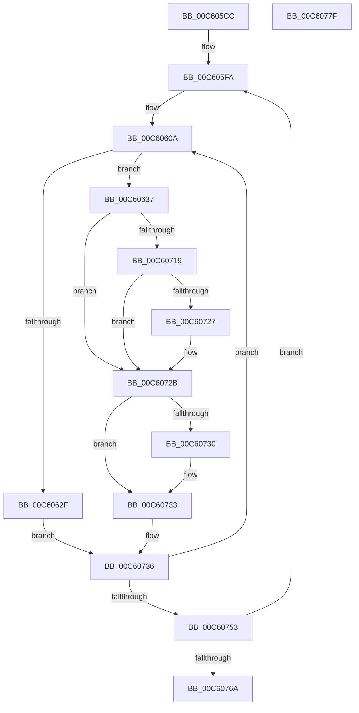

# MiInitializeDummyPages

- RVA: `0x00C605CC`–`0x00C60780` (길이 `436` bytes)
- VA: `0x0000000140C605CC`
- 실행 섹션: `INIT`
- PDB 이름 있음: `예`; PDB Function 태그: `아니요`
- unwind 정보 RVA: `0x000BE6C8`
- 디코드: `121`개 명령, `436/436` bytes 표시
- 미해석 바이트: `0` (있으면 어셈블리에 `.byte`로 보존)

> 이 문서는 커널 이미지의 기계어와 PDB 기호를 분석해 생성했습니다. 4번과 5번은 함수 원형과 자료형을 바이너리 사용 방식에서 추정한 C 해석이며 원본 소스 복구 결과는 아닙니다.

## 1. Dependencies

- 직접 호출 지점: **7**; 고유 호출 대상: **7**
- 직접 호출자로 확인된 함수: **1**
- RIP 상대 이미지 참조: **4**

### Outgoing calls
- `0x00C605E5` → [MiMakeDemandZeroPte](../../text/33/MiMakeDemandZeroPte_function_00337A00.md) (function, `0x00337A00`)
- `0x00C6060A` → [MiAllocateDummyPage](../C5/MiAllocateDummyPage_function_00C5F6E8.md) (function, `0x00C5F6E8`)
- `0x00C6063A` → [MiLockPageInline](../../text/31/MiLockPageInline_function_0031A340.md) (function, `0x0031A340`)
- `0x00C606C1` → [MiIncreaseUsedPtesInPfn](../../text/38/MiIncreaseUsedPtesInPfn_function_00382D90.md) (function, `0x00382D90`)
- `0x00C606CC` → [MiUnlockPage](../../text/31/MiUnlockPage_function_0031A3E0.md) (function, `0x0031A3E0`)
- `0x00C60707` → [MiMakeValidPte](../../text/2C/MiMakeValidPte_function_002C5590.md) (function, `0x002C5590`)
- `0x00C6073B` → [MiFillPhysicalPages](../../text/33/MiFillPhysicalPages_function_00332910.md) (function, `0x00332910`)

### Direct callers
- [MiInitNucleus](../C5/MiInitNucleus_function_00C5FD38.md) at `0x00C6016A`

### Static image references
- `0x00C605EC` → RVA `0x00E37470` (`.data`; read)
- `0x00C606D1` → RVA `0x00FC6C38` (`ALMOSTRO`; read)
- `0x00C6070C` → RVA `0x00FC6A88` (`ALMOSTRO`; read)
- `0x00C6071F` → RVA `0x00E2DBC9` (`.data`; reference)

## 2. Other-region calls and transfers

- 다른 실행 섹션으로 향하는 call: **6**
  - `0x00C605E5` → [MiMakeDemandZeroPte](../../text/33/MiMakeDemandZeroPte_function_00337A00.md) (`INIT` → `.text`)
  - `0x00C6063A` → [MiLockPageInline](../../text/31/MiLockPageInline_function_0031A340.md) (`INIT` → `.text`)
  - `0x00C606C1` → [MiIncreaseUsedPtesInPfn](../../text/38/MiIncreaseUsedPtesInPfn_function_00382D90.md) (`INIT` → `.text`)
  - `0x00C606CC` → [MiUnlockPage](../../text/31/MiUnlockPage_function_0031A3E0.md) (`INIT` → `.text`)
  - `0x00C60707` → [MiMakeValidPte](../../text/2C/MiMakeValidPte_function_002C5590.md) (`INIT` → `.text`)
  - `0x00C6073B` → [MiFillPhysicalPages](../../text/33/MiFillPhysicalPages_function_00332910.md) (`INIT` → `.text`)
- 별도 외부 분기/꼬리 이동을 확인하지 못했습니다.

## 3. Assembly (complete function range)

```asm
00C605CC  48 89 5C 24 18                  mov qword ptr [rsp + 0x18], rbx
00C605D1  55                              push rbp
00C605D2  56                              push rsi
00C605D3  57                              push rdi
00C605D4  41 54                           push r12
00C605D6  41 55                           push r13
00C605D8  41 56                           push r14
00C605DA  41 57                           push r15
00C605DC  48 83 EC 20                     sub rsp, 0x20
00C605E0  B9 01 00 00 00                  mov ecx, 1
00C605E5  E8 16 74 6D FF                  call 0x140337a00
00C605EA  33 ED                           xor ebp, ebp
00C605EC  4C 8D 3D 7D 6E 1D 00            lea r15, [rip + 0x1d6e7d]
00C605F3  89 6C 24 68                     mov dword ptr [rsp + 0x68], ebp
00C605F7  48 8B D8                        mov rbx, rax
00C605FA  8B C5                           mov eax, ebp
00C605FC  4D 8D 67 D0                     lea r12, [r15 - 0x30]
00C60600  F7 D8                           neg eax
00C60602  4D 1B ED                        sbb r13, r13
00C60605  33 FF                           xor edi, edi
00C60607  8D 6F 01                        lea ebp, [rdi + 1]
00C6060A  E8 D9 F0 FF FF                  call 0x140c5f6e8
00C6060F  4C 8B F0                        mov r14, rax
00C60612  48 8D 34 40                     lea rsi, [rax + rax*2]
00C60616  48 C1 E6 04                     shl rsi, 4
00C6061A  48 B8 00 00 00 00 00 DE FF FF   movabs rax, 0xffffde0000000000
00C60624  48 03 F0                        add rsi, rax
00C60627  48 89 5E 10                     mov qword ptr [rsi + 0x10], rbx
00C6062B  85 FF                           test edi, edi
00C6062D  75 08                           jne 0x140c60637
00C6062F  4D 8B CD                        mov r9, r13
00C60632  E9 FF 00 00 00                  jmp 0x140c60736
00C60637  48 8B CE                        mov rcx, rsi
00C6063A  E8 01 9D 6B FF                  call 0x14031a340
00C6063F  8B 4E 20                        mov ecx, dword ptr [rsi + 0x20]
00C60642  44 8A D8                        mov r11b, al
00C60645  89 4C 24 60                     mov dword ptr [rsp + 0x60], ecx
00C60649  BA 00 02 00 00                  mov edx, 0x200
00C6064E  C1 E9 10                        shr ecx, 0x10
00C60651  80 E1 DF                        and cl, 0xdf
00C60654  88 4C 24 62                     mov byte ptr [rsp + 0x62], cl
00C60658  8B 4C 24 60                     mov ecx, dword ptr [rsp + 0x60]
00C6065C  89 4E 20                        mov dword ptr [rsi + 0x20], ecx
00C6065F  8B 4E 20                        mov ecx, dword ptr [rsi + 0x20]
00C60662  89 4C 24 60                     mov dword ptr [rsp + 0x60], ecx
00C60666  C1 E9 10                        shr ecx, 0x10
00C60669  80 E1 F7                        and cl, 0xf7
00C6066C  88 4C 24 62                     mov byte ptr [rsp + 0x62], cl
00C60670  48 B9 01 02 00 00 00 00 00 C0   movabs rcx, 0xc000000000000201
00C6067A  8B 44 24 60                     mov eax, dword ptr [rsp + 0x60]
00C6067E  89 46 20                        mov dword ptr [rsi + 0x20], eax
00C60681  8B 46 20                        mov eax, dword ptr [rsi + 0x20]
00C60684  89 44 24 60                     mov dword ptr [rsp + 0x60], eax
00C60688  C1 E8 10                        shr eax, 0x10
00C6068B  24 FD                           and al, 0xfd
00C6068D  0C 05                           or al, 5
00C6068F  88 44 24 62                     mov byte ptr [rsp + 0x62], al
00C60693  8B 44 24 60                     mov eax, dword ptr [rsp + 0x60]
00C60697  89 46 20                        mov dword ptr [rsi + 0x20], eax
00C6069A  8B 46 20                        mov eax, dword ptr [rsi + 0x20]
00C6069D  89 44 24 60                     mov dword ptr [rsp + 0x60], eax
00C606A1  66 89 6C 24 60                  mov word ptr [rsp + 0x60], bp
00C606A6  8B 44 24 60                     mov eax, dword ptr [rsp + 0x60]
00C606AA  89 46 20                        mov dword ptr [rsi + 0x20], eax
00C606AD  48 8B 46 18                     mov rax, qword ptr [rsi + 0x18]
00C606B1  48 23 C1                        and rax, rcx
00C606B4  48 8B CE                        mov rcx, rsi
00C606B7  48 0D 01 02 00 00               or rax, 0x201
00C606BD  48 89 46 18                     mov qword ptr [rsi + 0x18], rax
00C606C1  E8 CA 26 72 FF                  call 0x140382d90
00C606C6  41 8A D3                        mov dl, r11b
00C606C9  48 8B CE                        mov rcx, rsi
00C606CC  E8 0F 9D 6B FF                  call 0x14031a3e0
00C606D1  48 8B 0D 60 65 36 00            mov rcx, qword ptr [rip + 0x366560]
00C606D8  3B FD                           cmp edi, ebp
00C606DA  41 B8 01 00 00 08               mov r8d, 0x8000001
00C606E0  48 B8 F8 FF FF FF 7F 00 00 00   movabs rax, 0x7ffffffff8
00C606EA  44 0F 44 C5                     cmove r8d, ebp
00C606EE  48 C1 E9 09                     shr rcx, 9
00C606F2  48 23 C8                        and rcx, rax
00C606F5  48 B8 00 00 00 00 80 F6 FF FF   movabs rax, 0xfffff68000000000
00C606FF  49 8B 54 24 F8                  mov rdx, qword ptr [r12 - 8]
00C60704  48 03 C8                        add rcx, rax
00C60707  E8 84 4E 66 FF                  call 0x1402c5590
00C6070C  48 F7 05 71 63 36 00 00 00 00 02  test qword ptr [rip + 0x366371], 0x2000000
00C60717  75 12                           jne 0x140c6072b
00C60719  8B CF                           mov ecx, edi
00C6071B  8B D5                           mov edx, ebp
00C6071D  D3 E2                           shl edx, cl
00C6071F  84 15 A4 D4 1C 00               test byte ptr [rip + 0x1cd4a4], dl
00C60725  74 04                           je 0x140c6072b
00C60727  48 83 E0 DF                     and rax, 0xffffffffffffffdf
00C6072B  83 FF 02                        cmp edi, 2
00C6072E  75 03                           jne 0x140c60733
00C60730  49 89 07                        mov qword ptr [r15], rax
00C60733  4C 8B C8                        mov r9, rax
00C60736  49 8B D6                        mov rdx, r14
00C60739  33 C9                           xor ecx, ecx
00C6073B  E8 D0 21 6D FF                  call 0x140332910
00C60740  4D 89 34 24                     mov qword ptr [r12], r14
00C60744  03 FD                           add edi, ebp
00C60746  49 83 C4 08                     add r12, 8
00C6074A  83 FF 03                        cmp edi, 3
00C6074D  0F 8E B7 FE FF FF               jle 0x140c6060a
00C60753  8B 6C 24 68                     mov ebp, dword ptr [rsp + 0x68]
00C60757  49 83 C7 38                     add r15, 0x38
00C6075B  FF C5                           inc ebp
00C6075D  89 6C 24 68                     mov dword ptr [rsp + 0x68], ebp
00C60761  83 FD 02                        cmp ebp, 2
00C60764  0F 82 90 FE FF FF               jb 0x140c605fa
00C6076A  48 8B 5C 24 70                  mov rbx, qword ptr [rsp + 0x70]
00C6076F  48 83 C4 20                     add rsp, 0x20
00C60773  41 5F                           pop r15
00C60775  41 5E                           pop r14
00C60777  41 5D                           pop r13
00C60779  41 5C                           pop r12
00C6077B  5F                              pop rdi
00C6077C  5E                              pop rsi
00C6077D  5D                              pop rbp
00C6077E  C3                              ret
00C6077F  CC                              int3
```

## 4. C-style interpretation (structured pseudocode)

```c
__int64 __fastcall MiInitializeDummyPages(void)
{
    __int64 result;
    __int64 v_r12;
    __int64 v_r15;
    __int64 v_rbp;
    __int64 v_rdi;
    __int64 v_rsi;
    __int64 v_rsp;
    unsigned int v_stack_p10;
    unsigned __int64 v_stack_p18;
    unsigned int v_stack_p8;
    unsigned __int8 v_stack_pA;

    v_stack_p18 = v_rbx;
    v_rsp = (v_rsp) - (32);
    result = MiMakeDemandZeroPte(1, a2, a3, a4);
    v_rbp = 0;
    v_stack_p10 = 0;
loc_00C605FA:
    result = (unsigned int)(-(0));
    v_rdi = 0;
loc_00C6060A:
    result = MiAllocateDummyPage(1, a2, a3, a4);
    v_rsi = (result + result * 2) << (4);
    v_rsi = (v_rsi) + (result);
    *(unsigned __int64 *)(v_rsi + 16) = result;
    if (0 != 0) goto loc_00C60637;
    goto loc_00C60736;
loc_00C60637:
    result = MiLockPageInline(v_rsi, a2, a3, v_r13);
    v_stack_p8 = (unsigned int)((unsigned int)(*(unsigned int *)(v_rsi + 32)));
    a1 = (unsigned int)(((unsigned int)(*(unsigned int *)(v_rsi + 32))) >> (16));
    a1 = (unsigned __int8)((a1) & (223));
    v_stack_pA = (unsigned __int8)(a1);
    *(unsigned int *)(v_rsi + 32) = (unsigned int)((unsigned int)(v_stack_p8));
    v_stack_p8 = (unsigned int)((unsigned int)(*(unsigned int *)(v_rsi + 32)));
    a1 = (unsigned int)(((unsigned int)(*(unsigned int *)(v_rsi + 32))) >> (16));
    a1 = (unsigned __int8)((a1) & (247));
    v_stack_pA = (unsigned __int8)(a1);
    *(unsigned int *)(v_rsi + 32) = (unsigned int)((unsigned int)(v_stack_p8));
    v_stack_p8 = (unsigned int)((unsigned int)(*(unsigned int *)(v_rsi + 32)));
    result = (unsigned int)(((unsigned int)(*(unsigned int *)(v_rsi + 32))) >> (16));
    result = (unsigned __int8)((result) & (253));
    result = (unsigned __int8)((result) | (5));
    v_stack_pA = (unsigned __int8)(result);
    *(unsigned int *)(v_rsi + 32) = (unsigned int)((unsigned int)(v_stack_p8));
    v_stack_p8 = (unsigned int)((unsigned int)(*(unsigned int *)(v_rsi + 32)));
    v_stack_p8 = (unsigned __int16)(v_rdi + 1);
    *(unsigned int *)(v_rsi + 32) = (unsigned int)((unsigned int)(v_stack_p8));
    result = (*(unsigned __int64 *)(v_rsi + 24)) & (a1);
    result = (result) | (513);
    *(unsigned __int64 *)(v_rsi + 24) = result;
    result = MiIncreaseUsedPtesInPfn(v_rsi, 512, a3, v_r13);
    result = MiUnlockPage(v_rsi, (unsigned __int8)((unsigned __int8)(result)), a3, v_r13);
    a3 = (unsigned int)(0x8000001ULL);
    if (0 == ((unsigned int)(v_rdi + 1))) { a3 = (unsigned int)(v_rdi + 1); }
    a1 = (*(unsigned __int64 *)(v_rip + 3564896)) >> (9);
    a1 = (a1) & (result);
    a1 = (a1) + (result);
    result = MiMakeValidPte(a1, *(unsigned __int64 *)(v_rip + 1928829 - 48 - 8), a3, v_r13);
    if (((*(unsigned __int64 *)(v_rip + 3564401)) & (0x2000000ULL)) != 0) goto loc_00C6072B;
    a2 = (unsigned int)(((unsigned int)((unsigned int)(v_rdi + 1))) << (0));
    if (((*(unsigned __int8 *)(v_rip + 1889444)) & ((unsigned __int8)(a2))) != 0) {
        result = (result) & (-33);
    }
    if (0 == 2) {
        *(unsigned __int64 *)(v_rip + 1928829) = result;
    }
loc_00C60736:
    a1 = 0;
    result = MiFillPhysicalPages(a1, result, a3, result);
    *(unsigned __int64 *)(v_rip + 1928829 - 48) = result;
    v_rdi = (unsigned int)((v_rdi) + ((unsigned int)(v_rdi + 1)));
    v_r12 = (v_rip + 1928829 - 48) + (8);
    if (((unsigned int)(v_rdi)) <= 3) goto loc_00C6060A;
    v_r15 = (v_rip + 1928829) + (56);
    v_rbp = (unsigned int)(((unsigned int)(v_stack_p10)) + 1);
    v_stack_p10 = (unsigned int)(v_rbp);
    if (((unsigned int)(v_rbp)) < 2) goto loc_00C605FA;
    v_rsp = (v_rsp) + (32);
    return result;
}
```

## 5. (Beta) C Style

```c
void MiInitializeDummyPages(void)
{
    int64_t result;
    int64_t local_r12;
    int64_t local_r15;
    int64_t local_rbp;
    int64_t local_rdi;
    int64_t local_rsi;
    int64_t local_rsp;
    uint32_t v_stack_p10;
    uint64_t v_stack_p18;
    uint32_t v_stack_p8;
    uint8_t v_stack_pA;

    v_stack_p18 = local_rbx;
    local_rsp = (local_rsp) - (32);
    result = MiMakeDemandZeroPte(1, a2, a3, a4);
    local_rbp = 0;
    v_stack_p10 = 0;
loc_00C605FA:
    result = (uint32_t)(-(0));
    local_rdi = 0;
loc_00C6060A:
    result = MiAllocateDummyPage(1, a2, a3, a4);
    local_rsi = (result + result * 2) << (4);
    local_rsi = (local_rsi) + (result);
    *(uint64_t *)(local_rsi + 0x10) = result;
    if (0 != 0) goto loc_00C60637;
    goto loc_00C60736;
loc_00C60637:
    result = MiLockPageInline(local_rsi, a2, a3, local_r13);
    v_stack_p8 = (uint32_t)((uint32_t)(*(uint32_t *)(local_rsi + 0x20)));
    a1 = (uint32_t)(((uint32_t)(*(uint32_t *)(local_rsi + 0x20))) >> (16));
    a1 = (uint8_t)((a1) & (223));
    v_stack_pA = (uint8_t)(a1);
    *(uint32_t *)(local_rsi + 0x20) = (uint32_t)((uint32_t)(v_stack_p8));
    v_stack_p8 = (uint32_t)((uint32_t)(*(uint32_t *)(local_rsi + 0x20)));
    a1 = (uint32_t)(((uint32_t)(*(uint32_t *)(local_rsi + 0x20))) >> (16));
    a1 = (uint8_t)((a1) & (247));
    v_stack_pA = (uint8_t)(a1);
    *(uint32_t *)(local_rsi + 0x20) = (uint32_t)((uint32_t)(v_stack_p8));
    v_stack_p8 = (uint32_t)((uint32_t)(*(uint32_t *)(local_rsi + 0x20)));
    result = (uint32_t)(((uint32_t)(*(uint32_t *)(local_rsi + 0x20))) >> (16));
    result = (uint8_t)((result) & (253));
    result = (uint8_t)((result) | (5));
    v_stack_pA = (uint8_t)(result);
    *(uint32_t *)(local_rsi + 0x20) = (uint32_t)((uint32_t)(v_stack_p8));
    v_stack_p8 = (uint32_t)((uint32_t)(*(uint32_t *)(local_rsi + 0x20)));
    v_stack_p8 = (uint16_t)(local_rdi + 1);
    *(uint32_t *)(local_rsi + 0x20) = (uint32_t)((uint32_t)(v_stack_p8));
    result = (*(uint64_t *)(local_rsi + 0x18)) & (a1);
    result = (result) | (513);
    *(uint64_t *)(local_rsi + 0x18) = result;
    result = MiIncreaseUsedPtesInPfn(local_rsi, 512, a3, local_r13);
    result = MiUnlockPage(local_rsi, (uint8_t)((uint8_t)(result)), a3, local_r13);
    a3 = (uint32_t)(0x8000001ULL);
    if (0 == ((uint32_t)(local_rdi + 1))) { a3 = (uint32_t)(local_rdi + 1); }
    a1 = (*(uint64_t *)(v_rip + 0x366560)) >> (9);
    a1 = (a1) & (result);
    a1 = (a1) + (result);
    result = MiMakeValidPte(a1, *(uint64_t *)(v_rip + 0x1D6E7D - 0x30 - 0x8), a3, local_r13);
    if (((*(uint64_t *)(v_rip + 0x366371)) & (0x2000000ULL)) != 0) goto loc_00C6072B;
    a2 = (uint32_t)(((uint32_t)((uint32_t)(local_rdi + 1))) << (0));
    if (((*(uint8_t *)(v_rip + 0x1CD4A4)) & ((uint8_t)(a2))) != 0) {
        result = (result) & (-33);
    }
    if (0 == 2) {
        *(uint64_t *)(v_rip + 0x1D6E7D) = result;
    }
loc_00C60736:
    a1 = 0;
    result = MiFillPhysicalPages(a1, result, a3, result);
    *(uint64_t *)(v_rip + 0x1D6E7D - 0x30) = result;
    local_rdi = (uint32_t)((local_rdi) + ((uint32_t)(local_rdi + 1)));
    local_r12 = (v_rip + 1928829 - 48) + (8);
    if (((uint32_t)(local_rdi)) <= 3) goto loc_00C6060A;
    local_r15 = (v_rip + 1928829) + (56);
    local_rbp = (uint32_t)(((uint32_t)(v_stack_p10)) + 1);
    v_stack_p10 = (uint32_t)(local_rbp);
    if (((uint32_t)(local_rbp)) < 2) goto loc_00C605FA;
    local_rsp = (local_rsp) + (32);
    return result;
}
```

## 6. Execution-region graph

[열기: 2D/3D 그래프와 함수 탐색 컨트롤 패널](../../../control-panel.html?section=init&rva=0x00C605CC&view=graph)

- 2D 그래프는 위에서 아래로 흐르고, 3D 그래프는 빈 공간을 드래그해 회전합니다. Shift+드래그는 이동, 휠은 확대·축소, 함수 노드 선택은 대상 보고서 이동입니다.

### Static fallback


