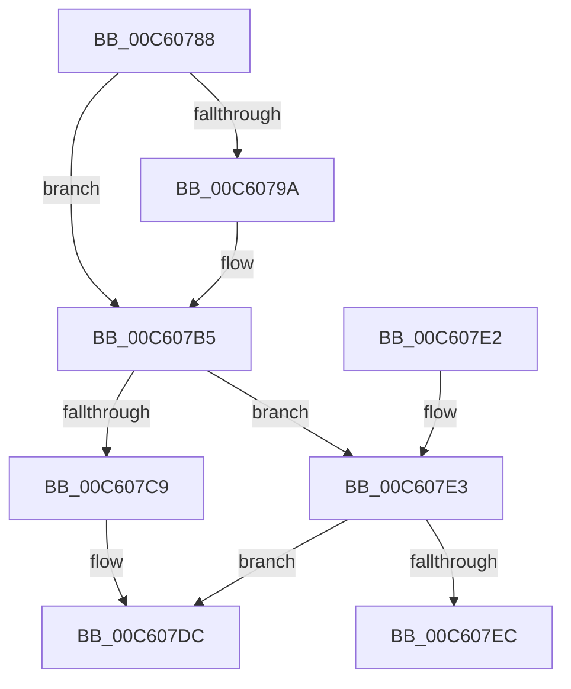

# MiInitializeFunctionOverrides

- RVA: `0x00C60788`–`0x00C60807` (길이 `127` bytes)
- VA: `0x0000000140C60788`
- 실행 섹션: `INIT`
- PDB 이름 있음: `예`; PDB Function 태그: `아니요`
- unwind 정보 RVA: `0x000BCA68`
- 디코드: `33`개 명령, `127/127` bytes 표시
- 미해석 바이트: `0` (있으면 어셈블리에 `.byte`로 보존)

> 이 문서는 커널 이미지의 기계어와 PDB 기호를 분석해 생성했습니다. 4번과 5번은 함수 원형과 자료형을 바이너리 사용 방식에서 추정한 C 해석이며 원본 소스 복구 결과는 아닙니다.

## 1. Dependencies

- 직접 호출 지점: **5**; 고유 호출 대상: **4**
- 직접 호출자로 확인된 함수: **1**
- RIP 상대 이미지 참조: **2**

### Outgoing calls
- `0x00C60791` → [RtlFunctionOverrideSelfTest](../../text/6A/RtlFunctionOverrideSelfTest_function_006AA490.md) (function, `0x006AA490`)
- `0x00C607AF` → [KeBugCheckEx](../../text/4F/KeBugCheckEx_function_004FD660.md) (function, `0x004FD660`)
- `0x00C607D7` → [RtlInitFunctionOverrideCapabilities](../../page/79/RtlInitFunctionOverrideCapabilities_function_00795614.md) (function, `0x00795614`)
- `0x00C607E3` → [VslInitFunctionOverrideCapabilities](../../text/58/VslInitFunctionOverrideCapabilities_function_0058FFA8.md) (function, `0x0058FFA8`)
- `0x00C60801` → [KeBugCheckEx](../../text/4F/KeBugCheckEx_function_004FD660.md) (function, `0x004FD660`)

### Direct callers
- [MiInitNucleus](../C5/MiInitNucleus_function_00C5FD38.md) at `0x00C60242`

### Static image references
- `0x00C607B5` → RVA `0x00FC6A88` (`ALMOSTRO`; read)
- `0x00C607C0` → RVA `0x00E2DAC0` (`.data`; read)

## 2. Other-region calls and transfers

- 다른 실행 섹션으로 향하는 call: **5**
  - `0x00C60791` → [RtlFunctionOverrideSelfTest](../../text/6A/RtlFunctionOverrideSelfTest_function_006AA490.md) (`INIT` → `.text`)
  - `0x00C607AF` → [KeBugCheckEx](../../text/4F/KeBugCheckEx_function_004FD660.md) (`INIT` → `.text`)
  - `0x00C607D7` → [RtlInitFunctionOverrideCapabilities](../../page/79/RtlInitFunctionOverrideCapabilities_function_00795614.md) (`INIT` → `PAGE`)
  - `0x00C607E3` → [VslInitFunctionOverrideCapabilities](../../text/58/VslInitFunctionOverrideCapabilities_function_0058FFA8.md) (`INIT` → `.text`)
  - `0x00C60801` → [KeBugCheckEx](../../text/4F/KeBugCheckEx_function_004FD660.md) (`INIT` → `.text`)
- 별도 외부 분기/꼬리 이동을 확인하지 못했습니다.

## 3. Assembly (complete function range)

```asm
00C60788  40 53                           push rbx
00C6078A  48 83 EC 30                     sub rsp, 0x30
00C6078E  48 8B D9                        mov rbx, rcx
00C60791  E8 FA 9C A4 FF                  call 0x1406aa490
00C60796  84 C0                           test al, al
00C60798  75 1B                           jne 0x140c607b5
00C6079A  48 83 64 24 20 00               and qword ptr [rsp + 0x20], 0
00C607A0  45 33 C9                        xor r9d, r9d
00C607A3  45 33 C0                        xor r8d, r8d
00C607A6  BA 01 03 00 00                  mov edx, 0x301
00C607AB  41 8D 49 1A                     lea ecx, [r9 + 0x1a]
00C607AF  E8 AC CE 89 FF                  call 0x1404fd660
00C607B4  CC                              int3
00C607B5  48 F7 05 C8 62 36 00 00 40 00 00  test qword ptr [rip + 0x3662c8], 0x4000
00C607C0  48 8D 0D F9 D2 1C 00            lea rcx, [rip + 0x1cd2f9]
00C607C7  75 1A                           jne 0x140c607e3
00C607C9  48 8B 93 F0 00 00 00            mov rdx, qword ptr [rbx + 0xf0]
00C607D0  48 8B 92 28 0F 00 00            mov rdx, qword ptr [rdx + 0xf28]
00C607D7  E8 38 4E B3 FF                  call 0x140795614
00C607DC  48 83 C4 30                     add rsp, 0x30
00C607E0  5B                              pop rbx
00C607E1  C3                              ret
00C607E2  CC                              int3
00C607E3  E8 C0 F7 92 FF                  call 0x14058ffa8
00C607E8  85 C0                           test eax, eax
00C607EA  79 F0                           jns 0x140c607dc
00C607EC  48 83 64 24 20 00               and qword ptr [rsp + 0x20], 0
00C607F2  45 33 C9                        xor r9d, r9d
00C607F5  4C 63 C0                        movsxd r8, eax
00C607F8  BA 83 10 00 00                  mov edx, 0x1083
00C607FD  41 8D 49 1A                     lea ecx, [r9 + 0x1a]
00C60801  E8 5A CE 89 FF                  call 0x1404fd660
00C60806  CC                              int3
```

## 4. C-style interpretation (structured pseudocode)

```c
__int64 __fastcall MiInitializeFunctionOverrides(__int64 a1, __int64 a2, int a3, int a4)
{
    __int64 result;
    __int64 v_rsp;
    unsigned __int64 v_stack_m18;
    unsigned __int64 v_stack_p20;

    v_rsp = (v_rsp) - (48);
    result = RtlFunctionOverrideSelfTest(a1, a2, a3, a4);
    if ((unsigned __int8)(result) == 0) {
        a4 = 0;
        a3 = 0;
        a2 = 769;
        a1 = a4 + 26;
        result = KeBugCheckEx(a1, a2, a3, a4);
    }
    if (((*(unsigned __int64 *)(v_rip + 3564232)) & (0x4000ULL)) != 0) goto loc_00C607E3;
    result = RtlInitFunctionOverrideCapabilities(v_rip + 1889017, *(unsigned __int64 *)(*(unsigned __int64 *)(a1 + 240) + 3880), a3, a4);
loc_00C607DC:
    v_rsp = (v_rsp) + (48);
    return result;
loc_00C607E3:
    result = VslInitFunctionOverrideCapabilities(v_rip + 1889017, *(unsigned __int64 *)(*(unsigned __int64 *)(a1 + 240) + 3880), a3, a4);
    if (!sign_flag) goto loc_00C607DC;
    a4 = 0;
    result = KeBugCheckEx(a4 + 26, (unsigned int)(0x1083ULL), (int)((unsigned int)(result)), a4);
    return result;
}
```

## 5. (Beta) C Style

```c
int64_t MiInitializeFunctionOverrides(void *Arg1, int64_t Arg2, int32_t Arg3, int32_t Arg4)
{
    uint8_t *arg1 = (uint8_t *)Arg1;

    int64_t result;
    int64_t local_rsp;
    uint64_t v_stack_m18;
    uint64_t v_stack_p20;

    local_rsp = (local_rsp) - (48);
    result = RtlFunctionOverrideSelfTest(Arg1, Arg2, Arg3, Arg4);
    if ((uint8_t)(result) == 0) {
        Arg4 = 0;
        Arg3 = 0;
        Arg2 = 769;
        Arg1 = Arg4 + 26;
        result = KeBugCheckEx(Arg1, Arg2, Arg3, Arg4);
    }
    if (((*(uint64_t *)(v_rip + 0x3662C8)) & (0x4000ULL)) != 0) goto loc_00C607E3;
    result = RtlInitFunctionOverrideCapabilities(v_rip + 1889017, *(uint64_t *)(*(uint64_t *)(arg1 + 0xF0) + 0xF28), Arg3, Arg4);
loc_00C607DC:
    local_rsp = (local_rsp) + (48);
    return result;
loc_00C607E3:
    result = VslInitFunctionOverrideCapabilities(v_rip + 1889017, *(uint64_t *)(*(uint64_t *)(arg1 + 0xF0) + 0xF28), Arg3, Arg4);
    if (!sign_flag) goto loc_00C607DC;
    Arg4 = 0;
    result = KeBugCheckEx(Arg4 + 26, (uint32_t)(0x1083ULL), (int32_t)((uint32_t)(result)), Arg4);
    return result;
}
```

### 관측된 메모리 오프셋

구조체 형식이 확인되지 않은 접근은 인자 기준의 오프셋으로만 기록했습니다.

| 기준 인자 | 오프셋 표현 | 폭 (bit) | 접근 |
|---|---:|---:|---|
| `Arg1` | `+ 0xF0` | `64` | `R` |

## 6. Execution-region graph

[열기: 2D/3D 그래프와 함수 탐색 컨트롤 패널](../../../control-panel.html?section=init&rva=0x00C60788&view=graph)

- 2D 그래프는 위에서 아래로 흐르고, 3D 그래프는 빈 공간을 드래그해 회전합니다. Shift+드래그는 이동, 휠은 확대·축소, 함수 노드 선택은 대상 보고서 이동입니다.

### Static fallback


