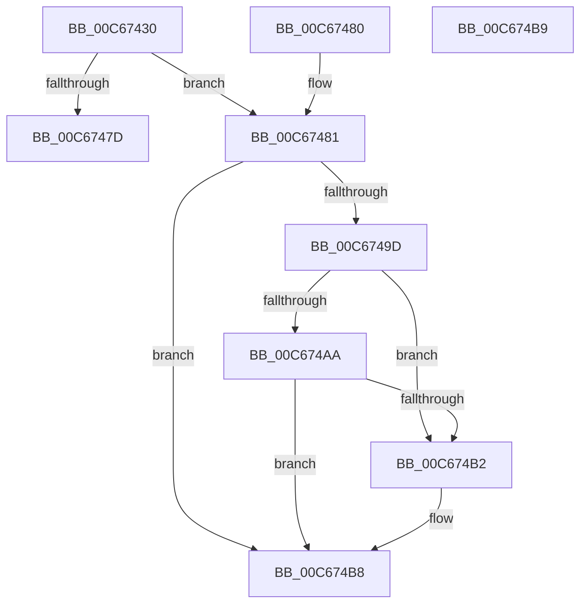

# MiInitializeHotPatches

- RVA: `0x00C67430`–`0x00C674BA` (길이 `138` bytes)
- VA: `0x0000000140C67430`
- 실행 섹션: `INIT`
- PDB 이름 있음: `예`; PDB Function 태그: `아니요`
- unwind 정보 RVA: `0x000DB714`
- 디코드: `29`개 명령, `138/138` bytes 표시
- 미해석 바이트: `0` (있으면 어셈블리에 `.byte`로 보존)

> 이 문서는 커널 이미지의 기계어와 PDB 기호를 분석해 생성했습니다. 4번과 5번은 함수 원형과 자료형을 바이너리 사용 방식에서 추정한 C 해석이며 원본 소스 복구 결과는 아닙니다.

## 1. Dependencies

- 직접 호출 지점: **0**; 고유 호출 대상: **0**
- 직접 호출자로 확인된 함수: **1**
- RIP 상대 이미지 참조: **10**

### Outgoing calls
- 직접 디코드된 call 명령이 없습니다.

### Direct callers
- [MiInitSystem](../C5/MiInitSystem_function_00C5E6C0.md) at `0x00C5E854`

### Static image references
- `0x00C67433` → RVA `0x00E37578` (`.data`; write)
- `0x00C6743A` → RVA `0x00E37580` (`.data`; write)
- `0x00C67441` → RVA `0x00E37570` (`.data`; write)
- `0x00C67448` → RVA `0x00E37588` (`.data`; write)
- `0x00C6744F` → RVA `0x00E37590` (`.data`; write)
- `0x00C6746F` → RVA `0x00E375AC` (`.data`; write)
- `0x00C67493` → RVA `0x00E375B0` (`.data`; write)
- `0x00C6749D` → RVA `0x00FC6A88` (`ALMOSTRO`; read)
- `0x00C674AA` → RVA `0x00FC5260` (`ALMOSTRO`; read)
- `0x00C674B2` → RVA `0x00E375B4` (`.data`; read/write)

## 2. Other-region calls and transfers

- 다른 실행 섹션으로 향하는 call: **0**
- 별도 외부 분기/꼬리 이동을 확인하지 못했습니다.

## 3. Assembly (complete function range)

```asm
00C67430  45 33 C9                        xor r9d, r9d
00C67433  4C 89 0D 3E 01 1D 00            mov qword ptr [rip + 0x1d013e], r9
00C6743A  4C 89 0D 3F 01 1D 00            mov qword ptr [rip + 0x1d013f], r9
00C67441  4C 89 0D 28 01 1D 00            mov qword ptr [rip + 0x1d0128], r9
00C67448  4C 89 0D 39 01 1D 00            mov qword ptr [rip + 0x1d0139], r9
00C6744F  4C 89 0D 3A 01 1D 00            mov qword ptr [rip + 0x1d013a], r9
00C67456  48 8B 81 F0 00 00 00            mov rax, qword ptr [rcx + 0xf0]
00C6745D  8B 90 A8 0D 00 00               mov edx, dword ptr [rax + 0xda8]
00C67463  81 C2 FF 0F 00 00               add edx, 0xfff
00C67469  81 E2 00 F0 FF FF               and edx, 0xfffff000
00C6746F  89 15 37 01 1D 00               mov dword ptr [rip + 0x1d0137], edx
00C67475  F7 C2 FF 1F 00 00               test edx, 0x1fff
00C6747B  74 04                           je 0x140c67481
00C6747D  33 C0                           xor eax, eax
00C6747F  C3                              ret
00C67480  CC                              int3
00C67481  48 8B 81 F0 00 00 00            mov rax, qword ptr [rcx + 0xf0]
00C67488  8B 88 20 0F 00 00               mov ecx, dword ptr [rax + 0xf20]
00C6748E  B8 01 00 00 00                  mov eax, 1
00C67493  89 0D 17 01 1D 00               mov dword ptr [rip + 0x1d0117], ecx
00C67499  85 D2                           test edx, edx
00C6749B  74 1B                           je 0x140c674b8
00C6749D  48 F7 05 E0 F5 35 00 00 40 00 00  test qword ptr [rip + 0x35f5e0], 0x4000
00C674A8  75 08                           jne 0x140c674b2
00C674AA  39 05 B0 DD 35 00               cmp dword ptr [rip + 0x35ddb0], eax
00C674B0  75 06                           jne 0x140c674b8
00C674B2  09 05 FC 00 1D 00               or dword ptr [rip + 0x1d00fc], eax
00C674B8  C3                              ret
00C674B9  CC                              int3
```

## 4. C-style interpretation (structured pseudocode)

```c
__int64 __fastcall MiInitializeHotPatches(__int64 a1, __int64 a2, __int64 a3, int a4)
{
    __int64 result;

    a4 = 0;
    *(unsigned __int64 *)(v_rip + 1900862) = 0;
    *(unsigned __int64 *)(v_rip + 1900863) = 0;
    *(unsigned __int64 *)(v_rip + 1900840) = 0;
    *(unsigned __int64 *)(v_rip + 1900857) = 0;
    *(unsigned __int64 *)(v_rip + 1900858) = 0;
    a2 = (unsigned int)(((unsigned int)(*(unsigned int *)(*(unsigned __int64 *)(a1 + 240) + 3496))) + (0xFFFULL));
    a2 = (unsigned int)((a2) & (0xFFFFF000ULL));
    *(unsigned int *)(v_rip + 1900855) = (unsigned int)(a2);
    if ((((unsigned int)(a2)) & (0x1FFFULL)) == 0) goto loc_00C67481;
    result = 0;
    return result;
loc_00C67481:
    *(unsigned int *)(v_rip + 1900823) = (unsigned int)((unsigned int)(*(unsigned int *)(*(unsigned __int64 *)(a1 + 240) + 3872)));
    if ((unsigned int)(a2) == 0) goto loc_00C674B8;
    if (((*(unsigned __int64 *)(v_rip + 3536352)) & (0x4000ULL)) != 0) goto loc_00C674B2;
    if ((*(unsigned int *)(v_rip + 3530160)) == 1) {
    }
    return 1;
}
```

## 5. (Beta) C Style

```c
int64_t MiInitializeHotPatches(void *Arg1, int64_t Arg2, int64_t Arg3, int32_t Arg4)
{
    uint8_t *arg1 = (uint8_t *)Arg1;

    int64_t result;

    Arg4 = 0;
    *(uint64_t *)(v_rip + 0x1D013E) = 0;
    *(uint64_t *)(v_rip + 0x1D013F) = 0;
    *(uint64_t *)(v_rip + 0x1D0128) = 0;
    *(uint64_t *)(v_rip + 0x1D0139) = 0;
    *(uint64_t *)(v_rip + 0x1D013A) = 0;
    Arg2 = (uint32_t)(((uint32_t)(*(uint32_t *)(*(uint64_t *)(arg1 + 0xF0) + 0xDA8))) + (0xFFFULL));
    Arg2 = (uint32_t)((Arg2) & (0xFFFFF000ULL));
    *(uint32_t *)(v_rip + 0x1D0137) = (uint32_t)(Arg2);
    if ((((uint32_t)(Arg2)) & (0x1FFFULL)) == 0) goto loc_00C67481;
    result = 0;
    return result;
loc_00C67481:
    *(uint32_t *)(v_rip + 0x1D0117) = (uint32_t)((uint32_t)(*(uint32_t *)(*(uint64_t *)(arg1 + 0xF0) + 0xF20)));
    if ((uint32_t)(Arg2) == 0) goto loc_00C674B8;
    if (((*(uint64_t *)(v_rip + 0x35F5E0)) & (0x4000ULL)) != 0) goto loc_00C674B2;
    if ((*(uint32_t *)(v_rip + 0x35DDB0)) == 1) {
    }
    return 1;
}
```

### 관측된 메모리 오프셋

구조체 형식이 확인되지 않은 접근은 인자 기준의 오프셋으로만 기록했습니다.

| 기준 인자 | 오프셋 표현 | 폭 (bit) | 접근 |
|---|---:|---:|---|
| `Arg1` | `+ 0xF0` | `64` | `R` |

## 6. Execution-region graph

[열기: 2D/3D 그래프와 함수 탐색 컨트롤 패널](../../../control-panel.html?section=init&rva=0x00C67430&view=graph)

- 2D 그래프는 위에서 아래로 흐르고, 3D 그래프는 빈 공간을 드래그해 회전합니다. Shift+드래그는 이동, 휠은 확대·축소, 함수 노드 선택은 대상 보고서 이동입니다.

### Static fallback


