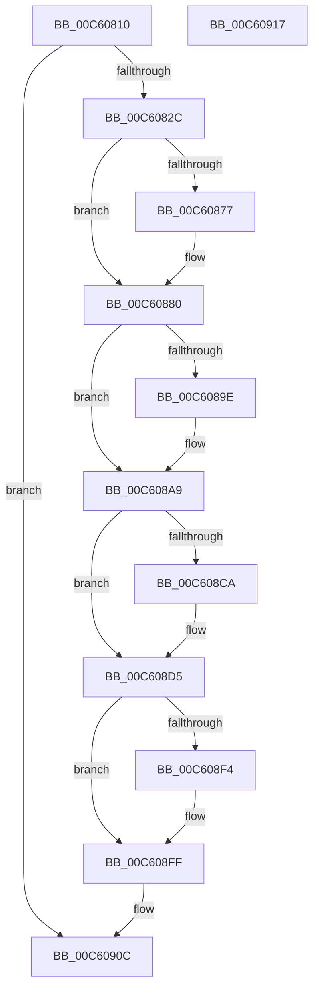

# MiInitializeKasan

- RVA: `0x00C60810`–`0x00C60918` (길이 `264` bytes)
- VA: `0x0000000140C60810`
- 실행 섹션: `INIT`
- PDB 이름 있음: `예`; PDB Function 태그: `아니요`
- unwind 정보 RVA: `0x0005CAAC`
- 디코드: `65`개 명령, `264/264` bytes 표시
- 미해석 바이트: `0` (있으면 어셈블리에 `.byte`로 보존)

> 이 문서는 커널 이미지의 기계어와 PDB 기호를 분석해 생성했습니다. 4번과 5번은 함수 원형과 자료형을 바이너리 사용 방식에서 추정한 C 해석이며 원본 소스 복구 결과는 아닙니다.

## 1. Dependencies

- 직접 호출 지점: **10**; 고유 호출 대상: **4**
- 직접 호출자로 확인된 함수: **1**
- RIP 상대 이미지 참조: **7**

### Outgoing calls
- `0x00C60843` → [MiFillGapAddresses](MiFillGapAddresses_function_00C65A3C.md) (function, `0x00C65A3C`)
- `0x00C6086E` → [KasanTrackAddress](../../text/46/KasanTrackAddress_function_00462520.md) (function, `0x00462520`)
- `0x00C6087A` → [MxInstallMoreMemory](../../text/67/MxInstallMoreMemory_function_00671A04.md) (function, `0x00671A04`)
- `0x00C60895` → [KasanTrackAddress](../../text/46/KasanTrackAddress_function_00462520.md) (function, `0x00462520`)
- `0x00C608A3` → [MxInstallMoreMemory](../../text/67/MxInstallMoreMemory_function_00671A04.md) (function, `0x00671A04`)
- `0x00C608C1` → [KasanTrackAddress](../../text/46/KasanTrackAddress_function_00462520.md) (function, `0x00462520`)
- `0x00C608CF` → [MxInstallMoreMemory](../../text/67/MxInstallMoreMemory_function_00671A04.md) (function, `0x00671A04`)
- `0x00C608EB` → [KasanTrackAddress](../../text/46/KasanTrackAddress_function_00462520.md) (function, `0x00462520`)
- `0x00C608F9` → [MxInstallMoreMemory](../../text/67/MxInstallMoreMemory_function_00671A04.md) (function, `0x00671A04`)
- `0x00C60907` → [KasanInitSystem](../C3/KasanInitSystem_function_00C368B0.md) (function, `0x00C368B0`)

### Direct callers
- [MiInitNucleus](../C5/MiInitNucleus_function_00C5FD38.md) at `0x00C601A4`

### Static image references
- `0x00C6081A` → RVA `0x00FC6A88` (`ALMOSTRO`; read)
- `0x00C6082C` → RVA `0x00E38BF8` (`.data`; read)
- `0x00C60833` → RVA `0x00E38C00` (`.data`; read)
- `0x00C60848` → RVA `0x00FC5020` (`ALMOSTRO`; read)
- `0x00C6085A` → RVA `0x00FC6ED8` (`ALMOSTRO`; write)
- `0x00C60880` → RVA `0x00FC505C` (`ALMOSTRO`; read)
- `0x00C608A9` → RVA `0x00FC507C` (`ALMOSTRO`; read)

## 2. Other-region calls and transfers

- 다른 실행 섹션으로 향하는 call: **8**
  - `0x00C6086E` → [KasanTrackAddress](../../text/46/KasanTrackAddress_function_00462520.md) (`INIT` → `.text`)
  - `0x00C6087A` → [MxInstallMoreMemory](../../text/67/MxInstallMoreMemory_function_00671A04.md) (`INIT` → `.text`)
  - `0x00C60895` → [KasanTrackAddress](../../text/46/KasanTrackAddress_function_00462520.md) (`INIT` → `.text`)
  - `0x00C608A3` → [MxInstallMoreMemory](../../text/67/MxInstallMoreMemory_function_00671A04.md) (`INIT` → `.text`)
  - `0x00C608C1` → [KasanTrackAddress](../../text/46/KasanTrackAddress_function_00462520.md) (`INIT` → `.text`)
  - `0x00C608CF` → [MxInstallMoreMemory](../../text/67/MxInstallMoreMemory_function_00671A04.md) (`INIT` → `.text`)
  - `0x00C608EB` → [KasanTrackAddress](../../text/46/KasanTrackAddress_function_00462520.md) (`INIT` → `.text`)
  - `0x00C608F9` → [MxInstallMoreMemory](../../text/67/MxInstallMoreMemory_function_00671A04.md) (`INIT` → `.text`)
- 별도 외부 분기/꼬리 이동을 확인하지 못했습니다.

## 3. Assembly (complete function range)

```asm
00C60810  48 89 5C 24 08                  mov qword ptr [rsp + 8], rbx
00C60815  57                              push rdi
00C60816  48 83 EC 20                     sub rsp, 0x20
00C6081A  48 0F BA 25 65 62 36 00 23      bt qword ptr [rip + 0x366265], 0x23
00C60823  48 8B F9                        mov rdi, rcx
00C60826  0F 83 E0 00 00 00               jae 0x140c6090c
00C6082C  48 8B 1D C5 83 1D 00            mov rbx, qword ptr [rip + 0x1d83c5]
00C60833  48 8B 15 C6 83 1D 00            mov rdx, qword ptr [rip + 0x1d83c6]
00C6083A  48 8B CB                        mov rcx, rbx
00C6083D  48 FF CA                        dec rdx
00C60840  48 03 D3                        add rdx, rbx
00C60843  E8 F4 51 00 00                  call 0x140c65a3c
00C60848  8B 15 D2 47 36 00               mov edx, dword ptr [rip + 0x3647d2]
00C6084E  45 33 C0                        xor r8d, r8d
00C60851  65 48 8B 0C 25 20 3A 00 00      mov rcx, qword ptr gs:[0x3a20]
00C6085A  48 89 1D 77 66 36 00            mov qword ptr [rip + 0x366677], rbx
00C60861  BB 50 00 00 00                  mov ebx, 0x50
00C60866  8B C3                           mov eax, ebx
00C60868  48 2B C2                        sub rax, rdx
00C6086B  48 03 C8                        add rcx, rax
00C6086E  E8 AD 1C 80 FF                  call 0x140462520
00C60873  85 C0                           test eax, eax
00C60875  79 09                           jns 0x140c60880
00C60877  8D 4B B7                        lea ecx, [rbx - 0x49]
00C6087A  E8 85 11 A1 FF                  call 0x140671a04
00C6087F  CC                              int3
00C60880  8B 15 D6 47 36 00               mov edx, dword ptr [rip + 0x3647d6]
00C60886  45 33 C0                        xor r8d, r8d
00C60889  65 48 8B 0C 25 58 91 00 00      mov rcx, qword ptr gs:[0x9158]
00C60892  48 2B CA                        sub rcx, rdx
00C60895  E8 86 1C 80 FF                  call 0x140462520
00C6089A  85 C0                           test eax, eax
00C6089C  79 0B                           jns 0x140c608a9
00C6089E  B9 08 00 00 00                  mov ecx, 8
00C608A3  E8 5C 11 A1 FF                  call 0x140671a04
00C608A8  CC                              int3
00C608A9  8B 15 CD 47 36 00               mov edx, dword ptr [rip + 0x3647cd]
00C608AF  45 33 C0                        xor r8d, r8d
00C608B2  65 48 8B 0C 25 E8 88 00 00      mov rcx, qword ptr gs:[0x88e8]
00C608BB  48 2B DA                        sub rbx, rdx
00C608BE  48 03 CB                        add rcx, rbx
00C608C1  E8 5A 1C 80 FF                  call 0x140462520
00C608C6  85 C0                           test eax, eax
00C608C8  79 0B                           jns 0x140c608d5
00C608CA  B9 09 00 00 00                  mov ecx, 9
00C608CF  E8 30 11 A1 FF                  call 0x140671a04
00C608D4  CC                              int3
00C608D5  65 48 8B 0C 25 88 01 00 00      mov rcx, qword ptr gs:[0x188]
00C608DE  45 33 C0                        xor r8d, r8d
00C608E1  8B 15 39 47 36 00               mov edx, dword ptr [rip + 0x364739]
00C608E7  48 8B 49 30                     mov rcx, qword ptr [rcx + 0x30]
00C608EB  E8 30 1C 80 FF                  call 0x140462520
00C608F0  85 C0                           test eax, eax
00C608F2  79 0B                           jns 0x140c608ff
00C608F4  B9 0A 00 00 00                  mov ecx, 0xa
00C608F9  E8 06 11 A1 FF                  call 0x140671a04
00C608FE  CC                              int3
00C608FF  BA 01 00 00 00                  mov edx, 1
00C60904  48 8B CF                        mov rcx, rdi
00C60907  E8 A4 5F FD FF                  call 0x140c368b0
00C6090C  48 8B 5C 24 30                  mov rbx, qword ptr [rsp + 0x30]
00C60911  48 83 C4 20                     add rsp, 0x20
00C60915  5F                              pop rdi
00C60916  C3                              ret
00C60917  CC                              int3
```

## 4. C-style interpretation (structured pseudocode)

```c
__int64 __fastcall MiInitializeKasan(__int64 a1, __int64 a2, int a3)
{
    __int64 result;
    __int64 v_rbx;
    __int64 v_rsp;
    unsigned __int64 v_stack_p8;

    v_stack_p8 = v_rbx;
    v_rsp = (v_rsp) - (32);
    if (condition_is_above_or_equal) goto loc_00C6090C;
    a2 = (*(unsigned __int64 *)(v_rip + 1934278)) - 1;
    a2 = (a2) + (*(unsigned __int64 *)(v_rip + 1934277));
    result = MiFillGapAddresses(*(unsigned __int64 *)(v_rip + 1934277), a2, a3, a4);
    a3 = 0;
    *(unsigned __int64 *)(v_rip + 3565175) = *(unsigned __int64 *)(v_rip + 1934277);
    result = (80) - ((unsigned int)(*(unsigned int *)(v_rip + 3557330)));
    a1 = (*(unsigned __int64 *)(gs_base + (0 + 14880))) + (result);
    result = KasanTrackAddress(a1, (unsigned int)(*(unsigned int *)(v_rip + 3557330)), a3, a4);
    if (sign_flag) {
        a1 = 80 - 73;
        result = MxInstallMoreMemory(a1, (unsigned int)(*(unsigned int *)(v_rip + 3557330)), a3, a4);
    }
    a3 = 0;
    a1 = (*(unsigned __int64 *)(gs_base + (0 + 37208))) - ((unsigned int)(*(unsigned int *)(v_rip + 3557334)));
    result = KasanTrackAddress(a1, (unsigned int)(*(unsigned int *)(v_rip + 3557334)), a3, a4);
    if (sign_flag) {
        a1 = 8;
        result = MxInstallMoreMemory(a1, (unsigned int)(*(unsigned int *)(v_rip + 3557334)), a3, a4);
    }
    a3 = 0;
    v_rbx = (80) - ((unsigned int)(*(unsigned int *)(v_rip + 3557325)));
    a1 = (*(unsigned __int64 *)(gs_base + (0 + 35048))) + (v_rbx);
    result = KasanTrackAddress(a1, (unsigned int)(*(unsigned int *)(v_rip + 3557325)), a3, a4);
    if (sign_flag) {
        a1 = 9;
        result = MxInstallMoreMemory(a1, (unsigned int)(*(unsigned int *)(v_rip + 3557325)), a3, a4);
    }
    a3 = 0;
    result = KasanTrackAddress(*(unsigned __int64 *)(*(unsigned __int64 *)(gs_base + (0 + 392)) + 48), (unsigned int)(*(unsigned int *)(v_rip + 3557177)), a3, a4);
    if (sign_flag) {
        a1 = 10;
        result = MxInstallMoreMemory(a1, (unsigned int)(*(unsigned int *)(v_rip + 3557177)), a3, a4);
    }
    result = KasanInitSystem(a1, 1, a3, a4);
loc_00C6090C:
    v_rsp = (v_rsp) + (32);
    return result;
}
```

## 5. (Beta) C Style

```c
int64_t MiInitializeKasan(int64_t Arg1, int64_t Arg2, int32_t Arg3)
{
    int64_t result;
    int64_t local_rbx;
    int64_t local_rsp;
    uint64_t v_stack_p8;

    v_stack_p8 = local_rbx;
    local_rsp = (local_rsp) - (32);
    if (condition_is_above_or_equal) goto loc_00C6090C;
    Arg2 = (*(uint64_t *)(v_rip + 0x1D83C6)) - 1;
    Arg2 = (Arg2) + (*(uint64_t *)(v_rip + 0x1D83C5));
    result = MiFillGapAddresses(*(uint64_t *)(v_rip + 0x1D83C5), Arg2, Arg3, a4);
    Arg3 = 0;
    *(uint64_t *)(v_rip + 0x366677) = *(uint64_t *)(v_rip + 0x1D83C5);
    result = (80) - ((uint32_t)(*(uint32_t *)(v_rip + 0x3647D2)));
    Arg1 = (*(uint64_t *)(gs_base + (0 + 0x3A20))) + (result);
    result = KasanTrackAddress(Arg1, (uint32_t)(*(uint32_t *)(v_rip + 0x3647D2)), Arg3, a4);
    if (sign_flag) {
        Arg1 = 80 - 73;
        result = MxInstallMoreMemory(Arg1, (uint32_t)(*(uint32_t *)(v_rip + 0x3647D2)), Arg3, a4);
    }
    Arg3 = 0;
    Arg1 = (*(uint64_t *)(gs_base + (0 + 0x9158))) - ((uint32_t)(*(uint32_t *)(v_rip + 0x3647D6)));
    result = KasanTrackAddress(Arg1, (uint32_t)(*(uint32_t *)(v_rip + 0x3647D6)), Arg3, a4);
    if (sign_flag) {
        Arg1 = 8;
        result = MxInstallMoreMemory(Arg1, (uint32_t)(*(uint32_t *)(v_rip + 0x3647D6)), Arg3, a4);
    }
    Arg3 = 0;
    local_rbx = (80) - ((uint32_t)(*(uint32_t *)(v_rip + 0x3647CD)));
    Arg1 = (*(uint64_t *)(gs_base + (0 + 0x88E8))) + (local_rbx);
    result = KasanTrackAddress(Arg1, (uint32_t)(*(uint32_t *)(v_rip + 0x3647CD)), Arg3, a4);
    if (sign_flag) {
        Arg1 = 9;
        result = MxInstallMoreMemory(Arg1, (uint32_t)(*(uint32_t *)(v_rip + 0x3647CD)), Arg3, a4);
    }
    Arg3 = 0;
    result = KasanTrackAddress(*(uint64_t *)(*(uint64_t *)(gs_base + (0 + 0x188)) + 0x30), (uint32_t)(*(uint32_t *)(v_rip + 0x364739)), Arg3, a4);
    if (sign_flag) {
        Arg1 = 10;
        result = MxInstallMoreMemory(Arg1, (uint32_t)(*(uint32_t *)(v_rip + 0x364739)), Arg3, a4);
    }
    result = KasanInitSystem(Arg1, 1, Arg3, a4);
loc_00C6090C:
    local_rsp = (local_rsp) + (32);
    return result;
}
```

## 6. Execution-region graph

[열기: 2D/3D 그래프와 함수 탐색 컨트롤 패널](../../../control-panel.html?section=init&rva=0x00C60810&view=graph)

- 2D 그래프는 위에서 아래로 흐르고, 3D 그래프는 빈 공간을 드래그해 회전합니다. Shift+드래그는 이동, 휠은 확대·축소, 함수 노드 선택은 대상 보고서 이동입니다.

### Static fallback


