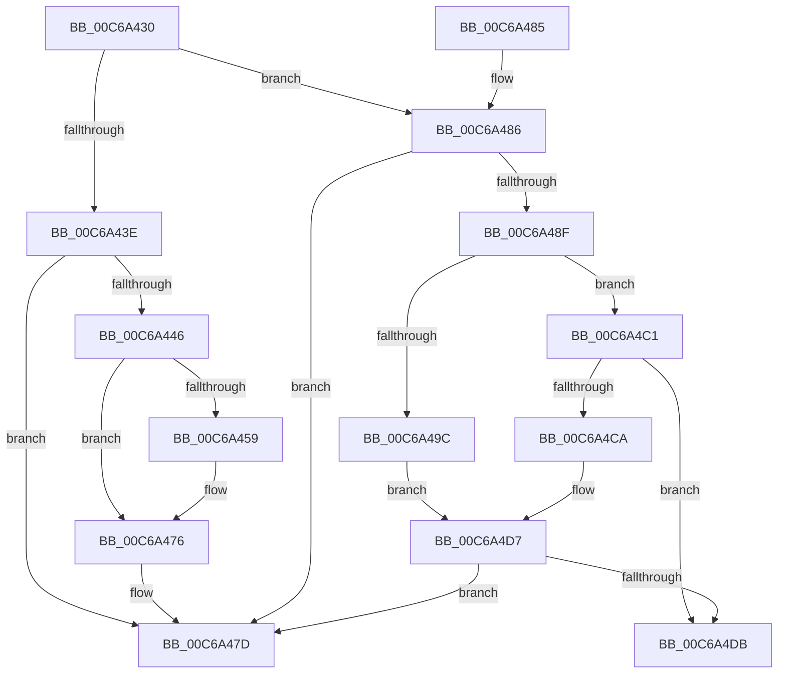

# MiInitializeKernelCfgImages

- RVA: `0x00C6A430`–`0x00C6A4F5` (길이 `197` bytes)
- VA: `0x0000000140C6A430`
- 실행 섹션: `INIT`
- PDB 이름 있음: `예`; PDB Function 태그: `아니요`
- unwind 정보 RVA: `0x000D902C`
- 디코드: `56`개 명령, `197/197` bytes 표시
- 미해석 바이트: `0` (있으면 어셈블리에 `.byte`로 보존)

> 이 문서는 커널 이미지의 기계어와 PDB 기호를 분석해 생성했습니다. 4번과 5번은 함수 원형과 자료형을 바이너리 사용 방식에서 추정한 C 해석이며 원본 소스 복구 결과는 아닙니다.

## 1. Dependencies

- 직접 호출 지점: **7**; 고유 호출 대상: **6**
- 직접 호출자로 확인된 함수: **0**
- RIP 상대 이미지 참조: **1**

### Outgoing calls
- `0x00C6A450` → [MiAllocateKernelCfgBitmapPageTables](../../page/A4/MiAllocateKernelCfgBitmapPageTables_function_00A4B80C.md) (function, `0x00A4B80C`)
- `0x00C6A470` → [KeBugCheckEx](../../text/4F/KeBugCheckEx_function_004FD660.md) (function, `0x004FD660`)
- `0x00C6A4A8` → [RtlImageNtHeaderEx](../../text/41/RtlImageNtHeaderEx_function_0041EAA0.md) (function, `0x0041EAA0`)
- `0x00C6A4B5` → [MiMarkKernelImageCfgBits](../../page/A4/MiMarkKernelImageCfgBits_function_00A4B1E0.md) (function, `0x00A4B1E0`)
- `0x00C6A4C1` → [MiProcessKernelCfgImageLoadConfig](../../page/A7/MiProcessKernelCfgImageLoadConfig_function_00A7FE40.md) (function, `0x00A7FE40`)
- `0x00C6A4D2` → [MiProcessKernelCfgImage](../../text/4D/MiProcessKernelCfgImage_function_004D0744.md) (function, `0x004D0744`)
- `0x00C6A4EF` → [KeBugCheckEx](../../text/4F/KeBugCheckEx_function_004FD660.md) (function, `0x004FD660`)

### Direct callers
- 이 함수 시작 RVA로 연결되는 직접 call은 확인되지 않았습니다. 간접 호출은 완전히 역산할 수 없습니다.

### Static image references
- `0x00C6A493` → RVA `0x00FC6B28` (`ALMOSTRO`; read)

## 2. Other-region calls and transfers

- 다른 실행 섹션으로 향하는 call: **7**
  - `0x00C6A450` → [MiAllocateKernelCfgBitmapPageTables](../../page/A4/MiAllocateKernelCfgBitmapPageTables_function_00A4B80C.md) (`INIT` → `PAGE`)
  - `0x00C6A470` → [KeBugCheckEx](../../text/4F/KeBugCheckEx_function_004FD660.md) (`INIT` → `.text`)
  - `0x00C6A4A8` → [RtlImageNtHeaderEx](../../text/41/RtlImageNtHeaderEx_function_0041EAA0.md) (`INIT` → `.text`)
  - `0x00C6A4B5` → [MiMarkKernelImageCfgBits](../../page/A4/MiMarkKernelImageCfgBits_function_00A4B1E0.md) (`INIT` → `PAGE`)
  - `0x00C6A4C1` → [MiProcessKernelCfgImageLoadConfig](../../page/A7/MiProcessKernelCfgImageLoadConfig_function_00A7FE40.md) (`INIT` → `PAGE`)
  - `0x00C6A4D2` → [MiProcessKernelCfgImage](../../text/4D/MiProcessKernelCfgImage_function_004D0744.md) (`INIT` → `.text`)
  - `0x00C6A4EF` → [KeBugCheckEx](../../text/4F/KeBugCheckEx_function_004FD660.md) (`INIT` → `.text`)
- 별도 외부 분기/꼬리 이동을 확인하지 못했습니다.

## 3. Assembly (complete function range)

```asm
00C6A430  40 53                           push rbx
00C6A432  48 83 EC 30                     sub rsp, 0x30
00C6A436  48 8B D9                        mov rbx, rcx
00C6A439  48 85 D2                        test rdx, rdx
00C6A43C  75 48                           jne 0x140c6a486
00C6A43E  66 0F BA 61 6E 09               bt word ptr [rcx + 0x6e], 9
00C6A444  73 37                           jae 0x140c6a47d
00C6A446  8B 51 40                        mov edx, dword ptr [rcx + 0x40]
00C6A449  45 33 C0                        xor r8d, r8d
00C6A44C  48 8B 49 30                     mov rcx, qword ptr [rcx + 0x30]
00C6A450  E8 B7 13 DE FF                  call 0x140a4b80c
00C6A455  85 C0                           test eax, eax
00C6A457  79 1D                           jns 0x140c6a476
00C6A459  48 83 64 24 20 00               and qword ptr [rsp + 0x20], 0
00C6A45F  41 B9 01 00 00 00               mov r9d, 1
00C6A465  48 63 D0                        movsxd rdx, eax
00C6A468  4C 8B C3                        mov r8, rbx
00C6A46B  B9 22 04 00 00                  mov ecx, 0x422
00C6A470  E8 EB 31 89 FF                  call 0x1404fd660
00C6A475  CC                              int3
00C6A476  81 4B 68 00 21 00 00            or dword ptr [rbx + 0x68], 0x2100
00C6A47D  33 C0                           xor eax, eax
00C6A47F  48 83 C4 30                     add rsp, 0x30
00C6A483  5B                              pop rbx
00C6A484  C3                              ret
00C6A485  CC                              int3
00C6A486  F7 41 68 00 20 00 00            test dword ptr [rcx + 0x68], 0x2000
00C6A48D  75 EE                           jne 0x140c6a47d
00C6A48F  48 8B 51 30                     mov rdx, qword ptr [rcx + 0x30]
00C6A493  48 3B 15 8E C6 35 00            cmp rdx, qword ptr [rip + 0x35c68e]
00C6A49A  75 25                           jne 0x140c6a4c1
00C6A49C  45 33 C0                        xor r8d, r8d
00C6A49F  4C 8D 4C 24 48                  lea r9, [rsp + 0x48]
00C6A4A4  41 8D 48 01                     lea ecx, [r8 + 1]
00C6A4A8  E8 F3 45 7B FF                  call 0x14041eaa0
00C6A4AD  BA 01 00 00 00                  mov edx, 1
00C6A4B2  48 8B CB                        mov rcx, rbx
00C6A4B5  E8 26 0D DE FF                  call 0x140a4b1e0
00C6A4BA  0F BA 6B 68 0D                  bts dword ptr [rbx + 0x68], 0xd
00C6A4BF  EB 16                           jmp 0x140c6a4d7
00C6A4C1  E8 7A 59 E1 FF                  call 0x140a7fe40
00C6A4C6  85 C0                           test eax, eax
00C6A4C8  78 11                           js 0x140c6a4db
00C6A4CA  45 33 C0                        xor r8d, r8d
00C6A4CD  33 D2                           xor edx, edx
00C6A4CF  48 8B CB                        mov rcx, rbx
00C6A4D2  E8 6D 62 86 FF                  call 0x1404d0744
00C6A4D7  85 C0                           test eax, eax
00C6A4D9  79 A2                           jns 0x140c6a47d
00C6A4DB  48 83 64 24 20 00               and qword ptr [rsp + 0x20], 0
00C6A4E1  45 33 C9                        xor r9d, r9d
00C6A4E4  48 63 D0                        movsxd rdx, eax
00C6A4E7  4C 8B C3                        mov r8, rbx
00C6A4EA  B9 22 04 00 00                  mov ecx, 0x422
00C6A4EF  E8 6C 31 89 FF                  call 0x1404fd660
00C6A4F4  CC                              int3
```

## 4. C-style interpretation (structured pseudocode)

```c
__int64 __fastcall MiInitializeKernelCfgImages(__int64 a1, __int64 a2, int a3)
{
    __int64 result;
    __int64 v_rsp;
    unsigned __int64 v_stack_m18;
    unsigned __int64 v_stack_p20;
    unsigned __int64 v_stack_p48;

    v_rsp = (v_rsp) - (48);
    if (a2 != 0) goto loc_00C6A486;
    if (condition_is_above_or_equal) goto loc_00C6A47D;
    a3 = 0;
    result = MiAllocateKernelCfgBitmapPageTables(*(unsigned __int64 *)(a1 + 48), (unsigned int)(*(unsigned int *)(a1 + 64)), a3, a4);
    if (sign_flag) {
        a4 = 1;
        a2 = (int)((unsigned int)(result));
        a3 = a1;
        a1 = 0x422ULL;
        result = KeBugCheckEx(a1, a2, a3, a4);
    }
loc_00C6A47D:
    result = 0;
    v_rsp = (v_rsp) + (48);
    return result;
loc_00C6A486:
    if (((*(unsigned int *)(a1 + 104)) & (0x2000ULL)) != 0) goto loc_00C6A47D;
    if ((*(unsigned __int64 *)(a1 + 48)) != (*(unsigned __int64 *)(v_rip + 3524238))) goto loc_00C6A4C1;
    a3 = 0;
    result = RtlImageNtHeaderEx(a3 + 1, *(unsigned __int64 *)(a1 + 48), a3, v_stack_p48);
    result = MiMarkKernelImageCfgBits(a1, 1, a3, v_stack_p48);
    goto loc_00C6A4D7;
loc_00C6A4C1:
    result = MiProcessKernelCfgImageLoadConfig(a1, 1, a3, v_stack_p48);
    if (sign_flag) goto loc_00C6A4DB;
    a3 = 0;
    a2 = 0;
    result = MiProcessKernelCfgImage(a1, a2, a3, v_stack_p48);
loc_00C6A4D7:
    if (!sign_flag) goto loc_00C6A47D;
loc_00C6A4DB:
    a4 = 0;
    result = KeBugCheckEx((unsigned int)(0x422ULL), (int)((unsigned int)(result)), a1, a4);
    return result;
}
```

## 5. (Beta) C Style

```c
int64_t MiInitializeKernelCfgImages(void *Arg1, int64_t Arg2, int32_t Arg3)
{
    uint8_t *arg1 = (uint8_t *)Arg1;

    int64_t result;
    int64_t local_rsp;
    uint64_t v_stack_m18;
    uint64_t v_stack_p20;
    uint64_t v_stack_p48;

    local_rsp = (local_rsp) - (48);
    if (Arg2 != 0) goto loc_00C6A486;
    if (condition_is_above_or_equal) goto loc_00C6A47D;
    Arg3 = 0;
    result = MiAllocateKernelCfgBitmapPageTables(*(uint64_t *)(arg1 + 0x30), (uint32_t)(*(uint32_t *)(arg1 + 0x40)), Arg3, a4);
    if (sign_flag) {
        a4 = 1;
        Arg2 = (int32_t)((uint32_t)(result));
        Arg3 = Arg1;
        Arg1 = 0x422ULL;
        result = KeBugCheckEx(Arg1, Arg2, Arg3, a4);
    }
loc_00C6A47D:
    result = 0;
    local_rsp = (local_rsp) + (48);
    return result;
loc_00C6A486:
    if (((*(uint32_t *)(arg1 + 0x68)) & (0x2000ULL)) != 0) goto loc_00C6A47D;
    if ((*(uint64_t *)(arg1 + 0x30)) != (*(uint64_t *)(v_rip + 0x35C68E))) goto loc_00C6A4C1;
    Arg3 = 0;
    result = RtlImageNtHeaderEx(Arg3 + 1, *(uint64_t *)(arg1 + 0x30), Arg3, v_stack_p48);
    result = MiMarkKernelImageCfgBits(Arg1, 1, Arg3, v_stack_p48);
    goto loc_00C6A4D7;
loc_00C6A4C1:
    result = MiProcessKernelCfgImageLoadConfig(Arg1, 1, Arg3, v_stack_p48);
    if (sign_flag) goto loc_00C6A4DB;
    Arg3 = 0;
    Arg2 = 0;
    result = MiProcessKernelCfgImage(Arg1, Arg2, Arg3, v_stack_p48);
loc_00C6A4D7:
    if (!sign_flag) goto loc_00C6A47D;
loc_00C6A4DB:
    a4 = 0;
    result = KeBugCheckEx((uint32_t)(0x422ULL), (int32_t)((uint32_t)(result)), Arg1, a4);
    return result;
}
```

### 관측된 메모리 오프셋

구조체 형식이 확인되지 않은 접근은 인자 기준의 오프셋으로만 기록했습니다.

| 기준 인자 | 오프셋 표현 | 폭 (bit) | 접근 |
|---|---:|---:|---|
| `Arg1` | `+ 0x30` | `64` | `R` |
| `Arg1` | `+ 0x40` | `32` | `R` |
| `Arg1` | `+ 0x68` | `32` | `R` |
| `Arg1` | `+ 0x68` | `32` | `R/W` |
| `Arg1` | `+ 0x6E` | `16` | `R` |

## 6. Execution-region graph

[열기: 2D/3D 그래프와 함수 탐색 컨트롤 패널](../../../control-panel.html?section=init&rva=0x00C6A430&view=graph)

- 2D 그래프는 위에서 아래로 흐르고, 3D 그래프는 빈 공간을 드래그해 회전합니다. Shift+드래그는 이동, 휠은 확대·축소, 함수 노드 선택은 대상 보고서 이동입니다.

### Static fallback


