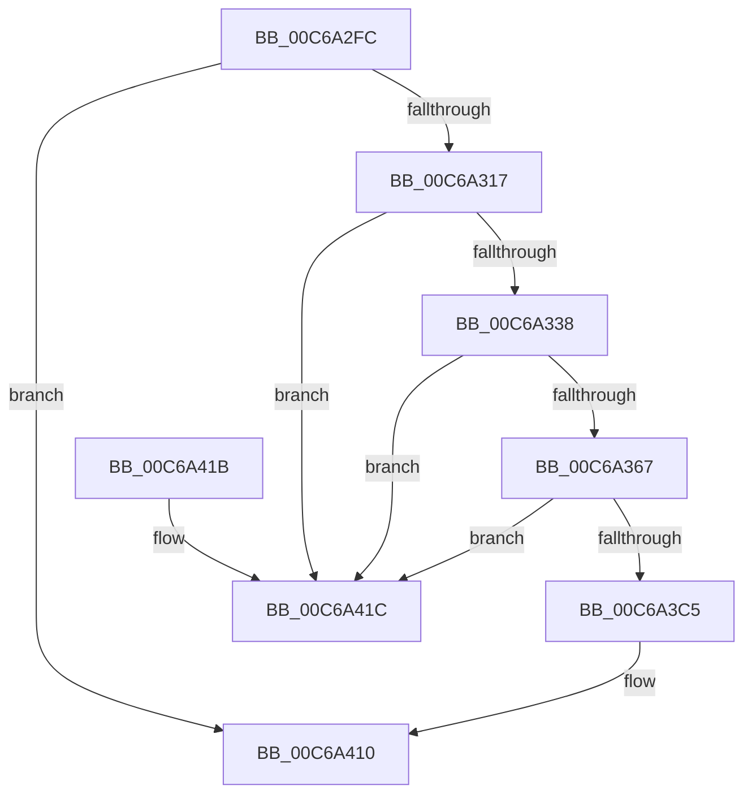

# MiInitializeKernelCfg

- RVA: `0x00C6A2FC`–`0x00C6A427` (길이 `299` bytes)
- VA: `0x0000000140C6A2FC`
- 실행 섹션: `INIT`
- PDB 이름 있음: `예`; PDB Function 태그: `아니요`
- unwind 정보 RVA: `0x000D901C`
- 디코드: `63`개 명령, `299/299` bytes 표시
- 미해석 바이트: `0` (있으면 어셈블리에 `.byte`로 보존)

> 이 문서는 커널 이미지의 기계어와 PDB 기호를 분석해 생성했습니다. 4번과 5번은 함수 원형과 자료형을 바이너리 사용 방식에서 추정한 C 해석이며 원본 소스 복구 결과는 아닙니다.

## 1. Dependencies

- 직접 호출 지점: **7**; 고유 호출 대상: **6**
- 직접 호출자로 확인된 함수: **1**
- RIP 상대 이미지 참조: **9**

### Outgoing calls
- `0x00C6A32A` → [MiReservePtes](../../text/31/MiReservePtes_function_00318D20.md) (function, `0x00318D20`)
- `0x00C6A35A` → [VslInitializeSecureKernelCfg](../../text/58/VslInitializeSecureKernelCfg_function_0058E8A8.md) (function, `0x0058E8A8`)
- `0x00C6A3BC` → [MiMakeZeroedPageTables](../../text/3B/MiMakeZeroedPageTables_function_003B4F6C.md) (function, `0x003B4F6C`)
- `0x00C6A3D9` → [MiEnumerateSystemImages](../../text/2A/MiEnumerateSystemImages_function_002A3D40.md) (function, `0x002A3D40`)
- `0x00C6A3EC` → [MiEnumerateSystemImages](../../text/2A/MiEnumerateSystemImages_function_002A3D40.md) (function, `0x002A3D40`)
- `0x00C6A3F3` → [MiProcessKernelCfgAddressTakenImports](../../page/AD/MiProcessKernelCfgAddressTakenImports_function_00AD4384.md) (function, `0x00AD4384`)
- `0x00C6A421` → [MxInstallMoreMemory](../../text/67/MxInstallMoreMemory_function_00671A04.md) (function, `0x00671A04`)

### Direct callers
- [MiInitializeLoadedModuleList](MiInitializeLoadedModuleList_function_00C6BCDC.md) at `0x00C6BF76`

### Static image references
- `0x00C6A306` → RVA `0x00FC6A88` (`ALMOSTRO`; read)
- `0x00C6A317` → RVA `0x00E38C18` (`.data`; read)
- `0x00C6A31E` → RVA `0x00E37668` (`.data`; read)
- `0x00C6A371` → RVA `0x00E2D818` (`.data`; write)
- `0x00C6A396` → RVA `0x00E2D810` (`.data`; write)
- `0x00C6A3C5` → RVA `0x00E2D820` (`.data`; read/write)
- `0x00C6A3CD` → RVA `0x00C6A430` (`MiInitializeKernelCfgImages`; read)
- `0x00C6A402` → RVA `0x00E2D818` (`.data`; read)
- `0x00C6A409` → RVA `0x012018B8` (`CFGRO`; write)

## 2. Other-region calls and transfers

- 다른 실행 섹션으로 향하는 call: **7**
  - `0x00C6A32A` → [MiReservePtes](../../text/31/MiReservePtes_function_00318D20.md) (`INIT` → `.text`)
  - `0x00C6A35A` → [VslInitializeSecureKernelCfg](../../text/58/VslInitializeSecureKernelCfg_function_0058E8A8.md) (`INIT` → `.text`)
  - `0x00C6A3BC` → [MiMakeZeroedPageTables](../../text/3B/MiMakeZeroedPageTables_function_003B4F6C.md) (`INIT` → `.text`)
  - `0x00C6A3D9` → [MiEnumerateSystemImages](../../text/2A/MiEnumerateSystemImages_function_002A3D40.md) (`INIT` → `.text`)
  - `0x00C6A3EC` → [MiEnumerateSystemImages](../../text/2A/MiEnumerateSystemImages_function_002A3D40.md) (`INIT` → `.text`)
  - `0x00C6A3F3` → [MiProcessKernelCfgAddressTakenImports](../../page/AD/MiProcessKernelCfgAddressTakenImports_function_00AD4384.md) (`INIT` → `PAGE`)
  - `0x00C6A421` → [MxInstallMoreMemory](../../text/67/MxInstallMoreMemory_function_00671A04.md) (`INIT` → `.text`)
- 별도 외부 분기/꼬리 이동을 확인하지 못했습니다.

## 3. Assembly (complete function range)

```asm
00C6A2FC  48 89 5C 24 08                  mov qword ptr [rsp + 8], rbx
00C6A301  56                              push rsi
00C6A302  48 83 EC 20                     sub rsp, 0x20
00C6A306  48 F7 05 77 C7 35 00 00 00 04 00  test qword ptr [rip + 0x35c777], 0x40000
00C6A311  0F 84 F9 00 00 00               je 0x140c6a410
00C6A317  48 8B 1D FA E8 1C 00            mov rbx, qword ptr [rip + 0x1ce8fa]
00C6A31E  48 8D 0D 43 D3 1C 00            lea rcx, [rip + 0x1cd343]
00C6A325  BA 20 00 00 00                  mov edx, 0x20
00C6A32A  E8 F1 E9 6A FF                  call 0x140318d20
00C6A32F  48 85 C0                        test rax, rax
00C6A332  0F 84 E4 00 00 00               je 0x140c6a41c
00C6A338  48 C1 E0 19                     shl rax, 0x19
00C6A33C  48 BE 00 00 00 00 80 F6 FF FF   movabs rsi, 0xfffff68000000000
00C6A346  48 8B CE                        mov rcx, rsi
00C6A349  48 C1 E1 19                     shl rcx, 0x19
00C6A34D  48 2B C1                        sub rax, rcx
00C6A350  48 8B CB                        mov rcx, rbx
00C6A353  48 C1 F8 10                     sar rax, 0x10
00C6A357  48 8B D0                        mov rdx, rax
00C6A35A  E8 49 45 92 FF                  call 0x14058e8a8
00C6A35F  85 C0                           test eax, eax
00C6A361  0F 88 B5 00 00 00               js 0x140c6a41c
00C6A367  48 BA FF FF FF FF FF 01 00 00   movabs rdx, 0x1ffffffffff
00C6A371  48 89 1D A0 34 1C 00            mov qword ptr [rip + 0x1c34a0], rbx
00C6A378  48 03 D3                        add rdx, rbx
00C6A37B  48 B8 00 00 00 00 00 10 00 00   movabs rax, 0x100000000000
00C6A385  48 C1 EA 09                     shr rdx, 9
00C6A389  48 B9 F8 FF FF FF 7F 00 00 00   movabs rcx, 0x7ffffffff8
00C6A393  48 23 D1                        and rdx, rcx
00C6A396  48 89 05 73 34 1C 00            mov qword ptr [rip + 0x1c3473], rax
00C6A39D  48 8B C6                        mov rax, rsi
00C6A3A0  48 C1 EB 09                     shr rbx, 9
00C6A3A4  48 03 D0                        add rdx, rax
00C6A3A7  48 23 CB                        and rcx, rbx
00C6A3AA  48 8B C6                        mov rax, rsi
00C6A3AD  48 03 C8                        add rcx, rax
00C6A3B0  41 B9 08 00 00 00               mov r9d, 8
00C6A3B6  41 B8 00 08 00 00               mov r8d, 0x800
00C6A3BC  E8 AB AB 74 FF                  call 0x1403b4f6c
00C6A3C1  85 C0                           test eax, eax
00C6A3C3  74 57                           je 0x140c6a41c
00C6A3C5  48 83 25 53 34 1C 00 00         and qword ptr [rip + 0x1c3453], 0
00C6A3CD  48 8D 0D 5C 00 00 00            lea rcx, [rip + 0x5c]
00C6A3D4  45 33 C0                        xor r8d, r8d
00C6A3D7  33 D2                           xor edx, edx
00C6A3D9  E8 62 99 63 FF                  call 0x1402a3d40
00C6A3DE  45 33 C0                        xor r8d, r8d
00C6A3E1  48 8D 0D 48 00 00 00            lea rcx, [rip + 0x48]
00C6A3E8  41 8D 50 01                     lea edx, [r8 + 1]
00C6A3EC  E8 4F 99 63 FF                  call 0x1402a3d40
00C6A3F1  33 C9                           xor ecx, ecx
00C6A3F3  E8 8C 9F E6 FF                  call 0x140ad4384
00C6A3F8  48 B9 00 00 00 00 00 02 00 FC   movabs rcx, 0xfc00020000000000
00C6A402  48 03 0D 0F 34 1C 00            add rcx, qword ptr [rip + 0x1c340f]
00C6A409  48 89 0D A8 74 59 00            mov qword ptr [rip + 0x5974a8], rcx
00C6A410  48 8B 5C 24 30                  mov rbx, qword ptr [rsp + 0x30]
00C6A415  48 83 C4 20                     add rsp, 0x20
00C6A419  5E                              pop rsi
00C6A41A  C3                              ret
00C6A41B  CC                              int3
00C6A41C  B9 20 00 00 00                  mov ecx, 0x20
00C6A421  E8 DE 75 A0 FF                  call 0x140671a04
00C6A426  CC                              int3
```

## 4. C-style interpretation (structured pseudocode)

```c
__int64 __fastcall MiInitializeKernelCfg(void)
{
    __int64 result;
    __int64 v_rbx;
    __int64 v_rsp;
    unsigned __int64 v_stack_p8;

    v_stack_p8 = v_rbx;
    v_rsp = (v_rsp) - (32);
    if (((*(unsigned __int64 *)(v_rip + 3524471)) & (0x40000ULL)) == 0) goto loc_00C6A410;
    result = MiReservePtes(v_rip + 1889091, 32, a3, a4);
    if (result == 0) goto loc_00C6A41C;
    result = (result) << (25);
    a1 = (v_rsi) << (25);
    result = (result) - (a1);
    result = (result) >> (16);
    result = VslInitializeSecureKernelCfg(*(unsigned __int64 *)(v_rip + 1894650), result, a3, a4);
    if (sign_flag) goto loc_00C6A41C;
    *(unsigned __int64 *)(v_rip + 1848480) = *(unsigned __int64 *)(v_rip + 1894650);
    a2 = (result) + (*(unsigned __int64 *)(v_rip + 1894650));
    a2 = (a2) >> (9);
    a2 = (a2) & (*(unsigned __int64 *)(v_rip + 1894650));
    *(unsigned __int64 *)(v_rip + 1848435) = result;
    v_rbx = (*(unsigned __int64 *)(v_rip + 1894650)) >> (9);
    a2 = (a2) + (v_rsi);
    a1 = (*(unsigned __int64 *)(v_rip + 1894650)) & (v_rbx);
    a1 = (a1) + (v_rsi);
    result = MiMakeZeroedPageTables(a1, a2, (unsigned int)(0x800ULL), 8);
    if ((unsigned int)(result) == 0) goto loc_00C6A41C;
    a3 = 0;
    a2 = 0;
    result = MiEnumerateSystemImages(v_rip + 92, a2, a3, 8);
    a3 = 0;
    result = MiEnumerateSystemImages(v_rip + 72, a3 + 1, a3, 8);
    a1 = 0;
    result = MiProcessKernelCfgAddressTakenImports(a1, a3 + 1, a3, 8);
    a1 = (a1) + (*(unsigned __int64 *)(v_rip + 1848335));
    *(unsigned __int64 *)(v_rip + 5862568) = a1;
loc_00C6A410:
    v_rsp = (v_rsp) + (32);
    return result;
loc_00C6A41C:
    result = MxInstallMoreMemory(32, a3 + 1, a3, 8);
    return result;
}
```

## 5. (Beta) C Style

```c
void MiInitializeKernelCfg(void)
{
    int64_t result;
    int64_t local_rbx;
    int64_t local_rsp;
    uint64_t v_stack_p8;

    v_stack_p8 = local_rbx;
    local_rsp = (local_rsp) - (32);
    if (((*(uint64_t *)(v_rip + 0x35C777)) & (0x40000ULL)) == 0) goto loc_00C6A410;
    result = MiReservePtes(v_rip + 1889091, 32, a3, a4);
    if (result == 0) goto loc_00C6A41C;
    result = (result) << (25);
    a1 = (local_rsi) << (25);
    result = (result) - (a1);
    result = (result) >> (16);
    result = VslInitializeSecureKernelCfg(*(uint64_t *)(v_rip + 0x1CE8FA), result, a3, a4);
    if (sign_flag) goto loc_00C6A41C;
    *(uint64_t *)(v_rip + 0x1C34A0) = *(uint64_t *)(v_rip + 0x1CE8FA);
    a2 = (result) + (*(uint64_t *)(v_rip + 0x1CE8FA));
    a2 = (a2) >> (9);
    a2 = (a2) & (*(uint64_t *)(v_rip + 0x1CE8FA));
    *(uint64_t *)(v_rip + 0x1C3473) = result;
    local_rbx = (*(uint64_t *)(v_rip + 0x1CE8FA)) >> (9);
    a2 = (a2) + (local_rsi);
    a1 = (*(uint64_t *)(v_rip + 0x1CE8FA)) & (local_rbx);
    a1 = (a1) + (local_rsi);
    result = MiMakeZeroedPageTables(a1, a2, (uint32_t)(0x800ULL), 8);
    if ((uint32_t)(result) == 0) goto loc_00C6A41C;
    a3 = 0;
    a2 = 0;
    result = MiEnumerateSystemImages(v_rip + 92, a2, a3, 8);
    a3 = 0;
    result = MiEnumerateSystemImages(v_rip + 72, a3 + 1, a3, 8);
    a1 = 0;
    result = MiProcessKernelCfgAddressTakenImports(a1, a3 + 1, a3, 8);
    a1 = (a1) + (*(uint64_t *)(v_rip + 0x1C340F));
    *(uint64_t *)(v_rip + 0x5974A8) = a1;
loc_00C6A410:
    local_rsp = (local_rsp) + (32);
    return result;
loc_00C6A41C:
    result = MxInstallMoreMemory(32, a3 + 1, a3, 8);
    return result;
}
```

## 6. Execution-region graph

[열기: 2D/3D 그래프와 함수 탐색 컨트롤 패널](../../../control-panel.html?section=init&rva=0x00C6A2FC&view=graph)

- 2D 그래프는 위에서 아래로 흐르고, 3D 그래프는 빈 공간을 드래그해 회전합니다. Shift+드래그는 이동, 휠은 확대·축소, 함수 노드 선택은 대상 보고서 이동입니다.

### Static fallback


