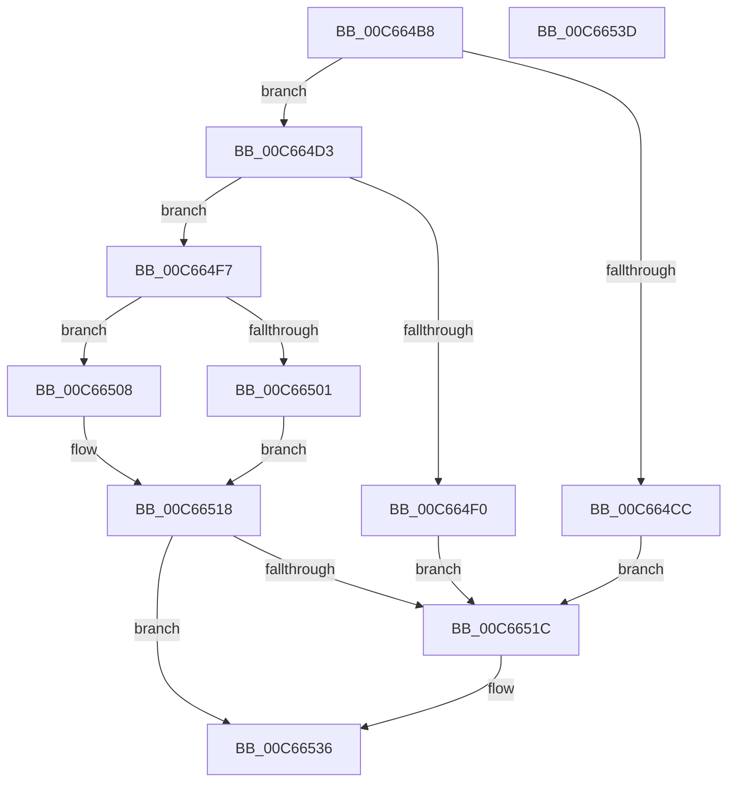

# MiInitializeKernelScp

- RVA: `0x00C664B8`–`0x00C6653E` (길이 `134` bytes)
- VA: `0x0000000140C664B8`
- 실행 섹션: `INIT`
- PDB 이름 있음: `예`; PDB Function 태그: `아니요`
- unwind 정보 RVA: `0x0005D2F4`
- 디코드: `39`개 명령, `134/134` bytes 표시
- 미해석 바이트: `0` (있으면 어셈블리에 `.byte`로 보존)

> 이 문서는 커널 이미지의 기계어와 PDB 기호를 분석해 생성했습니다. 4번과 5번은 함수 원형과 자료형을 바이너리 사용 방식에서 추정한 C 해석이며 원본 소스 복구 결과는 아닙니다.

## 1. Dependencies

- 직접 호출 지점: **4**; 고유 호출 대상: **4**
- 직접 호출자로 확인된 함수: **1**
- RIP 상대 이미지 참조: **3**

### Outgoing calls
- `0x00C664C1` → [MiLockKernelScpSection](MiLockKernelScpSection_function_00C666B8.md) (function, `0x00C666B8`)
- `0x00C664E5` → [RtlCreateKernelScpFunctionTable](../../text/5E/RtlCreateKernelScpFunctionTable_function_005EF118.md) (function, `0x005EF118`)
- `0x00C6650D` → [MiInitializeRetpoline](MiInitializeRetpoline_function_00C66544.md) (function, `0x00C66544`)
- `0x00C66530` → [KeBugCheckEx](../../text/4F/KeBugCheckEx_function_004FD660.md) (function, `0x004FD660`)

### Direct callers
- [MiInitSystem](../C5/MiInitSystem_function_00C5E6C0.md) at `0x00C5E86D`

### Static image references
- `0x00C664D3` → RVA `0x00E2D83C` (`.data`; read)
- `0x00C664DA` → RVA `0x00E2D830` (`.data`; read)
- `0x00C664F7` → RVA `0x00E2D848` (`.data`; read)

## 2. Other-region calls and transfers

- 다른 실행 섹션으로 향하는 call: **2**
  - `0x00C664E5` → [RtlCreateKernelScpFunctionTable](../../text/5E/RtlCreateKernelScpFunctionTable_function_005EF118.md) (`INIT` → `.text`)
  - `0x00C66530` → [KeBugCheckEx](../../text/4F/KeBugCheckEx_function_004FD660.md) (`INIT` → `.text`)
- 별도 외부 분기/꼬리 이동을 확인하지 못했습니다.

## 3. Assembly (complete function range)

```asm
00C664B8  48 83 EC 38                     sub rsp, 0x38
00C664BC  83 64 24 40 00                  and dword ptr [rsp + 0x40], 0
00C664C1  E8 F2 01 00 00                  call 0x140c666b8
00C664C6  8B C8                           mov ecx, eax
00C664C8  85 C0                           test eax, eax
00C664CA  79 07                           jns 0x140c664d3
00C664CC  B8 A2 00 00 00                  mov eax, 0xa2
00C664D1  EB 49                           jmp 0x140c6651c
00C664D3  44 8B 05 62 73 1C 00            mov r8d, dword ptr [rip + 0x1c7362]
00C664DA  48 8B 15 4F 73 1C 00            mov rdx, qword ptr [rip + 0x1c734f]
00C664E1  41 C1 E0 0C                     shl r8d, 0xc
00C664E5  E8 2E 8C 98 FF                  call 0x1405ef118
00C664EA  8B C8                           mov ecx, eax
00C664EC  85 C0                           test eax, eax
00C664EE  79 07                           jns 0x140c664f7
00C664F0  B8 A7 00 00 00                  mov eax, 0xa7
00C664F5  EB 25                           jmp 0x140c6651c
00C664F7  8B 0D 4B 73 1C 00               mov ecx, dword ptr [rip + 0x1c734b]
00C664FD  85 C9                           test ecx, ecx
00C664FF  79 07                           jns 0x140c66508
00C66501  B8 A1 00 00 00                  mov eax, 0xa1
00C66506  EB 10                           jmp 0x140c66518
00C66508  48 8D 4C 24 40                  lea rcx, [rsp + 0x40]
00C6650D  E8 32 00 00 00                  call 0x140c66544
00C66512  8B C8                           mov ecx, eax
00C66514  8B 44 24 40                     mov eax, dword ptr [rsp + 0x40]
00C66518  85 C9                           test ecx, ecx
00C6651A  79 1A                           jns 0x140c66536
00C6651C  45 33 C0                        xor r8d, r8d
00C6651F  4C 63 C9                        movsxd r9, ecx
00C66522  BA 82 10 00 00                  mov edx, 0x1082
00C66527  48 89 44 24 20                  mov qword ptr [rsp + 0x20], rax
00C6652C  41 8D 48 1A                     lea ecx, [r8 + 0x1a]
00C66530  E8 2B 71 89 FF                  call 0x1404fd660
00C66535  CC                              int3
00C66536  8B C1                           mov eax, ecx
00C66538  48 83 C4 38                     add rsp, 0x38
00C6653C  C3                              ret
00C6653D  CC                              int3
```

## 4. C-style interpretation (structured pseudocode)

```c
__int64 __fastcall MiInitializeKernelScp(void)
{
    __int64 result;
    __int64 v_rsp;
    unsigned __int64 v_stack_m18;
    unsigned int v_stack_p8;

    v_rsp = (v_rsp) - (56);
    result = MiLockKernelScpSection(a1, a2, a3, a4);
    if (!sign_flag) goto loc_00C664D3;
    goto loc_00C6651C;
loc_00C664D3:
    a3 = (unsigned int)(((unsigned int)(*(unsigned int *)(v_rip + 1864546))) << (12));
    result = RtlCreateKernelScpFunctionTable((unsigned int)((unsigned int)(result)), *(unsigned __int64 *)(v_rip + 1864527), a3, a4);
    if (!sign_flag) goto loc_00C664F7;
    goto loc_00C6651C;
loc_00C664F7:
    if (!sign_flag) goto loc_00C66508;
    goto loc_00C66518;
loc_00C66508:
    result = MiInitializeRetpoline(v_stack_p8, *(unsigned __int64 *)(v_rip + 1864527), a3, a4);
loc_00C66518:
    result = (unsigned int)(v_stack_p8);
    if (sign_flag) {
        a3 = 0;
        a4 = (int)((unsigned int)((unsigned int)((unsigned int)(result))));
        a2 = 0x1082ULL;
        v_stack_m18 = (unsigned int)(v_stack_p8);
        a1 = a3 + 26;
        result = KeBugCheckEx(a1, a2, a3, a4);
    }
    v_rsp = (v_rsp) + (56);
    return (unsigned int)((unsigned int)(a1));
}
```

## 5. (Beta) C Style

```c
void MiInitializeKernelScp(void)
{
    int64_t result;
    int64_t local_rsp;
    uint64_t v_stack_m18;
    uint32_t v_stack_p8;

    local_rsp = (local_rsp) - (56);
    result = MiLockKernelScpSection(a1, a2, a3, a4);
    if (!sign_flag) goto loc_00C664D3;
    goto loc_00C6651C;
loc_00C664D3:
    a3 = (uint32_t)(((uint32_t)(*(uint32_t *)(v_rip + 0x1C7362))) << (12));
    result = RtlCreateKernelScpFunctionTable((uint32_t)((uint32_t)(result)), *(uint64_t *)(v_rip + 0x1C734F), a3, a4);
    if (!sign_flag) goto loc_00C664F7;
    goto loc_00C6651C;
loc_00C664F7:
    if (!sign_flag) goto loc_00C66508;
    goto loc_00C66518;
loc_00C66508:
    result = MiInitializeRetpoline(v_stack_p8, *(uint64_t *)(v_rip + 0x1C734F), a3, a4);
loc_00C66518:
    result = (uint32_t)(v_stack_p8);
    if (sign_flag) {
        a3 = 0;
        a4 = (int32_t)((uint32_t)((uint32_t)((uint32_t)(result))));
        a2 = 0x1082ULL;
        v_stack_m18 = (uint32_t)(v_stack_p8);
        a1 = a3 + 26;
        result = KeBugCheckEx(a1, a2, a3, a4);
    }
    local_rsp = (local_rsp) + (56);
    return (uint32_t)((uint32_t)(a1));
}
```

## 6. Execution-region graph

[열기: 2D/3D 그래프와 함수 탐색 컨트롤 패널](../../../control-panel.html?section=init&rva=0x00C664B8&view=graph)

- 2D 그래프는 위에서 아래로 흐르고, 3D 그래프는 빈 공간을 드래그해 회전합니다. Shift+드래그는 이동, 휠은 확대·축소, 함수 노드 선택은 대상 보고서 이동입니다.

### Static fallback


