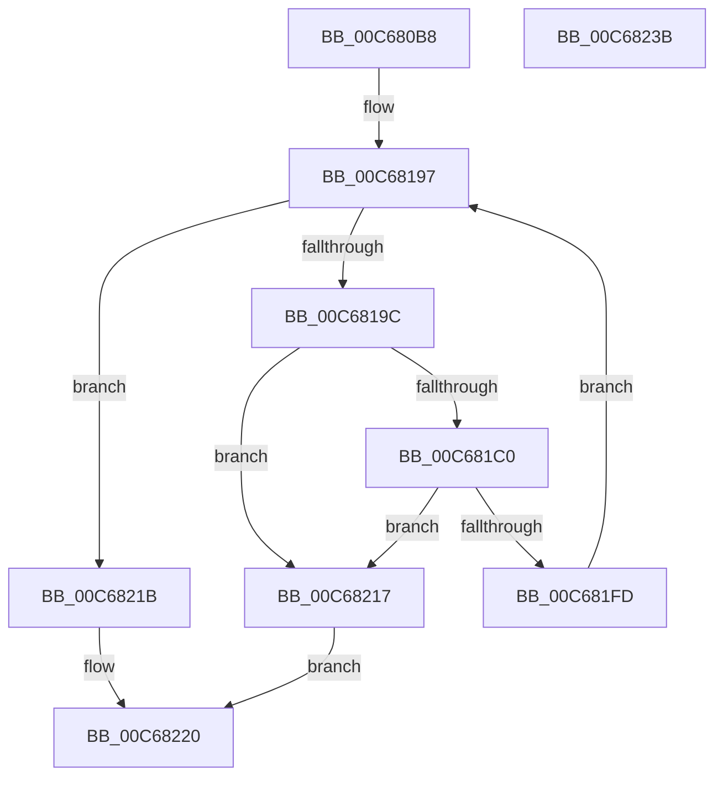

# MiInitializeKernelStacks

- RVA: `0x00C680B8`–`0x00C6823C` (길이 `388` bytes)
- VA: `0x0000000140C680B8`
- 실행 섹션: `INIT`
- PDB 이름 있음: `예`; PDB Function 태그: `아니요`
- unwind 정보 RVA: `0x00060130`
- 디코드: `96`개 명령, `388/388` bytes 표시
- 미해석 바이트: `0` (있으면 어셈블리에 `.byte`로 보존)

> 이 문서는 커널 이미지의 기계어와 PDB 기호를 분석해 생성했습니다. 4번과 5번은 함수 원형과 자료형을 바이너리 사용 방식에서 추정한 C 해석이며 원본 소스 복구 결과는 아닙니다.

## 1. Dependencies

- 직접 호출 지점: **6**; 고유 호출 대상: **4**
- 직접 호출자로 확인된 함수: **1**
- RIP 상대 이미지 참조: **6**

### Outgoing calls
- `0x00C68124` → [MiMarkBootKernelStack](MiMarkBootKernelStack_function_00C68244.md) (function, `0x00C68244`)
- `0x00C6814E` → [MiMarkBootKernelStack](MiMarkBootKernelStack_function_00C68244.md) (function, `0x00C68244`)
- `0x00C68157` → [MiMarkBootGuardPage](../../text/68/MiMarkBootGuardPage_function_0068643C.md) (function, `0x0068643C`)
- `0x00C68160` → [MiMarkBootGuardPage](../../text/68/MiMarkBootGuardPage_function_0068643C.md) (function, `0x0068643C`)
- `0x00C681B7` → [MiInitializeDynamicRegion](MiInitializeDynamicRegion_function_00C65C2C.md) (function, `0x00C65C2C`)
- `0x00C681F4` → [MiInitializePteInfo](MiInitializePteInfo_function_00C6A7E0.md) (function, `0x00C6A7E0`)

### Direct callers
- [MiInitNucleus](../C5/MiInitNucleus_function_00C5FD38.md) at `0x00C6035C`

### Static image references
- `0x00C680ED` → RVA `0x00FC5020` (`ALMOSTRO`; read)
- `0x00C68173` → RVA `0x00E35FA4` (`.data`; write)
- `0x00C6817B` → RVA `0x00FC5000` (`ALMOSTRO`; read)
- `0x00C68185` → RVA `0x00E35E18` (`.data`; read)
- `0x00C6819C` → RVA `0x00E38BA8` (`.data`; read)
- `0x00C681C5` → RVA `0x00E35EE0` (`.data`; read)

## 2. Other-region calls and transfers

- 다른 실행 섹션으로 향하는 call: **2**
  - `0x00C68157` → [MiMarkBootGuardPage](../../text/68/MiMarkBootGuardPage_function_0068643C.md) (`INIT` → `.text`)
  - `0x00C68160` → [MiMarkBootGuardPage](../../text/68/MiMarkBootGuardPage_function_0068643C.md) (`INIT` → `.text`)
- 별도 외부 분기/꼬리 이동을 확인하지 못했습니다.

## 3. Assembly (complete function range)

```asm
00C680B8  48 8B C4                        mov rax, rsp
00C680BB  48 89 58 08                     mov qword ptr [rax + 8], rbx
00C680BF  48 89 68 10                     mov qword ptr [rax + 0x10], rbp
00C680C3  48 89 70 18                     mov qword ptr [rax + 0x18], rsi
00C680C7  48 89 78 20                     mov qword ptr [rax + 0x20], rdi
00C680CB  41 56                           push r14
00C680CD  48 83 EC 40                     sub rsp, 0x40
00C680D1  65 48 8B 34 25 88 01 00 00      mov rsi, qword ptr gs:[0x188]
00C680DA  49 BE F8 FF FF FF 7F 00 00 00   movabs r14, 0x7ffffffff8
00C680E4  65 48 8B 14 25 20 3A 00 00      mov rdx, qword ptr gs:[0x3a20]
00C680ED  8B 05 2D CF 35 00               mov eax, dword ptr [rip + 0x35cf2d]
00C680F3  48 83 C2 50                     add rdx, 0x50
00C680F7  48 8B FA                        mov rdi, rdx
00C680FA  48 BD 00 00 00 00 80 F6 FF FF   movabs rbp, 0xfffff68000000000
00C68104  48 2B F8                        sub rdi, rax
00C68107  48 C1 EF 09                     shr rdi, 9
00C6810B  49 23 FE                        and rdi, r14
00C6810E  48 8B C5                        mov rax, rbp
00C68111  48 C1 EA 09                     shr rdx, 9
00C68115  48 03 F8                        add rdi, rax
00C68118  49 23 D6                        and rdx, r14
00C6811B  48 8B C5                        mov rax, rbp
00C6811E  48 03 D0                        add rdx, rax
00C68121  48 8B CF                        mov rcx, rdi
00C68124  E8 1B 01 00 00                  call 0x140c68244
00C68129  48 8B 5E 30                     mov rbx, qword ptr [rsi + 0x30]
00C6812D  48 C1 EB 09                     shr rbx, 9
00C68131  49 23 DE                        and rbx, r14
00C68134  48 8B C5                        mov rax, rbp
00C68137  48 8B 56 38                     mov rdx, qword ptr [rsi + 0x38]
00C6813B  48 03 D8                        add rbx, rax
00C6813E  48 C1 EA 09                     shr rdx, 9
00C68142  49 23 D6                        and rdx, r14
00C68145  48 8B C5                        mov rax, rbp
00C68148  48 03 D0                        add rdx, rax
00C6814B  48 8B CB                        mov rcx, rbx
00C6814E  E8 F1 00 00 00                  call 0x140c68244
00C68153  48 8D 4B F8                     lea rcx, [rbx - 8]
00C68157  E8 E0 E2 A1 FF                  call 0x14068643c
00C6815C  48 8D 4F F8                     lea rcx, [rdi - 8]
00C68160  E8 D7 E2 A1 FF                  call 0x14068643c
00C68165  8B 05 B5 CE 35 00               mov eax, dword ptr [rip + 0x35ceb5]
00C6816B  BE 0D 00 00 00                  mov esi, 0xd
00C68170  C1 E8 0C                        shr eax, 0xc
00C68173  88 05 2B DE 1C 00               mov byte ptr [rip + 0x1cde2b], al
00C68179  33 DB                           xor ebx, ebx
00C6817B  0F B7 05 7E CE 35 00            movzx eax, word ptr [rip + 0x35ce7e]
00C68182  8D 0C 40                        lea ecx, [rax + rax*2]
00C68185  48 8B 05 8C DC 1C 00            mov rax, qword ptr [rip + 0x1cdc8c]
00C6818C  48 8D 0C C9                     lea rcx, [rcx + rcx*8]
00C68190  48 8D 3C C8                     lea rdi, [rax + rcx*8]
00C68194  8D 46 FC                        lea eax, [rsi - 4]
00C68197  83 FB 02                        cmp ebx, 2
00C6819A  73 7F                           jae 0x140c6821b
00C6819C  48 8D 0D 05 0A 1D 00            lea rcx, [rip + 0x1d0a05]
00C681A3  48 03 C0                        add rax, rax
00C681A6  48 8B 6C C1 08                  mov rbp, qword ptr [rcx + rax*8 + 8]
00C681AB  4C 8B 34 C1                     mov r14, qword ptr [rcx + rax*8]
00C681AF  4C 8B C5                        mov r8, rbp
00C681B2  49 8B D6                        mov rdx, r14
00C681B5  8B CE                           mov ecx, esi
00C681B7  E8 70 DA FF FF                  call 0x140c65c2c
00C681BC  85 C0                           test eax, eax
00C681BE  74 57                           je 0x140c68217
00C681C0  48 89 7C 24 38                  mov qword ptr [rsp + 0x38], rdi
00C681C5  48 8D 05 14 DD 1C 00            lea rax, [rip + 0x1cdd14]
00C681CC  C7 44 24 30 01 00 00 00         mov dword ptr [rsp + 0x30], 1
00C681D4  48 8D 0C 5B                     lea rcx, [rbx + rbx*2]
00C681D8  48 C1 E1 05                     shl rcx, 5
00C681DC  41 B9 05 00 00 00               mov r9d, 5
00C681E2  48 03 C8                        add rcx, rax
00C681E5  48 89 6C 24 28                  mov qword ptr [rsp + 0x28], rbp
00C681EA  45 33 C0                        xor r8d, r8d
00C681ED  4C 89 74 24 20                  mov qword ptr [rsp + 0x20], r14
00C681F2  8B D6                           mov edx, esi
00C681F4  E8 E7 25 00 00                  call 0x140c6a7e0
00C681F9  85 C0                           test eax, eax
00C681FB  74 1A                           je 0x140c68217
00C681FD  0F B7 05 FC CD 35 00            movzx eax, word ptr [rip + 0x35cdfc]
00C68204  FF C3                           inc ebx
00C68206  48 8D 0C C0                     lea rcx, [rax + rax*8]
00C6820A  B8 0F 00 00 00                  mov eax, 0xf
00C6820F  8B F0                           mov esi, eax
00C68211  48 8D 3C CF                     lea rdi, [rdi + rcx*8]
00C68215  EB 80                           jmp 0x140c68197
00C68217  33 C0                           xor eax, eax
00C68219  EB 05                           jmp 0x140c68220
00C6821B  B8 01 00 00 00                  mov eax, 1
00C68220  48 8B 5C 24 50                  mov rbx, qword ptr [rsp + 0x50]
00C68225  48 8B 6C 24 58                  mov rbp, qword ptr [rsp + 0x58]
00C6822A  48 8B 74 24 60                  mov rsi, qword ptr [rsp + 0x60]
00C6822F  48 8B 7C 24 68                  mov rdi, qword ptr [rsp + 0x68]
00C68234  48 83 C4 40                     add rsp, 0x40
00C68238  41 5E                           pop r14
00C6823A  C3                              ret
00C6823B  CC                              int3
```

## 4. C-style interpretation (structured pseudocode)

```c
__int64 __fastcall MiInitializeKernelStacks(void)
{
    __int64 result;
    __int64 v_rbx;
    __int64 v_rdi;
    __int64 v_rsp;
    unsigned __int64 v_stack_m10;
    unsigned int v_stack_m18;
    unsigned __int64 v_stack_m20;
    unsigned __int64 v_stack_m28;
    unsigned __int64 v_stack_p10;
    unsigned __int64 v_stack_p18;
    unsigned __int64 v_stack_p20;
    unsigned __int64 v_stack_p8;

    *(unsigned __int64 *)(v_rsp + 8) = v_rbx;
    *(unsigned __int64 *)(v_rsp + 16) = v_rbp;
    *(unsigned __int64 *)(v_rsp + 24) = v_rsi;
    *(unsigned __int64 *)(v_rsp + 32) = v_rdi;
    v_rsp = (v_rsp) - (64);
    a2 = (*(unsigned __int64 *)(gs_base + (0 + 14880))) + (80);
    v_rdi = (a2) - ((unsigned int)(*(unsigned int *)(v_rip + 3526445)));
    v_rdi = (v_rdi) >> (9);
    v_rdi = (v_rdi) & (v_r14);
    a2 = (a2) >> (9);
    v_rdi = (v_rdi) + (v_rbp);
    a2 = (a2) & (v_r14);
    a2 = (a2) + (v_rbp);
    result = MiMarkBootKernelStack(v_rdi, a2, a3, a4);
    v_rbx = (*(unsigned __int64 *)(*(unsigned __int64 *)(gs_base + (0 + 392)) + 48)) >> (9);
    v_rbx = (v_rbx) & (v_r14);
    v_rbx = (v_rbx) + (v_rbp);
    a2 = (*(unsigned __int64 *)(*(unsigned __int64 *)(gs_base + (0 + 392)) + 56)) >> (9);
    a2 = (a2) & (v_r14);
    a2 = (a2) + (v_rbp);
    result = MiMarkBootKernelStack(v_rbx, a2, a3, a4);
    result = MiMarkBootGuardPage(v_rbx - 8, a2, a3, a4);
    result = MiMarkBootGuardPage(v_rdi - 8, a2, a3, a4);
    result = (unsigned int)(((unsigned int)(*(unsigned int *)(v_rip + 3526325))) >> (12));
    *(unsigned __int8 *)(v_rip + 1891883) = (unsigned __int8)(result);
    v_rbx = 0;
loc_00C68197:
    if (0 >= 2) goto loc_00C6821B;
    result = (13 - 4) + (13 - 4);
    result = MiInitializeDynamicRegion(13, *(unsigned __int64 *)(v_rip + 1903109 + result * 8), *(unsigned __int64 *)(v_rip + 1903109 + result * 8 + 8), a4);
    if ((unsigned int)(result) == 0) goto loc_00C68217;
    v_stack_m10 = *(unsigned __int64 *)(v_rip + 1891468) + *(unsigned __int16 *)(v_rip + 3526270) + *(unsigned __int16 *)(v_rip + 3526270) * 2 + *(unsigned __int16 *)(v_rip + 3526270) + *(unsigned __int16 *)(v_rip + 3526270) * 2 * 8 * 8;
    v_stack_m18 = 1;
    a1 = (v_rbx + v_rbx * 2) << (5);
    a1 = (a1) + (v_rip + 1891604);
    v_stack_m20 = *(unsigned __int64 *)(v_rip + 1903109 + result * 8 + 8);
    a3 = 0;
    v_stack_m28 = *(unsigned __int64 *)(v_rip + 1903109 + result * 8);
    result = MiInitializePteInfo(a1, 13, a3, 5);
    if ((unsigned int)(result) == 0) goto loc_00C68217;
    v_rbx = (unsigned int)((v_rbx) + 1);
    goto loc_00C68197;
loc_00C68217:
    result = 0;
    goto loc_00C68220;
loc_00C6821B:
loc_00C68220:
    v_rsp = (v_rsp) + (64);
    return 1;
}
```

## 5. (Beta) C Style

```c
void MiInitializeKernelStacks(void)
{
    int64_t result;
    int64_t local_rbx;
    int64_t local_rdi;
    int64_t local_rsp;
    uint64_t v_stack_m10;
    uint32_t v_stack_m18;
    uint64_t v_stack_m20;
    uint64_t v_stack_m28;
    uint64_t v_stack_p10;
    uint64_t v_stack_p18;
    uint64_t v_stack_p20;
    uint64_t v_stack_p8;

    *(uint64_t *)(local_rsp + 0x8) = local_rbx;
    *(uint64_t *)(local_rsp + 0x10) = local_rbp;
    *(uint64_t *)(local_rsp + 0x18) = local_rsi;
    *(uint64_t *)(local_rsp + 0x20) = local_rdi;
    local_rsp = (local_rsp) - (64);
    a2 = (*(uint64_t *)(gs_base + (0 + 0x3A20))) + (80);
    local_rdi = (a2) - ((uint32_t)(*(uint32_t *)(v_rip + 0x35CF2D)));
    local_rdi = (local_rdi) >> (9);
    local_rdi = (local_rdi) & (local_r14);
    a2 = (a2) >> (9);
    local_rdi = (local_rdi) + (local_rbp);
    a2 = (a2) & (local_r14);
    a2 = (a2) + (local_rbp);
    result = MiMarkBootKernelStack(local_rdi, a2, a3, a4);
    local_rbx = (*(uint64_t *)(*(uint64_t *)(gs_base + (0 + 0x188)) + 0x30)) >> (9);
    local_rbx = (local_rbx) & (local_r14);
    local_rbx = (local_rbx) + (local_rbp);
    a2 = (*(uint64_t *)(*(uint64_t *)(gs_base + (0 + 0x188)) + 0x38)) >> (9);
    a2 = (a2) & (local_r14);
    a2 = (a2) + (local_rbp);
    result = MiMarkBootKernelStack(local_rbx, a2, a3, a4);
    result = MiMarkBootGuardPage(local_rbx - 8, a2, a3, a4);
    result = MiMarkBootGuardPage(local_rdi - 8, a2, a3, a4);
    result = (uint32_t)(((uint32_t)(*(uint32_t *)(v_rip + 0x35CEB5))) >> (12));
    *(uint8_t *)(v_rip + 0x1CDE2B) = (uint8_t)(result);
    local_rbx = 0;
loc_00C68197:
    if (0 >= 2) goto loc_00C6821B;
    result = (13 - 4) + (13 - 4);
    result = MiInitializeDynamicRegion(13, *(uint64_t *)(v_rip + 0x1D0A05 + result * 8), *(uint64_t *)(v_rip + 0x1D0A05 + result * 8 + 0x8), a4);
    if ((uint32_t)(result) == 0) goto loc_00C68217;
    v_stack_m10 = *(uint64_t *)(v_rip + 0x1CDC8C) + *(uint16_t *)(v_rip + 0x35CE7E) + *(uint16_t *)(v_rip + 0x35CE7E) * 2 + *(uint16_t *)(v_rip + 0x35CE7E) + *(uint16_t *)(v_rip + 0x35CE7E) * 2 * 8 * 8;
    v_stack_m18 = 1;
    a1 = (local_rbx + local_rbx * 2) << (5);
    a1 = (a1) + (v_rip + 1891604);
    v_stack_m20 = *(uint64_t *)(v_rip + 0x1D0A05 + result * 8 + 0x8);
    a3 = 0;
    v_stack_m28 = *(uint64_t *)(v_rip + 0x1D0A05 + result * 8);
    result = MiInitializePteInfo(a1, 13, a3, 5);
    if ((uint32_t)(result) == 0) goto loc_00C68217;
    local_rbx = (uint32_t)((local_rbx) + 1);
    goto loc_00C68197;
loc_00C68217:
    result = 0;
    goto loc_00C68220;
loc_00C6821B:
loc_00C68220:
    local_rsp = (local_rsp) + (64);
    return 1;
}
```

## 6. Execution-region graph

[열기: 2D/3D 그래프와 함수 탐색 컨트롤 패널](../../../control-panel.html?section=init&rva=0x00C680B8&view=graph)

- 2D 그래프는 위에서 아래로 흐르고, 3D 그래프는 빈 공간을 드래그해 회전합니다. Shift+드래그는 이동, 휠은 확대·축소, 함수 노드 선택은 대상 보고서 이동입니다.

### Static fallback


